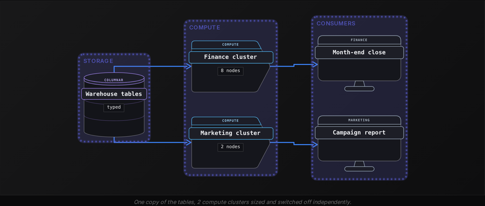
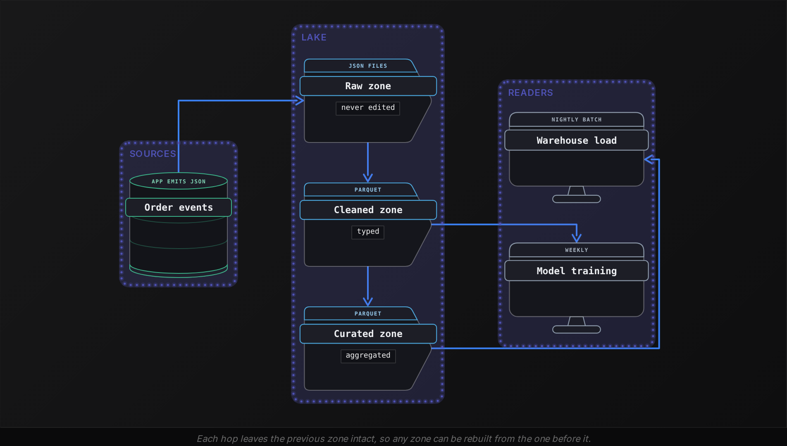
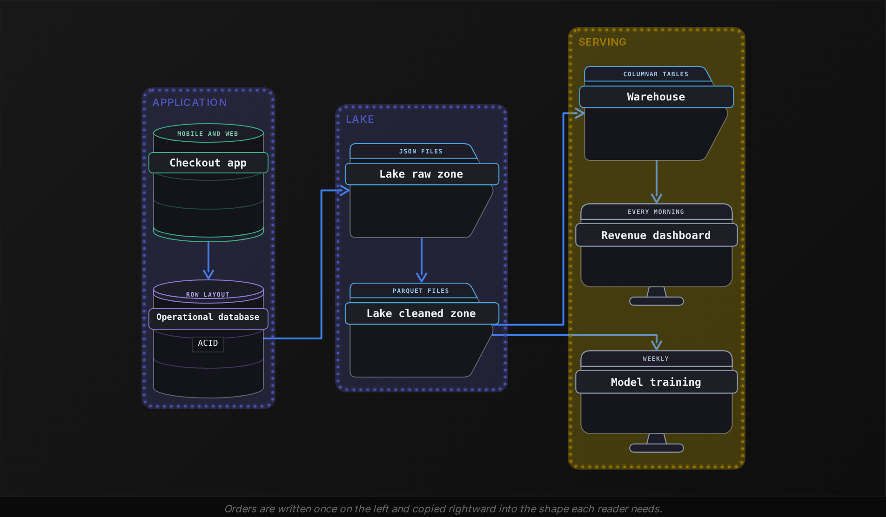

# Storage Layers: Beginner

At 6:40 pm, the dinner peak at DoorDash, an analyst is about to run last month's revenue-by-city query. The orders live in 3 places: the live database checkout writes to, raw event files in a lake, and a warehouse. Pick the live database and checkouts stall behind the scan; pick the warehouse and the answer arrives in seconds.


<br>

---

## Storage Is Not Just the Database

In Pipeline Anatomy the storage role was a single box: the place data lands so a consumer can read it. Open that box at any company past its first year and you find several systems holding the same data in several shapes. A food delivery app taking 2 million orders a day keeps each order in 3 places, because 3 different readers need it in 3 different forms.

The checkout screen needs every field of 1 order right now, and it has to change that order the moment a courier picks it up. An analyst needs 60 million orders from last month, 3 columns each, summed by city. A data scientist needs every raw order event from the last 2 years, including the fields nobody has cleaned yet, to test a delivery time model. No single layout on disk serves all 3 reads well, so storage splits into shapes.

| Shape | What it holds | Who reads it | Typical read |
| --- | --- | --- | --- |
| Operational database | The live orders, 1 row per order, changed as the order moves | The app itself | Fetch or update 1 order by its id in a few milliseconds |
| Data warehouse | Cleaned, typed tables of orders and customers | Analysts, dashboards | Sum 60 million orders by city in seconds |
| Data lake | Raw files of every order event as received, plus cleaned copies | Pipelines, data scientists | Reread 2 years of files with a new rule |


<br>

### One order in 3 shapes

Here is order 8841207 as the operational database holds it: 1 row, every column, found by its id.

| order_id | customer_id | city | total_cents | status | placed_at |
| --- | --- | --- | --- | --- | --- |
| 8841207 | 55018 | Austin | 2499 | delivered | 2026-10-22 18:41:03 |

The lake holds the same order as the events the app emitted while the order moved: 1 JSON object per event, written into a file alongside thousands of neighbours and never edited again. The first event looks like this.

```sql
{
  "event": "order_placed",
  "order_id": 8841207,
  "customer_id": 55018,
  "city": "Austin",
  "total_cents": 2499,
  "ts": "2026-10-22T18:41:03Z",
  "app_version": "7.12.0"
}
```

The warehouse holds it as a slice through a column. Every order's `total_cents` sits together on disk, every `city` sits together, and a query summing revenue by city reads those 2 slices and touches nothing else. Order 8841207 is in there, but a query asking for it by id has to search a column of 1.4 billion ids to find it, then gather its other fields from 5 more columns. The layout that makes sums fast makes a single lookup slow, and that trade is the whole reason the shapes differ.


<br>

### Why one shape cannot do every job

A disk hands back bytes in order, so whatever sits next to each other on disk is cheap to read together. Put a whole row together and 1 lookup is cheap, while a sum over 1 column drags every other column along for the ride. Put a whole column together and the sum is cheap, while 1 lookup has to visit every column separately. Files in a lake sit in a third arrangement: whole files written once. They are cheap to store and to reread end to end, but there's no index to find 1 record. Each arrangement wins 1 kind of read by giving up the others.

Keeping 3 copies of every order sounds wasteful until you price the alternatives. Storage for 1.4 billion orders costs less per month than 1 engineer's afternoon, while a checkout that waits behind an analyst's query costs orders. A pipeline's job is often to carry data from one layer to the next: out of the operational database, into the lake as files, then into the warehouse as tables. The batch versus streaming choice sets how often that movement runs; this lesson sets where the data lands.

> **TIP**
>
> When someone says 'the database', ask which one. The answer tells you what read they expect: 1 row by key, millions of rows aggregated, or raw files to reread.

**The marketing team wants average order value per city for the last 90 days, refreshed every morning. Which storage shape should the query run against?**

- **A.** The operational database, because it holds the most current orders with every column present.
- **B.** The data warehouse, because the daily query averages total_cents by city, reading 3 columns across millions of rows.
- **C.** The data lake's raw zone, because the JSON files hold every order event ever emitted.
- **D.** A summary table inside the operational database, loaded each night with the 90 day totals.

<details>
<summary>Solution</summary>

**B.** The data warehouse, because the daily query averages total_cents by city, reading 3 columns across millions of rows.

The warehouse stores each column together, so grouping city and averaging total_cents reads 2 columns plus the date column for the filter and skips the rest. A daily refresh matches a nightly batch load.

**Why the others are wrong**

- **A.** Current, yes, but the query reads 180 million rows while checkouts write to the same disk. The report slows the app and the app slows the report.
- **C.** The raw files do hold the data, but each query parses every field of every JSON object. The raw zone is for reprocessing, and this question runs every morning.
- **D.** A summary table there still puts a nightly scan of 180 million rows next to checkout traffic. The summary belongs in the warehouse with the other aggregates.

</details>


<br>

---

## The Data Warehouse

A data warehouse is a storage layer built for 1 kind of read: scan many rows, a few columns at a time, and aggregate them. It is good at that because of 3 properties, and you can identify a warehouse by them: a columnar layout, a schema the system enforces, and storage kept separate from compute.


<br>

### Columnar layout

Take the orders table with its 6 columns. A row layout writes order 8841201 in full, then 8841202 in full, and so on down the disk. A columnar layout writes every order_id, then every customer_id, then every city, each column in its own run of bytes.

Row layout: what sits together

| Position | Bytes stored |
| --- | --- |
| 1 | 8841201, 55010, Austin, 1899, delivered, 2026-10-22 18:40:11 |
| 2 | 8841202, 55011, Denver, 3250, delivered, 2026-10-22 18:40:19 |
| 3 | 8841203, 55012, Chicago, 4100, placed, 2026-10-22 18:40:27 |

Columnar layout: what sits together

| Column | Bytes stored |
| --- | --- |
| order_id | 8841201, 8841202, 8841203, ... |
| city | Austin, Denver, Chicago, ... |
| total_cents | 1899, 3250, 4100, ... |
| status | delivered, delivered, placed, ... |

Now run the morning dashboard's query: revenue by city for the last 30 days.

```sql
SELECT
  city,
  SUM(total_cents) AS revenue_cents
FROM orders
WHERE placed_at >= TIMESTAMP '2026-09-22 00:00:00'
GROUP BY city
```

The query names 3 columns, `city` along with `total_cents` and `placed_at`. In the row layout the disk reads every byte of all 6 columns, because the 3 the query wants are interleaved with the 3 it does not. In the columnar layout the disk reads the 3 column runs and skips the other 3, about half the bytes. A real orders table at a mature product carries 40 to 60 columns while a dashboard query reads 3 or 4, so the saving grows with the width of the table. Over 60 million orders, that is the difference between a query that returns in seconds and one that returns in minutes.


<br>

### Enforced schema

A warehouse table declares its columns and their types before a single row arrives, and it rejects any row that breaks the declaration.

```sql
CREATE TABLE orders (
  order_id BIGINT,
  customer_id BIGINT,
  city VARCHAR,
  total_cents BIGINT,
  status VARCHAR,
  placed_at TIMESTAMP
)
```

With `total_cents` declared as `BIGINT`, a load that tries to insert the string 'twenty-four ninety-nine' fails at the table's edge and the analyst's `SUM` never meets a string. Dozens of dashboards and hundreds of saved queries lean on those types, and 1 wrong row would break all of them at once. The price is that changing a column's shape takes a deliberate step, which a warehouse team pays so every reader can trust every type.


<br>

### Storage separated from compute

In older warehouse designs 1 machine, or 1 fixed cluster, held both the disks and the processors. When finance ran month-end at the same hour marketing analysed a campaign, both fought for the same processors and both slowed down, and adding capacity meant buying a bigger machine for everyone. A modern warehouse keeps table data in a storage service and runs queries on compute clusters that attach to that storage on demand. Finance gets a cluster, marketing gets another, both read the same tables with no copy, and a cluster sitting idle is switched off and billed nothing while the tables stay put.




<br>

### Workloads every warehouse carries

- **Daily revenue dashboard** *Scan millions of rows, return a few hundred numbers*\
  Runs every morning after the overnight load and reads 3 or 4 columns.
- **Month-end finance close** *Join orders, refunds and courier payouts*\
  Needs every amount typed as a number and every date typed as a date, because the result goes to the auditors.
- **Experiment analysis** *Compare conversion between 2 app variants*\
  Groups weeks of orders by the variant each customer saw, a read that touches 2 or 3 columns across tens of millions of rows.

> **TIP**
>
> If a team describes a system by its typed tables and the clusters they spin up to query them, you are looking at a warehouse, whatever it is called.

**The warehouse's columnar layout speeds up some reads far more than others. Which of these queries gains the least from it?**

- **A.** SUM(total_cents) grouped by status over every order placed in the last year
- **B.** COUNT(*) of orders per city per day for all of 2025
- **C.** AVG(total_cents) for every order delivered in Denver
- **D.** SELECT * for order 8841207, found by its order_id

<details>
<summary>Solution</summary>

**D.** SELECT * for order 8841207, found by its order_id

The query wants every column of 1 row, so the engine searches the order_id run for the match, then fetches that position from 5 other column runs. The operational database does this in milliseconds.

**Why the others are wrong**

- **A.** Reads 3 columns out of 6 and skips the rest across 730 million rows. This is the read columnar layout exists for.
- **B.** Reads city and placed_at and skips 4 columns. The count needs no other column, so most of the table is never touched.
- **C.** Reads total_cents along with city and status, half of the 6 columns, and skips the rest. The layout halves the bytes read.

</details>


<br>

---

## The Data Lake

A data lake is files in object storage. Object storage is a service that keeps each file as an object under a key that looks like a path. It writes an object whole and can read back all of it or a part, but it never edits an object in place: to change a file you write a new one. Its price per terabyte is a small fraction of a database disk, and it holds any format you hand it, so the lake becomes the place a company keeps everything it might want later.

| Zone | Example path | Format | Written by |
| --- | --- | --- | --- |
| Raw | lake/orders/raw/2026-10-22/events-0001.json | JSON, exactly as received | Ingestion pipeline |
| Cleaned | lake/orders/cleaned/2026-10-22/part-0001.parquet | Parquet, typed, 1 record per event | Cleaning job |
| Curated | lake/orders/curated/daily_city_revenue/2026-10-22/part-0000.parquet | Parquet, aggregated for a use | Modelling job |


<br>

### Zones

A lake without structure turns into a swamp nobody trusts, so teams divide it into zones with 1 rule each. Raw holds data exactly as it arrived and is never changed, so the original is always there to go back to. Cleaned holds the same records with types applied, broken records set aside and duplicates removed. Curated holds data shaped for 1 consumer, such as daily revenue per city or a feature file for the delivery time model. Names vary between companies, but the 3 jobs stay the same.



The raw zone justifies its storage bill the first time something goes wrong upstream. In June the app shipped a version that wrote `total_cents` in dollars for 3 days, so every cleaned file for those days held totals 100 times too small. The raw events were untouched. The team fixed the cleaning rule and reran it over those 3 days, which rebuilt the cleaned and curated zones with the right totals. Had the lake only kept cleaned data, the original amounts would have been gone.


<br>

### Why Parquet

Raw files arrive in whatever format the source speaks: CSV from a partner, JSON from the app. From the cleaned zone on, the lake converts to Parquet, which applies the warehouse's columnar idea inside a file.

| Format | Layout inside the file | Types | Reading 3 of 40 fields |
| --- | --- | --- | --- |
| CSV | 1 line per record, fields separated by commas | None, everything is text | Reads every byte of every line |
| JSON | 1 object per record, field names repeated in each | None enforced | Reads and parses every byte of every object |
| Parquet | Values grouped by column, with a footer describing the file | Written into the file | Reads the 3 column groups and skips 37 |

Take 1 day of 2 million order events with 40 fields each. As JSON every record repeats all 40 field names, so at roughly 600 bytes per record the day comes to around 1.2 GB. Parquet writes each field name once per file and compresses similar values stored next to each other, so the same day commonly lands at a quarter of that size or less. A query that reads 3 fields then touches 3 small column groups instead of 1.2 GB of text, and takes each field's type from the footer.

| ✓ Do | ✗ Don't |
| --- | --- |
| • Land data in raw exactly as received, in its original format<br><br>• Convert to Parquet in the cleaned zone and read Parquet from there on<br><br>• Name zones so a path tells you what has been done to the data | • Edit a file in the raw zone, ever<br><br>• Run daily reports against JSON or CSV when a Parquet copy exists<br><br>• Skip zones and write a consumer's table straight from raw |

**A data scientist wants 18 months of order events to test a delivery time model, including 3 fields the cleaning job drops because no dashboard uses them. Where should she read?**

- **A.** The raw zone, because it keeps every field of every event exactly as it arrived.
- **B.** The cleaned zone, because it holds every event as typed Parquet for fast scans.
- **C.** The warehouse orders table, because it holds 18 months of history with enforced types.
- **D.** The operational database, because it is the original source of every order.

<details>
<summary>Solution</summary>

**A.** The raw zone, because it keeps every field of every event exactly as it arrived.

The dropped fields survive only in raw, and 18 months of files sit there untouched. Reading JSON is slower than Parquet, but the read runs once.

**Why the others are wrong**

- **B.** Cleaned is typed and fast, and that's where the 3 fields were dropped. The speed does not help when the columns she needs are absent.
- **C.** The warehouse is loaded from cleaned, so it has the same gap, and it keeps 1 row per order, while she wants the events behind each order.
- **D.** The live database keeps the current state of each order, so events from 18 months ago were overwritten as statuses changed, and an 18 month scan would slow checkouts.

</details>


<br>

---

## The Operational Database

The operational database is the storage layer the application itself talks to. When a customer taps Place Order, the app inserts 1 row; a courier accepting the order updates that row, and a refresh of the tracking screen reads it. Each of those happens hundreds of times a second across the fleet, and each has to finish fast enough that the person holding the phone never notices.

| Operation | Rows touched | Columns touched | Time allowed |
| --- | --- | --- | --- |
| Place order | 1 insert | All 6 | Under 50 ms |
| Courier picks up | 1 update | status | Under 50 ms |
| Customer views order | 1 read | All 6 | Under 50 ms |
| Monthly revenue by city | 1.4 billion reads | 3 | Minutes, taken from the rows above |


<br>

### Row layout, built for one record

Every operation above wants 1 record, often with all its columns, so the operational database stores each row's columns together on disk. One read brings back the whole order. An index on `order_id` lets the database jump to that row's position without reading its neighbours, the way a book's index sends you to 1 page. The same layout that cost the warehouse in the previous section is exactly right here, because nobody at checkout wants a column.


<br>

### ACID transactions

Placing an order changes more than 1 row. The app inserts the order, decrements the restaurant's count of a limited dish and records the payment, and those 3 writes have to behave as 1. The operational database wraps them in a transaction and promises 4 properties, remembered by the letters ACID.

- **Atomic** *All or nothing*\
  If the payment write fails, the order insert and the stock decrement both roll back, so no half-order is left behind.
- **Consistent** *Rules hold after every transaction*\
  A stock count declared non-negative never goes below 0, and every order's customer_id points to a real customer.
- **Isolated** *Concurrent transactions do not see each other mid-flight*\
  If 2 customers order the last portion at the same instant, they do not both receive it; 1 waits and sees the count at 0.
- **Durable** *Committed means saved*\
  Once the app receives the commit, a power loss 1 second later does not lose the order.

| Step | Write | If this step fails |
| --- | --- | --- |
| 1 | Insert the order row | Nothing has been written; the customer sees an error |
| 2 | Decrement the dish's stock count | Step 1 rolls back; no order without stock |
| 3 | Record the payment | Steps 1 and 2 roll back; no stock lost without payment |
| 4 | Commit | All 3 writes become permanent together |


<br>

### OLTP: thousands of tiny operations

This access pattern has a name: online transaction processing, OLTP. It means many operations per second, each touching a handful of rows by key and needing an answer in milliseconds, and any of them may be a write. The database is tuned for it: indexes to find rows, locks to keep transactions isolated, and a log that makes commits durable. Those features cost something on every operation, which is fine when the operation touches 1 row and ruinous when it touches 1.4 billion.

- **450** — checkout writes per second at peak
- **9 min** — a revenue query on the live database


<br>

### Why the analytical query belongs elsewhere

One Tuesday an analyst pointed the monthly revenue query at the live database at 6:40 in the evening, the dinner peak. With no index on `placed_at`, the database had no way to skip to last month, so it read all 6 columns of all 1.4 billion orders to sum 1 column of 60 million of them. The read held disk and processor until 6:49, and in that window the slowest checkouts went from 40 ms to over 2 seconds. Customers saw spinners and some gave up. The query returned a correct number; it ran in the wrong place.

The remedy is the pipeline shape you already know. A batch job copies the day's new and changed orders out each night, or a stream carries each change within seconds, and the copy lands in the lake and the warehouse. Analysts read the copy, and so do the dashboards and models. The operational database goes back to the job it does well: serving 1 row right now under 4 guarantees.

**Each of 4 teams proposes a read against the live operational database. Which one is the read it handles well?**

- **A.** Count the orders each city placed in each hour across the last 12 months, for a seasonality chart.
- **B.** Join orders to refunds to find every customer refunded more than 3 times since launch.
- **C.** Fetch order 8841207 by its id and set its status to picked_up when the courier confirms.
- **D.** List the 100 restaurants with the highest average order value since the app launched.

<details>
<summary>Solution</summary>

**C.** Fetch order 8841207 by its id and set its status to picked_up when the courier confirms.

This read uses the index to find 1 row, then writes it back; the customer sees the change the instant it commits. Row layout and the index on order_id, backed by the transaction guarantees, are built for exactly this.

**Why the others are wrong**

- **A.** That read scans every row of the year, all columns in row layout, and holds the disk for minutes while checkouts wait. It belongs in the warehouse.
- **B.** A join across 2 full tables reads 1.4 billion rows plus refunds. The warehouse holds both tables with typed columns and reads only the columns the join needs.
- **D.** Averaging total_cents across 1.4 billion rows and ranking restaurants scans the whole table. Run it on the warehouse copy, where it reads 2 columns.

</details>


<br>

---

## Picking the Right Storage Shape

Picking a shape for a new workload comes down to 3 questions, asked in order: how will the data be read, how fresh does it need to be, and how much of it is there. The answers usually point at 1 shape, and when they point at 2, the second is a copy fed by a pipeline.

| Question | If the answer is | Points toward |
| --- | --- | --- |
| Access pattern | 1 row by key, read and written by the app | Operational database |
| Access pattern | Many rows, few columns, summed or counted | Data warehouse |
| Access pattern | Whole files reread, raw fields kept for years, formats mixed | Data lake |
| Freshness | The instant it is written | Operational database, where the write happens |
| Freshness | Minutes to hours behind the write | Warehouse or lake, fed by a batch or streaming copy |
| Freshness | Days old is fine; read once or rarely | Data lake |
| Scale | Gigabytes of hot, changing rows | Operational database |
| Scale | Terabytes of typed tables | Data warehouse |
| Scale | Terabytes to petabytes, mixed formats, each byte read rarely | Data lake |

The operational database is the freshest copy by definition, which tempts people to read it for everything. Ask instead whether the consumer can tell the difference. A dashboard opened at 9 am and compared with yesterday can't tell whether the orders are 10 seconds or 10 hours old, so it belongs on a warehouse loaded overnight. A courier deciding which door to knock on can tell, so that read stays on the operational database.


<br>

### Placing 5 workloads

| Workload | Access | Freshness | Scale | Shape |
| --- | --- | --- | --- | --- |
| Courier app shows 1 order | 1 row by id, then an update | Now | Gigabytes, hot | Operational database |
| Morning revenue dashboard | Sum 3 columns over 60 million rows | Daily | Terabytes | Warehouse |
| Train a delivery time model on 2 years of events | Every field of every file | Weekly | Tens of terabytes | Lake, raw and cleaned |
| Month-end finance close | Typed joins across 3 tables | Monthly | Terabytes | Warehouse |
| Fix a cleaning rule and rebuild 3 days | Reread the original files | Once | Terabytes | Lake, raw zone |



Read the diagram left to right. The operational database is the only place a person writes an order. Everything to its right is a copy carried by a nightly batch or a stream, and each reader takes the copy whose shape and freshness fit its need.

**A support agent has a customer on the phone and needs to see the customer's 5 most recent orders, each with its current status. Where should the support tool read?**

- **A.** The warehouse, because it holds every order with typed columns the tool can trust.
- **B.** The lake's cleaned zone, because the Parquet files hold every order event in order.
- **C.** The lake's curated zone, because a per-customer table could be built for support.
- **D.** The operational database, because it has the current status and finds rows by customer_id in milliseconds.

<details>
<summary>Solution</summary>

**D.** The operational database, because it has the current status and finds rows by customer_id in milliseconds.

The tool needs 5 indexed rows, current as of now, including the status the courier set seconds ago. That's the OLTP read the operational database is built for: 5 indexed lookups.

**Why the others are wrong**

- **A.** The warehouse copy is loaded overnight, so an order placed 20 minutes ago is missing and a status changed this morning is stale. The agent would tell the customer wrong things.
- **B.** Finding 5 orders for 1 customer means scanning files, since a folder of Parquet has no index on customer_id. The customer waits seconds to minutes.
- **C.** A curated table is still a copy refreshed on a schedule, so the current status is as stale as the last job. Support needs the write itself.

</details>


<br>

### 3 placement mistakes

> Mismatches and what they cost
>
> - Dashboard on the operational database: a 9 minute scan steals disk from checkouts, and shoppers see spinners.
> - Checkout on the warehouse: columnar storage is built for bulk loads, so 1-row inserts are slow and a shopper will not wait.
> - Raw clickstream in the warehouse: 50 billion untyped events a month pay warehouse prices and pass schema enforcement before anyone has agreed a schema.

Each layer you add is also a pipeline you own, so add a shape when its question arrives. A new app with 2 GB of orders can run its morning report on a nightly copy of the operational database for a year. The warehouse arrives when that report takes minutes, and the lake when someone needs events a cleaning rule threw away or untyped events pile up. Pipeline Anatomy's test for when a pipeline is not needed applies to storage layers too.

**The app team wants to capture every tap and scroll, about 50 billion events a month with no agreed fields yet. For the first quarter, only 1 exploring team reads them. Where should the events land first?**

- **A.** A warehouse table with every field declared as VARCHAR, so the schema can be fixed later.
- **B.** The lake's raw zone as files, in whatever format the app emits them.
- **C.** An events table in the operational database, next to orders, so the app writes once.
- **D.** The lake's curated zone as Parquet aggregates, counting taps per screen per day.

<details>
<summary>Solution</summary>

**B.** The lake's raw zone as files, in whatever format the app emits them.

Tens of terabytes a month and growing, changing fields, 1 exploratory reader, no freshness demand: every answer points at the lake. Once the fields settle, a cleaning job writes Parquet and the warehouse loads what dashboards need.

**Why the others are wrong**

- **A.** That is 50 billion rows a month at warehouse prices, behind a schema nobody can define yet, so the declared columns would be wrong within weeks.
- **C.** That means 50 billion inserts a month into the database that serves checkout, with every write paying for indexes and durability. Checkout latency would climb within days.
- **D.** Aggregating before anyone knows which fields matter throws away the detail the exploring team came for. Curated tables come after raw and cleaned, never instead of them.

</details>


<br>

---

## Putting It All Together

The food delivery app launches a loyalty programme: every tenth order ships with free delivery. The checkout screen must show a customer's progress toward the next free delivery as they order. Finance needs the monthly cost of free deliveries by city for the board. The data science team wants 18 months of raw order events, including app version and device, to predict which customers the programme will keep.

- The progress counter is read and written at checkout, 1 row per customer, in the same transaction as the order insert, so it lives in the operational database and inherits its ACID guarantees.
- The monthly cost by city sums 2 columns over 60 million orders and refreshes once a day, so it runs on the warehouse, loaded by the nightly batch copy, with amounts typed as BIGINT for the board.
- The retention model needs app_version and device, fields the cleaning job drops, and 18 months of history, so the data scientist reads the lake's raw zone first and the cleaned Parquet for everything else.
- Every copy to the right of the operational database is carried by a pipeline, and the batch versus streaming choice from the previous lesson sets how far behind the checkout each copy runs.
- Had the finance query been pointed at the operational database, the dinner peak would have paid for the board report in slow checkouts, the same mismatch the 6:40 pm incident showed.


<br>

---

## Key Takeaways

- Storage is plural: the same order lives as a row in the operational database, a column slice in the warehouse and an event in a lake file, because each layout wins a different read.
- A warehouse stores data by column under an enforced schema, with storage separated from compute, and it exists for queries that aggregate a few columns over millions of rows.
- A lake is files in object storage. Raw files are never edited, and everything downstream of them, the cleaned and curated zones, is converted to Parquet.
- An operational database stores whole rows, wraps multi-row writes in ACID transactions and serves OLTP: 1 row by key in milliseconds, hundreds of times a second.
- Analytical queries on the operational database steal disk and processor from checkouts, so a pipeline copies the data out and the reads move to the warehouse or lake.
- Pick a shape by access pattern first. Freshness comes next, judged by what the consumer can actually perceive, and scale after that; add each layer when its question arrives.

Exercises for this lesson: [_exercises/pa_storage_layers_beginner.md](_exercises/pa_storage_layers_beginner.md)
