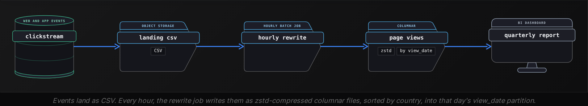

# Storage Layers: Intermediate

At Netflix, an analyst wants to know how many members in Germany started a new series in its first week. The viewing-history table behind the answer holds years of plays. Written one way, her query reads every byte; written another, it reads a small slice of the table and returns quickly. The difference is how the table is stored.


<br>

---

## Columnar Versus Row Storage

Every storage format decides which bytes sit next to each other on disk. That choice sets how many bytes a query must read and how well they compress. It also sets how fast a CPU can work through them. Take a `page_views` table with 40 columns. They include `country`, `session_id`, `page_url` and `user_agent`, plus a JSON blob in `properties`. Its rows average 290 bytes, and `country` is a 2-letter code.


<br>

### Same rows, 2 layouts

A row layout writes each row's values together, then the next row's. A columnar layout writes each column's values together, then the next column's. Here are 4 rows of `page_views`, with 3 of its 40 columns, in the order each layout puts them on disk.

Row layout, in file order

| Position | Bytes |
| --- | --- |
| 1 | US, s_91, /home |
| 2 | DE, s_17, /cart |
| 3 | US, s_44, /home |
| 4 | US, s_91, /pay |

Columnar layout, in file order

| Position | Bytes |
| --- | --- |
| 1 | US, DE, US, US |
| 2 | s_91, s_17, s_44, s_91 |
| 3 | /home, /cart, /home, /pay |

```sql
SELECT
  country,
  COUNT(*) AS views
FROM page_views
GROUP BY country
```

For this query the row layout leaves the engine no shortcut. The 2 bytes of `country` sit inside every 290-byte row, and storage returns data in blocks of kilobytes or megabytes, so the engine reads every row in full to extract a single field. In the columnar layout the country values form one contiguous run: the engine reads that run and skips the other 39 columns.

- **0.7%** — share of each row the count needs
- **145x** — bytes read, row layout over columnar


<br>

### Why columns compress better

Neighbouring values in a column share a type and often repeat. Millions of `country` values hold around 200 distinct strings, while a single row puts a timestamp beside a URL beside a boolean. Columnar writers turn that sameness into savings with encodings, applied per column before any general-purpose codec runs.

3 encodings a columnar writer picks per column

- **Dictionary encoding.** Each distinct page_type is stored once, and every value becomes a small integer code. With 18 page types, a code needs 5 bits instead of a 10 to 20 byte string.
- **Run-length encoding.** A repeated value is stored once with its count. If a file is sorted by country, 3 million consecutive US values become a single pair: US, 3,000,000.
- **Delta encoding.** Each timestamp is stored as its difference from the previous one. Sorted event times sit milliseconds apart, and small differences need far fewer bits than full timestamps.

Sort order decides how much run-length encoding saves. Written in arrival order, `country` goes US, DE, US, BR, so each run is only 1 or 2 values long. Sorted by country, each country collapses into a single long run.


<br>

### Vectorized execution

The third gain happens inside the CPU. A row-at-a-time engine calls its filter and aggregation code once per row, decoding each row to find the field it wants. A vectorized engine takes a batch of one column's values, typically 1,000 or more, and runs a single tight loop over the batch. The batch sits contiguously in memory and stays in the CPU cache, and modern CPUs can apply a single instruction to several values at once. A columnar file already stores data in that shape, so the engine decodes a column straight into batches.


<br>

### Where rows still win

The operational database from the beginner lessons stores rows on purpose. Its work is a single record at a time: insert order 8841, fetch it with all its fields, update its status. A row layout serves each of those with a single contiguous read or write. In a columnar file, assembling a single row touches 40 separate column regions, and adding a single row means appending to all 40, so columnar files are written in large batches and rarely updated in place.

| ✓ Row layout fits | ✗ Columnar layout fits |
| --- | --- |
| • Fetching or updating a record by its key<br><br>• Thousands of small inserts per second<br><br>• Reading most columns of a few rows | • Aggregating millions of rows<br><br>• Reading a few of many columns<br><br>• Writing in large batches, then reading many times |


<br>

### Inside a columnar file

A columnar file cuts its rows into row groups, commonly roughly 128MB each; some formats call them stripes. Within a row group each column has its own chunk, so a reader can fetch `country` for a row group without touching `page_url`. The footer at the end of the file records the minimum and maximum value of each column in each row group, along with how many nulls it holds. The pushdown section puts those statistics to work, letting the engine skip row groups without reading them.

| Part of the file | What it holds |
| --- | --- |
| Row group 1 | About 128MB of rows, one chunk per column |
| Row group 2 | The next 128MB of rows, one chunk per column |
| Footer | Schema, plus min, max and null count per column per row group |

**page_views is stored as columnar files with 40 columns. Which query gains the least from the columnar layout?**

- **A.** Count views per country across the whole table
- **B.** Fetch all 40 columns for the 12 views in 1 session
- **C.** Average load_ms per page_type over a year
- **D.** Count distinct session_id per day for a quarter

<details>
<summary>Solution</summary>

**B.** Fetch all 40 columns for the 12 views in 1 session

Correct. It needs every column of a few rows, so the engine reads all 40 chunks and the I/O saving disappears. A row store suits this lookup.

**Why the others are wrong**

- **A.** This reads 1 of 40 columns across every row, the case where columnar layout saves the most.
- **C.** It reads 2 columns over many rows: the scan skips the other 38 and the average runs as a vectorized loop.
- **D.** Again 2 columns over many rows, so the engine reads a small share of each row's bytes.

</details>


<br>

---

## Partitioning and File Pruning

Columnar files let a query skip columns. Partitioning lets it skip whole files. A partitioned table keeps its files in a directory per value of a chosen column, and the engine compares the query's filter to those directory values before it lists a single data file.

| Directory | Files | Size |
| --- | --- | --- |
| page_views/view_date=2026-10-20/ | 24 | 5.5GB |
| page_views/view_date=2026-10-21/ | 24 | 5.5GB |
| page_views/view_date=2026-10-22/ | 24 | 5.5GB |

`page_views` holds 450 days of history. An hourly load writes each day as 24 columnar files of roughly 230MB, 5.5GB in all. A query filtering on `view_date = DATE '2026-10-21'` reads 1 directory. The other 449 are never even listed, and skipping them that way is partition pruning.

```sql
SELECT
  page_type,
  COUNT(*) AS views
FROM page_views
WHERE view_date = DATE '2026-10-21'
GROUP BY page_type
```


<br>

### Choose the partition column from how the table is filtered

A partition key pays off only when queries filter on it. Partition `page_views` by `load_hour`, the hour the pipeline wrote each row, while analysts filter on `view_date`, and every query still opens every partition, because no filter mentions `load_hour`. Choosing well starts from the query log: count which columns appear in WHERE clauses and how many distinct values each holds.

| Column | Queries filtering on it | Distinct values per day |
| --- | --- | --- |
| view_date | 94% | 1 |
| country | 31% | about 200 |
| page_type | 12% | 18 |
| session_id | 3% | about 9 million |

`view_date` wins on both counts. Almost every query filters on it, and a single value per day gives each partition 5.5GB, enough for files in the hundreds of MB. `session_id` is the opposite case: 9 million partitions a day would hold a few hundred bytes each. `country` sits in between, and the third of queries filtering on it tempts teams to add it as a second level.


<br>

### Country partitions mean thousands of tiny files

Add `country` under `view_date`, keep the hourly load, and each run now writes 1 file per country it saw. With 200 countries across 24 runs, that is up to 4,800 files a day. The 5.5GB splits unevenly: the biggest countries get hourly files of tens of MB, and most get files well under 1MB.

Partitioned by view_date

| For 90 days | Count |
| --- | --- |
| Partitions | 90 |
| Files | 2,160 |
| Average file | about 230MB |

By view_date and country

| For 90 days | Count |
| --- | --- |
| Partitions | up to 18,000 |
| Files | up to 432,000 |
| Average file | about 1.1MB |

Each file carries costs that do not shrink with its size. The engine has to list it and read its footer, and it schedules a task for every file. On object storage, a single request to storage often takes tens to hundreds of milliseconds. A 90-day query on the date-only table pays those costs 2,160 times; on the country-partitioned table it pays them up to 432,000 times, and on a 1MB file the footer is a sizeable share of the bytes. Small files also compress worse and hold row groups too small for their statistics to skip much. The third of queries that filter on country got faster, and all the rest got slower.

> **TIP**
>
> Serve a secondary filter like `country` inside the files: sort each hour's rows by `country` before writing. Each row group's min and max then cover a narrow band of countries, and the engine skips row groups for other countries without multiplying the file count.

| ✓ Do | ✗ Don't |
| --- | --- |
| • Partition on the column most queries filter on<br><br>• Keep each partition in the hundreds of MB or more<br><br>• Sort within files by secondary filter columns<br><br>• Read the query log before choosing a partition column | • Partition on high-cardinality columns like session_id<br><br>• Partition on a column no query filters on<br><br>• Stack partition levels until files shrink below 1MB<br><br>• Pick the partition column from the load schedule instead of the filters |

**A payments table lands 3GB of compressed files per day. In the query log, 90% of queries filter on paid_date, 40% on merchant_id (60,000 merchants) and 8% on currency (30 values). Which layout fits?**

- **A.** Partition by paid_date and merchant_id so merchant queries prune
- **B.** Partition by merchant_id alone, since it has the most distinct values
- **C.** Partition by paid_date and currency, since 30 values stay manageable
- **D.** Partition by paid_date and sort each day's rows by merchant_id

<details>
<summary>Solution</summary>

**D.** Partition by paid_date and sort each day's rows by merchant_id

Correct. Partitioning on paid_date matches 90% of queries and keeps 3GB partitions, and the merchant sort gives row groups narrow min and max ranges to skip by.

**Why the others are wrong**

- **A.** A day's 3GB over 60,000 merchant partitions averages 50KB per merchant. Merchant queries prune, and every other query opens thousands of tiny files.
- **B.** High cardinality argues against partitioning on this column, and this drops paid_date, the filter in 90% of queries.
- **C.** Only 8% of queries filter on currency, yet every query now opens up to 30 times as many files, tiny ones for rare currencies.

</details>


<br>

---

## Compression: Bytes Versus CPU

Encodings shrink a column using what its values mean. A codec then squeezes the encoded bytes further by finding repeated byte patterns, with no idea what they represent. Every codec sits somewhere on 3 axes: how small it makes the data (ratio), how fast it restores it (decompression speed), and whether a reader can start in the middle of the output (splittability).

| Codec | Ratio | Decompression per core |
| --- | --- | --- |
| LZ4 | about 2.1x | about 4,500MB/s |
| Snappy | about 2.1x | about 1,800MB/s |
| zstd, level 1 | about 2.9x | about 1,700MB/s |
| gzip (deflate), level 1 | about 2.7x | about 400MB/s |

*Round figures on general text, in line with the zstd project's published benchmark. Speed counts the uncompressed bytes produced. Your data will give different numbers, and the ordering usually holds.*

The table splits into 2 families. LZ4 and Snappy give up ratio for speed. zstd and gzip compress harder, but zstd still decompresses quickly while gzip needs around 4 times the CPU per byte decompressed. zstd also offers levels up to 22: higher levels spend more CPU on write for a better ratio, and decompression speed barely changes.


<br>

### Which side of the machine is slower?

The better codec depends on where a query waits. Take a job whose scan decompresses to 600GB, running on 100 cores. Reading and decompressing overlap, so the slower of the 2 sets the pace. From object storage the cluster pulls 5GB/s in total; from local SSD it pulls 100GB/s.

| Codec | On disk | Read, object storage | Read, local SSD | Decompress, 100 cores |
| --- | --- | --- | --- | --- |
| LZ4 | 286GB | 57s | 2.9s | 1.3s |
| Snappy | 286GB | 57s | 2.9s | 3.3s |
| zstd, level 1 | 207GB | 41s | 2.1s | 3.5s |
| gzip, level 1 | 222GB | 44s | 2.2s | 15s |

On object storage every codec decompresses faster than the network delivers, so the job waits on bytes. zstd finishes in roughly 41s against 57s for LZ4 because it moves 79GB less. On local SSD the bottleneck flips: reading takes 2 to 3 seconds for every codec, gzip's 15s of decompression dominates, and LZ4 finishes first at 2.9s while zstd needs 3.5s.

> Choosing by bottleneck
>
> - I/O-bound, such as scans of cold data on remote storage: favour ratio, usually zstd
> - CPU-bound, such as hot data on local disk or in cache: favour decompression speed with LZ4 or Snappy
> - Written once and read thousands of times: pay for a higher zstd level at write time
> - gzip rarely wins on new data: its ratio trails zstd's at about a quarter of the decompression speed


<br>

### Splittability: can 100 cores share one file?

A cluster is fast because many cores read different parts of the data at once. A gzip-compressed CSV file breaks that, because a deflate stream can only be decoded from its beginning. Land a single 20GB gzip CSV and it expands to around 54GB, which 1 core decompresses in roughly 135 seconds while the other 99 wait. Snappy or LZ4 wrapped around a whole CSV file usually has the same problem.

Columnar files avoid this by compressing small pages inside each column chunk independently. A reader jumps to any row group through the footer and decodes it alone, so a columnar file is splittable with every codec in the table. The codec decides splittability only when it wraps an entire file.

| ✓ One core per file | ✗ Many cores per file |
| --- | --- |
| • A CSV or JSON file under whole-file gzip<br><br>• A CSV file under whole-file Snappy or LZ4<br><br>• Any compressed stream without a block index | • Columnar files with any codec, split by row group<br><br>• Uncompressed CSV, split at line breaks<br><br>• Formats that compress independent, indexed blocks |

> **TIP**
>
> When raw landing files must arrive as gzip, keep each one between 128MB and 1GB so the cluster has many separate files to read in parallel, then rewrite them as columnar files early.

**A nightly job scans 3 years of cold sensor readings stored on object storage as Snappy-compressed columnar files. While it runs, the cluster's CPUs sit at 30%. Which change most likely shortens it?**

- **A.** Rewrite the files with zstd so the job pulls fewer bytes from storage
- **B.** Rewrite the files with LZ4 because it decompresses faster than Snappy
- **C.** Rewrite each day as 1 gzip CSV file for a better ratio than Snappy
- **D.** Turn compression off so the CPUs stop spending time on decompression

<details>
<summary>Solution</summary>

**A.** Rewrite the files with zstd so the job pulls fewer bytes from storage

Correct. Idle CPUs mean the job waits on storage. zstd's better ratio cuts the bytes moved, and the spare cores absorb its decompression.

**Why the others are wrong**

- **B.** Decompression is not the bottleneck at 30% CPU, and LZ4's ratio matches Snappy's, so the bytes pulled stay about the same.
- **C.** The ratio improves, but each file becomes a single core's job, and gzip decodes at a fraction of Snappy's speed.
- **D.** Uncompressed files roughly double the bytes pulled from storage, which is already the bottleneck.

</details>


<br>

---

## Predicate Pushdown

Partitions and footer statistics save bytes only when the engine compares the query's filter to them before reading. Predicate pushdown is that hand-off: the engine moves a filter from the query down into the scan, which tests it against partition values, row-group min and max, and bloom filters. A filter left above the scan runs after the data is read, so every byte gets fetched first.


<br>

### One filter, 2 spellings

`fct_orders` is partitioned by `event_date` and `country`. 3 days times 2 countries gives 6 partitions. Each partition holds 1 file of 5 row groups of 128MB, and the footer records min and max `order_ts` for each row group. The query asks for orders placed on 2026-04-22 at or after 19:00. Switch between the 2 spellings and watch which row groups the engine opens.

**Filters on the columns**

https://github.com/user-attachments/assets/7b6496f8-4730-4c98-8f17-15e2767be991

**Functions on the columns**

https://github.com/user-attachments/assets/c4e84164-8396-4efc-8c4c-a80d7e038c4f

```sql
SELECT
  order_id,
  order_ts
FROM fct_orders
WHERE event_date = DATE '2026-04-22'
  AND order_ts >= TIMESTAMP '2026-04-22 19:00:00'
```

```sql
SELECT
  order_id,
  order_ts
FROM fct_orders
WHERE DATE(order_ts) = DATE '2026-04-22'
  AND HOUR(order_ts) >= 19
```

The first spelling names `event_date`, so the engine keeps the 2 partitions for 2026-04-22 and drops the other 4. Inside each file it compares 19:00 to each row group's max `order_ts`. The first 3 row groups end at 18:00:00 or earlier and are skipped; the last 2 are read. That is 4 row groups and 512MB of file, out of 30 row groups and 3,840MB. The second spelling filters on `hour(order_ts)`, a value no footer stores, and never mentions `event_date`, so unless the engine rewrites it, the scan reads all 30 row groups and filters the rows afterwards.

- **7.5x** — less data scanned by the first spelling


<br>

### Writing filters the scan can test

4 habits that keep a filter pushable

- **Compare the bare column.** order_ts >= TIMESTAMP '2026-04-22 19:00:00' can be tested against min and max; hour(order_ts) >= 19 cannot.
- **Filter the partition column itself.** A condition on order_ts tells the engine nothing about the event_date directories, so state the event_date condition as well.
- **Move arithmetic to the constant side.** Write event_date >= DATE '2026-04-22' instead of date_add('day', 7, event_date) >= DATE '2026-04-29'.
- **Match types.** Compare a DATE column to a DATE literal. When types differ, the engine may cast the column on every row, and a cast column can lose its pushdown.

*Some engines rewrite a few common wrappers, such as a cast from timestamp to date, back into a range on the bare column. Whether yours did shows up in the plan, covered below.*

**Which filter lets the engine skip fct_orders row groups using the footer's min and max order_ts?**

- **A.** hour(order_ts) BETWEEN 19 AND 23
- **B.** CAST(order_ts AS varchar) >= '2026-04-22 19:00:00'
- **C.** order_ts >= TIMESTAMP '2026-04-22 19:00:00'
- **D.** date_add('hour', 5, order_ts) >= TIMESTAMP '2026-04-23 00:00:00'

<details>
<summary>Solution</summary>

**C.** order_ts >= TIMESTAMP '2026-04-22 19:00:00'

Correct. A bare column against a typed literal is checked against each row group's max order_ts, so row groups ending before 19:00 on 2026-04-22 are skipped.

**Why the others are wrong**

- **A.** The condition wraps order_ts in a function, so the scan has no stored value to compare it with.
- **B.** The footer stores timestamp values, and casting every row to text hides the column from those statistics.
- **D.** It selects the same rows as the bare comparison, but the arithmetic sits on the column. Move the 5 hours to the constant side.

</details>


<br>

### Bloom filters for needle lookups

Min and max help when values are clustered: a row group spanning 06:00 to 12:00 rules itself out for 19:00. They fail on a column like `customer_id`, whose values are scattered, so every row group's min and max span almost the whole id range. A bloom filter fills that gap. At write time the writer builds a small bit array per row group from every `customer_id` in it. At read time the engine asks whether `c_48213` could be present. A no is certain, and the row group is skipped. A yes means possibly, with a false-positive rate set at write time, often about 1%.

```sql
SELECT
  order_id,
  order_ts
FROM fct_orders
WHERE event_date = DATE '2026-04-22'
  AND customer_id = 'c_48213'
```

Say the customer ordered once on 2026-04-22, so the order sits in 1 of the 10 row groups across that date's 2 files. The bloom filters rule out the other 9, barring a false positive. They only help with equality and short `IN` lists. Neither `customer_id LIKE 'c_48%'` nor a range filter gets anything from them. They also exist only for columns the writer was configured to build them on.


<br>

### Verify with EXPLAIN

Pushdown is the engine's decision, so check it instead of assuming it. `EXPLAIN` prints the plan without running the query. `EXPLAIN ANALYZE` runs it and adds what each step actually read.

To check the first spelling, put `EXPLAIN ANALYZE` on the line above its `SELECT` and run it. The plan lists the scan of fct_orders with the constraint the engine pushed into it, and the input size that scan read.

| Where to look | Filter pushed down | Filter not pushed down |
| --- | --- | --- |
| Constraint on the fct_orders scan | Names event_date with 2026-04-22 | No event_date constraint |
| Input size the scan reports | A small share of the table | Close to the full size of the columns read |

> **TIP**
>
> Run `EXPLAIN ANALYZE` on both spellings and compare the input size each scan reports. A wide gap means pushdown worked; matching numbers mean it did not.

**A customer placed 1 order on 2026-04-22. EXPLAIN ANALYZE on a query filtering event_date = DATE '2026-04-22' and customer_id = 'c_48213' shows the scan read all 10 row groups for that date. What is the likely cause?**

- **A.** Bloom filters only work on partition columns such as event_date
- **B.** The files were written without bloom filters on customer_id
- **C.** The event_date condition used up the pushdown, so the second was ignored
- **D.** Equality conditions use min and max only, and bloom filters need LIKE

<details>
<summary>Solution</summary>

**B.** The files were written without bloom filters on customer_id

Correct. Scattered ids defeat min and max, so only a bloom filter could skip the 9 row groups without the order, and it must be built at write time.

**Why the others are wrong**

- **A.** Partition columns need no bloom filter, since the directory name already prunes them. Bloom filters serve data columns like customer_id.
- **C.** Engines push down every eligible condition together. The date condition did its part by narrowing the scan to 2 files.
- **D.** It is the reverse: bloom filters answer equality and short IN lists, and give nothing to LIKE patterns.

</details>


<br>

---

## Turning a 10TB Scan Into 100GB

Each technique so far cut bytes on its own. Applied to a single table, the cuts multiply. Here is `page_views` as it first landed: 450 days of uncompressed, row-oriented CSV, 10TB in all. It has 40 columns, and its rows average 290 bytes. The quarterly report counts sessions per country and page type over the last 90 days, excluding bots.

```sql
SELECT
  country,
  page_type,
  APPROX_DISTINCT(session_id) AS sessions
FROM page_views
WHERE view_date >= DATE '2026-07-25'
  AND is_bot = FALSE
GROUP BY country, page_type
```




<br>

### 3 factors, multiplied

| Step | What the scan skips | Factor | Bytes scanned |
| --- | --- | --- | --- |
| Start: row CSV | Nothing | 1x | 10TB |
| Partition by view_date, filter on it | 360 of 450 days | 5x | 2TB |
| Columnar files | 36 of 40 columns, 232 of 290 bytes | 5x | 400GB |
| Encodings plus zstd | 3 of every 4 bytes in those columns | 4x | 100GB |

Each factor comes from an earlier section. Partitioning removes the days the report does not ask for, and it works only because the WHERE clause compares `view_date` directly, the pushdown habit. Columnar layout removes 36 of the 40 columns. Encodings and zstd shrink what remains 4x, helped by the country sort that lengthens runs. The order of the steps changes nothing, because each factor divides the bytes that are left.

- **100x** — less data read per quarterly report


<br>

### Remove one piece, keep the rest

| Missing piece | Bytes scanned | Why |
| --- | --- | --- |
| Nothing | 100GB | All 3 factors apply |
| Pushdown: filter written as date_format(view_ts, '%Y-%m-%d') >= '2026-07-25' | Over 500GB | No partition pruned, and view_ts becomes a fifth column read |
| Partitioning | Over 500GB | All 450 days of the 4 columns, plus a date column to filter |
| Encodings and compression | 400GB | Partitions and columns still cut 25x |
| Columnar layout | 500GB | Whole rows for 90 days, even granting row files 4x compression |

*A table without partitions can still skip row groups by the min and max of a date column if its files were written in date order. To find out which ones to skip, though, the engine first reads the footer of every file across all 450 days.*

The cheapest piece to lose is the one that costs nothing to keep. A single function around a timestamp turns the 100GB report back into a scan of more than 500GB, while the files themselves stay exactly as they were. Columnar layout and compression pay off whatever the filter says, so they are defaults; partitioning is a per-table decision that pays only when filters reach it.

**On the final page_views layout, a query reads page_url and load_ms, which average 87 of each row's 290 bytes and also compress 4x. It filters view_date directly over the last 9 days. About how many bytes does it scan?**

- **A.** About 750GB
- **B.** About 60GB
- **C.** About 150GB
- **D.** About 15GB

<details>
<summary>Solution</summary>

**D.** About 15GB

Correct. Those columns are 87/290 of 10TB, or 3TB; 4x compression leaves 750GB, and 9 of 450 days leaves 15GB.

**Why the others are wrong**

- **A.** That is both columns compressed across all 450 days. The view_date filter still prunes 441 of them.
- **B.** That prunes partitions and columns but leaves out the 4x from encodings and zstd.
- **C.** That divides by 5 for partitions, as the quarterly report did, but 9 of 450 days is a 50x cut.

</details>


<br>

### Going below 100GB

The quarterly report reads every country, so the country sort helped only compression. A Germany-only version adds `country = 'DE'`, and row-group min and max on `country` can now prune, but only a whole row group at a time. Each hourly file of about 230MB holds 2 row groups, so German rows share row groups with other countries and the scan falls at best to about half, near 50GB. A daily job that rewrites each day sorted by country makes about 43 row groups per day; if German views are 6% of traffic, they fill about 3 of them, and the scan approaches 6GB.

**A teammate proposes adding country as a second partition level under view_date, keeping the hourly load, so the Germany report prunes better. What happens to the quarterly report?**

- **A.** Roughly the same bytes, now spread across up to 432,000 small files
- **B.** About 200 times fewer bytes, since each country becomes its own partition
- **C.** No change at all, because the report has no filter on country
- **D.** The query fails, because a partition column cannot appear in GROUP BY

<details>
<summary>Solution</summary>

**A.** Roughly the same bytes, now spread across up to 432,000 small files

Correct. The report reads every country, so nothing extra is pruned, while its file count for 90 days climbs from 2,160 to up to 432,000, each with fixed per-file costs.

**Why the others are wrong**

- **B.** Partition pruning needs a filter on the partition column, and the quarterly report has no country filter.
- **C.** The bytes barely move, but the file count does: the report slows down because the engine has to list every tiny file and read each one's footer.
- **D.** Partition columns can be selected and grouped like any other column; the engine reads their values from the directory path.

</details>


<br>

---

## Putting It All Together

Suppose a Netflix analyst owns a weekly report on German members watching a new series. The viewing-history table behind it sits on remote object storage as zstd-compressed columnar files, partitioned by view date and sorted by country within each day. The report filters the date column directly, and EXPLAIN ANALYZE shows it reading 7 daily partitions and a few row groups per day instead of years of plays.

- Partitioning by view date pays only because the report's filter names the date column directly; a function around a timestamp would send the scan through every day.
- Sorting each day by country lets row-group min and max skip other countries without adding a partition level and its flood of tiny files.
- Remote object storage makes the report I/O-bound, so a high-ratio codec like zstd shortens it more than a faster codec would.
- Columnar layout limits the scan to the few columns the report names, and the encodings on those columns multiply the codec's saving.


<br>

---

## Key Takeaways

- Columnar layout reads only the columns a query names, compresses well because neighbouring values match, and feeds vectorized loops.
- Pick the partition column from the filters in the query log, and keep partitions in the hundreds of MB so the table does not fill up with tiny files.
- Choose a codec by bottleneck: ratio when the job waits on storage, decompression speed when it waits on CPU.
- Columnar files split by row group with any codec, while a whole-file gzip CSV keeps 1 core busy and the rest idle.
- Compare bare columns to typed literals so filters can prune partitions and reach the min and max statistics and bloom filters inside each file, then confirm with EXPLAIN ANALYZE.
- The savings multiply: partitions and column pruning each cut the bytes 5x, compression cut them another 4x, and a 10TB scan became 100GB.

Exercises for this lesson: [_exercises/pa_storage_layers_intermediate.md](_exercises/pa_storage_layers_intermediate.md)
