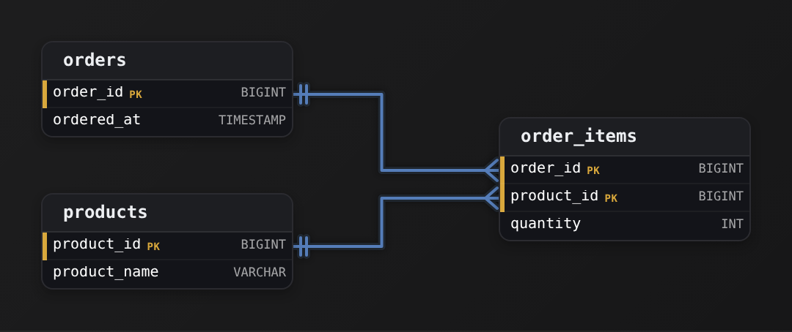
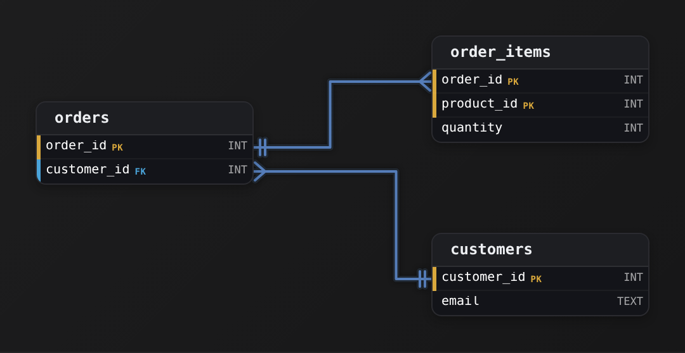
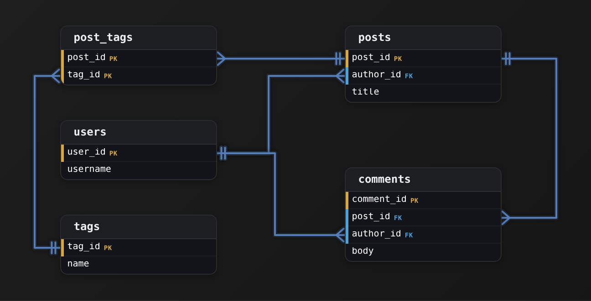

# Keys & Identity - Exercises

Lesson: [data_modeling_keys.md](../data_modeling_keys.md)

### Exercise 1 of 10

**● TASK**

Create a users table with a proper primary key. Members sign up with an email and a username, and both can be changed later; when an account is closed its row stays on the table, and its username may be claimed by a new member. Keep email and username on the table so members can still be looked up by them.

<details>
<summary><strong>Solution</strong></summary>

#### A key the business cannot touch

This table needs a **surrogate key**: a value the system generates only to identify the row, such as a sequence number in `user_id`. Neither natural candidate passes the primary key rules here. `email` breaks immutability, because a member can change it. `username` breaks collision across time, because a closed account keeps its row while a new member takes the same name. Generating the key is the only way to get one that is unique, never null and never edited.


*`user_id` is generated and owns identity; `email` and `username` stay as attributes for lookup.*

| Pitfall: Unique today is not unique forever |
| --- |
| Keying on `username` passes every check on day one. Then an account closes, its row stays, and a new member claims the same name. Now the insert either fails or the closed account has to be renamed, which rewrites history. This is the recycled-SKU problem in a new setting. |

| ✕ Natural key | ✓ Surrogate key |
| --- | --- |
| `email` or `username` is readable in every log line. But it changes when the member edits it, and every copy of the old value has to follow. A released name can also come back attached to a different person. | `user_id` means nothing to the business, so nothing in the business can edit or reuse it. `email` and `username` stay as plain columns, so a lookup by either still works. |

| Real world: Keep the natural key, demote it |
| --- |
| Production user tables almost always carry both: a generated `user_id` as the key, with the login handle and email as ordinary columns that support search. The handle is for people; the generated key is what the system relies on. |

**Follow-up questions**

1. The business now says no 2 open accounts may share an `email`. Does that make `email` a good primary key?\
   *Separates a uniqueness rule on an attribute from the immutability a key needs.*
2. A partner system sends a numeric member number it promises never to change or reuse. Would you still generate your own `user_id`?\
   *Weighs a trusted natural key against owning identity yourself.*

</details>


<br>

### Exercise 2 of 10

**● TASK**

Design an employees table with a primary key and basic profile columns.

<details>
<summary><strong>Solution</strong></summary>

#### One entity, one table, one key

This is the starting move of every schema: take a real-world thing you need to track and turn it into a table. Here the thing is an employee, so you get an `employees` table where **each row is exactly one employee**. That row-equals-one-entity rule is the whole game, and the primary key is what enforces it: `emp_id` is the column that promises every row is a distinct, addressable employee.


*One entity table: `emp_id` identifies the row, the rest are attributes describing it.*

1. **Name the entity as the table**

   The noun you are storing becomes the table: `employees`, plural, because it holds many of them. Everything you decide next hangs off this one choice, so get the grain right first: one row per employee, not one row per paycheck or per department.

2. **Give it a primary key**

   Add `emp_id` as the primary key. It is the column the database uses to tell rows apart and the handle other tables will point at later. A synthetic key like `emp_id` beats keying on a name, because 2 people really can both be 'Jordan Lee' and a good key must stay unique and never change.

3. **Hang the attributes off it**

   `first_name`, `last_name`, and `department` are attributes: facts that describe the employee the key identifies. Each one belongs here because it is true of the whole employee, not of some sub-thing. If a fact needed its own key someday, that is your signal it wants its own table.

| Pitfall: Common pitfall |
| --- |
| Keying on `first_name` + `last_name` instead of a dedicated `emp_id`. It looks unique until your second Jordan Lee is hired, and then the 'key' collides and rows blur together. A primary key must be unique and stable; a person's name is neither, which is exactly why you mint a `emp_id` the business never has to retype. |

| Key insight: PK vs. attribute is the core distinction |
| --- |
| `emp_id` answers 'which employee?'; `first_name`, `last_name`, and `department` answer 'what is this employee like?'. Every column you add later sorts into one of those 2 jobs. Getting that sort right is what keeps a table from turning into a junk drawer. |

**Follow-up questions**

1. If an employee can belong to more than one department, does `department` still belong in `employees`?\
   *Tests when a repeating attribute has outgrown its column and wants its own table plus a link.*
2. What would you use as the primary key if the company already issues a badge number to every hire?\
   *Natural vs. synthetic key: a stable, unique business identifier can serve as the PK directly.*

</details>


<br>

### Exercise 3 of 10

**● TASK**

Design a customers table and an orders table where each order is linked to a customer through a foreign key.

<details>
<summary><strong>Solution</strong></summary>

#### One column that points at another table's key

A **foreign key** is a column that stores the primary key of a row in another table, and that one pointer is the whole relationship. Here `orders.customer_id` holds a value that must already exist in `customers.customer_id`. Every order names exactly one customer, and the database refuses an order that points at a customer who isn't there. Each table keeps its own primary key (`customer_id`, `order_id`) to fix its grain, and the link is the extra column on `orders`.


*`orders.customer_id` references `customers.customer_id`: many orders, one customer.*

Look at which side carries the key. Because `customer_id` lives on `orders`, one customer can appear on any number of order rows while each order holds just one customer. That placement is what makes it **one-to-many**: the row on the many side always holds the foreign key.

| Pitfall: An `order_id` on `customers` allows one order each |
| --- |
| Flipping the pointer and putting an `order_id` column on `customers` gives each customer room for a single order. The second one has nowhere to go except overwriting the first or duplicating the customer row. Ask 'which row can there be many of?' and put the key there. |

| Real world: Most app schemas are this shape repeated |
| --- |
| `users` and `sessions`, `posts` and `comments`, `invoices` and `line_items` all follow it. Declaring the constraint, rather than just naming a column `customer_id`, is what lets the database reject orphaned rows and lets a `JOIN` reassemble the tables through the key. |

**Follow-up questions**

1. How would you let an order contain many products while a product appears on many orders?\
   *Many-to-many needs a third table such as `order_items` holding 2 foreign keys.*
2. What should happen to a customer's orders when the customer row is deleted?\
   *Referential actions on the foreign key: `ON DELETE CASCADE` versus `ON DELETE RESTRICT`.*

</details>


<br>

### Exercise 4 of 10

**● TASK**

Create a users table and a posts table connected by a foreign key relationship.

<details>
<summary><strong>Solution</strong></summary>

#### The foreign key that turns 2 tables into one model

A **foreign key** is a column in one table that stores the primary key value of a row in another. Here `posts` carries `author_id`, and every value in it is a real `user_id` from `users`. The primary key names each user exactly once; the foreign key points back at that name. The 2 tables are never physically merged. The relationship is the promise that every `author_id` matches some `user_id`.


*`posts.author_id` references `users.user_id`: many posts, one author.*

One user can appear in many `posts` rows, since many rows can hold the same `author_id`. A single post has exactly one `author_id`, so it belongs to exactly one user. That asymmetry is **one-to-many**, and the foreign key always sits on the many side. Ask which thing there can be lots of, and put the pointer there.

| Pitfall: The link goes on the many side |
| --- |
| Adding a `post_id` column to `users` records only one post per user. The moment someone writes a second post there is nowhere to put it. Putting `author_id` on `posts` means `users` never has to grow a column per child. |

| Real world: The database enforces the promise for you |
| --- |
| Once `author_id` is declared a foreign key, an insert into `posts` with no matching `user_id` is rejected, and deleting a referenced user is blocked or cascades instead of orphaning posts. That referential integrity is why you model the link explicitly rather than keeping the numbers consistent by hand. |

**Follow-up questions**

1. How would you model a post that can have many tags, and a tag that applies to many posts?\
   *A single foreign key only expresses one-to-many; many-to-many needs a junction table holding 2 foreign keys.*
2. What should happen to a user's posts when that user is deleted?\
   *Delete behavior on `author_id`: cascade, restrict, or set null.*

</details>


<br>

### Exercise 5 of 10

**● TASK**

Orders and products are many-to-many: one order holds many products, and one product appears on many orders. Model orders, products and the order lines that link them, with each line recording the quantity ordered. A product appears at most once per order, so the order and the product together identify a line.

<details>
<summary><strong>Solution</strong></summary>

#### The junction table and its composite key

Orders and products cannot point at each other directly. A product column on `orders` holds only one product, and an order column on `products` holds only one order. The many-to-many lives in a third table, a junction table, with one row per (order, product) pair. Each of its 2 columns is a foreign key to one side. Together they form a **composite primary key**: neither column is unique alone, but the pair is, and that pair is exactly the order line.



*`order_items` resolves the many-to-many: `order_id` and `product_id` each reference a parent, and together they are the key. `quantity` describes the pairing.*

Each key column has 2 jobs. As a foreign key, `order_id` must name a real order. As half of the primary key, it combines with `product_id` so the same product cannot land on one order twice. `quantity` is outside the key: it is a fact about the line, not part of what makes the line unique. Re-adding a product to an order updates that line's `quantity` and creates no second row.

**The junction table as DDL**

```sql
CREATE TABLE order_items (
    order_id   BIGINT NOT NULL REFERENCES orders (order_id),
    product_id BIGINT NOT NULL REFERENCES products (product_id),
    quantity   INT    NOT NULL,
    PRIMARY KEY (order_id, product_id)
);
```

*2 `REFERENCES` clauses make the pair point at both sides; `PRIMARY KEY (order_id, product_id)` makes the pair the identity.*

| Pitfall: A lone surrogate id drops the line's identity |
| --- |
| A common wrong version gives `order_items` a single `id` key and leaves `order_id` and `product_id` as plain columns. The database then accepts the same product twice on one order, because each copy gets its own `id`. A surrogate can sit beside the pair, but only together with a `UNIQUE (order_id, product_id)` constraint. Without that constraint, nothing says what one row is. |

| Key insight: Every many-to-many becomes a table keyed by its pair |
| --- |
| Students and courses (`enrollments`), users and roles (`user_roles`), and posts and tags (`post_tags`) all follow the same shape. Whenever 2 things relate many-to-many, the link gets its own table. Its key is the pair of foreign keys, and facts about the link (a grade, a `quantity`, an `assigned_at`) are non-key columns. |

**Follow-up questions**

1. What changes if the same product may appear on one order twice, each time at a different unit price?\
   *Relaxing the pair's uniqueness means the key needs a column that tells 2 lines apart, or a surrogate that sits beside a widened `UNIQUE` constraint.*
2. What if every time a product is added to an order must be kept as its own row, along with when it was added?\
   *Recording every re-add as its own row makes `added_at` part of what identifies a line, so the key grows to 3 columns or moves to a surrogate plus `UNIQUE`.*

</details>


<br>

### Exercise 6 of 10

**● TASK**

Students enroll in many courses and each course holds many students. Model students, courses and their enrollments so that an enrollment is identified by the student-course pair, and the same student can never be enrolled twice in the same course. Record when each enrollment happened.

<details>
<summary><strong>Solution</strong></summary>

#### One row per student-course pair

An enrollment has no identity apart from the 2 things it connects, so its primary key is a **composite key**: `student_id` and `course_id` taken together. A student shows up in many rows and a course shows up in many rows, but one student in one course shows up exactly once. Uniqueness lives on the combination, never on either column alone.

The table carrying that key is a **junction table**. Students and courses are many-to-many, and neither side can hold a single foreign key to the other, so the relationship gets a table of its own whose rows are the links. Each key column is also a foreign key: `student_id` points at `students` and `course_id` at `courses`. `enrolled_at` lives here too because it describes the enrollment, not the student or the course.


*`course_enrollments` sits between the 2 parents; its 2 foreign keys together form its primary key.*

| Pitfall: 2 separate keys is not a composite key |
| --- |
| Marking `student_id` unique and `course_id` unique on their own would let each student take only one course and each course hold only one student. A table has one primary key, and here it spans both columns: the tuple (`student_id`, `course_id`) is what must be unique. |

| ✕ Composite key | ✓ Surrogate beside the pair |
| --- | --- |
| Key is (`student_id`, `course_id`) directly. The pair that identifies an enrollment is the identifier, with no extra column. | Add an `enrollment_id` surrogate as the key and keep UNIQUE on (`student_id`, `course_id`). Useful when other tables must reference one enrollment column; the surrogate sits beside the pair constraint and never replaces it. |

**Follow-up questions**

1. What changes if a student may retake the same course in a later term?\
   *The pair stops being unique. You can extend the key with the term, but a composite that keeps growing is the signal to add a surrogate and demote the triple to UNIQUE.*
2. What goes wrong if `course_enrollments` has a surrogate key and no uniqueness on the pair?\
   *Nothing says what one row is, so a replayed load writes the same enrollment twice and no constraint rejects it.*

</details>


<br>

### Exercise 7 of 10

**● TASK**

Create a `sessions` table whose primary key is a system-generated UUID rather than a sequential integer. Each session belongs to a user and records the time it was created.

<details>
<summary><strong>Solution</strong></summary>

#### A surrogate key that isn't a counter

A **UUID surrogate key** moves key generation out of the database's sequence. Instead of the database handing out 1, 2, 3 in order, the primary key becomes a 128-bit value the system generates at random (or from a timestamp, depending on the UUID version). It is still a surrogate: `session_id` carries no business meaning, and its only job is to identify the row. What changes is who mints the key and what it looks like. That decision is what you modeled here; `user_id` and `created_at` are ordinary supporting columns.


*One user has many sessions. Each session is keyed by a system-generated `session_id` UUID, and `user_id` is the many-side foreign key back to `users`.*

| ✕ Sequential BIGSERIAL | ✓ UUID |
| --- | --- |
| `session_id BIGSERIAL PRIMARY KEY`. The database allocates the next number from a sequence, so keys are dense, ordered and small (8 bytes). The value is unique only within one table on one database, and it leaks volume: a session with id '10432' tells anyone who sees it roughly how many sessions exist, and lets them guess '10431'. | `session_id UUID PRIMARY KEY`. A generator produces a globally unique value with no central counter; it can be `gen_random_uuid()`, an app library or a client. There is nothing to enumerate, and 2 systems can mint keys at the same time without colliding. The cost is 16 bytes per key and no natural sort order. |

| Pitfall: A UUID key needs the UUID type |
| --- |
| A common mistake is typing `session_id` as `BIGINT` or `VARCHAR` and assuming a UUID will fit. A `BIGINT` cannot hold 128 bits. A `VARCHAR` wastes space, accepts malformed values and loses the fixed-width validation the `UUID` type gives you. Marking the column PK makes it the identifier; declaring it `UUID` makes it the **right kind of identifier** for a key minted outside the database. |

| Key insight: Keys can be minted before the row reaches the database |
| --- |
| Key generation is what this design turns on. A sequential key must come from the database, in order, through one central counter. A UUID can be minted anywhere: the app server before the row is written, an offline client that syncs later, or the database through a default. That is why UUIDs show up on entities created in distributed or client-first systems, where waiting on a central sequence would be a bottleneck or simply impossible. |

| Real world: Mixed generators across tables are normal |
| --- |
| Session and event tables are a classic home for UUIDs, because their rows are created fast, often at the edge, and should not be enumerable. `user_id` stays a `BIGINT` because users are minted centrally, where small, ordered keys pay off. A UUID key on `sessions` referencing an integer `user_id` on `users` is a normal one-to-many design, not an inconsistency to fix. |

**Follow-up questions**

1. What happens to insert locality on a huge table keyed by random UUID v4, and how does UUID v7 change that?\
   *Random UUIDs scatter inserts across the index, while time-ordered UUIDs keep new keys close together.*
2. If sessions were rebuilt by parallel jobs replaying the same raw events, would a random UUID still be the right generator, or would a hash key serve better?\
   *Compares a random UUID with a hash of the natural key when parallel jobs must agree on the same key.*

</details>


<br>

### Exercise 8 of 10

**● TASK**

Design an events table using a UUID primary key with basic event tracking columns.

<details>
<summary><strong>Solution</strong></summary>

#### A surrogate key, generated as a UUID

`event_id` is a **surrogate primary key**. It carries no business meaning. Its only job is to give every row one stable, unique handle. Generating it as a UUID means the key can be minted anywhere: by the app, by a queue consumer, or by the database, without asking a central sequence for the next number. That matters for an events table, because events arrive fast and from many places. A UUID lets each producer stamp an id without coordinating with anyone.


*One table: a UUID surrogate key plus the 3 columns that describe what happened, to whom, and when.*

| Key insight: A natural key breaks on the first collision |
| --- |
| It is tempting to key the table on something the event already carries, such as `(user_id, occurred_at)`. That natural key fails the moment one user fires 2 events in the same instant. A surrogate `event_id` avoids the problem entirely. It is unique by construction, and it never has to change, even if the meaning of the other columns does. |

| ✕ Auto-increment integer | ✓ UUID |
| --- | --- |
| A `BIGSERIAL` key is small and sorts in insert order. It also forces every writer through one sequence, so only the database can mint an id. That becomes a bottleneck when many producers ingest events at high volume. | A `uuid` is 16 bytes and unordered. Any producer can generate one independently, with no round trip to the database. For events streaming in from many services, that decentralized `event_id` generation is the whole point. |

| Pitfall: When it happened is not when it was written |
| --- |
| Don't drop `occurred_at` or merge it into a database `created_at`. The time the event happened and the time the row was written are different. For events, the first is the fact you actually care about. Keep `occurred_at` as its own column and let the producer set it. |

**Follow-up questions**

1. If the primary key also had to sort roughly in insertion order, what kind of UUID would you reach for?\
   *Time-ordered variants such as UUIDv7 keep decentralized generation and restore index locality.*
2. How would the schema change if `event_type` grew into a fixed set of a dozen known types you wanted to enforce?\
   *Carries the surrogate-key idea into a lookup table referenced by a foreign key.*

</details>


<br>

### Exercise 9 of 10

**● TASK**

Design a small e-commerce schema demonstrating primary keys, foreign keys, and a composite key in a junction table.

<details>
<summary><strong>Solution</strong></summary>

#### 3 key types, one schema

This challenge asked you to place 3 kinds of keys correctly. A **primary key** uniquely identifies a row (`customer_id` in `customers`, `order_id` in `orders`). A foreign key points at another table's primary key to record a relationship (`orders.customer_id` referencing `customers.customer_id`). A composite primary key is a primary key made of more than one column at once, and it is the idiomatic way to model the many-to-many between orders and products inside the `order_items` junction table.



*customers -> orders is one-to-many; orders <-> products is many-to-many, resolved by the `order_items` junction table whose PK is the pair (`order_id`, `product_id`).*

| Key insight: The junction table is where the composite key lives |
| --- |
| An order can contain many products and a product can appear on many orders. A relational table cannot store that many-to-many directly, so you split it into a third table. `order_items` has one row per (order, product) pair, and the natural identity of that row IS the pair, so both `order_id` and `product_id` carry `PK`. Together they guarantee a product appears at most once per order; `quantity` then says how many. |

| ✕ Composite PK (`order_id`, `product_id`) | ✓ A surrogate `item_id` PK |
| --- | --- |
| Both columns are marked `PK`, so the database enforces one row per (order, product) pair for free. Add the same product twice to an order and the insert is rejected; you `UPDATE` the `quantity` instead. The key also states the business rule. | A single `item_id` `PK` makes every row unique on a meaningless number, so nothing stops the same `product_id` appearing twice under one `order_id`. You now need a separate `UNIQUE(order_id, product_id)` constraint to get back what the composite key gave you automatically. |

| Pitfall: Common pitfall: making the FK the PK by accident |
| --- |
| `orders.customer_id` is a foreign key, not a primary key. If you mark it `PK`, every customer could place at most one order, because the primary key must be unique per row. The row identity of an order is `order_id`; `customer_id` is just a `FK` pointer that may repeat as a customer places more orders. |

The same shape shows up any time 2 things relate through their pairing rather than one side owning the other: students to courses through an `enrollments` table, users to roles through `user_roles`, tags to posts through `post_tags`. Each is a junction table whose composite key is the pair of the 2 `FK`s it connects, often carrying its own attributes (a grade, a granted-at timestamp, a quantity) that belong to the pairing rather than to either side alone.

**Follow-up questions**

1. The same customer buys the same product on 2 different orders. Does the composite key on (`order_id`, `product_id`) allow that?\
   *Tests whether the learner sees that uniqueness is scoped to the pair, not to `product_id` alone: different `order_id` values make the pairs distinct.*
2. If you later needed to store a per-line discount, where would `discount` live, and would it change any of the keys?\
   *Reinforces that line-level attributes belong on `order_items` beside `quantity` and do not affect the composite `PK`.*

</details>


<br>

### Exercise 10 of 10

**● TASK**

Design the schema for a blogging platform. Users write posts, and users leave comments on posts. Each post can carry many tags and each tag can apply to many posts. Give every table a primary key, connect the related tables with foreign keys, and resolve the many-to-many relationship between posts and tags with a junction table whose composite primary key is the 2 foreign keys together.

<details>
<summary><strong>Solution</strong></summary>

#### Resolving a many-to-many with a junction table

The move this challenge trains is turning a many-to-many relationship into 2 one-to-many relationships. A post has one author, so `posts` just carries an `author_id` that points at `users.user_id`: a single foreign key column is enough for one-to-many. But a post has many tags AND a tag has many posts, and there is nowhere to put that. You cannot store many `tag_id` values in one `posts` column, and you cannot store many `post_id` values in one `tags` column. The relationship does not belong to either table, so it gets its own table: `post_tags`.



*One FK per one-to-many; the posts<->tags many-to-many is carried by the `post_tags` junction table.*

| Pitfall: The comma-list and repeated-column traps |
| --- |
| The 2 wrong answers people reach for first: a `tags` text column on `posts` holding 'sql,database,modeling', or fixed columns `tag1_id`, `tag2_id`, `tag3_id`. The comma list cannot be joined or indexed (you can't ask 'which posts have tag 7' without a substring scan, and 'sql' matches 'nosql'), and the numbered columns cap how many tags a post can have and leave most rows full of `NULL`. Both violate first normal form because one cell holds many values. The junction table is what keeps every cell atomic. |

**The five-table schema**

```sql
CREATE TABLE users (
    user_id  SERIAL PRIMARY KEY,
    username TEXT NOT NULL
);

CREATE TABLE posts (
    post_id   SERIAL PRIMARY KEY,
    author_id INT NOT NULL REFERENCES users(user_id),
    title     TEXT NOT NULL
);

CREATE TABLE comments (
    comment_id SERIAL PRIMARY KEY,
    post_id    INT NOT NULL REFERENCES posts(post_id),
    author_id  INT NOT NULL REFERENCES users(user_id),
    body       TEXT NOT NULL
);

CREATE TABLE tags (
    tag_id SERIAL PRIMARY KEY,
    name   TEXT NOT NULL
);

CREATE TABLE post_tags (
    post_id INT NOT NULL REFERENCES posts(post_id),
    tag_id  INT NOT NULL REFERENCES tags(tag_id),
    PRIMARY KEY (post_id, tag_id)
);
```

*`post_tags` is all key: its primary key IS the pair of foreign keys.*

Look closely at `post_tags`: it has no `id` of its own. Its 2 columns are each a foreign key, and together they are the composite primary key `PRIMARY KEY (post_id, tag_id)`. That composite key does real work: it says a given post can be linked to a given tag at most once, so you can never insert the same (post, tag) pair twice. Each single column still points many-to-one at its parent, so the one many-to-many became 2 clean one-to-many relationships pointing into the junction.

| ✕ Surrogate PK on posts | ✓ Composite PK on `post_tags` |
| --- | --- |
| `posts` gets a synthetic `post_id` because its natural identity (a title) isn't stable or unique. A surrogate key is the right call for a real entity. | `post_tags` has no identity of its own beyond the pair it links, so `(post_id, tag_id)` IS the key. Adding a surrogate `post_tag_id` here would be dead weight and would let duplicate pairs slip in unless you also add a UNIQUE constraint. |

| Real world: This shape is everywhere |
| --- |
| Any time you read 'each X can have many Y and each Y can have many X', a junction table is the answer: students to courses (`enrollments`), orders to products (`order_items`), users to roles (`user_roles`). The junction often grows its own attributes too, like an `enrolled_at` timestamp or a `quantity`, at which point the pattern earns even more of its keep. |

**Follow-up questions**

1. How would you record WHEN a tag was added to a post?\
   *Junction rows can carry their own attributes; add a `tagged_at` column to `post_tags` without touching the composite key.*
2. What breaks if you delete a `users` row that still has `posts`?\
   *Tests understanding of FK referential integrity and the ON DELETE choice (restrict vs cascade).*

</details>
