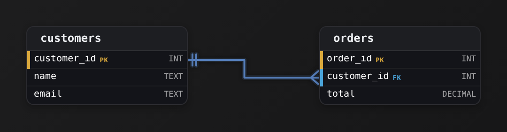
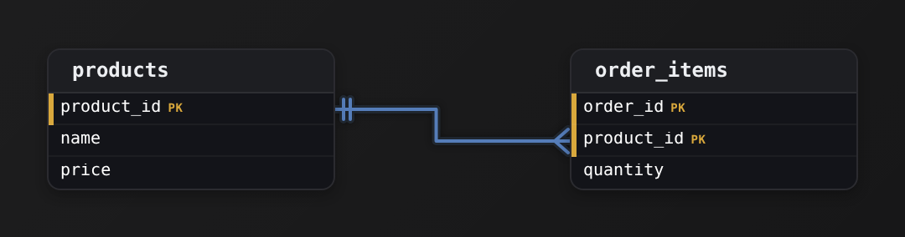
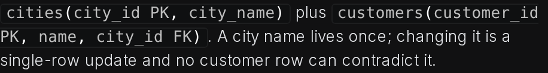
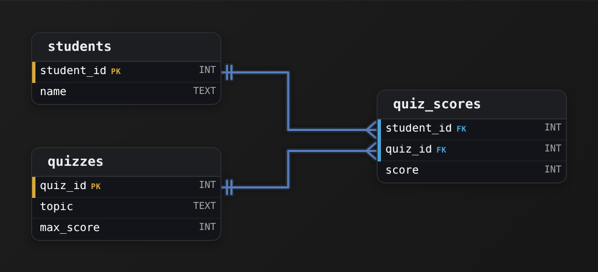
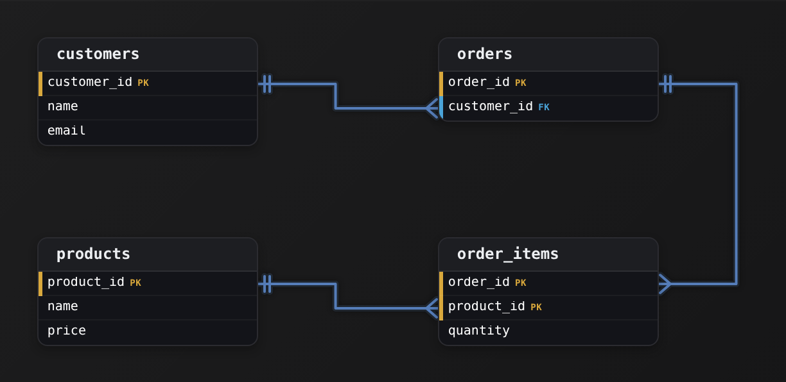
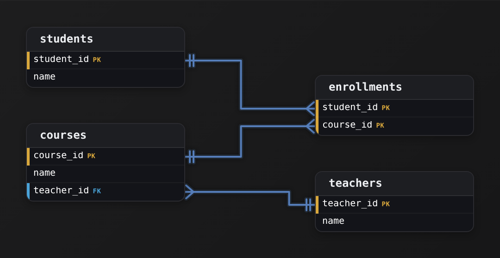

# Normalization - Exercises

Lesson: [data_modeling_normalization.md](../data_modeling_normalization.md)

### Exercise 1 of 12

**● TASK**

An orders table stores customer name and email in every row. Changing a customer's email means updating hundreds of rows. Fix the redundancy.

<strong>Solution</strong>

#### The fix is a foreign key, not a bigger table

In the wide `orders` table, `name` and `email` sit in an order row but describe the customer. That is a **transitive dependency**: `order_id` determines `customer_id`, and `customer_id` determines `email`. Third normal form (3NF) says every non-key column must describe the key and nothing but the key. Here `email` describes `customer_id`, which is not the key of `orders`. That mismatch is why one email change rewrites hundreds of rows. The fix moves the customer facts into their own table and points at them with a foreign key.

*One row per customer in `customers`; every order references it through `orders.customer_id`.*

| Key insight: One fact, one place |
| --- |
| An email now lives in a single `customers` row. Updating it is a one-row `UPDATE`, and 2 orders can no longer disagree about the same customer's address. The `customer_id` foreign key is how you join name and email back onto a report when you need them. |

| ✕ Before (one wide table) | ✓ After (customers + orders) |
| --- | --- |
| `name` and `email` repeat on every order. A customer with 400 orders stores their email 400 times, so a change means 400 writes that can partially fail and leave the rows out of sync. | `email` sits once in `customers`. `orders` keeps `order_id`, `total` and the `customer_id` foreign key. A change is one write, and no order row is touched. |

| Pitfall: Copying the columns is not moving them |
| --- |
| A common half-fix adds a `customers` table but leaves `name` and `email` on `orders` as well. The redundancy is still there, now in 2 places. The split only works once `orders` keeps nothing about the customer except `customer_id`. |

This shape turns up everywhere: `line_items` repeating a product's name, `events` repeating a venue's address, `payroll` repeating a department name. The move is always the same: lift the repeating attributes into the table they describe and leave a foreign key behind.

**Follow-up questions**

1. Where would you store a shipping address that can differ per order?\
   *Separates attributes of the customer from attributes of the order.*
2. What can the `customer_id` foreign key make the database enforce that the wide table could not?\
   *Referential integrity: no order can point at a customer that does not exist.*

 

### Exercise 2 of 12

**● TASK**

A products table copies category name into every row. If a category name changes, thousands of rows need updating. Eliminate the duplication.

<strong>Solution</strong>

#### A repeating value is a table trying to escape

Duplicated data goes out of sync, and the starter's `category_name` column is the plainest case of it. The category name doesn't depend on the product, it depends on the category. That's the tell: a column whose value repeats across a group of rows is describing **something the table isn't really about**. When 'Kitchenware' is stamped onto every kitchen product, the row is storing a fact about the category in the wrong place, and every copy is one more row a rename can miss. The fix is to give the category its own table and point at it.

*The category name lives in exactly one row of `categories`; each product references it by `category_id`.*

Every category name now lives in exactly one place: one row of `categories`. A product no longer carries the name at all. It carries a `category_id` that points at the owning row. Renaming a category is a single `UPDATE` to one row, and every product sees the new name because it never held a copy. That is what eliminating the duplication means: not compressing the repeated text, but moving the fact to the one row that owns it.

| Trick: The reference ties the split back together |
| --- |
| Splitting the table is only half the work. `products.category_id` must be a foreign key referencing `categories.category_id`. That reference is what lets you join the name back on read, and it stops a product from pointing at a category that doesn't exist. Without it you have 2 disconnected tables. |

| Pitfall: Keeping the copied name 'for convenience' |
| --- |
| The common half-fix adds `categories` and a `category_id` reference but leaves `category_name` on `products` too, so reads skip the join. Now the reference and the copied string can disagree, and a rename still has thousands of rows to touch. If the name lives in `categories`, it must not also live in `products`. |

| ✕ Before (duplicated) | ✓ After (one copy) |
| --- | --- |
| One `products` table with `name`, `price` and a repeated `category_name` on every row. A category rename touches thousands of rows, and any missed row is silently wrong. | `categories` owns the name behind `category_id`; `products` holds `category_id` as a reference. A rename changes one row, and a join reconstructs the name on demand. |

The same move shows up constantly on the job: an `orders` table repeating a customer email, an `events` table repeating a venue address, a `line_items` table repeating a product name. Whenever a column's value is identical across a group of rows, ask which thing actually owns that fact, give it a table with a primary key, and replace the repeated column with a reference to it.

**Follow-up questions**

1. What should happen to a product's `category_id` when its category row is deleted?\
   *Extends the reference beyond drawing the arrow: block the delete, or clear the product's category.*
2. The `orders` table also repeats each customer's email on every order. Which table should own the email?\
   *Applies the same move to a second repeated fact.*

 

### Exercise 3 of 12

**● TASK**

A contacts table stores multiple phone numbers as comma-separated text in one column, a 1NF violation. Fix it.

<strong>Solution</strong>

#### First normal form: one value per cell

First normal form (1NF) says every column holds a single, atomic value, never a list packed into one field. A `phones` column holding '555-1234,555-9876,555-0000' is really 3 facts crammed into one cell. The fix is to pull that **repeating group** out into its own table, one row per phone number, and link it back to the contact with a foreign key. That link is a one-to-many relationship: one contact, many phone rows.

*The comma-separated column becomes its own table, one row per phone, joined back on `contact_id`.*

1. **Give the parent a stable key**

   `contacts` keeps `contact_id` as its primary key and drops the phone list. What remains in the row is a fact about the contact alone, which is exactly what 1NF wants.

2. **Make each repeating value its own row**

   Create `phone_numbers` with its own `phone_id` primary key, a single `phone` column holding one number, and a `contact_id` foreign key back to `contacts`. The foreign key is what makes it one-to-many: many `phone_numbers` rows can carry the same `contact_id`.

| Pitfall: Numbered columns are still a list |
| --- |
| The tempting fix is to widen `contacts` with `phone1`, `phone2`, `phone3`. That is the same 1NF failure in disguise: the count is capped arbitrarily, most rows leave `phone3` as `NULL`, and searching by area code now means checking 3 columns. A child table removes the cap: a contact with 5 numbers is just 5 rows. |

| Real world: A delimiter in a column means a missing child table |
| --- |
| The same shape appears everywhere: a user with many emails, an order with many line items, a post with many tags. Whenever you see commas inside a value, or numbered columns like `option_a` and `option_b`, a child table with a foreign key back to its parent is waiting to be drawn. |

**Follow-up questions**

1. How would you stop the same number from being stored twice for one contact?\
   *Adds a composite unique constraint on (`contact_id`, `phone`).*
2. What changes if one phone number can belong to several contacts, like a shared household line?\
   *Turns one-to-many into many-to-many, which needs a junction table.*

 

### Exercise 4 of 12

**● TASK**

The `articles` table keys each row on `article_id`, keeps a `title`, and stores every tag in one `tags` cell as a comma-separated list like 'sql, indexes, performance'. Redesign it into first normal form so each cell holds a single tag, an article can carry any number of tags, and one tag can label many articles.

<strong>Solution</strong>

#### First normal form: one value per cell

A `tags` cell reading 'sql, indexes, performance' is the textbook break of **first normal form** (1NF): the cell holds a list where it should hold one atomic value. The fix is to give each value its own row. Because one article has many tags and one tag labels many articles, those rows belong in a separate table that pairs the two.

*`article_tags` holds one row per (article, tag) pair; its composite key includes `article_id`, which also references `articles`.*

1. **Leave `articles` holding one row per article**

   `articles` keeps `article_id` as its primary key and the columns that describe the article itself, like `title`. The `tags` column disappears entirely; its data moves out. Nothing that is true once per article changes.

2. **Create a table keyed on the pair**

   `article_tags` gets 2 columns, `article_id` and `tag`, and its primary key is both of them together. That lets the same `article_id` appear on many rows (one per tag) and the same `tag` appear against many articles, while forbidding the exact duplicate pair. `article_id` also points back to `articles.article_id`.

| Key insight: One row per tag replaces one list per article |
| --- |
| Each row of `article_tags` is one fact: 'this article carries this tag'. Adding a tag is an `INSERT`, removing one is a `DELETE` of a single row, and no other row is touched. |

| ✕ Comma-separated column | ✓ One tag per row |
| --- | --- |
| `WHERE tags LIKE '%sql%'` to find tagged articles, which can't use an index and matches 'nosql' by accident. Counting articles per tag means splitting strings first. | `WHERE tag = 'sql'` uses the index on `article_tags`, joins cleanly to `articles`, and `GROUP BY tag` counts usage in one line. |

| Pitfall: A surrogate `id` lets duplicate pairs in |
| --- |
| Giving `article_tags` its own `id` primary key works, but it lets the same (article, tag) pair be inserted twice unless you add a unique constraint anyway. Making the pair itself the primary key gets uniqueness and the lookup index in one move. |

**Follow-up questions**

1. How would you fix a `phone_numbers` column holding '555-1234, 555-5678'?\
   *The same move applies to any list-valued column: each phone number becomes its own row keyed by the person and the number.*
2. How would you list every article that has both 'sql' and 'performance'?\
   *Filter `article_tags` to the 2 tags, then `GROUP BY article_id HAVING COUNT(*) = 2`.*

 

### Exercise 5 of 12

**● TASK**

An order-items table has a composite key but some columns depend on only part of that key, a 2NF violation. Separate out the partial dependency.

<strong>Solution</strong>

#### Second normal form, in plain terms

Second normal form says: when a table has a **composite key**, every non-key column must depend on the *whole* key, not just part of it. The table you were handed keyed each row on the pair (`order_id`, `product_id`), which is correct because a product appears on an order once and its `quantity` genuinely needs both halves to make sense. The trap is that `name` and `price` came along for the ride, and those describe the product alone. `price` depends on `product_id` and nothing else, so it hangs off only *part* of the key. That is the partial dependency you had to separate out.

| Pitfall: What the un-split table actually costs you |
| --- |
| Leaving `name` and `price` in `order_items` means the price of a product is stored once per order line it appears on. Sell the same item on 500 orders and you store its price 500 times. Change the price and you must update every one of those rows in lockstep, and if one update is missed the same product now has 2 prices. That inconsistency, the update anomaly, is the concrete symptom 2NF exists to prevent. |

*The partial-dependency columns move to products; `order_items` keeps only what needs the whole key, and points back with a foreign key.*

1. **Move the partially-dependent columns to their own table**

   Anything that depends on only `product_id` becomes a `products` table keyed on `product_id` alone: `name` and `price` land there, one row per distinct product. Now a price lives in exactly one place, which is the whole point.

2. **Leave `order_items` with only the full-key columns**

   `order_items` keeps its composite key (`order_id`, `product_id`) and `quantity`, because `quantity` really is a fact about *this product on this order*. `product_id` stays in the key and simultaneously becomes a **foreign key** referencing `products.product_id`, which is how the split row still knows which product it names.

| ✕ Before (2NF violation) | ✓ After (2NF) |
| --- | --- |
| One `order_items` table holding `order_id`, `product_id`, `quantity`, `name`, `price`. `name` and `price` repeat on every line for the same product and can drift out of sync. | `products` owns `name` and `price` once each; `order_items` keeps `quantity` and a `product_id` foreign key. Each fact is stored in exactly one place. |

| Key insight: The tell for a partial dependency |
| --- |
| You only ever look for a 2NF partial dependency when the key is composite. Scan each non-key column and ask which part of the key it truly needs. If a column is fully determined by a strict subset of the key (`price` by `product_id`), that subset wants to become its own table, and the leftover key column stays behind as a foreign key. |

**Follow-up questions**

1. What if the price a customer paid can differ from the current catalog price over time?\
   *Tests whether the learner sees that a historical `unit_price` genuinely depends on the whole (`order_id`, `product_id`) key and therefore belongs on `order_items`, not products.*
2. Where would order-level facts like `order_date` or `customer_id` live once you keep normalizing?\
   *Extends the concept toward an orders table, since those depend on `order_id` alone, another partial dependency.*

 

### Exercise 6 of 12

**● TASK**

A course-grades table has a composite key, but course name depends on only the course portion. Fix the partial dependency.

<strong>Solution</strong>

#### Partial dependency and second normal form

Splitting out `courses` is **second normal form** at work. Once a table has a composite primary key, every non-key column must depend on the whole key, not on part of it. The key here is (`student_id`, `course_id`), but the course `name` is fixed by `course_id` alone, because who the student is has no bearing on what the course is called. That is a partial dependency, and 2NF is the rule that forbids it.

| Pitfall: A half-key fact repeats on every enrollment |
| --- |
| If `name` stays in `course_grades`, it is copied once per student taking the course. Renaming 'Intro to CS' then means updating every one of those rows, and missing one leaves the table disagreeing with itself. A course with no enrollments yet also has nowhere to store its name. |

1. **Move course-only facts to `courses`**

   Every column that depends on `course_id` alone moves to a `courses` table keyed by `course_id`, with `name` as a plain attribute. The name is now stored once, next to the key it actually depends on.

2. **Keep whole-key facts on `course_grades`**

   `course_grades` keeps the composite key (`student_id`, `course_id`) and `grade`, since a grade depends on both the student and the course. Its `course_id` also becomes a foreign key to `courses`, so every grade still points at a real course and its name.

*`name` lives once in `courses`, and `course_grades` references it through `course_id`.*

| Real world: Junction tables attract one-sided columns |
| --- |
| Enrollments, order line items and team memberships all collect attributes that really belong to one side. For each column, ask whether it depends on the whole key or on just one part. A column that depends on one part moves to that part's own table and is referenced by foreign key. |

**Follow-up questions**

1. If this table also stored the student's `major`, where would it go?\
   *`major` depends on `student_id` alone, so it moves to a `students` table, mirroring the `courses` split.*
2. What if each grade carried a numeric `score` and a `letter` derived from that score?\
   *A non-key column depending on another non-key column is a transitive dependency, which third normal form addresses.*

 

### Exercise 7 of 12

**● TASK**

An employees table stores department name alongside department ID. The name depends on the ID, not the primary key. Remove the transitive dependency.

<strong>Solution</strong>

#### Every fact lives with the key it depends on

Third normal form removes **transitive dependencies**: a non-key column that depends on another non-key column instead of on the primary key. The department name says nothing about the employee. It is determined by `department_id`, which is in turn determined by `employee_id`. That chain is the signal. The repair moves the name to a table where its real determinant, `department_id`, is the primary key.

*The department name is stored once in `departments`. Each `employees` row points to it through `department_id`.*

1. **Give the department its own table**

   Create `departments` with `department_id` as the primary key and the department `name` as an ordinary column. The name now depends on the key of the table that holds it, and nothing else.

2. **Point `employees` at it with a foreign key**

   Keep `department_id` on `employees` and mark it as a foreign key to `departments.department_id`. Each employee row stores a reference to its department rather than a copy of the department name. A join retrieves the name when you need it.

| Pitfall: Keeping the copy in sync is the anomaly |
| --- |
| The tempting non-fix leaves the department name on `employees` and relies on keeping it in sync. Rename a department and every row still holding the old string is wrong. A department with no employees has nowhere to store its name. With the name stored once in `departments`, neither problem can occur. |

| Real world: Label columns beside their ids are the usual 3NF cleanup |
| --- |
| Status labels, category names and region names often sit next to their ids in real schemas. Normalizing them costs a join. In return, a rename becomes a single `UPDATE`, and the `FK` rejects ids that point at nothing. |

**Follow-up questions**

1. 2 departments in different regions share the same name. Does the design still hold?\
   *The name was never the identity. The surrogate `department_id` still keys the row.*
2. A report needs the department name on every employee row and can't afford the join. Where should the copy live?\
   *Deliberate denormalization belongs in a view or read model built from the normalized tables, not in the source table.*

 

### Exercise 8 of 12

**● TASK**

A products table stores category description alongside category ID, a transitive dependency. Normalize to 3NF.

<strong>Solution</strong>

#### The transitive dependency

Third normal form says every non-key column must depend on the key, the whole key, and nothing but the key. The starting `products` table breaks the last part: `product_id` decides `category_id`, but `category_id` decides the category `description`. So `description` depends on the key only **through** another non-key column, and that indirect chain is a transitive dependency. 3NF is the rule that removes it.

| Pitfall: Storing the description on the product |
| --- |
| The version most people write first keeps `description` right on `products` next to `category_id`. Now the same category text is copied onto every product in that category. Rename the category and you must update thousands of rows or leave some stale; a category with no products yet has nowhere to live at all. That duplication is exactly what the transitive dependency was warning you about. |

*3NF: description moves to categories; products keeps only a `category_id` foreign key.*

The fix is to give the dependent facts their own home. `description` is really a fact about the category, so it moves into a `categories` table keyed by `category_id`. `products` keeps `category_id` as a foreign key pointing at that table. Every non-key column now depends on its own table's key and nothing else: `description` on `categories.category_id`, `name` on `products.product_id`. The chain is gone.

| Key insight: The shape this creates |
| --- |
| Splitting on a transitive dependency almost always produces a one-to-many: one row in `categories` is referenced by many rows in `products` through the `category_id` foreign key. The category text is stored exactly once, and a category can exist before any product uses it. That is the payoff of 3NF, one fact in one place. |

**Follow-up questions**

1. What if a product could belong to several categories at once?\
   *Pushes past one-to-many to a many-to-many, which needs a junction table like `product_categories` rather than a single `category_id` column.*
2. Where would you put a category's parent category to build a hierarchy?\
   *Tests self-referencing foreign keys: a `parent_category_id` on `categories` pointing back at `category_id`.*

 

### Exercise 9 of 12

**● TASK**

A customers table stores city name alongside city ID, a transitive dependency. Fix it to reach 3NF.

<strong>Solution</strong>

#### The transitive dependency you just broke apart

Third normal form says every non-key column must depend on the key, the whole key, and **nothing but the key**. The `customers` table you started with violated that last clause: `city_name` doesn't depend on `customer_id` at all, it depends on `city_id`, which in turn depends on `customer_id`. That chain, `customer_id` to `city_id` to `city_name`, is a transitive dependency, and the fix is always the same shape, lift the dependent pair out into its own table and leave a foreign key behind.

Concretely: `city_id` and `city_name` travel together and are really a fact about a city, not about a customer. So they belong in a `cities` table keyed by `city_id`. The `customers` table keeps `city_id` as a foreign key and drops `city_name` entirely. Now `city_name` lives in exactly one place and depends only on its own key.

*The 3NF result: `city_name` moves to cities, customers references it by `city_id`.*

| Pitfall: Leaving `city_name` on both tables |
| --- |
| The tempting half-fix is to add a `cities` table but keep `city_name` on `customers` too, 'for convenience.' That reintroduces the exact anomaly 3NF exists to prevent: rename a city and you now have to update every customer row, and if you miss one, `cities.city_name` and `customers.city_name` disagree with no way to say which is right. The column must exist in exactly one place. `customers` gets `city_id` and only `city_id`. |

| Key insight: How to spot a transitive dependency in the wild |
| --- |
| Ask of every non-key column: 'does this describe the row's entity, or something the row merely points at?' `name` describes the customer, it stays. `city_name` describes a city the customer points at, it leaves. Any time 2 non-key columns always change together (`city_id` and `city_name` here, or `zip` and `city`, or `product_id` and `product_name`), you're looking at a hidden entity waiting to become its own table. |

| ✕ Before (2NF, not 3NF) | ✓ After (3NF) |
| --- | --- |
| `customers(customer_id PK, name, city_id, city_name)`. Every non-key column depends on the key, but `city_name` depends on it only through `city_id`. Updating a city name means touching many rows. | `cities(city_id PK, city_name)` plus `customers(customer_id PK, name, city_id FK)`. A city name lives once; changing it is a single-row update and no customer row can contradict it. |

**Follow-up questions**

1. What if 2 cities in different states share the same name, like Springfield?\
   *Tests whether the learner sees that `city_id` as a surrogate key already handles this, each Springfield is a distinct `cities` row, and that adding a `state_id` FK to `cities` would extend the same normalization one level further.*
2. Where does this pattern stop, could city itself have a transitive dependency?\
   *Probes the idea that normalization is recursive: if `cities` also stored `state_name`, you'd factor out a `states` table by the identical reasoning.*

 

### Exercise 10 of 12

**● TASK**

Create a fully normalized 3NF schema for tracking student quiz scores.

<strong>Solution</strong>

#### Third normal form: one fact, one home

**Third normal form** wants every non-key column to depend on the key, the whole key, and nothing but the key. In practice that is one habit: give each real thing its own table so a fact is stored once. There are 3 things here, a student, a quiz, and the `score` earned when a student sits a quiz. That score belongs to neither entity alone, so it lives in `quiz_scores` between them.

*2 entity tables and the junction that records who scored what.*

1. **Bridge the many-to-many with a composite-key junction**

   A student takes many quizzes and a quiz is taken by many students, so neither entity table can hold a foreign key to the other. `quiz_scores` breaks the tie: `student_id` and `quiz_id` are both foreign keys, and together they form its primary key. That composite key lets a student hold one `score` per quiz, and `score` depends on the whole pair, nothing less.

| Pitfall: One wide table repeats every fact |
| --- |
| Cramming `name`, `topic`, `max_score`, and `score` into one row means a name change must be edited in every attempt, and `max_score` is copied per row where the copies can silently disagree. Splitting out `students` and `quizzes` gives each fact one home: `max_score` is a property of the quiz, not of an attempt. |

**Follow-up questions**

1. What if a student may retake a quiz and you keep every attempt?\
   *The composite key blocks a second row for the same pair, so add `attempt_no` or `taken_at` into the key to make each attempt distinct.*
2. Where does the date a quiz was taken belong?\
   *It describes the attempt, so it sits on `quiz_scores`, not on `students` or `quizzes`.*

 

### Exercise 11 of 12

**● TASK**

Take a fully denormalized orders dataset (with customer, product, and order info all in one flat table) and normalize it to 3NF.

<strong>Solution</strong>

#### Normalizing to 3NF: one fact, one place

You started with a single flat table where every row repeated the customer's `name` and `email`, the product's `name` and `price`, and the order's identity all together. Normalization is the disciplined act of splitting that one table into several so that every fact lives in exactly one place. Third normal form (3NF) is reached when every non-key column depends on the key, the whole key, and nothing but the key. The 4 tables you drew, `customers`, `products`, `orders`, and `order_items`, are what that rule produces here.

*The flat orders table split into 3NF: an entity table each for customers and products, an orders header, and an `order_items` junction resolving the many-to-many.*

1. **Pull each independent entity into its own table**

   The customer facts (`name`, `email`) depend only on who the customer is, not on any order, so they move to `customers` keyed by `customer_id`. Product facts (`name`, `price`) move to `products` keyed by `product_id` for the same reason. Leaving `price` on the order line would tie a product's identity to the order it happened to appear on, the exact transitive dependency 3NF forbids.

2. **Resolve the many-to-many with a junction table**

   One order contains many products, and one product appears in many orders, so no single foreign key can link them. `order_items` is the junction: its key is the composite `(order_id, product_id)`, with `order_id` referencing `orders` and `product_id` referencing `products`. `quantity` belongs here because it depends on the pair, not on the order alone or the product alone. The `orders` header keeps only what depends on the order itself: its `order_id` and the `customer_id` who placed it.

| Pitfall: Common pitfall: skipping the junction |
| --- |
| The tempting shortcut is to put `product_id` directly on `orders`. That silently assumes one product per order. The moment an order has 2 line items you either duplicate the whole order row or cram a list into one cell, which also breaks first normal form. The composite-key `order_items` table is what lets an order hold any number of distinct products cleanly. |

| Key insight: Why quantity lives on the line, not the order |
| --- |
| A quick test for where a column belongs: ask what it functionally depends on. `quantity` changes per product-within-an-order, so it depends on both halves of the `order_items` key. `email` depends only on `customer_id`. `price` depends only on `product_id`. Placing each column beside the key it actually depends on is the whole game of 3NF. |

| ✕ Denormalized (before) | ✓ Normalized 3NF (after) |
| --- | --- |
| One flat row repeats `customer_email` and `product_price` on every line. Update a customer's email and you must rewrite every order they ever placed; miss one and the data disagrees with itself. | `email` sits once in `customers`, `price` once in `products`. An update touches a single row, and `order_items` records only what a line item genuinely is: a `quantity` of a `product_id` on an `order_id`. |

**Follow-up questions**

1. If a product's `price` can change over time but historical orders must show the price charged at the time, where does that value go?\
   *Tests whether the learner sees that a point-in-time fact belongs on `order_items` (e.g. `unit_price`), separate from the current `products.price`.*
2. How would you extend this schema to let one order ship to a different address than the customer's default?\
   *Probes modeling an order-level attribute versus a customer-level one.*

 

### Exercise 12 of 12

**● TASK**

Normalize a flat school schedule dataset into 3NF, separating students, teachers, and courses.

<strong>Solution</strong>

#### What 3NF is asking you to do here

Third normal form means every non-key column depends on the key, the whole key, and nothing but the key. The flat schedule row mixes 4 different things in one place: a student, a teacher, a course, and the fact that the student is taking that course. Normalizing to 3NF is just the act of giving each of those its own table with its own primary key, then reconnecting them with foreign keys. Once you see the 4 entities, the shape almost writes itself.

*The flat row split into 3 entity tables plus one junction table.*

1. **Give each real-world thing its own table**

   A student, a teacher, and a course are 3 independent entities, so each gets a table and a surrogate key: `students(student_id)`, `teachers(teacher_id)`, `courses(course_id)`. The name lives with its entity and nowhere else, so a teacher renamed once is renamed everywhere. This is what kills the duplication where the teacher's name repeated on every schedule row.

2. **Model the one-to-many with a foreign key column**

   One teacher teaches many courses, but a course has exactly one teacher. That asymmetry means the key goes on the many side: `courses` carries a `teacher_id` foreign key pointing at `teachers.teacher_id`. You do NOT put a course list on the teacher, because a single column cannot hold many course ids without breaking first normal form.

3. **Model the many-to-many with a junction table**

   A student takes many courses and a course holds many students, so neither side can carry a foreign key to the other. The relationship itself becomes a row in `enrollments`, whose primary key is the composite `(student_id, course_id)`. That composite key is doing double duty: it links out to both parents AND it stops the same student being enrolled in the same course twice.

| Trick: The count-the-arrows test |
| --- |
| Decide the direction of every relationship before you place a single key. A one-to-many (`teachers` to `courses`) puts a foreign key on the many side. A many-to-many (`students` to `courses`) can never be a foreign key on either table; it always needs its own `enrollments` row. If you find yourself wanting to store a list in a column, that is the signal you actually needed a junction table. |

| Pitfall: Common pitfall: a junction table with a surrogate key |
| --- |
| It is tempting to give `enrollments` its own `enrollment_id` and leave `student_id` and `course_id` as plain columns. That technically works, but it lets a duplicate (`student_id`, `course_id`) pair sneak in unless you remember to add a separate unique constraint. Making the pair itself the composite primary key gets the uniqueness for free and states the intent: an enrollment IS a student-course pairing. |

| ✕ Flat (un-normalized) row | ✓ Normalized 3NF |
| --- | --- |
| One wide row repeats `teacher_name` and `student_name` for every enrollment. Rename a teacher and you must hunt down every row; delete a student's last enrollment and you lose the student entirely. | Each fact lives once. `teachers.name` is stored a single time, `enrollments` holds only ids, and a student with zero courses still exists as a row in `students`. No update or deletion anomalies. |

**Follow-up questions**

1. What changes if a course can be co-taught by 2 teachers?\
   *Turns the one-to-many between `teachers` and `courses` into a many-to-many, so the `teacher_id` FK on `courses` must become its own `course_teachers` junction table.*
2. Where would you store a per-enrollment grade or enrollment date?\
   *Tests whether they see `enrollments` as a real entity: attributes of the relationship belong on the junction table, not on `students` or `courses`.*

