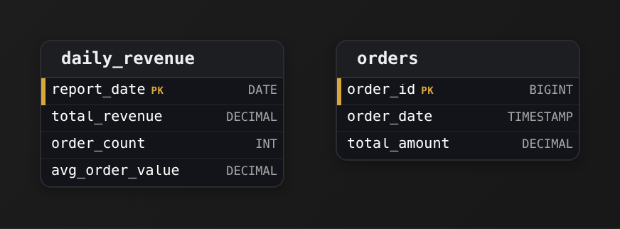
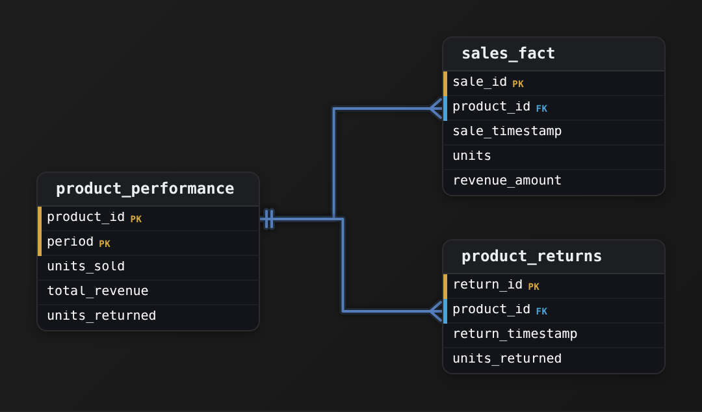
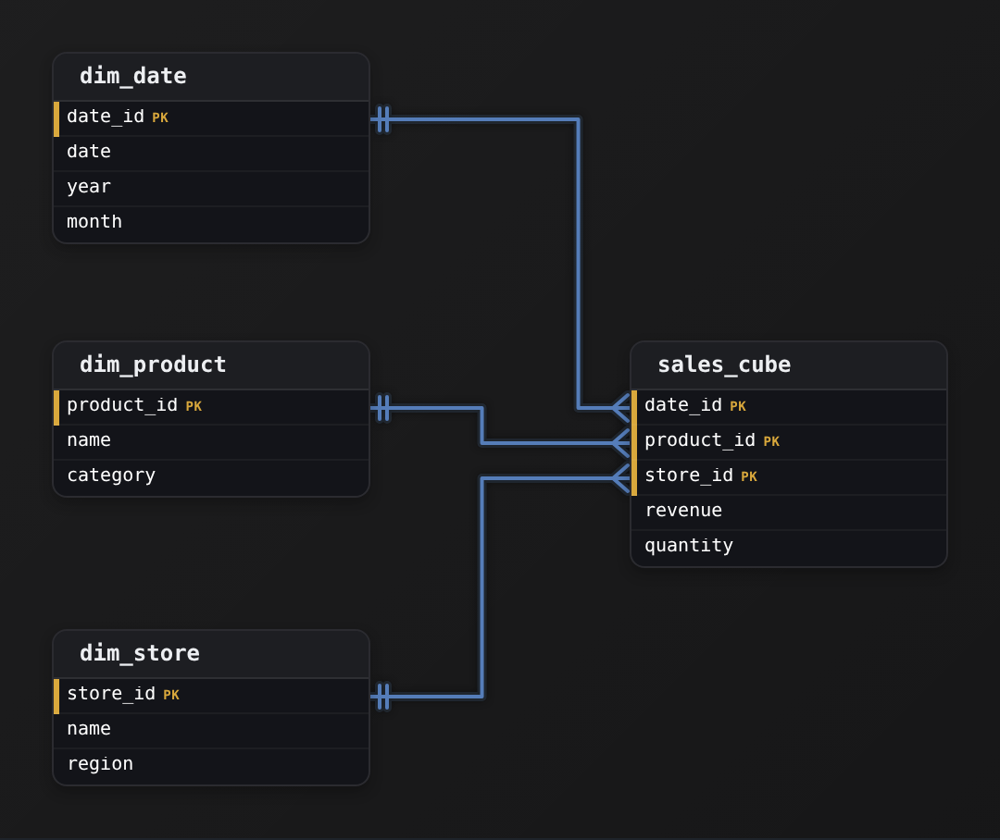
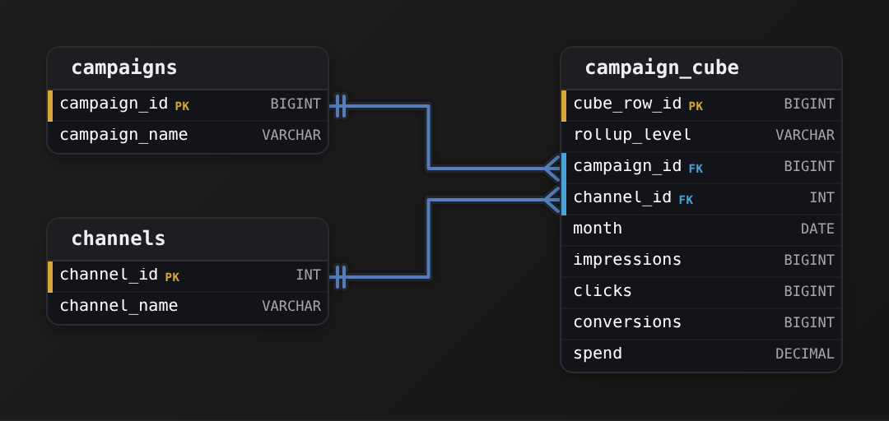
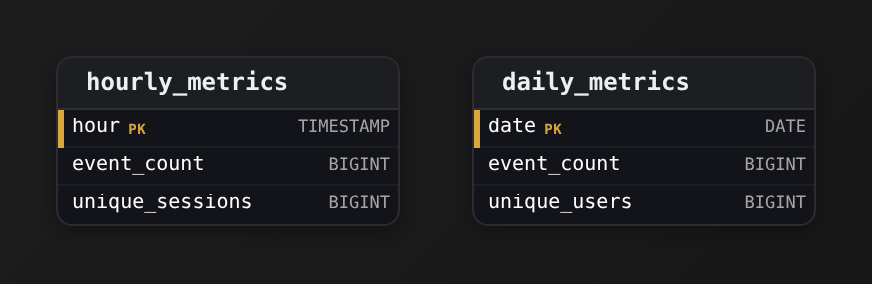
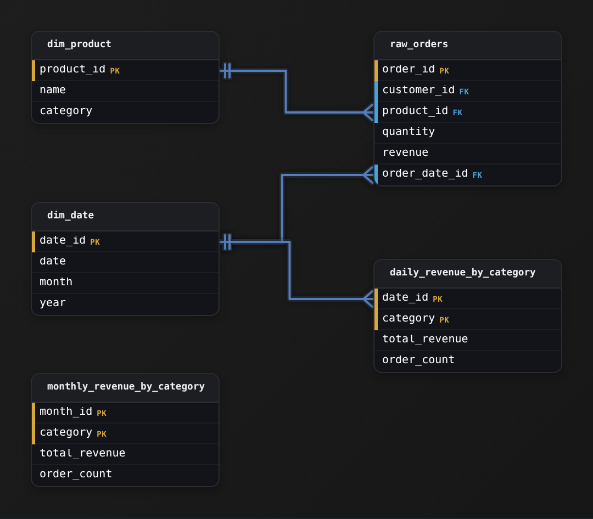
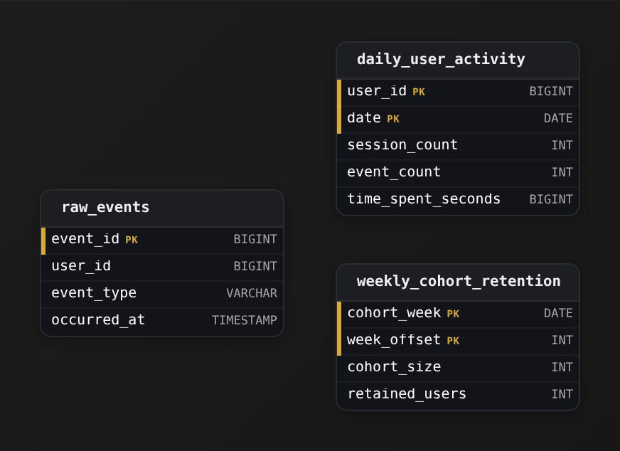

# Pre-Aggregation - Exercises

Lesson: [data_modeling_aggregation.md](../data_modeling_aggregation.md)

### Exercise 1 of 12

**● TASK**

Design a daily revenue aggregate table pre-computed from raw orders to avoid expensive full-table scans.

<details>
<summary><strong>Solution</strong></summary>

#### A rollup table, keyed by its grain

Pre-aggregation means answering "what was revenue on each day?" once, on a schedule, and storing the answer. Dashboards then read a small `daily_revenue` table instead of scanning every row of `orders`. The design depends on one decision made first: **the grain**.



*`daily_revenue` is derived from `orders` by a job, not joined to it, so there is no foreign key between them.*

| Key insight: One row per calendar day |
| --- |
| Grain answers "what does one row mean?" Here it is one day, so `report_date` is the primary key, and every other column is an aggregate over that day: `SUM(total_amount)` becomes `total_revenue`, `COUNT(*)` becomes `order_count`. |

| Pitfall: Averages do not add up |
| --- |
| Keeping `order_id` turns the row back into an order, which just copies `orders`. Storing only `avg_order_value` breaks weekly rollups: 7 daily averages cannot be averaged. Keep the additive `total_revenue` and `order_count`, then divide at the end. |

**The nightly refresh**

```sql
INSERT INTO daily_revenue (report_date, total_revenue, order_count, avg_order_value)
SELECT
    order_date::date        AS report_date,
    SUM(total_amount)       AS total_revenue,
    COUNT(*)                AS order_count,
    AVG(total_amount)       AS avg_order_value
FROM orders
WHERE order_date::date = CURRENT_DATE - 1
GROUP BY order_date::date
ON CONFLICT (report_date) DO UPDATE
    SET total_revenue   = EXCLUDED.total_revenue,
        order_count     = EXCLUDED.order_count,
        avg_order_value = EXCLUDED.avg_order_value;
```

*The `GROUP BY` key is the grain; the `report_date` PK makes `ON CONFLICT` a safe, re-runnable upsert.*

| Real world: Billions of rows become 365 a year |
| --- |
| BI layers work this way: overnight jobs roll raw events into per-day or per-hour summaries, and dashboards only query those. In a star schema these rollups are fact tables keyed to a date dimension. |

**Follow-up questions**

1. What changes if revenue must also be split by `region`?\
   *The grain becomes one row per (`report_date`, `region`), so the primary key becomes composite.*
2. A late order arrives dated 3 days ago. How does `daily_revenue` stay correct?\
   *Re-run the upsert over a trailing window of days, not only yesterday.*

</details>


<br>

### Exercise 2 of 12

**● TASK**

Design a pre-aggregated summary table that a dashboard reads instead of scanning the 500-million-row sales_fact (product_id, sale_timestamp, units, revenue_amount) and product_returns (product_id, return_timestamp, units_returned). Make the grain one row per product per period, keyed by the composite (product_id, period). Store only additive columns (units_sold, total_revenue, units_returned) so coarser rollups stay correct; return rate is computed at query time.

<details>
<summary><strong>Solution</strong></summary>

#### Pre-aggregation: trade storage for read speed

A **summary table** is pre-aggregation in its plainest form. You run the `GROUP BY` over `sales_fact` and `product_returns` once, on a schedule, and write the result into `product_performance`. The dashboard then reads a few thousand rows instead of scanning 500 million. It is the same idea an OLAP cube materializes. What you designed is the rollup's grain and its columns.



*2 large facts roll up into one small summary keyed on (`product_id`, `period`).*

1. **Fix the grain, then the key falls out**

   Say the grain as a sentence: one row per product per period. The primary key follows directly as the composite of `product_id` and `period`. Every other column must then be a fact measured at exactly that grain.

2. **Keep only additive measures**

   `units_sold`, `total_revenue` and `units_returned` are plain sums, so a quarter is just the `SUM` of its months. This is what lets one table serve day, month and quarter views.

| Pitfall: A stored ratio breaks on rollup |
| --- |
| A `return_rate` column (`units_returned / units_sold`) is correct on a single row and wrong at any coarser grain. A quarter's rate is not the sum or the average of its monthly rates, because each month has a different denominator. Store both components and divide at query time. The same applies to `avg_price` or `margin_pct`. |

| Real world: The summary is a rebuildable read model |
| --- |
| A nightly or hourly job repopulates `product_performance`, either as a materialized view or as a scheduled `INSERT ... SELECT`. The duplication is deliberate denormalization. The facts remain the source of truth, and you can drop and rebuild the summary at any time. |

**Follow-up questions**

1. If the finest `period` you store is a day, how does the dashboard serve a monthly view without a second table?\
   *Additivity means you re-aggregate the summary itself with `SUM` grouped by month.*
2. A product has sales in a period but zero returns. Should a row still exist, and what does `units_returned` hold?\
   *The outer-join gap: the row exists with `units_returned` as 0.*
3. What breaks if `product_id` alone is the primary key?\
   *Grain, not just uniqueness, drives the key: every period collapses into one row.*

</details>


<br>

### Exercise 3 of 12

**● TASK**

Design a store-level daily sales aggregate using fully additive metrics (sums that roll up correctly across all dimensions).

<details>
<summary><strong>Solution</strong></summary>

#### Grain first, then metrics

The technique here is **grain definition**: before you name a single column, you fix the exact meaning of one row. For this aggregate the grain is one store, one day, so the natural key is (`store_id`, `sale_date`) and both together form the primary key. Everything else on the row must be a fact measured at that grain and nothing else. Pin the grain down in one sentence you could say out loud ("one row per store per day") and the rest of the table almost designs itself.


*One row per (`store_id`, `sale_date`); every measure is a plain SUM at that grain.*

| Trick: Store only fully additive measures |
| --- |
| A measure is fully additive when SUM over any dimension still means something. `total_revenue`, `units_sold` and `transaction_count` are all counts of things, so summing them across stores, across days, or across both gives the correct grand total. That is what lets one daily table answer weekly, monthly, per-region and company-wide questions with the same `SUM(...) GROUP BY ...`. |

| Pitfall: Never store an average as a column |
| --- |
| The tempting wrong version adds `avg_order_value` to the row. Averages are non-additive: the average of daily averages is not the real average, and there is no weight to recover it from once the detail is gone. The fix is to keep the 2 additive components, `total_revenue` and `transaction_count`, and divide at read time (`SUM(total_revenue) / SUM(transaction_count)`). Store the sums, compute the ratios in the query. |

| ✕ Additive (keep) | ✓ Non-additive (derive) |
| --- | --- |
| `total_revenue`, `units_sold`, `transaction_count`, each is a SUM that rolls up across `store_id` and `sale_date` unchanged. | `avg_order_value`, `pct_returns`, `distinct_customers`, ratios, percents and distinct counts cannot be re-summed. Derive them from stored sums, or model distinct counts at their own grain. |

This is also **pre-aggregation**: you collapse millions of raw transactions once, into one small row per store-day, so dashboards never rescan the fact table. Because the stored measures are additive, that single daily table is the source for every coarser period. A monthly report is just `SUM(total_revenue) ... GROUP BY store_id, date_trunc('month', sale_date)` over the same rows. In real warehouses this is exactly how a daily aggregate feeds weekly and quarterly rollups without a second pipeline.

**Follow-up questions**

1. How would you report distinct customers per store-week if `store_daily_sales` only stores counts?\
   *Tests understanding that distinct counts are non-additive and cannot be summed from a daily grain; you need per-customer detail or an approximate sketch.*
2. A stakeholder wants average revenue per store. What do you compute at read time and why not store it?\
   *Checks that ratios are derived from `SUM(total_revenue)` and a count, never persisted as a column.*

</details>


<br>

### Exercise 4 of 12

**● TASK**

A fintech dashboard needs each user's account balance over time. Design a single daily snapshot table with one row per user per day. Account balance is a semi-additive metric: you can sum it across users at a single point in time, but you cannot sum it across days. Store the balance snapshot plus the daily transaction count, and use a composite key over the user and the snapshot date to set the grain.

<details>
<summary><strong>Solution</strong></summary>

#### The daily snapshot fact table

What you just modeled is a **daily snapshot fact**: one row that captures the state of a measure at a fixed point in time, taken once per day. The 2 keys you put on the table, `user_id` and `snapshot_date`, are not just identifiers, they DEFINE the grain: exactly one row per user per day. Get the grain right and everything else, the measures and the queries, falls out of it. The whole design is a single table `user_daily_balances` because the question only ever asks for a balance as-of a day, and a snapshot answers that in one indexed lookup.


*Composite PK (`user_id`, `snapshot_date`) sets the grain: one balance snapshot per user per day.*

| Key insight: The composite key IS the grain |
| --- |
| A single-column key on `user_id` would allow only one row per user for all time, and a single-column key on `snapshot_date` would allow one row per day for everyone. Only the composite `(user_id, snapshot_date)` says 'one row per user per day', which is precisely the grain the dashboard reads. The primary key doubles as the uniqueness constraint that stops a double-load from writing 2 balances for the same user on the same day. |

| Pitfall: Semi-additive means SUM across days is nonsense |
| --- |
| `account_balance` is semi-additive: `SUM(account_balance)` across users on one `snapshot_date` gives a real total (assets under management that day), but `SUM(account_balance)` across days for one user double-counts money that never moved. Roll balance up over time with a point-in-time pick, `AVG`, or a last-value, never a `SUM`. Contrast `transaction_count`, which is fully additive: summing it across both users and days is always meaningful. |

| ✕ `account_balance` (semi-additive) | ✓ `transaction_count` (additive) |
| --- | --- |
| Sum across users at one `snapshot_date`: valid. Sum across days: WRONG. Time rollups use last-value or `AVG`, not `SUM`. | A flow, not a level. `SUM(transaction_count)` across any mix of users and days is valid, so monthly activity is a plain `GROUP BY`. |

**The design as DDL**

```sql
CREATE TABLE user_daily_balances (
    user_id           bigint        NOT NULL,
    snapshot_date     date          NOT NULL,
    account_balance   numeric(18,2) NOT NULL,
    transaction_count integer       NOT NULL DEFAULT 0,
    PRIMARY KEY (user_id, snapshot_date)
);
```

*numeric for money (never float), a real date for the grain, and the composite PK enforcing one row per user per day.*

2 data-type choices carry weight here. Money is `numeric(18,2)`, not `float`, because binary floating point cannot represent 0.10 exactly and balances must reconcile to the cent. The grain column is a real `date`, not a string, so range scans and `BETWEEN` filters use the index and sort correctly. Storing the snapshot pre-aggregated this way means the dashboard never re-derives a balance from a transaction ledger at read time, which is the whole point of a snapshot fact: the expensive work happens once, at load.

**Follow-up questions**

1. A user has no activity on a given day. Do you still write a row with the carried-forward balance, or leave a gap?\
   *Tests whether the snapshot is dense (every user every day) or sparse, and how as-of queries handle missing days.*
2. How would you answer 'what was this user's balance on a date with no row'?\
   *Pushes toward a last-value-before-date lookup, reinforcing that balance is a level, not a flow.*
3. If you also needed intraday balances, what changes about the grain and the key?\
   *Moves `snapshot_date` toward a `snapshot_at` timestamp and reshapes the composite key.*

</details>


<br>

### Exercise 5 of 12

**● TASK**

Design a sales cube aggregate that supports rollups across any combination of date, product, and region.

<details>
<summary><strong>Solution</strong></summary>

#### The star schema, plainly

The shape this challenge asked for is a **star schema**: one central fact table surrounded by dimension tables. The fact table, `sales_cube`, holds the numbers you measure (revenue, quantity); each dimension table (`dim_date`, `dim_product`, `dim_store`) holds the descriptive attributes you slice by. The word 'cube' just means you can aggregate those measures along several independent axes at once, and 'rollup across any combination' is exactly what a star schema is built to answer.



*One fact table with a three-part key, 3 dimensions hanging off it.*

| Trick: The composite key IS the grain |
| --- |
| The insight that cracks this is that `sales_cube`'s primary key is the set of dimension foreign keys together: `(date_id, product_id, store_id)`. That composite key declares the grain, one row per date per product per store, and guarantees you never store the same cell twice. Each part of the key is both a `PK` component AND an `FK` into its dimension. That dual role is what turns a plain table into a cube. |

Notice region is not a column on `sales_cube`. It lives on `dim_store` as an attribute. A store belongs to a region, so you reach region by joining through `store_id`. This is why the schema handles 'any combination' for free: to roll up by region you `GROUP BY dim_store.region`; to roll up by month you `GROUP BY dim_date.month`; to do both you group by both. The fact table never changes, only the columns you group by.

| Pitfall: Common pitfall: a single surrogate key |
| --- |
| The tempting wrong move is to give `sales_cube` one auto-increment `id` as the primary key and leave the 3 dimension keys as ordinary columns. It looks tidier, but it lets duplicate (`date_id`, `product_id`, `store_id`) rows in, so your rollups silently double-count. The composite key is not decoration; it is the constraint that keeps the aggregate correct. Another version of the same mistake is copying `region` or `category` onto the fact row, which denormalizes the dimensions and means an attribute rename has to touch millions of fact rows. |

| ✕ Additive measures on the fact | ✓ Attributes on the dimension |
| --- | --- |
| `revenue` and `quantity` live on `sales_cube` because they are additive: summing them across any set of rows is meaningful. `SUM(revenue)` over a region-month slice is a real answer. | `year`, `month`, `category`, `region` live on the dimensions because they describe, they are not summed. You group and filter by them. Keeping them off the fact is what makes the star both compact and flexible. |

In production this is the backbone of nearly every reporting warehouse and BI tool. Analysts drag `category` and `region` onto a pivot without writing SQL, and the tool is really just generating `GROUP BY` over this exact star. When someone later asks to slice by a new attribute, say store 'format' or product 'brand', you add a column to the dimension, not to the fact, and every historical row is instantly sliceable by it.

**Follow-up questions**

1. How would you support slicing by product `brand` if brand were added later?\
   *Tests whether they add the attribute to `dim_product` rather than to `sales_cube`.*
2. What breaks if a store's `region` reassignment must not rewrite past sales?\
   *Opens the door to slowly changing dimensions, versioning `dim_store` rows instead of updating in place.*
3. If you needed a running count of distinct customers per slice, why can't that live as a measure on `sales_cube`?\
   *Tests understanding of additive vs non-additive measures.*

</details>


<br>

### Exercise 6 of 12

**● TASK**

Design a flat summary table that serves as an OLAP cube for a marketing dashboard over 3 dimensions: campaign, channel and month. It pre-computes impressions, clicks, conversions and spend for every combination of those dimensions, from campaign by channel by month down to the single grand total. Each row must record which dimensions it rolls up, so the dashboard can tell a channel total from a detail row.

<details>
<summary><strong>Solution</strong></summary>

#### 8 groupings, one table

An OLAP cube answers a dashboard filter before anyone clicks it, because every dimension combination is already a stored row. Campaign, channel and month give 2^3 = 8 groupings: the full detail, 3 pairs, 3 single dimensions and the grand total. In a warehouse the cube is a flat table. The decision that makes it usable is **how each row says which grouping it belongs to**.



*`campaign_cube` holds all 8 groupings. A rolled-up dimension is left empty, and `rollup_level` names the grouping.*

1. **Keep every dimension column on every row**

   `campaign_id`, `channel_id` and `month` appear on all 8 groupings. A channel-by-month total leaves `campaign_id` empty, and the grand total leaves all 3 empty. A composite key over the dimensions cannot have an empty part, so the row is keyed by a surrogate `cube_row_id`.

2. **Name the grouping on the row**

   `rollup_level` holds values such as 'campaign+channel+month', 'channel' or 'all', so the dashboard filters to exactly the level it is drawing. Without that flag, a row with an empty `channel_id` is ambiguous: it could be an all-channels total or a detail row whose channel was never recorded.

3. **Fill it with one `GROUP BY CUBE`**

   `GROUP BY CUBE (campaign_id, channel_id, month)` emits all 8 groupings in a single pass, and `GROUPING()` supplies the value for `rollup_level`. Because the measures are additive, every rolled-up row is a plain `SUM` of the detail rows.

| Pitfall: The detail rows alone are not a cube |
| --- |
| Storing only campaign by channel by month gives you the cube's bottom level and nothing more. Every channel total or monthly total is then still a scan and a `SUM` at read time. The cube pays off only when the higher levels are already rows. |

| Real world: Cubes grow as 2^n |
| --- |
| 3 dimensions give 8 groupings, and 10 give 1,024. At that point the cube can outgrow the fact table it summarizes. When the dashboard only ever asks for a handful of combinations, `GROUPING SETS` stores just those and drops the rest. |

**Follow-up questions**

1. If the dashboard never shows campaign by month without channel, how would `GROUPING SETS` shrink this table?\
   *This practices choosing groupings deliberately instead of taking all 2^n.*
2. What changes if `month` must also roll up to quarter and year?\
   *This adds a hierarchy within one dimension alongside rollups across dimensions.*
3. How many groupings does adding a region dimension create, and is the full cube still worth storing?\
   *This practices the 2^n growth argument.*

</details>


<br>

### Exercise 7 of 12

**● TASK**

Design two aggregate tables at different grains (hourly and daily) that can be reconciled with each other.

<details>
<summary><strong>Solution</strong></summary>

#### Two grains, one truth

**Grain** is the exact thing one row stands for, and here the primary key states it: `hourly_metrics` holds one row per `hour`, `daily_metrics` one row per `date`. Both pre-aggregate the same event stream, so a dashboard reads a few hundred rows instead of rescanning raw events. Whether the two tables can be reconciled depends on which measures you put in them.



*Each table's PK is its grain: one row per `hour`, one row per `date`.*

| Key insight: Additive metrics roll up; distinct counts do not |
| --- |
| `event_count` is additive: a day's total is exactly the sum of its 24 hourly rows. `unique_sessions` is not. A session seen at 09:00 and again at 14:00 counts once in each hour, so summing hourly uniques double-counts it. Distinct counts only hold at the grain they were computed at. |

| ✕ Reconciling the additive column | ✓ Reconciling the distinct column |
| --- | --- |
| `SUM(event_count)` from `hourly_metrics` grouped by day should match `daily_metrics.event_count` row for row. If it drifts, one aggregation is broken or late. | No sum of hourly rows gives `unique_users`. `daily_metrics.unique_users` must be a fresh `COUNT(DISTINCT user_id)` over raw events at day grain. |

| Pitfall: Summing hourly uniques inflates the daily count |
| --- |
| Building the daily table as `SUM(event_count), SUM(unique_sessions)` over `hourly_metrics` is cheap and the additive column tallies perfectly, but `SUM(unique_sessions)` is silently wrong, and worse the more visitors return across hours. Roll additive columns up from the finer table; recompute distinct ones from raw. |

| Real world: Tag every measure with its additivity |
| --- |
| Warehouse teams label measures additive, semi-additive or non-additive. Counts and sums roll up everywhere; balances roll up across everything but time; distinct counts and ratios roll up across nothing. The tag tells the rollup job which columns it may `SUM` and which it must re-derive. |

**Follow-up questions**

1. How could daily distinct users become approximately roll-up-able from the hourly table?\
   *Mergeable sketches such as HyperLogLog, whose registers combine across hours where a `SUM` cannot.*
2. If `hourly_metrics` loads every hour but `daily_metrics` runs at midnight, how do you stop the reconciliation check from false-alarming mid-day?\
   *Compare a partial day only against completed hours.*

</details>


<br>

### Exercise 8 of 12

**● TASK**

Design a single pre-aggregation summary table for revenue by region. Executive reports roll up to the month, but analysts must be able to drill into weekly detail, so choose the finest grain any consumer actually needs. Store additive components instead of a stored average, so that average order value can be computed correctly at every rollup level rather than falling into the average-of-averages trap. Give the table a composite primary key on its grain columns.

<details>
<summary><strong>Solution</strong></summary>

#### Grain is the design decision

The grain of a summary table is the level of detail one row represents. Here 2 consumers pull from the same table: executives roll up to the month, analysts drill into the week. The rule is to build at the **finest grain any consumer actually needs** and let coarser reports aggregate up. Weekly is finer than monthly, so the grain is one row per region per week: `revenue_by_region_week` keyed on (`region`, `week`). A monthly figure is then a `SUM` over the 4 or 5 weeks in that month, and no consumer is left unserved.


*One pre-aggregated fact row per region-week. The composite key (region, week) is exactly the grain; the 2 measures are additive.*

The primary key is the grain written down. Because a row is identified by its region-and-week pair, the key is composite: (`region`, `week`) together are unique, neither alone is. Getting the key to match the grain is what stops duplicate rows for the same region-week from silently double-counting revenue.

| Pitfall: The average-of-averages trap |
| --- |
| The tempting shortcut is to store `avg_order_value` directly. But an average is not additive: you cannot average 4 weekly `avg_order_value` figures to get a correct monthly one, because each week had a different `order_count`. A region with 1000 orders one week and 10 the next is not weighted right by a plain average of the two. Store the additive components, `total_revenue` and `order_count`, and derive the average on read as `SUM(total_revenue) / SUM(order_count)`. It comes out correct at the week, the month, or the year. |

| ✕ Stored average (broken) | ✓ Additive components (correct) |
| --- | --- |
| Columns `avg_order_value` per region-week. Monthly rollup does `AVG(avg_order_value)`, which throws away how many orders backed each week. The number is wrong whenever weekly volumes differ. | Columns `total_revenue` and `order_count`. Both `SUM` cleanly across any set of weeks; average order value is `SUM(total_revenue) / SUM(order_count)` at whatever level you group. One table, every rollup correct. |

| Real world: In production |
| --- |
| This is why warehouse fact tables store fully-additive measures (counts, sums) and leave ratios to the BI layer. Pre-aggregating to region-week turns a scan of millions of raw orders into a handful of rows per region, so a dashboard grouping by month reads a tiny table instead of the order log. The grain choice is the whole point: too coarse and the analysts can't drill, too fine (per-order) and you've saved nobody any work. |

**Follow-up questions**

1. An executive now wants a running median order value, not the average. Can you still serve it from this table?\
   *Tests whether the learner sees that median is non-additive: no stored components let you reconstruct it from region-week rows. It needs a finer grain or a different structure.*
2. A new consumer needs daily revenue for one region. What breaks, and what has to change?\
   *Tests grain discipline: weekly is now too coarse, so the finest-grain rule forces a rebuild at daily grain with `day` in the composite key.*

</details>


<br>

### Exercise 9 of 12

**● TASK**

Design a refresh tracking table that records when each materialized aggregate was last updated and from which watermark.

<details>
<summary><strong>Solution</strong></summary>

#### The refresh tracking table

A materialized aggregate trades freshness for speed. You pre-compute a rollup once so thousands of reads skip the heavy `GROUP BY`, but the numbers are only as current as the last rebuild. So every pre-aggregation needs a small companion **control table** that records when each aggregate was last rebuilt and whether that rebuild worked. That is `refresh_log`.


*One row per aggregate, keyed on `view_name`; each refresh upserts its own row.*

With `view_name` as the primary key, "how stale is `daily_sales`?" is a single-row lookup. Each other column answers one question: `last_refreshed_at` is the freshness clock, `status` says whether the run finished ('success', 'failed', 'running'), `row_count` sanity-checks output size, and `duration_seconds` shows a refresh slowly getting too slow.

| ✕ One row per view | ✓ One row per run |
| --- | --- |
| `view_name` is the PK and each refresh overwrites the row. Cheapest staleness lookup, but only the latest state survives. | Key on `(view_name, last_refreshed_at)` and append an immutable row per run. Full history for debugging and SLA audits, at the cost of a `MAX(last_refreshed_at)` to find the current state. |

| Pitfall: A timestamp alone is not a signal |
| --- |
| Storing only `last_refreshed_at` can't tell you whether the last refresh succeeded. A run that writes 'success' with a `row_count` of 0 is often the earliest warning that an upstream source went empty. |

| Real world: Staleness alerts read this table |
| --- |
| The orchestrator (Airflow, dbt, cron) writes this row at the end of every rebuild, and a monitor compares `last_refreshed_at` to each view's SLA. That is how you catch a job that silently stopped firing before a stakeholder finds a stale dashboard. |

**Follow-up questions**

1. Where would you record the source watermark a refresh consumed, so an incremental rebuild can resume from it?\
   *A `source_watermark` column turns full refreshes into incremental ones.*
2. What key would you switch to if every refresh attempt had to be kept?\
   *The append-only log keyed on `(view_name, last_refreshed_at)`.*

</details>


<br>

### Exercise 10 of 12

**● TASK**

Create an incrementally-refreshable aggregate table with a watermark column to track where the last refresh left off.

<details>
<summary><strong>Solution</strong></summary>

#### The pattern: a pre-aggregated table that remembers where it stopped

An **incrementally-refreshable aggregate** is a table that stores a rolled-up measure at a chosen grain, plus one extra column, the watermark, that records how far the last refresh consumed the source. Instead of recomputing the whole aggregate every run, each refresh reads only the source rows past the stored watermark, folds them into the matching buckets, and advances the watermark. The table you designed does exactly this: `event_count` is the rolled-up measure, and `last_event_id` is the bookmark that makes the next run cheap.


*One row per (hour, `source_id`). `event_count` is the measure; `last_event_id` is the watermark.*

1. **Fix the grain, then the primary key falls out of it**

   The grain is the question the table answers: how many events per source, per hour. That sentence names 2 dimensions, `hour` and `source_id`, so the composite primary key is `(hour, source_id)`. Getting the grain right first is what lets the refresh `UPSERT` a bucket by its key instead of guessing whether a row already exists. A vaguer grain, say hour alone, would force every source's events into one bucket and lose `source_id` forever.

2. **Pre-aggregate the measure so reads are already summarized**

   `event_count` is stored, not computed at query time. That is the whole point of **pre-aggregation**: pay the summarization cost once, on write, so dashboards read a small table instead of scanning raw events. Each refresh adds the newly-counted rows into the existing `event_count` for that bucket rather than replacing it.

3. **Add the watermark so the next run knows where to start**

   `last_event_id` stores the highest source event id already folded into the aggregate. The next refresh runs `WHERE event_id > last_event_id`, processes only that slice, and writes the new maximum back. A monotonic id (or a `processed_at` timestamp) works; the column just has to be something the source orders by and never rewrites.

| ✕ Full refresh (no watermark) | ✓ Incremental (with watermark) |
| --- | --- |
| Every run re-scans all history and rebuilds every bucket. Correct, but cost grows with total data forever, and a 5-minute schedule re-counts years of events each time. | Each run reads only rows past `last_event_id`, folds them into the affected buckets, and advances the watermark. Cost scales with new data, not total data. |

| Pitfall: The watermark has to live in the table it protects |
| --- |
| The common mistake is tracking progress in a separate 'last run time' config row or an external job variable. When the aggregate write and the watermark advance are not in the same row and the same transaction, a crash between them either double-counts or skips events. Storing `last_event_id` on `hourly_event_agg` lets you upsert the count and the watermark atomically per bucket. |

| Real world: In production this is how rollup tables stay live |
| --- |
| Metrics tables, materialized views with `REFRESH ... CONCURRENTLY` cursors, and streaming sinks all use this shape: a grain, a stored measure, and a watermark column. It is the same idea as a Kafka consumer offset, just persisted next to the data it summarizes. |

**Follow-up questions**

1. What changes if late-arriving events can land in an hour you already aggregated?\
   *Tests whether the learner sees that a strictly increasing `last_event_id` skips backfilled rows, and that a lookback window or an `event_time`-based watermark is needed.*
2. How would you support exactly-once counting if a refresh crashes mid-batch?\
   *Probes the atomic upsert of `event_count` and `last_event_id` together.*

</details>


<br>

### Exercise 11 of 12

**● TASK**

Build a star schema with an orders fact table linked to product and date dimensions, plus a daily aggregate at one row per date and category and a monthly rollup at one row per month and category. Both summary tables store the additive components total_revenue and order_count, not a pre-computed average, so ratios stay correct at every rollup level. Give the daily aggregate a composite primary key on date and category, and the monthly rollup one on month and category, instead of a surrogate id.

<details>
<summary><strong>Solution</strong></summary>

#### The 3 layers you just modeled

This capstone stacks 3 ideas the lesson introduced one at a time. First a **star schema**: a fact table `raw_orders` sitting at the center, each row a single order, with foreign keys out to the `dim_product` and `dim_date` dimensions that describe it. Then 2 pre-aggregated summary tables built on top of that fact: `daily_revenue_by_category` collapses orders to one row per date and category, and `monthly_revenue_by_category` rolls that up again to one row per month and category. The whole point is that dashboards never scan millions of raw order rows, they read the small rollup that already carries the answer.



*Fact at the center, 2 dimensions, and 2 additive rollups. The composite keys on the summary tables spell out their grain.*

| Key insight: Store the additive parts, not the average |
| --- |
| The summary tables carry `total_revenue` and `order_count`, never a stored `avg_revenue`. Both of those are additive: to get a monthly number you just sum the daily `total_revenue` and sum the daily `order_count`. The average is then derived on read as `total_revenue / order_count`, and it stays correct at every level. Store a pre-computed average instead and you cannot roll it up, because the mean of daily means is not the true monthly mean unless every day had the same order count. |

| ✕ Grain hidden behind a surrogate | ✓ Grain in the key |
| --- | --- |
| A single `daily_id` surrogate primary key lets 2 rows share the same date and `category`. Nothing in the schema stops a double-counted duplicate, and a reader has to go read the load job to learn what one row means. | A composite primary key on (`date_id`, `category`) makes the grain a rule the database enforces: one row per date per category, duplicates rejected on insert. The key IS the documentation of the grain. |

Notice the same move on the monthly table: its key is (`month_id`, `category`), not a surrogate. That is why `monthly_revenue_by_category` keys on `month_id` while the daily table keys on `date_id`, each grain names itself. The dimensions stay narrow and shared: `category` lives once on `dim_product`, but it is denormalized down into both summary tables so a category dashboard never has to join back to the fact. That copied `category` column is a deliberate trade, a little redundancy bought in exchange for a rollup you can read without a join.

| Real world: This is a dbt project in miniature |
| --- |
| In production the raw fact is a source table, and `daily_revenue_by_category` and `monthly_revenue_by_category` are scheduled models that rebuild nightly (or incrementally) off it. The additivity rule is what makes the incremental build cheap: yesterday's daily rows never change, so you only recompute today, and the monthly model just re-sums the daily one. Break additivity by storing an average and you are forced to rescan raw orders every run. |

**Follow-up questions**

1. You now need a distinct-customer count per category per day. Can you just add it to `daily_revenue_by_category` and sum it up to the month?\
   *Tests whether the learner sees that distinct counts are non-additive, so they cannot be rolled up from the daily grain and need a separate treatment (e.g. HLL sketches or recomputation from the fact).*
2. How would the schema change if a product could move between categories over time?\
   *Pushes on the denormalized `category` copies and introduces slowly-changing-dimension thinking on `dim_product`.*

</details>


<br>

### Exercise 12 of 12

**● TASK**

Design a user engagement analytics system with raw events, daily activity aggregates, and a weekly summary rollup.

<details>
<summary><strong>Solution</strong></summary>

#### One table per grain

Pre-aggregation means storing each question's answer at the grain it gets asked, so a dashboard never re-derives it from the firehose. `raw_events` keeps one row per event, `daily_user_activity` rolls those up to one row per user per day, and `weekly_cohort_retention` rolls up again to one row per cohort per week-offset. 3 tables, because analytics questions arrive at 3 grains.



*Event, then user-day, then cohort-week: each table's PK is its grain.*

The keys fall straight out of the grain. An event has no business columns guaranteed unique (one user can fire the same `event_type` twice in a second), so `raw_events` mints `event_id`. The aggregates are different: their grain already is a combination of columns, so the key is **composite**. 'One row per user per day' is `(user_id, date)`; 'one row per cohort per week-offset' is `(cohort_week, week_offset)`.

| Pitfall: A surrogate `activity_id` lets a rerun double-count |
| --- |
| Give `daily_user_activity` its own `activity_id` and leave `(user_id, date)` as plain columns, and nothing stops 2 rows for the same user on the same day. A re-run of the nightly job quietly doubles the counts. With the composite PK, a recomputed day collides on `(user_id, date)` and upserts instead. |

| ✕ Asking `raw_events` | ✓ Asking `daily_user_activity` |
| --- | --- |
| 'Weekly actives' scans every event in the range and runs `COUNT(DISTINCT user_id)` over millions of rows, on every page load. | The same question reads at most 7 rows per user keyed on `(user_id, date)`; the expensive `GROUP BY` over raw events ran once, in the batch job. |

| Real world: Grain-matched keys make rollups safe to rebuild |
| --- |
| This is the usual warehouse layering: `raw_events` is the fact grain, the daily and weekly tables are marts rebuilt on a schedule. Because each mart's PK matches its grain, the job can re-run any window and upsert without corrupting history. |

**Follow-up questions**

1. If retention had to be split by acquisition channel, how would the key on `weekly_cohort_retention` change?\
   *Adding a dimension to the grain widens the composite key to `(cohort_week, week_offset, channel)`.*
2. How do you keep `daily_user_activity` correct when late events land for a day already aggregated?\
   *Recompute a trailing window and upsert on `(user_id, date)`.*

</details>
