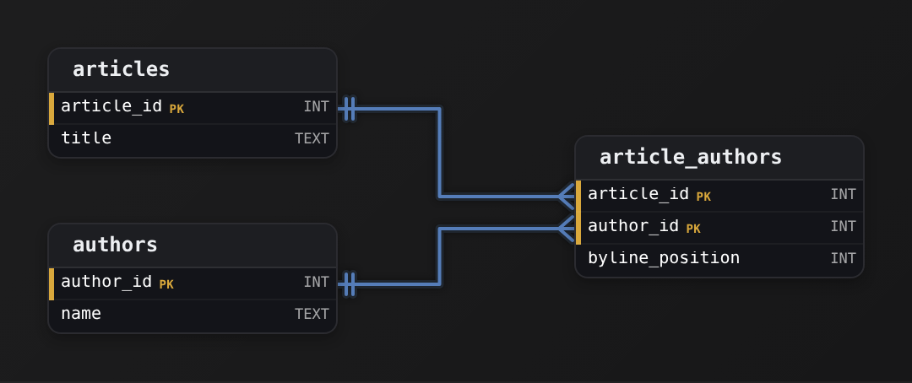
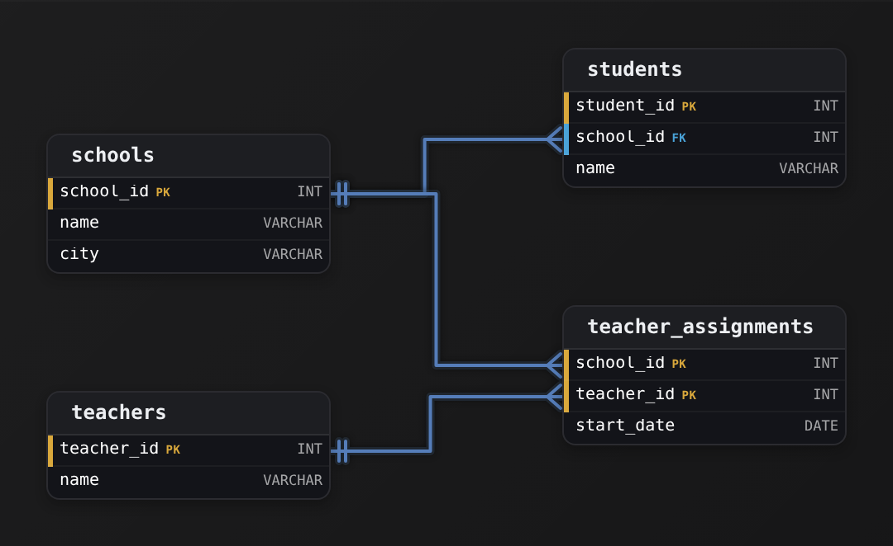
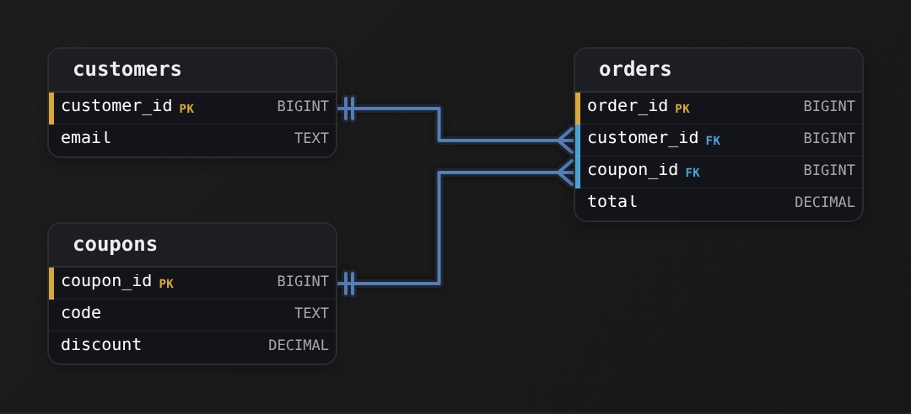
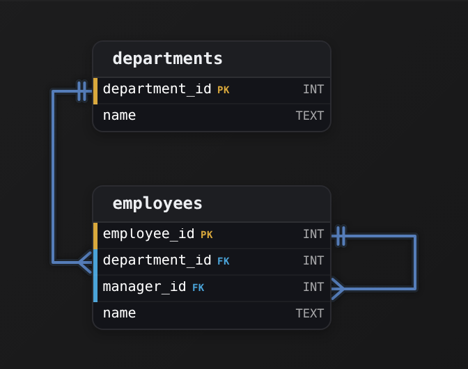
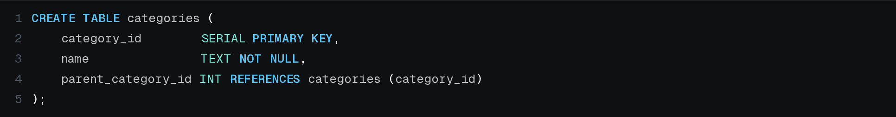
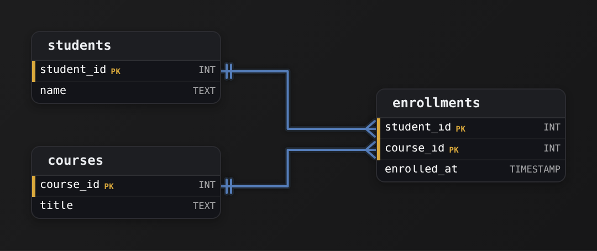
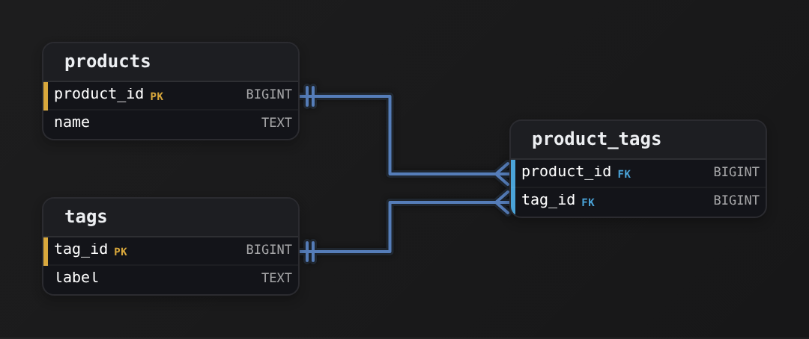
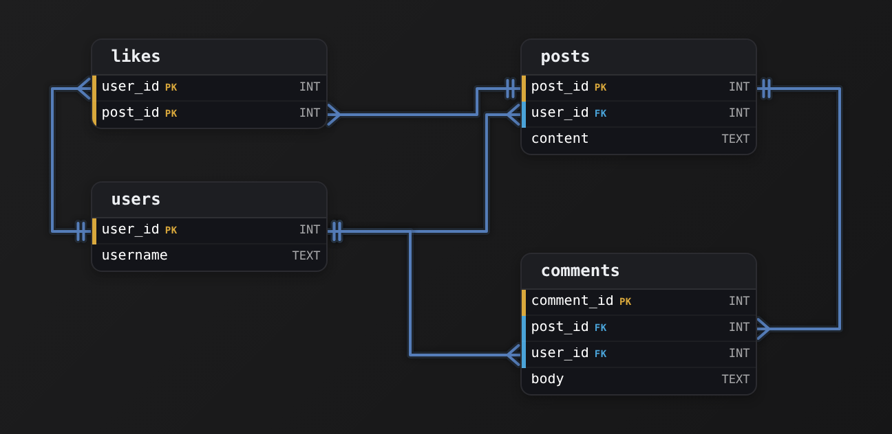
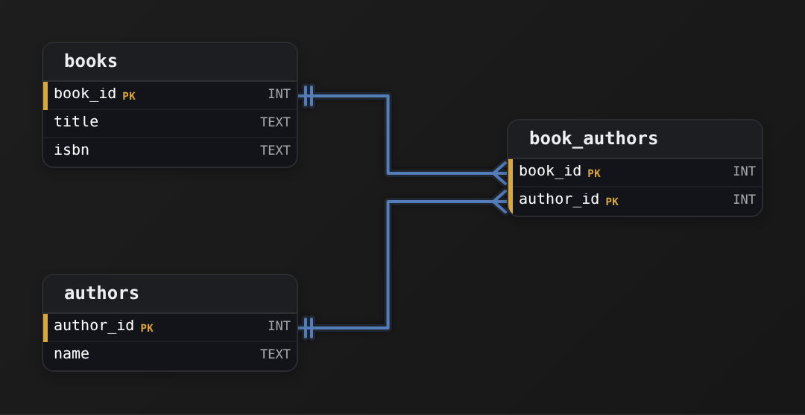

# Relationships - Exercises

Lesson: [data_modeling_relationships.md](../data_modeling_relationships.md)

### Exercise 1 of 12

**● TASK**

Model a scenario where employees belong to departments. Design 2 tables connected by a relationship.

<details>
<summary><strong>Solution</strong></summary>

#### One department, many employees

Employees and departments are the textbook **one-to-many relationship**. One department holds many employees, and each employee sits in exactly one department. You model it with a foreign key on the many side, `employees.department_id`, that points at the primary key of the one side, `departments.department_id`. The child row carries the link. The parent never lists who points at it.


*The FK lives on the many side: `employees.department_id` references `departments.department_id`.*

1. **Give each table a primary key**

   `department_id` and `employee_id` set each table's grain: one row per department and one row per employee. A foreign key can land on a single row only because the column it references is unique, so the primary keys come first.

2. **Put `department_id` on `employees`**

   Say the relationship as 'one department has many employees'. The foreign key goes on the second noun. Many employee rows can share one `department_id` value, and that shared value is how a one-to-many relationship is stored.

| Pitfall: An `employee_id` on `departments` holds only one |
| --- |
| If you flip the key and put an `employee_id` column on `departments`, each department can record only one employee. Adding a second one means duplicating the department row, and `name` repeats. A plain text `department` column on `employees` fails the same way: renaming a department means rewriting every employee row. |

| Real world: Repeated text wants its own table |
| --- |
| Orders to a customer, comments to a post and line items to an invoice all have this same shape. When the same descriptive text repeats across many rows, that thing usually deserves its own table with an `*_id` primary key, and the rows reference it by foreign key. |

**Follow-up questions**

1. What changes if an employee can belong to several departments at once?\
   *It becomes many-to-many: a join table such as `employee_departments` holds 2 foreign keys, and `department_id` comes off `employees`.*
2. Should `employees.department_id` allow `NULL`?\
   *A nullable foreign key lets a new hire exist before being assigned. `NOT NULL` forces a department at insert time.*

</details>


<br>

### Exercise 2 of 12

**● TASK**

Design a publishers-and-books schema where each book belongs to exactly one publisher.

<details>
<summary><strong>Solution</strong></summary>

#### One-to-many, modeled with a foreign key

"Each book belongs to exactly one publisher" is the textbook definition of a **one-to-many** relationship: one publisher has many books, each book has one publisher. In a relational schema you record that not with a shared table or a list column, but by giving the child row a pointer back to its parent. That pointer is a foreign key: `books.publisher_id` holds the `publisher_id` of the one publisher that owns the row.


*The FK lives on the many side. `books.publisher_id` references `publishers.publisher_id`.*

The rule of thumb worth memorizing: in a one-to-many, the foreign key always lives on the **many** side. A book has one publisher, so `books` carries `publisher_id`. Publishers do not carry a book column, because a publisher can have any number of books and a single column could only hold one. Each row in `books` names its parent; the parent stays untouched no matter how many children point at it.

| Pitfall: Don't put the pointer on the one side |
| --- |
| The most common wrong answer flips the direction: adding a `book_id` column to `publishers`. That can only reference a single book, so a publisher with 3 books needs 3 rows or a comma-joined list, both of which break as soon as you query them. The other frequent miss is dropping the `publisher_id` FK entirely and hoping a `publisher_name` text column will do, that stores the same publisher spelled 5 ways with nothing linking the rows. |

| Key insight: Why every table needs its own PK |
| --- |
| Both tables get a **primary key** (`publisher_id`, `book_id`) because each row needs one stable, unique handle to be referenced by. The FK on `books` only works because `publishers.publisher_id` is guaranteed unique, that is what lets a `publisher_id` value identify exactly one publisher. PK on the parent, FK on the child pointing at it: that pair is the whole mechanism. |

| ✕ One-to-many (this problem) | ✓ Many-to-many (if a book had several publishers) |
| --- | --- |
| A single FK column, `books.publisher_id`, on the many side. No extra table. Each book points at one publisher; each publisher is pointed at by many books. | The FK-on-the-child trick stops working, because a book would need many `publisher_id` values. You add a third join table, `book_publishers`, holding one row per (`book_id`, `publisher_id`) pair, with an FK to each side. |

**Follow-up questions**

1. What would you change if a book could be co-published by 2 or more publishers?\
   *Tests whether the learner can recognize the jump from one-to-many to many-to-many and reach for a junction table.*
2. How do you make the database itself refuse a book whose `publisher_id` names a publisher that doesn't exist?\
   *Points at FK constraint enforcement (referential integrity), not just drawing the relationship.*

</details>


<br>

### Exercise 3 of 12

**● TASK**

An author writes many articles, and an article can be co-written by several authors. Read that relationship from both directions and model authors and articles so every article lists all of its authors and every author all of their articles, recording each author's position in that article's byline.

<details>
<summary><strong>Solution</strong></summary>

#### When both sides say many

Reading cardinality from both directions is what turns this into a many-to-many relationship. From the author side, one author has many articles. From the article side, one article has many authors. A foreign key column holds exactly one value, so `author_id` on `articles` allows one author per article, and `article_id` on `authors` allows one article per author. Neither side can hold the relationship, so it gets **a table of its own**: `article_authors`, one row per author-article pairing.



*`article_authors` holds one row per pairing, with an FK to each side and `byline_position` on the pairing.*

1. **Split the many-to-many into 2 one-to-manys**

   Each row of `article_authors` points at exactly one article and exactly one author. So `articles` to `article_authors` is one-to-many, and so is `authors` to `article_authors`. The foreign keys sit on the many side, exactly as the previous section taught, and the composite key on (`article_id`, `author_id`) stops the same pairing from being listed twice.

2. **Put pairing facts on the pairing**

   A byline position belongs to neither the author nor the article alone: the same author is first on one paper and third on another. It describes one author on one article, so `byline_position` lives on `article_authors`. Asking 'whose fact is this?' tells you where a column goes.

| Pitfall: 2 foreign keys still mean one of each |
| --- |
| Adding `author_id` to `articles` and `article_id` to `authors` looks like it covers both directions, but each column still holds one value. The result is a single author per article and a single article per author, with the 2 columns free to contradict each other. |

| ✕ One-to-many | ✓ Many-to-many |
| --- | --- |
| Each article has one author, so a single `author_id` FK on `articles` is enough and no third table is needed. | Articles have several authors and authors have several articles, so a junction table such as `article_authors` carries an FK to each side, one row per pairing. |

**Follow-up questions**

1. How would you record which co-author is the corresponding author on each article?\
   *Another fact about the pairing, so it belongs on `article_authors`, not on `authors`.*
2. If articles could also carry many topic tags, how many new tables does that add?\
   *Read the article-to-tag relationship from both sides before deciding.*

</details>


<br>

### Exercise 4 of 12

**● TASK**

Design a schema for a school district where each student is enrolled at exactly one school and a school has many students. Teachers can work at several schools at once and each school employs many teachers; record the date each teacher started at each school.

<details>
<summary><strong>Solution</strong></summary>

#### Read each relationship from both sides

A relationship is many-to-many when both directions answer "many": a teacher works at several schools, and a school employs many teachers. Students are different. From the student side the answer is exactly one school, so that pair stays one-to-many, with a `school_id` foreign key on `students`. The teacher pair cannot be modeled that way, because one foreign key column holds one value. It needs **a junction table** with one row per teacher-school pair.



*`students` points at one school; `teacher_assignments` holds one row per teacher-school pair.*

The junction table's primary key is the pair `school_id` plus `teacher_id`, and each column points back to its parent. That table is also where `start_date` belongs. The date is not a fact about the teacher alone or the school alone. It belongs to one specific pairing, and the junction row is that pairing.

| Pitfall: A `school_id` on `teachers` caps every teacher at one school |
| --- |
| Copying the student pattern puts a `school_id` on `teachers`, which quietly limits every teacher to one school. Adding a `school_id_2` column or a comma-separated list does not fix that. A third school breaks the fixed columns, a list cannot be checked against `schools`, and neither one has a place for a start date per school. |

| ✕ Student and school | ✓ Teacher and school |
| --- | --- |
| One school per student, many students per school. The foreign key `school_id` lives on the many side, `students`. No third table is needed. | Many on both sides. Neither table can hold the other's key, so `teacher_assignments` carries both keys, and joining through it returns one row per pairing. |

**Follow-up questions**

1. A teacher leaves a school and later returns to it. What does that do to the key on `teacher_assignments`?\
   *Checks whether the pair alone is still unique once the same teacher-school pairing can occur twice.*
2. Each school keeps exactly one record of private accreditation details in a separate table. What is the cardinality, and where does the key go?\
   *Applies the one-to-one case from the same section.*

</details>


<br>

### Exercise 5 of 12

**● TASK**

Design an orders table where one foreign key is required (every order needs a customer) and another is optional (a coupon may or may not apply).

<details>
<summary><strong>Solution</strong></summary>

#### Required vs. optional relationships

Optionality is the minimum side of a relationship's cardinality: must a row link to a parent, or may it link to none? On a foreign key that choice comes down to one word, **nullable or NOT NULL**. Here `orders.customer_id` must always point at a real customer, so the link is many-to-exactly-one and the column is `NOT NULL`. `orders.coupon_id` points at a coupon only sometimes, so the link is many-to-zero-or-one and the column stays nullable. The 2 relationships use the same key machinery but have different cardinalities, and the diagram has to show the difference.



*`orders` to `customers` is many-to-exactly-one (required); `orders` to `coupons` is many-to-zero-or-one (optional).*

**The same design as DDL**

```sql
CREATE TABLE customers (
    customer_id  BIGINT PRIMARY KEY,
    email        TEXT NOT NULL
);

CREATE TABLE coupons (
    coupon_id    BIGINT PRIMARY KEY,
    code         TEXT NOT NULL,
    discount     NUMERIC(5,2) NOT NULL
);

CREATE TABLE orders (
    order_id     BIGINT PRIMARY KEY,
    customer_id  BIGINT NOT NULL REFERENCES customers(customer_id),  -- required: exactly one
    coupon_id    BIGINT     NULL REFERENCES coupons(coupon_id),      -- optional: zero or one
    total        NUMERIC(10,2) NOT NULL
);
```

*The cardinality shows up in 2 words: `customer_id` is NOT NULL and `coupon_id` is NULL.*

| ✕ `customer_id` (required) | ✓ `coupon_id` (optional) |
| --- | --- |
| Many orders to exactly one customer. Because the column is `NOT NULL`, an insert with no `customer_id` is rejected, and the foreign key guarantees the customer exists. No order can be an orphan. | Many orders to zero or one coupon. A row may leave `coupon_id` empty, but whenever it is set, the foreign key still forces it to match a real coupon. |

| Pitfall: Identical cardinality on both links hides the point |
| --- |
| If you draw both links as exactly-one, or mark both columns `NOT NULL` for symmetry, the model now says every order must carry a coupon, and every coupon-less checkout is rejected. Watch the read side too: an `INNER JOIN` from `orders` to `coupons` silently drops every order without one, so revenue totals from that join come out low. Use a `LEFT JOIN` instead. |

| Real world: In the warehouse the optional link gets an Unknown member |
| --- |
| The operational `orders` table spells absence as `NULL`. When this data lands in an analytical model, the usual move is a 'No coupon' member in the coupon dimension (for example `coupon_id = -1`). The fact key is then never null, and every fact row survives the join. |

**Follow-up questions**

1. How would you also guarantee that a coupon can't be applied to 2 different orders?\
   *This moves the coupon link from zero-or-many orders per coupon to zero-or-one: think about a unique constraint on the nullable `coupon_id` and how NULLs behave under it.*
2. If a coupon is deleted, what should happen to the orders that used it?\
   *Compare `ON DELETE SET NULL`, which only an optional link allows, with `ON DELETE RESTRICT` on the required customer link.*

</details>


<br>

### Exercise 6 of 12

**● TASK**

Create an employees table with a required department link and an optional manager link.

<details>
<summary><strong>Solution</strong></summary>

#### Required vs. optional, both as foreign keys

This design hangs on one distinction: a foreign key can be **mandatory or optional**, and you say which with nullability. Every employee must belong to a department, so `employees.department_id` is a foreign key that is `NOT NULL`. Not every employee has a boss, so `employees.manager_id` is a foreign key that is nullable. Same mechanism, 2 cardinalities, controlled by whether the column can hold `NULL`.



*`employees.department_id` is a required FK to departments; `manager_id` is an optional FK that points back into employees itself.*

1. **Give departments its own table and key**

   A department is an entity an employee points at, so it earns its own row and a stable `department_id` primary key. That key is what `employees.department_id` will reference. The alternative, storing the department name as a plain text column on `employees`, has no key to point at and lets the same department be spelled 2 ways.

2. **Make the department link required**

   `employees.department_id` is a foreign key to `departments.department_id`, declared `NOT NULL`. The `NOT NULL` is the whole 'required' requirement: it makes the database reject any employee row that has no department. This is the one-to-many 'each employee belongs to exactly one department' cardinality, enforced rather than hoped for.

3. **Point the manager link back at the same table**

   A manager is just another employee, so `manager_id` is a foreign key to `employees.employee_id`, the table's own primary key. That is a self-referential foreign key. It stays nullable so the top of the org chart, the person with no manager, is a legal row rather than a special case you have to fake.

| Key insight: Nullable is how a self-reference terminates |
| --- |
| A self-referential FK has to bottom out somewhere. Leaving `manager_id` nullable lets the top row set `manager_id` to `NULL` and end the chain cleanly. If you made it `NOT NULL`, you'd have no honest way to represent the person at the top, and you'd be tempted to point them at themselves, which quietly breaks any recursive walk up the chain. |

| ✕ Required department | ✓ Optional manager |
| --- | --- |
| `department_id` is `NOT NULL` and references `departments`. Every employee must resolve to a department; an insert with no `department_id` fails. This is mandatory participation. | `manager_id` is nullable and references `employees`. An employee may have a manager or none; `NULL` is a valid value meaning 'no manager'. This is optional participation. |

| Pitfall: Don't model manager as a name or a separate table |
| --- |
| The common miss is either putting the manager's `name` on the employee row or inventing a `managers` table. A manager is an employee, with the same columns and the same lifecycle, so a second table duplicates the entity. Reuse `employees` and let `manager_id` reference `employee_id`; that's what makes it self-referential. |

**Follow-up questions**

1. How would you find every employee who reports (directly or indirectly) to a given manager?\
   *Tests whether they see the self-referential `manager_id` as a tree you walk with a recursive CTE.*
2. What happens on delete if a manager row is removed while employees still point at it via `manager_id`?\
   *Probes referential-action choices: `ON DELETE SET NULL` vs. `RESTRICT` for an optional self-FK.*
3. If an employee could belong to several departments over time, how does the model change?\
   *Moves the required one-to-many into a many-to-many with a join table.*

</details>


<br>

### Exercise 7 of 12

**● TASK**

Design an employees table with a self-referencing relationship to model the manager hierarchy.

<details>
<summary><strong>Solution</strong></summary>

#### A self-referencing foreign key

The trick to modeling a manager hierarchy is that a manager IS an employee. You do not need a separate `managers` table. You put the `manager_id` column on `employees` itself and point it back at that same table's own primary key, `employee_id`. One table, one foreign key that references its own primary key. That is a **self-referential relationship**, and it is the standard way to store any tree that lives in a single kind of thing: employees under managers, categories under parent categories, comments under parent comments.


*One table. The edge leaves `manager_id` and lands back on `employee_id` in the same table, so the row for an employee points at the row for that employee's manager.*

1. **Give every employee a stable identity**

   `employee_id` is the primary key: one unique, non-null value per person. This is the value other rows will point AT, so it has to be stable and unique. Everything about the hierarchy hangs off this being trustworthy.

2. **Store the manager as a pointer, not a copy**

   `manager_id` is a foreign key back to `employees.employee_id`. You are not copying the manager's name into the row, you are storing the manager's id. To find who someone reports to, you match their `manager_id` to the `employee_id` of another row in the same table. That self-join is exactly what the foreign key promises is valid.

| Pitfall: The CEO's `manager_id` has to be nullable |
| --- |
| The most common miss here is making `manager_id` NOT NULL. Someone at the top reports to no one, so their `manager_id` is `NULL`. If you forbid nulls you either cannot insert the CEO at all or you invent a fake self-referencing row where the CEO is their own manager, which corrupts every hierarchy query. Leave `manager_id` nullable and the top of the tree is simply the row whose `manager_id` is `NULL`. |

| ✕ Separate managers table | ✓ Self-reference (correct) |
| --- | --- |
| A second `managers` table duplicates every manager who is also an employee. Now a promoted employee has to be copied across tables and kept in sync, and a manager who reports to another manager has nowhere clean to live. The model fights the fact that managers and employees are the same entity. | One `employees` table with `manager_id` referencing `employee_id`. A manager is just an employee that other rows point to. Promotions change no structure, and a chain of any depth (report to lead to director to CEO) is the same single column followed repeatedly. |

| Real world: In production, this is the adjacency-list tree |
| --- |
| This shape is called an adjacency list, and it is how org charts, threaded comments, and nested categories are stored in real schemas. Walking it more than one level deep is where a recursive CTE (`WITH RECURSIVE`) comes in, following `manager_id` up or down the tree. The table design you just built is the foundation every one of those queries stands on. |

**Follow-up questions**

1. How would you find every employee under a given manager, at any depth?\
   *Points toward a recursive CTE that follows `manager_id` down the tree, which only works because the foreign key is self-referential.*
2. What constraint would you add to stop an employee from being set as their own manager?\
   *Tests understanding that a CHECK (`manager_id` <> `employee_id`) guards a cycle the foreign key alone permits.*

</details>


<br>

### Exercise 8 of 12

**● TASK**

Create a categories table that references itself to model nested subcategories.

<details>
<summary><strong>Solution</strong></summary>

#### One table, pointing at itself

A category can hold other categories, and those can hold more, to any depth. The model for that is a **self-referential foreign key**: one `categories` table where each row can point at another row in the same table as its parent. `category_id` is the primary key, and `parent_category_id` is a foreign key back to `categories.category_id`. 'Electronics' is a root row. 'Laptops' carries a `parent_category_id` equal to the id of 'Electronics', and 'Gaming Laptops' points at 'Laptops'. The whole tree lives in one table.



*One table, and the edge loops back on itself: `parent_category_id` references `category_id` in the same table.*

| Pitfall: A table per level caps the depth |
| --- |
| The first instinct is a `categories` table plus a `subcategories` table with a `category_id` FK. That models exactly 2 levels. When the business adds a sub-subcategory, you need a third table, then a fourth. Nesting has no fixed depth, so the depth can't be built into the schema's shape. Put every level in one table and let `parent_category_id` carry the hierarchy. |

| Key insight: Roots need a nullable parent |
| --- |
| A top-level category has no parent, so `parent_category_id` must be **nullable**. A `NULL` there means the row is a root, and every row with a non-null `parent_category_id` is a child. That one nullable FK lets a single table hold the roots and the whole tree below them. |

**The DDL**

```sql
CREATE TABLE categories (
    category_id        SERIAL PRIMARY KEY,
    name               TEXT NOT NULL,
    parent_category_id INT REFERENCES categories (category_id)
);
```

*`REFERENCES` points back at the table being defined, and `parent_category_id` stays nullable so root rows have no parent.*

| Real world: Every tree fits this shape |
| --- |
| The same pattern models any tree in one table: `employees` with a `manager_id` pointing back at `employees`, threaded comments with a `parent_comment_id`, or folders in a file system. To read the tree, use a recursive CTE (`WITH RECURSIVE`) to walk from any node up to its root or down to its leaves. |

**Follow-up questions**

1. How would you stop a category from becoming its own ancestor and creating a cycle?\
   *A self-referential FK alone allows a loop like A to B to A. Preventing it takes an application check or a recursive guard.*
2. What should happen to child rows when you delete a parent category, and how would `ON DELETE` control it?\
   *Compares `CASCADE`, `SET NULL` and `RESTRICT` when the FK points back at its own table.*

</details>


<br>

### Exercise 9 of 12

**● TASK**

Model a many-to-many relationship between students and courses using a junction table.

<details>
<summary><strong>Solution</strong></summary>

#### The junction table

A many-to-many relationship is one where each row on the left can pair with many rows on the right, and vice versa: one student takes many courses, one course holds many students. A relational table can't store that directly, because a single `students` row has no place to list an open-ended set of course IDs. The fix is a third table that exists only to hold the pairings. That table is the **junction table** (also called an associative or bridge table), and here it is `enrollments`: one row per (student, course) pair.



*2 one-to-many relationships that meet in the middle. `enrollments` fans out from both parents.*

Notice the shape: the many-to-many is really **2 one-to-many relationships** pointing at the junction from each side. `enrollments.student_id` is a foreign key to `students`, and `enrollments.course_id` is a foreign key to `courses`. Each parent has many enrollments; each enrollment names exactly one parent on each side. The junction is where those 2 fans cross.

| Trick: The primary key is the pair |
| --- |
| The junction's primary key is the 2 foreign keys together: `PRIMARY KEY (student_id, course_id)`. This **composite key** is what makes the pairing meaningful. It says a given student can enroll in a given course exactly once: the database rejects a duplicate (student, course) row for you, so you never have to dedupe in application code. `enrolled_at` and any other attributes of the enrollment hang off this key, not off either parent. |

| Pitfall: Don't stuff the list into one side |
| --- |
| The tempting wrong answer is a `course_ids` column on `students` holding something like '101,102,103'. It looks compact, but now you can't join, can't index a single course, can't enforce that 101 is a real course, and adding a drop means string-surgery. The relational answer is always a row per pair, never a delimited list in a cell. A single foreign key from `students` to `courses` is also wrong: that only models one-to-many, forcing a student into a single course. |

This pattern is everywhere once you see it. Authors and books (a `book_authors` junction), users and roles (`user_roles`), orders and products (`order_items`, which also carries `quantity` and `unit_price`). That last case is the payoff of a real junction table: because the pairing is its own row, it has room for its own attributes. `enrolled_at` lives on `enrollments` precisely because it describes the relationship, not the student and not the course.

**Follow-up questions**

1. What if a student can enroll in the same course again in a later term?\
   *Then (`student_id`, `course_id`) is no longer unique. Add `term` to the composite key, or introduce a surrogate `enrollment_id` PK and keep a UNIQUE constraint on the columns that must not repeat.*
2. Should the junction table have its own surrogate `enrollment_id`?\
   *Weighs a natural composite key against a single synthetic key. A surrogate simplifies child references and ORMs; the composite key enforces uniqueness for free and reads self-documenting.*

</details>


<br>

### Exercise 10 of 12

**● TASK**

Design a many-to-many relationship between products and tags.

<details>
<summary><strong>Solution</strong></summary>

#### The junction table

A many-to-many relationship means one product can carry many tags and one tag can label many products. No single foreign-key column can hold that: a column stores one value per row, so it can only ever point one way. The fix is a third table that exists purely to hold the pairings, the **junction table** (also called an associative or bridge table). Here that table is `product_tags`, and each of its rows says one thing: this `product_id` is linked to this `tag_id`.



*`product_tags` sits between the 2 entities; its 2 foreign keys together form its primary key.*

**The three-table design**

```sql
CREATE TABLE products (
    product_id  BIGINT PRIMARY KEY,
    name        TEXT NOT NULL
);

CREATE TABLE tags (
    tag_id  BIGINT PRIMARY KEY,
    label   TEXT NOT NULL
);

CREATE TABLE product_tags (
    product_id  BIGINT NOT NULL REFERENCES products(product_id),
    tag_id      BIGINT NOT NULL REFERENCES tags(tag_id),
    PRIMARY KEY (product_id, tag_id)
);
```

*The 2 entities own their own ids; `product_tags` owns only the pairing.*

| Key insight: The composite key is the whole point |
| --- |
| The primary key of `product_tags` is `PRIMARY KEY (product_id, tag_id)`, both columns together, not a new `id` column. That composite key does 2 jobs at once: it makes each pairing unique, so the same product can't be tagged 'sale' twice, and it declares that a row has no identity of its own beyond the 2 things it connects. Each column is also a foreign key back to its parent, so the database refuses a pairing that names a product or tag that doesn't exist. |

| Pitfall: The comma-separated column |
| --- |
| The tempting shortcut is a single `tags` column on `products` holding 'sale,new,clearance'. It looks compact, but it can't be queried: finding every product with the 'sale' tag means a `LIKE '%sale%'` scan that also matches 'sale-pending', you can't join to a real `tags` table, and nothing stops a typo'd tag. The junction table turns tag lookup into an indexed join and lets a tag carry its own attributes. |

| ✕ One-to-many (wrong here) | ✓ Many-to-many (correct) |
| --- | --- |
| Putting `tag_id` directly on `products` lets a product hold exactly one tag. That's a one-to-many shape, fine for 'a product has one category', useless when a product needs several tags. | The `product_tags` bridge lets both sides be many. Add a pairing row to tag a product; delete that row to untag it. The `products` and `tags` tables never change shape as links come and go. |

**Follow-up questions**

1. What if you need to know when a tag was applied, or who applied it?\
   *Add columns like `tagged_at` or `tagged_by` to `product_tags`. Once the junction row carries its own attributes, it stops being a pure bridge and becomes an entity in its own right.*
2. Would you add a surrogate `product_tag_id` primary key instead of the composite key?\
   *Tests the trade-off: a surrogate key eases FK references from other tables but still needs a UNIQUE constraint on (`product_id`, `tag_id`) to prevent duplicate pairings.*

</details>


<br>

### Exercise 11 of 12

**● TASK**

Design a social network schema that demonstrates one-to-many, self-referential, and many-to-many relationships.

<details>
<summary><strong>Solution</strong></summary>

#### 3 relationship shapes, one schema

Every schema you draw is really just a small number of relationship shapes repeated. This exercise asked you to place 3 of them side by side. A **one-to-many** relationship (a user writes many posts) lives as a foreign key on the many side. A many-to-many relationship (a user likes many posts, a post is liked by many users) needs a junction table. A self-referential relationship (a user follows another user) is a foreign key that points back at its own table. The trick is recognizing which shape a sentence in the prompt is describing before you draw a single box.



*users writes many posts and comments (one-to-many); likes is the junction that resolves the many-to-many between users and posts.*

1. **Put the foreign key on the many side**

   A user has many posts, so the key that ties them together lives on `posts`, not `users`. Each row in `posts` carries a `user_id` that points at exactly one row in `users`, and that single column already encodes "many posts belong to one user." The same reasoning gives `comments` 2 one-to-many parents at once: a `post_id` back to `posts` and a `user_id` back to `users`. There is no separate table and no list column: the FK on the child is the whole relationship.

| Trick: Many-to-many always becomes a junction table |
| --- |
| You cannot express "many users like many posts" with a foreign key on either side, because a like belongs to a (user, post) pair, not to one user or one post. The `likes` table IS that pair: its primary key is the composite `(user_id, post_id)`, and each of those columns is also a foreign key. That composite PK is doing double duty, it links both parents AND guarantees a user can like a given post only once. |

| Key insight: Self-referential is just a foreign key that points home |
| --- |
| The self-referential shape trips people up only because the FK's target is the same table it lives on. To model "a user follows another user," add a `followers` table with `follower_id` and `followed_id`, both foreign keys into `users`. It is a junction table like `likes`, except both sides resolve to the one table, which is exactly what makes it self-referential. The lighter-weight version is a single self-FK, like a `parent_comment_id` on `comments` that lets a comment reply to another comment. |

| ✕ The mistake | ✓ The fix |
| --- | --- |
| Trying to record likes by adding a `liked_by` column to `posts`, or a `liked_posts` column to `users`. A single column can hold only one value, so this caps each post at one liker (or forces a comma-joined string you can never query cleanly). | A `likes` junction with one row per (user, post) pair. Counting a post's likes is a `COUNT(*)` with a `WHERE post_id = ?`; listing a user's liked posts is a join. The relationship scales to any number of pairs because each is its own row. |

| Real world: In production, this is the whole feed |
| --- |
| These 4 shapes are the backbone of nearly every social product. The `likes` junction is where engagement analytics come from, the `posts.user_id` one-to-many is what powers a profile page, and the self-referential `followers` edge is what a feed-ranking job walks to decide whose posts you see. Getting the junction right early is what keeps those queries as plain joins instead of application-side loops later. |

**Follow-up questions**

1. How would you let a comment reply to another comment without adding a new table?\
   *Tests whether you can spot the single-column self-referential FK (`parent_comment_id` into `comments`).*
2. The `followers` relationship is directional: A follows B is not B follows A. How does the junction capture that, and what would you change to model a mutual friendship instead?\
   *Tests understanding that column naming (`follower_id` vs `followed_id`) encodes direction, and that a symmetric relationship needs a different convention.*
3. If a user is deleted, what should happen to their posts, comments, and likes?\
   *Extends the FK concept into referential actions (`ON DELETE CASCADE` vs `SET NULL`).*

</details>


<br>

### Exercise 12 of 12

**● TASK**

Build a library catalog schema with authors, books, and a many-to-many relationship between them.

<details>
<summary><strong>Solution</strong></summary>

#### Many-to-many needs a third table

A book can have several authors, and an author writes several books. That is a **many-to-many** relationship, and the one rule to carry away is this: a relational schema cannot store many-to-many in 2 tables. You need a third table that sits between `authors` and `books` and records one row per author-book pairing. That table is called a junction table (also a join, bridge, or associative table), and here it is `book_authors`.



*`book_authors` links the 2 entity tables. Its 2 foreign keys together form the primary key.*

Notice the shape of `book_authors`: it holds no facts of its own, just `book_id` and `author_id`. Each column is a **foreign key** pointing back at a real entity, `book_id` at `books.book_id` and `author_id` at `authors.author_id`. Together those 2 columns are the composite primary key, which is what stops the same author from being attached to the same book twice.

| Pitfall: The comma-separated author column |
| --- |
| The tempting wrong turn is to skip the third table and put an `authors` column on `books`, storing 'King, Straub' as text. It looks simpler until you try to answer "which books did Straub write?" That becomes a `LIKE '%Straub%'` string scan that also matches 'Straubenmuller', you cannot join to a real author row, and renaming an author means rewriting every string. The junction table turns all of that back into plain joins on indexed keys. |

| Key insight: How to spot it every time |
| --- |
| When both sides of a relationship can point at many of the other, neither entity's table can hold the foreign key, because a foreign-key column stores one value per row. The direction where "one row points at many" is exactly where the FK cannot fit. That mismatch is the tell that you need a junction table. A one-to-many (one author, many books) would instead just put `author_id` on `books`, no third table needed. |

| ✕ One-to-many | ✓ Many-to-many |
| --- | --- |
| One publisher, many books. Put `publisher_id` as a foreign key directly on `books`. 2 tables, one FK column, done. | Many authors, many books. No single FK column can hold the set, so introduce `book_authors` with a `book_id` FK and an `author_id` FK, keyed on the pair. |

**Follow-up questions**

1. Where would you store an author's ordering, so a book lists its primary author first?\
   *Tests that the junction table is the natural home for attributes ABOUT the relationship, e.g. an `author_order` column, not just the 2 keys.*
2. What breaks if you drop the composite primary key on `book_authors` and add a surrogate `id` instead?\
   *Tests understanding that without a uniqueness constraint on (`book_id`, `author_id`) the same pairing can be inserted twice.*

</details>
