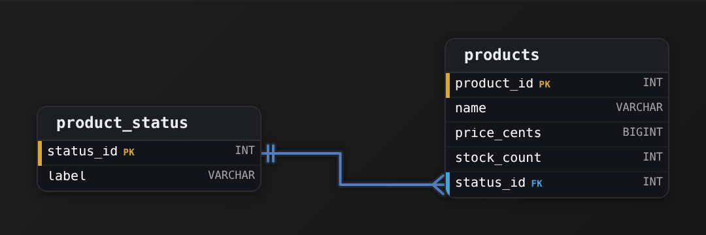
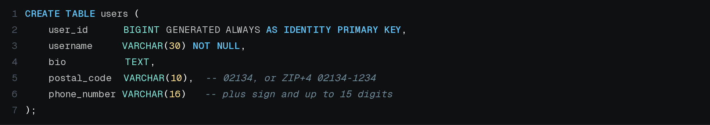
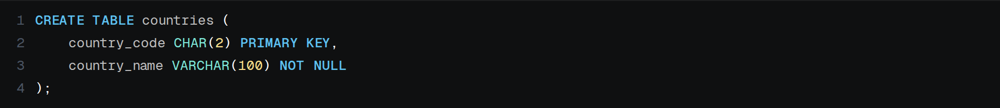
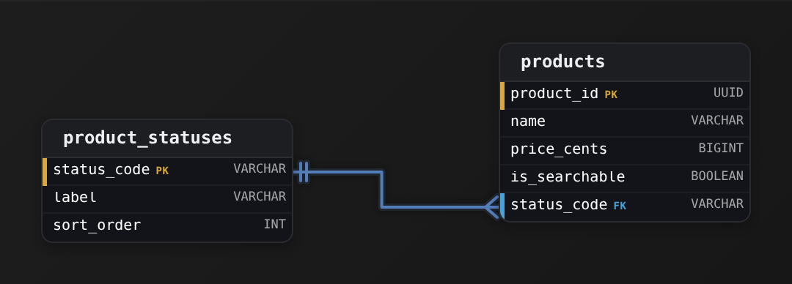
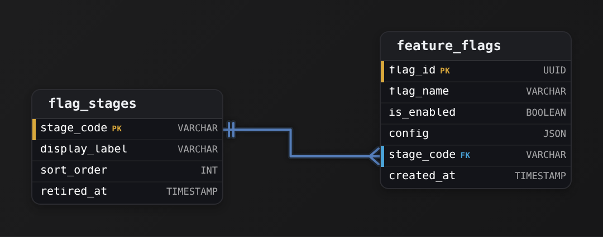
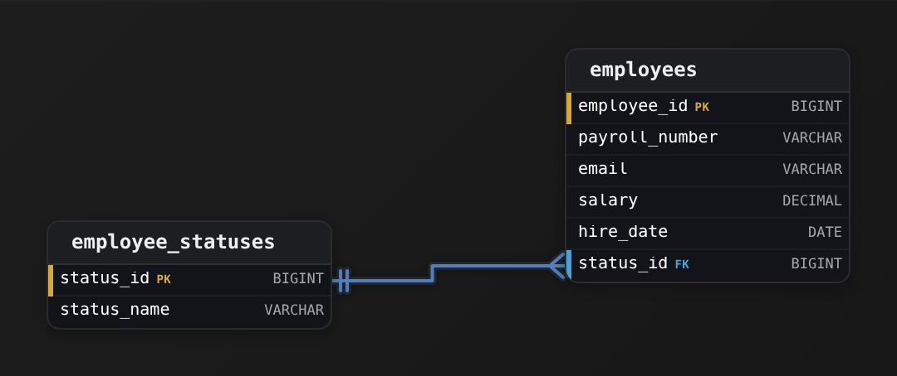
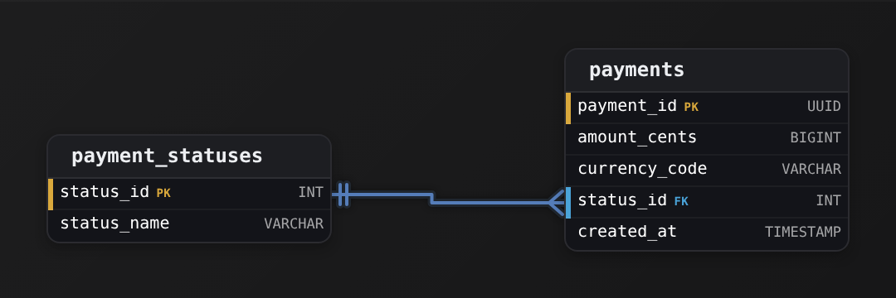
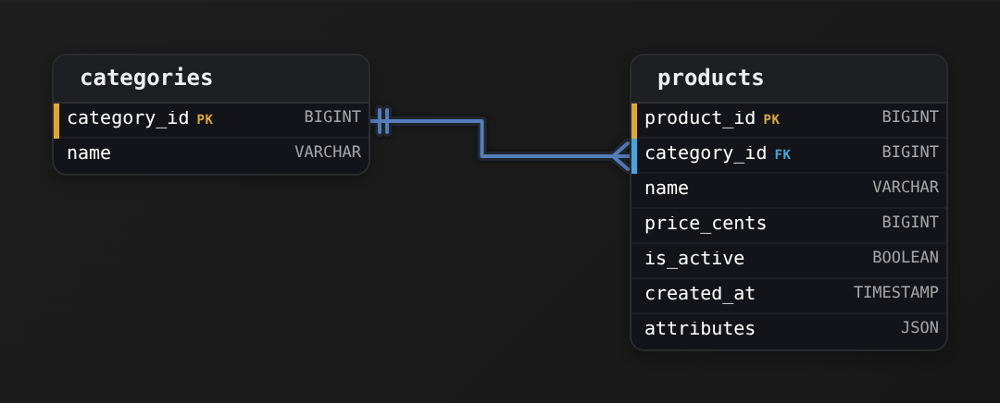
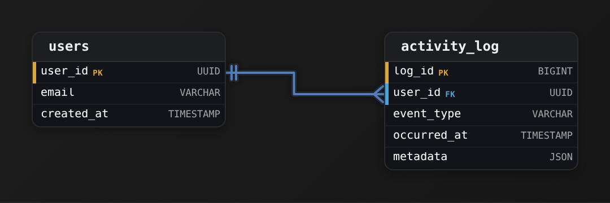

# Schema Types - Exercises

Lesson: [data_modeling_data_types.md](../data_modeling_data_types.md)

### Exercise 1 of 12

**● TASK**

Apply the type-review checklist to a products table with product_id as primary key, a name, a price stored exactly as integer cents, and a stock_count of whole units. Product status keeps gaining new values, so do not use an enum: add a status_id foreign key to a product_status lookup table (status_id primary key plus a label). Give every column its appropriate type.

<details>
<summary><strong>Solution</strong></summary>

#### Running the type-review checklist on a real catalog

This is the checklist you just learned, applied end to end: pick a **primary key**, choose a type that matches each value's real shape, and split any column whose set of values will keep growing into its own lookup table. 2 tables fall out of it. `products` holds one row per item; `product_status` holds one row per status label. The 3 decisions worth slowing down on are how you store money, how you store stock, and why status becomes a foreign key instead of an enum.



*Many products point at one status row: an N:1 edge from `products.status_id` to `product_status`.status_id.*

| Pitfall: Money is not a float |
| --- |
| The instinct is to type the price as `FLOAT` or `DOUBLE`, and it looks fine until 0.10 + 0.20 stops equalling 0.30. Binary floating point cannot represent most decimal fractions exactly, so cents drift and totals fail to reconcile. Storing the price as `price_cents` in an integer type (a `BIGINT` so large catalogs and currencies with no sub-unit still fit) keeps money exact: every value is a whole count of the smallest unit, and arithmetic stays precise. `DECIMAL(12,2)` is the other correct answer; the one wrong answer is any floating-point type. |

`stock_count` gets the same treatment for a simpler reason: you can hold 3 units or 4, never 3.5. A whole-number type like `INT` makes the fractional value unrepresentable, which is exactly what you want. Both columns also earn a `CHECK (... >= 0)` constraint, since neither a price nor a shelf count is ever negative. The type narrows what can be stored; the constraint narrows it further to what is valid.

| ✕ Status baked into the column | ✓ Status as a lookup table |
| --- | --- |
| An enum or a `CHECK (status IN ('active','discontinued'))` on `products` hard-codes today's values. Adding 'preorder' next quarter means an ALTER on a large table, and every new value is a schema migration. | A `status_id` foreign key into `product_status` makes a new status a one-row `INSERT` into a tiny table. The label lives in exactly one place, so renaming 'discontinued' updates one row instead of every product. This is third normal form: the label depends on the status, not on the product. |

That split gives you the classic **one-to-many** shape: many rows in `products` reference one row in `product_status`, an N:1 edge. The `status_id` in the lookup table is a surrogate key, a meaningless integer whose only job is to be a stable target for the foreign key, so a label change never ripples into `products`. The foreign key itself is what guarantees a product can never point at a status that does not exist.

**The catalog as DDL**

```sql
CREATE TABLE product_status (
    status_id INT PRIMARY KEY,
    label     VARCHAR(50) NOT NULL
);

CREATE TABLE products (
    product_id  INT PRIMARY KEY,
    name        VARCHAR(200) NOT NULL,
    price_cents BIGINT NOT NULL CHECK (price_cents >= 0),
    stock_count INT    NOT NULL CHECK (stock_count >= 0),
    status_id   INT    NOT NULL REFERENCES product_status(status_id)
);
```

*The ER answer written out: integer-cents money, whole-number stock, and status as a foreign key into a lookup table.*

| Real world: In production this is the money-bug prevention pattern |
| --- |
| Payment systems store amounts as integer minor units almost universally (Stripe's API is entirely in cents) precisely to dodge floating-point drift. The status lookup table is just as common: order state, subscription state, ticket state all live in small reference tables so that adding a state is data, not a deploy. |

**Follow-up questions**

1. How would you handle prices in currencies with different sub-unit rules, like yen (no cents) or Kuwaiti dinar (3 decimal places)?\
   *Tests whether integer minor units generalize, and whether a currency column belongs alongside `price_cents`.*
2. If a product could carry several statuses at once (say 'active' and 'on sale'), what changes about the one-to-many design?\
   *Pushes from N:1 toward a many-to-many junction table between products and `product_status`.*

</details>


<br>

### Exercise 2 of 12

**● TASK**

Design a payments transactions table with a primary key, an exact-precision money amount that never drifts from the bank statement, and a whole-number item quantity. The set of valid statuses will grow over time, so model status as its own lookup table that transactions references instead of baking the allowed values into the column definition.

<details>
<summary><strong>Solution</strong></summary>

#### 2 decisions, 2 tables

This schema turns on 2 modeling calls you were asked to make. First, picking column types that match what the data actually IS: money that must never drift needs an exact numeric type, and a count of items needs a whole-number type. Second, pulling the status set out of the transaction row and into its own **lookup table** that `transactions` points at with a foreign key. Everything else here is scaffolding around those 2 choices.


*transactions references `transaction_status`: one status row describes many transactions.*

1. **Store money as an exact decimal, never a float**

   The prompt says the amount must stay exact against the bank statement, so `amount` is `DECIMAL(12,2)` (also spelled `NUMERIC`). A decimal stores the value in base-10 with a fixed number of digits, so '19.99' is exactly '19.99'. A binary float type like `FLOAT` or `REAL` cannot represent most decimal cents exactly, so sums slowly drift a cent here and there. The type IS the guarantee: choosing `DECIMAL` is how you enforce the precision requirement, not something you patch up in application code.

| Pitfall: FLOAT for money is the classic trap |
| --- |
| Reaching for `FLOAT` because it 'holds decimals' is the mistake to avoid here. `0.1 + 0.2` stored as binary floats is not `0.3`, and once you SUM millions of rows the rounding error becomes a real, visible mismatch with the ledger. `DECIMAL(p,s)` (or an integer count of `amount_cents`) is the only safe way to hold currency. |

2. **Move the status set into a lookup table**

   The valid statuses are expected to grow, so they must live as DATA, not as part of the column definition. That is why there is a `transaction_status` table: each allowed status is a row keyed by `status_id`, and `transactions.status_id` is a foreign key pointing at it. Adding 'refunded' later is a one-row `INSERT`, with no schema change and no redeploy. This is the one-to-many shape: one status row is referenced by many transaction rows.

| ✕ Status baked into the column | ✓ Status as a lookup table |
| --- | --- |
| A `CHECK (status IN ('paid','failed'))` or an `ENUM` bakes the allowed values into the table definition. Every new status is a migration that rewrites the column, and the list of valid values is invisible to normal queries. | `transaction_status` holds the values as rows and `transactions.status_id` references them. New values are inserts, the `FK` still guarantees only known statuses get used, and each status name is stored once instead of repeated on every transaction row. |

| Key insight: Why the FK is what makes this normalized |
| --- |
| Storing the raw text 'paid' on every transaction repeats the same string millions of times and lets typos like 'pais' slip in. Referencing `transaction_status.status_id` instead means the label lives in exactly one place (third normal form) and the foreign key rejects any `status_id` that is not a real status. That combination, one home for the value plus a referential guarantee, is the whole point of a lookup table. |

**Follow-up questions**

1. If a report needs to sum `amount` per status name, which tables does the query touch and how do they join?\
   *Checks that you see the FK relationship as the join path back to the human-readable label.*
2. How would you also record WHEN each status change happened, not just the current status?\
   *Extends the lookup-table idea toward a status-history table keyed by transaction and timestamp.*
3. What would change if amounts could be in different currencies?\
   *Pushes on the data-type decision: a currency code column, and why you never mix currencies in one summed column.*

</details>


<br>

### Exercise 3 of 12

**● TASK**

Design a users table keyed by a user id, where the canvas types carry each length rule: VARCHAR for a column with a stated maximum, TEXT for one with none. A username is at most 30 characters, and a profile bio is free-form prose of any length. Each user also has a US postal code such as 02134 and a phone number in E.164 form (a plus sign and up to 15 digits), both kept exactly as entered.

<details>
<summary><strong>Solution</strong></summary>

#### Bounded strings vs. unbounded text

Sizing a text column starts with one question: is there a maximum length you can state? A username capped at 30 characters has one, and so do a postal code and an E.164 phone number, so each is a bounded `VARCHAR`. A bio is open-ended prose with no honest ceiling, so it is `TEXT`. The second question is whether a value that looks like a number is really a number. Postal codes and phone numbers are never added up, so both stay strings.



*One row per user, keyed by `user_id`: `VARCHAR` marks every column with a stated maximum, and `TEXT` marks the one without.*

| Key insight: The length limit is a business rule |
| --- |
| Use `VARCHAR(n)` when the maximum is a rule you can state, such as a 30-character handle or 15 digits plus a sign. Putting that rule in the column type means every insert path enforces it. Typing `VARCHAR(255)` on every string out of habit enforces nothing: if you cannot say why the number is 255, either pick a bound you can defend or use `TEXT`. |

| Pitfall: A value you never add is text |
| --- |
| Declare `postal_code` as `INT` and '02134' is stored as 2134. Declare `phone_number` as `BIGINT` and the plus sign, which is part of the number, is dropped. Neither value is ever summed or compared as a magnitude, so both belong in strings sized to their format. |

**`users` table**

```sql
CREATE TABLE users (
    user_id      BIGINT GENERATED ALWAYS AS IDENTITY PRIMARY KEY,
    username     VARCHAR(30) NOT NULL,
    bio          TEXT,
    postal_code  VARCHAR(10),  -- 02134, or ZIP+4 02134-1234
    phone_number VARCHAR(16)   -- plus sign and up to 15 digits
);
```

*Every bounded column states its maximum; `bio` stays unbounded.*

| Real world: A real bound protects every downstream system |
| --- |
| URL slugs, display layouts and SMS gateways all assume handles and phone numbers are short. A real cap on `username` and `phone_number` protects all of them. Keeping `bio` as `TEXT` means you never ship a migration to widen it because a user hit an arbitrary cap. |

**Follow-up questions**

1. If usernames may grow to 50 characters, is changing `VARCHAR(30)` to `VARCHAR(50)` a safe migration?\
   *On Postgres, widening a `VARCHAR` only changes metadata. Narrowing one rewrites the table and can fail on existing rows.*
2. Users outside the US start signing up. What does `postal_code` need to hold now?\
   *UK and Canadian postal codes contain letters and spaces, which is one more reason the column was never a number.*

</details>


<br>

### Exercise 4 of 12

**● TASK**

Design a countries table using a fixed-length string for ISO country codes and a variable-length string for names.

<details>
<summary><strong>Solution</strong></summary>

#### Matching the type to the shape of the data

The whole exercise here is picking a string type by what the value actually looks like. An ISO country code is always exactly the same width, so it wants a fixed-length type, `CHAR`. A country name can be 4 letters ('Chad') or fifty-plus ('The United Kingdom of Great Britain and Northern Ireland'), so it wants a variable-length type, `VARCHAR`. Same data category, strings, but 2 different physical types because the 2 columns have 2 different shapes.



*One table: a fixed-width code as the natural primary key, a variable-width name beside it.*

ISO 3166-1 defines a two-letter alpha-2 code ('US', 'FR', 'JP') and a three-letter alpha-3 code ('USA', 'FRA', 'JPN'). Either way the width is fixed by the standard, so `CHAR(2)` or `CHAR(3)` says exactly what a legal value is: the type itself rejects a one-character typo or a stray four-character string before it ever reaches the row.

**countries**

```sql
CREATE TABLE countries (
    country_code CHAR(2) PRIMARY KEY,
    country_name VARCHAR(100) NOT NULL
);
```

*Fixed-length code as the key, variable-length name beside it.*

| Key insight: Why the code is the primary key |
| --- |
| ISO codes are a natural key: unique, stable, and already the value every other table would reference. So `country_code` becomes the `PRIMARY KEY` directly, with no separate surrogate id. A foreign key in `users` or `orders` then stores a compact `CHAR(2)` instead of repeating the full country name on every row. |

| Pitfall: Reaching for VARCHAR everywhere |
| --- |
| The common instinct is to type both columns `VARCHAR` and move on. It works, but you give up the guarantee: `VARCHAR(3)` happily stores 'U' or 'US ' with a trailing space, so bad codes slip in and joins quietly miss. `CHAR(2)` pins the width to the standard. Reserve fixed-length `CHAR` for values that really are always the same size; using it for `country_name` would pad every 'Chad' with trailing blanks. |

| ✕ CHAR(n), fixed width | ✓ VARCHAR(n), variable width |
| --- | --- |
| Stores exactly `n` characters, padding shorter values. Right when every value is the same length by definition: ISO codes, US state abbreviations, fixed-format SKUs. Here the width doubles as a validation rule. | Stores only the characters present, up to a cap `n`. Right when length genuinely varies: names, descriptions, emails. Pick `n` as a sane ceiling (`VARCHAR(100)`), not a promise every value fills it. |

**Follow-up questions**

1. If you switched to the three-letter alpha-3 codes, what single change does the schema need?\
   *Tests that the width lives in the type: `CHAR(2)` becomes `CHAR(3)`, and nothing else moves.*
2. Where would `region` or `continent` go, and would it belong in this table or its own?\
   *Tests normalization instinct once the model grows past 2 columns.*

</details>


<br>

### Exercise 5 of 12

**● TASK**

Create an orders table choosing between date-only and full timestamp types based on what each column actually needs.

<details>
<summary><strong>Solution</strong></summary>

#### Match the type to what the column measures

Picking between `DATE` and `TIMESTAMP` is a data-type decision about meaning, not size. A `TIMESTAMP` records **the exact moment an event happened**. A `DATE` records which calendar day something belongs to. They answer different questions, so choose by what each column has to answer rather than defaulting to the more precise one.


*`created_at` captures a moment; `ship_date` captures a calendar day.*

| ✕ `created_at` as `DATE` | ✓ `ship_date` as `TIMESTAMP` |
| --- | --- |
| Orders placed at '09:01' and '16:45' become indistinguishable. You lose ordering within the day and can no longer measure time-to-fulfill. Once that precision is dropped at write time, no query can recover it. | The warehouse ships in daily batches and never records a ship time, so every row gets a fake '00:00:00'. Readers wonder whether that midnight is real, and time zone conversion can shift the value onto the wrong day. |

| Pitfall: Extra precision is a false promise |
| --- |
| Making every temporal column a `TIMESTAMP` to be safe implies the time of day is meaningful. On `ship_date` it is not, and the phantom time invites off-by-one-day bugs. A `DATE` documents intent: this is a day, treat it as a day. |

| Real world: Events get timestamps, calendars get dates |
| --- |
| Event columns like `updated_at` and `logged_in_at` mark moments, so they are timestamps. Business-calendar columns like `due_date`, `invoice_date` and `birth_date` mark days, so they are dates. The naming suffix often tells you which one you are looking at. |

**Follow-up questions**

1. A `delivered_at` column records the moment a courier scans the package. Which type does it take?\
   *Applies the moment-versus-day test to a new column.*
2. Orders now arrive from several countries. What changes about how you store `created_at`?\
   *Extends toward a time-zone-aware timestamp so the stored instant is unambiguous.*

</details>


<br>

### Exercise 6 of 12

**● TASK**

Design a sessions table where both start and end times need full timestamp precision.

<details>
<summary><strong>Solution</strong></summary>

#### Matching the data type to the precision the attribute needs

The concept this challenge is drilling is **choosing a column's data type from what the value actually has to carry**. The phrase "full timestamp precision" is the whole tell: a session begins at a specific moment and ends at a specific moment, and each moment is a date *and* a time-of-day. So `started_at` and `expires_at` are both `TIMESTAMP` columns. Anything narrower quietly throws information away.


*One table, one identity column, and 2 full-precision temporal attributes.*

| ✕ DATE | ✓ TIMESTAMP |
| --- | --- |
| `DATE` stores only the calendar day, no time-of-day. Store a login at 2:47:13 PM as `DATE` and it collapses to midnight of that day, so `expires_at - started_at` is a whole number of days and every session that starts and ends on the same day looks like it lasted zero time. | `TIMESTAMP` keeps the day and the time together down to sub-second, so the difference between `started_at` and `expires_at` is a real duration. This is exactly what "full timestamp precision" asks for. |

| Pitfall: Reaching for DATE (or splitting date and time apart) |
| --- |
| The common miss is typing `started_at` as `DATE`, or worse, modeling a separate `start_date` and `start_time` pair. Splitting them forces every duration query to re-stitch 2 columns and makes an index on "when did this start" impossible. One `TIMESTAMP` column per moment is both the correct precision and the simpler shape. |

| Key insight: Every table still needs an identity |
| --- |
| Even a two-attribute table gets a primary key. `session_id` is a surrogate PK: a stable, single-column handle that other tables (users, events, audit logs) can reference without depending on the timestamps. Never let a value that can change or repeat, like `started_at`, stand in as the key. |

**Follow-up questions**

1. If sessions span time zones, would you use `TIMESTAMP` or `TIMESTAMPTZ`?\
   *Tests whether the learner knows that `TIMESTAMP` is naive (no offset) and `TIMESTAMPTZ` anchors the instant to UTC.*
2. What would change if you only ever needed the calendar day a session started, not the time?\
   *Checks that data-type choice follows the required precision: that case is the one where `DATE` is correct.*

</details>


<br>

### Exercise 7 of 12

**● TASK**

Design a products table whose ID is minted independently by several regional catalog services with no shared sequence. Each product carries a required yes/no flag for whether it shows in search, and a price in exact cents. Its lifecycle status (draft, live, discontinued) is a set the merchandising team keeps extending, each value with a display label and a sort order, and the database must reject an unknown status.

<details>
<summary><strong>Solution</strong></summary>

#### A status set that keeps growing

The ENUM section warned about exactly this kind of status: a lifecycle the merchandising team keeps extending. As an ENUM, every new value is a DDL migration. A mid-list insert can rewrite the whole table, and there is nowhere to put a label or a sort order. A **lookup table** turns the set into data, and a foreign key from `products` makes the database itself refuse an unknown status. The key deserves the same care. Several services mint IDs with no shared sequence, so a UUID is the type that cannot collide.



*`products.status_code` references `product_statuses.status_code`; `product_id` is a UUID minted by whichever service creates the product.*

1. **Mint the key where the row is born**

   No sequence spans the regional catalog services, so an auto-increment `BIGINT` would eventually hand out the same `product_id` twice. A `UUID` is generated by the service that creates the product and is unique without any coordination. Prefer a time-ordered UUID (version 7) so new keys land near each other in the primary-key index instead of scattering across it.

2. **Turn the status set into rows**

   `product_statuses` holds one row per code: `status_code` is its primary key, with `label` and `sort_order` beside it. `products.status_code` is a foreign key to that table, so an insert carrying 'archvied' fails at the database instead of slipping through. Adding '`on_hold`' next quarter is an `INSERT`, not a migration. The join it costs is against a table of a handful of rows.

3. **Give the flag and the price types that cannot lie**

   `is_searchable` is a `BOOLEAN NOT NULL`: 2 states and no third. A `CHAR(1)` holding 'Y' or 'N' also accepts 'y', 'X' and the empty string unless you bolt on a `CHECK`. `price_cents` stays a `BIGINT` count of cents, the exact-money choice from the first section of this lesson.

| Pitfall: An ENUM can swallow the typo silently |
| --- |
| In MySQL with strict mode off, inserting a status outside the `ENUM` list stores '' at index 0 and the insert reports success. You end up with a product that has no status and no error. A foreign key has no lenient mode: the row is rejected every time. |

**The same design as DDL**

```sql
CREATE TABLE product_statuses (
    status_code VARCHAR(20)  PRIMARY KEY,
    label       VARCHAR(50)  NOT NULL,
    sort_order  INT          NOT NULL
);

CREATE TABLE products (
    product_id    UUID         PRIMARY KEY,  -- minted by the creating service
    name          VARCHAR(255) NOT NULL,
    price_cents   BIGINT       NOT NULL,
    is_searchable BOOLEAN      NOT NULL,
    status_code   VARCHAR(20)  NOT NULL REFERENCES product_statuses (status_code)
);
```

*The foreign key and the `NOT NULL` flags are the declared rules; nothing here relies on application code to keep statuses valid.*

**Follow-up questions**

1. A status is retired but old products still carry it: what would you add to `product_statuses` instead of deleting the row?\
   *Retiring a value without breaking the foreign key on existing rows.*
2. Where in this catalog would a native `ENUM` or a `CHECK` list still be the right call?\
   *Separating sets fixed by definition from sets the business keeps changing.*

</details>


<br>

### Exercise 8 of 12

**● TASK**

Design the feature flags table for a product whose regional services each create new flags on their own, with no shared counter to hand out ids. Every flag has a required unique name, an on/off toggle, and a settings bundle whose keys differ from flag to flag. Each flag also sits in a lifecycle stage (today draft, rolling out, retired) that product keeps adding to and wants shown with a display label and sort order.

<details>
<summary><strong>Solution</strong></summary>

#### 3 columns, 3 different promises

A flag row looks simple, but each column's type is a separate promise about the future. The id has to be mintable anywhere, the toggle has exactly 2 answers, and the stage is a set product will keep growing. That gives you a UUID key, a `BOOLEAN`, and **a lookup table with a foreign key instead of an ENUM**.



*`feature_flags` keyed by a UUID, with `stage_code` pointing at the `flag_stages` lookup table.*

1. **Mint `flag_id` as a UUID**

   Several regional services create flags with no shared counter, so a sequence would either collide across regions or need a central service to hand out numbers. A `UUID` can be generated by whichever service creates the flag, and 2 regions will not produce the same one.

2. **Declare the rules on the columns**

   `is_enabled` is a `BOOLEAN` because a toggle has exactly 2 answers. The per-flag settings go in `config` as `JSON` because their keys differ row to row. `flag_name` is required and carries a unique key, so the database rejects a duplicate name instead of trusting every service to check first.

3. **Give the stage its own table**

   Stages are a set product keeps changing, and each one needs a label and a sort position. Rows in `flag_stages` hold `display_label`, `sort_order` and `retired_at` beside the code, adding a stage is an INSERT, and the foreign key on `feature_flags.stage_code` still rejects a stage that does not exist.

| Pitfall: An ENUM stage makes every new stage a migration |
| --- |
| An ENUM of 'draft', '`rolling_out`' and 'retired' feels tidy until product asks for 'paused'. That request becomes a DDL change, and the ENUM has nowhere to keep a label or sort order. In MySQL with non-strict mode, a typo is stored as '' and the insert succeeds. Keep ENUM for sets fixed by definition, like day of week. |

**Follow-up questions**

1. If flags were only ever created by one central admin service, would a `BIGINT` sequence for `flag_id` be the better choice?\
   *Checks that the UUID follows from distributed creation, not from habit.*
2. Product wants to retire '`rolling_out`' without breaking old flags that still reference it. What changes in `flag_stages`?\
   *Uses `retired_at` on the lookup row instead of deleting the value.*

</details>


<br>

### Exercise 9 of 12

**● TASK**

A nightly payroll import writes employees straight to the database without the HR app's checks, so declare each rule below as a constraint in the schema and give every column a type that fits. No two employees share an email or a payroll number. Each employee has exactly one status from HR's often-growing status list, and no two statuses share a name. Salary reconciles to the cent with payroll, and hire date is a calendar day.

<details>
<summary><strong>Solution</strong></summary>

#### One rule, one declared constraint

A declared constraint is a business rule written into the schema instead of into application code. The database checks it on every insert and update from every writer, including the payroll import that never touches the HR app. The work here is translation. Each no-duplicates rule becomes its own unique constraint, so `email`, `payroll_number` and `status_name` each carry a `UK` badge. A value that must come from a list HR maintains becomes a referential constraint: a required foreign key to a table of defined statuses.

| Key insight: A type shapes a value, a constraint checks a rule |
| --- |
| `DECIMAL` and `DATE` decide what one value can look like. No type knows that another row already holds an email, or that 'sabbatical' was never defined. Rules about other rows and other tables need declared constraints. |

| Pitfall: The primary key does not make email unique |
| --- |
| Giving `employees` an `employee_id` key and checking for duplicate emails in the HR app looks safe. The import never runs that check, though, and two concurrent hires can both pass a `SELECT` before either one inserts. Only a declared unique constraint refuses the second row. |

1. **Declare unique constraints on `email` and `payroll_number`**

   These are two rules, so they get two constraints. A composite unique constraint on the pair would still let two employees share an email as long as their payroll numbers differ.

2. **Make `status_id` a required foreign key**

   Statuses grow often, which rules out an ENUM or a CHECK list, and free text would let 'actve' slip in. Store each status as a row in `employee_statuses`. The foreign key from `employees.status_id` is a referential constraint that rejects any status that was never defined. Because the relationship is required, with exactly one status per employee, it also refuses a row that has no status.

3. **Declare `status_name` unique too**

   Without this constraint, a second 'active' row splits employees across two identical statuses. The foreign key guarantees that a status exists, and the unique constraint guarantees that it exists only once.

The types finish the review. `salary` reconciles with payroll, so it is `DECIMAL` with a stated scale such as `DECIMAL(12,2)`, never a float. `hire_date` is a calendar day, so it is `DATE`, with no time or zone attached.



*Every HR rule is a declared constraint. Unique constraints (`UK`) on `email`, `payroll_number` and `status_name` reject duplicates. The required foreign key from `employees.status_id` to `employee_statuses.status_id` rejects a missing or undefined status. `salary` is `DECIMAL` and `hire_date` is `DATE`.*

**Follow-up questions**

1. Payroll starts paying in euros as well as dollars. What does `salary` need beside it?\
   *An amount without its currency is ambiguous, so money is stored together with a currency code.*
2. Two employees may share an email only if one of them is terminated. Can a plain unique constraint on `email` still express that?\
   *This is where a plain unique constraint stops being enough and a narrower one takes over.*

</details>


<br>

### Exercise 10 of 12

**● TASK**

Design a payments table with a payment_id UUID primary key, an amount stored as BIGINT cents rather than FLOAT so sums over millions of rows never drift, a currency_code, and a created_at timestamp. Model status as a payment_statuses lookup table with its own primary key, referenced by a status_id foreign key instead of an ENUM, so adding a status is an INSERT, not an ALTER TABLE.

<details>
<summary><strong>Solution</strong></summary>

#### 3 type choices that keep a payments table honest

This schema is really 3 decisions the lesson named: a **surrogate primary key** (`payment_id` as a `UUID`), integer money (`amount_cents` as a `BIGINT` count of cents), and a status lookup table (`payment_statuses`) that `payments` points at through a `status_id` foreign key. None of them change what the row means; each of them changes how the table behaves under scale and over time. That is the whole reason to reach for them deliberately instead of the defaults a form generator would pick.



*One `payment_statuses` row is referenced by many payments rows: a 1:N relationship carried by the `status_id` foreign key.*

| Pitfall: FLOAT for money quietly loses cents |
| --- |
| The tempting version stores `amount` as a `FLOAT` or `DOUBLE`. It looks fine for one row, but 0.10 and 0.20 have no exact binary representation, so `SUM(amount)` over millions of rows drifts a fraction of a cent at a time until a reconciliation report is off by real money. Storing `amount_cents` as an integer count of the smallest unit means every value is exact and every sum is exact. `NUMERIC`/`DECIMAL` is the other correct choice; integer cents is the leaner one when you never need sub-cent precision. |

| ✕ ENUM status column | ✓ `payment_statuses` lookup table |
| --- | --- |
| An `ENUM` or `CHECK`-constrained `status` column bakes the allowed values into the column definition. Adding 'refunded' means an `ALTER TABLE` on a large, hot table, and every consumer that hard-codes the list has to be found and updated. | A `payment_statuses` table with its own `status_id` primary key makes each status a row. Adding a status is an `INSERT`, retiring one is an `UPDATE` to a flag, and `payments.status_id` is a plain foreign key the database enforces. New behavior is data, not a schema migration. |

| Key insight: Why a UUID surrogate key here |
| --- |
| `payment_id` is a `UUID` rather than an auto-increment `INT` because payment IDs often travel outside the database, into URLs, receipts, and third-party processor calls, and a sequential integer leaks volume and lets anyone guess the next id. A `UUID` is unguessable and can be generated before the row is ever written, which matters when several systems create payments concurrently. It is a surrogate key: it has no business meaning, so nothing about the payment can ever force it to change. |

**Follow-up questions**

1. How would you record when a payment moved between statuses, not just its current `status_id`?\
   *Pushes past a single foreign key toward a `payment_status_history` table (`payment_id`, `status_id`, `changed_at`), the event-log shape behind most audit requirements.*
2. The `currency_code` column stores things like 'USD' and 'EUR'. When would you promote that to its own lookup table too?\
   *Tests when a lookup table earns its keep, versus when a stable, standardized code (ISO 4217) is fine as a plain column.*

</details>


<br>

### Exercise 11 of 12

**● TASK**

A product catalog needs a schema where every column carries the right data type. Model a categories table and a products table with a one-to-many relationship (a category has many products), then type every column using this lesson's checklist. The products table must include an integer primary key, a foreign key to categories, a product name, a price, an active flag, a created-at timestamp, and a flexible JSON attributes column. Choose a money-safe type for price (never FLOAT; store the amount as integer cents), and pick the appropriate type for every remaining column.

<details>
<summary><strong>Solution</strong></summary>

#### Typing every column, one checklist pass

Data typing is the habit of asking, for each column, "what kind of value actually lives here, and what type stores it safely?" You just walked 2 tables through that checklist: `categories` and `products`. The shape is small, but every column is a decision, and the decisions are what carry over to real schemas.



*One category has many products: the many-side (products) holds the foreign key.*

The keys come first because they set the pattern. `category_id` and `product_id` are surrogate keys: machine-generated integers with no business meaning, typed `BIGINT` so you never run out of room. A foreign key must match the type of the primary key it points at, so `products.category_id` is `BIGINT` too. Get that pairing wrong and the reference either won't declare or forces a silent cast on every join.

| Key insight: One-to-many lives on the many-side |
| --- |
| "A category has many products" means the `category_id` foreign key sits on `products`, not on `categories`. Each product row names its one category; a category is found by every product that points back to it. Putting the key on the one-side is the classic reversal, and it can't represent many children at all. |

| Pitfall: Never type money as FLOAT |
| --- |
| `FLOAT` is binary floating point, so 0.10 + 0.20 is not exactly 0.30 and cents drift as you sum orders. Store the amount as an integer count of the smallest unit: `price_cents` as `BIGINT`, where 1999 means $19.99. Integers add and compare exactly. `DECIMAL` is the other money-safe answer; `FLOAT` never is. |

The remaining columns are direct reads of what they hold. `name` is text, so `VARCHAR`. `is_active` is a yes/no flag, so `BOOLEAN` rather than an integer 0/1 you'd have to remember the meaning of. `created_at` is a moment in time, so `TIMESTAMP`. And `attributes` is open-ended per-product data that doesn't deserve its own columns, so `JSON` keeps it flexible without reshaping the table every time a product gains a field.

| ✕ Model-shaped guess | ✓ Typed on purpose |
| --- | --- |
| `price` as `FLOAT`, `is_active` as `INT`, `created_at` as `VARCHAR`, `product_id` as `INT`. Each looks fine in a demo and fails at scale: float cents drift, the flag's meaning is a guess, dates won't sort or filter as dates, and `INT` keys overflow past ~2.1 billion rows. | `price_cents` as `BIGINT`, `is_active` as `BOOLEAN`, `created_at` as `TIMESTAMP`, `product_id` as `BIGINT`. Every type matches the value's real nature, so arithmetic, comparisons, and range queries all behave, and the keys have headroom. |

**Follow-up questions**

1. If a product could belong to several categories at once, how would the one-to-many become a many-to-many?\
   *Tests whether the learner reaches for a join table with 2 foreign keys instead of stacking category columns.*
2. Why prefer a surrogate `product_id` over using `name` as the primary key?\
   *Checks the surrogate-key reasoning: names change and repeat, a generated `BIGINT` stays stable and unique.*

</details>


<br>

### Exercise 12 of 12

**● TASK**

Design a user activity schema. Create users (user_id as the primary key, email as a unique key, created_at) and activity_log (log_id as the primary key, user_id as the foreign key, event_type, occurred_at, metadata for open-ended per-event detail). Connect activity_log to users.

<details>
<summary><strong>Solution</strong></summary>

#### One type per meaning

A column type is the cheapest quality control a schema has: the database checks it on every write, with no pipeline or reviewer involved. In this schema each value gets the type that cannot hold a wrong answer. `user_id` is a `UUID`, not a string. `email` is a bounded `VARCHAR` carrying a unique key. Both moments are full `TIMESTAMP` instants, not dates. The open-ended `metadata` is `JSON` rather than a spread of guessed columns. The stable facts about a person live in `users`, and the stream of what they do lives in `activity_log`.



*`activity_log.user_id` references `users.user_id`; each `activity_log` row is one event for one user.*

**The same design as PostgreSQL DDL**

```sql
CREATE TABLE users (
    user_id     UUID PRIMARY KEY DEFAULT gen_random_uuid(),
    email       VARCHAR(320) NOT NULL,
    created_at  TIMESTAMPTZ NOT NULL DEFAULT now()
);
CREATE UNIQUE INDEX users_email_uq ON users (lower(email));

CREATE TABLE activity_log (
    log_id       BIGINT GENERATED ALWAYS AS IDENTITY PRIMARY KEY,
    user_id      UUID NOT NULL REFERENCES users(user_id),
    event_type   VARCHAR(64) NOT NULL,
    occurred_at  TIMESTAMPTZ NOT NULL DEFAULT now(),
    metadata     JSONB NOT NULL DEFAULT '{}'
);
```

*The canvas `TIMESTAMP` becomes `TIMESTAMPTZ` here, and the canvas `JSON` becomes `JSONB`.*

1. **Mint each table's key for its role**

   `users.user_id` is a `UUID` because it is an opaque handle. You can generate it anywhere and put it in a URL without revealing how many users exist. `activity_log.log_id` is an identity `BIGINT` because the log is an internal, append-only stream. A compact sequence is cheaper to index and follows insertion order. One habit applied to both tables would be wrong for one of them.

2. **Let declared constraints do the guarding**

   Every activity row must point at a real user, so `user_id` in `activity_log` is a `NOT NULL` foreign key. Its type matches the key it references: a `UUID` for a `UUID`. `email` gets a 320-character `VARCHAR`, which is the real ceiling for an address, and a unique key. In the DDL that key is built on `lower(email)`, so 'Ada@x.com' and 'ada@x.com' cannot both exist.

| Pitfall: A zoneless timestamp and metadata spread across columns |
| --- |
| The canvas offers one `TIMESTAMP`, but the column you deploy must store an instant (`TIMESTAMPTZ` in PostgreSQL). A naive timestamp is a clock reading with no zone, so events written from 2 regions sort wrongly and shift on daylight-saving changes. Inventing `meta1`, `meta2` and `device` columns for whatever an event might carry gives you the same data as one `JSON` column, as a wide, mostly `NULL` table that is harder to change. |

| ✕ String id and unbounded text | ✓ Typed id and keyed email |
| --- | --- |
| `user_id TEXT` accepts 'banana' as an id. `email TEXT` with no unique key lets 2 rows differ only by capitalization. The table holds junk, and every reader has to validate it again. | `user_id UUID` rejects anything that is not a UUID at write time. A unique key on the lowercased `email` makes the uniqueness you intended the uniqueness you actually get, applied once for every writer. |

**Follow-up questions**

1. An event's `metadata` always carries a `source` that every report filters on. When does it earn its own typed column?\
   *This weighs the flexibility of `JSON` against the type and constraint a real column gives you.*
2. `event_type` only ever takes 6 values. Would you make it an enum, a lookup table, or keep `VARCHAR` with a check constraint?\
   *This connects the enum trade-offs to what happens when a seventh value arrives.*
3. What should happen to a user's `activity_log` rows when the user is deleted?\
   *This extends the foreign key from existing to choosing its `ON DELETE` behaviour.*

</details>
