# Star Schemas - Exercises

Lesson: [data_modeling_dimensional.md](../data_modeling_dimensional.md)

### Exercise 1 of 12

**● TASK**

Design a star schema for sales analytics: one central sales table holding the quantity and revenue of each sale, joined to dimensions for date, product and customer. Each product has a name and a category and belongs to a brand, and each brand has a supplier name. Brands are renamed often, so snowflake the product dimension so a brand rename touches exactly one row, while date and customer stay as single denormalised tables.

<strong>Solution</strong>

#### One dimension snowflaked, the rest a star

A star schema keeps each dimension as one wide table, one join away from the facts. **Snowflaking** a dimension splits part of it into a sub-dimension that the dimension points at. Most of the design work is choosing which dimensions stay flat. Here only brand gets its own table. It is renamed often and many products share it, so storing it once means a rename touches one row. Date and customer stay flat because nothing in them is renamed in bulk.

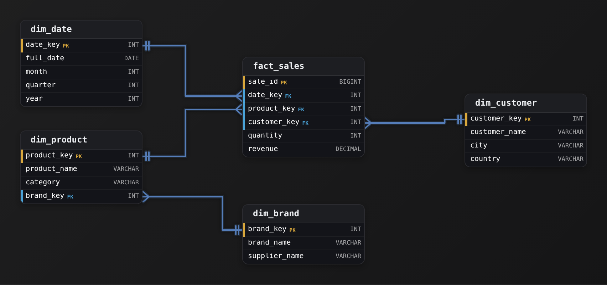

*`fact_sales` sits at the centre. `dim_product` points at `dim_brand`, the one snowflaked sub-dimension.*

1. **Put the measures in the centre**

   `fact_sales` holds one row per sale with `quantity` and `revenue`, plus one integer foreign key per dimension: `date_key`, `product_key` and `customer_key`. Nothing descriptive lives here, so the large table stays narrow and a query reads only the columns it names.

2. **Keep date and customer flat**

   `dim_date` holds `month`, `quarter` and `year` side by side, and `dim_customer` holds `city` and `country`. The repetition is cheap because these tables are small, and a filter on `country` costs one join that the engine can broadcast.

3. **Split brand out of product**

   `dim_product` keeps `category` but replaces the brand name with `brand_key`, a foreign key to `dim_brand`. That table holds `brand_name` and `supplier_name` once per brand, so a rename updates one `dim_brand` row instead of every product of that brand.

| Pitfall: Snowflake only where a split pays for itself |
| --- |
| After splitting one dimension, it is tempting to split all of them: `category` into its own table, `country` into another, `year` into a third. Each split adds a join to every query that filters on that attribute, and that is how an operational schema ends up at 11 joins. Split an attribute out only when it changes and repeats across many rows, as brand does here. |

| ✕ Brand flat on product | ✓ Brand snowflaked |
| --- | --- |
| `dim_product` stores `brand_name` and `supplier_name` on every product row. A brand filter is one join from `fact_sales`, but a rename rewrites every product of that brand. | `dim_product` stores `brand_key`, and `dim_brand` stores the name once. A rename touches one row. A brand filter costs one extra join, against a table small enough to sit in memory on every worker. |

**Follow-up questions**

1. Suppliers start being renamed too. Would you split `supplier_name` out of `dim_brand` into a third table?\
   *Checks that each split is justified by how the attribute changes, not applied out of habit.*
2. A report sums `revenue` by `category`. How many joins does it need here, and how many if category were snowflaked as well?\
   *Counts the join cost each extra split adds to a common query.*

 

### Exercise 2 of 12

**● TASK**

Design a star schema for website pageviews, each recording its time on page, sliced by date (day of week, month), user (country, device) and page (URL). Every page belongs to a site section, and the content team renames sections every few weeks across 40,000 pages. Snowflake the section out of the page dimension so a rename touches one row, and keep every other dimension flat.

<strong>Solution</strong>

#### A star with one snowflaked arm

Almost all of this model is a plain star schema: `fact_pageviews` sits in the middle holding `time_on_page_seconds`, with one integer foreign key out to each flat dimension. The one exception is the section hierarchy. It becomes a **snowflake arm**, with `dim_page` pointing at its own `dim_section`, because section names change often and are shared by thousands of pages.

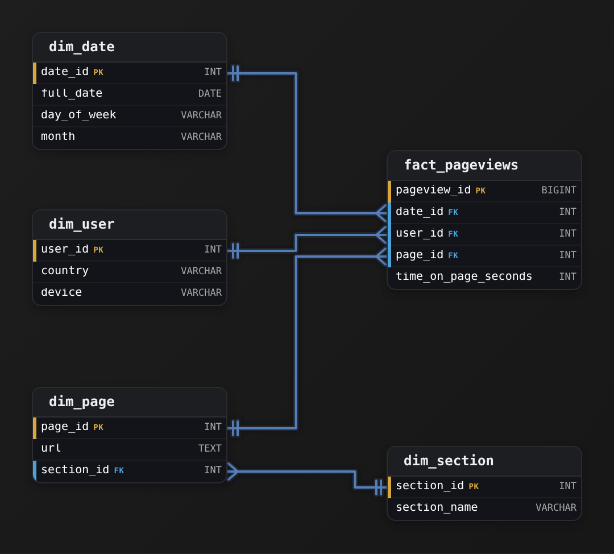

*`fact_pageviews` at the centre, `dim_date` and `dim_user` flat, and `dim_page` snowflaked out to `dim_section`.*

1. **Keep the date and user dimensions flat**

   A question like time on page by country and month is one large scan of `fact_pageviews` and 2 small joins. Putting `day_of_week` and `month` on `dim_date`, and `country` and `device` on `dim_user`, keeps each of those joins a single equality probe into a small table the engine can broadcast to every worker.

2. **Split the section out of `dim_page`**

   If `section_name` sat on `dim_page`, renaming a section would rewrite every one of its pages, potentially thousands of rows each time. Moving it into `dim_section` and leaving a `section_id` on the page row means a rename touches exactly one row. The cost is one extra join, and `dim_section` holds a few dozen rows, so that join is close to free.

| Pitfall: Snowflaking every attribute buys you nothing |
| --- |
| It is tempting to normalize further and split out `dim_country`, `dim_device` and `dim_month`. None of those values gets renamed across thousands of rows, so each split only adds a join before a row can be summed. Take that far enough and you are back to the operational schema's chain of joins and its minutes-long queries. |

| Real world: Snowflake the hierarchy that churns |
| --- |
| The same call shows up with product brands, store regions and campaign groupings. Snowflake a hierarchy when its labels change often and are shared widely, and flatten it when it is stable. The fact table and its query shape stay the same either way. |

**Follow-up questions**

1. If sections were renamed once a year instead of every few weeks, would you still snowflake `dim_section`?\
   *Weighs the cost of a rare wide rewrite against an extra join on every query.*
2. Sections now roll up into departments that are renamed just as often. Where does the department name go?\
   *Extends the snowflake arm by one more level and checks that the fact table is untouched.*

 

### Exercise 3 of 12

**● TASK**

An online store already has customer and product tables. Design the fact tables keyed to them for 2 questions: what each order line sold (quantity, unit price, line total, with its order id and order date), and how many units of each product were on hand at the end of each day. Line totals get summed over any date range, while units on hand is a level read on a given day.

<strong>Solution</strong>

#### 2 questions, 2 fact types

Choosing between a transaction fact and a periodic snapshot comes down to **metric additivity**: can the measure be summed across every dimension, including time? `line_total` and `quantity` can, because a month of sales is the sum of its days. `units_on_hand` cannot. It is a level, and adding Monday's stock to Tuesday's counts the same unit twice. That one difference is why the design needs 2 fact tables, not one.

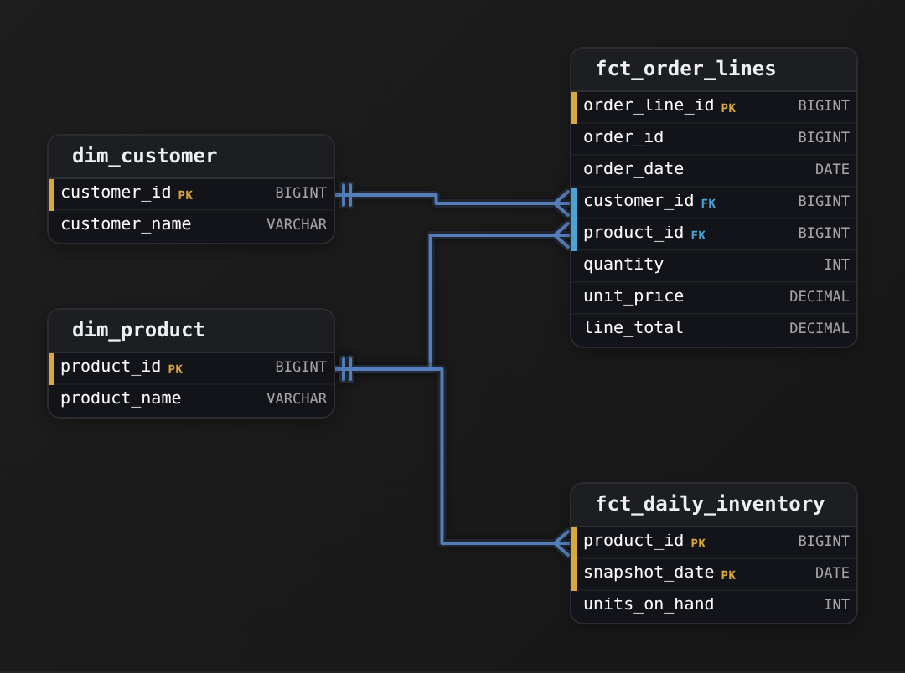

*`fct_order_lines` is the transaction fact and `fct_daily_inventory` the periodic snapshot. Both reference `dim_product`.*

`fct_order_lines` is a transaction fact: one row per order line, written once when the sale happens and never updated. Its sales measures are additive, so filtering on `order_date`, customer or product and then applying `SUM` gives a real number. `fct_daily_inventory` is a periodic snapshot: one row per product per day, written whether or not anything sold. That is what lets you read the stock level on a day with no sales.

| Pitfall: Stock does not belong on the order line |
| --- |
| Putting `units_on_hand` on `fct_order_lines` ties the level to sales events. A product that sold nothing on 3 March has no row that day, so its stock is missing. A product with 40 lines that day carries 40 copies of the level, and a `SUM` adds them all together. A level needs its own table with a row for every day. |

| Key insight: Sum across products, never across days |
| --- |
| `units_on_hand` is semi-additive. Summing every product on one `snapshot_date` gives total stock that day, which is a real figure. Across days, the valid answers are the last day's value, the average or the minimum, and the metric's written definition decides which one applies. |

**Follow-up questions**

1. Fulfilment wants the days from order placed to order delivered. Which fact type holds that, and what changes on its rows over time?\
   *Points at the accumulating snapshot: one row per order, with its milestone dates filled in as each stage happens.*
2. `unit_price` sits on `fct_order_lines`. Is it additive?\
   *Summing prices across lines means nothing, so `unit_price` is non-additive; `line_total` is the measure to sum.*

 

### Exercise 4 of 12

**● TASK**

Design a periodic snapshot fact table for a retailer's inventory: one row per product, per warehouse, per day, keyed to product, warehouse and date dimensions. Each row records the units on hand at close and the units received that day. Monthly reports need a valid figure for each measure under its additivity: units received per month, and the stock level on each month's last day.

<strong>Solution</strong>

#### 2 measures, 2 behaviours

Metric additivity decides how each column in this snapshot may roll up. `units_received` is a flow: each day's count is new stock, so it is **additive** across product, warehouse and date, and a month is the sum of its days. `units_on_hand` is a balance: it is semi-additive, summing across products and warehouses but never across days, because a unit that stays on the shelf is counted again every day.

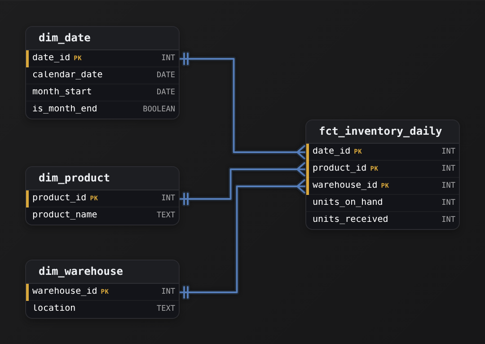

*One `fct_inventory_daily` row per day, product and warehouse; `is_month_end` on `dim_date` lets a report read the balance only at month end.*

1. **Classify each measure before placing it**

   Ask of every column: does adding it across dates give a real quantity? Receipts on 1 and 2 March add up to what arrived in those 2 days, so `units_received` is additive. Stock on 1 and 2 March adds up to nothing physical, so `units_on_hand` is semi-additive: it adds across warehouses on one day, and only there.

2. **Give the date dimension a month-end marker**

   A month's stock figure is the level on its last day, so `dim_date` carries `is_month_end`. A monthly report sums `units_received` over every day grouped by `month_start`, and reads `units_on_hand` only from rows whose date has `is_month_end` set. The classification lives in the model, not in each analyst's memory.

| Pitfall: Summing a balance over days inflates it |
| --- |
| Grouping the daily rows by `month_start` and summing `units_on_hand` returns about 30 times the stock a warehouse holds: a pallet untouched all month is counted on every day. The query runs and the number looks plausible, which is why the design has to make the month-end value easy to pick. |

| Key insight: Every balance follows the same rule |
| --- |
| A bank's daily account snapshot has the same pair: deposits that day are additive, the closing balance is semi-additive. Over a month you report total deposits, and either the month-end balance or the average daily balance, whichever the metric's written definition names. |

**Follow-up questions**

1. How would you report a month's average daily stock for one product in one warehouse?\
   *Sum `units_on_hand` over the month's days and divide by the number of days, not by the number of rows across warehouses.*
2. Where would a dollar value of stock go, and how does it roll up?\
   *Units times unit cost on the snapshot row is still a balance, so it is semi-additive like `units_on_hand`.*
3. What changes if reports also need the units shipped each day?\
   *It is another flow measure on the same row, additive across every dimension including the date.*

 

### Exercise 5 of 12

**● TASK**

Design a conformed customer dimension that could be shared across multiple fact tables and subject areas.

<strong>Solution</strong>

#### One customer row, every fact

A **conformed dimension** is one dimension table that several fact tables join to and agree on. When `fact_orders` and `fact_support_tickets` both point at the same `dim_customer`, 'Berlin' means one thing everywhere. Orders by country and tickets by country then line up row for row.

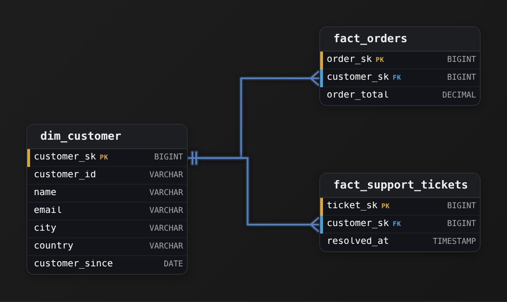

*One `dim_customer` serves 2 facts, and both join on the surrogate `customer_sk`.*

The primary key is `customer_sk`, a meaningless integer the warehouse mints. The business identifier `customer_id` rides along as an ordinary attribute. That natural key belongs to a source system you do not control: it can be recycled, it can arrive as a long string, and it can differ between the sources you are conforming. Facts join on the compact surrogate, so they never inherit those problems.

| Key insight: The surrogate buys you history |
| --- |
| Say a customer moves from 'Berlin' to 'Munich'. A slowly-changing dimension keeps the old row and adds a new one. The 2 rows share a `customer_id`, and each gets its own `customer_sk`. Old orders still point at the old `customer_sk`, so historical reports keep saying 'Berlin'. If facts joined on the natural key, you could not keep that history. |

| Pitfall: A natural key welds facts to one source |
| --- |
| Making `customer_id` the PK looks simpler, and the joins work fine today. The day 2 source systems disagree on an id, or an id gets recycled, every fact joined on it is silently wrong. Mint `customer_sk` and demote `customer_id` to a descriptive column. |

| Real world: Why dashboards stop disagreeing |
| --- |
| Companies keep one `dim_customer`, one `dim_date` and one `dim_product` that finance, marketing and support all join to. When each team builds its own customer table instead, 2 dashboards report different customer counts for the same month, and nobody can say which is right. |

**Follow-up questions**

1. How would you extend `dim_customer` so a report shows a customer's `country` as it was at the time of each order?\
   *Leads to a Type 2 dimension, which adds effective-date columns and a current-row flag.*
2. A second source system has its own customer ids. How do both map to one row in `dim_customer`?\
   *Conforming across sources means a match step that feeds one `customer_sk`.*

 

### Exercise 6 of 12

**● TASK**

Create a role-playing date dimension scenario where the same date dimension serves multiple purposes (order date, ship date) in a single fact table.

<strong>Solution</strong>

#### One calendar, many roles

A **role-playing dimension** is one physical dimension table that a single fact joins to more than once, with each join playing a different business role. `fct_orders` cares about 2 dates, the order date and the ship date, and both are plain calendar days. So you build ONE `dim_date` and point two foreign keys at it: `order_date_id` and `ship_date_id`. It is the same table playing 2 roles.

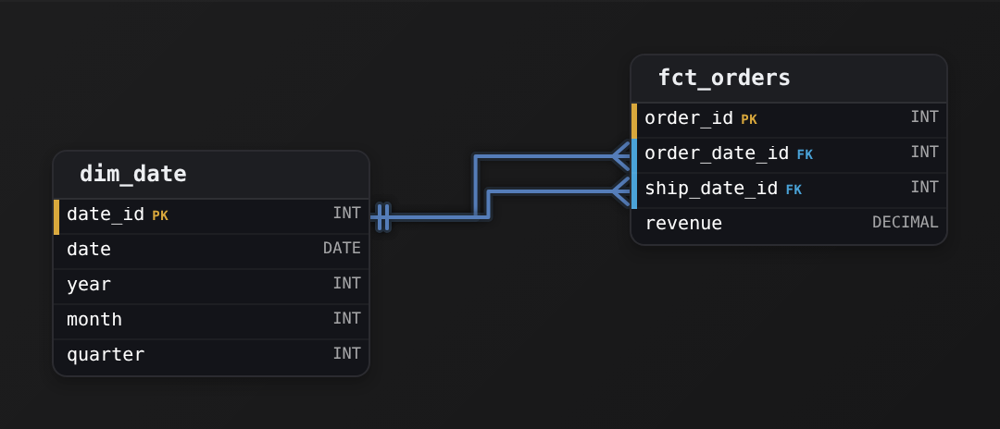

*2 FKs from `fct_orders`, `order_date_id` and `ship_date_id`, both landing on `dim_date.date_id`. That is the whole pattern.*

| Pitfall: Cloning the dimension makes calendars drift |
| --- |
| The instinct is to build a `dim_order_date` and a separate `dim_ship_date`, each with its own `year`, `month` and `quarter`. Now every calendar attribute lives in 2 places, a fiscal-calendar fix has to be applied twice, and the copies drift apart. The date '2026-03-31' is the same day whichever role it plays, so it should exist as exactly one row. |

1. **Give the dimension a surrogate key it can be reused by**

   `dim_date.date_id` is a surrogate key, so `order_date_id` and `ship_date_id` are just integers pointing into the same key space. Any date column on any fact can borrow this one dimension. The fact does not care which role a row plays; it only carries an id.

2. **Resolve the role at query time, not in the schema**

   You separate the roles when you query, by joining `dim_date` twice under different aliases: `JOIN dim_date od ON od.date_id = fct_orders.order_date_id` and `JOIN dim_date sd ON sd.date_id = fct_orders.ship_date_id`. Then `od.month` is the order month and `sd.month` is the ship month. The model stays lean; the role lives in the alias.

| Real world: Roles become named views for report builders |
| --- |
| The pattern is everywhere once you look: `dim_customer` playing bill-to and ship-to, `dim_airport` playing origin and destination. Warehouses often expose each role as a thin view over the one table, so a report builder sees 'Ship Date' while storage holds a single `dim_date`. |

**Follow-up questions**

1. What changes if an order has not shipped yet and `ship_date_id` is unknown?\
   *Point the FK at a dedicated 'not applicable' row in `dim_date` instead of `NULL`, so inner joins do not silently drop unshipped orders.*
2. How would you add a third role, say `return_date_id`, to the same fact?\
   *The pattern generalizes: one new FK column, no new dimension table.*

 

### Exercise 7 of 12

**● TASK**

Design a fact table at the line-item grain: one row per item within each order.

<strong>Solution</strong>

#### Grain first, everything else follows

The whole design turns on one sentence you had to commit to before drawing a single column: **the grain is one row per item within an order**. Grain is the promise a fact table makes about what a single row means. Once you say "one line item," the primary key writes itself, the measures that are allowed to live on the row are settled, and the dimensions you can hang off it become obvious. That is why `fct_order_lines` keys on both `order_id` and `line_item_id` together: a line item only has an identity *inside* its order, so the grain is the composite of the two.

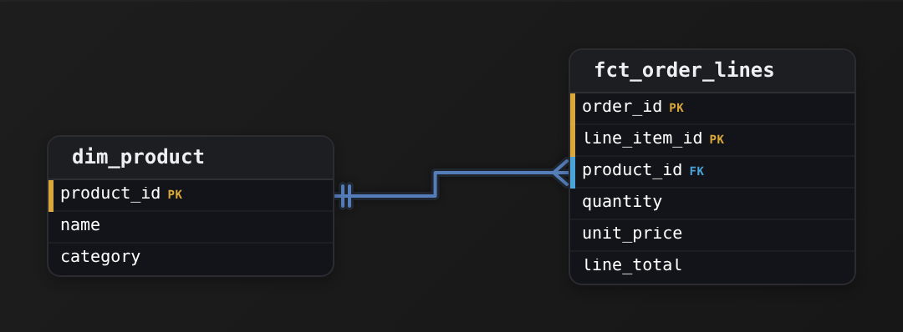

*The fact table carries the numbers you add up; the dimension carries the words you slice by.*

| Pitfall: Keying the fact at the wrong grain |
| --- |
| The most common miss is keying on `order_id` alone and stuffing the line items into repeated or array-like columns, or worse, keying on `product_id`. Both break the promise: an order with 3 items either collapses to one row (you lose 2 lines) or forces you to widen the row per product. Keep the PK exactly at the grain, `(order_id, line_item_id)`, and every line item gets its own honest row. |

Notice the split of what goes where. `quantity`, `unit_price`, and `line_total` sit on the fact because they are **measures**, numbers that make sense to sum or average across many rows. The product's `name` and `category` do not live on the fact; they live once in `dim_product` and are reached by the `product_id` foreign key. That is the star: descriptive, low-churn attributes in a dimension, additive numbers in the fact, joined by a slim key. Repeating `category` on every order line would bloat the table and mean re-writing millions of rows the day marketing renames a category.

| Real world: In production, `line_total` earns its keep |
| --- |
| You could always recompute `quantity * unit_price` at query time, but storing `line_total` on the row is standard practice: it locks in the amount actually charged even if `unit_price` on the product later changes, and it lets a dashboard sum revenue without a multiply on every scan. A fact table is allowed to carry a derived measure when it is additive and captures a point-in-time truth. |

**Follow-up questions**

1. If the same order can be shipped in parts, where would you record ship date so it does not break the line-item grain?\
   *Tests whether a new attribute belongs on the fact row, in a new dimension, or forces a finer grain.*
2. How would you add a customer to this model without changing the grain of `fct_order_lines`?\
   *Reinforces that a new `dim_customer` plus an `FK` leaves each line-item row intact.*

 

### Exercise 8 of 12

**● TASK**

Create a daily-grain fact table that aggregates all transactions to one row per day per store per product.

<strong>Solution</strong>

#### Grain first: one row per day per store per product

The whole design falls out of one sentence: **the grain is one row per day, per store, per product**. That sentence names the 3 things that make a row unique, and those 3 become the composite primary key of the fact table `fct_daily_sales` (`date_id`, `store_id`, `product_id` together). Everything else in the table is either a foreign key pointing at a dimension or a measured number. Fix the grain before you draw anything and the rest of the star schema is bookkeeping.

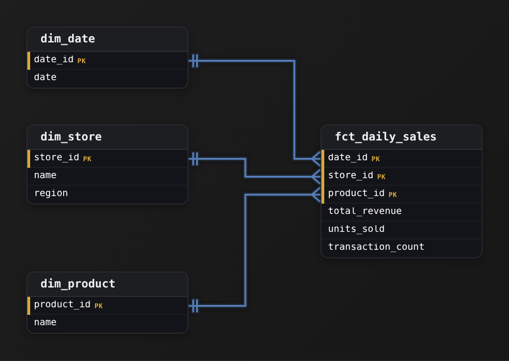

*A star: one fact at the center, 3 dimensions on the points. The fact's PK is the 3 FKs together.*

| Key insight: The composite key IS the grain, written down |
| --- |
| Each column of the primary key answers one part of "what makes this row unique": day, store, product. If you can add a fourth thing to that key without changing what a row means, your grain sentence was incomplete. If 2 rows could ever share all 3 of (`date_id`, `store_id`, `product_id`), you have duplicated a day's sales and `total_revenue` will double-count. |

| Pitfall: Don't store one row per transaction and call it a fact table |
| --- |
| The most common wrong answer keeps the raw grain: one row per receipt line, keyed by `transaction_id`. That is a fine transaction-grain fact, but it is not what was asked. The daily grain pre-aggregates every transaction for a day into ONE row, so a dashboard reads `SUM(total_revenue)` over far fewer rows. Pre-aggregation is the point: you trade drilling to a single sale for a table that answers "revenue by store by day" instantly. |

| Key insight: Only additive measures belong at this grain |
| --- |
| `total_revenue`, `units_sold`, and `transaction_count` are all fully additive: you can `SUM` them across any dimension and the number stays meaningful. That is why they survive aggregation. An average price does NOT belong as a stored measure here (averaging an average across stores is wrong); store `total_revenue` and `units_sold` and let the query divide. Keep the fact table to additive facts plus the foreign keys, nothing else. |

| ✕ Dimension row | ✓ Fact row |
| --- | --- |
| `dim_store` holds the descriptive context that rarely changes: `name`, `region`. One row per store, keyed by a surrogate `store_id`. Dimensions answer "which" and "what kind of." They are wide and short. | `fct_daily_sales` holds the measurements. Its columns are the 3 FKs plus additive numbers. One row per grain combination, keyed by all 3 FKs together. Facts answer "how much" and "how many." They are narrow and tall. |

The 3 edges are each a many-to-one from fact to dimension: many daily-sales rows point at one `dim_date` row, many at one `dim_store` row. Using surrogate integer keys like `date_id` and `store_id` (rather than the raw date or a store name) keeps the fact table narrow and its joins fast, and lets a dimension's descriptive columns change without touching millions of fact rows. This is the star schema in miniature, and the same shape reappears everywhere: web events by day, ad spend by campaign by day, inventory snapshots by warehouse.

**Follow-up questions**

1. What changes if a store's `region` gets reassigned and you need to keep history?\
   *Pushes toward slowly-changing dimensions (SCD Type 2): a new `dim_store` surrogate row per version, so old facts still point at the region that was true then.*
2. How would you add a monthly-grain summary on top of this?\
   *Tests whether the learner sees that a coarser fact rolls up from the daily one by summing additive measures over `date_id`.*

 

### Exercise 9 of 12

**● TASK**

Design a product dimension and a sales fact for a warehouse that loads 2 catalogs, both of which number their products from 1. A product's category can change, and every sale must keep the category the product had when it was sold. The sales fact will grow to billions of rows. Decide how the warehouse mints the dimension's key, and keep each version traceable to its source product.

<strong>Solution</strong>

#### The warehouse decides what identifies a product

This design turns on **key generation**: the warehouse, not either catalog, decides which number identifies a product version. Both catalogs hand you product 1, so neither source code can be the key. A category change also needs a second row for the same product, so the code could not stay unique anyway. `product_sk` is minted in the load, one value per version, and the source identity sits beside it as `source_system` plus `product_code`.

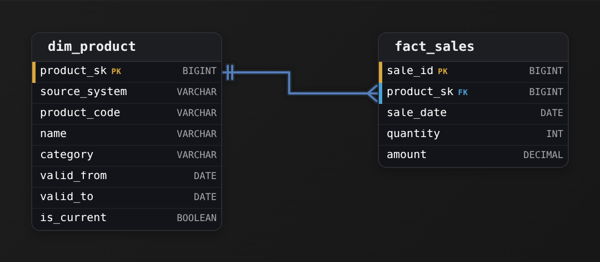

*`fact_sales` joins on `product_sk` alone; `source_system` plus `product_code` trace each version back to its catalog.*

1. **Widen the natural key to `source_system` plus `product_code`**

   Product 1 from the first catalog and product 1 from the second are different products. Adding `source_system` makes the pair unique per source. A lookup during the load then resolves to exactly one product, and nothing collides when a third catalog arrives.

2. **Mint `product_sk` from a sequence in the load**

   Each new version takes the next value of a sequence as it lands. The number means nothing outside the warehouse and never changes once a fact references it. It also fits in a `BIGINT`, which is all `fact_sales` stores on each of its billions of rows.

3. **Give every category change its own key**

   When a category changes, set the old row's `valid_to`, flip its `is_current` to false, and insert a new row with a fresh `product_sk` and the same natural key. Sales already loaded keep pointing at the version they were sold under, so the join needs equality alone.

| Pitfall: Offsetting ids hides the collision instead of fixing it |
| --- |
| Adding 10,000,000 to the second catalog's codes makes the numbers distinct today. But the stored value no longer matches anything in the source, and the scheme breaks once that catalog grows past the offset or a third one arrives. Widen the natural key and let the surrogate do the identifying. |

| ✕ Sequence-minted integer | ✓ UUID string |
| --- | --- |
| 8 bytes per fact row, compact indexes, and equality joins on an integer. The only cost is that the load needs one place to hand out the next number. | Needs no coordination, but stores 36 characters per row as text (16 bytes at best). That cost repeats across billions of sales and every index on `product_sk`. |

| Key insight: A hash key is the one that survives a rebuild |
| --- |
| A sequence hands out different numbers if you rebuild `dim_product` from scratch in a different order. If rebuilds are routine, hash `source_system`, `product_code` and `valid_from` into a 64-bit integer instead: the same inputs give the same key every time. |

**Follow-up questions**

1. A sale arrives before its product reaches `dim_product`. Which `product_sk` does the fact get, and how does it still count in totals?\
   *A reserved -1 'unknown' row lets the fact join and count, and it is repointed once the product lands.*
2. A catalog renumbers one of its product codes. Which rows change, and which stay exactly as they are?\
   *Only the natural key on `dim_product` changes; every `product_sk` already stored in `fact_sales` is untouched.*

 

### Exercise 10 of 12

**● TASK**

Our customer_id values and a newly acquired retailer's both start at 1, so one id can name 2 different customers. Design a customer dimension and a sales fact at one row per order line, where the fact's billions of rows join on a compact customer key the warehouse generates in its load and never renumbers. Each customer row must trace back to its source system and customer_id, and a sale whose customer has not loaded yet must still join and count.

<strong>Solution</strong>

#### Minting a key the warehouse owns

Once 2 systems both number customers from 1, the source id stops identifying anyone. The fix is a **surrogate key** that the warehouse mints itself during the load. How it is minted matters as much as having one. It has to be compact, because every fact row repeats it. It has to be stable, because facts point at it forever. And it cannot be derived from a source value that might collide.

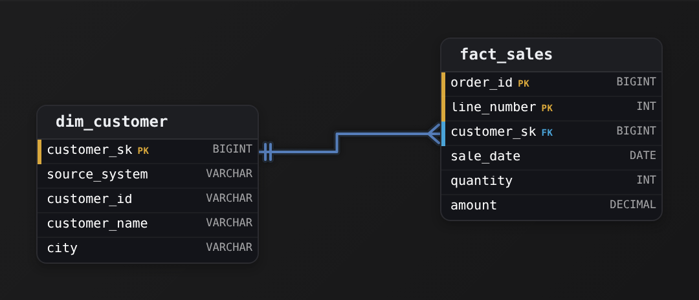

*`customer_sk` is minted in the load. The pair `source_system` plus `customer_id` traces each row back to its source, and `fact_sales` joins on `customer_sk` alone.*

1. **Choose how `customer_sk` is minted**

   A sequence gives a `BIGINT` that is 8 bytes on every one of billions of fact rows. A deterministic hash of `source_system` and `customer_id`, fitted into a `BIGINT`, works too, and it is useful when loads run in parallel. A `UUID` costs twice the bytes for no extra guarantee. The source `customer_id` cannot be the key at all, because it collides.

2. **Widen the natural key and keep it beside the surrogate**

   Store `source_system` next to `customer_id`, so that the pair is unique and every row traces back to the system it came from. The load looks up this pair to find an existing `customer_sk` before it mints a new one.

3. **Reserve `customer_sk = -1` for the unknown customer**

   Seed one 'unknown' row with key -1. A sale whose customer has not arrived yet gets `customer_sk = -1`, so it still joins and counts in totals instead of dropping out of an inner join.

| Pitfall: An offset is a renumbering in disguise |
| --- |
| Adding 10,000,000 to the acquired `customer_id` values hides the collision, but it rewrites a source value. It also breaks the next time a third system arrives with its own range. Widening the natural key leaves every minted `customer_sk` untouched. |

**Follow-up questions**

1. If the dimension were rebuilt from scratch every night, would a sequence or a hash keep each `customer_sk` the same across rebuilds?\
   *Shows when a deterministic hash wins over a sequence.*
2. A third source arrives whose ids are strings like 'C-0042'. What in this design has to change?\
   *Tests that the widened natural key, not the surrogate, absorbs a new source.*

 

### Exercise 11 of 12

**● TASK**

Build a complete retail star schema with date, product, store, and customer dimensions feeding into a central sales fact table. Each dimension gets its own surrogate key, and the fact table references every dimension by that key.

<strong>Solution</strong>

#### The star schema, named plainly

A **star schema** is one central fact table surrounded by dimension tables, each joined to the fact by a single key. The fact holds the measurements you sum and count; the dimensions hold the descriptive attributes you slice by. Here the measurements are `revenue` and `units_sold`, and you slice them by date, product, store, and customer. Drawn out, `fct_sales` sits in the middle and the four `dim_` tables fan out around it, which is where the name comes from.

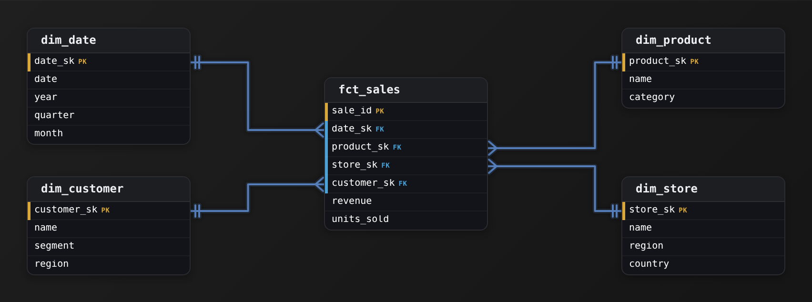

*One fact, four dimensions. Every FK in `fct_sales` points at a dimension's surrogate PK.*

1. **Fix the grain of the fact before anything else**

   The grain is the question "what does one row of `fct_sales` mean?" Here it is one sale, so `sale_id` is the primary key and every measure (`revenue`, `units_sold`) has to be true at that level. Deciding this first is what tells you which dimensions can attach: a sale happens on a date, for a product, at a store, to a customer, so those four foreign keys belong. Skip this step and you end up mixing per-sale and per-day rows in one table, and no aggregation can be trusted.

2. **Give each dimension its own surrogate key**

   Each `dim_` table gets a synthetic key it owns: `date_sk`, `product_sk`, `store_sk`, `customer_sk`. These are the primary keys of the dimensions and carry no business meaning; they exist only to join. The descriptive columns (`category`, `region`, `segment`) live right on the dimension, denormalized, so a query filtering by `category` never has to hop through another table.

3. **Reference every dimension from the fact by its surrogate key**

   `fct_sales` carries one foreign key per dimension, each pointing at that dimension's `_sk`. This is the one-to-many relationship that makes the star work: one row in `dim_product` maps to many rows in `fct_sales`, never the reverse. A query then joins the narrow fact to the wide dimensions on integer keys, which is the cheap, index-friendly path analytic engines are built for.

| Key insight: Why surrogate keys, not the natural ones |
| --- |
| It is tempting to join on the source system's `customer_id` or an SKU string. The surrogate `customer_sk` decouples the warehouse from the source: if the business re-numbers customers, merges 2 source systems, or a customer's `segment` changes over time, you absorb it in the dimension without rewriting every fact row. It also keeps the fact's foreign keys as compact integers instead of long natural strings. |

| Pitfall: Don't snowflake the dimensions |
| --- |
| The common mistake is to normalize `dim_product` by pulling `category` into a separate `dim_category` table with its own key, then linking it. That turns your star into a snowflake and adds a join to every category query for no analytic benefit. In dimensional modeling you deliberately keep dimensions flat and denormalized; the redundancy is the point. |

**Follow-up questions**

1. How would you handle a customer whose `segment` changes over time, so history stays correct?\
   *Tests slowly-changing dimensions (Type 2): a new dimension row with a new `customer_sk` per version rather than an in-place update.*
2. Sales and returns both happen at the store. Do returns go in `fct_sales` or a separate fact?\
   *Tests grain discipline: a return at a different grain or sign convention argues for its own fact table.*
3. Why is `dim_date` its own table instead of just storing the raw date on the fact?\
   *Tests why pre-computed `year`/`quarter`/`month` attributes belong in a dimension for cheap slicing.*

 

### Exercise 12 of 12

**● TASK**

Design a digital marketing star schema with campaign and date dimensions feeding into a performance fact table.

<strong>Solution</strong>

#### The star schema you just drew

A star schema splits data into a central **fact table** of the numbers a business counts and a ring of dimensions holding the context you slice them by. Your measures, impressions, clicks, conversions and spend, sit in `fct_ad_performance`; the things you slice by, the campaign and the day, sit in `dim_campaign` and `dim_date`. The fact sits in the middle with a dimension on each point, which is where the name comes from.

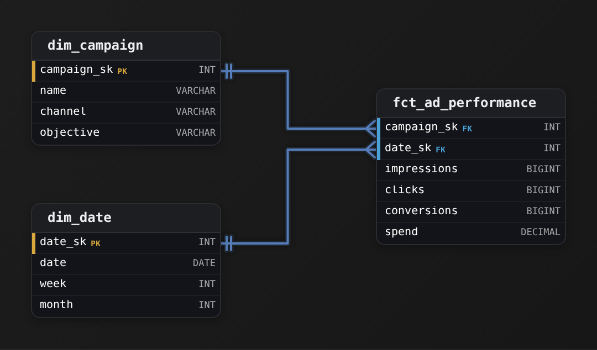

*One fact table in the center with a foreign key out to each dimension. The grain is one row per campaign per day.*

1. **Name the grain before anything else**

   A fact table's grain is what one row represents. Here it is one campaign on one day, so the fact keys are the pair `campaign_sk` and `date_sk`. Deciding this first tells you which columns are measures that roll up (`impressions`, `spend`) and which are context that describes (`channel`, `month`). Get it wrong and every aggregate double-counts.

2. **Give each dimension a surrogate key**

   `campaign_sk` and `date_sk` are surrogate keys, meaningless integers the warehouse mints rather than an ad-platform ID or a calendar date. Joining the fact on narrow integer keys keeps it skinny and lets a campaign be renamed without rewriting history in the fact rows.

| Pitfall: Descriptions belong in the dimensions |
| --- |
| Widening `fct_ad_performance` with `channel`, `objective` and `month` so you can query one table repeats the same strings across millions of rows and forces a schema change whenever marketing adds an attribute. Push descriptive text out to the dimensions, leave only measures and foreign keys in the fact. |

| Key insight: Why a dedicated `dim_date` |
| --- |
| Storing raw `date` and calling `date_trunc` at query time makes every analyst re-derive periods. A `dim_date` with prebuilt `week` and `month` lets every report group the same way, and it is the one dimension almost every fact table reuses. |

**Follow-up questions**

1. If a campaign's `objective` changes over time and you must report the value true on each day, how would `dim_campaign` change?\
   *Introduces slowly changing dimensions (Type 2): versioned rows keyed by a new surrogate.*
2. Marketing wants spend broken out by ad creative too. New dimension, or a change to the grain?\
   *Tests whether adding a dimension shifts the grain to one row per campaign per creative per day.*

