# Collections: Advanced

Late November at Spotify, days before Wrapped ships, a year of play events per listener has to become a top-5 artist list, plays grouped by month, a rolling log of recent tracks, and a minutes-listened bracket. Built from plain lists and dicts, the job either crawls through rescans and front-of-list deletes or drowns in key checks. Whether it finishes in time depends on 5 standard-library tools.


<br>

---

## heapq Operations

A scheduler holding 50,000 waiting jobs keeps asking which job runs next. Calling min(jobs) reads all 50,000 every time, and re-sorting after each arrival reorders the whole list to answer a question about a single item. The heapq module keeps an ordinary list arranged so the smallest item always sits at index 0. After a push or a pop, a short walk through the list repairs that arrangement.


<br>

### The heap rule: no parent is larger than its children

Picture index i as a parent whose 2 children live at indexes 2\*i + 1 and 2\*i + 2. A list is a heap when every parent is less than or equal to both children. That rule puts the minimum at index 0 and says nothing about the order of the rest. Watch the list after each `heappush`:

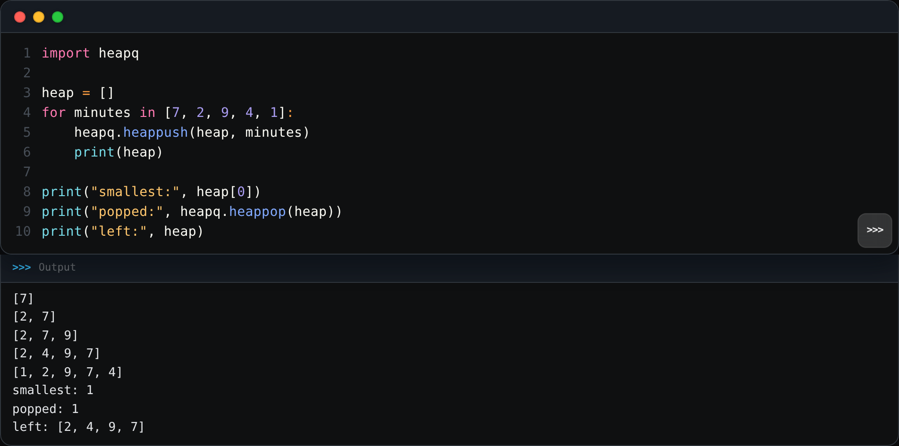

```python
import heapq

heap = []
for minutes in [7, 2, 9, 4, 1]:
    heapq.heappush(heap, minutes)
    print(heap)

print("smallest:", heap[0])
print("popped:", heapq.heappop(heap))
print("left:", heap)
```

The final list `[1, 2, 9, 7, 4]` is out of order, since 9 sits before 7 and 4, yet `heap[0]` holds the minimum. When 1 arrived it was appended at index 4, compared with its parent at index 1, swapped, then compared with index 0 and swapped again. A pop runs the other direction: the last item moves to index 0 and sinks, swapping with its smaller child at each level.

| Index | Value | Child indexes | Child values |
| --- | --- | --- | --- |
| 0 | 1 | 1 and 2 | 2 and 9 |
| 1 | 2 | 3 and 4 | 7 and 4 |
| 2 | 9 | 5 and 6 | none yet |
| 3 | 7 | 7 and 8 | none yet |
| 4 | 4 | 9 and 10 | none yet |

Those walks stay short because each level of the tree holds twice as many items as the level above it: 1, then 2, then 4, so 20 levels hold over 1,000,000 items. A push or pop on a 1,000,000-item heap visits roughly 20 levels at most, where `min()` reads every item. For data already sitting in a list, `heapq.heapify(items)` rearranges it into a heap in place, in a single pass.


<br>

### Tuples carry the priority

Heaps compare items with `<`, so a tuple `(priority, job)` orders by priority first and compares job names only on a tie. Lower numbers leave first. The 2 jobs below share priority 1; decide which pops first, then play it.

https://github.com/user-attachments/assets/02252908-5dd8-49e2-ba97-ec9073ffa5dc

Both priority-1 jobs tied, so Python compared the names, and `'backfill_events'` sorts before `'fix_schema'`. That fallback fails when the second item can't be compared, such as a dict describing the job. Put a sequence number between the priority and the payload: no 2 entries share a number, so Python never reaches the payload, and equal priorities leave in arrival order.

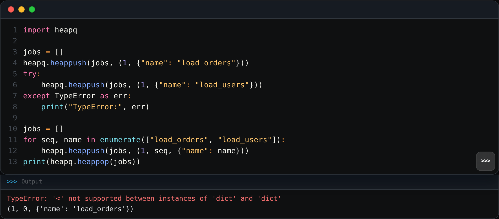

```python
import heapq

jobs = []
heapq.heappush(jobs, (1, {"name": "load_orders"}))
try:
    heapq.heappush(jobs, (1, {"name": "load_users"}))
except TypeError as err:
    print("TypeError:", err)

jobs = []
for seq, name in enumerate(["load_orders", "load_users"]):
    heapq.heappush(jobs, (1, seq, {"name": name}))
print(heapq.heappop(jobs))
```


<br>

### Largest first, and the top k

`heapq` builds min-heaps only. For largest-first order, push each number negated and negate it again on the way out, because the most negative stored value is the largest original.

https://github.com/user-attachments/assets/f69a8809-ca79-4ef8-9b26-cf5f8d33fb42

When you need a top k once and have no queue to keep alive, `heapq.nlargest(k, items)` and `heapq.nsmallest(k, items)` answer in a single call. Both take `key=` the way `sorted()` does. The last line gets the same answer by sorting all 5 values to keep 2.

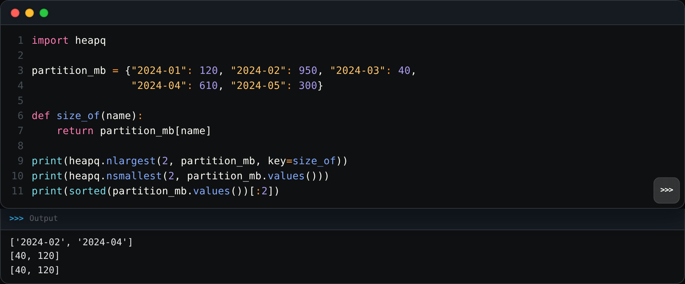

```python
import heapq

partition_mb = {"2024-01": 120, "2024-02": 950, "2024-03": 40,
                "2024-04": 610, "2024-05": 300}

def size_of(name):
    return partition_mb[name]

print(heapq.nlargest(2, partition_mb, key=size_of))
print(heapq.nsmallest(2, partition_mb.values()))
print(sorted(partition_mb.values())[:2])
```

> **TIP**
>
> `heappush` and `heappop` trust that the list already obeys the heap rule. If you filled the list with `append`, call `heapq.heapify()` before the first pop. Skip it and pops come out in a scrambled order with no error to warn you.

Only index 0 has a fixed meaning. The largest item always sits among the leaves, the slots with no children. In a list of n items those run from index `n  2` to `n - 1`, and nothing says which leaf holds the maximum. In `[1, 2, 9, 7, 4]` the maximum, 9, is at index 2. Meanwhile `heap[-1]` holds 4, the item that 1 displaced on its climb to the top. Asking a min-heap for its largest item still means scanning half the list.

**What does this program print?**

```python
from collections import deque

d = deque([1, 2], maxlen=3)
d.append(3)
d.appendleft(0)
d.append(4)
print(list(d))
```

- **A.** [2, 3, 4]: a full deque always drops its oldest item, whatever end you add to
- **B.** [1, 2, 4]: each add to a full deque drops an item from the opposite end
- **C.** [0, 1, 2, 3, 4]: maxlen only limits how many items the deque starts with
- **D.** [0, 1, 2]: once full, a deque ignores further adds at its right end

<details>
<summary>Solution</summary>

**B.** [1, 2, 4]: each add to a full deque drops an item from the opposite end

appendleft(0) pushed 3 off the right, giving [0, 1, 2], then append(4) pushed 0 off the left.

**Why the others are wrong**

- **A.** appendleft(0) dropped 3, the newest item, from the right end.
- **C.** maxlen applies to every add, so the deque never holds more than 3 items.
- **D.** Adds are never ignored. append(4) kept 4 and dropped 0 from the left.

</details>


<br>

---

## Counter for Frequency

Counting by hand means a dict plus, for every item, a membership check before the `+= 1`. `collections.Counter` is a dict subclass built for tallies: pass it any iterable and it counts each item, and reading a key it never saw returns 0 instead of raising `KeyError`.

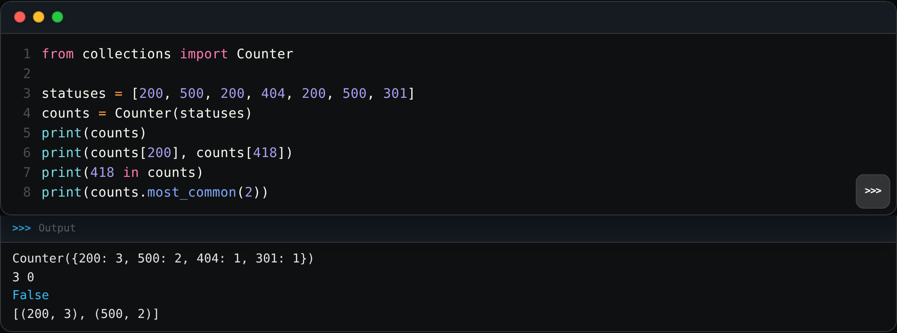

```python
from collections import Counter

statuses = [200, 500, 200, 404, 200, 500, 301]
counts = Counter(statuses)
print(counts)
print(counts[200], counts[418])
print(418 in counts)
print(counts.most_common(2))
```

The repr runs from most to least common, so 404 precedes 301 only because it was seen first. `counts[418]` returned 0 without storing 418, which is why `418 in counts` stays `False`. And `most_common(2)` returns `(item, count)` pairs, highest count first, ties in first-seen order.

| ✓ Counting with a plain dict | ✗ Counting with Counter |
| --- | --- |
| • An if key not in counts check before every increment<br><br>• Reading an unseen key raises KeyError<br><br>• Top 2 needs sorted() with a key function, then a slice<br><br>• Merging 2 days of counts is a loop you write | • Counter(statuses) counts the whole list in a single call<br><br>• Reading an unseen key returns 0<br><br>• Top 2 is counts.most_common(2)<br><br>• Merging 2 days is monday + tuesday |


<br>

### Combining counts with +, - and subtract()

Counters support arithmetic, which suits daily tallies that roll up into weekly ones. `+` adds counts key by key. `-` subtracts and then drops every key whose result is 0 or below, while the `subtract()` method changes the counter in place and keeps negatives. Before running this, decide which keys survive `monday - tuesday`.

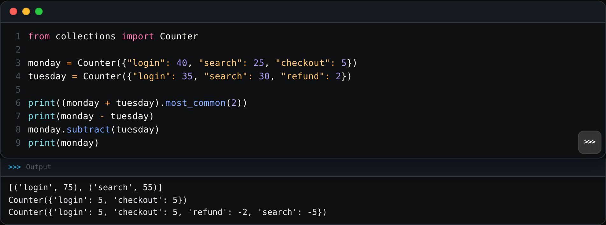

```python
from collections import Counter

monday = Counter({"login": 40, "search": 25, "checkout": 5})
tuesday = Counter({"login": 35, "search": 30, "refund": 2})

print((monday + tuesday).most_common(2))
print(monday - tuesday)
monday.subtract(tuesday)
print(monday)
```

`search` fell from 25 to -5, so `-` dropped it and `subtract()` kept it. `refund` never appeared on Monday: `-` ignored it, while `subtract()` recorded -2. Reach for `-` when a negative count means nothing, such as units left in a warehouse bin, and for `subtract()` when falling below zero is the signal you want to see.


<br>

### Feeding Counter the right items

A Counter counts whatever its iterable yields, and a string yields characters, so passing a raw log line tallies letters and spaces. Split the line to count words. `update()` adds another batch to an existing counter, which fits log lines arriving item by item.

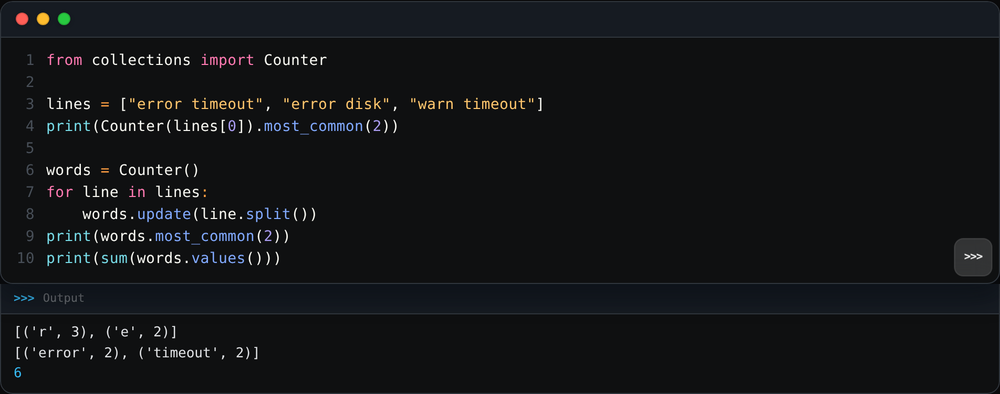

```python
from collections import Counter

lines = ["error timeout", "error disk", "warn timeout"]
print(Counter(lines[0]).most_common(2))

words = Counter()
for line in lines:
    words.update(line.split())
print(words.most_common(2))
print(sum(words.values()))
```

*Python 3.10 added Counter.total(). On 3.9, sum(words.values()) gives the same number, as the last line does.*


Reads and writes behave differently on a Counter. A read of a missing key, `counts['x']`, answers 0 without storing anything. Any assignment stores. That includes `+= 1`, which assigns 1 after fetching the 0. An assigned 0 stays stored as well. Once `counts['x'] = 0` runs, `'x' in counts` is `True`, and the key counts toward `len(counts)`, which grows by 1. Unary plus, `+counts`, returns a new Counter with every zero and negative count removed, which tidies up after `subtract()`.

**What does this program print?**

```python
from collections import deque

d = deque([1, 2], maxlen=3)
d.append(3)
d.appendleft(0)
d.append(4)
print(list(d))
```

- **A.** [2, 3, 4]: a full deque always drops its oldest item, whatever end you add to
- **B.** [1, 2, 4]: each add to a full deque drops an item from the opposite end
- **C.** [0, 1, 2, 3, 4]: maxlen only limits how many items the deque starts with
- **D.** [0, 1, 2]: once full, a deque ignores further adds at its right end

<details>
<summary>Solution</summary>

**B.** [1, 2, 4]: each add to a full deque drops an item from the opposite end

appendleft(0) pushed 3 off the right, giving [0, 1, 2], then append(4) pushed 0 off the left.

**Why the others are wrong**

- **A.** appendleft(0) dropped 3, the newest item, from the right end.
- **C.** maxlen applies to every add, so the deque never holds more than 3 items.
- **D.** Adds are never ignored. append(4) kept 4 and dropped 0 from the left.

</details>


<br>

---

## defaultdict Usage

Grouping rows under a key runs through most aggregation code: orders by customer, files by date, errors by service. With a plain dict, every append needs a check that the key's list exists yet. `defaultdict` moves that check inside the dict. You give it a factory, and a lookup on a missing key calls the factory, stores the result under that key and returns it.

```sql
orders = [("ana", 30), ("ben", 12), ("ana", 45), ("cy", 8), ("ben", 20)]

by_customer = {}
for customer, amount in orders:
    if customer not in by_customer:
        by_customer[customer] = []
    by_customer[customer].append(amount)

by_customer = {}
for customer, amount in orders:
    by_customer.setdefault(customer, []).append(amount)
```

The same grouping with `defaultdict`:

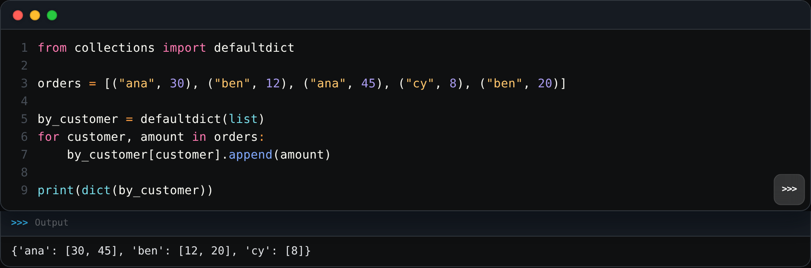

```python
from collections import defaultdict

orders = [("ana", 30), ("ben", 12), ("ana", 45), ("cy", 8), ("ben", 20)]

by_customer = defaultdict(list)
for customer, amount in orders:
    by_customer[customer].append(amount)

print(dict(by_customer))
```

You pass `list`, the type itself, with no parentheses. The dict calls it with no arguments each time it meets a new key, so every customer gets a fresh list of their own. Converting with `dict()` before printing gives a plain dict, which also goes back to raising `KeyError` on a mistyped key.


<br>

### Any zero-argument callable is a factory

`int()` returns 0, so `defaultdict(int)` is a tally you bump with `+= 1`. `set` collects distinct values. A function you define works too, provided it takes no arguments. As the 2 dicts below fill, watch when each key first appears in each.

https://github.com/user-attachments/assets/1a8daf60-174b-44df-b091-14a09d8f724b

`'us'` joined `by_region` on the second event and `clicks` only on the fifth, the first time anything looked up `clicks['us']`. A key comes into existence at its first lookup. When each value is a small record, write the factory as a function:

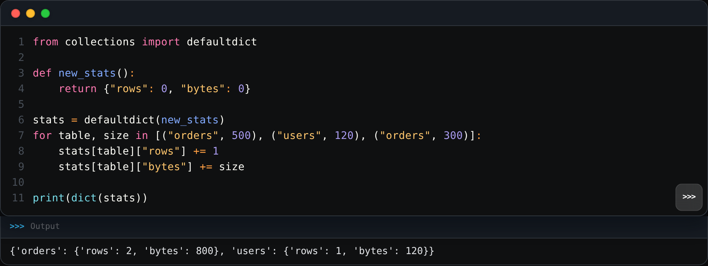

```python
from collections import defaultdict

def new_stats():
    return {"rows": 0, "bytes": 0}

stats = defaultdict(new_stats)
for table, size in [("orders", 500), ("users", 120), ("orders", 300)]:
    stats[table]["rows"] += 1
    stats[table]["bytes"] += size

print(dict(stats))
```

> **TIP**
>
> For 2 levels of grouping, such as counts per day per table, the inner factory must be a function too: `def per_table(): return defaultdict(int)`, then `defaultdict(per_table)`. Each new day gets its own fresh inner tally.


<br>

### The lookup that writes

That rule has a side effect you must predict: `d[key]` on a missing key inserts it, even inside an `if` that was only meant to look. `.get()` and `in` never call the factory, so they are the safe ways to ask about a key.

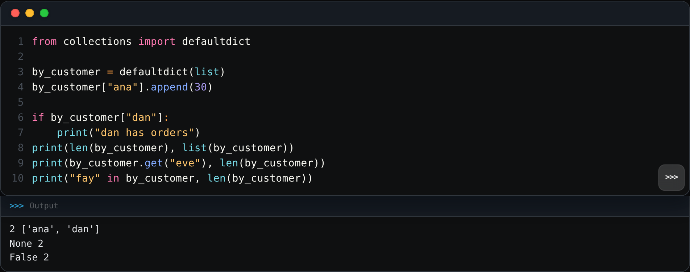

```python
from collections import defaultdict

by_customer = defaultdict(list)
by_customer["ana"].append(30)

if by_customer["dan"]:
    print("dan has orders")
print(len(by_customer), list(by_customer))
print(by_customer.get("eve"), len(by_customer))
print("fay" in by_customer, len(by_customer))
```

The `if` saw an empty list and printed nothing, yet `'dan'` now sits in the dict with no orders, and a report counting customers would count dan. Converting to `dict()` once grouping ends shuts this door, because later lookups go back to raising `KeyError`.

| ✓ Do | ✗ Don't |
| --- | --- |
| • Pass the factory itself: defaultdict(list)<br><br>• Use in or .get() when you only want to look<br><br>• Convert with dict(d) once grouping is finished<br><br>• Use Counter over defaultdict(int) when you need top items | • Write defaultdict([]): a list can't be called, so it raises TypeError<br><br>• Test if d[key]: on a defaultdict<br><br>• Nest with a call: defaultdict(defaultdict(int)) raises TypeError<br><br>• Expect a missing key to raise KeyError as a plain dict would |

A defaultdict keeps its factory in an attribute, `default_factory`. Setting `d.default_factory = None` once grouping ends makes missing keys raise `KeyError` again, and `d` stays the same object. That helps when other code already holds a reference to it, which a `dict()` copy would leave behind. `.get(key, 0)` takes a fallback of your own. Like plain `.get()`, it never calls the factory and stores nothing.

**What does this program print?**

```python
from collections import deque

d = deque([1, 2], maxlen=3)
d.append(3)
d.appendleft(0)
d.append(4)
print(list(d))
```

- **A.** [2, 3, 4]: a full deque always drops its oldest item, whatever end you add to
- **B.** [1, 2, 4]: each add to a full deque drops an item from the opposite end
- **C.** [0, 1, 2, 3, 4]: maxlen only limits how many items the deque starts with
- **D.** [0, 1, 2]: once full, a deque ignores further adds at its right end

<details>
<summary>Solution</summary>

**B.** [1, 2, 4]: each add to a full deque drops an item from the opposite end

appendleft(0) pushed 3 off the right, giving [0, 1, 2], then append(4) pushed 0 off the left.

**Why the others are wrong**

- **A.** appendleft(0) dropped 3, the newest item, from the right end.
- **C.** maxlen applies to every add, so the deque never holds more than 3 items.
- **D.** Adds are never ignored. append(4) kept 4 and dropped 0 from the left.

</details>


<br>

---

## deque Double-Ended Operations

A Python list stores its items as a contiguous row of references. Adding or removing at the end touches the last slot and nothing else. At index 0 the work changes: every other reference shifts over by a slot to open or close the gap at the front.

List before inserting a at index 0

| Slot | Reference |
| --- | --- |
| 0 | b |
| 1 | c |
| 2 | d |
| 3 | e |
| 4 | (empty) |

List after inserting a at index 0

| Slot | Reference | Moved? |
| --- | --- | --- |
| 0 | a | new |
| 1 | b | yes |
| 2 | c | yes |
| 3 | d | yes |
| 4 | e | yes |

The insert moved 4 references to make room for 1 item. On a list of 1,000,000 items, a front insert moves 1,000,000 references, and a queue drained with `pop(0)` pays that again on every call, each a little shorter than the last. Over a whole drain the moves add up:

- **5 billion** — slot moves, pop(0) on 100,000 items
- **0** — slot moves, popleft on 100,000 items


<br>

### How a deque avoids the shift

`collections.deque`, pronounced "deck" and short for double-ended queue, stores items in a chain of fixed-size blocks, 64 references each in CPython, with each block linked to the blocks on both sides. Adding at either end writes into the end block, or links a new block when that one is full. No stored item moves, so a front operation costs the same on 10 items as on 10,000,000.

The methods mirror each other. `append` and `pop` work on the right end, and their left-end twins are `appendleft` and `popleft`. Predict the last line before you play it, keeping in mind that `extendleft` adds its items to the front item by item.

https://github.com/user-attachments/assets/7607bd7a-b2ed-45e5-a997-4080836b0a2e

`extendleft([-1, -2])` put -1 at the front and then -2 in front of it, so the batch landed reversed. Pass `reversed(batch)` when its order has to survive.


<br>

### maxlen: a buffer that forgets

A deque built with `maxlen=n` never holds more than n items. Adding to a full one drops an item from the opposite end, with no error. That makes it the usual holder for recent history, whether the last few events are retries or readings.

https://github.com/user-attachments/assets/5cddbc2c-238a-4b9c-ae2c-b38cb9ecf632

The last line shows the rule from the other side: `appendleft` on a full deque pushed `e5` off the right. A rolling average of the last 3 latency readings needs nothing more:

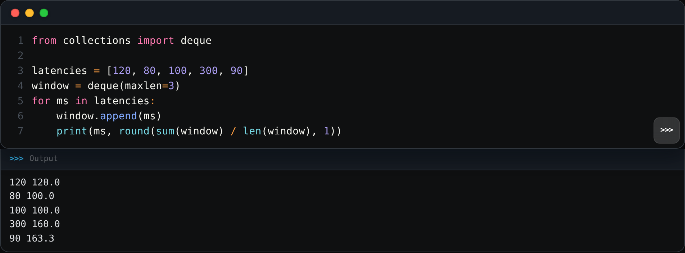

```python
from collections import deque

latencies = [120, 80, 100, 300, 90]
window = deque(maxlen=3)
for ms in latencies:
    window.append(ms)
    print(ms, round(sum(window) / len(window), 1))
```


<br>

### What a deque gives up

Blocks make the ends fast and the middle slower. `d[0]` and `d[-1]` read an end block directly, while `d[500000]` on a 1,000,000-item deque walks block by block from the nearer end. Slicing raises an error:

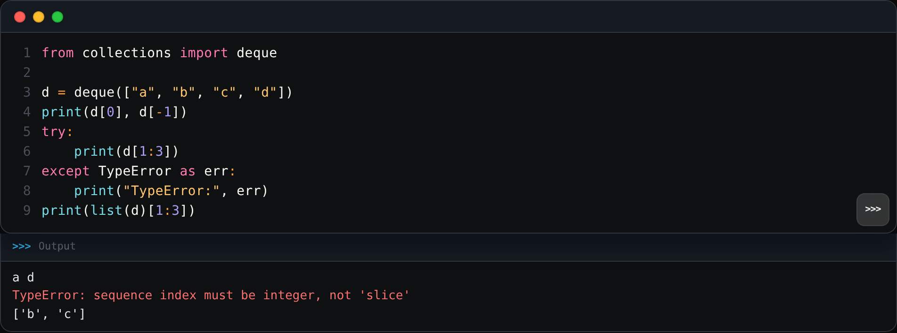

```python
from collections import deque

d = deque(["a", "b", "c", "d"])
print(d[0], d[-1])
try:
    print(d[1:3])
except TypeError as err:
    print("TypeError:", err)
print(list(d)[1:3])
```

`rotate(-1)` moves the front item to the back, which gives a round-robin over workers with no index arithmetic:

https://github.com/user-attachments/assets/40ea63b6-0eb0-410b-a507-21e5620fbc37

| ✓ list | ✗ deque |
| --- | --- |
| • Fast append and pop at the end<br><br>• insert(0, x) and pop(0) move every other item<br><br>• Fast lst[i] anywhere, plus slicing<br><br>• Grows without a size limit | • Fast adds and removes at both ends<br><br>• appendleft and popleft move nothing<br><br>• Fast at the ends, slower toward the middle, no slicing<br><br>• Optional maxlen that drops from the far end |

The limit is set once, when the deque is built. `d.maxlen` reads it back, and assigning to it raises `AttributeError`, so a buffer that must grow is rebuilt as `deque(d, maxlen=new_size)`. Building from a long iterable applies the rule from the start: `deque([1, 2, 3, 4, 5], maxlen=3)` keeps `[3, 4, 5]`. Each item was appended in turn, and the oldest fell off the left as each new one arrived.

**What does this program print?**

```python
from collections import deque

d = deque([1, 2], maxlen=3)
d.append(3)
d.appendleft(0)
d.append(4)
print(list(d))
```

- **A.** [2, 3, 4]: a full deque always drops its oldest item, whatever end you add to
- **B.** [1, 2, 4]: each add to a full deque drops an item from the opposite end
- **C.** [0, 1, 2, 3, 4]: maxlen only limits how many items the deque starts with
- **D.** [0, 1, 2]: once full, a deque ignores further adds at its right end

<details>
<summary>Solution</summary>

**B.** [1, 2, 4]: each add to a full deque drops an item from the opposite end

appendleft(0) pushed 3 off the right, giving [0, 1, 2], then append(4) pushed 0 off the left.

**Why the others are wrong**

- **A.** appendleft(0) dropped 3, the newest item, from the right end.
- **C.** maxlen applies to every add, so the deque never holds more than 3 items.
- **D.** Adds are never ignored. append(4) kept 4 and dropped 0 from the left.

</details>


<br>

---

## bisect Binary Search

On a sorted list, you can find where a value belongs without reading every item. Compare the target with the middle item: if the middle is smaller, the target belongs to its right; otherwise it belongs at or left of it. Each comparison halves what remains. The `bisect` module runs that loop in C; written out in Python, you can watch the range shrink.

https://github.com/user-attachments/assets/4998113c-5206-4273-a6a4-14a87c9e0b5a

A list of 8 took 3 comparisons. Doubling the list adds 1 more comparison, so the count barely moves as data grows:

- **20** — halvings to search 1,000,000 items
- **30** — halvings to search 1,000,000,000 items


<br>

### bisect_left and bisect_right

Both return an insertion index, the position where the value could go and keep the list sorted, and they differ only when the value is already present. `bisect_left` returns the index of the first equal item; `bisect_right`, also callable as `bisect.bisect`, returns the index right after the last one.

| Index | 0 | 1 | 2 | 3 | 4 | 5 |
| --- | --- | --- | --- | --- | --- | --- |
| Value | 100 | 200 | 200 | 200 | 350 | 500 |
| Points here |  | bisect_left(ts, 200) |  |  | bisect_right(ts, 200) |  |

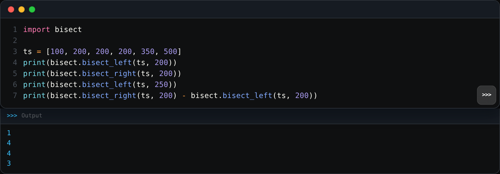

```python
import bisect

ts = [100, 200, 200, 200, 350, 500]
print(bisect.bisect_left(ts, 200))
print(bisect.bisect_right(ts, 200))
print(bisect.bisect_left(ts, 250))
print(bisect.bisect_right(ts, 200) - bisect.bisect_left(ts, 200))
```

To check membership, compute `i = bisect.bisect_left(ts, x)` and then test `i < len(ts) and ts[i] == x`. The bounds check matters because a value above everything returns `len(ts)`. To count values from `lo` up to but excluding `hi`, subtract: `bisect_left(ts, hi) - bisect_left(ts, lo)`. On sorted event timestamps, that counts a time window's events with no loop.

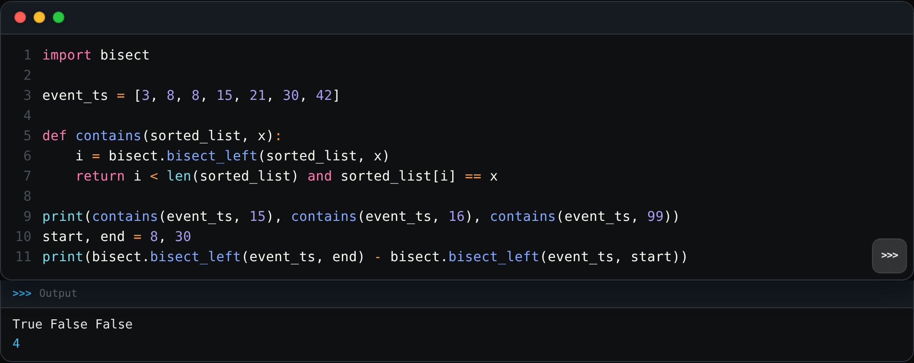

```python
import bisect

event_ts = [3, 8, 8, 15, 21, 30, 42]

def contains(sorted_list, x):
    i = bisect.bisect_left(sorted_list, x)
    return i < len(sorted_list) and sorted_list[i] == x

print(contains(event_ts, 15), contains(event_ts, 16), contains(event_ts, 99))
start, end = 8, 30
print(bisect.bisect_left(event_ts, end) - bisect.bisect_left(event_ts, start))
```


<br>

### Bucketing values against thresholds

A sorted list of thresholds turns `bisect_right` into a decision table: the index it returns is the bucket number. A value equal to a threshold lands in the bucket above it; switch to `bisect_left` when boundary values belong below.

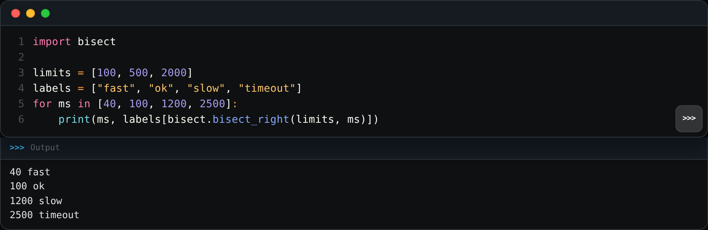

```python
import bisect

limits = [100, 500, 2000]
labels = ["fast", "ok", "slow", "timeout"]
for ms in [40, 100, 1200, 2500]:
    print(ms, labels[bisect.bisect_right(limits, ms)])
```


<br>

### Inserting while staying sorted

`bisect.insort(lst, x)` finds the position with `bisect_right` and inserts there, so the list is sorted after every new item.

https://github.com/user-attachments/assets/c8024374-38a4-406c-aff4-2a4ede2d5436

The search half of `insort` takes a few comparisons, but the insert half is `list.insert`, which shifts every later item like the front insert in the deque section. For a few thousand items that cost is small. When a large list takes many inserts, append everything and sort once; that is usually faster. If you only ever need the smallest item, use a heap instead.

> **TIP**
>
> On Python 3.9 the `bisect` functions take no `key=` argument; it arrived in 3.10. To search records by a field such as a timestamp, keep a parallel sorted list of that field's values. The index you get from that list also points into the records list.

> Bisect trusts you
>
> - The list must be in ascending order; bisect never checks, and an unsorted list returns a wrong index silently
> - A descending list fails the same way: sort it ascending or store negated values
> - Mixed types such as `int` and `str` raise `TypeError` when bisect compares them

Bisect never checks the order, so check it yourself once, where sorted data enters your code. `all(a <= b for a, b in zip(ts, ts[1:]))` compares each neighbouring pair and returns `False` at the first pair out of order. That pass reads the whole list, which is the cost bisect saves you, so run it when the list is built, never inside a loop of searches. A list kept only through `insort` stays sorted by construction and needs no check.

**This list was never sorted. What does the program print?**

```python
import bisect

latencies = [50, 20, 90, 70]
print(bisect.bisect_left(latencies, 30))
```

- **A.** 2: bisect halves the list as given and never checks that it is sorted
- **B.** 1: bisect sorts a copy first, and 30 belongs at index 1 in that copy
- **C.** ValueError: bisect rejects a list that is not in ascending order
- **D.** 0: bisect scans from the left to the first value at or above 30

<details>
<summary>Solution</summary>

**A.** 2: bisect halves the list as given and never checks that it is sorted

Index 2 holds 90, not below 30, so the search moves left; index 1 holds 20, below 30, so it returns 2.

**Why the others are wrong**

- **B.** bisect never sorts or copies; it compares against the list exactly as given.
- **C.** No check runs, so no error is raised and the wrong index comes back quietly.
- **D.** bisect jumps to middle items instead of scanning, so it never looks at index 0 here.

</details>


<br>

---

## Putting It All Together

Back at Spotify, days before Wrapped ships, a listener's year arrives as an in-memory list of (timestamp, artist, minutes) play records sorted by timestamp. The job must produce their top-5 artists, plays grouped by month, a log of their last 5 tracks, a count of plays in the first week of December, and a minutes-listened bracket, all from a single loop plus a few lookups.

- A Counter fed each record's artist tallies the year, and most_common ( 5 ) returns the top 5 through the same heapq . nlargest that serves any top-k job.
- A defaultdict ( list ) keyed by month collects each month's records as the loop runs, with no check for months not seen yet.
- A deque ( maxlen = 5 ) appended on every play holds only the last 5 tracks when the loop ends, each older track having dropped off the left.
- Because the records arrive sorted, 2 bisect_left calls on the timestamp list count the plays in December's first week without scanning the year.
- The minutes total goes through bisect_right against a sorted list of thresholds to pick its bracket, the same decision-table move as the latency buckets.
- If the top artists are revealed card by card, a heap of ( - minutes , seq , artist ) tuples hands them out largest first, with seq settling ties.


<br>

---

## Key Takeaways

- heapq keeps the smallest item at index 0 of a plain list; each push or pop walks a single parent chain, and a sequence number in the tuple settles ties.
- Counter turns any iterable into tallies, reads missing keys as 0 without storing them, and answers top-k questions with most_common ( n ) .
- defaultdict builds a missing key's value from a zero-argument factory, and any d [ key ] lookup, even inside an if , inserts that key.
- deque adds and removes at both ends without moving stored items, at the cost of slicing and fast middle access. maxlen turns it into a rolling buffer.
- bisect finds positions in a sorted list by halving, counts a range with 2 calls, and trusts that the list really is sorted.
