# Collections: Beginner

A runner finishes a 5K in Lisbon and uploads it to Strava. Once the upload is parsed, the activity page works from a fixed record: an activity ID, a date and 5 kilometre splits in seconds. It must show the finish time, the fastest and slowest kilometre, and whether the watch's elevation agrees with the map. Miscount the record's fields and the page crowns the wrong kilometre as fastest.


<br>

---

## Creating Tuples

A tuple is an ordered sequence, like a list, that cannot change after Python builds it. You write one as values separated by commas, usually inside parentheses. Reach for a tuple when a record has a fixed shape: a GPS point is always a latitude and a longitude, and a 5K run always has 5 kilometre splits. Once the record exists, no later line of code can overwrite one of its values by accident.

```sql
point = (38.7223, -9.1393)
splits = (312, 298, 305, 291, 284)
run = ("r_4821", "Lisbon", 5, splits)
empty = ()
```

Reading from a tuple works the way list reading does: index 0 is the first item, `-1` is the last, and an item inside a nested tuple takes a second index. The run record holds 4 items of 3 types: 2 strings, an integer and a tuple.

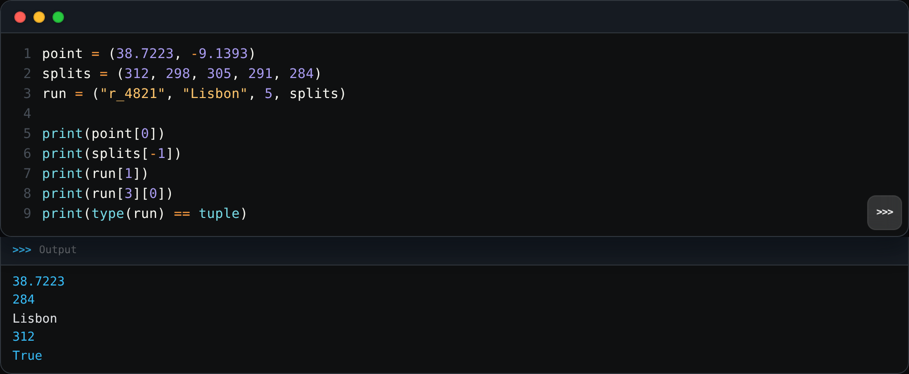

```python
point = (38.7223, -9.1393)
splits = (312, 298, 305, 291, 284)
run = ("r_4821", "Lisbon", 5, splits)

print(point[0])
print(splits[-1])
print(run[1])
print(run[3][0])
print(type(run) == tuple)
```


<br>

### The comma builds the tuple

The comma is what tells Python to build a tuple. Parentheses only group, as they do in `(2 + 3) * 4`. That has 2 consequences: values separated by commas with no parentheses around them are already a tuple, and a single value wrapped in parentheses stays that value. A tuple with 1 item needs a trailing comma.

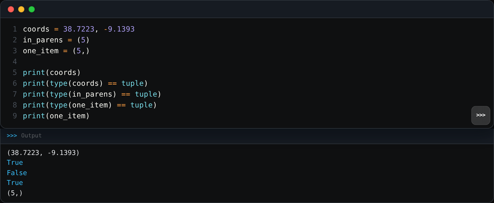

```python
coords = 38.7223, -9.1393
in_parens = (5)
one_item = (5,)

print(coords)
print(type(coords) == tuple)
print(type(in_parens) == tuple)
print(type(one_item) == tuple)
print(one_item)
```

*Python prints a one-item tuple with its trailing comma, (5,), so the printed form shows which kind you are holding.*

**Which line creates a tuple holding exactly 1 item, the number 7?**

- **A.** item = (7)
- **B.** item = (7,)
- **C.** item = [7]
- **D.** item = ()

<details>
<summary>Solution</summary>

**B.** item = (7,)

The trailing comma is what makes a tuple, so this is a tuple of length 1 holding 7.

**Why the others are wrong**

- **A.** Parentheses alone only group, so item is the integer 7 and type(item) shows int.
- **C.** Square brackets build a list with 1 item, which can still be appended to and changed.
- **D.** Empty parentheses build a tuple with 0 items, so the 7 is missing entirely.

</details>


<br>

### A tuple refuses every change

A list lets you replace, append and remove items. A tuple has no method that changes it, and assigning to one of its indexes stops the program with a `TypeError` at the line that attempted the edit.

```sql
splits = (312, 298, 305, 291, 284)
print("before:", splits)
splits[0] = 300
print("after:", splits)
```

The first `print` runs, then line 3 raises `TypeError: 'tuple' object does not support item assignment`, and `after:` never prints. That final line of the error names the problem. Calling `splits.append(280)` also stops the program, with `AttributeError: 'tuple' object has no attribute 'append'`, because tuples have no `append` method.

To correct a value, build a new tuple and assign it to the name, as in `point = (38.7223, -9.1400)`. That line points the name `point` at a brand-new tuple, and the original was never edited. This is the safety a tuple buys: a record's values change only where code writes out a whole new record on purpose.

| ✓ list | ✗ tuple |
| --- | --- |
| • Square brackets: [312, 298]<br><br>• Items can be replaced, appended and removed<br><br>• Suits data that grows, such as today's uploads<br><br>• Refused as a dictionary key or set member | • Commas, usually in parentheses: (312, 298)<br><br>• Fixed at creation; an edit raises an error<br><br>• Suits a record of known shape, such as a GPS point<br><br>• Accepted as a key or set member when its contents are |


<br>

### Tuples as dictionary keys

The Sets lesson showed that a set refuses a list as a member because a list can change. Dictionary keys follow the same rule, and a tuple of strings and numbers passes it. That makes a tuple the right key when no single value is unique: a runner logs many dates and a date holds many runners, but the pair `(runner, date)` picks out a single day's distance.

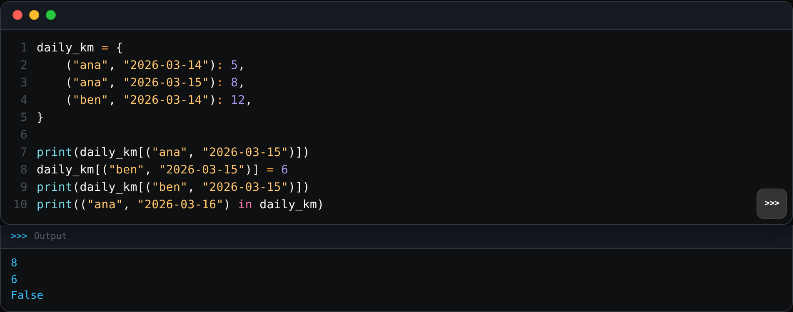

```python
daily_km = {
    ("ana", "2026-03-14"): 5,
    ("ana", "2026-03-15"): 8,
    ("ben", "2026-03-14"): 12,
}

print(daily_km[("ana", "2026-03-15")])
daily_km[("ben", "2026-03-15")] = 6
print(daily_km[("ben", "2026-03-15")])
print(("ana", "2026-03-16") in daily_km)
```

> **TIP**
>
> A tuple is only as fixed as what it holds. `("r_4821", [312, 298])` cannot be a dictionary key, and the list inside it can still be appended to. Build records from strings, numbers and other tuples.


<br>

---

## Starred Assignment

Reading a record by index means remembering that position 2 is the distance and position 3 is the splits. Unpacking gives each position a name instead. Write several names on the left of `=`, separated by commas, and Python assigns the tuple's items to them in order: first item to first name, second to second.

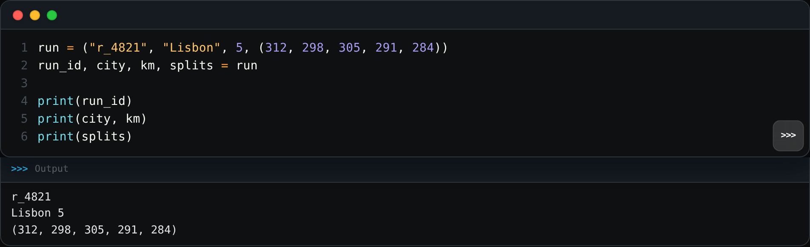

```python
run = ("r_4821", "Lisbon", 5, (312, 298, 305, 291, 284))
run_id, city, km, splits = run

print(run_id)
print(city, km)
print(splits)
```

Plain unpacking needs an exact match: 4 names take 4 items. Give 3 names to a 7-item row and Python stops rather than guess which items you meant.

```sql
row = ("r_4821", "2026-03-14", 312, 298, 305, 291, 284)
run_id, date, first_split = row
print(run_id)
```

The reverse mismatch, more names than items, raises `ValueError: not enough values to unpack (expected 3, got 2)`. In both cases no name gets a value, and the program stops on that line.


<br>

### A starred name takes what is left

Put `*` in front of 1 name and it becomes a collector. Python fills the plain names first, those before the star from the left end and those after it from the right end, then gives every remaining item to the starred name as a list. The 7-item row becomes readable in a single line: `run_id, date, *splits = row` gives 2 named fields and a list of however many splits the run recorded.

https://github.com/user-attachments/assets/9757f66b-a259-4005-a8ff-b5a40d7bce13

*Plain names fill from the ends; the starred name collects what remains, as a list.*

Three rules come out of that run. The starred name always holds a list, even when the source is a tuple. The star can sit first, last or between plain names. When nothing is left over, the starred name gets an empty list and no error is raised.

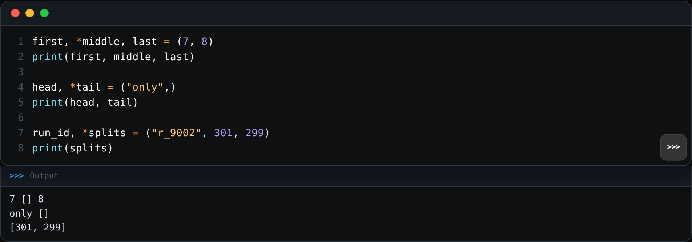

```python
first, *middle, last = (7, 8)
print(first, middle, last)

head, *tail = ("only",)
print(head, tail)

run_id, *splits = ("r_9002", 301, 299)
print(splits)
```

| Target, for a 5-item tuple | Plain names get | Starred name gets |
| --- | --- | --- |
| `a, b, c, d, e` | all 5 items | no starred name |
| `a, \*rest` | `a` = 312 | `rest` = [298, 305, 291, 284] |
| `\*rest, e` | `e` = 284 | `rest` = [312, 298, 305, 291] |
| `a, \*rest, e` | `a` = 312, `e` = 284 | `rest` = [298, 305, 291] |
| `a, b, c, d, e, \*rest` | all 5 items | `rest` = [] |

**What does this program print?**

```python
profile = {"name": "ana", "runs": [5, 8, 12, 21], "tags": ("trail", "night")}
print(len(profile), len(profile["runs"]), len(profile["name"]))
```

- **A.** 7 4 3
- **B.** 3 4 1
- **C.** 3 3 3
- **D.** 3 4 3

<details>
<summary>Solution</summary>

**D.** 3 4 3

The dictionary has 3 keys, the runs list has 4 items, and the string "ana" has 3 characters.

**Why the others are wrong**

- **A.** Adds the nested items to the key count; len of a dictionary counts its 3 keys and never looks inside values.
- **B.** Treats the name as a single item; len of a string counts characters, so "ana" gives 3.
- **C.** Counts the runs list as 3; it holds 5, 8, 12 and 21, so its length is 4.

</details>


<br>

### Where a starred name still fails

A star relaxes the count, but every plain name still needs an item. `a, b, *rest = (1,)` stops with `ValueError: not enough values to unpack (expected at least 2, got 1)`. The words `at least` in the message tell you a starred name was involved.

An assignment can hold 1 starred name at most. With 2, Python would have no way to decide how to divide the leftovers between them, so `*a, *b = (1, 2, 3)` is refused with a `SyntaxError` before any line of the program runs.


<br>

### Skipping fields with an underscore

Often only a few fields matter. By convention the name `_` marks a value you are deliberately not using, and `*_` discards any number of them. Python treats `_` like any other name; the convention tells the next reader that skipping it was on purpose.

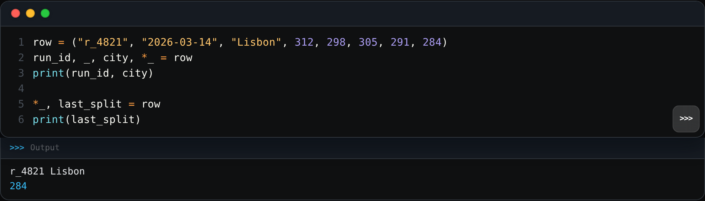

```python
row = ("r_4821", "2026-03-14", "Lisbon", 312, 298, 305, 291, 284)
run_id, _, city, *_ = row
print(run_id, city)

*_, last_split = row
print(last_split)
```


<br>

### Unpacking in a for loop header

A `for` loop over a list of tuples can unpack each tuple right in its header. Every pass assigns the current tuple's items with the same rules: an exact count without a star, and at least the plain names with one. Here the uploads carry different numbers of splits.

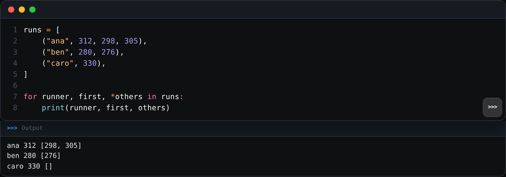

```python
runs = [
    ("ana", 312, 298, 305),
    ("ben", 280, 276),
    ("caro", 330),
]

for runner, first, *others in runs:
    print(runner, first, others)
```

> **TIP**
>
> Unpack a record as soon as it arrives and use the names from then on. `runner` still reads correctly a month later, while `row[0]` makes the next reader look up what position 0 held.


<br>

---

## Using min, max, sum

Three built-in functions answer the first questions anyone asks about a column of numbers. `sum` adds every item, `min` returns the smallest and `max` returns the largest. Each takes a whole collection, walks through it and returns 1 value, replacing a loop and a running variable with a single call.

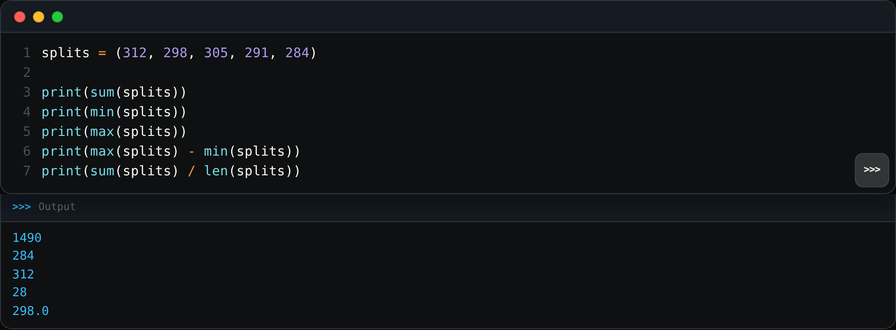

```python
splits = (312, 298, 305, 291, 284)

print(sum(splits))
print(min(splits))
print(max(splits))
print(max(splits) - min(splits))
print(sum(splits) / len(splits))
```

The last 2 lines are the usual combinations: the spread between the slowest and fastest kilometre, and the average split. Division with `/` always produces a float, which is why the average prints as `298.0`. Written out by hand, the work behind `sum` and `min` looks like this:

```sql
splits = (312, 298, 305, 291, 284)

total = 0
for s in splits:
    total = total + s

fastest = splits[0]
for s in splits:
    if s < fastest:
        fastest = s
```

The 2 loops start differently. A total can start at `0` before any item is seen, while a minimum has to start from a real item, since no number is guaranteed to be larger than all of them. That difference decides what an empty collection does, further down.


<br>

### Any collection, or loose arguments

All 3 accept anything you can loop over: a list, a tuple, a set or a `range`. `min` and `max` also accept 2 or more separate values, which suits picking the larger of 2 readings. `sum` takes the collection as its first argument, so `sum(140, 152)` raises a `TypeError`.

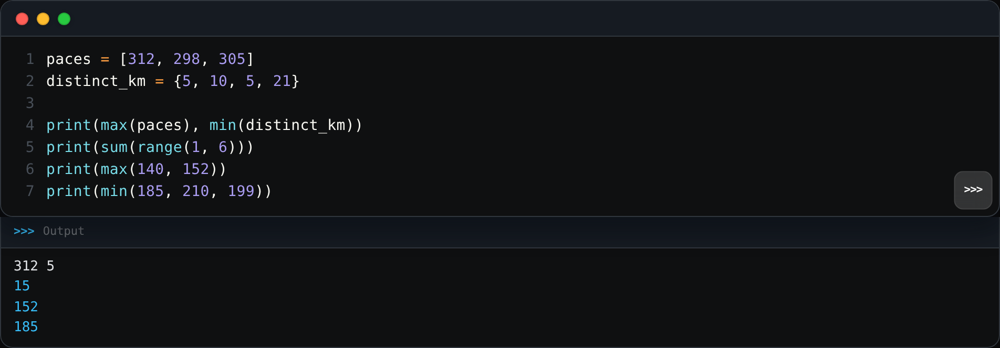

```python
paces = [312, 298, 305]
distinct_km = {5, 10, 5, 21}

print(max(paces), min(distinct_km))
print(sum(range(1, 6)))
print(max(140, 152))
print(min(185, 210, 199))
```


<br>

### Strings and dictionaries compare differently

`min` and `max` work on anything that `<` can compare. Strings compare character by character in character-code order, where every uppercase letter sorts before every lowercase one. A dictionary passed to `min` or `max` is compared by its keys, so the answer is a key and the values play no part.

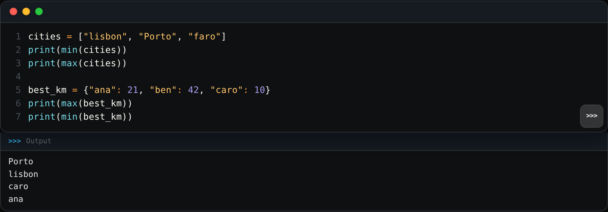

```python
cities = ["lisbon", "Porto", "faro"]
print(min(cities))
print(max(cities))

best_km = {"ana": 21, "ben": 42, "caro": 10}
print(max(best_km))
print(min(best_km))
```

`max(best_km)` returns `caro` because `c` is the latest letter among the keys, though Caro ran the shortest distance. When you want the largest number, pass the numbers. The lesson on dictionary views, later in the track, shows the direct way to hand a dictionary's values to `max`.


<br>

### Empty collections and mixed types

An empty collection splits the 3 functions apart. `sum` starts at 0, finds nothing to add and returns `0`. `min` and `max` have no item to start from, so they raise an error. A day with no uploads is ordinary input for a daily job, so this case reaches real code.

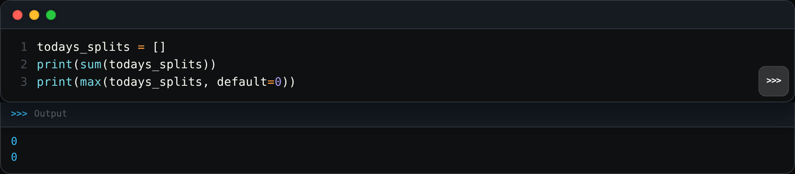

```python
todays_splits = []
print(sum(todays_splits))
print(max(todays_splits, default=0))
```

Without `default`, `max(todays_splits)` stops the program with `ValueError: max() arg is an empty sequence`. The `default` keyword argument gives `min` and `max` a value to return when the collection is empty. Choose one that cannot be mistaken for real data, or check the length first and skip the summary. `default` works only with a single collection; combined with loose arguments it raises a `TypeError`.

Mixed types fail as well. `sum` adds with `+`, so a string among the numbers raises `TypeError: unsupported operand type(s) for +: 'int' and 'str'`. `min` and `max` compare with `<`, so `min([312, "298"])` raises `TypeError: '<' not supported between instances of 'str' and 'int'`. A split stored as text must become a number first, which the Type Conversions lesson covers.

**A daily job receives a runner's splits for a day with no uploads. What does this program print?**

```python
splits = []
print(sum(splits), max(splits, default=-1))
```

- **A.** 0 -1
- **B.** 0 0
- **C.** -1 -1
- **D.** None -1

<details>
<summary>Solution</summary>

**A.** 0 -1

sum of nothing is its starting value 0, and max returns its default because there is no item to compare.

**Why the others are wrong**

- **B.** The default value becomes the answer, so max returns -1, the value it was given, rather than 0.
- **C.** default belongs to the max call alone; sum of an empty list returns 0 on its own.
- **D.** sum always returns a number, and with nothing to add it returns its starting value 0.

</details>


<br>

### Counting with sum

In arithmetic Python treats `True` as 1 and `False` as 0. Summing a list of comparison results therefore counts how many were true, here the kilometres run in under 5 minutes.

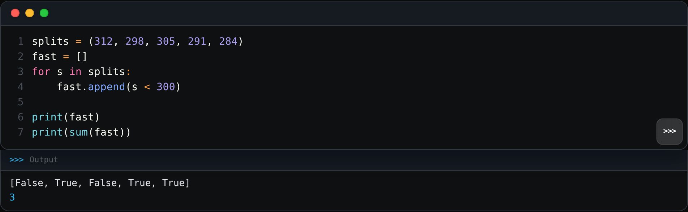

```python
splits = (312, 298, 305, 291, 284)
fast = []
for s in splits:
    fast.append(s < 300)

print(fast)
print(sum(fast))
```

| ✓ Do | ✗ Don't |
| --- | --- |
| • Pass default= to min and max when the input can be empty<br><br>• Check the length before computing sum(x) / len(x)<br><br>• Pass the numbers themselves to max when you want the largest number | • Don't write a running-total loop where sum does the job<br><br>• Don't feed numbers stored as text into sum, min or max<br><br>• Don't expect max(some_dict) to look at the values |


<br>

---

## abs() for Absolutes

`abs` returns how far a number lies from zero: the same number with its sign removed. It accepts integers and floats and gives back the type it received.

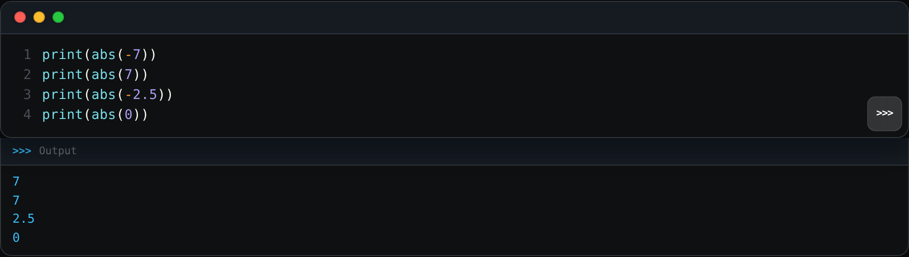

```python
print(abs(-7))
print(abs(7))
print(abs(-2.5))
print(abs(0))
```


<br>

### The distance between 2 numbers

The everyday form is `abs(a - b)`: how far apart 2 values are, whichever is larger. Subtraction alone returns a signed answer that flips with the order you wrote, and wrapping it in `abs` makes the order stop mattering. Here a running watch and a map disagree about a route's elevation gain.

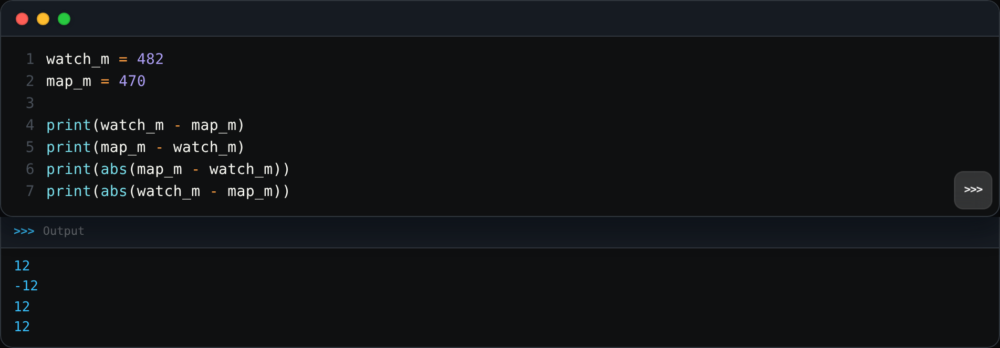

```python
watch_m = 482
map_m = 470

print(watch_m - map_m)
print(map_m - watch_m)
print(abs(map_m - watch_m))
print(abs(watch_m - map_m))
```


<br>

### Tolerance checks

Two measurements from different devices rarely agree exactly, so comparing them with `==` fails over a 1-metre disagreement. A useful check asks whether the gap is small enough: `abs(a - b) <= tolerance`.

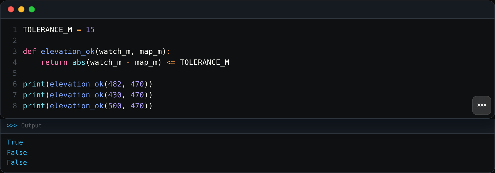

```python
TOLERANCE_M = 15

def elevation_ok(watch_m, map_m):
    return abs(watch_m - map_m) <= TOLERANCE_M

print(elevation_ok(482, 470))
print(elevation_ok(430, 470))
print(elevation_ok(500, 470))
```

Drop the `abs` and the second call returns `True`. The difference `430 - 470` is `-40`, and `-40` is below every positive tolerance, so a watch reading 40 metres low would pass a check it should fail.

**Which expression tells whether 2 readings, a and b, are within 5 of each other in either direction?**

- **A.** a - b <= 5
- **B.** abs(a) - abs(b) <= 5
- **C.** abs(a - b) <= 5
- **D.** abs(a - b) == 5

<details>
<summary>Solution</summary>

**C.** abs(a - b) <= 5

The size of the difference is the distance, and it is the same whichever reading is larger.

**Why the others are wrong**

- **A.** Passes whenever a is below b, however far, because the difference is then negative.
- **B.** Removing each sign before subtracting loses the distance: -3 and 4 give -1 and pass while 7 apart.
- **D.** Uses the right distance but accepts only readings exactly 5 apart, rejecting every closer pair.

</details>


<br>

### Signed difference or size?

Removing the sign removes information. Whether a runner got faster or slower than last week lives in the sign of `this_week - last_week`, and how big the change was lives in its absolute value. Keep the signed number when direction matters, and take `abs` when only size does.

A climb profile shows both at once. Five elevation readings give a net change from the first point to the last, and a total amount of climbing and descending along the way. Only the second needs `abs`.

https://github.com/user-attachments/assets/bb02e5ec-3739-43a7-b8f9-de84a8a07d7b

*Each step keeps its sign; abs turns it into distance before it joins the total.*

The net change is 23 metres, yet the runner moved 51 metres up and down. Adding the signed steps would cancel each descent against a climb and land on 23 again, hiding 28 metres of effort.


<br>

### Average size of an error

The same idea measures how wrong a forecast was. A pace predictor guessed each kilometre before the run; the mean absolute error averages the size of each miss, so misses in opposite directions cannot cancel.

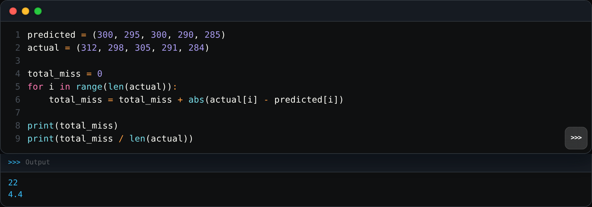

```python
predicted = (300, 295, 300, 290, 285)
actual = (312, 298, 305, 291, 284)

total_miss = 0
for i in range(len(actual)):
    total_miss = total_miss + abs(actual[i] - predicted[i])

print(total_miss)
print(total_miss / len(actual))
```

Summing the signed misses gives 20 instead of 22, because the last kilometre ran 1 second faster than predicted and that -1 cancels part of the others. With larger misses in both directions, a signed average can sit near 0 while every prediction is far off.


<br>

### Common mistakes

`abs(a) - abs(b)` and `abs(a - b)` are different calculations. With `a = -3` and `b = 4`, the first is `3 - 4`, which is `-1`; the second is `abs(-7)`, which is `7`. Only the second is a distance.

`abs` takes 1 number. A list of gaps needs a loop that calls `abs` on each item. Passing the list itself, as in `abs(gaps)`, stops the program with `TypeError: bad operand type for abs(): 'list'`, and a number stored as text such as `"-12"` fails the same way, with `'str'` at the end of the message.

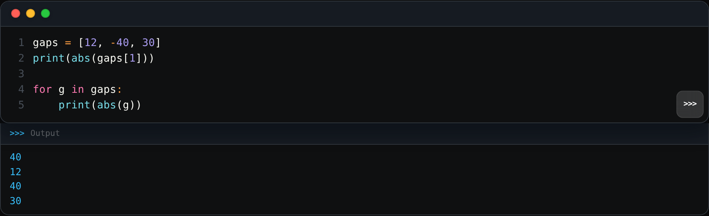

```python
gaps = [12, -40, 30]
print(abs(gaps[1]))

for g in gaps:
    print(abs(g))
```

- Reconciliation: flag a daily total that differs from the source system by more than a tolerance.
- Forecast quality: mean absolute error over predicted and actual values.
- Sensor drift: the gap between 2 devices measuring the same route.
- Time gaps: how many seconds separate 2 events, whichever was logged first.


<br>

---

## len() Across Types

`len` returns how many items a collection holds, as an integer. The same call works on every collection in this track so far, and what counts as 1 item depends on the type.

| Value | len counts | Example | Result |
| --- | --- | --- | --- |
| string | characters, including spaces and escapes | `len("5K run")` | 6 |
| list | items | `len([312, 298])` | 2 |
| tuple | items | `len((38.7, -9.1))` | 2 |
| dict | keys, each key-value pair once | `len({"ana": 21, "ben": 42})` | 2 |
| set | distinct members after duplicates drop | `len({5, 10, 5})` | 2 |
| range | numbers it would produce | `len(range(1, 6))` | 5 |

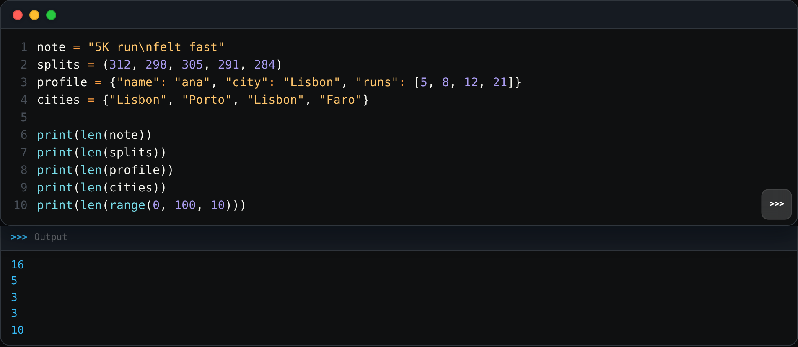

```python
note = "5K run\nfelt fast"
splits = (312, 298, 305, 291, 284)
profile = {"name": "ana", "city": "Lisbon", "runs": [5, 8, 12, 21]}
cities = {"Lisbon", "Porto", "Lisbon", "Faro"}

print(len(note))
print(len(splits))
print(len(profile))
print(len(cities))
print(len(range(0, 100, 10)))
```

Two of those results catch people out. The `\n` escape is 1 character, so the note has length 16 even though it prints on 2 lines. The `runs` list inside the profile holds 4 numbers, and `len(profile)` is still 3 because it counts the 3 keys and never looks inside a value.

**What does this program print?**

```python
profile = {"name": "ana", "runs": [5, 8, 12, 21], "tags": ("trail", "night")}
print(len(profile), len(profile["runs"]), len(profile["name"]))
```

- **A.** 7 4 3
- **B.** 3 4 1
- **C.** 3 3 3
- **D.** 3 4 3

<details>
<summary>Solution</summary>

**D.** 3 4 3

The dictionary has 3 keys, the runs list has 4 items, and the string "ana" has 3 characters.

**Why the others are wrong**

- **A.** Adds the nested items to the key count; len of a dictionary counts its 3 keys and never looks inside values.
- **B.** Treats the name as a single item; len of a string counts characters, so "ana" gives 3.
- **C.** Counts the runs list as 3; it holds 5, 8, 12 and 21, so its length is 4.

</details>


<br>

### Only the top level counts

`len` counts the items directly inside a collection. A list of 3 tuples has length 3 however long the tuples are. To count everything inside, loop over the outer collection and add up the inner lengths.

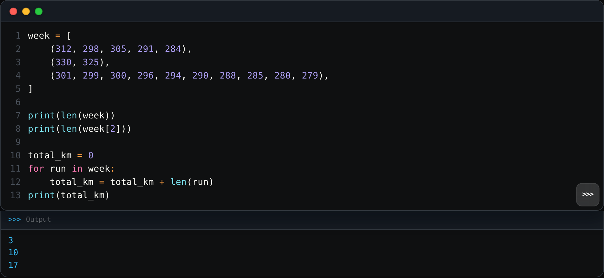

```python
week = [
    (312, 298, 305, 291, 284),
    (330, 325),
    (301, 299, 300, 296, 294, 290, 288, 285, 280, 279),
]

print(len(week))
print(len(week[2]))

total_km = 0
for run in week:
    total_km = total_km + len(run)
print(total_km)
```


<br>

### Length and indexes

A sequence of length `n` has valid indexes from `0` to `n - 1`. That is why `range(len(splits))` produces exactly the indexes of `splits`, and why `splits[len(splits)]` raises `IndexError: tuple index out of range`. The last item sits at `len(splits) - 1`, the same position as `-1`.


<br>

### Counting distinct values

A set drops duplicates, so `len(set(items))` counts distinct values. Comparing it with `len(items)` shows whether duplicates exist, a standard check on IDs that are meant to be unique.

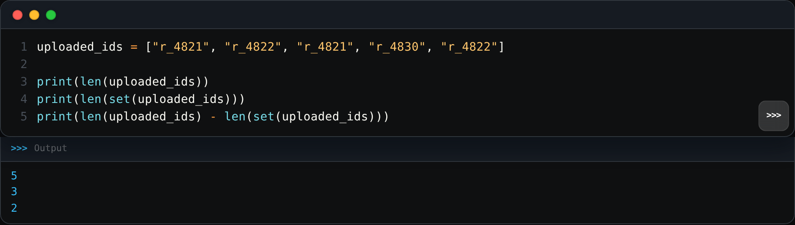

```python
uploaded_ids = ["r_4821", "r_4822", "r_4821", "r_4830", "r_4822"]

print(len(uploaded_ids))
print(len(set(uploaded_ids)))
print(len(uploaded_ids) - len(set(uploaded_ids)))
```


<br>

### Values with no length

A single number is 1 value, so `len(1490)` raises `TypeError: object of type 'int' has no len()`. Floats and `True` fail the same way. Counting the digits of a number is a question about its text form, which needs a conversion first.


<br>

### Guarding a summary with len

An average divides by the length, and an empty list has length 0, so `sum(x) / len(x)` on it raises `ZeroDivisionError: division by zero`. A length check in front of the division decides what an empty input returns.

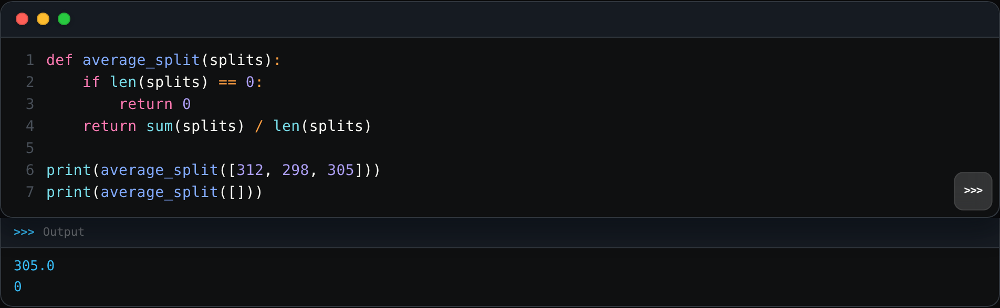

```python
def average_split(splits):
    if len(splits) == 0:
        return 0
    return sum(splits) / len(splits)

print(average_split([312, 298, 305]))
print(average_split([]))
```


<br>

### Checking a row before unpacking it

`len` pairs with starred assignment. The target `run_id, runner, *splits` needs at least 2 fields, and a row with exactly 2 unpacks to an empty `splits` list. This job only summarizes runs that carry at least 1 split, so it checks `len(row) < 3` first, sets those rows aside and keeps going. The program combines tuples, starred assignment, `len` and `sum`.

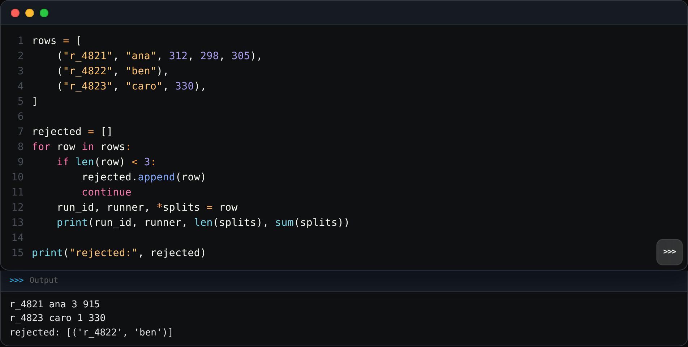

```python
rows = [
    ("r_4821", "ana", 312, 298, 305),
    ("r_4822", "ben"),
    ("r_4823", "caro", 330),
]

rejected = []
for row in rows:
    if len(row) < 3:
        rejected.append(row)
        continue
    run_id, runner, *splits = row
    print(run_id, runner, len(splits), sum(splits))

print("rejected:", rejected)
```

Ben's row has no splits to summarize, so the length check sets it aside. Without the check it would unpack cleanly to an empty `splits` list and print `r_4822 ben 0 0`, a 0-second run that never happened. The other rows unpack with a starred `splits` list of whatever length they carry, and `len` and `sum` summarize it.

> Where len shows up in a pipeline
>
> - Row checks: a record with the wrong field count is set aside before unpacking.
> - Empty guards: `len(x) == 0` skips a summary that would divide by zero.
> - Duplicate checks: `len(items)` against `len(set(items))` on IDs meant to be unique.
> - Batch sizes: the number of records loaded is logged so the next run can compare.


<br>

---

## Putting It All Together

Picture the weekly training summary a Strava runner opens on Monday. Each activity from the week arrives as a tuple: activity ID, runner, then that run's kilometre splits in seconds. The job behind the summary sets aside rows with fewer than 3 fields, unpacks the rest with a starred splits list, reports total time and the fastest and slowest kilometre, flags any run whose watch elevation strays more than 15 metres from the map, and stores a single total per runner and week.

- The tuple record is fixed, so every later step reads the same values the upload delivered.
- len guards the unpacking: a row with no splits is set aside, so every row that reaches the starred assignment carries at least 1 split.
- The starred splits list feeds sum , min and max directly, and the length check means min and max never meet an empty list.
- abs turns the watch-versus-map gap into a size, so a reading 40 metres high and one 40 metres low are flagged alike.
- A ( runner , week ) tuple key keeps each runner's weekly total in a single dictionary.


<br>

---

## Key Takeaways

- A tuple is a fixed sequence: the comma builds it, ( 5 , ) is a one-item tuple, and any edit raises an error.
- A tuple of strings and numbers can be a dictionary key, which makes it the natural composite key.
- Unpacking assigns items to names in order; a starred name collects the leftovers as a list, possibly empty.
- sum , min and max summarize any collection; sum of nothing is 0, while min and max need default = .
- abs ( a - b ) is a distance; keep the sign when direction matters and drop it when only size does.
- len counts top-level items: characters, keys or distinct set members, and a plain number has no length.
