# Collections: Intermediate

It's late November at Spotify, and the Wrapped pipeline has to turn a year of raw play events into each listener's top 5 tracks. Play counts arrive as text, tracks with 0 plays must be dropped, track names sit in a separate list from their counts, and 2 songs tied at 310 plays need a fixed order. Whether the card a listener shares is right comes down to 4 built-ins.


<br>

---

## Using sorted() with key

`sorted()` takes any iterable, compares its items with `<`, and returns a new list in ascending order. The input is left as it was, so other code that still reads it sees the original order.

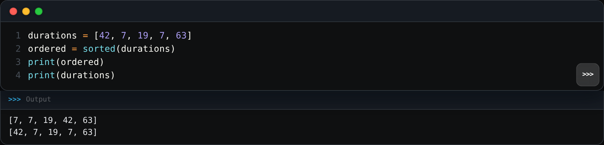

```python
durations = [42, 7, 19, 7, 63]
ordered = sorted(durations)
print(ordered)
print(durations)
```

Strings compare character by character using each character's code, and the uppercase letters A to Z all have lower codes than the lowercase letters a to z. A mixed-case list of table names therefore comes back in an order nobody would pick by hand. The `key` argument fixes that:

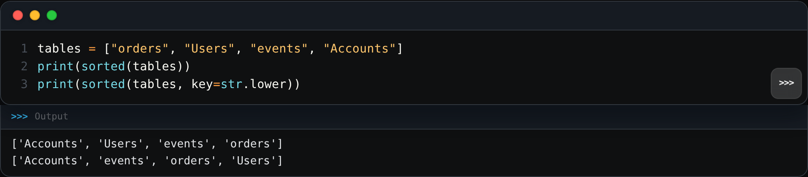

```python
tables = ["orders", "Users", "events", "Accounts"]
print(sorted(tables))
print(sorted(tables, key=str.lower))
```


<br>

### What the key function does

`key` takes a function. `sorted()` calls it once on each item, sorts by the values it returns, and hands back the original items in that order. With `key=str.lower`, the comparisons run on `'users'` and `'accounts'`, yet the output still reads `'Users'` and `'Accounts'`. The key decides the order and never changes what is in the list.

Any function that takes 1 argument can be a key, built-ins included. With `key=len`, table names line up by character count. `events` and `orders` both have 6 characters, and `events` stays ahead because it came first in the input:

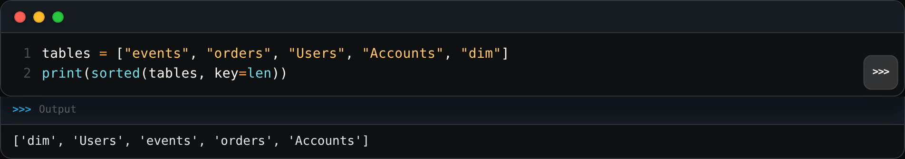

```python
tables = ["events", "orders", "Users", "Accounts", "dim"]
print(sorted(tables, key=len))
```

Pipeline records are usually dicts, and 2 dicts cannot be compared with `<`, so you write a small function that returns the field to sort on. This program prints a line each time its key function runs. Compare the order of those calls with the order of the final output.

https://github.com/user-attachments/assets/dbee4cda-2f14-47d1-9b8b-5daf20fbd956

*The key function runs once per run, in input order, before any run moves.*

All 3 key calls happen first, in input order, before any item moves; the runs then come out by their returned minutes. The argument is `key=by_minutes`, with no parentheses, which hands `sorted()` the function itself. Writing `key=by_minutes()` would call it on the spot with no run to read. The same slip with a built-in, `key=len()`, fails before any sorting with `TypeError: len() takes exactly one argument (0 given)`.


<br>

### Sorting on 2 fields with a tuple key

Tuples compare the way lists do: first items first, and the second items only when the first ones tie. A key function that returns a tuple therefore sorts by the first field and breaks ties with the next. Here the runs group by team, and within a team the shortest run leads.

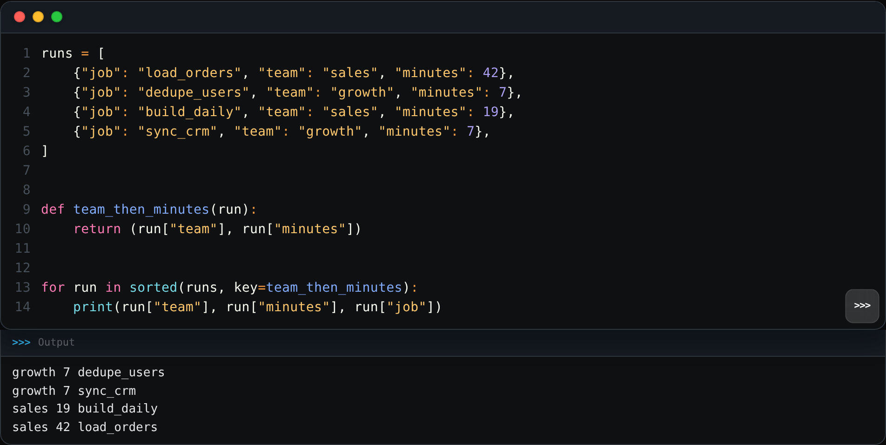

```python
runs = [
    {"job": "load_orders", "team": "sales", "minutes": 42},
    {"job": "dedupe_users", "team": "growth", "minutes": 7},
    {"job": "build_daily", "team": "sales", "minutes": 19},
    {"job": "sync_crm", "team": "growth", "minutes": 7},
]


def team_then_minutes(run):
    return (run["team"], run["minutes"])


for run in sorted(runs, key=team_then_minutes):
    print(run["team"], run["minutes"], run["job"])
```

Both growth runs have the key `('growth', 7)`. With the keys fully tied, `dedupe_users` stays ahead of `sync_crm` because it came first in the input. Python's sort is stable: items with equal keys keep their original relative order. That guarantee is what makes a sorted report come out the same on every run over the same data.


<br>

### Missing values break the comparison

Real columns have gaps, and Python has no rule for comparing `None` with a number. Decide what this program prints before you check the answer.

**A latency column has a missing reading. What does this program print?**

```python
latencies = [120, None, 85]
print(sorted(latencies))
```

- **A.** It prints [None, 85, 120], with the missing value placed first
- **B.** It prints [85, 120, None], with the missing value placed last
- **C.** It raises a TypeError, because None and int cannot be compared
- **D.** It prints [85, 120], with the missing value dropped from the list

<details>
<summary>Solution</summary>

**C.** It raises a TypeError, because None and int cannot be compared

The sort compares None with 120, finds no < for that pair, and stops with TypeError: '<' not supported between instances of 'NoneType' and 'int'.

**Why the others are wrong**

- **A.** Python has no ordering between None and numbers, so it cannot place None first. The comparison raises an error instead.
- **B.** That's what a nulls-last key produces. Plain sorted() has no rule for None, so it never reaches this result.
- **D.** sorted() never drops items. It returns as many items as it received, or it fails.

</details>

The fix is a key that never puts `None` and a number into the same comparison. Return a tuple whose first item marks the value as present (`0`) or missing (`1`). Every missing value then sorts after every real one, and the second items are only compared between values of the same kind.

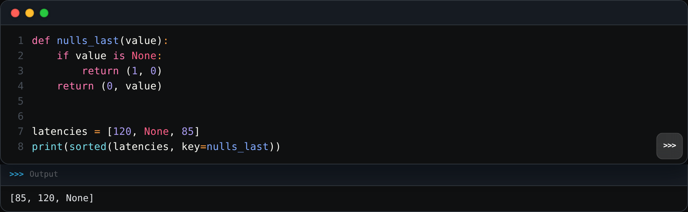

```python
def nulls_last(value):
    if value is None:
        return (1, 0)
    return (0, value)


latencies = [120, None, 85]
print(sorted(latencies, key=nulls_last))
```

> **TIP**
>
> Give each key function a name that states its rule, the way `by_minutes` and `nulls_last` do, and define it next to the data it reads. The call `sorted(runs, key=by_minutes)` then reads like a description of the result.


<br>

---

## Using sorted() in Reverse

Ranking flips the question: which items come first when bigger is better. `reverse=True` makes `sorted()` put the largest key first, and slicing the result with `[:n]` keeps the top N. Here are 5 tracks with a year of play counts, 2 of them tied at 310.

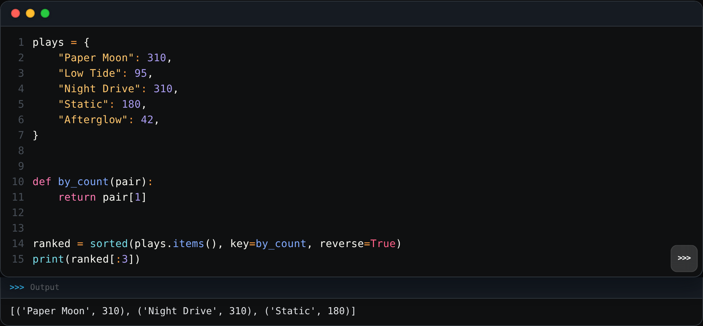

```python
plays = {
    "Paper Moon": 310,
    "Low Tide": 95,
    "Night Drive": 310,
    "Static": 180,
    "Afterglow": 42,
}


def by_count(pair):
    return pair[1]


ranked = sorted(plays.items(), key=by_count, reverse=True)
print(ranked[:3])
```

Each item of `plays.items()` is a `(name, count)` pair, so `by_count` returns `pair[1]`. Paper Moon and Night Drive tie at 310, and Paper Moon stays ahead because it was inserted first: `reverse=True` keeps equal keys in input order. Sorting ascending and then reversing with `[::-1]` gives a different answer:

sorted(..., reverse=True)

| rank | track | plays |
| --- | --- | --- |
| 1 | Paper Moon | 310 |
| 2 | Night Drive | 310 |
| 3 | Static | 180 |
| 4 | Low Tide | 95 |
| 5 | Afterglow | 42 |

sorted(...)[::-1]

| rank | track | plays |
| --- | --- | --- |
| 1 | Night Drive | 310 |
| 2 | Paper Moon | 310 |
| 3 | Static | 180 |
| 4 | Low Tide | 95 |
| 5 | Afterglow | 42 |

The ascending sort keeps Paper Moon ahead of Night Drive, and `[::-1]` then flips the entire list, ties included. If one report uses `reverse=True` and another uses `[::-1]`, the same data shows 2 different number-one tracks. Pick `reverse=True` for descending order with ties in input order.

Passing the dict itself to `sorted()` sorts its keys and returns them alone, alphabetically. To rank the names by their counts, use the dict's `get` method as the key: `sorted()` calls `plays.get` on each name and orders the names by the counts it returns.

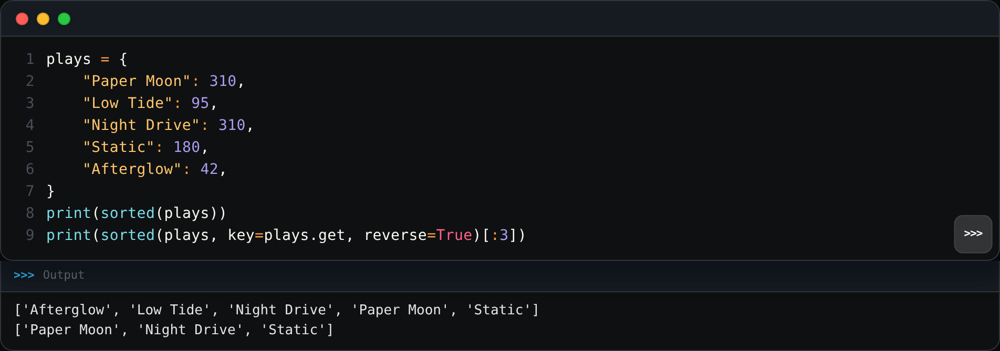

```python
plays = {
    "Paper Moon": 310,
    "Low Tide": 95,
    "Night Drive": 310,
    "Static": 180,
    "Afterglow": 42,
}
print(sorted(plays))
print(sorted(plays, key=plays.get, reverse=True)[:3])
```

`key=plays.get` carries no parentheses for the same reason `key=by_minutes` carried none: `sorted()` needs the method itself, ready to call on each name. Use this form when the report lists names only, and `plays.items()` when each line needs its count beside the name.


<br>

### Descending on one field, ascending on another

`reverse=True` flips every part of a tuple key together. A common ranking rule wants plays descending but names ascending, so tied tracks land alphabetically. For a numeric field, negate it inside the key: the most plays becomes the smallest key, and the sort itself stays ascending.

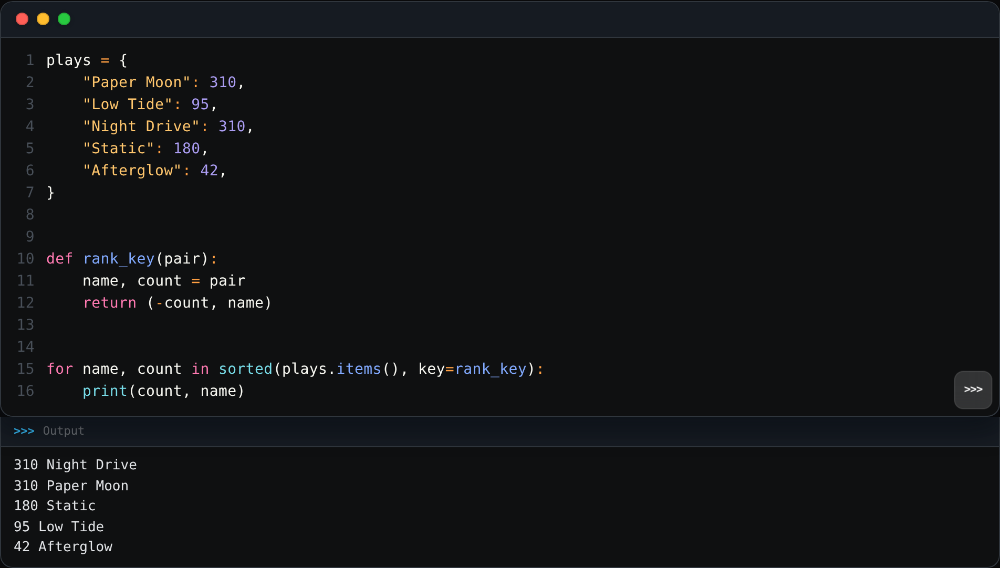

```python
plays = {
    "Paper Moon": 310,
    "Low Tide": 95,
    "Night Drive": 310,
    "Static": 180,
    "Afterglow": 42,
}


def rank_key(pair):
    name, count = pair
    return (-count, name)


for name, count in sorted(plays.items(), key=rank_key):
    print(count, name)
```

> **TIP**
>
> Text cannot be negated. When the field that needs the opposite direction is a string, sort twice: first by the tiebreaker, then by the main field. The second sort is stable, so among its ties it keeps the order the first sort produced.

Say runs should be listed fastest first, and runs tied on minutes should list their names from Z to A. Names cannot be negated, so the first pass sorts by name with `reverse=True` and the second pass sorts by minutes:

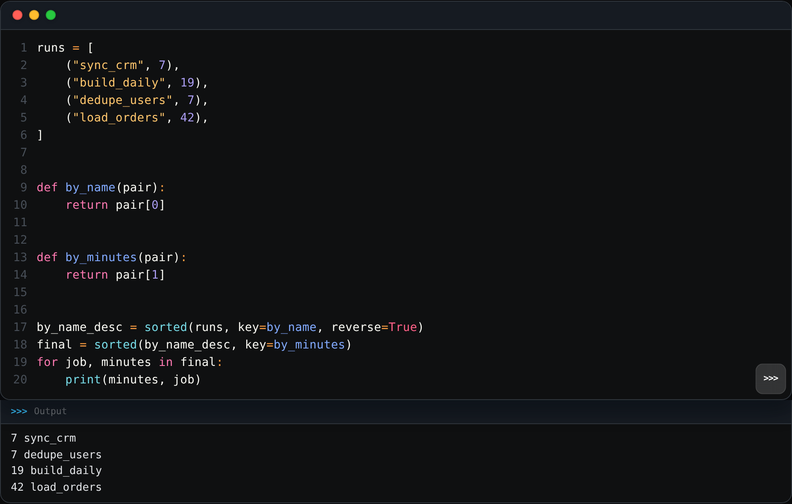

```python
runs = [
    ("sync_crm", 7),
    ("build_daily", 19),
    ("dedupe_users", 7),
    ("load_orders", 42),
]


def by_name(pair):
    return pair[0]


def by_minutes(pair):
    return pair[1]


by_name_desc = sorted(runs, key=by_name, reverse=True)
final = sorted(by_name_desc, key=by_minutes)
for job, minutes in final:
    print(minutes, job)
```

After the first pass, `sync_crm` sits ahead of `dedupe_users`. The second pass sees them tied at 7 minutes and, being stable, leaves them in that order. With any number of fields the rule holds: sort by the least important field first and the most important field last, each pass with its own `reverse`.


<br>

### The top 1 with max() and min()

When N is 1, sorting the whole list does work you then throw away. `max()` and `min()` accept the same `key` argument and return the single best item. When several items share the best key, they return the first one they meet.

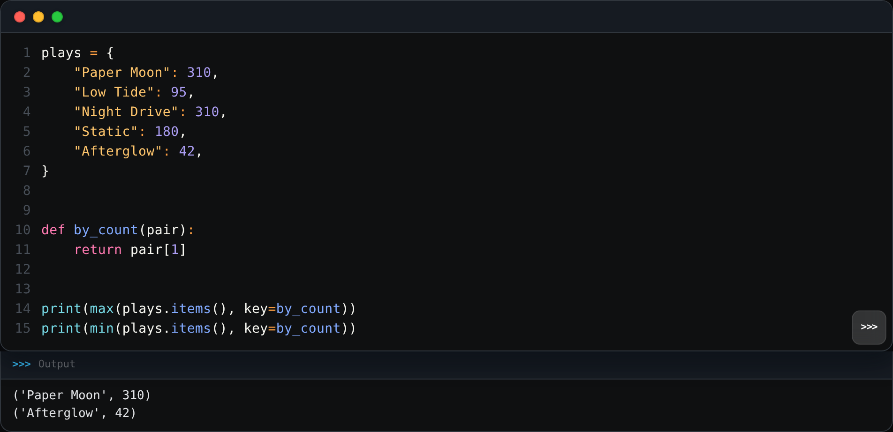

```python
plays = {
    "Paper Moon": 310,
    "Low Tide": 95,
    "Night Drive": 310,
    "Static": 180,
    "Afterglow": 42,
}


def by_count(pair):
    return pair[1]


print(max(plays.items(), key=by_count))
print(min(plays.items(), key=by_count))
```

Small inputs behave differently across these tools. A slice past the end of a list returns what exists, so `ranked[:5]` for a listener who played only 3 tracks all year returns those 3 with no error. `max()` on an empty input raises `ValueError`, so check that a list has items before asking for its best one.

**Both lines rank the same scores. What do they print?**

```python
scores = [("ana", 9), ("bo", 7), ("cy", 9)]


def by_score(pair):
    return pair[1]


print(sorted(scores, key=by_score, reverse=True)[0][0])
print(sorted(scores, key=by_score)[::-1][0][0])
```

- **A.** It prints ana, then ana
- **B.** It prints cy, then cy
- **C.** It prints cy, then ana
- **D.** It prints ana, then cy

<details>
<summary>Solution</summary>

**D.** It prints ana, then cy

reverse=True keeps ana ahead of cy on the 9-point tie. The ascending sort also keeps ana first, then [::-1] flips the list and cy leads.

**Why the others are wrong**

- **A.** The first line is right, but [::-1] reverses the tie too, so cy moves ahead of ana on the second line.
- **B.** reverse=True keeps tied items in input order, so ana, listed first, stays first on the first line.
- **C.** This swaps the 2 behaviors. Stable ties belong to reverse=True, and the flipped tie belongs to [::-1].

</details>


<br>

---

## Using map() for Transforms

`map(function, iterable)` calls the function on each item and produces the results in the same order. Raw extracts often deliver numbers as text, and `map(int, raw)` converts a whole column in a single expression. Predict both printed lines before you look:

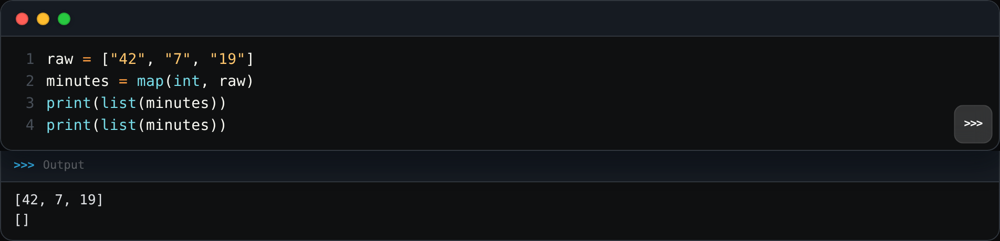

```python
raw = ["42", "7", "19"]
minutes = map(int, raw)
print(list(minutes))
print(list(minutes))
```

`map()` returns a map object, which produces each value only when something asks for it, and produces it once. `list()` asks for every value, so the second `list()` call finds nothing left and returns `[]`. Store the result of `list()` in a variable whenever you need the values twice.

> **TIP**
>
> `sum()`, `max()` and `min()` read a map object directly, so `sum(map(int, raw))` totals a text column with no list built in between.

**A job converts row counts, totals them, then checks how many it got. What does this print?**

```python
raw = ["1200", "0", "98000"]
counts = map(int, raw)
total = sum(counts)
print(total, len(list(counts)))
```

- **A.** It prints 99200 0
- **B.** It prints 99200 3
- **C.** It raises TypeError from sum()
- **D.** It prints 0 0

<details>
<summary>Solution</summary>

**A.** It prints 99200 0

sum() reads all 3 values out of the map object. list() then finds it empty, so its length is 0.

**Why the others are wrong**

- **B.** That would hold for a list. The map object was already used up by sum().
- **C.** map(int, raw) hands sum() integers, so the addition works.
- **D.** sum() runs first and sees all 3 converted values. Only the later list() call finds nothing.

</details>


<br>

### The function runs when the values are read

Creating the map object converts nothing. Step through this program and watch when each `converting` line prints relative to the loop.

https://github.com/user-attachments/assets/71d7903a-7f01-4a60-a19d-e83f0b4a5f39

*Each value is converted at the moment the loop asks for it.*

If `map()` converted eagerly, all 3 `converting` lines would print before the first running total. Instead each text value is converted only when the loop asks for it, with the running total updated in between. That timing also decides where an error surfaces: a bad value fails on the line that reads the map, which can be far from the line that built it.

```sql
raw = ["42", "n/a", "19"]
minutes = map(int, raw)
print("map created")
print(list(minutes))
```

Run it and `map created` prints first, because building the map converted nothing. The failure comes on line 4, when `list()` reads the values and `int('n/a')` runs: the traceback names line 4 and ends with `ValueError: invalid literal for int() with base 10: 'n/a'`. Line 2, where `map()` was written, never appears in it. When a step fails inside a `list()` or `sum()` call, trace the map object back to the data it was built from.


<br>

### Transforming records with your own function

Any function that takes 1 item and returns 1 value works with `map()`. For records, the function usually builds a new dict from the old one, so the source list stays intact for any other step that reads it.

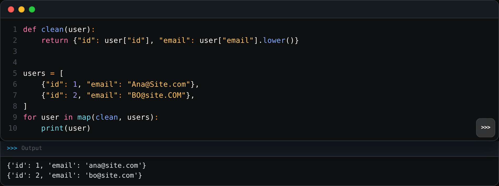

```python
def clean(user):
    return {"id": user["id"], "email": user["email"].lower()}


users = [
    {"id": 1, "email": "Ana@Site.com"},
    {"id": 2, "email": "BO@site.COM"},
]
for user in map(clean, users):
    print(user)
```

A map object is iterable like a list, so one map can feed another. `str.strip` and `str.upper` are methods named through their type, and they plug in the same way `str.lower` did as a sort key. Here country codes arrive padded and in mixed case:

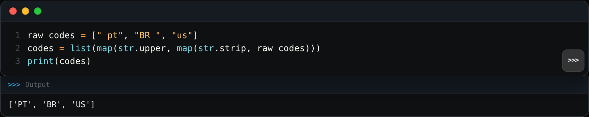

```python
raw_codes = [" pt", "BR ", "us"]
codes = list(map(str.upper, map(str.strip, raw_codes)))
print(codes)
```

Neither map does anything until `list()` reads the outer one. Then each code passes through both steps before the next code starts: `' pt'` becomes `'pt'`, then `'PT'`. Keep the list that `list()` returns, because both map objects are spent after that one read.

Given 2 iterables, `map()` pairs them up by position and calls the function with 1 item from each. It stops when the shorter one runs out:

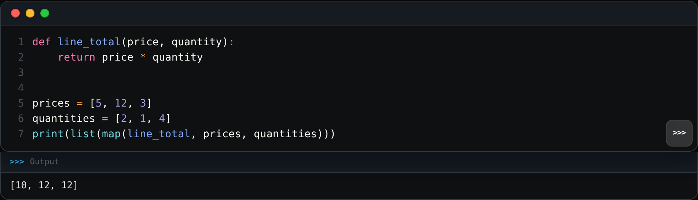

```python
def line_total(price, quantity):
    return price * quantity


prices = [5, 12, 3]
quantities = [2, 1, 4]
print(list(map(line_total, prices, quantities)))
```

| ✓ A for loop with append | ✗ map() |
| --- | --- |
| • Needs an empty list set up before the loop that appends to it<br><br>• Has room for several statements and if branches<br><br>• Builds the full list right away<br><br>• Reads well when the transform is written inline | • A single expression around a named function<br><br>• The function takes 1 item per iterable and returns 1 value<br><br>• Produces values only when read, and only once<br><br>• Reads well when you pass a built-in like int or a method like str.lower |


<br>

---

## Using filter() for Selection

`filter(function, iterable)` runs the function against every item and keeps those for which it returns `True`. A function used this way is called a predicate: it answers a yes-or-no question about 1 item. Like a map object, the result is a filter object that computes each item as you read it and can be read only once.

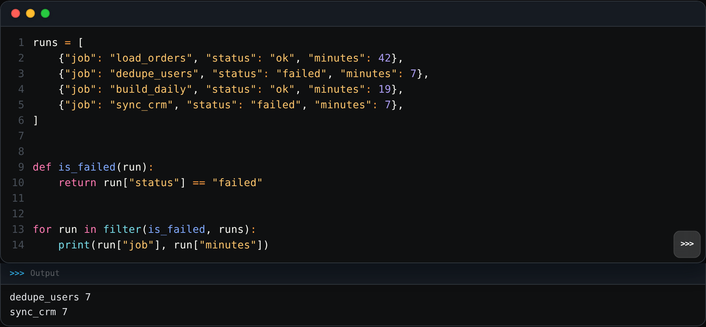

```python
runs = [
    {"job": "load_orders", "status": "ok", "minutes": 42},
    {"job": "dedupe_users", "status": "failed", "minutes": 7},
    {"job": "build_daily", "status": "ok", "minutes": 19},
    {"job": "sync_crm", "status": "failed", "minutes": 7},
]


def is_failed(run):
    return run["status"] == "failed"


for run in filter(is_failed, runs):
    print(run["job"], run["minutes"])
```

The 2 dicts printed are the same objects that sit in `runs`. Nothing in them changed, and they come out in their original order. `filter()` chooses which items survive and never edits them, which gives you 2 properties to check in any output: it holds at most as many items as the input, and every item in it came from the input.

| ✓ map() | ✗ filter() |
| --- | --- |
| • Function returns a new value for each item<br><br>• Output has exactly as many items as the input<br><br>• Items come out changed<br><br>• Answers: what does each item become? | • Function returns True or False for each item<br><br>• Output has as many items as the input, or fewer<br><br>• Items come out unchanged<br><br>• Answers: which items stay? |


<br>

### Predicates that test several conditions

A predicate can combine conditions with `and` and `or`, as long as it ends by returning `True` or `False`. It receives exactly 1 argument, the item, so a threshold it needs has to be written inside the function or read from a constant defined at module level.

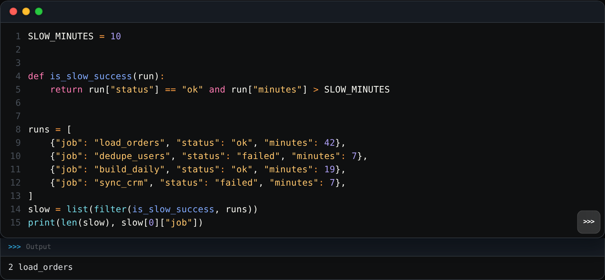

```python
SLOW_MINUTES = 10


def is_slow_success(run):
    return run["status"] == "ok" and run["minutes"] > SLOW_MINUTES


runs = [
    {"job": "load_orders", "status": "ok", "minutes": 42},
    {"job": "dedupe_users", "status": "failed", "minutes": 7},
    {"job": "build_daily", "status": "ok", "minutes": 19},
    {"job": "sync_crm", "status": "failed", "minutes": 7},
]
slow = list(filter(is_slow_success, runs))
print(len(slow), slow[0]["job"])
```

`load_orders` at 42 minutes and `build_daily` at 19 pass both tests, so `slow` holds 2 dicts. The 2 failed runs fall at the status test, whatever their minutes. A threshold kept in a named constant such as `SLOW_MINUTES` changes in one place when the rule changes.


<br>

### Filtering a dict

Looping over a dict gives its keys, so a predicate on values needs `.items()`, where each item is a `(key, value)` pair. Pass the surviving pairs to `dict()` to rebuild the mapping. Here only tables that loaded rows stay:

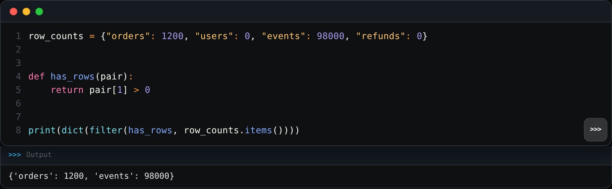

```python
row_counts = {"orders": 1200, "users": 0, "events": 98000, "refunds": 0}


def has_rows(pair):
    return pair[1] > 0


print(dict(filter(has_rows, row_counts.items())))
```


<br>

### Dropping missing values with a predicate

Earlier, `None` in a latency column broke `sorted()`, and a key placed it last. When missing readings should not appear in the result at all, a predicate built on `is not None` removes them, and `sorted()` takes the filter object directly:

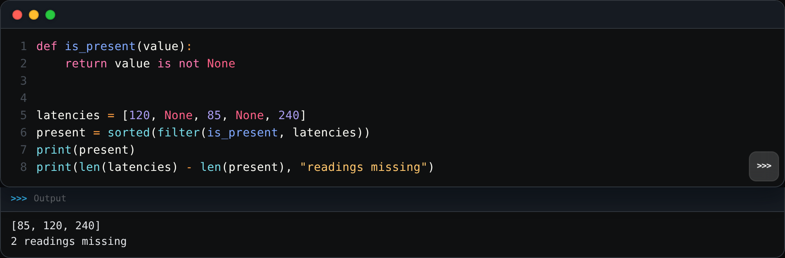

```python
def is_present(value):
    return value is not None


latencies = [120, None, 85, None, 240]
present = sorted(filter(is_present, latencies))
print(present)
print(len(latencies) - len(present), "readings missing")
```

Placing gaps last and dropping them are 2 different report decisions. A chart built from the filtered list looks complete. Print or log how many items the filter removed, as the last line does, so whoever reads the result knows 2 of the 5 readings never reached it.


<br>

### Chaining filter, map and sorted

Each of these functions accepts the others' output, so the 3 calls can nest in a single expression. Read it from the inside out: the innermost call is the first to touch the raw list.

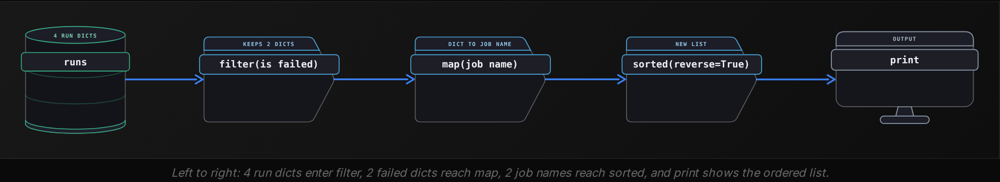

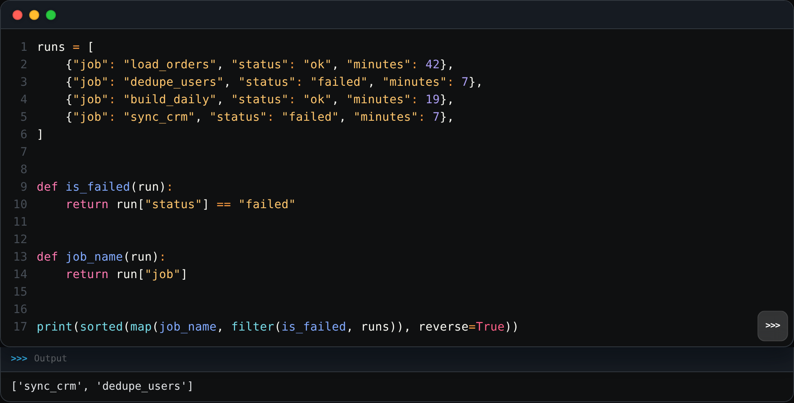

```python
runs = [
    {"job": "load_orders", "status": "ok", "minutes": 42},
    {"job": "dedupe_users", "status": "failed", "minutes": 7},
    {"job": "build_daily", "status": "ok", "minutes": 19},
    {"job": "sync_crm", "status": "failed", "minutes": 7},
]


def is_failed(run):
    return run["status"] == "failed"


def job_name(run):
    return run["job"]


print(sorted(map(job_name, filter(is_failed, runs)), reverse=True))
```

Put `filter()` inside `map()` when the order is yours to choose. The transform then runs on fewer items, and the predicate sees the full original record with every field it might test, before `map()` reduces each record to a name.

**The arguments to filter() are swapped. What happens when this runs?**

```python
def is_failed(run):
    return run["status"] == "failed"

runs = [{"job": "sync_crm", "status": "failed"}]
kept = filter(runs, is_failed)
print("built")
print(list(kept))
```

- **A.** It prints built, then raises TypeError at list()
- **B.** It raises TypeError at the filter() line, before printing
- **C.** It prints built, then an empty list
- **D.** It prints built, then the sync_crm record

<details>
<summary>Solution</summary>

**B.** It raises TypeError at the filter() line, before printing

The function must come first. Python tries to iterate over is_failed, and stops with TypeError: 'function' object isn't iterable.

**Why the others are wrong**

- **A.** filter() checks that its second argument is iterable the moment it is called, so the error comes before the print.
- **C.** Swapped arguments don't produce a quiet empty result here. The filter() call itself fails.
- **D.** filter() does not detect swapped arguments and repair them. The call raises an error.

</details>


<br>

---

## Using zip() for Combining

You have walked 2 lists side by side with `zip()` in a `for` loop. Called on its own, `zip()` returns a zip object that yields tuples and can be consumed once. Whatever you pass it to sets the final shape: `list()` gives pairs and `dict()` turns those pairs into a mapping.

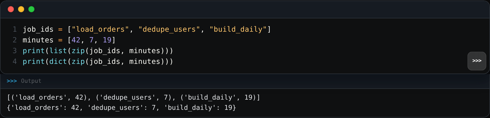

```python
job_ids = ["load_orders", "dedupe_users", "build_daily"]
minutes = [42, 7, 19]
print(list(zip(job_ids, minutes)))
print(dict(zip(job_ids, minutes)))
```

`zip()` accepts any number of iterables and builds a tuple with 1 item from each, so 3 parallel columns become 3-field rows that a `for` loop can unpack in a single line:

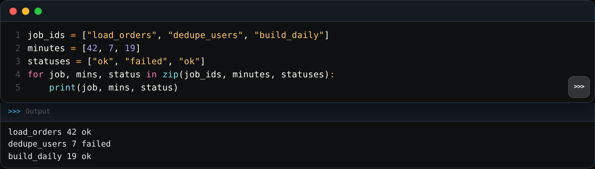

```python
job_ids = ["load_orders", "dedupe_users", "build_daily"]
minutes = [42, 7, 19]
statuses = ["ok", "failed", "ok"]
for job, mins, status in zip(job_ids, minutes, statuses):
    print(job, mins, status)
```

`dict(zip(...))` has its own silent failure. When a key repeats, each later pair overwrites the earlier value, the same as assigning to that key twice:

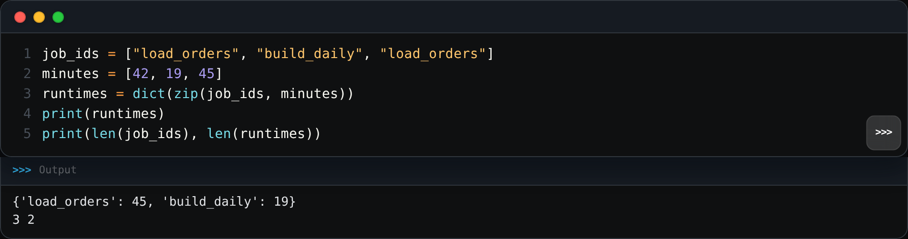

```python
job_ids = ["load_orders", "build_daily", "load_orders"]
minutes = [42, 19, 45]
runtimes = dict(zip(job_ids, minutes))
print(runtimes)
print(len(job_ids), len(runtimes))
```

The first `load_orders` runtime of 42 is gone. Without any error, 3 job entries became 2 dict entries. If the key column can repeat, compare `len(job_ids)` with the length of the dict you built, as the last line does, before trusting the mapping.


<br>

### Turning rows into records

Extracts often arrive as a header row plus value rows, the layout of a CSV file or a query result. `dict(zip(header, row))` labels each value with its column name, and wrapping that in a function lets `map()` apply it to every row.

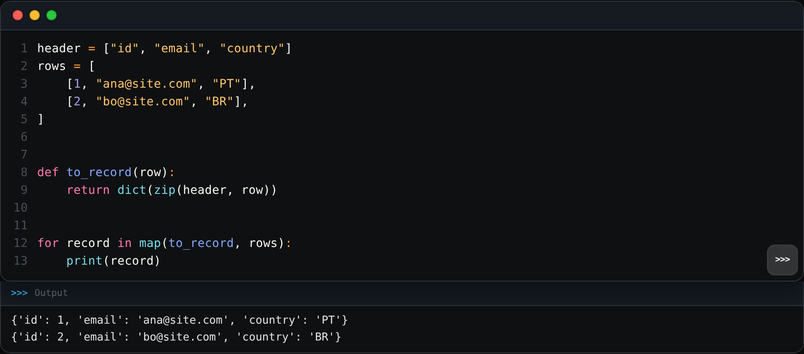

```python
header = ["id", "email", "country"]
rows = [
    [1, "ana@site.com", "PT"],
    [2, "bo@site.com", "BR"],
]


def to_record(row):
    return dict(zip(header, row))


for record in map(to_record, rows):
    print(record)
```


<br>

### The shortest input sets the length

`zip()` stops as soon as any input is exhausted, and it raises no error about the leftovers. Step through a mismatch where the runtime list lost its last value somewhere upstream.

https://github.com/user-attachments/assets/b802c1a6-1c79-47b5-b1cf-75eb8c4c2de1

*zip stops when minutes runs out, and build_daily is left behind.*

`build_daily` is never paired, and nothing in the output says so. In a pipeline this is silent data loss. When 2 lists are supposed to match, compare their lengths before zipping and stop the step if they differ:

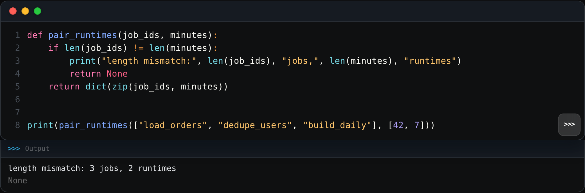

```python
def pair_runtimes(job_ids, minutes):
    if len(job_ids) != len(minutes):
        print("length mismatch:", len(job_ids), "jobs,", len(minutes), "runtimes")
        return None
    return dict(zip(job_ids, minutes))


print(pair_runtimes(["load_orders", "dedupe_users", "build_daily"], [42, 7]))
```


<br>

### Unzipping and sorting parallel lists

The `*` in a call spreads a list into separate arguments. `zip(*pairs)` therefore receives each pair as its own argument and groups all the first items together, then all the second items, splitting a list of pairs back into 2 tuples. Combined with `sorted()`, this orders 2 parallel lists by one of them while keeping every pairing intact.

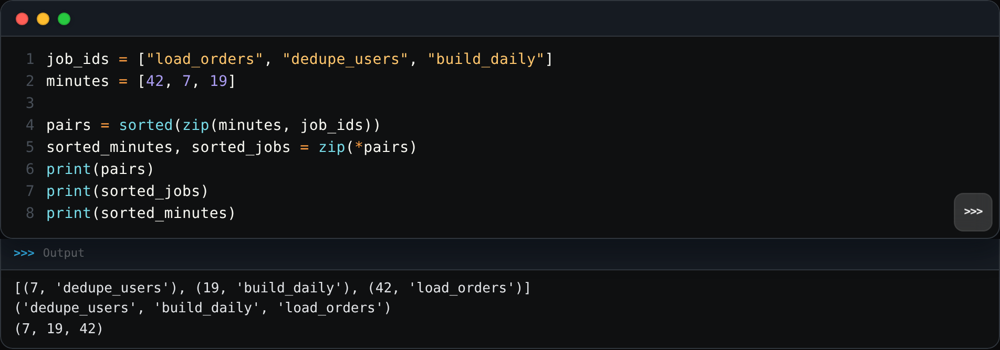

```python
job_ids = ["load_orders", "dedupe_users", "build_daily"]
minutes = [42, 7, 19]

pairs = sorted(zip(minutes, job_ids))
sorted_minutes, sorted_jobs = zip(*pairs)
print(pairs)
print(sorted_jobs)
print(sorted_minutes)
```

Putting `minutes` first in the `zip()` call makes each runtime the first item of its tuple, so plain `sorted()` orders by runtime with no key function, and the job name only matters on a tie. The results come back as tuples; pass them to `list()` if later code needs lists.

**A column of counts is 1 value short. What does this program print?**

```python
names = ["orders", "users", "events"]
counts = [1200, 0]
pairs = zip(names, counts)
print(len(list(pairs)), len(list(pairs)))
```

- **A.** It prints 3 3
- **B.** It prints 2 2
- **C.** It prints 2 0
- **D.** It raises a TypeError for unequal lengths

<details>
<summary>Solution</summary>

**C.** It prints 2 0

zip() makes 2 pairs because counts has 2 items, and the first list() consumes them. The second finds the object empty.

**Why the others are wrong**

- **A.** zip() stops at the shorter list, and the zip object can only be read once.
- **B.** The first list() uses up the zip object, so the second one gets nothing.
- **D.** zip() never checks lengths on its own. It pairs what it can and stops quietly.

</details>

Ties deserve their own check because a wrong tie order raises nothing. Records built from parallel lists keep the order of those lists, so a track's position in the source decides which of 2 tied tracks takes first place under `reverse=True`. Flip the ties with `[::-1]` and the top of the report changes while every count stays the same.


<br>

---

## Putting It All Together

Back on Spotify's Wrapped pipeline, an extract delivers a header and rows of track and play count, with every count as text. The step has to produce each listener's top 5 tracks, with the 2 songs tied at 310 plays in a fixed order and tracks with 0 plays left out.

- zip ( ) inside a to_record function, applied with map ( ) , turns header-plus-rows into dict records and converts the play counts to integers.
- filter ( ) drops the 0-play tracks before ranking, so the sort only compares tracks that can appear on the card.
- A key of ( - plays , track ) ranks by plays descending and breaks the 310-play tie alphabetically, and [ : 5 ] keeps the top 5.
- Each one-pass object in the chain is read exactly once by the next call, which is why the chain works, and why storing a map object and reading it twice returns nothing the second time.


<br>

---

## Key Takeaways

- sorted ( ) returns a new list; key names a function called once per item, and the items come back unchanged in key order.
- A tuple key sorts on several fields, and negating a number flips the direction of that field alone.
- reverse = True keeps tied items in input order, while [ : : - 1 ] flips the ties too; slice with [ : n ] for the top N.
- map ( ) and filter ( ) return one-pass objects that run the function only when read, so errors surface where the values are consumed.
- map ( ) changes every item and keeps the count; filter ( ) keeps or drops items without changing them.
- zip ( ) stops at the shortest input without a warning, so compare lengths before pairing columns.
