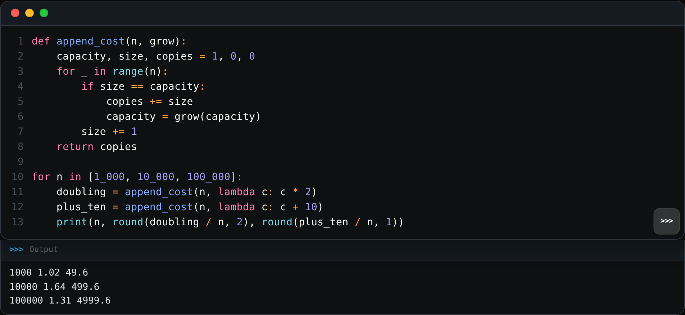
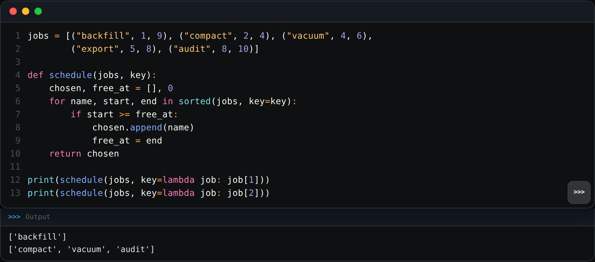
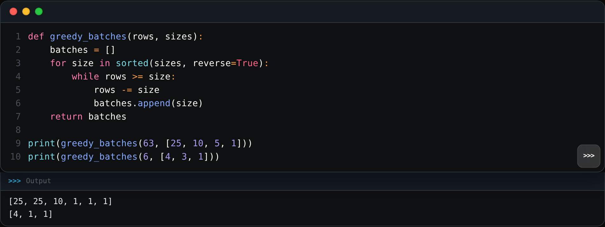
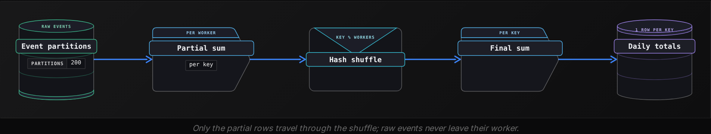
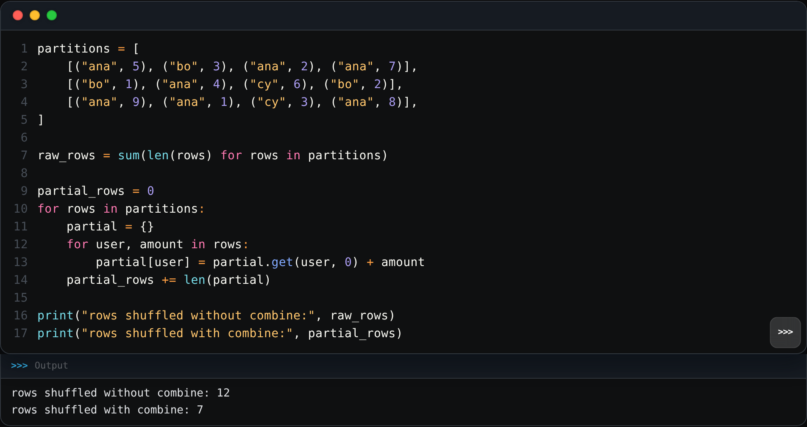
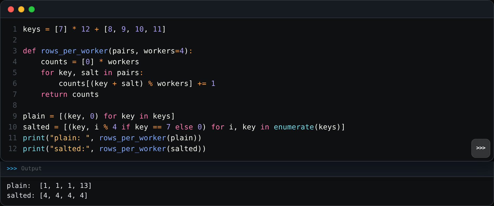
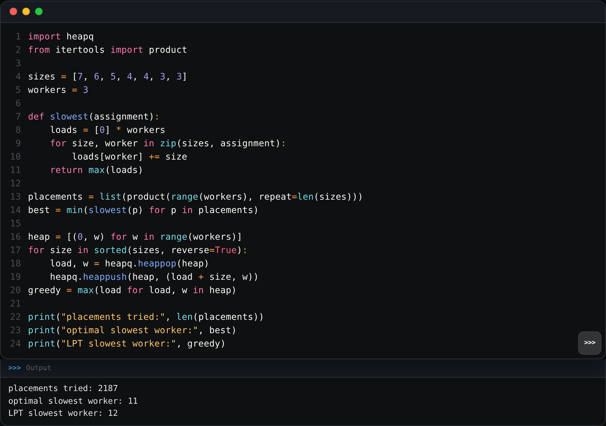
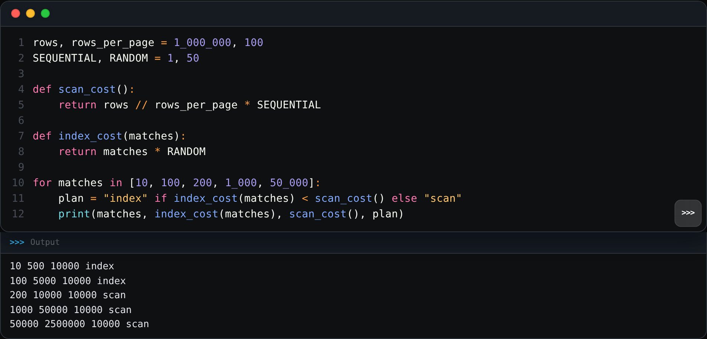

# Complexity: Advanced

At Google, a job counting words across billions of crawled pages hits a wall: "the" appears on nearly every page, so the machine owning it drowns. Google's 2004 paper on its batch framework describes the fix: add up counts on each machine before anything crosses the network. Appending to those tables, packing the output into fixed-size files and the hardware underneath each carry a cost this lesson models.


<br>

---

## Amortized Analysis

A Python list keeps its items in 1 contiguous block of memory slots, usually with a few spare slots at the end. When append finds every slot taken, the list cannot grow where it sits: it allocates a larger block, copies every existing reference into it, and frees the old one. That call costs O(n). Building a 10-million-row list with append in a loop still takes linear total time, and the reason is the size of the new block.


<br>

### Charging each append in advance

Picture an array that doubles its capacity whenever it fills. Starting from 1 slot, 6 appends trigger resizes at the 2nd, 3rd and 5th append, and each resize copies only the items already stored.

https://github.com/user-attachments/assets/d872772e-3b57-43bc-a90a-3ccd125061dc

*Each resize copies every stored item; appends between resizes write 1 slot.*

Amortized analysis bounds the total cost of a whole sequence of operations, then divides by the number of operations. Charge every append 3 units: 1 pays for writing its own slot and 2 go into savings. When an array of capacity 2k fills up, the k items appended since the previous resize have saved 2k units, exactly the price of copying all 2k items. The savings never run out, so n appends cost at most 3n units. Each append is amortized O(1), even though the few that resize cost O(n) on their own.


<br>

### The growth rule decides the total

The savings argument needs growth proportional to the current size. The program below counts copies under doubling and under a rule that adds a fixed 10 slots per resize, then prints copies per append for 3 list sizes.



```python
def append_cost(n, grow):
    capacity, size, copies = 1, 0, 0
    for _ in range(n):
        if size == capacity:
            copies += size
            capacity = grow(capacity)
        size += 1
    return copies

for n in [1_000, 10_000, 100_000]:
    doubling = append_cost(n, lambda c: c * 2)
    plus_ten = append_cost(n, lambda c: c + 10)
    print(n, round(doubling / n, 2), round(plus_ten / n, 1))
```

Doubling stays between 1 and 2 copies per append at every size. The fixed step makes the cost per append climb with n: each resize copies the whole array but buys room for only 10 more appends, so n appends trigger about n/10 resizes averaging n/2 copies each, O(n²) in total. At 100,000 appends that is 4,999.6 copies per append against 1.31.

*CPython's own list_resize in Objects/listobject.c grows a full list by about one eighth of its size plus a few slots. That smaller factor copies each item about 8 times over a long run in exchange for less idle memory, and because growth is still proportional to size, append stays amortized O(1).*


<br>

### Where the guarantee stops

- **Amortized differs from average case**\
  An average-case bound assumes some mix of inputs, and a bad input breaks it. An amortized bound holds for every sequence of appends.
- **A single append can still stall**\
  The resize on a 50-million-item list copies 50 million references before returning. Code with a per-request time limit feels that spike.
- **Only the end of the list is cheap**\
  insert(0, x) and pop(0) shift every item on every call, so n of them cost O(n²). A collections.deque handles both ends in O(1).
- **A known size skips resizing**\
  [None] \* n allocates the full block once, and filling it by index never resizes.

**A loop runs once for each of the n rows in rows. Which loop body makes the whole loop O(n²)?**

- **A.** out.append(row), then 1 out.reverse() after the loop
- **B.** out.insert(0, row) on a list
- **C.** out += [row] on a list
- **D.** queue.appendleft(row) on a deque

<details>
<summary>Solution</summary>

**B.** out.insert(0, row) on a list

Each front insert shifts every stored item, and those shifts sum to about n²/2.

**Why the others are wrong**

- **A.** Appends are amortized O(1) and a single reverse is O(n), so the total stays linear.
- **C.** += extends the list in place with the same over-allocation as append: amortized O(1).
- **D.** A deque adds at its left end in O(1) without shifting anything.

</details>


<br>

---

## Divide-and-Conquer and Greedy

Two design patterns sit behind many of the fast algorithms you already use. Divide and conquer splits the input, solves each part recursively and combines the answers. Greedy takes the choice that looks best right now, commits to it and never revisits it. You can read each one's cost off its structure, but greedy carries a risk that divide and conquer avoids: a fast answer that is wrong.


<br>

### Split, solve, combine

Merge sort is the standard case. A list of 1 item is already sorted, and 2 sorted lists merge into 1 in a single pass that walks a pointer through each, the two-pointer technique applied to merging.

https://github.com/user-attachments/assets/756d9451-ee5c-4260-8575-b5a562cf97b7

*Each printed line is 1 combine step; the smallest merges finish first.*

#### Reading the cost off the recursion

Three facts set the cost: how many parts each call makes, their size, and the price of the combine step. Merge sort makes 2 halves and merges in O(n), so each recursion level touches all n items once, and halving reaches size 1 after about log2 n levels: O(n log n). For 1 million rows that is 20 levels deep, far inside Python's default recursion limit of 1,000.

| Pattern | Parts per call | Combine step | Total |
| --- | --- | --- | --- |
| Binary search | 1 half | O(1) | O(log n) |
| Max of a range by halves | 2 halves | O(1) | O(n) |
| Merge sort | 2 halves | O(n) | O(n log n) |
| Peel off 1 item, recurse on the rest | 1 part of size n - 1 | O(n) | O(n²) |

The last row is the trap: peeling off 1 item per call gives n levels instead of log n. Sorting data bigger than memory reuses the merge step: sort chunks that fit, then stream the sorted runs through `heapq.merge` at O(log k) per row for k runs.

**What is the time complexity of peak(values, 0, len(values)) on a list of n values?**

```python
def peak(values, lo, hi):
    if hi - lo == 1:
        return values[lo]
    mid = (lo + hi) // 2
    return max(peak(values, lo, mid), peak(values, mid, hi))
```

- **A.** O(log n), because each call halves the range it looks at
- **B.** O(n log n), because the recursion is log n levels deep
- **C.** O(n²), because max compares every pair of values
- **D.** O(n), because about 2n calls each do O(1) work

<details>
<summary>Solution</summary>

**D.** O(n), because about 2n calls each do O(1) work

There are n single-value calls and n - 1 combining calls, each a constant amount of work.

**Why the others are wrong**

- **A.** Binary search keeps 1 half. This function recurses into both, so every value is still visited.
- **B.** Depth is log n, but level k holds 2^k calls doing O(1) each, and those sum to about 2n.
- **C.** Each max call receives 2 numbers and compares them once.

</details>


<br>

### Greedy: commit and never look back

One shared compute slot, 5 maintenance jobs with start and end hours, and the goal is to run as many as possible without overlap. A greedy scheduler sorts the jobs, takes each one that starts after the slot frees up, and skips the rest. The sort key is the entire algorithm.



```python
jobs = [("backfill", 1, 9), ("compact", 2, 4), ("vacuum", 4, 6),
        ("export", 5, 8), ("audit", 8, 10)]

def schedule(jobs, key):
    chosen, free_at = [], 0
    for name, start, end in sorted(jobs, key=key):
        if start >= free_at:
            chosen.append(name)
            free_at = end
    return chosen

print(schedule(jobs, key=lambda job: job[1]))
print(schedule(jobs, key=lambda job: job[2]))
```

Sorting by start time grabs `backfill` first, which holds the slot from hour 1 to hour 9 and blocks every other job. Sorting by end time is provably optimal: the job that finishes first leaves the most room afterward, and any best schedule can swap its first job for that one without losing a job. Repeating that swap down the schedule is an exchange argument, the usual proof behind a greedy rule. Cost: O(n log n) to sort plus 1 O(n) pass.

#### When the locally best choice is wrong

A bulk-load API accepts batches of exactly 25, 10, 5 or 1 rows and bills per request. Greedy keeps sending the largest batch that fits.



```python
def greedy_batches(rows, sizes):
    batches = []
    for size in sorted(sizes, reverse=True):
        while rows >= size:
            rows -= size
            batches.append(size)
    return batches

print(greedy_batches(63, [25, 10, 5, 1]))
print(greedy_batches(6, [4, 3, 1]))
```

For sizes 25, 10, 5 and 1, greedy happens to be optimal. Switch to 4, 3 and 1 and it sends 3 requests for 6 rows where 2 batches of 3 suffice. With arbitrary sizes, the fewest-requests answer needs memoized recursion over every row total from 1 to the target, costing O(target × sizes). Before trusting a greedy rule, compare it with brute force on a few hundred small inputs: 1 mismatch settles the question.


<br>

---

## Complexity in Distributed Systems

On a cluster, the step that dominates is moving a row between machines: the row is serialized, sent over the network, often spilled to disk, and read back. Two plans with the same O(n) CPU work can move very different numbers of rows, and that row count is the cost to minimize.


<br>

### What a shuffle does

Input arrives split into partitions, each on a worker, in whatever order it was written. Grouping by user_id needs every row for a user on the same worker, so the engine computes a target worker from each key and sends the row there. That redistribution is a **shuffle**. Below, partition i starts on worker i, and the target is user_id % 3.

https://github.com/user-attachments/assets/e4de1811-d7d7-4f42-8a15-25c0e6e879b0

*Every row for a user ends on 1 worker; rows whose target differs from their source cross the network.*

Four of the 6 rows crossed the network. With W workers and evenly spread keys, a row's target is its current worker only 1 time in W, so about (W - 1)/W of all rows move: two thirds on 3 workers, 99% on 100. A shuffle is O(n) in rows, and each row moved costs far more than a CPU step.


<br>

### Shrink the data before the shuffle

Sums, counts, mins and maxes split into 2 steps: each worker totals its own rows per key, and only those partial totals are shuffled for the final sum. The rows that cross drop from n to at most workers × distinct keys.





```python
partitions = [
    [("ana", 5), ("bo", 3), ("ana", 2), ("ana", 7)],
    [("bo", 1), ("ana", 4), ("cy", 6), ("bo", 2)],
    [("ana", 9), ("ana", 1), ("cy", 3), ("ana", 8)],
]

raw_rows = sum(len(rows) for rows in partitions)

partial_rows = 0
for rows in partitions:
    partial = {}
    for user, amount in rows:
        partial[user] = partial.get(user, 0) + amount
    partial_rows += len(partial)

print("rows shuffled without combine:", raw_rows)
print("rows shuffled with combine:", partial_rows)
```

With 1 billion events on 200 workers and 50,000 product ids, at most 10 million partial rows cross, 1% of the input. The function must split exactly: a sum of partial sums is the full sum, and an average travels as a (sum, count) pair. A median cannot be rebuilt from partial medians, so it gets no combine step.


<br>

### Broadcast the small side of a join

A join needs matching keys on the same worker too. A shuffle join hashes both tables by the join key and moves |A| + |B| rows. A broadcast join copies the small table B to all W workers, moving |B| × W rows, and leaves the large table in place. Joining 500,000,000 orders to a 250-row country table on 100 workers:

| Plan | Rows moved | Total |
| --- | --- | --- |
| Shuffle both sides | 500,000,000 + 250 | 500,000,250 |
| Broadcast countries | 250 × 100 workers | 25,000 |

Broadcast wins when |B| × W stays well below |A| and B fits in every worker's memory. That is a comparison of 2 counts, so redo it with real counts for each join.

**A join pairs 2,000,000,000 events with 40,000,000 user rows on 400 workers. Which plan moves fewer rows?**

- **A.** Shuffle both sides: about 2.04 billion rows, against 16 billion to broadcast
- **B.** Broadcast users, because the smaller table is always the one to broadcast
- **C.** Broadcast users, since a broadcast leaves the 2 billion events in place
- **D.** Either plan, since both move a number of rows proportional to the input

<details>
<summary>Solution</summary>

**A.** Shuffle both sides: about 2.04 billion rows, against 16 billion to broadcast

Broadcasting copies 40,000,000 rows to each of 400 workers, nearly 8 times what the shuffle moves.

**Why the others are wrong**

- **B.** Size alone does not decide it: the broadcast count multiplies by W, and 400 copies outweigh the events.
- **C.** The events do stay put, but the 16 billion copied user rows cost far more than moving them once.
- **D.** Both counts are linear in something, but here they differ by a factor of almost 8.

</details>


<br>

### Skew: 1 key, 1 slow worker

A stage finishes when its slowest partition finishes. If 1 key holds most rows, hashing sends them all to 1 worker while the rest idle. Salting splits the hot key: give each of its rows a salt from 0 to k - 1, aggregate per (key, salt), then add up the k partials for that key in a second, tiny aggregation.



```python
keys = [7] * 12 + [8, 9, 10, 11]

def rows_per_worker(pairs, workers=4):
    counts = [0] * workers
    for key, salt in pairs:
        counts[(key + salt) % workers] += 1
    return counts

plain = [(key, 0) for key in keys]
salted = [(key, i % 4 if key == 7 else 0) for i, key in enumerate(keys)]
print("plain: ", rows_per_worker(plain))
print("salted:", rows_per_worker(salted))
```

The busiest worker drops from 13 rows to 4, so the stage finishes about 3 times sooner with the same total work, plus 1 small extra aggregation.

> Counting shuffles in a plan
>
> - Each group-by or join on a new key shuffles the rows that reach it.
> - Steps that follow on the same key reuse the existing partitioning and add no shuffle.
> - Filters and dropped columns before a shuffle shrink every row that would cross.


<br>

---

## When Problems Are Inherently Hard

The intermediate tier showed a search over every combination doubling its work with each added item. For the family of problems called NP-hard, nobody has found an algorithm that runs in polynomial time, O(n^k) for some fixed k, in the worst case. They stand or fall together: a polynomial-time algorithm for any of the problems in this section would give one for all of them, and decades of searching have produced none. When a data task turns out to be one in disguise, stop hunting for a fast exact algorithm and choose a heuristic.


<br>

### Spotting them in pipeline work

| Pipeline task | Known hard problem |
| --- | --- |
| Pack files into the fewest 256 MB blocks without splitting any | Bin packing |
| Spread tasks across workers so the last one finishes soonest | Multiprocessor scheduling |
| Pick which summary tables to precompute within a storage budget | Knapsack |
| Choose the fewest source systems that together supply every needed column | Set cover |
| Group jobs into the fewest time windows so no 2 jobs writing the same table share one | Graph coloring |

> Signals of a hard problem
>
> - Each item goes into 1 of k groups, and the groups have limits.
> - You choose a subset under a budget, and the items interact.
> - The answer is an ordering whose cost depends on which items sit side by side, as in routes. Sorting differs: each item's place follows from its own key.
> - Checking a proposed answer is fast, but finding one seems to need trying combinations.

Spreading files across workers shows how fast the search space explodes. Each file can go to any worker, so the number of placements is the worker count raised to the number of files, and adding 1 file multiplies the search by the worker count.

- **1.1 trillion** — placements of 20 files on 4 workers
- **1.2 septillion** — placements of 40 files on 4 workers


<br>

### Exact on tiny inputs, a heuristic at scale

**Longest processing time first** (LPT) is a greedy heuristic: sort the files largest first and hand each to the least-loaded worker, kept at the top of a heap. The program compares it with exhaustive search on 7 files and 3 workers.



```python
import heapq
from itertools import product

sizes = [7, 6, 5, 4, 4, 3, 3]
workers = 3

def slowest(assignment):
    loads = [0] * workers
    for size, worker in zip(sizes, assignment):
        loads[worker] += size
    return max(loads)

placements = list(product(range(workers), repeat=len(sizes)))
best = min(slowest(p) for p in placements)

heap = [(0, w) for w in range(workers)]
for size in sorted(sizes, reverse=True):
    load, w = heapq.heappop(heap)
    heapq.heappush(heap, (load + size, w))
greedy = max(load for load, w in heap)

print("placements tried:", len(placements))
print("optimal slowest worker:", best)
print("LPT slowest worker:", greedy)
```

Exhaustive search checked 2,187 placements to find a slowest worker of 11 GB. LPT made 7 heap pops and 7 pushes and landed on 12. It runs in O(n log n) at any size, and Ronald Graham proved in 1969 that its slowest worker never exceeds 4/3 of the optimum.

#### Knowing how close you are

No placement beats the larger of 2 lower bounds: the total size split evenly and rounded up, and the single largest file. Here that is max(ceil(32 / 3), 7) = 11, so LPT's 12 sits at most 1 GB above optimal, and you learn that without the exhaustive search. On 10,000 files the check is 1 pass.

Other moves when exact is out of reach

- Use a greedy rule with a proven bound: first-fit decreasing packing never uses more than 11/9 of the optimal bin count plus 1.
- Search exactly while n is small, cutting any branch that already exceeds the best answer found.
- Exploit small integers: when sizes and budget are whole numbers, memoized search runs in time proportional to items × budget. That is polynomial in the budget's value but exponential in its digit count, so a budget of 10,000 is fine and one in the trillions is out of reach.
- Improve and stop: start from greedy, move 1 item between workers, keep moves that lower the maximum, and halt at a time limit.

**Which of these pipeline tasks is NP-hard?**

- **A.** Remove duplicate rows by primary key
- **B.** Sort 1 billion rows by event timestamp
- **C.** Group 300 files into the fewest 1 GB blocks without splitting a file
- **D.** Find the 10 customers with the highest revenue

<details>
<summary>Solution</summary>

**C.** Group 300 files into the fewest 1 GB blocks without splitting a file

This is bin packing: no known polynomial algorithm finds the fewest blocks, so first-fit decreasing is the usual answer.

**Why the others are wrong**

- **A.** A set or dict of seen keys does it in 1 O(n) pass.
- **B.** Sorting is O(n log n), and data bigger than memory uses a merge of sorted runs.
- **D.** A heap of size 10 does it in O(n log 10), which is O(n).

</details>


<br>

---

## When Theory Meets Reality

Big-O describes how cost grows and drops constant factors. On real hardware a constant can be 50, and n is a number you can look up. The fastest approach comes from combining the growth rate with 3 practical costs: the interpreter, memory layout, and storage access.


<br>

### The interpreter's constant factor

Python executes a loop body 1 bytecode instruction at a time. Built-ins such as sum, sorted, str.join and set operations run their loops in C. Two functions with the same O(n) growth can differ several times in speed:

```sql
import timeit

values = list(range(1_000_000))

def loop_sum():
    total = 0
    for v in values:
        total += v
    return total

print("loop:", timeit.timeit(loop_sum, number=10))
print("sum: ", timeit.timeit(lambda: sum(values), number=10))
```

Run it on your machine: the built-in typically finishes several times sooner. The seconds vary between machines; the ratio is what carries over. The same effect lets an O(n log n) `sorted` call in C beat an O(n) pure-Python loop at the sizes your pipeline sees, so measure before swapping one for the other.


<br>

### Memory layout and the cache

A CPU fetches memory in cache lines, commonly 64 bytes on x86 processors, so reading neighbouring values is cheap and jumping around is expensive. One line of contiguous 8-byte numbers delivers 8 usable values. One line of a Python list delivers 8 pointers, and each int they point to is a separate object elsewhere in memory, often a fetch of its own. Contiguous storage pays off when C code walks the buffer: a columnar file reader decoding a whole column, or a numeric routine that takes the buffer directly. Iterating an `array.array` from Python gains nothing, because every element read builds a new int object, so a Python loop or `sum` over it runs no faster than over a list and often slower. Columnar file formats keep each column contiguous for the same reason: a query that reads 3 of 40 columns fetches only those 3, in order.


<br>

### Storage: when a full scan beats an index

An index finds 1 row in O(log n), which sounds unbeatable next to an O(n) scan. A query matching many rows changes that: each match costs a random read of its page, while the scan reads every page in order. The model below charges a random page read 50 times a sequential one; replace 50 with your own hardware's ratio.



```python
rows, rows_per_page = 1_000_000, 100
SEQUENTIAL, RANDOM = 1, 50

def scan_cost():
    return rows // rows_per_page * SEQUENTIAL

def index_cost(matches):
    return matches * RANDOM

for matches in [10, 100, 200, 1_000, 50_000]:
    plan = "index" if index_cost(matches) < scan_cost() else "scan"
    print(matches, index_cost(matches), scan_cost(), plan)
```

With 10,000 pages to scan, the index wins only while matches × 50 stays under 10,000, so it loses from 200 matching rows on: 0.02% of the table. Query planners make this same call from row-count estimates, which is why a stale estimate can turn a fast query slow.


<br>

### Choosing in practice

| ✓ Do | ✗ Don't |
| --- | --- |
| • Time both candidates with timeit at your real n before rewriting<br><br>• Push hot loops into built-ins: sum, sorted, set operations, str.join<br><br>• Read only the columns you need, in sequential order<br><br>• Recompute crossovers when hardware or data volume changes | • Pick an algorithm from Big-O alone when n is a few hundred<br><br>• Use an index for a query that matches a large share of rows<br><br>• Hand-write a Python loop to beat a C built-in of the same order<br><br>• Trust a single timing run; repeat it and compare the fastest |

**In this section's model, faster storage drops the random read cost from 50 units to 5, and the scan still costs 10,000. A query matches 1,500 rows. Which plan wins?**

- **A.** Scan, because 1,500 matches is well past the 200-row crossover
- **B.** Index, because 1,500 × 5 = 7,500 units is below the scan's 10,000
- **C.** Scan, because faster storage cuts the scan's cost by the same factor
- **D.** Index, because an O(log n) lookup always beats an O(n) scan

<details>
<summary>Solution</summary>

**B.** Index, because 1,500 × 5 = 7,500 units is below the scan's 10,000

The cheaper random read pushes the crossover to 10,000 / 5 = 2,000 rows, and 1,500 sits under it.

**Why the others are wrong**

- **A.** The 200-row crossover came from a cost of 50. At 5 units it moves to 2,000 rows.
- **C.** The question fixes the scan at 10,000, so only the index side got cheaper.
- **D.** The index wins here, but at 2,500 matches the same storage would favour the scan.

</details>


<br>

---

## Putting It All Together

A ride-sharing company's nightly job totals fares per driver across 2 billion trip rows on 400 workers, joins the 3 million per-driver totals to a 2,000-row city table, and writes the result as files for the payments team before morning.

- Each worker builds its per-driver partial totals with dict updates and list appends, all amortized O(1), so the local pass stays linear.
- Combining before the shuffle sends at most 400 × distinct drivers partial rows across the network instead of 2 billion trips.
- A few drivers with enormous trip counts become hot keys, and salting them keeps 1 worker from holding up the stage.
- Broadcasting the 2,000-row city table to 400 workers moves 800,000 rows, fewer than the 3,002,000 a shuffle join would move.
- Packing the output into the fewest 256 MB files is bin packing: first-fit decreasing lands within its proven bound, checked against total size divided by 256 MB.
- The files are written and later read in sequential order, the access pattern storage serves fastest.


<br>

---

## Key Takeaways

- An append is amortized O(1) because capacity grows in proportion to size: under doubling, n appends make fewer than 2n copies.
- Front-of-list inserts and pops shift every item each time; a deque handles both ends in O(1).
- Read a divide-and-conquer cost from parts per call and the combine step: 2 halves with a linear merge give O(n log n).
- Greedy is fast and often optimal, but only an exchange argument or a brute-force comparison shows it is right.
- On a cluster, minimize rows moved: combine before shuffling, broadcast a small table, and salt a hot key.
- Assignment, packing, budgeted-subset and ordering tasks are often NP-hard; use a greedy heuristic and check it against a lower bound.
- Big-O picks the shape; interpreter overhead, cache behaviour and random versus sequential reads pick the winner at your n.
