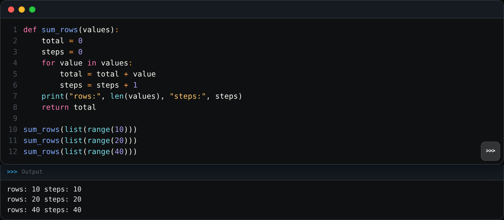
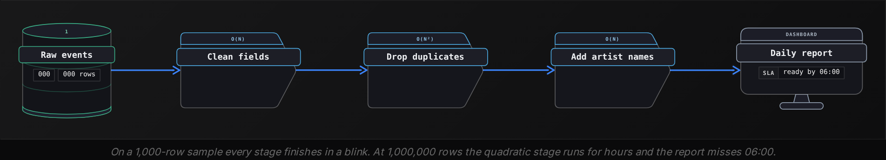
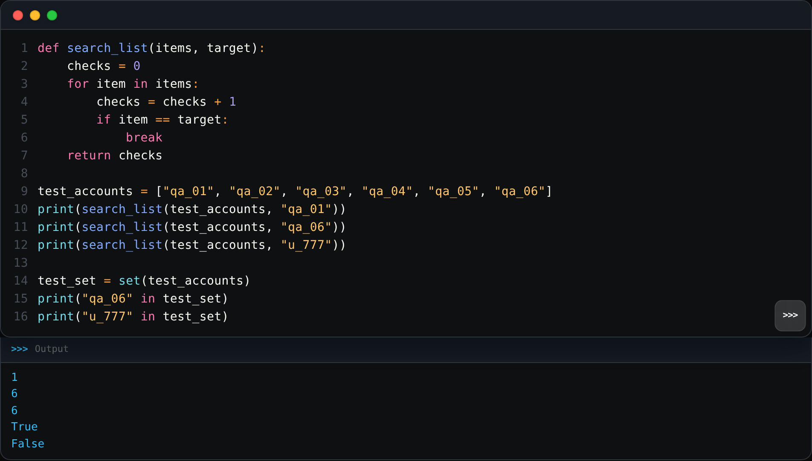
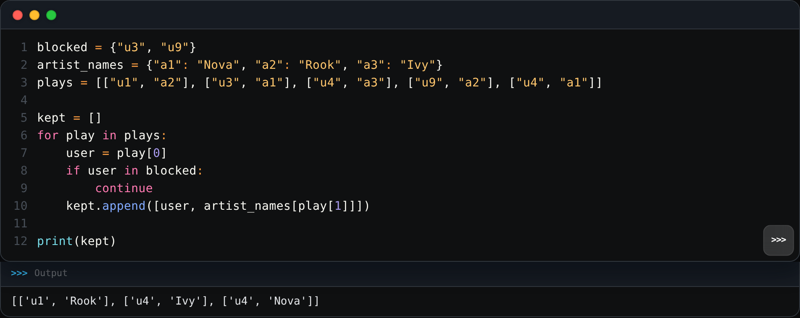
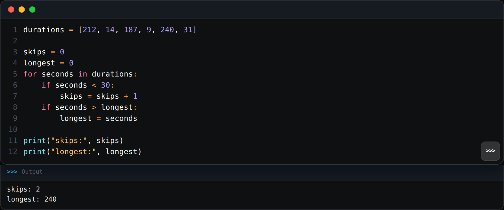
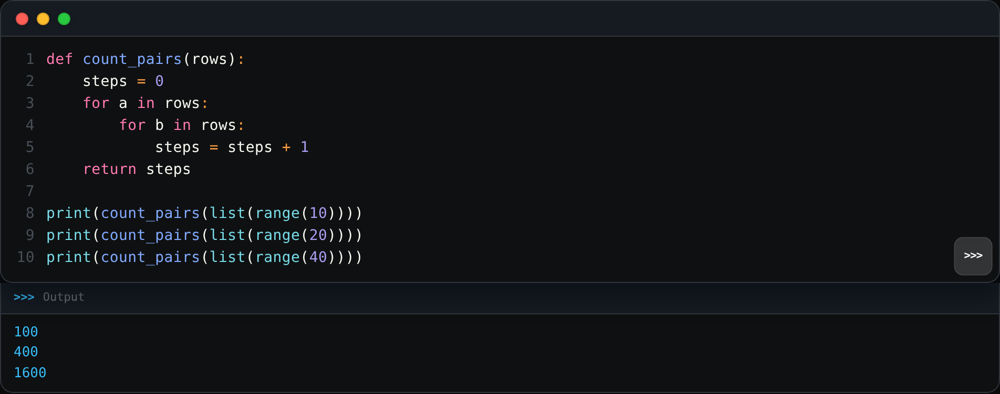

# Complexity: Beginner

It's late November at Spotify, and Wrapped has to ship to every listener on time. Your job turns each user's year of streams into top-artist lists, and it flew through the 1,000-user test. On the full listener base it is still running hours later. A single line, checking each stream against a list, decides whether Wrapped launches or slips.


<br>

---

## Why Speed Matters

Most pipeline code is written against a sample: 1,000 rows pulled into memory, checked by eye, then shipped. The same code then meets the full table, perhaps 50 million rows, and a job that finished in 2 seconds is still running the next morning. The code is identical to what passed on the sample; the input grew, and the work the code does grew faster than the input did.

> Inputs keep growing in production
>
> - Tables accumulate: an events table that adds 2 million rows a day holds 730 million after a year.
> - Samples are small on purpose, so a bad growth rate stays invisible until launch.
> - Reference data grows too: the product catalog gets longer every month, and so do user lists and blocklists.
> - A job that reprocesses full history each night does more work every night, even with steady traffic.


<br>

### Counting steps instead of seconds

Growth is easier to reason about when you count a function's steps instead of timing it. Seconds depend on the laptop and on how busy the server is. Steps depend only on the code and the size of its input, which is called n. A step is a small, fixed piece of work: a comparison, an addition, a lookup by key.

The function below sums a list and also counts how many times its loop body runs. That counter is the step count.



```python
def sum_rows(values):
    total = 0
    steps = 0
    for value in values:
        total = total + value
        steps = steps + 1
    print("rows:", len(values), "steps:", steps)
    return total

sum_rows(list(range(10)))
sum_rows(list(range(20)))
sum_rows(list(range(40)))
```

Every extra row added exactly 1 step. How the step count changes as n grows is the growth rate, and Big O notation is its shorthand. O(n), read "order n", means the steps grow in proportion to n.


<br>

### Constant, linear, quadratic

Most code at this stage lands in one of 3 classes. Constant time, O(1), does the same work at any n. Linear time, O(n), does work in proportion to n. Quadratic time, O(n²), does work in proportion to n times n, which usually means each row gets compared against many other rows.

| rows (n) | O(1) steps | O(n) steps | O(n²) steps |
| --- | --- | --- | --- |
| 10 | 1 | 10 | 100 |
| 1,000 | 1 | 1,000 | 1,000,000 |
| 1,000,000 | 1 | 1,000,000 | 1,000,000,000,000 |

Turn steps into time with a round assumption: plain Python loops get through roughly 10 million simple steps per second. At a million rows the linear job needs about 0.1 seconds. The quadratic job needs 100,000 seconds, a little under 28 hours, on the same rows and the same machine.

In a pipeline, the stage with the worst growth rate sets the pace for everything after it.



A quicker way to sense a growth rate is to ask a single question of any code: what happens to the work when the input doubles?

- **1x** — constant work when rows double
- **2x** — linear work when rows double
- **4x** — quadratic work when rows double

> **TIP**
>
> When code is fast on a sample and slow on real data, check the growth rate before asking for a bigger machine. A machine twice as fast lets a quadratic job handle only roughly 41% more rows in the same time.

**A deduplication script takes 2 seconds on 10,000 rows. Its work is quadratic. Roughly how long will it take on 100,000 rows?**

- **A.** About 20 seconds, because 10 times the rows means 10 times the work
- **B.** About 200 seconds, because 10 times the rows means 100 times the work
- **C.** About 2 seconds, because the script does the same work at any size
- **D.** About 2,000 seconds, because 10 times the rows means 1,000 times the work

<details>
<summary>Solution</summary>

**B.** About 200 seconds, because 10 times the rows means 100 times the work

Quadratic steps grow with n times n. The ratio is 10, and 10 times 10 is 100, so 2 seconds becomes about 200.

**Why the others are wrong**

- **A.** That's linear growth. Quadratic work grows with the square of the row ratio, so 10 times the rows is 100 times the work.
- **C.** That describes constant time. A dedup that compares rows with each other does more work as rows are added.
- **D.** That would be cubic growth, 10 times 10 times 10. Quadratic growth stops at 2 factors of 10.

</details>


<br>

---

## O(1) -- Constant Time

A constant-time operation costs the same number of steps whether the collection holds 10 items or 10 million. Python has several, and the 2 that matter most in pipeline code are reading a dict by key and checking whether a value is in a set.


<br>

### How a dict finds a key without searching

When you write totals["u42"] = 7, Python runs the key through a hash function, which turns it into a large integer. That integer picks a slot in an internal table, and the value is stored in that slot. Reading totals["u42"] later repeats the calculation, lands on the same slot and reads the value. No other key gets examined, so the size of the dict barely affects the cost. Now and then 2 keys land on the same slot and Python checks a few nearby slots, which keeps the average to a handful of steps. A set uses the same kind of table, storing keys with no values attached.

A list has no such shortcut when you search by value. The `in` operator works on lists too, but Python answers x in some_list by comparing x with each item in turn, starting at index 0, until it finds a match or runs out of items. Reading by position is a different story: some_list[3] jumps straight to slot 3, so indexing is O(1).


<br>

### Searching a list vs. checking a set

This program searches a list of test accounts by hand, counting every comparison, then asks a set the same questions.



```python
def search_list(items, target):
    checks = 0
    for item in items:
        checks = checks + 1
        if item == target:
            break
    return checks

test_accounts = ["qa_01", "qa_02", "qa_03", "qa_04", "qa_05", "qa_06"]
print(search_list(test_accounts, "qa_01"))
print(search_list(test_accounts, "qa_06"))
print(search_list(test_accounts, "u_777"))

test_set = set(test_accounts)
print("qa_06" in test_set)
print("u_777" in test_set)
```

The list search cost 1 check when the account sat at the front, and 6 for the last account or a missing one. With 600,000 test accounts, a miss would cost 600,000 comparisons. The set answered each question with a single hash calculation and would do the same with 600,000 accounts. A miss is the worst case for a list, because the loop must reach the end to be sure.

The table lists the operations you will use most and how each one's cost behaves as the collection grows.

| operation | example | cost |
| --- | --- | --- |
| read by index | `events[3]` | O(1) |
| length | `len(events)` | O(1), the size is stored |
| append to the end | `events.append(row)` | O(1) on average |
| dict read or write | `totals[user]` | O(1) on average |
| set membership | `user in blocked` | O(1) on average |
| set add | `seen.add(event_id)` | O(1) on average |
| list membership | `user in blocked_list` | O(n) |
| remove by value | `events.remove(row)` | O(n) |
| insert at the front | `events.insert(0, row)` | O(n), every item shifts right |


<br>

### Turning a list into a lookup

Pipelines often receive reference data as a list: valid country codes, blocked users, known product ids. Convert it once with set(...), or build a dict when each key needs a value, and every later check becomes constant time. not in asks the opposite question at the same cost. The conversion walks the list once, so it pays for itself as soon as you check more than a couple of values.



```python
blocked = {"u3", "u9"}
artist_names = {"a1": "Nova", "a2": "Rook", "a3": "Ivy"}
plays = [["u1", "a2"], ["u3", "a1"], ["u4", "a3"], ["u9", "a2"], ["u4", "a1"]]

kept = []
for play in plays:
    user = play[0]
    if user in blocked:
        continue
    kept.append([user, artist_names[play[1]]])

print(kept)
```

Each row does 2 lookups, one in the set and one in the dict, and both stay constant time however long the blocklist or the artist table gets. The loop over plays is a single pass, the shape the next section takes apart.


<br>

### Where list costs grow

Lists stay fast at their end and slow everywhere else. `append` writes into the next free slot, so adding the 2,000,001st id costs the same as adding the 3rd. `insert(0, row)` must move every existing item one slot to the right to open a gap at index 0: on a list of 2,000,000 ids, that is 2,000,000 moves for a single insert. `remove` pays twice. It first searches from the front for the value, then shifts every later item left to close the gap. A set keeps no positions to shift, so adding an id or checking membership costs the same at any size.

**users is a list of ids and user_set = set(users). Which line does about the same work whether there are 2,000 ids or 2,000,000?**

- **A.** 'u5' in users
- **B.** users.remove('u5')
- **C.** 'u5' in user_set
- **D.** users.insert(0, 'u5')

<details>
<summary>Solution</summary>

**C.** 'u5' in user_set

The set hashes 'u5' and checks its slot directly, so the cost stays flat as the set grows: O(1).

**Why the others are wrong**

- **A.** Membership on a list compares items from index 0 onward, so a miss costs a comparison per id: O(n).
- **B.** Removal first searches the list for the value, then shifts every later item left: O(n).
- **D.** Inserting at the front moves every existing id one slot to the right: O(n).

</details>


<br>

---

## O(n) -- Linear Time

A linear-time job visits each row once and does a fixed amount of work per visit, so 10 times the rows means 10 times the steps and no more. For a job that must read every record, that's the best growth rate on offer: no code can total revenue across 50 million orders without looking at all 50 million.


<br>

### A single pass with constant work per row

The pattern is a `for` loop over the input where every operation inside is O(1). The body may do arithmetic and comparisons, read or write a dict, check a set or call append. The cost is n rows times a fixed cost per row, which grows in step with n.

Most pipeline code aggregates rows into a dict. Each play adds its seconds to its artist's running total. Watch the dict fill as the loop moves down the list.

https://github.com/user-attachments/assets/1aa6222a-ab32-4d7e-9c50-dc68de18018f

*Each row costs a dict check and a dict write, so steps match rows.*

The loop ran 5 times for 5 rows. Each iteration did a membership check and a dict write along with a couple of additions. All of that is constant time, so the job is O(n). Feed it 5 million plays and it runs 5 million iterations, while the dict only grows to the number of distinct artists.


<br>

### Built-ins that loop for you

Some one-line calls hide a full pass over their input. sum(values) reads every item, and so do min(values) and max(values), which makes each of them O(n). set(values) and list(values) copy every item, also O(n). A list's `in` check is a pass that can stop early. len(values) is the exception: the list stores its own length, so asking for it is O(1).

Calling several of these one after another keeps the job linear. summarize below makes 3 passes over the same list for about 3n steps. Double the rows and the steps still only double.

```sql
def summarize(seconds_played):
    total = sum(seconds_played)
    longest = max(seconds_played)
    shortest = min(seconds_played)
    return [total, longest, shortest]
```

> **TIP**
>
> Separate passes are often clearer than a single loop juggling 5 variables. Keep the readable version until a measurement says the extra passes matter: they cost a constant factor and never change the growth rate.

A loop stays linear only while everything inside it is constant time. Put an O(n) call inside the loop and the job does n passes of n steps each, which is the trap the next section hunts down.


<br>

### Several answers from one pass

A single loop can keep several running results at once, each in its own variable started before the loop. This pass over 6 play durations counts skips, meaning plays under 30 seconds, and tracks the longest play.



```python
durations = [212, 14, 187, 9, 240, 31]

skips = 0
longest = 0
for seconds in durations:
    if seconds < 30:
        skips = skips + 1
    if seconds > longest:
        longest = seconds

print("skips:", skips)
print("longest:", longest)
```

Each row costs 2 comparisons and at most 2 assignments, so the loop stays O(n) whether it reads 6 rows or 6 million. A third running result would add a constant amount of work per row and leave the growth rate where it was.

Running results sometimes live in separate loops instead. Running 2 loops over the same rows, one after the other, costs the first pass plus the second. The table counts steps for 1 loop and for 2 sequential loops. The second pass doubles the count at every size, and going from 1,000 rows to 2,000 doubles both columns.

| rows (n) | 1 loop | 2 loops in sequence |
| --- | --- | --- |
| 1,000 | 1,000 | 2,000 |
| 2,000 | 2,000 | 4,000 |
| 1,000,000 | 1,000,000 | 2,000,000 |

**How does the work in report grow as rows grows?**

```python
def report(rows):
    total = 0
    for row in rows:
        total = total + row
    count = 0
    for row in rows:
        if row > 100:
            count = count + 1
    return [total, count]
```

- **A.** O(n²), because the function contains 2 loops over rows
- **B.** O(1), because each loop body does a fixed amount of work
- **C.** O(n) for the first loop only, since the second loop exits early
- **D.** O(n), because the 2 passes add up to about 2n steps

<details>
<summary>Solution</summary>

**D.** O(n), because the 2 passes add up to about 2n steps

Sequential loops add. 2n grows in proportion to n, so doubling the rows doubles the work.

**Why the others are wrong**

- **A.** The loops run one after the other, so their steps add up to n + n. Multiplying needs one loop inside the other.
- **B.** Each body is constant, but it runs once per row, so the total grows with the number of rows.
- **C.** Neither loop has a break. Both visit every row, and both count toward the total.

</details>


<br>

---

## O(n²) -- Quadratic Time

Quadratic code does work in proportion to n × n. Doubling the rows quadruples the steps, and 10 times the rows means 100 times the steps. It survives testing because sample data is small enough that even n × n steps finish quickly.


<br>

### A loop inside a loop

The plainest quadratic shape is a loop whose body holds a second loop over the same input. For each of the n outer rows, the inner loop runs n times, so the innermost line runs n × n times.



```python
def count_pairs(rows):
    steps = 0
    for a in rows:
        for b in rows:
            steps = steps + 1
    return steps

print(count_pairs(list(range(10))))
print(count_pairs(list(range(20))))
print(count_pairs(list(range(40))))
```

Going from 10 rows to 20 took the steps from 100 to 400. Sometimes that is the job, such as comparing every pair of sensor readings. More often it arrives by accident, with the inner loop written as something that doesn't look like a loop.


<br>

### The hidden inner loop

A common dedup remembers the ids it has kept in a list and checks each new id against that list:

```sql
def dedupe(event_ids):
    seen = []
    for event_id in event_ids:
        if event_id not in seen:
            seen.append(event_id)
    return seen
```

It reads as a single loop. On a list, though, event_id not in seen walks seen from the front, and seen grows as the function runs. The animation writes that hidden walk out as a real inner loop so you can watch the comparisons pile up.

https://github.com/user-attachments/assets/bd377a76-1341-43c9-aa95-ca674336e293

*The inner loop is what event_id not in seen does when seen is a list.*

With all-unique ids, each walk is 1 comparison longer than the last, so the total comes to about n² / 2. For 1,000 events that is 499,500 comparisons. For 1,000,000 events it is about 500 billion, and half of n² is still quadratic.


<br>

### The fix: let a set do the remembering

```sql
def dedupe(event_ids):
    seen = set()
    unique = []
    for event_id in event_ids:
        if event_id not in seen:
            seen.add(event_id)
            unique.append(event_id)
    return unique
```

The set answers event_id not in seen in constant time however many ids it holds, so the loop is n iterations of fixed work: O(n). The list unique stays because it keeps ids in their arrival order, which a set does not promise. At 1,000,000 events, about 500 billion comparisons become about 1 million hash lookups.


<br>

### Other one-liners that hide a loop

An O(n) call inside a loop over n rows is O(n²)

- values.count(x) inside a loop: each call compares every item in the list.
- max(values) inside a loop over values: recomputes the same answer on every row. Compute it once, before the loop.
- rows.remove(row) inside a loop: each removal searches the list, then shifts everything after the gap.
- rows.insert(0, row) inside a loop: each insert shifts every item already in the list.


<br>

### Matching 2 inputs: O(n × m)

Matching rows from 2 different inputs follows the same rule with 2 letters. Matching each of n plays to an artist by searching a list of m artists costs up to n × m comparisons. With 1,000,000 plays and 50,000 artists, that is 50 billion. Build a dict from the artist list once (m steps), then look each play up in it (n steps), and the job costs n + m.

Searching an artist list per play

| plays | artists | comparisons |
| --- | --- | --- |
| 1,000 | 50 | 50,000 |
| 1,000,000 | 50,000 | 50,000,000,000 |

Artist dict built once

| plays | artists | steps |
| --- | --- | --- |
| 1,000 | 50 | 1,050 |
| 1,000,000 | 50,000 | 1,050,000 |

To find the trap in any loop, go line by line and ask whether that line's cost depends on how many rows came before it. In the list-based dedup, only the membership check does:

| line inside the loop | with a list | with a set |
| --- | --- | --- |
| the loop itself | n iterations | n iterations |
| `event_id not in seen` | grows with `seen`: O(n) | 1 hash lookup: O(1) |
| remembering the id | `seen.append(event_id)`: O(1) | `seen.add(event_id)`: O(1) |

Only the growing line needs changing. Reordering the statements or rewriting the loop and the appends leaves the growth rate untouched, because each of them already costs a constant per row.

**Which change turns this function from O(n²) into O(n)?**

```python
def flag_repeat_users(user_ids):
    earlier = []
    repeats = []
    for user in user_ids:
        if user in earlier:
            repeats.append(user)
        earlier.append(user)
    return repeats
```

- **A.** Start earlier as set() and call earlier.add(user) instead of append
- **B.** Start repeats as set() so repeated users are stored without duplicates
- **C.** Replace the for loop with a while loop that walks the list by index
- **D.** Move earlier.append(user) above the if so the list fills sooner

<details>
<summary>Solution</summary>

**A.** Start earlier as set() and call earlier.add(user) instead of append

Membership in a set is a hash lookup, so each row costs constant work and the loop becomes a single linear pass.

**Why the others are wrong**

- **B.** Adding to repeats was already constant time. The slow line is the membership check against earlier.
- **C.** The loop style changes nothing here. Each in earlier check still walks a list that grows every row.
- **D.** That breaks the logic, since every user would find itself, and the check still walks the whole list.

</details>


<br>

---

## Reading Complexity at a Glance

Classifying code rarely takes an exact count. Find the part that grows fastest with the input and ignore the rest. A short set of rules covers most of what you will read in pipeline code.


<br>

### Rules for reading growth

- **Find n.** Name what grows: rows in a list, keys in a dict, ids in a set.
- **Count loops over the input.** Each costs n. A loop over a fixed range, such as range(7), costs a constant.
- **Sequential loops add.** A loop followed by another loop over the same rows is n + n.
- **Nested loops multiply.** A loop inside a loop costs the outer count times the inner count.
- **Look inside calls.** An O(n) built-in or helper inside a loop is an inner loop.
- **Keep the biggest term.** Drop constant factors and anything that grows more slowly.


<br>

### Why constants and small terms drop out

Big O describes the shape of growth at large n, where only the biggest term matters. Take code that does n² + 3n + 5 steps. At n = 1,000,000 the n² term is 1,000,000,000,000, while 3n + 5 is about 3,000,000, less than a thousandth of a percent of the total. Calling it O(n²) loses nothing you would act on. Likewise 3n and n / 2 both double when n doubles, so both are O(n).

| steps counted | Big O | why |
| --- | --- | --- |
| 5 | O(1) | no n at all |
| 3n + 5 | O(n) | drop the factor 3 and the + 5 |
| n² + 3n + 5 | O(n²) | n² outgrows everything else |
| n × m | O(n × m) | 2 independent inputs keep both letters |
| n + m | O(n + m) | either input can be the larger one |


<br>

### Classifying real snippets

Classify each function yourself before reading the explanation under it.

```sql
def first_and_last(events):
    first = events[0]
    last = events[len(events) - 1]
    return [first, last]
```

**O(1).** len reads a stored size and indexing jumps to a slot, so the function costs the same for 10 events as for 10 million.

```sql
def first_week(daily_counts):
    week = []
    for day in range(7):
        week.append(daily_counts[day])
    return week
```

**O(1).** It has a loop, but the loop runs exactly 7 times however long daily_counts is. A fixed number of iterations is constant work.

```sql
def users_also_in(today, yesterday):
    both = []
    lookup = set(yesterday)
    for user in today:
        if user in lookup:
            both.append(user)
    return both
```

**O(n + m).** Building lookup walks yesterday once (m steps), then the loop does constant work per user in today (n steps). Check against yesterday directly in the `if` and it becomes O(n × m).

| ✓ Do | ✗ Don't |
| --- | --- |
| • Convert lookup lists to a set or dict before the loop<br><br>• Compute totals and maxes once, outside the loop that uses them<br><br>• Ask what happens to the step count when the input doubles<br><br>• Test with 10 times the sample size before shipping | • Use in on a list inside a loop over rows, or call the list's count or remove there<br><br>• Assume a one-line call costs a single step<br><br>• Read a loop over range(7) as O(n)<br><br>• Trust a 1,000-row test to predict a 50-million-row run |

**plays has n items and artists has m. What's the growth rate of top_artist?**

```python
def top_artist(plays, artists):
    best = artists[0]
    for artist in artists:
        if plays.count(artist) > plays.count(best):
            best = artist
    return best
```

- **A.** O(m), because the loop runs once per artist
- **B.** O(n + m), because each list is read once
- **C.** O(n × m), because each artist triggers full walks of plays
- **D.** O(1), because count is a built-in that runs in one step

<details>
<summary>Solution</summary>

**C.** O(n × m), because each artist triggers full walks of plays

m iterations, each with 2 walks of n plays, is 2nm steps: O(n × m). Counting plays per artist in a dict first brings it to O(n + m).

**Why the others are wrong**

- **A.** The loop runs m times, but each plays.count call walks all n plays, twice per iteration.
- **B.** plays is read in full on every iteration, so its cost multiplies with m instead of adding.
- **D.** Built-ins still do work. count compares every item in the list, so each call is O(n).

</details>


<br>

### Nesting with a fixed inner loop

Nested loops multiply their counts, and the product is n² only when both counts grow with the input. In this check, the inner loop walks 4 field names that are the same for every row:

```sql
def blank_fields(rows):
    blanks = 0
    for row in rows:
        for field in ["artist", "track", "country", "device"]:
            if row[field] == "":
                blanks = blanks + 1
    return blanks
```

n rows times 4 fields is 4n steps, so blank_fields is O(n). Replace the field list with a loop over rows and both counts become n, giving n × n: O(n²). Before multiplying, ask of every inner loop what it walks over.

**This function has a loop inside a loop. How does its work grow with the number of rows?**

```python
def retry_flags(rows):
    flags = []
    for row in rows:
        for attempt in range(3):
            flags.append(row)
    return flags
```

- **A.** O(n²), because any loop inside a loop is quadratic
- **B.** O(1), because the inner loop is fixed at 3 iterations
- **C.** O(n + 3), because the inner and outer loops add together
- **D.** O(n), because the inner loop runs a fixed 3 times per row

<details>
<summary>Solution</summary>

**D.** O(n), because the inner loop runs a fixed 3 times per row

3 appends per row gives 3n steps. Drop the constant and it is linear: double the rows, double the work.

**Why the others are wrong**

- **A.** Nesting multiplies the 2 loop counts. The inner loop runs 3 times, so the product is 3n.
- **B.** The inner loop is fixed, but the outer loop still runs once per row.
- **C.** Loops add when one follows the other. Here one sits inside the other, so their counts multiply.

</details>


<br>

---

## Putting It All Together

A nightly job joins 2 million app events to a 40,000-row device list, drops events from a blocklist of test accounts and removes duplicate event ids. On a 5,000-row sample it finished in under a second; on the full night's data it runs past its 06:00 deadline.

- Growth rate explains the gap: the sample hid the job's shape, and 400 times the events meant far more than 400 times the work.
- Constant-time lookups: the device list becomes a dict keyed by device id and the blocklist becomes a set, both built before the loop.
- Single pass: one loop over the 2 million events does the filtering and the join, and dedups in the same pass, with only O(1) work per event, giving O(n + m) overall.
- Hidden quadratic traps: the original kept seen ids in a list and searched the device list per event, which made it O(n² + n × m).
- Reading at a glance: keeping only the biggest term, the old job was quadratic in events and the fixed one grows in step with its input.


<br>

---

## Key Takeaways

- Count steps as a function of input size n: seconds depend on the machine, steps depend on the code.
- Dict reads and writes are O(1). So are set membership and indexing, along with len and append , and none of them gets slower as data grows.
- A single pass with constant work per row is O(n), the best possible when every row must be read.
- An O(n) operation inside a loop over n rows is O(n²), even when it's written as a single line such as x in some_list .
- Classify by the fastest-growing term: sequential loops add, nested loops multiply, constants drop out.
