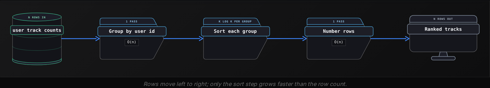
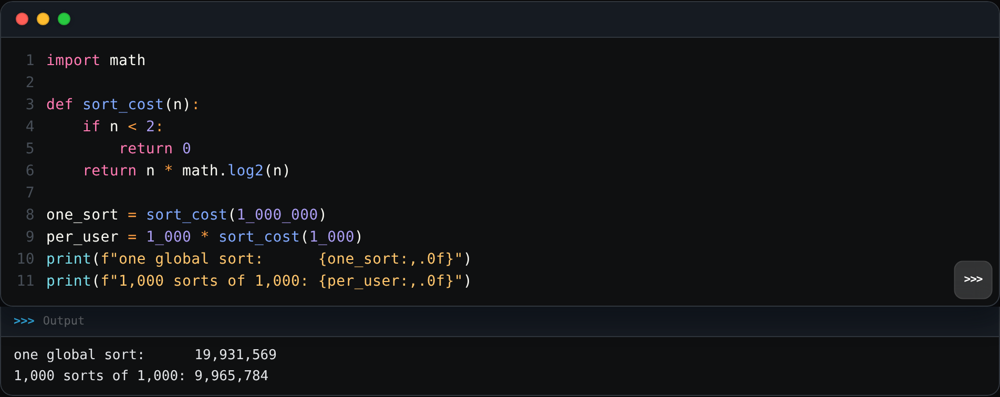
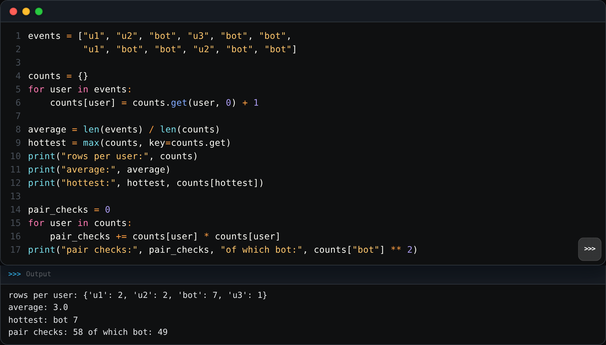
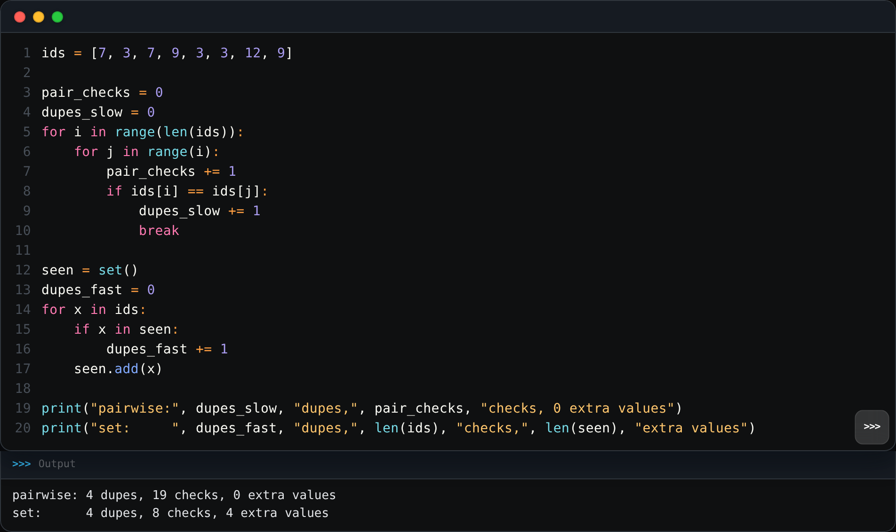
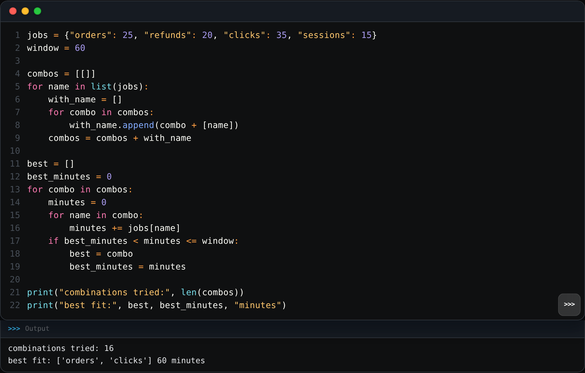

# Complexity: Intermediate

Each December, Spotify Wrapped launches on a single day, handing every listener a recap of their year. Imagine its ranking job had one night to finish. Fetching a listener's history must cost a handful of steps, and ranking that history means sorting it. An account that streamed around the clock can stall the run, and a feature trying every combination of songs would still be running next December.


<br>

---

## O(log n): Logarithmic Time

A linear scan answers "is 251 in this list?" by reading items until it meets 251 or runs out, so a list twice as long can cost twice the reads. A sorted list allows a different move. Read the middle item. If it is smaller than 251, everything to its left is smaller too, and the whole left half is discarded in 1 step; if it is larger, the right half goes instead. Each read cuts the remaining range in half, and the search stops when the range holds the target or holds nothing.

The number of reads is the number of times n can be halved before 1 item is left. That count is the base-2 logarithm of n, written log n, and an algorithm whose work grows this way is O(log n). The practical reading: **doubling the input adds 1 read.**

| Sorted items (n) | Linear scan, worst case | Halving search, worst case |
| --- | --- | --- |
| 16 | 16 reads | 5 reads |
| 1,000 | 1,000 reads | 10 reads |
| 1,000,000 | 1,000,000 reads | 20 reads |
| 1,000,000,000 | 1,000,000,000 reads | 30 reads |


<br>

### Watching the range shrink

The program below is binary search. It keeps 2 boundaries, `lo` and `hi`, around the slice of the list that could still hold the target. Each pass of the `while` loop reads the item at `mid`, halfway between them, and moves 1 boundary past it. Follow the gap between the boundaries: 16 candidates, then 8, then 4, then 1.

https://github.com/user-attachments/assets/452d5838-9316-40b9-abbd-5effee782145

*16 sorted ids, 4 middle reads to find 251.*

The search found 251 on the 4th read and never looked at 103, 118 or 10 other ids. A target larger than every id in this list costs 5 reads, the worst case for 16 items, matching the table above.


<br>

### Why an index makes a lookup fast

A table stores rows in the order they arrived. A query for user 251's plays cannot know where those rows sit, so it reads every row and checks `user_id` on each: O(n). An index on `user_id` is a second structure holding that column's values in sorted order, each paired with the position of the row it came from. The engine halves its way through the sorted values to the first 251, then follows the stored positions back to the rows.

plays (rows in arrival order)

| row | user_id | track_id |
| --- | --- | --- |
| 0 | 233 | t_9081 |
| 1 | 118 | t_1270 |
| 2 | 251 | t_4412 |
| 3 | 140 | t_0335 |
| 4 | 233 | t_7720 |
| 5 | 189 | t_1270 |

index on user_id (sorted)

| user_id | row |
| --- | --- |
| 118 | 1 |
| 140 | 3 |
| 189 | 5 |
| 233 | 0 |
| 233 | 4 |
| 251 | 2 |

```sql
SELECT
  track_id
FROM plays
WHERE user_id = 251
```

Real indexes branch wider than 2. Keys are packed into pages holding hundreds of entries each, arranged as a tree: the top page splits the key range into hundreds of slices, each pointing to a page that splits its slice again. Every step still discards most of what remains, so the cost stays O(log n) with a far larger base.

- **4** — page reads, 500-way tree, 1 billion keys
- **1 billion** — rows read by the same query, no index

> **TIP**
>
> Halving needs sorted data. The same `while` loop run over an unsorted list still returns an answer, often a wrong one, with no error. A database keeps each index sorted on every insert and update, which is why each extra index slows down writes.

**An events table is indexed on user_id. It grows from 10 million rows to 40 million. How does the work of an indexed lookup for a single user_id change?**

- **A.** It grows about 4 times, matching the 4 times larger table
- **B.** It grows by about 2 halving steps, 1 per doubling of the table
- **C.** It grows about 16 times, the table's growth squared
- **D.** It stays exactly the same, since index lookups are constant

<details>
<summary>Solution</summary>

**B.** It grows by about 2 halving steps, 1 per doubling of the table

Doubling 10 million twice gives 40 million, and each doubling adds 1 halving step: about 24 steps become about 26.

**Why the others are wrong**

- **A.** Four times the work is linear growth, the cost of a full read with no index. The index never touches most rows.
- **C.** Squared growth fits code that compares every pair of rows. An indexed lookup compares the target with a handful of keys.
- **D.** The change is small enough to look constant, but each doubling of the table still adds a step.

</details>


<br>

### Why the boundary moves past mid

Once `user_ids[mid]` has been read and is not the target, index `mid` is ruled out, so the next range has to leave it behind. The update `lo = mid` keeps it in, and that breaks the loop. Search the 16 ids for 300, larger than all of them: the boundaries close in until `lo` is 14 and `hi` is 15. Then `mid` is 14, 279 is smaller than 300, and `lo = mid` sets `lo` to 14 again. Every later pass computes the same `mid`, reads the same id and makes the same move, so the loop never ends. The update `lo = mid + 1` shrinks the range by at least 1 item per pass, and the trace below shows it stopping after 5 reads.

| Pass | lo | hi | mid | Id read | Next move |
| --- | --- | --- | --- | --- | --- |
| 1 | 0 | 15 | 7 | 189 | lo = 8 |
| 2 | 8 | 15 | 11 | 247 | lo = 12 |
| 3 | 12 | 15 | 13 | 268 | lo = 14 |
| 4 | 14 | 15 | 14 | 279 | lo = 15 |
| 5 | 15 | 15 | 15 | 295 | lo = 16 |
| 6 | 16 | 15 | not computed | none | lo > hi, loop ends, found_at stays None |


<br>

---

## O(n log n): Quasilinear Time

No single look at a row tells you where it belongs in sorted order, so sorting needs more than 1 pass. The general-purpose sorts in wide use, including the merge-based algorithm behind Python's `sorted()`, cost O(n log n). Merge sort shows where that comes from: treat each item as a sorted run of 1, then merge neighbouring runs into sorted runs twice as long, round after round. Every round touches all n items, and run length doubles each round, so after log n rounds a single run remains.

https://github.com/user-attachments/assets/71ad6959-af8c-4e9f-b735-4f3d6c371281

*8 values, 3 rounds, every round writes all 8.*

The 8 values took 3 rounds of 8 moves each, 24 moves in total, and that is the whole shape of n log n: **log n passes over the data.**

| Rows (n) | n | n log n | n² |
| --- | --- | --- | --- |
| 1,000 | 1,000 | about 10,000 | 1,000,000 |
| 1,000,000 | 1,000,000 | about 20 million | 1 trillion |
| 1,000,000,000 | 1 billion | about 30 billion | 1 quintillion |

The middle column sits far closer to n than to n². At 1,000,000 rows a sort does about 20 passes' worth of work, while comparing every pair does 1,000,000 passes' worth, which is why a nightly sort of a billion rows is routine and an all-pairs comparison of the same rows never finishes.


<br>

### Window functions sort inside each partition

SQL ranks rows within groups through a window function. The query below numbers each user's tracks from most played to least: `PARTITION BY user_id` splits the rows into 1 group per user, `ORDER BY play_count DESC` sorts each group, and `ROW_NUMBER()` counts 1, 2, 3 down each sorted group.

```sql
SELECT
  user_id,
  track_id,
  ROW_NUMBER() OVER (
    PARTITION BY user_id
    ORDER BY play_count DESC
  ) AS track_rank
FROM user_track_counts
```



A group of k rows costs about k log k to sort, so the window's total is that cost summed over the groups. Smaller groups shrink the log: sorting 1,000 groups of 1,000 rows pays about 10 per row, while a window with no `PARTITION BY` sorts the whole table as a single group and pays log n per row.



```python
import math

def sort_cost(n):
    if n < 2:
        return 0
    return n * math.log2(n)

one_sort = sort_cost(1_000_000)
per_user = 1_000 * sort_cost(1_000)
print(f"one global sort:      {one_sort:,.0f}")
print(f"1,000 sorts of 1,000: {per_user:,.0f}")
```

Partitioning by user halved the predicted work, because log 1,000 is half of log 1,000,000.

> Where n log n hides in a pipeline
>
> - `sorted()` and `.sort()` in Python code
> - `ORDER BY` on a query's output
> - A window function with `ORDER BY`, paid once per partition
> - Removing duplicates by sorting, then comparing neighbours
> - Sorting a whole table to keep its top 10 rows

> **TIP**
>
> Filter before sorting. A sort's cost follows the rows that reach it, so dropping 90% of rows first cuts the sort's work by slightly more than 90%: the log shrinks along with n.

**A nightly job sorts 2 million rows in 4 seconds. Next quarter the table holds 4 million rows. About how long should the sort take?**

- **A.** About 16 seconds, because doubling the rows quadruples a sort
- **B.** About 4 seconds, because the log factor keeps sorting flat
- **C.** Exactly 8 seconds, because sorting grows in step with row count
- **D.** A little over 8 seconds: twice the rows, plus 1 more merge round

<details>
<summary>Solution</summary>

**D.** A little over 8 seconds: twice the rows, plus 1 more merge round

n log n doubles n and adds 1 to log n: about 2 × 22 / 21 of the old time, roughly 8.4 seconds.

**Why the others are wrong**

- **A.** Quadrupling on doubled input is O(n²). A sort's log factor grows far more slowly than that.
- **B.** Every row still has to be placed, so the work at least doubles along with the row count.
- **C.** Doubling the rows doubles the n part, but log n grows too, from about 21 rounds to about 22.

</details>


<br>

### Sorting each group in Python

Python code ranks within groups the same way: keep a dict that maps each user_id to a list of that user's rows, and sort each list on its own. The cost follows the SQL window, about k log k per list of k rows, added up across users. `sorted()` calls its `key` function once per item before it compares anything, so a key that reads 1 field adds n calls to the sort, far fewer than its n log n comparisons. `reverse=True` puts the largest key first, the job `DESC` does inside the window.

```sql
sales_by_region = {
    "north": [("n1", 120), ("n2", 340), ("n3", 90)],
    "south": [("s1", 75), ("s2", 410)],
}

def by_amount(sale):
    return sale[1]

for region, sales in sales_by_region.items():
    ranked = sorted(sales, key=by_amount, reverse=True)
    print(region, ranked[0][0])
```


<br>

---

## Best, Worst, and Average Case

Two inputs of the same size can cost very different amounts. Searching a list for an id stops at the first match: if the id sits at index 0, that takes 1 comparison, the best case. A missing id gets compared with every item, the worst case. If the id is equally likely to sit anywhere, the search stops about halfway on average.

A single Big O quoted for an algorithm is **usually the worst case**, the bound the code can promise on every input. Hash lookups are the common exception: the O(1) quoted for a dict or set lookup is an average, and so is the O(n + m) of a join built on one. Best cases matter for a different reason: they explain how a job that ran in seconds on test data crawls on production data, whose inputs land on the slow path.

| Operation | Best case | Average case | Worst case |
| --- | --- | --- | --- |
| x in some_list | O(1): x is first | O(n): about n/2 reads | O(n): x is missing |
| Halving search, sorted list | O(1): x is in the middle | O(log n) | O(log n) |
| sorted() | O(n): input already in order | O(n log n) | O(n log n) |
| Pair check inside each group | O(n): every group has 1 row | depends on group sizes | O(n²): all rows in 1 group |


<br>

### Skew: when 1 key holds most of the rows

Pipelines often split work by key: per user, per country, per day. A linear per-key step costs the same however rows spread across keys. A per-key step that grows faster than linear does not: its total depends on the spread. Take a step that compares every pair of a user's events to catch near-duplicates, so a user with k events costs about k² checks. Here are 1,000,000 events spread 2 ways.

Even spread

| Users | Rows | Pair checks |
| --- | --- | --- |
| 1,000 users | 1,000 each | 1,000,000 each |
| Total | 1,000,000 | 1 billion |

Skewed spread

| Users | Rows | Pair checks |
| --- | --- | --- |
| 1 bot account | 500,000 | 250 billion |
| 999 users | about 500 each | about 250,000 each |
| Total | 1,000,000 | about 250.25 billion |

- **250x** — more pair checks, same total rows

Both spreads average 1,000 rows per user, so the average hides the trouble. Skew is a worst case the data chooses for you: a bot account, a default value such as an empty string, or every row with a missing key landing in the same `None` group.


<br>

### Measuring skew in a single pass

Counting rows per key takes 1 pass and a dict. Compare the largest count with the average: a ratio near 1 means an even spread, and a ratio in the hundreds means 1 key will own any per-key step that grows faster than linear.



```python
events = ["u1", "u2", "bot", "u3", "bot", "bot",
          "u1", "bot", "bot", "u2", "bot", "bot"]

counts = {}
for user in events:
    counts[user] = counts.get(user, 0) + 1

average = len(events) / len(counts)
hottest = max(counts, key=counts.get)
print("rows per user:", counts)
print("average:", average)
print("hottest:", hottest, counts[hottest])

pair_checks = 0
for user in counts:
    pair_checks += counts[user] * counts[user]
print("pair checks:", pair_checks, "of which bot:", counts["bot"] ** 2)
```

The bot holds 7 of 12 rows and 49 of 58 pair checks. Common repairs: drop or cap known bot keys, send the hot key down its own cheaper path, or replace the per-key pair check with a sort that lines near-duplicates up next to each other.

**is_new runs once for every incoming row. Which batch of incoming ids makes it do the most comparisons in total?**

```python
loaded_ids = [101, 102, 103, 104, 105, 106, 107, 108]

def is_new(record_id):
    return record_id not in loaded_ids
```

- **A.** A batch where every id is brand new, absent from loaded_ids
- **B.** A batch where every id equals 101, the first loaded id
- **C.** A batch where every id equals 105, near the middle
- **D.** Every batch costs the same, because not in is O(n)

<details>
<summary>Solution</summary>

**A.** A batch where every id is brand new, absent from loaded_ids

not in can only answer True after comparing against all 8 loaded ids, so every row pays the worst case.

**Why the others are wrong**

- **B.** Each check matches on its first comparison and stops there, which is the best case.
- **C.** Each check stops at the 5th comparison, fewer than the 8 a missing id costs.
- **D.** O(n) bounds the worst case. A check that finds its id early stops early.

</details>


<br>

### Guarding a quadratic step

A guard that decides whether a batch is safe for a per-key pair check has to look at the key that sets the cost. The average spreads the hot key's rows across every key and reports a typical size instead. Batch B below has 1 key with 900 rows and 99 keys with 1 row each. Its average is under 10 rows per key, yet it needs more than 8 times the pair checks of Batch A, where 10 keys hold 100 rows each. Because a key with k rows costs k² checks, the largest count decides the total, so the guard has to compare the largest key's count with the limit.

| Batch | Keys | Rows | Average per key | Largest key | Pair checks |
| --- | --- | --- | --- | --- | --- |
| A | 10 | 1,000 | 100 | 100 | 100,000 |
| B | 100 | 999 | 9.99 | 900 | 810,099 |


<br>

---

## Space Complexity

Space complexity measures the extra memory an algorithm holds while it runs, against n, leaving out the input itself. A running total holds 1 number however many rows go past: O(1) space. A set of every distinct id seen holds up to n entries: O(n). A table of every pair of rows holds n² cells.

| Task | Extra memory | Time |
| --- | --- | --- |
| Sum a column | O(1): 1 running total | O(n) |
| Remove duplicate ids with a set | O(n): 1 entry per distinct id | O(n) |
| Remove duplicates by comparing pairs | O(1) | O(n²) |
| Sort, then compare neighbours | O(n): sorted() returns a new list | O(n log n) |
| Join through a dict of 1 side | O(m): 1 entry per key on that side | O(n + m) |

Rows 2 and 3 solve the same problem from opposite ends: the set spends memory to save time, and the pairwise loop spends time to save memory. The program below runs both on 8 ids.



```python
ids = [7, 3, 7, 9, 3, 3, 12, 9]

pair_checks = 0
dupes_slow = 0
for i in range(len(ids)):
    for j in range(i):
        pair_checks += 1
        if ids[i] == ids[j]:
            dupes_slow += 1
            break

seen = set()
dupes_fast = 0
for x in ids:
    if x in seen:
        dupes_fast += 1
    seen.add(x)

print("pairwise:", dupes_slow, "dupes,", pair_checks, "checks, 0 extra values")
print("set:     ", dupes_fast, "dupes,", len(ids), "checks,", len(seen), "extra values")
```

On 8 ids that is 19 checks against 8. On 10,000,000 distinct ids the pairwise loop needs about 50 trillion checks, while the set needs 10,000,000 checks and room for 10,000,000 entries.


<br>

### The dict join: memory bought, time saved

Joining orders to customers with nested loops compares every order with every customer: O(n × m) time and no extra memory. Building a dict keyed by customer id first costs 1 pass over the customers and memory for m entries; after that, each order finds its customer in 1 lookup, O(n + m) overall.

https://github.com/user-attachments/assets/98dfcdc3-3197-4f38-9425-c89b7795649d

*The dict holds 1 entry per customer; each order then costs 1 lookup.*

Scale the join to 50,000,000 orders and 2,000,000 customers and the 2 approaches land far apart:

- **100 trillion** — comparisons, nested-loop join
- **52 million** — steps, dict join


<br>

### When memory runs out first

The dict join holds up only while the dict fits in memory. At 100 bytes per entry, 2,000,000 customers need about 200 MB, which a laptop holds, and 2,000,000,000 distinct ids need about 200 GB, which most single machines do not. When the lookup side outgrows memory, shrink it before giving up the speed.

| ✓ Do | ✗ Don't |
| --- | --- |
| • Build the lookup dict from the smaller side of a join<br><br>• Keep only the fields the lookup needs as dict values<br><br>• Process 1 date partition at a time when a year of keys won't fit<br><br>• Keep a running total when the total is all the job reports | • Collect every row into a list when 1 running value answers the question<br><br>• Build a table of every pair for a million rows<br><br>• Assume a set of ids fits in production because it fit on a sample<br><br>• Swap a dict for nested loops to save memory without doing the time math |

**A job attaches campaign names to 80 million click rows. The campaigns table has 5,000 rows. How should the join be built?**

- **A.** Build a dict from the clicks and look up each campaign in it
- **B.** Use nested loops so the job holds no extra memory at all
- **C.** Build a dict from the campaigns and look up each click in it
- **D.** Either side works, since a dict join is O(n + m) either way

<details>
<summary>Solution</summary>

**C.** Build a dict from the campaigns and look up each click in it

5,000 entries take little memory, and each of the 80 million clicks then costs 1 lookup.

**Why the others are wrong**

- **A.** That holds 80 million entries in memory to serve 5,000 lookups, the expensive side of the trade.
- **B.** 80 million × 5,000 is 400 billion comparisons, a huge time cost to save a few thousand entries.
- **D.** The time matches, but memory follows the side in the dict: 5,000 entries against 80 million.

</details>


<br>

### Build the dict once, outside the loop

The dict saves time only when it is built once, before the loop over orders, and read inside it. The version below prints the same pairs and keeps no dict, but each order scans the customer list again, the nested-loop cost from earlier: with 50,000,000 orders and 2,000,000 customers, 100 trillion comparisons. Building the dict inside the order loop is the same trap in another form, since each order then rebuilds all m entries for 1 lookup.

```sql
for order_id, customer_id, amount in orders:
    for cid, country in customers:
        if cid == customer_id:
            print(order_id, country)
```

One edge case remains in the fast version: an order whose customer_id is missing from the dict stops the run with a `KeyError` at `name_by_id[customer_id]`. Reading it with `name_by_id.get(customer_id)` returns `None` for that order instead, at the same cost of 1 lookup.


<br>

---

## Exponential Time

Some questions ask which combination of items is best: which sources to backfill tonight, which checks fit inside a time budget. Each item is in the combination or out of it, so 1 item gives 2 choices, 2 items give 2 × 2 = 4, and n items give 2ⁿ. Code that tries every combination does O(2ⁿ) work.

https://github.com/user-attachments/assets/eeb2099e-d271-4185-8a4b-a067a997f805

*Each new item copies every existing combination once, with the item added.*

The list doubled with every item. That is the signature of exponential time: O(n²) quadruples when n doubles, while O(2ⁿ) doubles when n grows by 1.

| Items (n) | Combinations (2ⁿ) | Time at 1 million per second |
| --- | --- | --- |
| 10 | 1,024 | about 1 millisecond |
| 20 | 1,048,576 | about 1 second |
| 30 | 1,073,741,824 | about 18 minutes |
| 40 | 1,099,511,627,776 | about 13 days |
| 50 | 1,125,899,906,842,624 | about 36 years |

- **1,024x** — 2ⁿ growth from 30 items to 40
- **1.8x** — n² growth from 30 items to 40


<br>

### Brute force on a backfill window

A backfill window has 60 minutes, and 4 jobs are waiting with known runtimes. The goal is the set of jobs that fills the window as fully as possible without running over. The program builds every combination with the doubling loop, adds up each one's minutes, and keeps the best fit.



```python
jobs = {"orders": 25, "refunds": 20, "clicks": 35, "sessions": 15}
window = 60

combos = [[]]
for name in list(jobs):
    with_name = []
    for combo in combos:
        with_name.append(combo + [name])
    combos = combos + with_name

best = []
best_minutes = 0
for combo in combos:
    minutes = 0
    for name in combo:
        minutes += jobs[name]
    if best_minutes < minutes <= window:
        best = combo
        best_minutes = minutes

print("combinations tried:", len(combos))
print("best fit:", best, best_minutes, "minutes")
```

Sixteen combinations finish instantly. The same code over 40 jobs would run for days, and nothing in it looks alarming: no deep nesting, no large input. The growth hides in the list that doubles once per job.

> Ways out of exponential work
>
> - Keep n small: up to about 20 items, 2ⁿ stays near a million and brute force is fine
> - Prune: stop extending a combination once its total already runs over the limit
> - Use a shortcut rule, such as taking the longest job that still fits, and accept a good answer
> - Watch for orderings too: n items have n! orders, and 10 items already have 3,628,800


**A script checks every combination of 25 candidate data sources and takes 30 seconds. A teammate adds 2 more sources. About how long will it take now?**

- **A.** About 32 seconds: 2 more sources out of 25 adds about 8%
- **B.** About 2 minutes: each added source doubles the combinations
- **C.** About 35 seconds: work grows with the square of the sources
- **D.** About 60 seconds: adding sources doubles the work once

<details>
<summary>Solution</summary>

**B.** About 2 minutes: each added source doubles the combinations

Going to 27 sources gives 2²⁷ combinations, 4 times the 2²⁵ before, so 30 seconds becomes about 120.

**Why the others are wrong**

- **A.** Proportional growth fits O(n). Every added source doubles the number of combinations.
- **C.** That is O(n²), where (27/25)² is about 1.17. Combinations grow far faster than squares.
- **D.** Doubling is right, but it happens per source: 2 new sources double the work twice.

</details>


<br>

### The line that doubles the list

One line in the combination loop does the doubling: `combos = combos + with_check`. The old list holds every combination without the new item, and `with_check` holds a copy of each one with the item added, so the new list is twice as long. Drop the old half and write `combos = with_check`, and every combination that leaves the item out is lost: the count stays at 1 however many items arrive. The table follows the 3 checks from the animation.

| After adding | Without the item | With the item | Total |
| --- | --- | --- | --- |
| nulls | [] | [nulls] | 2 |
| dupes | [], [nulls] | [dupes], [nulls, dupes] | 4 |
| schema | the 4 combinations so far | 4 copies with schema added | 8 |


<br>

---

## Putting It All Together

Picture the Wrapped ranking job imagined at the start of the lesson on its single night: it reads a year of plays, counts plays per listener and track, ranks each listener's tracks, attaches track titles from the catalog, and builds the cards each listener sees.

- Each listener's profile comes from an index on listener_id: about 4 page reads down a wide tree, where a full read would touch every one of a billion rows.
- Ranking is a window partitioned by listener_id, so the sort pays log k for the k tracks of each listener, less than a single global sort's log n.
- A test account that streamed around the clock lands in 1 partition; counting rows per key first exposes it before a per-listener pair check squares its row count.
- Track titles join through a dict built from the catalog, the smaller side, so the plays are read in 1 pass while the catalog's entries sit in memory.
- A card showing the best subset of a listener's top 50 songs would face 2⁵⁰ subsets, over a quadrillion, so it ships with a shortcut rule in place of brute force.


<br>

---

## Key Takeaways

- O(log n) comes from discarding half the remaining data per step; doubling n adds 1 step, which is why an indexed lookup on a billion rows stays fast.
- O(n log n) is log n passes over the data, the price of sorting, and a window function pays it per partition, so smaller partitions cost less.
- A single Big O usually quotes the worst case; skewed keys, missing values and ids that match nothing are how production data finds it.
- Space complexity is extra memory: a dict or set buys O(n) time with O(n) memory, and the trade holds only while the structure fits.
- O(2ⁿ) doubles with each added item; brute force over combinations is fine near 20 items and hopeless near 40.
