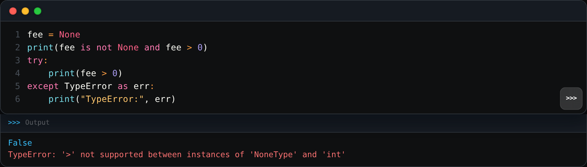
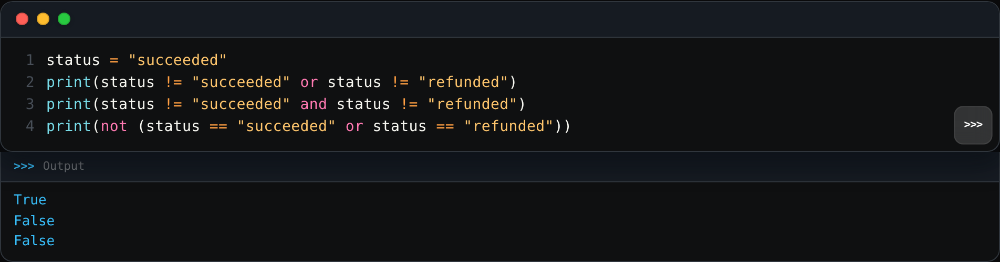
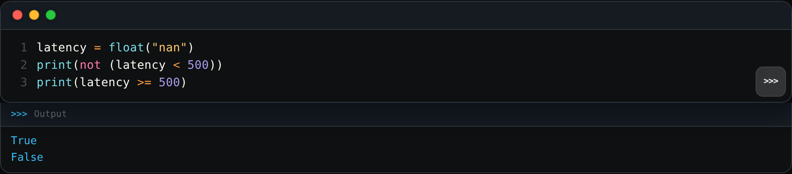
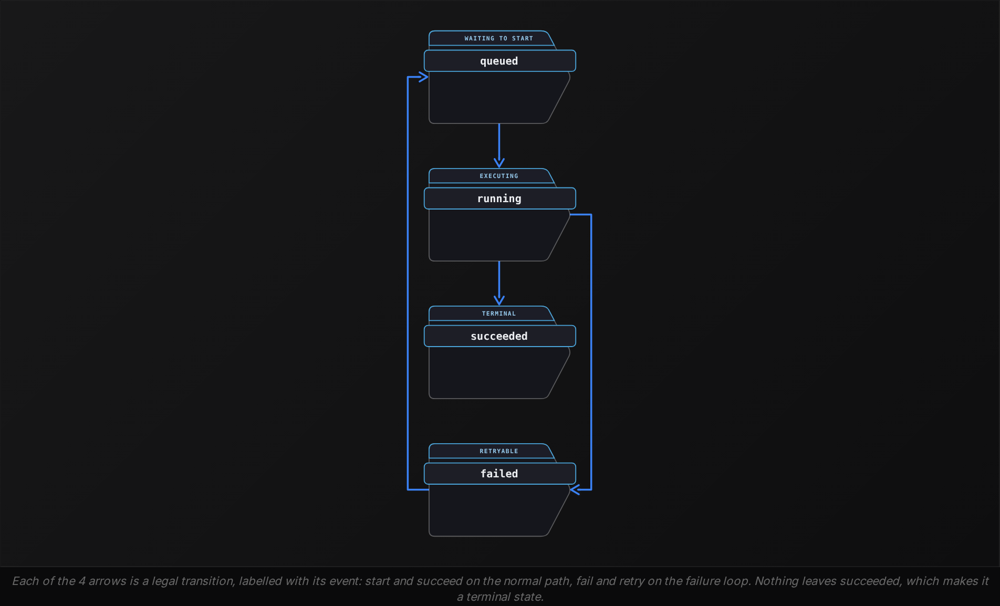
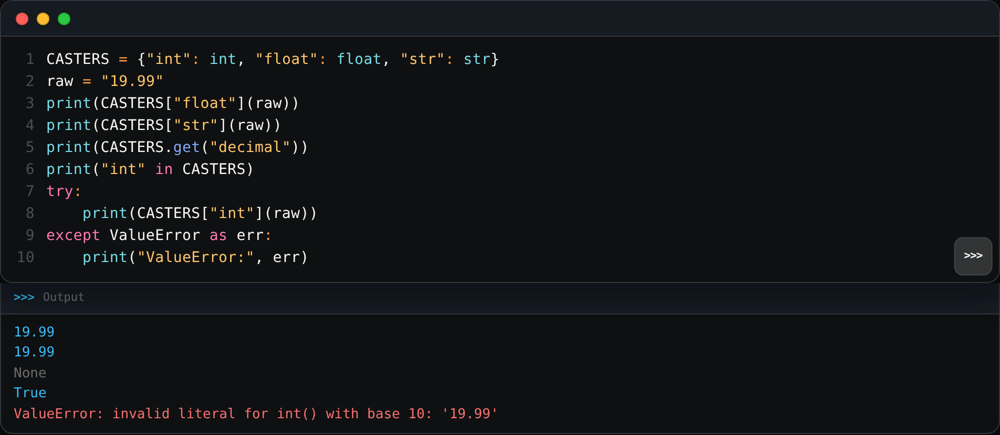
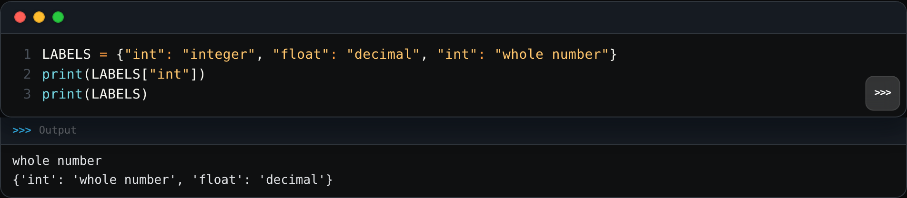
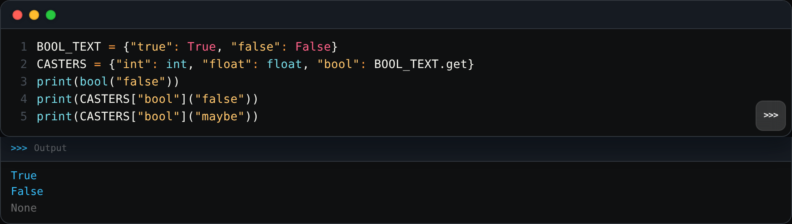
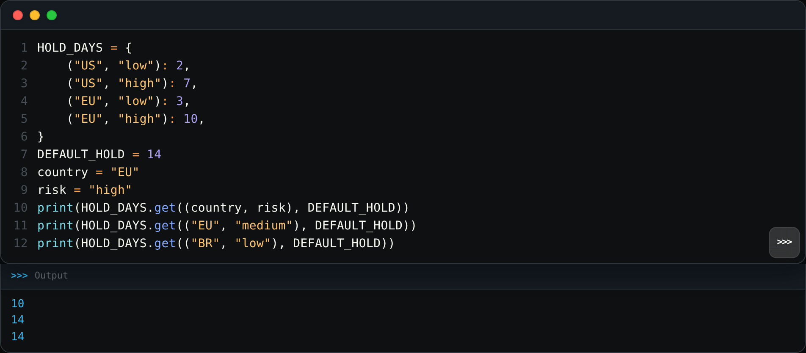
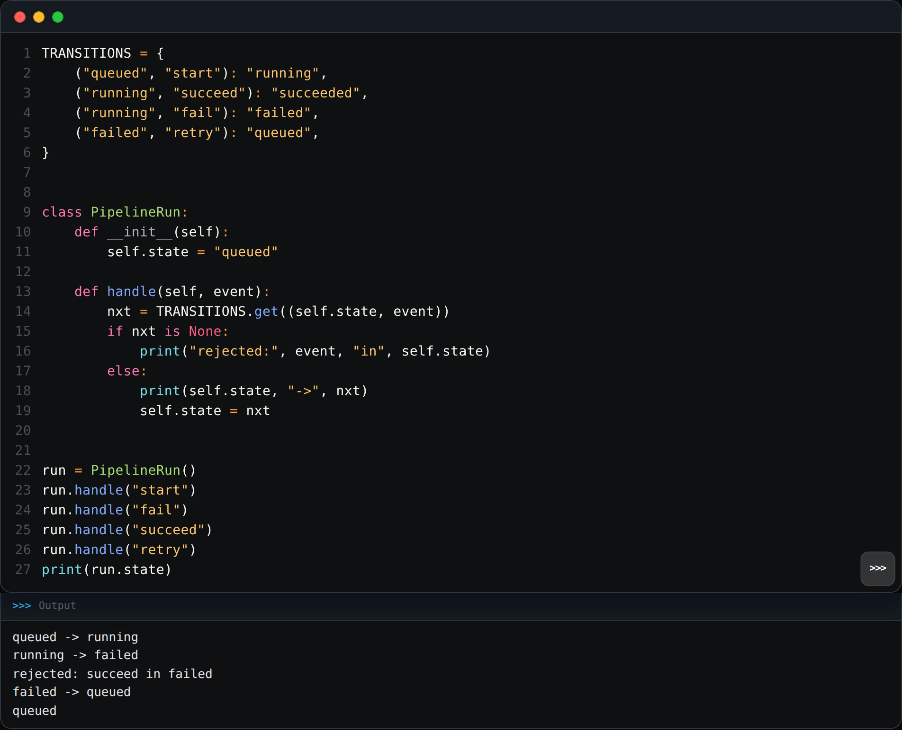

# Control Flow: Advanced

A Stripe PaymentIntent's status can be `requires_payment_method`, `processing`, `succeeded`, `canceled` or one of several other documented values. Say you own the nightly job that reconciles those payments, and one morning 3,000 refunds sit unprocessed because an `if` chain treated `processing` as finished. Whether that bug can exist depends on how your code names states. The way it negates conditions and looks up rules matters just as much.


<br>

---

## Removing Redundant Conditions

A condition is redundant when deleting it changes nothing the program does. For every value that can reach the line, the same branch runs, the same variables end with the same values, and the same exceptions are raised or avoided. Redundant checks cost the next reader time. Someone who sees `amount < 1000` on a branch assumes an amount of 1000 or more can arrive there, and goes looking for a case that never comes.


<br>

### Facts an elif already knows

An `elif` test runs only after every test above it came out False. Each of those False results is a fact the branch gets for free, and you can delete a check that restates one of them.

```sql
if amount >= 1000:
    tier = "large"
elif amount >= 100 and amount < 1000:
    tier = "medium"
elif amount >= 0 and amount < 100:
    tier = "small"
else:
    tier = "invalid"
```

By the second test, `amount >= 1000` has already failed, so `amount < 1000` is True every time Python reaches it. By the third test, `amount >= 100` has failed as well, which guarantees `amount < 100`. Both halves can go, and the chain becomes 3 cut points:

```sql
if amount >= 1000:
    tier = "large"
elif amount >= 100:
    tier = "medium"
elif amount >= 0:
    tier = "small"
else:
    tier = "invalid"
```

The reasoning says the rewrite is safe, and boundary values confirm it. Run both versions on each value where a comparison flips, taking 1 step either side of every cut point:

| amount | original tier | simplified tier |
| --- | --- | --- |
| -1 | invalid | invalid |
| 0 | small | small |
| 99 | small | small |
| 100 | medium | medium |
| 999 | medium | medium |
| 1000 | large | large |


<br>

### 3 more shapes of a dead check

- **Absorbed inside a single operator.** In x > 100 and x > 50, the stricter test implies the looser one, so keep x > 100. Under or the looser test wins: x > 100 or x > 50 is x > 50.
- **A branch that can never run.** elif amount >= 5000: placed below if amount >= 1000: is dead, because the branch above it already took every amount it would catch.
- **An if that copies its own test.** if late: alert = True paired with else: alert = False collapses to alert = late when late is always a bool, and to alert = bool(late) when it could hold anything else.


<br>

### Checks that only look redundant

Short-circuit evaluation gives some checks a second job. In `fee is not None and fee > 0`, Python evaluates the right test only when the left one is True. If you delete the left test, a None fee no longer produces a quiet False. It reaches `fee > 0` and raises:



```python
fee = None
print(fee is not None and fee > 0)
try:
    print(fee > 0)
except TypeError as err:
    print("TypeError:", err)
```

Now compare `fee is not None and fee` with plain `fee` as the test of an `if`. None is falsy, so `fee` alone already sends it down the False branch, and nothing on the right can raise. In that position the None test is redundant. Stored in a variable, the 2 forms differ: for a None fee, the first evaluates to False and the second to None, so deleting the test changes a value. The same test is needed in one place and redundant in another, so every removal needs its own argument.

A related look-alike: if is_refund == True: and if is_refund: agree only when is_refund always holds a bool. 1 == True is True, but "yes" == True is False even though "yes" is truthy. The shorter test would let through strings that the longer one refused.

> Before deleting a check
>
> - List what the line already knows: each earlier test that failed, each enclosing if that passed, each `and` operand to its left.
> - Delete a check only when it follows from that list.
> - Keep any check whose job is to stop a later test from raising.
> - Run the old and new code on every boundary value. Then run both on None and on a value of the wrong type.

**Which part of the third test can be deleted without changing status for any value of rows, including None?**

```python
if rows is None:
    status = "missing"
elif rows == 0:
    status = "empty"
elif rows is not None and rows > 0:
    status = "loaded"
else:
    status = "corrupt"
```

- **A.** rows is not None: the first branch already took every None, so it is always True here
- **B.** rows > 0: the second branch already handled zero, so every remaining count is positive
- **C.** Both tests, since the 2 earlier branches together cover None and zero
- **D.** Neither: rows is not None stops rows > 0 from raising a TypeError

<details>
<summary>Solution</summary>

**A.** rows is not None: the first branch already took every None, so it is always True here

Every None stops at the first branch, so by the third test rows isn't None is guaranteed. rows > 0 still separates negative counts, which belong in corrupt.

**Why the others are wrong**

- **B.** Negative counts still reach the third test. Without rows > 0, a count of -3 would become loaded instead of corrupt.
- **C.** Removing both makes the third branch catch everything left, so -3 becomes loaded and the else branch can never run.
- **D.** A None never reaches the third test because the first branch catches it, so that guard has nothing left to protect.

</details>

In that question the guard was dead because an earlier branch had already taken every None. Put no None branch above it, and the same words become the only thing between a None value and `<`. Whether a guard is removable depends on what sits above it, never on the guard's own wording.


<br>

---

## De Morgan's Laws

Pipelines are full of negated conditions: skip a batch unless it is loaded and non-empty, alert unless a job succeeded or was cancelled. De Morgan's 2 laws, named for the 19th-century logician Augustus De Morgan, move a `not` inside parentheses. That usually turns a condition you have to decode into one you can read left to right.

The 2 laws

- not (a and b) is equivalent to not a or not b
- not (a or b) is equivalent to not a and not b

The operator inside flips between `and` and `or`, and each operand gets its own `not`. Because `not` binds tighter than `and` and `or`, `not a or not b` already means `(not a) or (not b)`. With 2 inputs there are only 4 cases, and the table checks all of them:

| a | b | not (a and b) | not a or not b | not (a or b) | not a and not b |
| --- | --- | --- | --- | --- | --- |
| True | True | False | False | False | False |
| True | False | True | True | False | False |
| False | True | True | True | False | False |
| False | False | True | True | True | True |


<br>

### Negating a single comparison

Once a `not` sits on a single comparison, replace the pair with the opposite operator. When 2 numbers are ordered, exactly one of `x < y` and `x >= y` is True, so `>=` is the opposite of `<`. Writing `>` instead is a common slip:

| Negated | Rewritten |
| --- | --- |
| not (x < y) | x >= y |
| not (x <= y) | x > y |
| not (x == y) | x != y |
| not (x is None) | x is not None |
| not (lo <= x <= hi) | x < lo or x > hi |

The last row is De Morgan in disguise. A chained comparison is an `and` of 2 comparisons, so negating it yields an `or` of their opposites.

```sql
skip = not (row_count > 0 and status == "loaded")
skip = row_count <= 0 or status != "loaded"
```

Short-circuiting survives the rewrite. In both lines, `status` is compared only when `row_count` is above 0.


<br>

### The != with or trap

The bug De Morgan exposes most often reads naturally in English. Someone wants payments that are neither succeeded nor refunded and writes `status != "succeeded" or status != "refunded"`. Every status differs from at least 1 of those 2 strings, so the condition is True for every input, `"succeeded"` included.



```python
status = "succeeded"
print(status != "succeeded" or status != "refunded")
print(status != "succeeded" and status != "refunded")
print(not (status == "succeeded" or status == "refunded"))
```

The intent was `not (status == "succeeded" or status == "refunded")`. Pushing the `not` inside turns the `or` into `and`, which gives the second line. Treat a run of `!=` tests joined by `or` as a likely bug until you have checked it.


<br>

### Where the comparison flip breaks

The rules for `and` and `or`, like the rule for `not`, hold for every truth value. The comparison flip carries an extra assumption: that the 2 sides are ordered. A float NaN is ordered against nothing, so any comparison with it using `<`, `<=`, `>`, `>=` or `==` returns False.



```python
latency = float("nan")
print(not (latency < 500))
print(latency >= 500)
```

A filter written as `not (latency < 500)` keeps rows whose latency is NaN, and the rewrite `latency >= 500` drops them without warning. When missing measurements arrive as NaN, decide which side they belong on and test for them first. `latency != latency` is True only for NaN, since NaN compares unequal even to itself.

> **TIP**
>
> Rewrite a negation from the outside in. Swap the operator next to the `not`, give each operand its own `not`, then replace each negated comparison with its opposite. If the result surprises you, fill in the 4-row table for it.

**A retry rule reads if not (retries < 3 and status == "failed"):. Which condition is equivalent for an integer retries and a string status?**

- **A.** retries > 3 or status != "failed"
- **B.** retries >= 3 and status != "failed"
- **C.** retries >= 3 or status != "failed"
- **D.** retries < 3 or status != "failed"

<details>
<summary>Solution</summary>

**C.** retries >= 3 or status != "failed"

The and becomes or, < becomes >=, and == becomes !=, which is both laws and both flips applied.

**Why the others are wrong**

- **A.** The opposite of < is >=. With exactly 3 retries of a failed job, the original is True and this version is False.
- **B.** Negating an and produces an or. For 5 retries of a failed job, the original is True and this version is False.
- **D.** Only 1 comparison was negated. For 1 retry of a failed job, the original is False and this version is True.

</details>

A rewrite that agrees with the original on 1 input proves little. `retries > 3` and `retries >= 3`, each taken alone, disagree at 3 and nowhere else between 0 and 5. Test a rewrite where each comparison flips: at equal values, and 1 step to either side.


<br>

---

## State Machine Patterns

A batch run moves through a lifecycle. It waits in a queue and then runs. The run ends in success or failure, and a failed run may be retried. Code that tracks this with separate booleans can represent combinations no real run can be in. The flags here are `is_running`, `is_done` and `has_failed`, and a single forgotten reset is enough to produce one.

- **8** — combinations of 3 booleans
- **4** — combinations a real run can be in

Take a failure handler that sets has_failed = True and forgets is_running = False. A legal run sets at most 1 flag. Queued leaves all 3 False; running sets only is_running. Succeeded and failed each set only their own flag, is_done and has_failed respectively. This handler leaves is_running and has_failed both True, a combination no run can be in. Every report that checks is_running now counts a dead run as live, and no single variable answers the question of where the run is.


<br>

### A single variable, a fixed set of states

A state machine replaces the flags with a single variable. Its value is always 1 of 4 names: `queued`, `running`, `succeeded` or `failed`. Events come from outside the machine, and `start` and `fail` are 2 of them. A transition table says which event moves which state where. Any pair missing from the table is rejected, so no sequence of events can reach an impossible state.

| Current state | Event | Next state |
| --- | --- | --- |
| queued | start | running |
| running | succeed | succeeded |
| running | fail | failed |
| failed | retry | queued |



The class below holds the state and exposes `handle` as the only way to change it. Every branch in its if-elif chain pairs a current state with an event, and the final `else` catches each combination the table leaves out.

`__init__` runs once, when `PipelineRun()` creates a run, and sets its starting state. `self.state` is the variable each run carries with it, so 2 runs can sit in different states. `handle` is a function attached to the run: `run.handle("start")` calls it with `event` set to `"start"`, and `self` is that same run.

https://github.com/user-attachments/assets/422aeb0d-7661-48e3-a06a-138f02fdcf70

*Each call checks a single (state, event) pair; the 2 rejected events leave state unchanged.*

Watch the second and last events. `start` arrives while the run is already running, and `retry` arrives after it succeeded. Neither pair has a branch, so both are refused and `self.state` keeps its value. With flags, the same mistakes would have flipped a boolean and left the run in a combination no report expects.

> What the explicit state buys you
>
> - Every possible value of `state` can be listed, so each branch on it can be checked for coverage.
> - Illegal events are rejected in a single method instead of corrupting flags in many places.
> - Each transition can record the old and new state, which gives you an audit trail of the run.
> - Terminal states are visible: a state with no outgoing rows ends the lifecycle.

> **TIP**
>
> Assign `self.state` only inside the transition method. A line elsewhere that writes `run.state = "succeeded"` bypasses the table and brings back the problem the flags had.

**A fresh PipelineRun from the animation receives start, then fail, then succeed. What is run.state afterwards?**

- **A.** succeeded, because succeed is an event this machine accepts
- **B.** failed, because no branch pairs the failed state with succeed
- **C.** queued, because a failed run goes back to the queue on any event
- **D.** running, because succeed is rejected and start left it there

<details>
<summary>Solution</summary>

**B.** failed, because no branch pairs the failed state with succeed

start moves queued to running and fail moves running to failed. succeed then falls through to else, which rejects it, so the run stays in failed.

**Why the others are wrong**

- **A.** succeed is accepted only from running. The run is in failed when it arrives, so handle takes the else branch.
- **C.** Only the retry event moves a run from failed back to queued, and this run never received one.
- **D.** The rejection is right, but fail had already moved the run out of running before succeed arrived.

</details>

Extending the machine takes one new branch per legal pair. The branch tests both the current state and the event with `and`, assigns the next state, and goes above the final `else`, so every pair it doesn't name is still refused.


<br>

---

## Dict-Based Dispatch

Ingestion code often turns raw text into typed values according to a declared column type. Written as a chain, each new type adds 2 lines plus another comparison that every later type has to pass through first.

```sql
if col_type == "int":
    value = int(raw)
elif col_type == "float":
    value = float(raw)
elif col_type == "str":
    value = str(raw)
else:
    value = None
```

Every test compares the same variable against a constant with `==`. That shape is a lookup: given a key, find its value. A dictionary stores exactly that pairing.


<br>

### The dictionary operations dispatch needs

4 operations cover dispatch

- {"int": int, "float": float} builds a dict: each key, a colon, then the value it maps to.
- d[key] returns the value stored under key and raises KeyError when the key is absent.
- d.get(key, default) returns the value, or default when the key is absent. Leave the default out and you get None.
- key in d is True when the dict holds that key.

Values can be any object, including functions. `int` is a function you have called since type conversions. Written without parentheses, it is a value like `3` or `"int"`, so a dict can store it. `CASTERS["float"]` evaluates to the `float` function, and the `(raw)` after it makes the call.



```python
CASTERS = {"int": int, "float": float, "str": str}
raw = "19.99"
print(CASTERS["float"](raw))
print(CASTERS["str"](raw))
print(CASTERS.get("decimal"))
print("int" in CASTERS)
try:
    print(CASTERS["int"](raw))
except ValueError as err:
    print("ValueError:", err)
```

The last lookup shows that the dict only picks the converter: whether `int` accepts the text is still up to `int`. To replace the 8-line chain, fetch the converter first and call it only when the fetch found one:

```sql
caster = CASTERS.get(col_type)
if caster is None:
    value = None
else:
    value = caster(raw)
```

The `is None` test plays the chain's `else`. Writing `CASTERS.get(col_type)(raw)` without it turns an unknown type such as `"decimal"` into `None(raw)`, which raises `TypeError: 'NoneType' object is not callable` where the chain set None. Whatever `.get` returns is called next, so a default for this pattern has to be something you can call.


<br>

### Where a chain and a dict disagree

| ✓ if-elif chain | ✗ dict dispatch |
| --- | --- |
| • Tests run top to bottom and the first True branch wins.<br><br>• Each branch can test any expression, including a range or several variables at once.<br><br>• A repeated condition leaves a dead branch below the first copy.<br><br>• The else branch handles everything unmatched. | • Each key maps to a single value, so there's no order to win by.<br><br>• Matches a key exactly with ==; ranges need another shape.<br><br>• A repeated key keeps the last value and drops the earlier silently.<br><br>• .get with a default handles everything unmatched. |



```python
LABELS = {"int": "integer", "float": "decimal", "int": "whole number"}
print(LABELS["int"])
print(LABELS)
```

A duplicated condition in a chain and a duplicated key in a dict fail in opposite directions. The chain keeps the first, the dict keeps the last, and neither warns. Tiers decided by `amount >= 1000` stay in an if-elif chain, since no single key stands for every amount above a threshold.


<br>

### Dispatching to a lookup

Adding `"bool": bool` to the casters looks consistent and breaks quietly. `bool` on a string tests truthiness, and every non-empty string is truthy, so the text `"false"` becomes True. The fix is a second dict whose `.get` method acts as the caster. Written without parentheses, `BOOL_TEXT.get` is a callable value in the same way `int` is.



```python
BOOL_TEXT = {"true": True, "false": False}
CASTERS = {"int": int, "float": float, "bool": BOOL_TEXT.get}
print(bool("false"))
print(CASTERS["bool"]("false"))
print(CASTERS["bool"]("maybe"))
```

Unrecognised text such as `"maybe"` comes back as None. A later check can count that as a bad value instead of loading it as True.

**What does this program print?**

```python
ROUTES = {"csv": "parse_rows", "json": "parse_doc", "csv": "parse_text"}
fmt = "xml"
print(ROUTES.get(fmt, "reject"), ROUTES["csv"])
```

- **A.** reject parse_rows
- **B.** None parse_text
- **C.** A KeyError, since "xml" is missing
- **D.** reject parse_text

<details>
<summary>Solution</summary>

**D.** reject parse_text

"xml" is missing, so .get returns its default, and the later "csv" entry overwrote the earlier one.

**Why the others are wrong**

- **A.** The .get half is right, but the second "csv" entry replaced the first, so "parse_rows" is gone.
- **B.** .get returns None only when no default is given, and here the default is "reject".
- **C.** .get never raises for a missing key. Only square-bracket lookup does, and "csv" is present.

</details>

One callable default suits columns whose type has no converter: `str`. Called on a string, it returns the same text. `CASTERS.get(col_type, str)(raw)` fetches the converter and calls it in one expression, so a column of undeclared type loads as plain text instead of dropping to None.


<br>

---

## Decision Table Lookups

Dispatch keys on a single value, while plenty of business rules key on 2 or 3. How long a marketplace holds a seller's payout might depend on the seller's country and their risk level. Written as nested ifs, the rule hides its own gaps:

```sql
if country == "US":
    if risk == "high":
        hold_days = 7
    else:
        hold_days = 2
elif country == "EU":
    if risk == "high":
        hold_days = 10
    else:
        hold_days = 3
else:
    hold_days = 14
```

Look at the inner `else` branches. They treat every risk level other than `"high"` as low, including a new `"medium"` level and the typo `"hgih"`. Nothing fails, and payouts for both go out after the short hold.


<br>

### The rule as a table

A decision table gives each combination of inputs its own row next to its outcome. A risk analyst can review it without reading code, and a missing combination shows up as a missing row:

| country | risk | hold days |
| --- | --- | --- |
| US | low | 2 |
| US | high | 7 |
| EU | low | 3 |
| EU | high | 10 |
| anything else | anything else | 14 (default) |

To key a dict on 2 values, put them in a tuple: values in parentheses separated by commas, such as `("EU", "high")`. A tuple can't be changed after it is created, which is why Python accepts it as a dict key. 2 tuples are equal when their values match position by position.



```python
HOLD_DAYS = {
    ("US", "low"): 2,
    ("US", "high"): 7,
    ("EU", "low"): 3,
    ("EU", "high"): 10,
}
DEFAULT_HOLD = 14
country = "EU"
risk = "high"
print(HOLD_DAYS.get((country, risk), DEFAULT_HOLD))
print(HOLD_DAYS.get(("EU", "medium"), DEFAULT_HOLD))
print(HOLD_DAYS.get(("BR", "low"), DEFAULT_HOLD))
```

The lookup stays a single `.get` call however many rows the table grows to. When the risk team adds a `"medium"` level, they add 2 rows and the lookup line doesn't change. Until then, `"medium"` gets the explicit default instead of falling through to the low-risk hold.


<br>

### Wildcards and precedence

Rules with many inputs multiply rows, so tables often allow a wildcard: `("BR", "*")` means any risk level in Brazil. A key lookup has no notion of which row is more specific, so precedence lives in the code. Try the exact key, then the wildcard, then the default.

```sql
key = (country, risk)
if key in HOLD_DAYS:
    hold = HOLD_DAYS[key]
elif (country, "*") in HOLD_DAYS:
    hold = HOLD_DAYS[(country, "*")]
else:
    hold = DEFAULT_HOLD
```

That chain has 3 branches whatever the table's size, and it is the only place where order matters. The rows themselves can live in configuration like the file below. The risk team edits rows, a loader turns each into a tuple key, and the lookup code ships once.

```sql
default_hold_days: 14
hold_days:
  - {country: US, risk: low, days: 2}
  - {country: US, risk: high, days: 7}
  - {country: EU, risk: low, days: 3}
  - {country: EU, risk: high, days: 10}
  - {country: BR, risk: "*", days: 5}
```

| ✓ Do | ✗ Don't |
| --- | --- |
| • Give each combination of inputs its own row, even when outcomes repeat.<br><br>• Try the exact key first, wildcards after, the default last.<br><br>• Bucket ranges such as amounts into labels before using them in a key. | • Don't let an inner else stand in for values nobody listed.<br><br>• Don't rely on row order for precedence; a key lookup ignores it. |


<br>

### Transitions as a decision table

The pipeline run's if-elif chain is a decision table too: the current state and the event go in, and the next state comes out. Keyed by `(state, event)`, it shrinks `handle` to a lookup and a None check. That rewrite combines dispatch on tuple keys with the guard reasoning from earlier sections.



```python
TRANSITIONS = {
    ("queued", "start"): "running",
    ("running", "succeed"): "succeeded",
    ("running", "fail"): "failed",
    ("failed", "retry"): "queued",
}


class PipelineRun:
    def __init__(self):
        self.state = "queued"

    def handle(self, event):
        nxt = TRANSITIONS.get((self.state, event))
        if nxt is None:
            print("rejected:", event, "in", self.state)
        else:
            print(self.state, "->", nxt)
            self.state = nxt


run = PipelineRun()
run.handle("start")
run.handle("fail")
run.handle("succeed")
run.handle("retry")
print(run.state)
```

Adding a `cancel` event now means adding rows such as `("queued", "cancel"): "cancelled"`, and `handle` stays untouched. Keep the `nxt is None` check. It looks removable, in the same way the None guard in front of a comparison did, and it is the only thing stopping a rejected event from setting the state to None.

**This lookup tries the wildcard row before the exact key. What does it print?**

```python
RULES = {("BR", "*"): 5, ("BR", "high"): 12}
key = ("BR", "high")
if ("BR", "*") in RULES:
    hold = RULES[("BR", "*")]
elif key in RULES:
    hold = RULES[key]
else:
    hold = 14
print(hold)
```

- **A.** 12, because the exact row for BR and high exists
- **B.** 5, because the wildcard branch runs first and matches
- **C.** 14, because neither branch matches the key exactly
- **D.** A KeyError, because "*" is not a risk level

<details>
<summary>Solution</summary>

**B.** 5, because the wildcard branch runs first and matches

("BR", "*") is in the table, so the first branch wins and the more specific row is never consulted.

**Why the others are wrong**

- **A.** The exact row exists, but the chain never reaches it: the wildcard test above it comes out True first.
- **C.** Both keys are present. The default applies only when the exact key and the wildcard are both missing.
- **D.** "*" is an ordinary string key here, and the lookup finds it like any other.

</details>

In a rule table a missing row is routine: a new country starts sending payouts before anyone writes its rows. `HOLD_DAYS[key]` treats that as an error and stops the run with a KeyError, while `.get(key, DEFAULT_HOLD)` returns the hold the table promises for unlisted pairs. Square brackets belong only after an `in` test has proved the key is present, as in the precedence chain above.


<br>

---

## Putting It All Together

The reconciliation job from the opening reads Stripe payment statuses every night. For each payment it casts raw fields by declared type, advances the payment's lifecycle as status events arrive, decides whether a refund goes through automatically or waits for review, and holds back anything it cannot classify. Each of those decisions is a branch, and the 3,000 stuck refunds came from a branch that treated processing as a finished state.

- Payment status is a state machine: a ( status , event ) table gives processing rows of its own, so it can never count as finished by falling into an else .
- Raw fields are cast through a type-to-converter dict, with BOOL_TEXT . get for flags so the text "false" never loads as True.
- Refund handling is a decision table keyed by ( status , reason ) , tried exact key first, then wildcard, then a default of manual review.
- The review filter not ( status == "succeeded" and amount < 1000 ) becomes status != "succeeded" or amount >= 1000 , which is safe only after NaN amounts are routed elsewhere.
- After every lookup, the is None check on the result stays: it's the guard that separates an unknown combination from a real decision.


<br>

---

## Key Takeaways

- A check is redundant only if every input takes the same branch, ends with the same values and raises the same exceptions without it. Guards that protect a later comparison stay.
- Moving not inside parentheses swaps and with or and flips each comparison, < to >= . NaN breaks the comparison flip.
- A chain of != tests joined by or is True for every value and almost always meant and .
- A single state variable plus a transition table makes impossible combinations unreachable and illegal events visible.
- An if-elif chain comparing a variable to constants becomes a dict, and its else becomes the . get default.
- Rules over several inputs become a dict keyed by tuples, with precedence handled by a short, fixed lookup chain.
