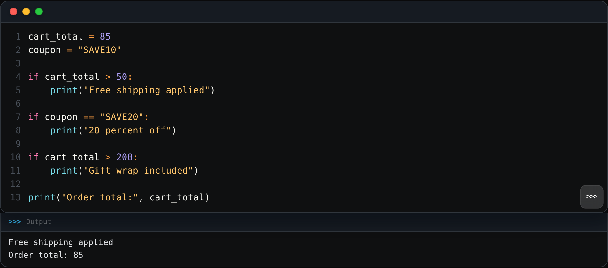
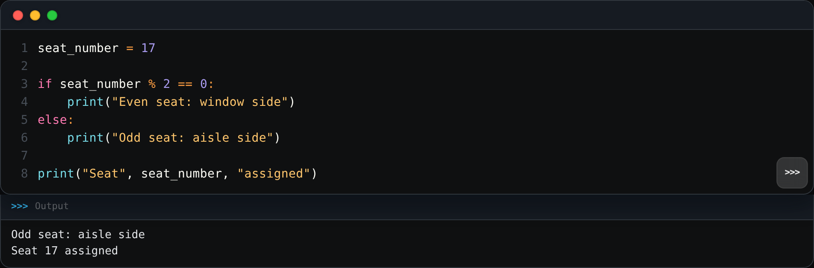
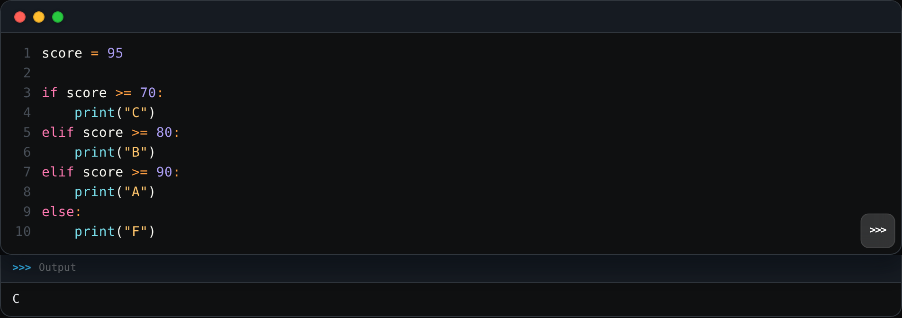
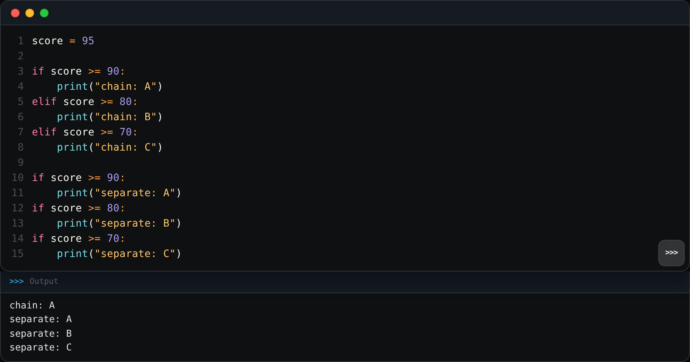
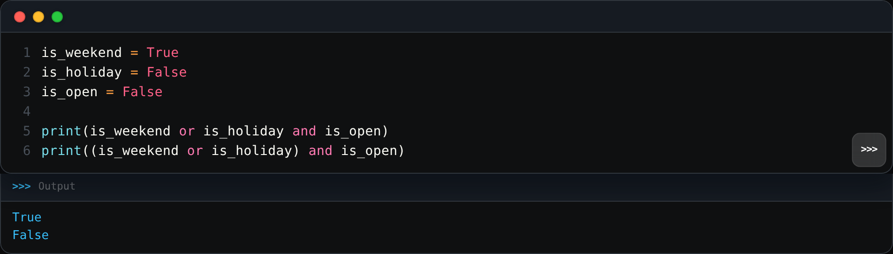
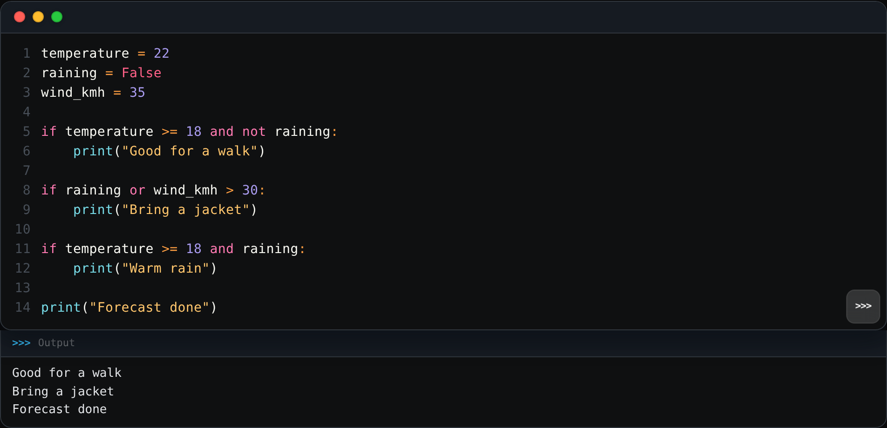
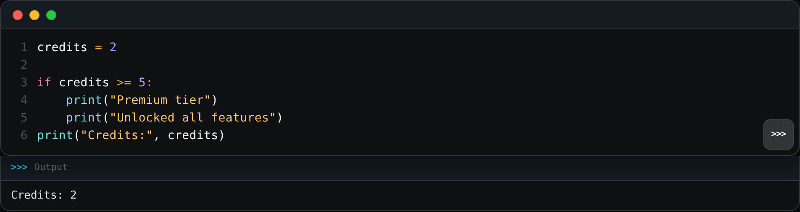
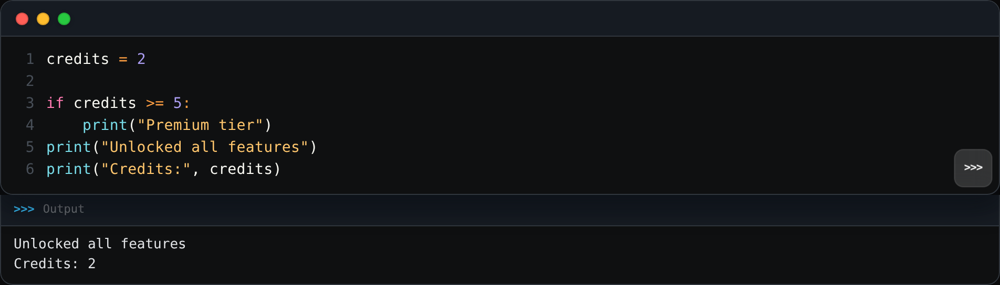
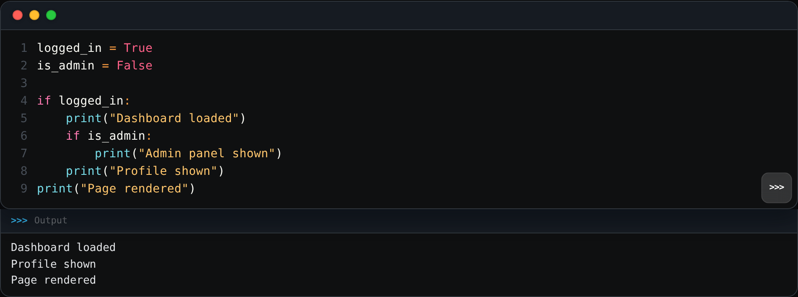

# Control Flow: Beginner

At Uber, a rider taps Request and the app has to decide what happens next. If demand around the pickup point is high, apply surge pricing to the fare. If the pickup is inside an airport zone, add the airport fee. If neither applies, dispatch at the base fare. Each of those decisions is an if statement, and this lesson teaches how Python makes them.


<br>

---

## The if Statement

Every program you have written so far runs each line exactly once, from the first to the last. An `if` statement adds a decision: it holds a condition, and the lines under it run only when that condition is `True`. When the condition is `False`, Python skips those lines and carries on below them.

```sql
balance = 120

if balance > 100:
    print("Balance above 100")
```

Python reads this in 3 steps. First, it compares the number stored in `balance` with 100. Second, that comparison produces a boolean, here `True`. Third, it uses that boolean to decide: `True` runs the indented `print`, and `False` skips it. Had `balance` been 90, the comparison would produce `False`, the `print` would never run, and the program would print nothing at all.


<br>

### What a condition is made of

A condition is any expression whose value is a boolean. You met that type in Data Types, where its only values were `True` and `False`. The 6 comparison operators below each take 2 values and produce one boolean, which makes them the usual way to build a condition. With `balance = 120`, each row shows what the comparison returns.

| Operator | Meaning | Example | Result |
| --- | --- | --- | --- |
| `==` | equal to | `balance == 120` | True |
| `!=` | not equal to | `balance != 120` | False |
| `>` | greater than | `balance > 200` | False |
| `<` | less than | `balance < 200` | True |
| `>=` | greater than or equal to | `balance >= 120` | True |
| `<=` | less than or equal to | `balance <= 100` | False |

A single = stores a value, and a double == asks whether 2 values are equal. Writing if balance = 100: is a syntax error, and Python refuses to run the file. When a condition tests equality it must use ==, because a single = is an assignment and is not allowed in an if header.


<br>

### The colon and the indent

The header line ends with a colon. Every line that belongs to the `if` is indented by 4 spaces underneath it, and together those lines are the statement's block. The block ends at the first line that returns to the left margin. That line runs no matter what the condition was, because it sits outside the block. Leave the indent out and Python stops before running anything, with the message `IndentationError: expected an indented block`.

> The 3 parts of an if statement
>
> - The keyword `if`, followed by a condition that produces True or False
> - A colon at the end of the header line, with nothing after it
> - One or more lines indented 4 spaces, which run only when the condition is True


<br>

### Watching a True condition

The animation below stores 21 in `age` and tests `age >= 18`. The comparison produces `True`, so both indented prints run in order. The final `print` is back at the left margin, so it belongs to the program rather than to the `if`, and it runs after the block finishes. Step through it and watch the highlight move into the block and out again.

https://github.com/user-attachments/assets/a4c84045-ea12-40da-b707-ff29e90bbd58


<br>

### Watching a False condition

This run stores 15 in `temperature` and tests `temperature > 30`. The comparison produces `False`, so Python jumps over the 2 indented lines without touching them, and the first thing it prints is the line after the block. Nothing inside a skipped block has any effect, which is the whole point of putting it inside an `if`.

https://github.com/user-attachments/assets/d8ab120a-ba28-4a0e-ae07-b711299e2787


<br>

### Several if statements in a row

Each `if` statement is checked on its own, so a program can hold any number of them, and each decides only about its own block. Below, 3 checks run against the same order. Predict which lines print before you reveal the output: the total is 85 and the coupon code is `SAVE10`.



```python
cart_total = 85
coupon = "SAVE10"

if cart_total > 50:
    print("Free shipping applied")

if coupon == "SAVE20":
    print("20 percent off")

if cart_total > 200:
    print("Gift wrap included")

print("Order total:", cart_total)
```

The first condition, `85 > 50`, is `True`, so the shipping line prints. The coupon test compares `"SAVE10"` with `"SAVE20"`, 2 different strings, so `==` returns `False` and the discount line is skipped. The third condition fails too, because 85 is below 200. The final `print` has no indent, so it runs regardless, and the order total appears last.

> **TIP**
>
> When an if block doesn't run and you expected it to, check the comparison first. Print the condition on its own, print(cart_total > 200), and Python shows you the True or False it saw.

**What does this program print?**

```python
count = 3

if count > 2:
    count = count + 10
if count > 5:
    print("Big")
else:
    print("Small")
print(count)
```

- **A.** Small, then 3
- **B.** Big, then 13
- **C.** Big, then 3
- **D.** Small, then 13

<details>
<summary>Solution</summary>

**B.** Big, then 13

3 > 2 is True, so count becomes 13 before the second if. 13 > 5 is True, so Big prints. The final print shows 13.

**Why the others are wrong**

- **A.** The first if runs because 3 > 2, so count is 13 by the time the second condition is checked.
- **C.** count was reassigned inside the first block, and the final print reads the new value, 13.
- **D.** 13 > 5 is True, so the if block prints Big rather than the else block.

</details>

When you write a header yourself, check 2 things. The operator must point the way the rule means: a rule that warns above 30 needs `>`, because `<` would warn on cool days and `==` would warn only at exactly 30. And the line must end with a colon, which marks where the indented block begins.


<br>

---

## Branching with if-else

An `if` on its own answers one question: run this block or skip it. Adding `else` gives Python a second block to run when the condition is `False`. The 2 blocks are alternatives. On any single run exactly one of them executes, so Python can't skip both or run both.

```sql
age = 16

if age >= 18:
    print("Adult ticket")
else:
    print("Child ticket")
```

The `else` line sits at the same indent as its `if`, ends with a colon, and carries no condition. It needs none, because it covers every case the `if` condition did not. Here `16 >= 18` is `False`, so Python skips the first block and runs the second, printing `Child ticket`.


<br>

### A branch can do more than print

Each block can hold as many lines as the decision needs, including assignments. The animation below picks a shipping fee: an order of 50 or more ships free, and anything less pays 5. After the branch finishes, the program continues with whichever value of `shipping` the chosen block set, so the grand total depends on that choice.

https://github.com/user-attachments/assets/a9369a55-ea55-432a-b949-c5951799ddc7

*42 >= 50 is False, so the else block sets shipping to 5.*

Change `order_total` in your head and trace it again. The table below lists 3 runs: the condition's value, the block that runs, and what prints. Look at the middle row, where the total is exactly 50. `>=` includes the equal case, so 50 ships free. Had the condition been `order_total > 50`, that same order would pay the fee.

| order_total | order_total >= 50 | Block that runs | Printed |
| --- | --- | --- | --- |
| 30 | False | else | Shipping fee added, then Grand total: 35 |
| 50 | True | if | Free shipping, then Grand total: 50 |
| 75 | True | if | Free shipping, then Grand total: 75 |


<br>

### Exactly one branch, every time

| ✓ if alone | ✗ if with else |
| --- | --- |
| • Runs the block or skips it<br><br>• On a False condition, nothing happens<br><br>• Use when the False case needs no action | • Runs the first block or the second<br><br>• On a False condition, the else block runs<br><br>• Use when both outcomes need code |

The remainder operator from Basic Operators makes a natural 2-way decision. `seat_number % 2` is what's left after dividing by 2, so it is 0 for an even number and 1 for an odd one. Comparing that remainder to 0 splits every integer into exactly 2 groups, which is what `if` and `else` need. Predict the output for seat 17.



```python
seat_number = 17

if seat_number % 2 == 0:
    print("Even seat: window side")
else:
    print("Odd seat: aisle side")

print("Seat", seat_number, "assigned")
```

Dividing 17 by 2 leaves a remainder of 1, so `1 == 0` is `False`, the `else` block runs, and the aisle line prints. The last `print` is outside both blocks and prints the seat number afterwards, whichever branch ran.

| ✓ Do | ✗ Don't |
| --- | --- |
| • Keep else at the same indent as its if<br><br>• End the else line with a colon and put nothing between else and the colon<br><br>• Put code for the False case inside else rather than after the if | • Write a condition after else, such as else age < 18:, which is a syntax error<br><br>• Use a second if to handle the False case, because the 2 conditions can drift apart<br><br>• Leave a block empty, because Python requires at least 1 line in it |

**What does this program print?**

```python
count = 3

if count > 2:
    count = count + 10
if count > 5:
    print("Big")
else:
    print("Small")
print(count)
```

- **A.** Small, then 3
- **B.** Big, then 13
- **C.** Big, then 3
- **D.** Small, then 13

<details>
<summary>Solution</summary>

**B.** Big, then 13

3 > 2 is True, so count becomes 13 before the second if. 13 > 5 is True, so Big prints. The final print shows 13.

**Why the others are wrong**

- **A.** The first if runs because 3 > 2, so count is 13 by the time the second condition is checked.
- **C.** count was reassigned inside the first block, and the final print reads the new value, 13.
- **D.** 13 > 5 is True, so the if block prints Big rather than the else block.

</details>

The most frequent `else` mistake is giving it a condition. A line such as `else order_total < 50:` makes Python reject the whole file before a single line runs, because `else` already means every case the `if` condition missed. Deleting the condition and leaving `else:` restores the branch.


<br>

---

## Chaining if-elif-else

Many decisions have more than 2 outcomes: a grade band, a shipping tier, a greeting that depends on the time of day. `elif`, short for else-if, adds another condition to the chain. Python tests the conditions from top to bottom, runs the block of the first one that is `True`, and skips every condition after it without evaluating them. The final `else` runs only when every condition before it was `False`.

```sql
score = 83

if score >= 90:
    grade = "A"
elif score >= 80:
    grade = "B"
elif score >= 70:
    grade = "C"
else:
    grade = "F"

print(grade)
```

With `score = 83`, Python tests `83 >= 90` first. It comes out `False`, so Python moves to the next condition. `83 >= 80` is `True`, so `grade` becomes `"B"` and the chain is finished. The condition `83 >= 70` is also `True`, but it is never evaluated, because the chain stopped at the first match. One block in a chain runs, however many of its conditions would have passed.


<br>

### Tracing a chain step by step

The animation prices a ride by distance. Watch which conditions are evaluated for a 12 km trip: the first is tested and fails, the second is tested and passes, and the highlight never reaches the third or the `else`.

https://github.com/user-attachments/assets/59b71adc-95d3-40b0-b910-fb6417be1344

*Python tests 2 conditions and stops at the first True one.*

| distance_km | Conditions tested | First True condition | fare |
| --- | --- | --- | --- |
| 3 | 1 | `distance_km <= 5` | 4 |
| 12 | 2 | `distance_km <= 15` | 9 |
| 30 | 3 | `distance_km <= 30` | 15 |
| 45 | 3 | none, so else runs | 25 |


<br>

### Order decides the answer

Because the first `True` condition wins, the order of the conditions is part of the logic. The program below has the same 3 bands as the grade example, written from lowest threshold to highest. Predict what a score of 95 prints.



```python
score = 95

if score >= 70:
    print("C")
elif score >= 80:
    print("B")
elif score >= 90:
    print("A")
else:
    print("F")
```

A score of 95 is at least 70, so the first condition is `True` and Python prints `C`. The conditions that would have produced `A` or `B` are never reached. When conditions overlap, put the most specific one first. In a chain of `>=` tests that is the highest threshold, and in a chain of `<=` tests it is the lowest.


<br>

### A chain against separate if statements

A set of 3 separate `if` statements looks similar on the page but behaves differently. Each one is tested independently, so every condition that is `True` runs its block. The program below runs the same 3 conditions both ways against a score of 95.



```python
score = 95

if score >= 90:
    print("chain: A")
elif score >= 80:
    print("chain: B")
elif score >= 70:
    print("chain: C")

if score >= 90:
    print("separate: A")
if score >= 80:
    print("separate: B")
if score >= 70:
    print("separate: C")
```

The chain prints 1 line, because it stops at the first match. The separate statements print 3, because 95 satisfies all 3 conditions and nothing stops the later ones from running. When the outcomes are meant to exclude each other, a chain is the right tool. When several outcomes can apply at once, separate `if` statements are.

Rules of an if-elif-else chain

- Conditions are tested top to bottom, and testing stops at the first True
- Exactly one block runs when there is an else, and at most one runs without it
- A chain may hold any number of elif lines and at most 1 else, which comes last
- Each elif has its own condition and colon, and else has a colon and no condition

**What does this program print?**

```python
count = 3

if count > 2:
    count = count + 10
if count > 5:
    print("Big")
else:
    print("Small")
print(count)
```

- **A.** Small, then 3
- **B.** Big, then 13
- **C.** Big, then 3
- **D.** Small, then 13

<details>
<summary>Solution</summary>

**B.** Big, then 13

3 > 2 is True, so count becomes 13 before the second if. 13 > 5 is True, so Big prints. The final print shows 13.

**Why the others are wrong**

- **A.** The first if runs because 3 > 2, so count is 13 by the time the second condition is checked.
- **C.** count was reassigned inside the first block, and the final print reads the new value, 13.
- **D.** 13 > 5 is True, so the if block prints Big rather than the else block.

</details>

Turning a rule stated in words into a chain takes 3 decisions: which comparison each band needs, which band is tested first, and which keyword opens each later band. With `<` tests the lowest threshold comes first, each later band starts with `elif`, and the last band, which has no upper limit, becomes the `else`.


<br>

---

## Combining with and/or

Real decisions often depend on 2 facts at once. A discount applies when the customer is a student and today is Tuesday. A jacket is needed when it rains or the wind is strong. Python's boolean operators join conditions into one: `and` is `True` only when both sides are `True`, `or` is `True` when at least one side is `True`, and `not` flips a single boolean to its opposite.

| left | right | left and right | left or right |
| --- | --- | --- | --- |
| True | True | True | True |
| True | False | False | True |
| False | True | False | True |
| False | False | False | False |

The table has 4 rows because 2 booleans have 4 combinations. Read it with the same question each time: `and` asks whether both are `True`, and only the first row says yes. `or` asks whether either is `True`, and only the last row says no. `not True` is `False`, and `not False` is `True`.

```sql
is_student = True
day = "Tuesday"

if is_student and day == "Tuesday":
    print("Student Tuesday rate")
```

Python evaluates each side to a boolean first, then applies the operator. `is_student` is already `True` and `day == "Tuesday"` produces `True`. That makes `True and True` evaluate to `True`, so the block runs. Change `day` to `"Friday"` and the right side becomes `False`. Now `True and False` is `False` and the block is skipped.


<br>

### Conditions are values

A combined condition is an expression like any other, so it can be stored in a variable and printed. The animation below builds 2 booleans and prints them before using one in an `if` together with `not`. Follow each comparison as it collapses to `True` or `False`.

https://github.com/user-attachments/assets/eb9e3952-f271-4346-8651-db9fcc9d9e12

*Each combined condition becomes a single True or False before the if uses it.*

| Expression | Step 1 | Step 2 | Value |
| --- | --- | --- | --- |
| `age <= 25 and day == "Tuesday"` | `True and True` | no further step | True |
| `member or day == "Tuesday"` | `False or True` | no further step | True |
| `student_rate and not member` | `True and not False` | `True and True` | True |


<br>

### Which operator applies first

When one condition holds both `and` and `or`, Python applies `not` first, then `and`, then `or`, the way multiplication happens before addition in arithmetic. Parentheses override that order, and they also make the intent visible to whoever reads the line next. The 2 prints below hold the same 3 variables and the same operators, and they disagree.



```python
is_weekend = True
is_holiday = False
is_open = False

print(is_weekend or is_holiday and is_open)
print((is_weekend or is_holiday) and is_open)
```

In the first line Python groups `is_holiday and is_open` together to get `False`. What remains, `True or False`, is `True`. The parentheses in the second line make Python evaluate the `or` first and get `True`, and then `True and is_open` comes out `False`. Whenever `and` and `or` share a line, add the parentheses, even when the default order already does what you want.


<br>

### Putting 3 conditions to work

Predict the output of the forecast check below before revealing it. The temperature is 22, it is not raining, and the wind is 35 km/h.



```python
temperature = 22
raining = False
wind_kmh = 35

if temperature >= 18 and not raining:
    print("Good for a walk")

if raining or wind_kmh > 30:
    print("Bring a jacket")

if temperature >= 18 and raining:
    print("Warm rain")

print("Forecast done")
```

The first condition is `True and not False`, which is `True and True`, so the walk line prints. The second is `False or True`, so the jacket line prints as well. The third is `True and False`, so nothing prints for warm rain. Each `if` decides on its own, which is why 2 of the 3 blocks ran.

| ✓ Do | ✗ Don't |
| --- | --- |
| • Write each side of and/or as a complete comparison<br><br>• Add parentheses when and and or appear on one line<br><br>• Name booleans so that a line like if raining or windy: reads as a sentence | • Write day == 6 or 7, which Python reads as (day == 6) or 7 and never as a second comparison<br><br>• Rely on the default order to separate and from or<br><br>• Compare a boolean to True, if raining == True:, when if raining: says the same |

**What does this program print?**

```python
count = 3

if count > 2:
    count = count + 10
if count > 5:
    print("Big")
else:
    print("Small")
print(count)
```

- **A.** Small, then 3
- **B.** Big, then 13
- **C.** Big, then 3
- **D.** Small, then 13

<details>
<summary>Solution</summary>

**B.** Big, then 13

3 > 2 is True, so count becomes 13 before the second if. 13 > 5 is True, so Big prints. The final print shows 13.

**Why the others are wrong**

- **A.** The first if runs because 3 > 2, so count is 13 by the time the second condition is checked.
- **C.** count was reassigned inside the first block, and the final print reads the new value, 13.
- **D.** 13 > 5 is True, so the if block prints Big rather than the else block.

</details>

Picking between `and` and `or` follows the wording of the rule. If every part must hold, use `and`. If any one part is enough, use `or`. A rule that says a parcel ships free when it is light or the buyer is a member needs `or`, because a heavy parcel bought by a member still qualifies.


<br>

---

## Execution Flow

Python runs a program one line at a time from the top, and an `if` statement is the first place the path forks. Reaching it, Python evaluates the condition once, using whatever each variable holds at that moment. It runs the block that result selects and then continues below. It never goes back to re-check a condition it has passed, even when a later line changes the variable.


<br>

### A full trace

The program below buys an item, tries to buy a second, and then resets the balance. Before you play it, write down what you expect each `print` to show. The second `if` reads `balance` after the first block changed it, and the final assignment to 200 comes too late to affect either decision.

https://github.com/user-attachments/assets/3c128814-b0c0-469b-9222-d6c6c824e315

*The second condition reads the balance left after the first block ran.*

| Line | What Python does | balance after |
| --- | --- | --- |
| `balance = 80` | stores 80 | 80 |
| `price = 50` | stores 50 | 80 |
| `if balance >= price:` | 80 >= 50 is True, enters the block | 80 |
| `balance = balance - price` | computes 80 - 50 | 30 |
| `print(...)` | prints Purchased, balance: 30 | 30 |
| `if balance >= price:` | 30 >= 50 is False, jumps to else | 30 |
| `print(...)` | prints Not enough for a second | 30 |
| `balance = 200` | stores 200, no condition is re-run | 200 |
| `print(...)` | prints Final balance: 200 | 200 |

The trace table is the tool to reach for whenever a program surprises you. One row per executed line, with the variable values after it, turns a guess into a record you can check against the real output. Lines inside a skipped block get no row at all, because Python never executed them.


<br>

### Indentation decides what an if owns

Python has no other way to know where a block ends. Each indented line after the header belongs to the `if`, and the first line back at the margin belongs to the program. Moving a single line left or right by 4 spaces changes which lines the condition controls, as the next 2 programs show. They differ only in the indent of the third `print`.



```python
credits = 2

if credits >= 5:
    print("Premium tier")
    print("Unlocked all features")
print("Credits:", credits)
```

With 2 credits, `2 >= 5` is `False`, so both messages inside the block are skipped and only the credits line prints. The second program is identical except that the unlock message has moved 4 spaces to the left.



```python
credits = 2

if credits >= 5:
    print("Premium tier")
print("Unlocked all features")
print("Credits:", credits)
```

That single move took the unlock message out of the block. It now sits at the margin and prints for every user, including one with 2 credits. The condition is the same in both programs, but it now controls 1 fewer line.


<br>

### Blocks inside blocks

An `if` block can hold another `if`. The inner `if` sits at 4 spaces, inside the outer block, and its own block is indented 8. Each level of nesting adds 4 more spaces, so the depth of the indent tells you how many conditions a line sits under. The inner condition is evaluated only when the outer one was `True`.



```python
logged_in = True
is_admin = False

if logged_in:
    print("Dashboard loaded")
    if is_admin:
        print("Admin panel shown")
    print("Profile shown")
print("Page rendered")
```

`logged_in` is `True`, so Python enters the outer block and prints the dashboard line. It then reaches the inner `if`, finds `is_admin` to be `False`, and skips the admin line. The profile line is indented 4 spaces, so it is back in the outer block and prints. The last line sits at the margin and prints for everyone. Had `logged_in` been `False`, Python would have jumped from the outer header straight to that last line, and the inner condition would never have been evaluated.

- Start at the top line and keep a note of every variable's current value
- At each if, evaluate the condition with those values and write down True or False
- Enter the block on True, or jump to the next line at the same indent on False
- In a chain, stop at the first True and skip the rest of the chain
- Record every print in order, then check the list against the real output

**What does this program print?**

```python
count = 3

if count > 2:
    count = count + 10
if count > 5:
    print("Big")
else:
    print("Small")
print(count)
```

- **A.** Small, then 3
- **B.** Big, then 13
- **C.** Big, then 3
- **D.** Small, then 13

<details>
<summary>Solution</summary>

**B.** Big, then 13

3 > 2 is True, so count becomes 13 before the second if. 13 > 5 is True, so Big prints. The final print shows 13.

**Why the others are wrong**

- **A.** The first if runs because 3 > 2, so count is 13 by the time the second condition is checked.
- **C.** count was reassigned inside the first block, and the final print reads the new value, 13.
- **D.** 13 > 5 is True, so the if block prints Big rather than the else block.

</details>

When a line that should always run prints only some of the time, look at its indent before its logic. A line indented under an `if` runs only when the condition is `True`, so a summary meant for every customer goes at the left margin, after the block ends.


<br>

---

## Putting It All Together

A merchant on Stripe writes fraud rules that decide what happens to each card charge: a charge from a card already flagged as stolen is blocked before anything else is considered, a charge under 50 dollars from a returning customer is allowed outright, a charge of 50 dollars or more from a returning customer is sent for manual review, and every other charge is also sent for review.

- The block rule comes first in the chain, because the first True condition wins and a flagged card must never reach the allow or review branches.
- The allow and review branches share the returning-customer test, so each joins it to an amount comparison with and, and the threshold is written with >= so that a charge of exactly 50 dollars is reviewed rather than allowed.
- The final else catches every charge no earlier condition matched, so no charge leaves the rule without a decision, which is the same guarantee an if-else gives for 2 outcomes.
- Tracing one charge, 72 dollars from a returning customer with a clean card, line by line shows the block test fail, the allow test fail on the amount, and the review test pass, the same trace table used in Execution Flow.


<br>

---

## Key Takeaways

- An if statement runs its indented block only when its condition is True, and the first unindented line after the block runs regardless.
- else adds a second block for the False case, so exactly one of the 2 blocks runs on every pass.
- An if-elif-else chain tests conditions top to bottom and runs only the first match, so the order of overlapping conditions is part of the logic.
- and needs both sides True, or needs at least one, not flips one boolean, and parentheses settle which applies first.
- Python evaluates a condition once, when it reaches it, with the values the variables hold at that moment, and indentation decides which lines it controls.
