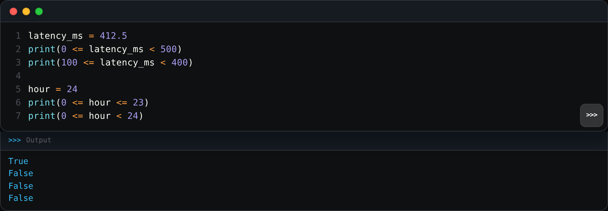
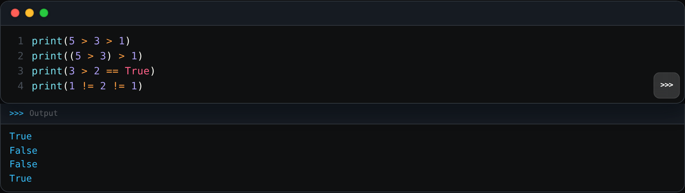
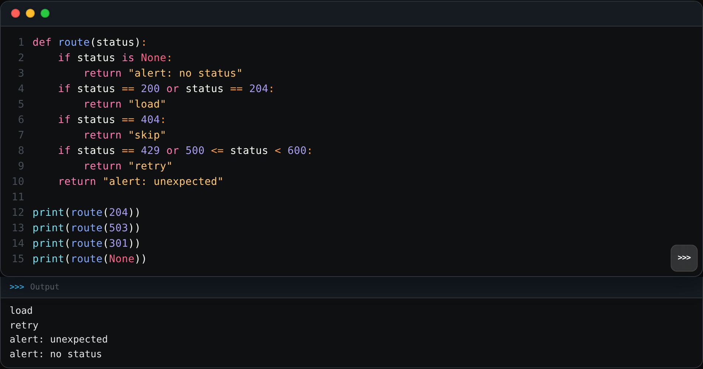
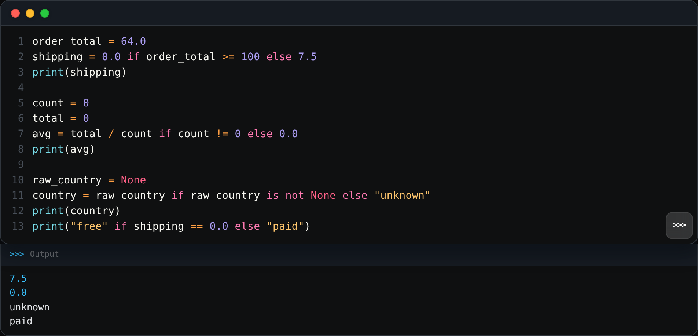
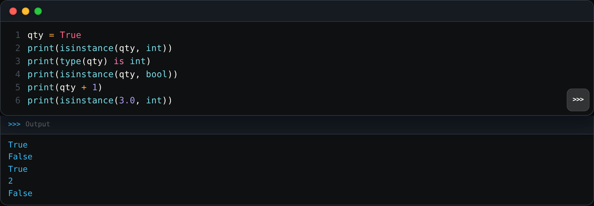

# Control Flow: Intermediate

It's Black Friday at Stripe, and a webhook consumer you own is choking. Alongside Stripe's own `charge.succeeded` and `charge.refunded` events, it ingests events re-emitted by a partner relay that passes amounts through as strings, nulls or negatives. One function decides which events get loaded, retried or rejected, and right now it's 9 levels of nested `if`. You have until the next traffic spike to flatten it.


<br>

---

## Guard Clauses

Most functions that handle real data spend their first lines deciding whether the input deserves any work. A payment amount can be missing or negative. It can also arrive in a currency the warehouse never converts. How those checks are arranged decides whether the function reads top to bottom or makes you track which `if` you are standing in.


<br>

### The function syntax this section needs

A guard clause lives inside a function, so here is the slice of function syntax it relies on. The line def to_dollars(amount_cents, currency): names a block of code and the 2 values it receives, and the indented lines under it form its body. Writing to_dollars(1999, "USD") runs that body with amount_cents set to 1999 and currency set to "USD". The keyword `return` hands a value back to the caller and ends the call on the spot: no line below it runs for that call. A function that reaches the end of its body without a `return` gives back None.


<br>

### The staircase

```sql
def to_dollars(amount_cents, currency):
    if amount_cents is not None:
        if amount_cents >= 0:
            if currency == "USD":
                return amount_cents / 100
            else:
                return "reject: not USD"
        else:
            return "reject: negative amount"
    else:
        return "reject: missing amount"
```

Read it the way the next engineer will. To find out what happens when `amount_cents` is `None`, you start at the `if` on line 2 and scan down to the `else` on line 10. The rule and its outcome sit 9 lines apart, and the only line doing real work, the division, is buried under 3 `if` statements. A fourth rule adds another step and re-indents everything inside it.


<br>

### Flip each check and leave early

A guard clause inverts the test so it describes the bad case, and returns the moment that case is found. Each guard is a complete rule on 2 adjacent lines: the condition, then the outcome. Once every guard has passed, the code below them may assume the input is valid, so the main path sits at the function's first indentation level. Step through the flat version with 3 different calls.

https://github.com/user-attachments/assets/170825d9-027a-4667-b3d7-5534f5a6dd83

*The None call exits at the first guard, so its currency is never read.*

| ✓ Nested checks | ✗ Guard clauses |
| --- | --- |
| • A rule's outcome sits in an else far below its condition<br><br>• The main path moves 1 level right per check<br><br>• A new check re-indents everything inside it | • A rule and its outcome sit on adjacent lines<br><br>• The main path stays at the first indentation level<br><br>• A new check is 2 lines added above the main path |


<br>

### Guard order is a dependency chain

Each guard may rely on the ones above it. The test `amount_cents < 0` needs a value that can be ordered against 0, and `None` can't be, so the `None` check sits above it. The rule: every guard comes before any comparison that would fail on a value no earlier guard has ruled out. The `None` guard rules out exactly 1 value. It doesn't make `amount_cents` a number: a string such as `"50"` passes it and fails at `< 0` the same way. Confirming that a value is a number takes a type check, which the last section of this lesson covers. In the animation, the call with `None` and "EUR" returned at the first guard, so the currency test never ran. Swap the first 2 guards and that protection is gone.

**The first 2 guards have been swapped. What happens when this runs?**

```python
def to_dollars(amount_cents, currency):
    if amount_cents < 0:
        return "reject: negative amount"
    if amount_cents is None:
        return "reject: missing amount"
    if currency != "USD":
        return "reject: not USD"
    return amount_cents / 100

print(to_dollars(None, "USD"))
```

- **A.** It prints reject: missing amount, because the None guard still runs before the currency test.
- **B.** It raises TypeError: '<' not supported between instances of 'NoneType' and 'int'.
- **C.** It prints reject: negative amount, because None is ranked below every number.
- **D.** It prints None, because the function reached its end without matching a guard.

<details>
<summary>Solution</summary>

**B.** It raises TypeError: '<' not supported between instances of 'NoneType' and 'int'.

The first guard compares None with 0. Python 3 defines no ordering between None and int, so the call stops with a TypeError and nothing prints.

**Why the others are wrong**

- **A.** The None guard never gets a turn. Python evaluates None < 0 first, and that comparison fails before any return.
- **C.** Python 3 does not rank None against numbers. The comparison raises instead of producing True or False.
- **D.** A guard did run, and it crashed. The function never reached a return or the end of its body.

</details>


<br>

### Guards reject, branches choose

Guards fit cases that stop the work: missing, malformed, out of range. When both outcomes are ordinary results, such as a domestic fee and an international fee, a plain `if`/`else` states the choice as it is, and turning one side into a fake guard hides that both sides are equal partners. A well-shaped function usually opens with a few guards and ends with a single short decision.


<br>

### Writing the inverted test

Converting a staircase into guards means writing the opposite of each condition the staircase kept going on. Every comparison operator has an exact opposite, and the table below pairs them. The boundary value is where a wrong inversion hides: the staircase accepted `amount_cents >= 0`, so the guard must leave on `amount_cents < 0`. Writing `<= 0` instead rejects a 0-cent amount, such as a fully discounted order, and nothing else, so every test that uses ordinary amounts still passes.

| Staircase continues when | Guard returns when |
| --- | --- |
| `amount_cents is not None` | `amount_cents is None` |
| `amount_cents >= 0` | `amount_cents < 0` |
| `currency == "USD"` | `currency != "USD"` |
| `total > 50` | `total <= 50` |


<br>

---

## Chained Comparisons

Range checks are everywhere in a pipeline: a latency between 0 and 500 ms, an hour between 0 and 23, a timestamp inside a partition's window. Python lets you write `0 <= hour <= 23` the way a math textbook would, and it means what the textbook means.

Python reads a < b < c as a < b and b < c, with one difference: the middle operand is evaluated once. A chain can be as long as you like, and it is True only when every adjacent pair is True. Any comparison operator you know can join a chain, == and != included, and is too.

| Chain | What Python checks | Result when x = 7 |
| --- | --- | --- |
| `0 <= x < 10` | `0 <= x and x < 10` | True |
| `10 > x > 3` | `10 > x and x > 3` | True |
| `0 < x < 5` | `0 < x and x < 5` | False |
| `x == 7 == 7.0` | `x == 7 and 7 == 7.0` | True |
| `1 < x > 3` | `1 < x and x > 3` | True |



```python
latency_ms = 412.5
print(0 <= latency_ms < 500)
print(100 <= latency_ms < 400)

hour = 24
print(0 <= hour <= 23)
print(0 <= hour < 24)
```


<br>

### Half-open ranges tile without gaps

`hour <= 23` and `hour < 24` give the same answer for every whole hour, which is why 24 failed both. They stop agreeing on values with fractions. The form `low <= x < high`, called half-open, includes its lower bound and excludes its upper one, so adjacent bands written this way share a boundary without overlapping: every value lands in exactly 1 band. Daily partitions follow the same rule, so an event stamped exactly at midnight belongs to the new day and never to both.

Closed bands (gap at 99.5)

| Band | Check |
| --- | --- |
| fast | 0 <= ms <= 99 |
| normal | 100 <= ms <= 499 |
| slow | 500 <= ms |

Half-open bands (no gap)

| Band | Check |
| --- | --- |
| fast | 0 <= ms < 100 |
| normal | 100 <= ms < 500 |
| slow | 500 <= ms |

With the closed bands on the left, a latency of 99.5 is too big for `fast` and too small for `normal`, so it matches no band at all. Closed bands that share a number fail the other way. With `ms <= 100` and `100 <= ms`, 100 qualifies for both, and only the order of the branches decides the label.


<br>

### Chains that read wrong



```python
print(5 > 3 > 1)
print((5 > 3) > 1)
print(3 > 2 == True)
print(1 != 2 != 1)
```

Parentheses end a chain: `(5 > 3) > 1` computes `True` first and then compares it with 1, and `True` behaves as 1 in arithmetic and comparisons, so `1 > 1` is False. `3 > 2 == True` chains into `2 == True`, which is False. `1 != 2 != 1` comes out True even though its first and last values are equal, because a chain only compares neighbours and says nothing about its ends.

> **TIP**
>
> Write chains in a single direction, low to high: `low <= x < high`. Readers scan left to right and expect the smallest bound first. Mixed directions such as `1 < x > 3` are legal and almost always a typo or a puzzle.


<br>

### Each link needs comparable types

Every link in a chain is a real comparison, so each pair must support ordering. A value read from a CSV or a web form arrives as a string, and a chain that puts it next to a number stops at the first link. If you convert the value with `int("85")` where it enters, the chain works on numbers from then on.

**A row's score field arrived from a web form. What does this program do?**

```python
score = "85"
if 0 <= score <= 100:
    print("valid")
else:
    print("out of range")
```

- **A.** It prints out of range, because a string never falls inside a numeric range.
- **B.** It prints valid, because Python converts "85" to 85 for the comparison.
- **C.** It prints valid, because "85" sorts between 0 and 100 as text.
- **D.** It stops with a TypeError, since Python 3 cannot order the int 0 against a str.

<details>
<summary>Solution</summary>

**D.** It stops with a TypeError, since Python 3 cannot order the int 0 against a str.

The first link compares the int 0 with the str "85". Ordering across those types is undefined, so Python raises before either branch runs.

**Why the others are wrong**

- **A.** Python never gets far enough to pick a branch. The first comparison itself fails.
- **B.** Python 3 does not convert between str and int while comparing. You call int() yourself.
- **C.** No text comparison happens. The left operand is the int 0, and ordering an int against a str is undefined.

</details>


<br>

---

## Pattern Matching with match-case

Dispatch means a single value decides which of several actions runs. A loader that calls an API keys everything off the response status. It loads on 200 or 204 and skips on 404. A 429 or any 5xx means retry, and anything else raises an alert. The cleaner that ladder reads, the less likely someone adds a new status in the wrong place.

> Which Python this section runs
>
> Python 3.10 added the `match` statement for exactly this job. The examples in this lesson run on Python 3.9, which predates it, so every runnable program here writes dispatch with `if` and `elif`. The `match` forms appear in a table below so you can read them in 3.10+ codebases, each mapped to a 3.9 line you can run.


<br>

### A dispatch ladder in 3.9



```python
def route(status):
    if status is None:
        return "alert: no status"
    if status == 200 or status == 204:
        return "load"
    if status == 404:
        return "skip"
    if status == 429 or 500 <= status < 600:
        return "retry"
    return "alert: unexpected"

print(route(204))
print(route(503))
print(route(301))
print(route(None))
```

Every test looks at the same subject, `status`, so a reader knows the whole ladder is one decision. Each test is also a complete case: an equality, alternatives joined by `or`, or a chained range. The last `return` is a deliberate catch-all, so a 301 nobody planned for produces a visible alert instead of reaching the end of the function and returning `None`.

Alternatives in a single branch are joined with `or`: `status == 200 or status == 204` is True when either equality holds. Joining them with `and` instead produces a branch that can never run, because 1 status can't equal 200 and 204 at the same time. Python raises no error for it. Every 204 falls through to the next test, and in this ladder that means the catch-all, so a successful response gets reported as unexpected.


<br>

### The same decision as match-case

| Pattern kind | match-case (3.10+) | Python 3.9 equivalent | Matches when |
| --- | --- | --- | --- |
| Literal | `case 404:` | `if status == 404:` | the subject equals 404 |
| Alternatives | `case 200 | 204:` | `if status == 200 or status == 204:` | any listed literal equals the subject |
| Capture plus guard | `case s if 500 <= s < 600:` | `if 500 <= status < 600:` | the guard is True; `s` is bound to the subject |
| None literal | `case None:` | `if status is None:` | the subject is None, compared by identity |
| Wildcard | `case _:` | the final `return` or `else:` | always; it catches whatever is left |

A `match` statement evaluates its subject once, then tries each `case` from top to bottom. The first case that fits runs its block and the statement ends, with no fall-through into the next case. When nothing fits and there's no `case _:`, the statement does nothing and raises no error. An `if`/`elif` ladder without a catch-all fails just as silently.

> A bare name in a case matches everything
>
> Inside a `case`, a bare name is a capture pattern: it matches any value and binds it to that name. So `case EXPECTED:`, written to compare with a variable, matches everything. Python 3.10 refuses it with a SyntaxError when other cases follow it, and accepts it silently as a catch-all when it's last. To compare with a named constant, use a dotted name such as `case codes.OK:` or a guard.


<br>

### First match wins, so order is a rule

Both forms stop at the first case that fits, so a broad case placed above a narrow one swallows it. List exact values first, the ranges that contain them after, and the catch-all last.

**A teammate moved the retry range to the top. What does this print?**

```python
def route(status):
    if 400 <= status < 600:
        return "retry"
    if status == 404:
        return "skip"
    return "load"

print(route(404))
```

- **A.** retry, because 404 falls inside the range tested first and the skip branch never runs.
- **B.** skip, because an exact equality test outranks a range test that comes before it.
- **C.** retry and then skip, because both conditions are True for a status of 404.
- **D.** load, because Python treats 404 as a status that should never be retried.

<details>
<summary>Solution</summary>

**A.** retry, because 404 falls inside the range tested first and the skip branch never runs.

404 satisfies 400 <= status < 600, so the first return fires. The status == 404 test is now unreachable for 404.

**Why the others are wrong**

- **B.** Python has no notion of a more specific test. It runs the first condition that is True.
- **C.** Both are True, but return ends the call, so only the first True test produces a result.
- **D.** Python attaches no meaning to 404. It checks the conditions in order, and the first one is True.

</details>


<br>

---

## Conditional Assignment

Many branches exist only to give a single variable one of 2 values. Written as a 4-line `if`/`else`, the reader has to confirm that both arms assign the same name. A conditional expression moves the choice to the right side of a single assignment, so the name appears once.

```sql
if order_total >= 100:
    shipping = 0.0
else:
    shipping = 7.5

shipping = 0.0 if order_total >= 100 else 7.5
```

The form is value_if_true if condition else value_if_false. Python evaluates the condition first, then evaluates only the side it picked. The `else` part is required: shipping = 0.0 if order_total >= 100 is a SyntaxError, because an expression must produce a value in every case. Since the whole thing is an expression, it can sit anywhere a value can, such as on the right of = or inside print(). It also works after `return`.



```python
order_total = 64.0
shipping = 0.0 if order_total >= 100 else 7.5
print(shipping)

count = 0
total = 0
avg = total / count if count != 0 else 0.0
print(avg)

raw_country = None
country = raw_country if raw_country is not None else "unknown"
print(country)
print("free" if shipping == 0.0 else "paid")
```

The average line depends on Python evaluating only the chosen side. With `count` at 0 the condition is False, so `total / count` never runs and no ZeroDivisionError appears. The country line is the standard way to default a missing value: test `is not None`, and keep the real value whenever there is one.


<br>

### Precedence: the if takes everything to its left

A conditional expression binds more loosely than arithmetic and comparisons. In `base + 5 if express else 0`, Python takes all of `base + 5` as the true side, so the result is either the whole sum or 0. To add 5 only for express orders, wrap the conditional in parentheses: `base + (5 if express else 0)`.

**What does this print?**

```python
def describe(v):
    if isinstance(v, int):
        return "count"
    if isinstance(v, bool):
        return "flag"
    return "other"

print(describe(False))
print(describe(2.0))
```

- **A.** flag then other, because False is a bool and 2.0 is a float.
- **B.** count then other, because a bool passes the int test that runs first.
- **C.** count then count, because 2.0 holds a whole number like an int.
- **D.** flag then count, because Python checks the most specific type first.

<details>
<summary>Solution</summary>

**B.** count then other, because a bool passes the int test that runs first.

isinstance(False, int) is True since bool is built on int. 2.0 is a float, which is neither int nor bool.

**Why the others are wrong**

- **A.** False is a bool, but the int test runs first and a bool passes it, so the bool branch never sees False.
- **C.** isinstance looks at the type alone. 2.0 is a float, so the int test is False for it.
- **D.** Python runs the tests in the order written and doesn't reorder them by how specific a type is.

</details>


<br>

### Where the inline form stops paying off

Conditional expressions can chain: `"gold" if spend >= 1000 else "silver" if spend >= 200 else "bronze"` picks among 3 tiers, testing left to right. That is about the limit. A fourth tier, or an `and` inside a condition, turns the line into a puzzle, and an `if`/`elif` ladder assigning `tier` in each arm reads faster. Side effects fit badly too: `print("a") if x else print("b")` runs, but it is a statement wearing an expression's syntax.

| ✓ Good fit for an inline conditional | ✗ Better as an if statement |
| --- | --- |
| • 2 outcomes, each a plain value<br><br>• A default for a value that might be None<br><br>• A guard against dividing by zero<br><br>• A label passed straight into print or return | • 3 or more outcomes, or conditions joined with and/or<br><br>• Branches that print or write a log line<br><br>• Arms that each need more than 1 line<br><br>• A choice someone will step through while debugging |


<br>

### Give the conditional part its own name

A conditional most often lands inside a sum when the code computes a fee or a discount, and taxes hit the same problem. Either wrap it in parentheses, or compute it on its own line first: `fee = 7.5 if order_total < 100 else 0.0`, then `total = order_total + fee`. The second form leaves no precedence to reason about, each line holds a single decision, and a debugger shows `fee` as its own value. With `order_total` at 64.0, `fee` is 7.5 and `total` is 71.5; at 120.0, `fee` is 0.0 and `total` is 120.0.


<br>

---

## Branching on Types With isinstance

Data that crosses a system boundary rarely arrives in a single shape. A quantity field decoded from a partner's JSON can be `12` or `"12"`. It can also be `None`, or even `True`. The code receiving it has to decide what each shape means, and `isinstance(value, int)` is how a branch asks whether a value is an `int`.

isinstance(value, T) returns True when value is of type T or of a type built on top of T. The second half matters for one pairing in particular: bool is built on int, which is why True + 1 is 2 and isinstance(True, int) is True. The exact check type(value) is int accepts only int itself, so it says False for a bool.



```python
qty = True
print(isinstance(qty, int))
print(type(qty) is int)
print(isinstance(qty, bool))
print(qty + 1)
print(isinstance(3.0, int))
```

That subtype rule is the classic hole in a quantity check. A test written as `isinstance(qty, int)` lets `True` through, and a boolean flag that leaked into the quantity column gets counted as 1. Test for `bool` before `int`, and reject it.


<br>

### Normalize at the boundary

A type check belongs where mixed shapes enter your code. A single function receives the raw value, sorts it by type, and hands back either a clean `int` or `None`. Everything downstream works on that one type, so no other function needs to ask.

https://github.com/user-attachments/assets/e8931823-4cbf-4cec-a67f-f764905e0d7b

*True is caught by the bool test before the int test can accept it.*

Each test in `parse_qty` is a type question, and their order matters for the reason guard order mattered earlier in this lesson: the `bool` test must come before the `int` test, or `True` would pass through as a quantity. A float such as 2.5 fails every test and reaches the final `return None`. `int("12")` converts a numeric string, while `int("twelve")` would stop the program with a ValueError, which the lesson on handling errors covers.


<br>

### When a type check is hiding a problem

The warning sign is the same `isinstance` ladder appearing in a second and a third function. It means values were never normalized when they arrived. Every consumer then re-decides what `"12"` means, and sooner or later 2 copies decide differently. The fix is structural: convert once at the edge, and let everything after it assume a single type.

| ✓ A type check worth keeping | ✗ A type check that hides a design problem |
| --- | --- |
| • It sits where raw data enters the code<br><br>• Each branch converts the value to a single target type<br><br>• It rejects bool before testing for int<br><br>• Downstream code never repeats it | • The same ladder is copied into several functions<br><br>• It branches to run an operation both types already support<br><br>• It rejects a float or int the code would handle fine<br><br>• It stands in for fixing the producer that sends mixed types |

A second warning sign is a check that adds nothing. `if isinstance(x, int) or isinstance(x, float): y = x + 1` branches on type to run an operation both types already support. Without the check, numbers behave the same. If `None` or `"12"` arrives, which should never happen, it fails loudly with a TypeError right where it's used.

**What does this print?**

```python
def describe(v):
    if isinstance(v, int):
        return "count"
    if isinstance(v, bool):
        return "flag"
    return "other"

print(describe(False))
print(describe(2.0))
```

- **A.** flag then other, because False is a bool and 2.0 is a float.
- **B.** count then other, because a bool passes the int test that runs first.
- **C.** count then count, because 2.0 holds a whole number like an int.
- **D.** flag then count, because Python checks the most specific type first.

<details>
<summary>Solution</summary>

**B.** count then other, because a bool passes the int test that runs first.

isinstance(False, int) is True since bool is built on int. 2.0 is a float, which is neither int nor bool.

**Why the others are wrong**

- **A.** False is a bool, but the int test runs first and a bool passes it, so the bool branch never sees False.
- **C.** isinstance looks at the type alone. 2.0 is a float, so the int test is False for it.
- **D.** Python runs the tests in the order written and doesn't reorder them by how specific a type is.

</details>


<br>

### Capstone: a reading through every tool

A habit worth keeping for any type ladder: feed it one value of every shape it could receive and note which test fires first. Give bools their own rows, since they are the values that slip into an int branch, and include 0, a real quantity that must come back as 0 and never as a missing value. Here is that check run on `parse_qty` from the animation.

| Input | First test that is True | parse_qty returns |
| --- | --- | --- |
| `None` | `raw is None` | `None` |
| `False` | `isinstance(raw, bool)` | `None` |
| `0` | `isinstance(raw, int)` | `0` |
| `"7"` | `isinstance(raw, str)` | `7` |
| `2.5` | none of them | `None` |


<br>

---

## Putting It All Together

Back at Stripe on Black Friday, the webhook consumer from the start of the lesson gets rewritten. Each event brings a kind such as charge.succeeded, plus an amount in cents; events that come through the partner relay may carry it as an int, a numeric string, None or a stray boolean. The new handler opens with guards, normalizes the amount by type, checks it against an allowed range, dispatches on the event kind and labels the result for the log in a single line.

- The guards run first and reject a missing amount before any comparison touches it, the dependency-chain rule from Guard Clauses.
- The amount is normalized with isinstance, bool caught before int, so a leaked True is never billed as 1 cent.
- A half-open chained comparison checks the normalized amount against its allowed range, so each boundary value belongs to exactly 1 side.
- The dispatch lists charge.refunded and charge.dispute.created as alternatives in a single branch and ends with a catch-all that alerts, so a new event kind gets noticed.
- A conditional expression labels each amount as large or standard for the log, keeping that 2-way choice on 1 line.


<br>

---

## Key Takeaways

- A guard clause states a bad case and returns on the next line, so the main path stays at the first indentation level.
- Guard order is a dependency chain: the None check comes before any comparison that would fail on None.
- low <= x < high checks both bounds with x evaluated once, and half-open bands cover a range with no gaps or overlaps.
- A chain compares neighbours only: parentheses break it, and 1 != 2 != 1 is True.
- Dispatch compares a single subject in every branch, lists exact values before ranges, and ends with a visible catch-all; match in 3.10+ follows the same first-match rule.
- a if cond else b evaluates only the chosen side and binds looser than + , so parenthesize it inside arithmetic.
- isinstance ( True , int ) is True: test bool before int, and keep type checks where raw data enters the code.
