# Data Structures: Advanced

At Airbnb, a nightly pipeline turns the day's bookings into the price suggestions hosts see at breakfast. Tonight a new task got wired to wait on a table that, 3 hops later, waits on it, so no task on that loop can start. You get one Python process to find that loop, slim down every booking record, cache the hot lookups, and keep the whole job inside its memory.


<br>

---

## Representing a Graph With Dicts

A nightly pipeline is a set of tasks plus a set of rules of the form "this task waits for that one". That structure is a directed graph: each task is a node and each rule is an edge. Python holds one with no graph library at all. A dict mapping every task to the list of tasks it depends on stores the whole graph, and deps["join"] answers "what must finish before join?" in a single lookup.

```sql
deps = {
    "bookings": [],
    "listings": [],
    "clean": ["bookings"],
    "join": ["clean", "listings"],
    "pricing": ["join"],
    "report": ["join", "pricing"],
}
```

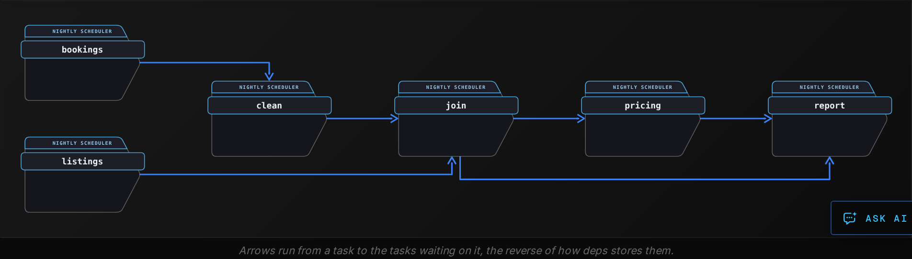

Exactly 2 tasks have empty lists. They are the sources: nothing sits upstream of them, so they can start the moment the run begins. Every other task waits until each name in its list has finished.


<br>

### Flipping the edges to find downstream impact

deps answers upstream questions. The on-call question runs the other way: if listings fails tonight, which tasks will never get fresh data? Answering it from deps means scanning every list for the name listings. Building a reversed dict once, mapping each task to the tasks that wait on it, turns each step of the search into one lookup. A breadth-first walk with a deque and a broken set then collects everything reachable.

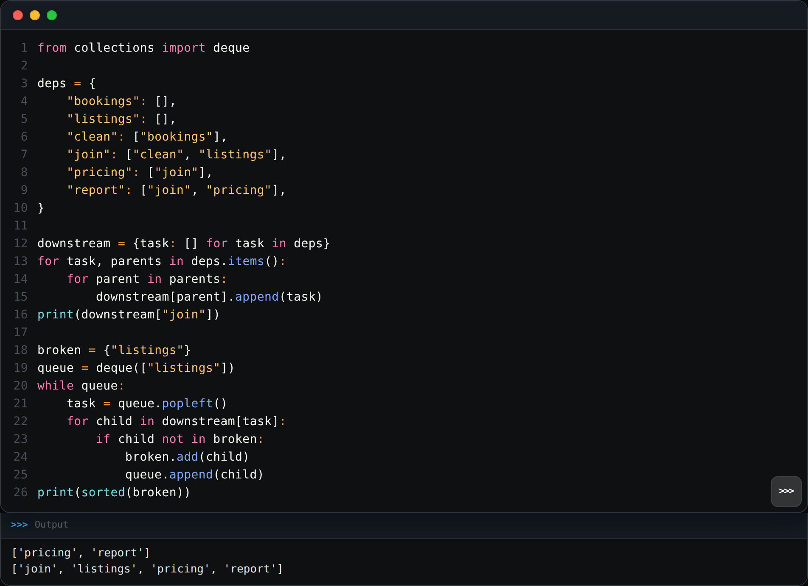

```python
from collections import deque

deps = {
    "bookings": [],
    "listings": [],
    "clean": ["bookings"],
    "join": ["clean", "listings"],
    "pricing": ["join"],
    "report": ["join", "pricing"],
}

downstream = {task: [] for task in deps}
for task, parents in deps.items():
    for parent in parents:
        downstream[parent].append(task)
print(downstream["join"])

broken = {"listings"}
queue = deque(["listings"])
while queue:
    task = queue.popleft()
    for child in downstream[task]:
        if child not in broken:
            broken.add(child)
            queue.append(child)
print(sorted(broken))
```

The broken set does 2 jobs. It holds the answer, and it stops the walk from processing report twice, since report is reachable through both join and pricing. On a graph with a shared upstream table and hundreds of tasks, that check is what keeps the walk from revisiting the same subtree again and again.


<br>

### Ordering tasks with in-degree counts

A scheduler needs an order in which every task runs after all of its dependencies, called a topological order. Kahn's algorithm finds one with 2 dicts and a queue. remaining counts how many dependencies each task still waits on; that count is the task's in-degree. Tasks at 0 go into the queue. Each time a task runs, every task downstream of it loses 1 from its count, and any count that reaches 0 joins the queue.

https://github.com/user-attachments/assets/4bd186cb-d067-4c97-aeab-092d86f14bff

*Kahn's algorithm: a task joins the queue when its remaining count hits 0.*

Watch remaining["join"] during the run: it starts at 2 and the task enters the queue only after both clean and listings have run. The printed order is one valid schedule among several. Swapping bookings and listings at the front would satisfy every rule too, which is why 2 schedulers can disagree on order and both be correct.


<br>

### Batches that can run in parallel

Kahn's queue hands out one task at a time, but a scheduler with spare workers can do better. Process the ready tasks as a wave: every task whose count reaches 0 during a wave goes into the next one. Tasks in the same wave share no path between them, so they can run at the same time, and the number of waves is the shortest possible run length when each task takes one step.

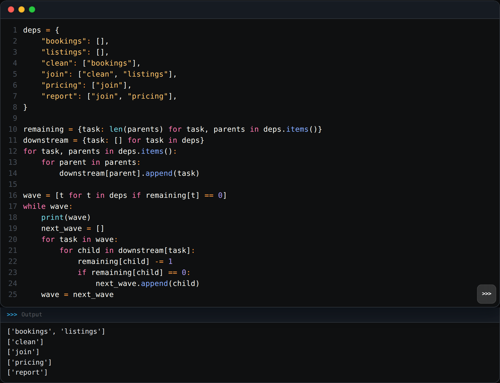

```python
deps = {
    "bookings": [],
    "listings": [],
    "clean": ["bookings"],
    "join": ["clean", "listings"],
    "pricing": ["join"],
    "report": ["join", "pricing"],
}

remaining = {task: len(parents) for task, parents in deps.items()}
downstream = {task: [] for task in deps}
for task, parents in deps.items():
    for parent in parents:
        downstream[parent].append(task)

wave = [t for t in deps if remaining[t] == 0]
while wave:
    print(wave)
    next_wave = []
    for task in wave:
        for child in downstream[task]:
            remaining[child] -= 1
            if remaining[child] == 0:
                next_wave.append(child)
    wave = next_wave
```

Only the first wave holds 2 tasks. The chain bookings, clean, join, pricing, report is the critical path, and adding workers can't shorten the run below 5 waves: speeding up the run means splitting or shortening a task on that chain.


<br>

### A cycle shows up as tasks left behind

If a task depends on itself through any chain of edges, no task on that loop ever reaches a count of 0. Kahn's algorithm then runs out of ready tasks and stops early, with no error. Comparing the length of the order with the number of tasks detects the cycle, and the tasks missing from the order are the ones stuck on the loop or behind it.

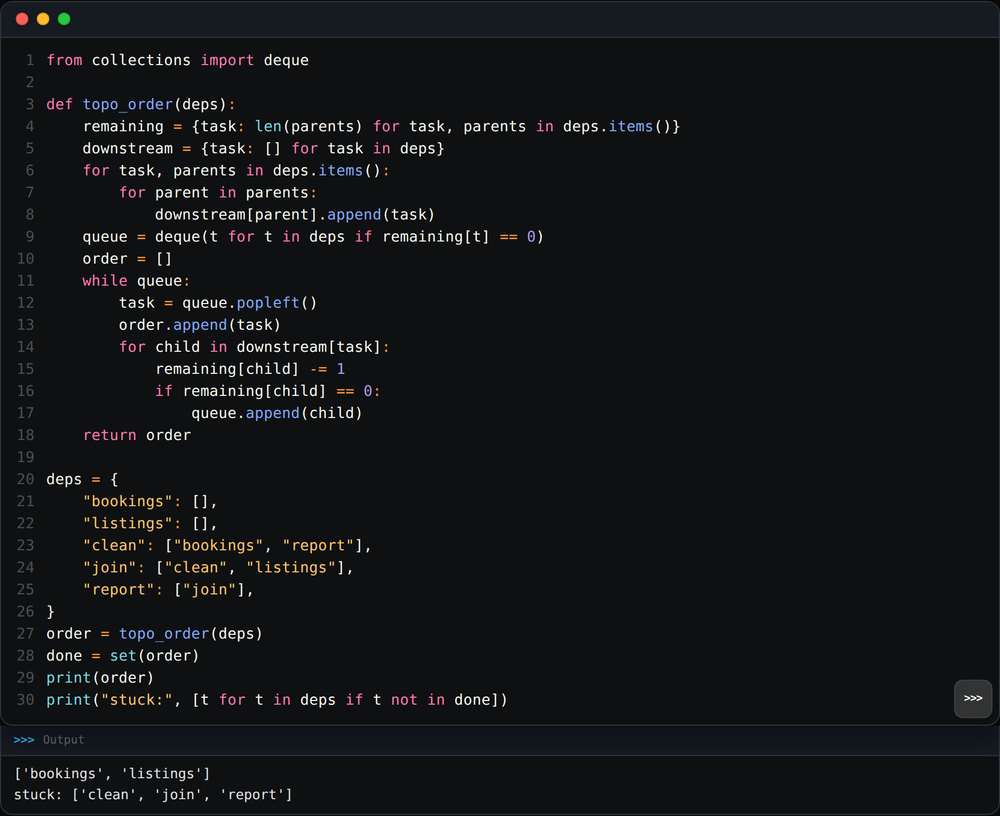

```python
from collections import deque

def topo_order(deps):
    remaining = {task: len(parents) for task, parents in deps.items()}
    downstream = {task: [] for task in deps}
    for task, parents in deps.items():
        for parent in parents:
            downstream[parent].append(task)
    queue = deque(t for t in deps if remaining[t] == 0)
    order = []
    while queue:
        task = queue.popleft()
        order.append(task)
        for child in downstream[task]:
            remaining[child] -= 1
            if remaining[child] == 0:
                queue.append(child)
    return order

deps = {
    "bookings": [],
    "listings": [],
    "clean": ["bookings", "report"],
    "join": ["clean", "listings"],
    "report": ["join"],
}
order = topo_order(deps)
done = set(order)
print(order)
print("stuck:", [t for t in deps if t not in done])
```

Here clean was rewired to wait on report, which waits on join, which waits on clean. Both sources run, each lowers a count from 2 to 1, and the queue empties with 3 tasks unreached. Run this check before the first task starts: a cycle discovered halfway through a run leaves some tables rebuilt and others stale.

> **TIP**
>
> Check the graph's names before ordering it. `set().union(*deps.values()) - set(deps)` lists every dependency with no entry of its own. Without that check, one misspelled task name surfaces as a `KeyError` halfway through building `downstream`.

**A teammate adds 2 tasks to a new pipeline file and builds the reversed dict. What does this program print?**

```python
deps = {
    "clean": ["bookings"],
    "join": ["clean", "fx_rates"],
}
downstream = {task: [] for task in deps}
for task, parents in deps.items():
    for parent in parents:
        downstream[parent].append(task)
print(downstream)
```

- **A.** {'clean': ['join'], 'join': []}, with the unknown parents skipped
- **B.** KeyError: 'bookings', raised while the loop handles the clean task
- **C.** KeyError: 'fx_rates', raised while the loop handles the join task
- **D.** {'clean': ['join'], 'join': [], 'bookings': ['clean'], 'fx_rates': ['join']}

<details>
<summary>Solution</summary>

**B.** KeyError: 'bookings', raised while the loop handles the clean task

clean comes first in deps, and its parent bookings was never added as a key of downstream, so the very first append fails.

**Why the others are wrong**

- **A.** Indexing a dict with a missing key never skips silently: downstream[parent] raises as soon as parent isn't a key.
- **C.** fx_rates is also missing, but the loop never reaches join: the error for bookings stops the program first.
- **D.** A dict comprehension creates keys only for what it iterates over, and downstream[parent].append never creates a key.

</details>


<br>

---

## Custom Structures

The join step loads every booking into memory before matching it to listings. With a few million bookings, the bytes each record's container costs decide whether the job fits on its machine. A dict per record is the default and also the largest option: each dict carries its own hash table, sized with room to grow, even though every record has the same 4 keys.

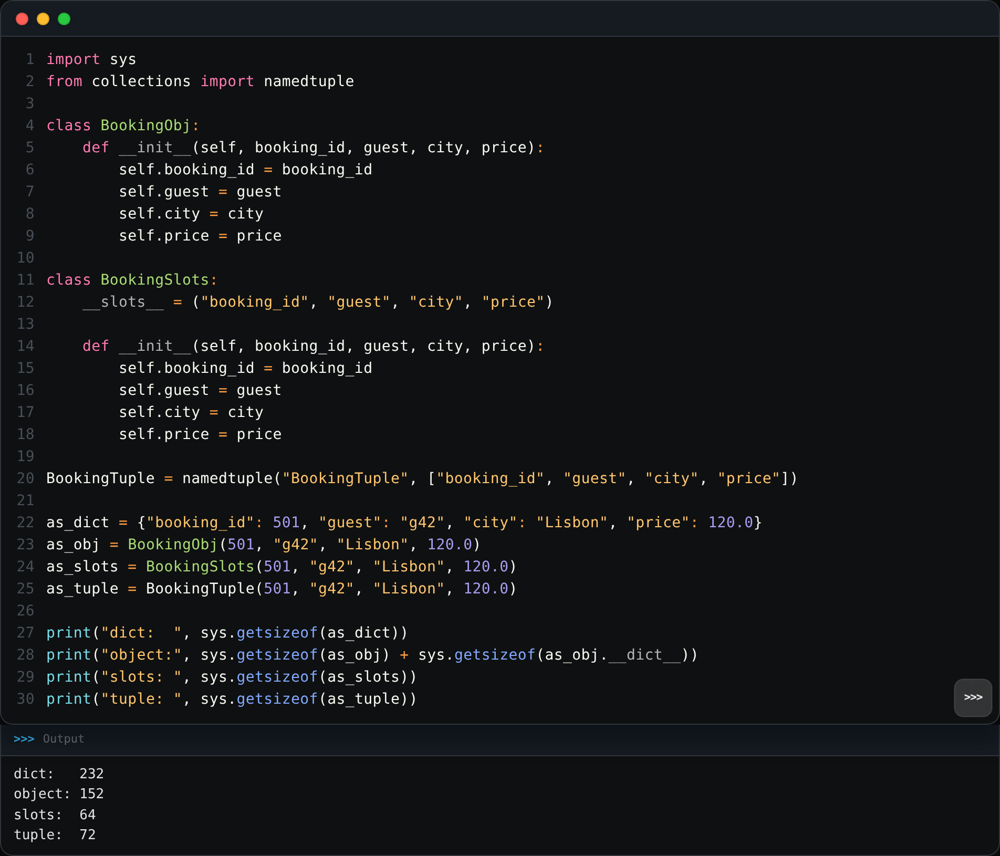

```python
import sys
from collections import namedtuple

class BookingObj:
    def __init__(self, booking_id, guest, city, price):
        self.booking_id = booking_id
        self.guest = guest
        self.city = city
        self.price = price

class BookingSlots:
    __slots__ = ("booking_id", "guest", "city", "price")

    def __init__(self, booking_id, guest, city, price):
        self.booking_id = booking_id
        self.guest = guest
        self.city = city
        self.price = price

BookingTuple = namedtuple("BookingTuple", ["booking_id", "guest", "city", "price"])

as_dict = {"booking_id": 501, "guest": "g42", "city": "Lisbon", "price": 120.0}
as_obj = BookingObj(501, "g42", "Lisbon", 120.0)
as_slots = BookingSlots(501, "g42", "Lisbon", 120.0)
as_tuple = BookingTuple(501, "g42", "Lisbon", 120.0)

print("dict:  ", sys.getsizeof(as_dict))
print("object:", sys.getsizeof(as_obj) + sys.getsizeof(as_obj.__dict__))
print("slots: ", sys.getsizeof(as_slots))
print("tuple: ", sys.getsizeof(as_tuple))
```

These figures come from 64-bit CPython 3.9 and cover each container alone. The strings and numbers inside are separate objects, and the next section measures them. A regular class keeps its attributes in a per-instance __dict__, so every instance pays for an object plus a dict. The slots class and the namedtuple both store 4 references in a fixed row; the namedtuple adds an 8-byte length field, so it measures 72 to the slots class's 64.

- **232 MB** — dict containers for 1M bookings
- **64 MB** — slots containers for 1M bookings


<br>

### Fixed attributes with __slots__

Assigning a tuple of names to __slots__ in the class body tells Python to reserve exactly those attributes in each instance, with no __dict__ behind them. Reading and writing them works as before. Creating any other attribute raises AttributeError, which turns a misspelled field name into an error on the line that misspelled it.

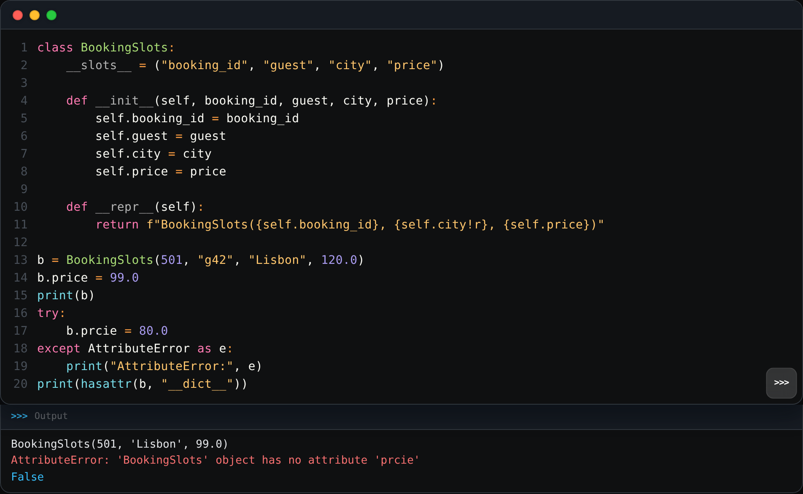

```python
class BookingSlots:
    __slots__ = ("booking_id", "guest", "city", "price")

    def __init__(self, booking_id, guest, city, price):
        self.booking_id = booking_id
        self.guest = guest
        self.city = city
        self.price = price

    def __repr__(self):
        return f"BookingSlots({self.booking_id}, {self.city!r}, {self.price})"

b = BookingSlots(501, "g42", "Lisbon", 120.0)
b.price = 99.0
print(b)
try:
    b.prcie = 80.0
except AttributeError as e:
    print("AttributeError:", e)
print(hasattr(b, "__dict__"))
```

*Without a __repr__, printing an instance shows its class name and memory address, which changes on every run. A record type that ends up in logs needs one.*

**This class has no __slots__. What does the program print?**

```python
class Booking:
    def __init__(self, booking_id, price):
        self.booking_id = booking_id
        self.price = price

b = Booking(501, 120.0)
b.prcie = 99.0
print(b.price)
```

- **A.** 99.0, because Python matches the misspelled name to the closest attribute
- **B.** AttributeError, because prcie was never defined in __init__
- **C.** 120.0, because the typo creates a new attribute and price keeps its value
- **D.** NameError, because prcie is used before Python has seen it assigned

<details>
<summary>Solution</summary>

**C.** 120.0, because the typo creates a new attribute and price keeps its value

b.prcie = 99.0 adds a third key to the instance's __dict__. Python raises no error, and price still holds 120.0.

**Why the others are wrong**

- **A.** Attribute names must match exactly. Python never corrects or guesses a name on assignment.
- **B.** That error comes from a class with __slots__. A regular instance accepts any new attribute name.
- **D.** NameError concerns bare variable names. An attribute assignment on an object never raises it.

</details>


<br>

### namedtuple: a tuple with field names

collections.namedtuple builds a tuple subclass whose positions also have names. It costs the same as a plain tuple, prints its fields, and unpacks like any tuple. Because it is immutable, it can be a dict key or a set member whenever its fields are hashable. Changing a field means building a new record with _replace, which leaves the original untouched.

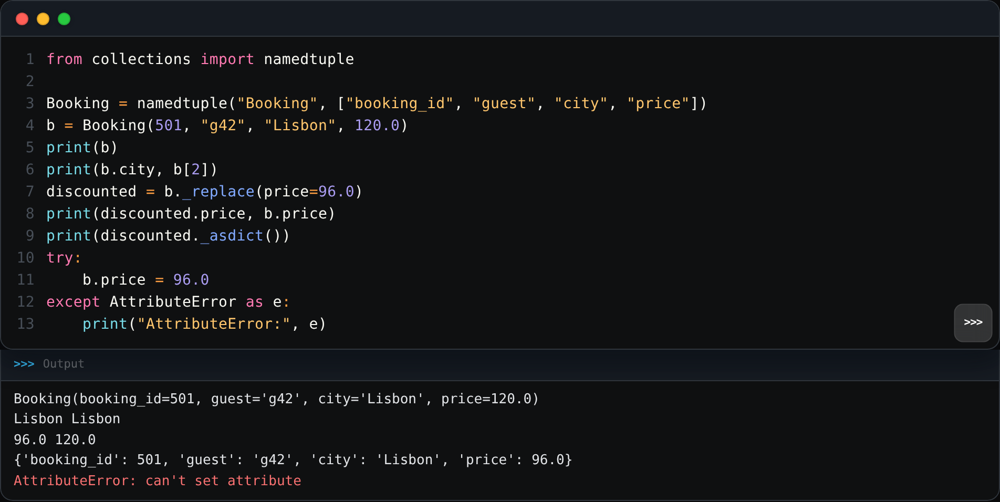

```python
from collections import namedtuple

Booking = namedtuple("Booking", ["booking_id", "guest", "city", "price"])
b = Booking(501, "g42", "Lisbon", 120.0)
print(b)
print(b.city, b[2])
discounted = b._replace(price=96.0)
print(discounted.price, b.price)
print(discounted._asdict())
try:
    b.price = 96.0
except AttributeError as e:
    print("AttributeError:", e)
```


<br>

### Enforcing the schema where rows enter

Rows usually arrive as dicts, decoded from JSON or built by an earlier step. Converting them with Booking(\*\*row) at the point where they enter the job does 2 things at once: it shrinks each record, and it rejects any row whose keys differ from the declared fields, before that row reaches the join.

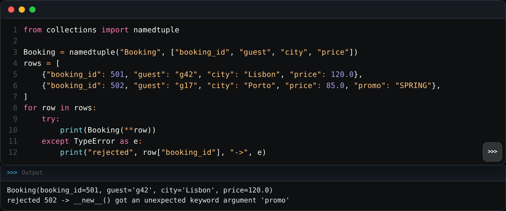

```python
from collections import namedtuple

Booking = namedtuple("Booking", ["booking_id", "guest", "city", "price"])
rows = [
    {"booking_id": 501, "guest": "g42", "city": "Lisbon", "price": 120.0},
    {"booking_id": 502, "guest": "g17", "city": "Porto", "price": 85.0, "promo": "SPRING"},
]
for row in rows:
    try:
        print(Booking(**row))
    except TypeError as e:
        print("rejected", row["booking_id"], "->", e)
```

| Record type | Bytes, 4 fields | Change a field? | Add a field later? | Fits when |
| --- | --- | --- | --- | --- |
| dict | 232 | Yes | Yes | Rows arrive with varying keys or go straight to JSON |
| regular class | 152 | Yes | Yes | You need methods and hold few instances |
| class with `__slots__` | 64 | Yes | No | Millions of mutable records share one schema |
| namedtuple | 72 | No | No | Fixed records you read, group or use as keys |


<br>

---

## Performance Profiling

The byte counts above came from a measurement, and every claim about speed or memory should come the same way. The standard library covers both sides: time.perf_counter() for elapsed time and sys.getsizeof() for the bytes of one object.


<br>

### Timing code with perf_counter

perf_counter() returns seconds as a float counted from an arbitrary starting point, so only the difference between 2 calls means anything. A single run is noisy because other processes take CPU time, and that noise only ever adds time. Repeat the measurement several times and keep the minimum: it's the closest estimate of what the code itself costs.

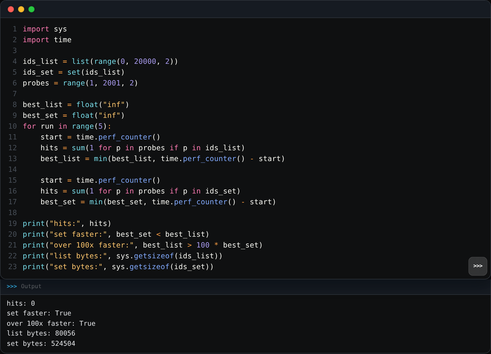

```python
import sys
import time

ids_list = list(range(0, 20000, 2))
ids_set = set(ids_list)
probes = range(1, 2001, 2)

best_list = float("inf")
best_set = float("inf")
for run in range(5):
    start = time.perf_counter()
    hits = sum(1 for p in probes if p in ids_list)
    best_list = min(best_list, time.perf_counter() - start)

    start = time.perf_counter()
    hits = sum(1 for p in probes if p in ids_set)
    best_set = min(best_set, time.perf_counter() - start)

print("hits:", hits)
print("set faster:", best_set < best_list)
print("over 100x faster:", best_list > 100 * best_set)
print("list bytes:", sys.getsizeof(ids_list))
print("set bytes:", sys.getsizeof(ids_set))
```

Every probe is odd and every id is even, so all 1,000 lookups miss: the list compares each probe against all 10,000 ids, while the set hashes the probe and checks one slot. The booleans hold on any machine. The raw seconds, which you can print yourself, change with the hardware. The last 2 lines show the bill for that speed: the set needs a hash table with spare room, and it pays for it in bytes.

- **6.6x** — memory of the set over the list


<br>

### Why sys.getsizeof is shallow

sys.getsizeof counts the object you hand it and none of the objects it refers to. A list's size is its header plus one 8-byte reference per slot, whether a reference points at a 1-character string or a 10 MB one. To measure a whole structure, walk it and add up every object you reach, counting each object once by its id(), because 2 records can share the same string.

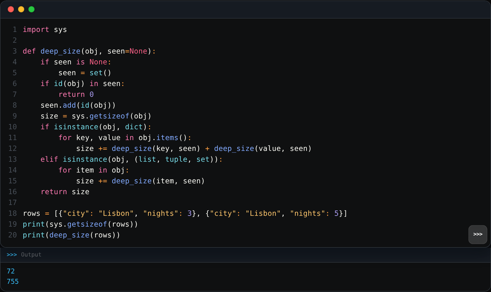

```python
import sys

def deep_size(obj, seen=None):
    if seen is None:
        seen = set()
    if id(obj) in seen:
        return 0
    seen.add(id(obj))
    size = sys.getsizeof(obj)
    if isinstance(obj, dict):
        for key, value in obj.items():
            size += deep_size(key, seen) + deep_size(value, seen)
    elif isinstance(obj, (list, tuple, set)):
        for item in obj:
            size += deep_size(item, seen)
    return size

rows = [{"city": "Lisbon", "nights": 3}, {"city": "Lisbon", "nights": 5}]
print(sys.getsizeof(rows))
print(deep_size(rows))
```

The shallow figure is the list header and 2 references. The deep figure adds both dicts at 232 bytes each, then the keys and values. The 2 "Lisbon" literals are one shared object in this program, and so are the key strings, so seen counts each of them once. Without seen, the walk would report shared strings once per record and overstate the total.

**What does this program print?**

```python
import sys

small = ["a"]
big = ["a" * 10_000]
print(sys.getsizeof(small) == sys.getsizeof(big))
```

- **A.** True: a list stores one reference per item, whatever that item's size
- **B.** False: big holds 10,000 characters and small holds only 1 of them
- **C.** False: big comes out exactly 9,999 bytes larger than small
- **D.** True: Python stores both strings in one shared object behind the scenes

<details>
<summary>Solution</summary>

**A.** True: a list stores one reference per item, whatever that item's size

Both lists hold a single 8-byte reference. The 10,000-character string is a separate object that getsizeof never visits.

**Why the others are wrong**

- **B.** The characters live in the string object. getsizeof(big) measures only the list and its 1 reference.
- **C.** That would be the difference between the 2 strings themselves. The lists around them are the same size.
- **D.** The strings are different objects. The sizes match because neither string is counted at all.

</details>


<br>

### Trading memory for time, and back

The set bought speed with memory. A generator makes the opposite trade. It holds one value at a time, so its size stays fixed no matter how many values it will yield, but it produces them only once. A second pass over the same generator finds it already exhausted and sees nothing.

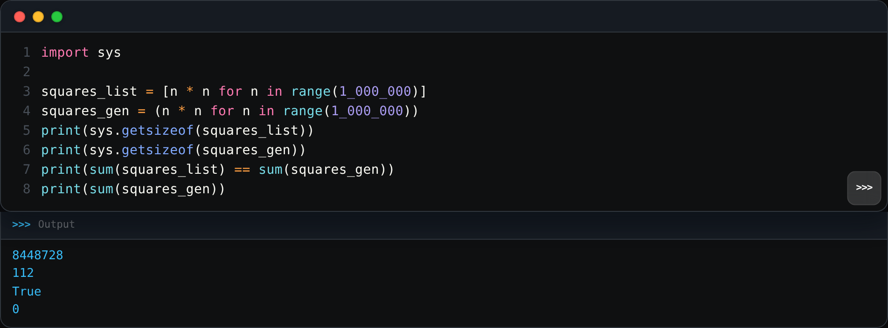

```python
import sys

squares_list = [n * n for n in range(1_000_000)]
squares_gen = (n * n for n in range(1_000_000))
print(sys.getsizeof(squares_list))
print(sys.getsizeof(squares_gen))
print(sum(squares_list) == sum(squares_gen))
print(sum(squares_gen))
```

| ✓ Spend memory to save time | ✗ Spend time to save memory |
| --- | --- |
| • A set or dict index beside a list for membership tests<br><br>• A cache holding results of slow calls<br><br>• A materialized list you will read many times | • A generator that recomputes values on each pass<br><br>• Scanning a list instead of keeping a set index beside it<br><br>• Recomputing a rare result instead of storing it |

> Rules for a fair measurement
>
> - Measure at the size you run in production: a list and a set look alike at 10 items.
> - Repeat each timing and keep the minimum, since noise only adds time.
> - Time one change at a time, with the same input for both versions.
> - Treat `sys.getsizeof` as the container alone; walk the structure for the real total.
> - Measure before rewriting anything, then measure again to confirm the gain.


<br>

---

## Caching Strategies

A cache keeps the result of a slow call so the next call with the same input skips the work. Memoizing with a dict already does that. Running a cache in a long-lived service adds 2 questions: how often does a key come back, and when should an entry leave? The share of lookups answered from the cache is its hit rate. A cache with a 0% hit rate costs memory and saves nothing.

| Workload | Keys | Strategy |
| --- | --- | --- |
| Currency code to display name | About 30, never change | Plain dict, no limit |
| Listing details for search pages | Millions, a few thousand hot | LRU with a size limit |
| Exchange rate per currency | Few, value changes hourly | TTL expiry plus a size limit |
| Fraud score per payment id | Every key unique | No cache: hit rate 0% |


<br>

### A dict with no limit grows forever

A memo dict never forgets an entry. That suits a small, fixed key space such as currency codes. Keyed on something that keeps arriving, such as listing ids from search traffic, it gains one entry per new key until the process runs out of memory. A size limit forces a choice of what to throw away, and the common answer is the entry used least recently, the LRU policy.


<br>

### LRU on top of dict ordering

A dict remembers insertion order, so it can double as the recency list. On a hit, pop the key and insert it again, which moves it to the end. On a miss with the cache full, the first key is the least recently used one, and next(iter(self.data)) reads it without building a list of all the keys.

https://github.com/user-attachments/assets/9859eefc-e2f1-43b3-9338-34042320f2da

*Capacity 3: a hit moves a key to the end, a full miss evicts the first key.*

L1 survives because its hit on the 4th access moved it behind L2 and L3. When L4 arrives, L2 is the oldest untouched entry and is evicted. However long the stream runs, data never holds more than 3 entries, and memory stays fixed at whatever 3 cached values cost.

*collections.OrderedDict provides move_to_end() and popitem(last=False) for the same 2 moves, if you prefer named operations.*

**This loop uses the LRUCache class from the animation. What does it print?**

```python
cache = LRUCache(2)
for key in ["A", "B", "A", "C", "B"]:
    if cache.get(key) is None:
        cache.put(key, key.lower())
print(list(cache.data))
```

- **A.** ['A', 'B'], because A was hit and the cache keeps the keys it saw first
- **B.** ['B', 'C'], because the remaining keys are listed in alphabetical order
- **C.** ['A', 'C'], because the hit on A protected it from every later eviction
- **D.** ['C', 'B'], because A became the oldest entry once C was used after it

<details>
<summary>Solution</summary>

**D.** ['C', 'B'], because A became the oldest entry once C was used after it

After A, B, A the order is B, A. C evicts B, leaving A, C. Then B evicts A, leaving C, B.

**Why the others are wrong**

- **A.** Capacity 2 means the 3rd and 4th misses must evict. A cache that keeps its first keys would never adapt to traffic.
- **B.** A dict lists keys in insertion order. B was inserted after C, so it comes last.
- **C.** The hit protects A only until something newer is used. When B returns, A is the oldest entry.

</details>


<br>

### Expiring entries with a time limit

Some values go stale. An exchange rate is right for an hour and then wrong. A TTL (time to live) cache stores each value with the moment it expires and treats an expired entry as a miss. Passing now in as an argument, instead of reading the clock inside, lets the example run with fixed numbers and print the same result every time.

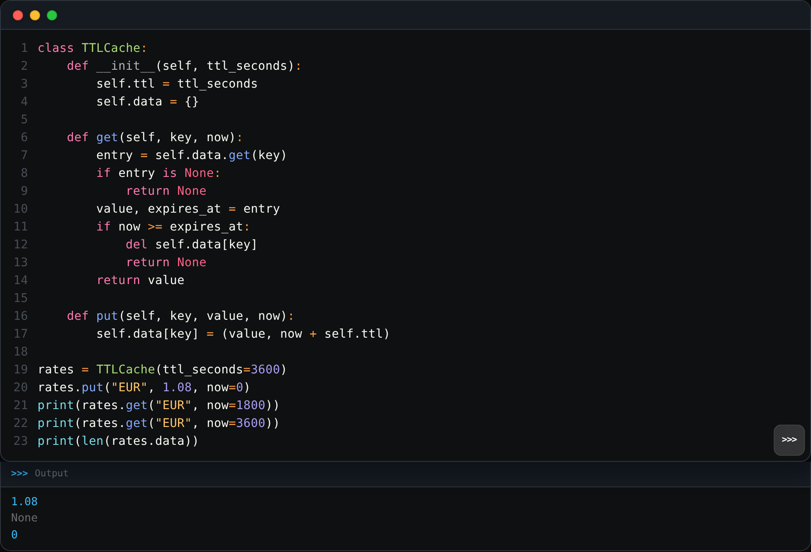

```python
class TTLCache:
    def __init__(self, ttl_seconds):
        self.ttl = ttl_seconds
        self.data = {}

    def get(self, key, now):
        entry = self.data.get(key)
        if entry is None:
            return None
        value, expires_at = entry
        if now >= expires_at:
            del self.data[key]
            return None
        return value

    def put(self, key, value, now):
        self.data[key] = (value, now + self.ttl)

rates = TTLCache(ttl_seconds=3600)
rates.put("EUR", 1.08, now=0)
print(rates.get("EUR", now=1800))
print(rates.get("EUR", now=3600))
print(len(rates.data))
```

Expiry fires only on a read. A key that is never read again stays in data forever, so a TTL by itself bounds staleness without bounding size. Production caches apply both rules: an entry leaves when it expires or when the size limit pushes it out.


<br>

### Every caller shares the cached object

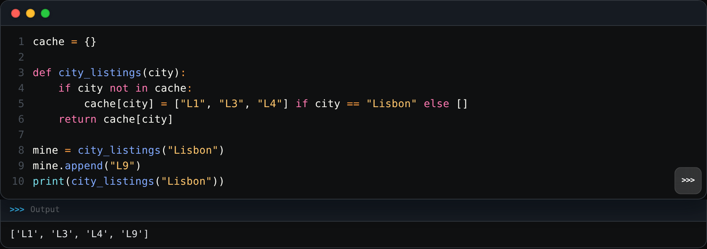

```python
cache = {}

def city_listings(city):
    if city not in cache:
        cache[city] = ["L1", "L3", "L4"] if city == "Lisbon" else []
    return cache[city]

mine = city_listings("Lisbon")
mine.append("L9")
print(city_listings("Lisbon"))
```

The cache returns the list it stores, so mine and cache["Lisbon"] are the same object. One caller's append changed what every later caller receives, and the cache now serves a listing that does not exist.

| ✓ Do | ✗ Don't |
| --- | --- |
| • Measure the hit rate before and after adding a cache<br><br>• Give every cache that sees unbounded keys a size limit<br><br>• Pair a TTL with a size limit so unread entries still leave<br><br>• Store immutable values, or hand callers a copy | • Cache results keyed on ids that never repeat<br><br>• Let a memo dict live as long as a server process<br><br>• Read the clock inside cache logic you need to test<br><br>• Return a cached list that callers can append to |


<br>

---

## Choosing for Scale

A production data layer is a set of structures kept in step, each answering one access pattern fast. Its design starts from the questions it must answer, and the shape of the incoming rows comes second. List the questions, pick one structure per question, and count what each structure adds to every write.

| Question the layer answers | Structure | Cost on every write |
| --- | --- | --- |
| Fetch a listing by id | dict: id to record | 1 dict insert |
| All listings in a city | defaultdict(list): city to ids | 1 append |
| Listings priced between 2 values | Sorted prices plus bisect | Shifts later items on insert |
| Last 5 searches per user | dict of deque(maxlen=5) | 1 append, oldest drops |
| Top 3 by rating | heapq.nlargest at read time | None; work happens on read |
| Distinct guests today | set of guest ids | 1 set add |

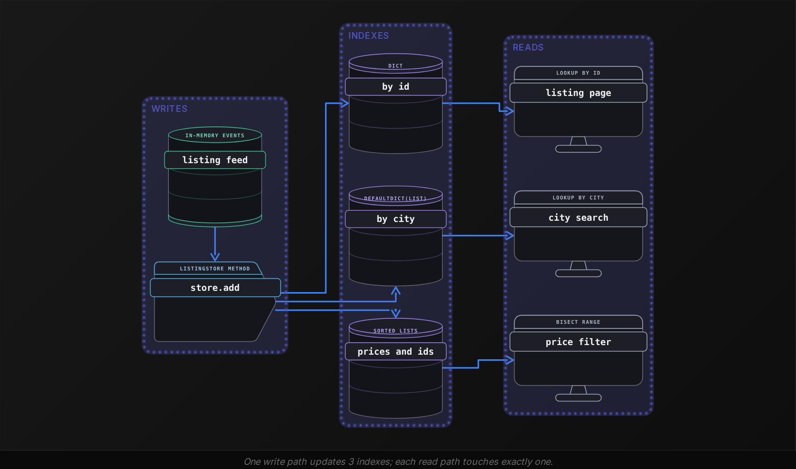

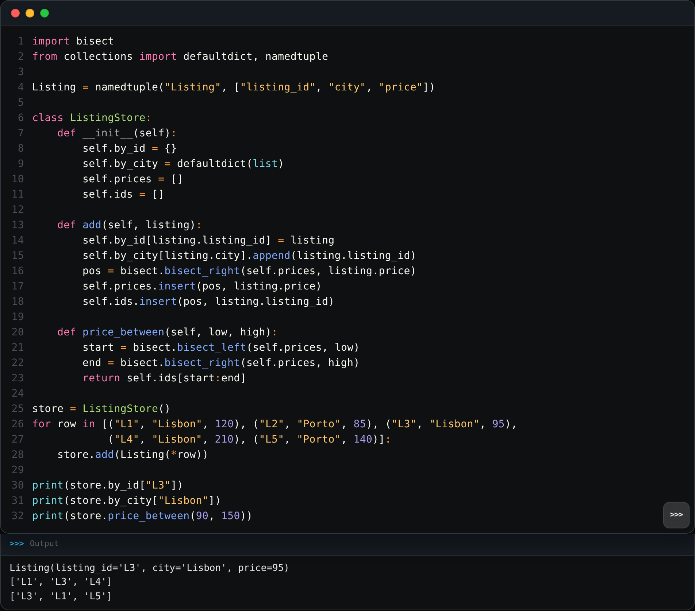

```python
import bisect
from collections import defaultdict, namedtuple

Listing = namedtuple("Listing", ["listing_id", "city", "price"])

class ListingStore:
    def __init__(self):
        self.by_id = {}
        self.by_city = defaultdict(list)
        self.prices = []
        self.ids = []

    def add(self, listing):
        self.by_id[listing.listing_id] = listing
        self.by_city[listing.city].append(listing.listing_id)
        pos = bisect.bisect_right(self.prices, listing.price)
        self.prices.insert(pos, listing.price)
        self.ids.insert(pos, listing.listing_id)

    def price_between(self, low, high):
        start = bisect.bisect_left(self.prices, low)
        end = bisect.bisect_right(self.prices, high)
        return self.ids[start:end]

store = ListingStore()
for row in [("L1", "Lisbon", 120), ("L2", "Porto", 85), ("L3", "Lisbon", 95),
            ("L4", "Lisbon", 210), ("L5", "Porto", 140)]:
    store.add(Listing(*row))

print(store.by_id["L3"])
print(store.by_city["Lisbon"])
print(store.price_between(90, 150))
```

Each read touches one index. by_city answers the city search without scanning listings. The price filter finds both ends of the range with 2 binary searches and slices between them, so it never looks at the listings priced at 85 or 210. prices and ids stay parallel because add inserts into both at the same pos.


<br>

### Every index is a write you must not forget

Each index makes one read fast and makes every write touch one more structure. A delete that updates by_id and by_city but skips the price lists leaves a listing that no longer exists showing up in price searches. Routing every write through the class's own methods keeps the indexes consistent; code outside the class should never append to by_city directly.


<br>

### Estimating before the layer stops fitting

Size the layer before it reaches production. Measure the deep size of the store at 10,000 listings, multiply by the growth factor to the real row count, and compare the result with the memory of the machine that will run it. Check the write path at that scale as well: inserting into a sorted list shifts every later element, and loading 1 million listings in random order moves roughly 250 billion references. A bulk load should append everything and sort once at the end.

> When the estimate does not fit
>
> - Only totals needed: stream the rows through a generator and keep running sums.
> - A small hot subset: keep it behind an LRU cache and fetch the rest on a miss.
> - Fixed schema, many rows: switch dict records to `__slots__` classes or namedtuples.
> - Every row needed by many processes: move it out of process memory into a database.

A cache keyed by task goes stale along the graph: when a source table reloads, every task reachable from it in downstream computed its result from old data, so those entries leave with it.


<br>

---

## Putting It All Together

Picture the search side of a rental marketplace like Airbnb serving listing pages, city searches and price filters from an in-process layer that a nightly pipeline rebuilds. The rebuild must run its tasks in dependency order, fit millions of listings in one machine's memory, and drop exactly the cached results that a reloaded table made stale.

- The rebuild order comes from Kahn's algorithm over the deps dict, and the same reversed graph tells the cache which entries to drop when bookings reloads.
- Listings stored as namedtuples instead of dicts cut each record's container from 232 to 72 bytes, which is what lets the store fit.
- A deep-size measurement at 10,000 listings, scaled up, decides whether the store fits before it ships.
- The listing page reads through an LRU cache with a size limit, while exchange rates sit behind a TTL so stale prices expire.


<br>

---

## Key Takeaways

- A dict from each task to its dependencies is a complete graph; reverse it once to answer downstream questions with lookups.
- Kahn's algorithm orders tasks by in-degree, and tasks missing from its result sit on or behind a cycle.
- A 4-field record costs 232 bytes as a dict, 64 bytes as a __slots__ class and 72 as a namedtuple on CPython 3.9.
- Time with perf_counter , repeat and keep the minimum; sys . getsizeof counts one container, so walk structures for totals.
- Pick a cache by workload: no limit for small fixed keys, LRU for drifting hot keys, TTL plus a limit for stale values.
- Design a data layer from its questions: one index per access pattern, every write routed through methods that update all of them.
