# Data Structures: Beginner

Spotify's Discover Weekly hands you 30 tracks every Monday. The playlist has to play in the curated order, no track may appear twice, each track carries fixed metadata like duration and release year, and play counts have to be looked up by track id. Those 4 needs map to 4 different Python collections, and picking the wrong one for any of them breaks the playlist.


<br>

---

## Which Collections Keep Their Order

Every collection you have met so far takes items one at a time. This section asks whether the collection remembers the sequence those items arrived in, because that decides whether a position like slot 0 means anything when you read the items back out.


<br>

### Lists and tuples: position is the whole point

A list stores items in numbered slots starting at 0. The first value you append lands in slot 0, the next in slot 1, and nothing moves unless you remove something. A tuple works the same way, built once with its items already seated. Both answer `steps[0]` with the item that went in first, every time the program runs, on every computer.

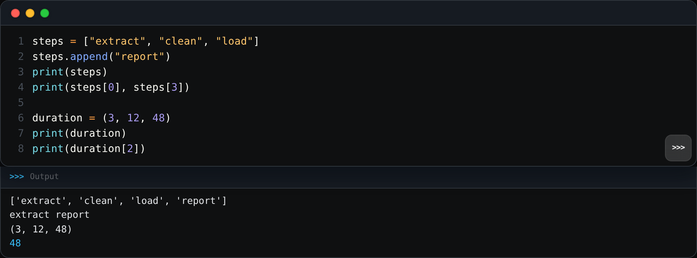

```python
steps = ["extract", "clean", "load"]
steps.append("report")
print(steps)
print(steps[0], steps[3])

duration = (3, 12, 48)
print(duration)
print(duration[2])
```

Appending `report` put it in slot 3, the next free position, and the earlier 3 items stayed where they were. The tuple answered slot 2 with 48 because that is where 48 sat when the tuple was written.


<br>

### Dicts: keys come back in the order they went in

A dict stores pairs, and since Python 3.7 the language guarantees that the keys come back in the order they were first inserted. Reassigning a value to a key that already exists changes the value and leaves the key in its original position. Deleting a key and adding it again puts it at the end, because that counts as a fresh insertion.

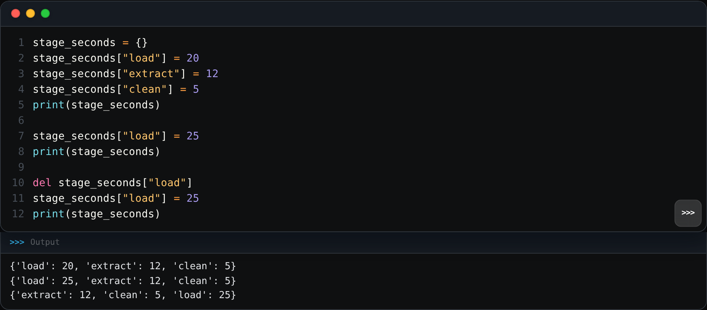

```python
stage_seconds = {}
stage_seconds["load"] = 20
stage_seconds["extract"] = 12
stage_seconds["clean"] = 5
print(stage_seconds)

stage_seconds["load"] = 25
print(stage_seconds)

del stage_seconds["load"]
stage_seconds["load"] = 25
print(stage_seconds)
```

Line 7 changed the value under `load` and the key stayed in front. Deleting it and adding it back moved it to the end, since the second add is a new insertion with no memory of the old one.


<br>

### Sets: no slots, so no order

A set keeps no slots at all. It stores each item at a spot computed from the item's own value, which is what lets `30 in tags` answer without scanning, and it means the order you added items plays no part in the order Python prints them. Small integers often come out in numeric order on the standard interpreter, so `{3, 1, 2}` prints as `{1, 2, 3}`, which looks like sorting but is a side effect of where those numbers land. Strings come out in an order that can change between one run and the next, so code that depends on set order can pass on one run and fail on the next.

https://github.com/user-attachments/assets/f14e7794-366f-4cb8-bef7-c78890c0d850

*Same 3 values, added in the same sequence: the list keeps slot positions, the set does not.*

Step through it and watch `in_order` grow at the end while `no_order` places each value where its number sends it. The 2 collections hold the same 3 integers and answer different questions: the list knows what came first, the set knows what is present.

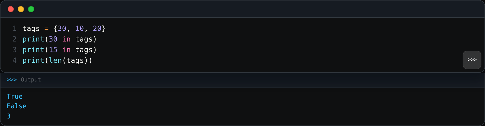

```python
tags = {30, 10, 20}
print(30 in tags)
print(15 in tags)
print(len(tags))
```

Both membership checks answered at once, because answering them is what a set is built for. Add a line `print(tags[0])` and the program stops there with `TypeError: 'set' object is not subscriptable`. There is no slot 0 to read, and the error names the operation the set refused: subscripting, the word Python uses for square brackets written after a value.

| Collection | Remembers insertion order | Reads by position |
| --- | --- | --- |
| list | yes | yes |
| tuple | yes | yes |
| dict | yes, for keys | no, reads by key |
| set | no | no |

> **TIP**
>
> A number in square brackets, like `batch[2]`, reads slot 2 when `batch` is a list or a tuple. On a dict the same brackets look up the key 2, and the lookup stops with a `KeyError` unless 2 is one of its keys. A set refuses the brackets entirely.


<br>

Predict each result before you pick, then read the explanations for the options you ruled out.

**What does this program print?**

```python
batches = ["b1", "b2", "b1", "b3"]
done = set()
order = []
for batch in batches:
    if batch not in done:
        done.add(batch)
        order.append(batch)
print(order, len(done))
```

- **A.** ['b1', 'b2', 'b1', 'b3'] 3
- **B.** ['b1', 'b2', 'b3'] 3
- **C.** ['b1', 'b2', 'b3'] 4
- **D.** ['b3', 'b2', 'b1'] 3

<details>
<summary>Solution</summary>

**B.** ['b1', 'b2', 'b3'] 3

The set blocks the second b1 and the list records each first arrival in order.

**Why the others are wrong**

- **A.** The membership check skips b1 the second time, so the list ends with 3 items.
- **C.** A set holds b1 once no matter how many times it is added, so its length is 3.
- **D.** append places each item at the end, so the list follows first arrival order.

</details>

Exercise: [Which Collections Keep Their Order](_exercises/python_data_structures_beginner_exercise_1.md)

An empty list is `[]` and grows with `append`, which puts the item in the next free slot. An empty set is `set()`, since `{}` builds an empty dict, and it grows with `add`, which files the item by its value. A set has no `append` and a list has no `add`, so pairing a collection with the other one's method stops the program with an `AttributeError`.

| Question | list | set |
| --- | --- | --- |
| Empty one is written | `[]` | `set()` |
| Adds an item with | `append` | `add` |
| A repeated value | takes a new slot | is ignored |
| Reading slot 0 | returns the first item | raises TypeError |


<br>

---

## Which Collections Can Change

Of the 4 collections, 3 can be edited after they exist: you can add items to them or take items out, and the collection keeps its identity through every change. The tuple is the exception. Once built, it holds exactly the items it was built with, for as long as it exists, and every attempt to alter it raises an error.


<br>

### Editing a list, a dict and a set in place

Editing in place means the operation changes the existing object rather than building a new one. `scores.append(90)` returns nothing useful and leaves `scores` longer by 1 item. The same holds for `metrics["errors"] = 5` on a dict and `seen.add(42)` on a set. In the animation below, one dict gains a key, has a value replaced and then loses a key, and the name `metrics` points at that same dict the whole time.

https://github.com/user-attachments/assets/ed0e52a5-16fe-419d-92ea-d94530765638

Because the object itself changes, every name bound to it sees the edit. A function that receives a list as a parameter receives the caller's list, so an `append` inside the function shows up outside it without any `return`.

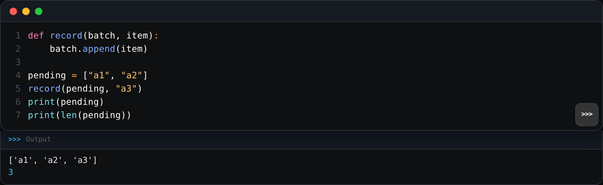

```python
def record(batch, item):
    batch.append(item)

pending = ["a1", "a2"]
record(pending, "a3")
print(pending)
print(len(pending))
```

`pending` has 3 items after the call even though `record` returned nothing. The function edited the one list that both names refer to.


<br>

### A tuple cannot be edited

A tuple has neither `append` nor `remove`, and it does not allow assignment into a slot. Calling a method it lacks raises an `AttributeError`, because the tuple has no attribute by that name. Assigning into a slot raises a `TypeError`, because the tuple refuses item assignment. What you can do is point the name at a different tuple, which leaves the old tuple exactly as it was and is a separate action from editing it.

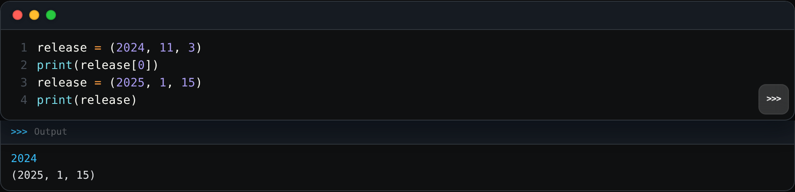

```python
release = (2024, 11, 3)
print(release[0])
release = (2025, 1, 15)
print(release)
```

Line 3 replaced the whole tuple, which is allowed because assignment binds a name and never touches the object. The table shows what happens when a program instead tries to change the tuple it already has: each line stops the program, and the error type tells you which kind of edit was refused.

| Attempt on release | What Python reports |
| --- | --- |
| `release.append(2026)` | `AttributeError: 'tuple' object has no attribute 'append'` |
| `release.remove(2025)` | `AttributeError: 'tuple' object has no attribute 'remove'` |
| `release[0] = 2026` | `TypeError: 'tuple' object does not support item assignment` |


<br>

### Why want something that cannot change

A fixed collection protects data that is supposed to be a fact: a release date, a pair of coordinates, the column names every row has to match. No loop or function anywhere in the program can shorten it by accident. There is a second payoff you met in the sets lesson: only values that cannot change can go into a set or be a dict key, so a tuple works as a key where a list is rejected.

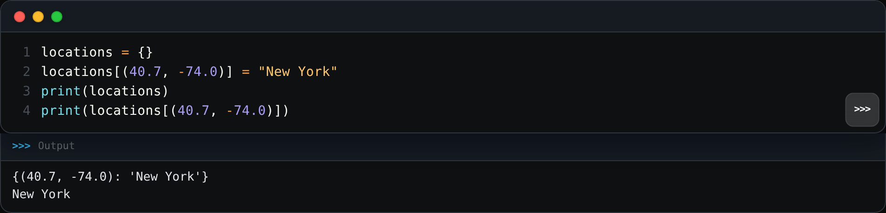

```python
locations = {}
locations[(40.7, -74.0)] = "New York"
print(locations)
print(locations[(40.7, -74.0)])
```

Python accepted the tuple as a key, and reading it back with the same tuple returned the stored value. If the same coordinates are written as the list `locations[[40.7, -74.0]] = "New York"`, the program stops with `TypeError: unhashable type: 'list'`. Unhashable is the name Python gives to values that can change and therefore cannot be filed by their contents.

| Collection | Add | Remove | Replace one item |
| --- | --- | --- | --- |
| list | `append` | `remove`, `pop` | assign to a slot |
| dict | assign to a new key | `del`, `pop` | assign to the key |
| set | `add` | `remove`, `discard` | `remove` then `add` |
| tuple | none | none | none, build a new tuple |

> 2 ways a value can change
>
> - Editing in place: `cart.append(item)`. The object grows, and every name bound to it sees the new item.
> - Rebinding: `release = (2025, 1, 15)`. A new object is built and the name moves to it, while the old object is untouched.
> - A tuple allows rebinding only. Every other collection here allows both.


<br>

Exercise: [Which Collections Can Change](_exercises/python_data_structures_beginner_exercise_2.md)

**What does this program print?**

```python
batches = ["b1", "b2", "b1", "b3"]
done = set()
order = []
for batch in batches:
    if batch not in done:
        done.add(batch)
        order.append(batch)
print(order, len(done))
```

- **A.** ['b1', 'b2', 'b1', 'b3'] 3
- **B.** ['b1', 'b2', 'b3'] 3
- **C.** ['b1', 'b2', 'b3'] 4
- **D.** ['b3', 'b2', 'b1'] 3

<details>
<summary>Solution</summary>

**B.** ['b1', 'b2', 'b3'] 3

The set blocks the second b1 and the list records each first arrival in order.

**Why the others are wrong**

- **A.** The membership check skips b1 the second time, so the list ends with 3 items.
- **C.** A set holds b1 once no matter how many times it is added, so its length is 3.
- **D.** append places each item at the end, so the list follows first arrival order.

</details>

An `AttributeError` raised on a method call usually traces back to the line that built the collection. Parentheses there make a tuple, and square brackets around the same items make a list in the same order, so changing the brackets on that one line is enough for every later `append` to succeed. Keep the parentheses only when the items are meant to stay fixed.

| ✓ Built with parentheses | ✗ Built with square brackets |
| --- | --- |
| • ("extract", "clean") is a tuple<br><br>• Keeps its items in order<br><br>• append raises AttributeError<br><br>• Accepted as a dict key | • ["extract", "clean"] is a list<br><br>• Keeps its items in order<br><br>• append adds to the end<br><br>• Refused as a dict key |


<br>

---

## Converting Between Collections

Each collection type doubles as a function. `list(x)` takes any collection and builds a new one of the named type holding the same items, and `tuple(x)` and `set(x)` work the same way. The source is untouched. What differs is which guarantees the new collection makes, and that is where values keep or lose something on the way across.


<br>

### What survives the trip

| From and to | Keeps | Loses |
| --- | --- | --- |
| list to tuple | order, every duplicate | the ability to edit |
| tuple to list | order, every duplicate | the fixed guarantee |
| list to set | one copy of each distinct value | order, duplicates, slot numbers |
| set to list | the distinct values, now in slots | nothing further; the order is the set's |
| dict to list | the keys, in insertion order | the values |
| dict to set | the distinct keys | the values and the order |

Read each row as a promise. A conversion to a tuple or a list keeps every item in its slot, so the length never changes. A set keeps one copy of each distinct value and throws away the slots, so the length can only shrink or stay the same. When a dict is the source, only its keys make the trip and the values stay behind.

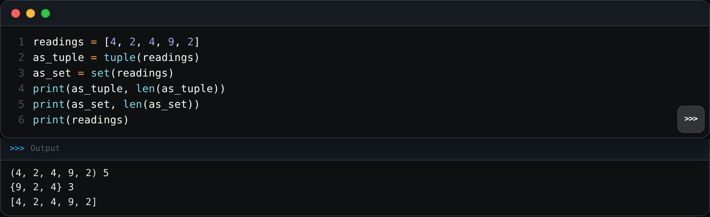

```python
readings = [4, 2, 4, 9, 2]
as_tuple = tuple(readings)
as_set = set(readings)
print(as_tuple, len(as_tuple))
print(as_set, len(as_set))
print(readings)
```

All 5 readings went in. The tuple reports 5 with the order intact. The set reports 3 and prints `{9, 2, 4}`, which is the slot order inside the set and has no relation to the order the readings arrived. The last line shows `readings` still holds all 5.

https://github.com/user-attachments/assets/469ba0e8-c14c-47d3-ab29-34c5b96d28dc

*The round trip through a set returns a list, but with 3 items in the set's slot order, not the 5 you started with.*

Watch `back_to_list` appear: it is a real list with a slot 0, and `back_to_list[0]` would work. What it cannot give back is the original arrival order or the 2 lost duplicates, because the set never had them.


<br>

### A dict converts to its keys

Handing a dict to `list()` or `set()` gives you the keys only, in insertion order for the list. The values stay behind in the dict. This is the usual way to get a dict's keys into something you can index.

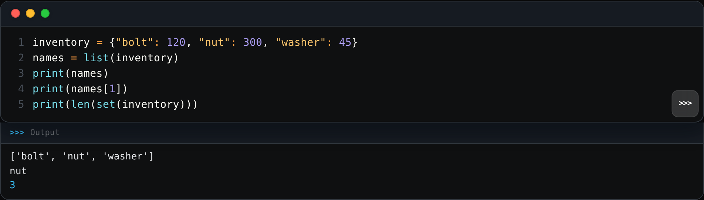

```python
inventory = {"bolt": 120, "nut": 300, "washer": 45}
names = list(inventory)
print(names)
print(names[1])
print(len(set(inventory)))
```


<br>

### Building a dict from pairs

`dict()` runs the other direction. Give it a list of 2-item tuples and each tuple's first item becomes a key, with its second item as that key's value.

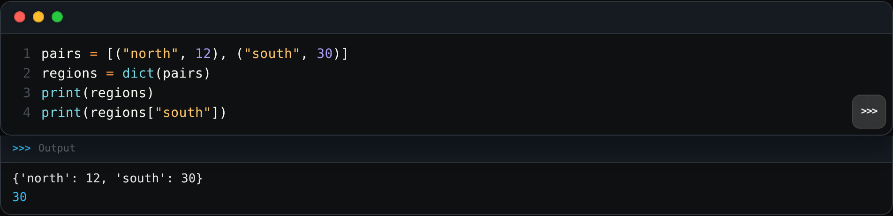

```python
pairs = [("north", 12), ("south", 30)]
regions = dict(pairs)
print(regions)
print(regions["south"])
```

Conversion never edits the source, so to drop duplicates and keep working with a list, assign the result back: `readings = list(set(readings))`. After that line the order is the set's order, and the duplicate count is gone for good.


<br>

Exercise: [Converting Between Collections](_exercises/python_data_structures_beginner_exercise_3.md)

**What does this program print?**

```python
batches = ["b1", "b2", "b1", "b3"]
done = set()
order = []
for batch in batches:
    if batch not in done:
        done.add(batch)
        order.append(batch)
print(order, len(done))
```

- **A.** ['b1', 'b2', 'b1', 'b3'] 3
- **B.** ['b1', 'b2', 'b3'] 3
- **C.** ['b1', 'b2', 'b3'] 4
- **D.** ['b3', 'b2', 'b1'] 3

<details>
<summary>Solution</summary>

**B.** ['b1', 'b2', 'b3'] 3

The set blocks the second b1 and the list records each first arrival in order.

**Why the others are wrong**

- **A.** The membership check skips b1 the second time, so the list ends with 3 items.
- **C.** A set holds b1 once no matter how many times it is added, so its length is 3.
- **D.** append places each item at the end, so the list follows first arrival order.

</details>

Converting a dict to a set never shrinks it, because its keys were unique to begin with, so `len(set(inventory))` always equals `len(inventory)`. Converting it to a list is what makes reading by position possible: square brackets on the dict look up a key, while square brackets on the list read a slot.

| Expression | Result |
| --- | --- |
| `inventory["nut"]` | 300 |
| `inventory[0]` | stops with `KeyError: 0` |
| `list(inventory)[0]` | `'bolt'` |
| `len(set(inventory))` | 3 |


<br>

---

## Which Collections Allow Duplicates

A duplicate is the same value appearing more than once. Lists and tuples store every copy and count every copy. A set stores one. A dict sits in between: keys are unique, values are free to repeat, and giving a dict the same key twice raises no error and keeps the last value.


<br>

### Lists and tuples keep every copy

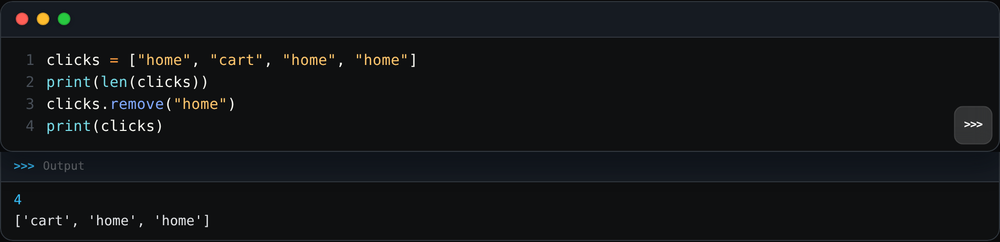

```python
clicks = ["home", "cart", "home", "home"]
print(len(clicks))
clicks.remove("home")
print(clicks)
```

The list took 4 items and `len` reported 4. `remove` deleted the first `home` only, so 2 copies remain. Each copy is a real item in its own slot. `min` counts them all, as do `max` and `sum`: `sum([5, 5, 5])` is 15, and a tuple behaves the same way.


<br>

### A set collapses copies

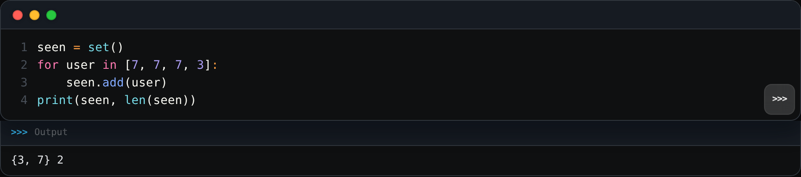

```python
seen = set()
for user in [7, 7, 7, 3]:
    seen.add(user)
print(seen, len(seen))
```

Of the 4 values added, 2 survive. `add` on a value already present does nothing and raises nothing, which is what makes a set the right place to record whether something has been seen rather than how often.


<br>

### Dict keys: the last one wins

Write a dict literal with the same key twice and Python builds it left to right, so the second value replaces the first. The key keeps the position where it first appeared. The same rule governs `dict()` given a list of pairs, and plain assignment to a key that already exists.

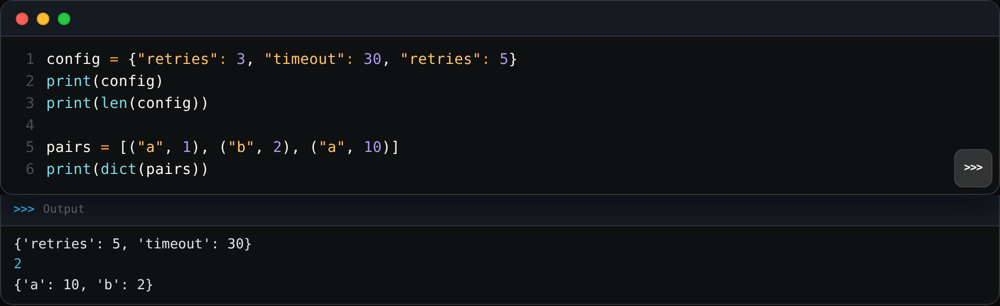

```python
config = {"retries": 3, "timeout": 30, "retries": 5}
print(config)
print(len(config))

pairs = [("a", 1), ("b", 2), ("a", 10)]
print(dict(pairs))
```

Python raises nothing, and `len` reports 2. A config literal with a repeated key silently discards the earlier value, and the mistake only surfaces when the program behaves as if `retries` were 5. The pairs example keeps `a` in front with the value 10 from the later pair.


<br>

### Using the rule on purpose: counting

Because keys are unique, a dict is the natural place to count how often each item of a list appears: the item becomes the key and its count the value. `in` checks whether the key exists before deciding whether to start at 1 or add 1 to the count already there.

https://github.com/user-attachments/assets/d8841e92-3255-4a85-887d-6bf55b919610

*Each repeated page lands on the key it already has, so the dict never grows past the number of distinct pages.*

The list reports 5 because it kept every click. The dict reports 2 because `home` and `cart` are the only keys that ever existed, no matter how many times each was seen.

| Collection | Written as | Stored as | Length |
| --- | --- | --- | --- |
| list | `[2, 2, 3]` | `[2, 2, 3]` | 3 |
| tuple | `(2, 2, 3)` | `(2, 2, 3)` | 3 |
| set | `{2, 2, 3}` | `{2, 3}` | 2 |
| dict | `{2: "a", 2: "b"}` | `{2: 'b'}` | 1 |


<br>

Exercise: [Which Collections Allow Duplicates](_exercises/python_data_structures_beginner_exercise_4.md)

**What does this program print?**

```python
batches = ["b1", "b2", "b1", "b3"]
done = set()
order = []
for batch in batches:
    if batch not in done:
        done.add(batch)
        order.append(batch)
print(order, len(done))
```

- **A.** ['b1', 'b2', 'b1', 'b3'] 3
- **B.** ['b1', 'b2', 'b3'] 3
- **C.** ['b1', 'b2', 'b3'] 4
- **D.** ['b3', 'b2', 'b1'] 3

<details>
<summary>Solution</summary>

**B.** ['b1', 'b2', 'b3'] 3

The set blocks the second b1 and the list records each first arrival in order.

**Why the others are wrong**

- **A.** The membership check skips b1 the second time, so the list ends with 3 items.
- **C.** A set holds b1 once no matter how many times it is added, so its length is 3.
- **D.** append places each item at the end, so the list follows first arrival order.

</details>

Trace the counting loop on 3 clicks and the 2 branches separate cleanly. A page's first visit finds no key, so the count starts at 1, and the key takes its position in the dict at that moment. Every later visit finds the key and adds 1 to the value under it, leaving the position alone. Flip the test to `not in` and the branches swap jobs with it: the first branch starts the count and the `else` adds 1.

| Page | page in counts | Branch taken | counts afterwards |
| --- | --- | --- | --- |
| `home` | False | start at 1 | `{'home': 1}` |
| `cart` | False | start at 1 | `{'home': 1, 'cart': 1}` |
| `home` | True | add 1 | `{'home': 2, 'cart': 1}` |


<br>

---

## Choosing the Right Type

Choosing a collection comes down to 4 questions. Order and change were covered in the earlier sections, as were duplicates, and the question about lookup by label is what a dict's keys are for. Ask them in the order below and the answer usually falls out by the second or third.

- Does position matter, or will you ask for the first or the nth item? Then a list or a tuple.
- Will the contents change after it is built? List, dict or set. Fixed after creation? Tuple.
- Do you look things up by a label such as a name or an id? Dict.
- Do you only need to know whether a value has been seen, with no repeats? Set.

The questions narrow the field one at a time. Take a version number such as 3.9.7, stored as 3 integers. Position matters, since 3 means the major version only in slot 0, so question 1 leaves a list or a tuple. The parts of a released version never change, so question 2 leaves the tuple. Now take the error count for each pipeline stage. No stage is first or third in any meaningful sense, so question 1 rules out list and tuple. The counts rise as errors arrive, so question 2 allows a dict or a set, and question 3 settles it: you read a count by the stage's name, which makes it a dict. The table pairs more needs with the collection that fits.

| Need | Pick | Because |
| --- | --- | --- |
| Steps of a pipeline that run in sequence and may grow | list | order matters and steps get added |
| Latitude and longitude of one warehouse | tuple | 2 fixed values, usable as a dict key |
| Stock level per product name | dict | lookup by label |
| User ids already emailed today | set | membership test, no repeats |
| The 30 tracks of a playlist in play order | list | order matters and tracks move |
| Column names a header row must match | tuple | a fixed fact nothing should edit |

| ✓ Reach for a list when | ✗ Reach for a set when |
| --- | --- |
| • Arrival order carries meaning<br><br>• Repeated values are real data<br><br>• You read items by slot number<br><br>• Items are appended at the end | • The only question is whether a value is present<br><br>• Repeated values should vanish<br><br>• Order is irrelevant<br><br>• The items are numbers or strings (tuples work too) |


<br>

### Putting 3 types together

Real tasks mix types, and the mix follows the same questions. The animation walks a list of click events, uses a set to remember which users have already appeared, and builds a list of each user's first event. The list preserves arrival order, the set answers `not in` without scanning, and the dict inside each event holds that event's fields by name.

https://github.com/user-attachments/assets/25a5d8d6-f469-4ed6-b2bc-c5fe49447dac

*From 5 events by 3 distinct users, the list ends with exactly one event per user, in the order they first appeared.*

Swap the set for a list and the program still works but scans every earlier user on each event. Swap the first-events list for a set and the arrival order is gone.

| ✓ Do | ✗ Don't |
| --- | --- |
| • Run through the 4 questions before writing the first bracket.<br><br>• Use a tuple for a record whose shape never changes.<br><br>• Keep a set beside a list when you need both arrival order and a fast membership test.<br><br>• Count repeats with a dict: the item is the key and the count is the value. | • Rely on the order a set prints in.<br><br>• Index a dict with a position number.<br><br>• Scan a list with in when a set would answer the same question without a scan.<br><br>• Repeat a key in a dict literal and expect both values to survive. |


<br>

These mix every idea so far: order and change, plus conversion and duplicates. Trace the code by hand first; the explanations assume you did.

**What does this program print?**

```python
batches = ["b1", "b2", "b1", "b3"]
done = set()
order = []
for batch in batches:
    if batch not in done:
        done.add(batch)
        order.append(batch)
print(order, len(done))
```

- **A.** ['b1', 'b2', 'b1', 'b3'] 3
- **B.** ['b1', 'b2', 'b3'] 3
- **C.** ['b1', 'b2', 'b3'] 4
- **D.** ['b3', 'b2', 'b1'] 3

<details>
<summary>Solution</summary>

**B.** ['b1', 'b2', 'b3'] 3

The set blocks the second b1 and the list records each first arrival in order.

**Why the others are wrong**

- **A.** The membership check skips b1 the second time, so the list ends with 3 items.
- **C.** A set holds b1 once no matter how many times it is added, so its length is 3.
- **D.** append places each item at the end, so the list follows first arrival order.

</details>

Exercise: [Choosing the Right Type](_exercises/python_data_structures_beginner_exercise_5.md)

Run the 4 questions in order, and when 2 types both satisfy every answer, prefer the one that refuses what the program never does: a type that blocks an unwanted edit turns a silent mistake into an error on the line that made it.

**A program stores the 7 day names and later reads the name for day number 3 with names[3]. The program never edits the day names after they are stored. Which collection fits best?**

- **A.** A list of the 7 names
- **B.** A dict keyed by day number
- **C.** A set of the 7 names
- **D.** A tuple of the 7 names

<details>
<summary>Solution</summary>

**D.** A tuple of the 7 names

Position matters and the contents are fixed, which is exactly what a tuple gives, and it refuses accidental edits.

**Why the others are wrong**

- **A.** A list handles the lookup, but it allows edits the program never wants, so a tuple matches the need more closely.
- **B.** A dict looks up by key, but these keys are consecutive positions, and a dict cannot guarantee the contents stay fixed.
- **C.** A set has no positions, so names[3] raises a TypeError the first time it runs.

</details>


<br>

---

## Putting It All Together

Netflix builds each member's Continue Watching row: the titles must appear in the order they were most recently played, each title's runtime and release year never change, the row must never show the same title twice, and the resume position has to be found by title id in one lookup.

- The titles in recency order are a list, because the order is the product and the row is read by position.
- Runtime and release year for a title form a tuple, fixed facts the row reads but never edits.
- Title ids already placed in the row live in a set, so the loop that builds the row checks not in without scanning the list.
- Resume positions keyed by title id are a dict, where writing the same id again replaces the old position, which is exactly the behaviour the row wants.
- Building the row converts between them: a set of ids drops repeats, and list ( ) on the dict of positions hands back the ids in the order they were first inserted.


<br>

---

## Key Takeaways

- Every collection except the set remembers insertion order, and the order a set prints in is never something to build on.
- Every collection except the tuple changes in place, so every name bound to one sees the edit; a tuple stays as built, and a name can only be rebound to a new tuple.
- list(), tuple() and set() build a new collection and leave the source alone; a trip through set() drops order and duplicates, and a dict converts to its keys.
- Lists and tuples keep every repeat, a set keeps one copy, and a dict given the same key twice keeps the last value in the key's first position.
- Pick a collection by asking about order first, then change, then lookup by label, and duplicates last.
