# Data Structures: Intermediate

You join the Spotify team building a listener's year-end Wrapped recap. Each play event arrives as nested JSON, a retried upload can deliver the same play twice, and track titles live in a separate catalog list. Count a retried play twice and someone's top song comes out wrong. This lesson turns those raw events into clean, correct rows, a single row per play.


<br>

---

## Flattening Nested Records

A table row is a fixed set of named columns, and each cell holds a single value: a number, a string, a timestamp. Event data seldom arrives in that shape. A play event from a music app carries the listener as a dict inside the record, the track as a second dict, and sometimes a list of tags. Before those events can be loaded as rows, every nested value has to move up to the top level under a column name of its own. That step is called flattening.

```sql
{
  "play_id": 101,
  "user": {
    "id": 7,
    "country": "SE"
  },
  "track": {
    "id": 55,
    "title": "Dancing Queen"
  },
  "ms_played": 183000
}
```


<br>

### Prefix each inner key with its parent

Walk the top-level pairs. When a value is a dict, which isinstance(value, dict) checks, copy each of its pairs out under the name parent_inner; otherwise copy the pair unchanged. The prefix keeps the listener's id and the track's id apart. Without it, both would land in a single column called id, and the second would overwrite the first.

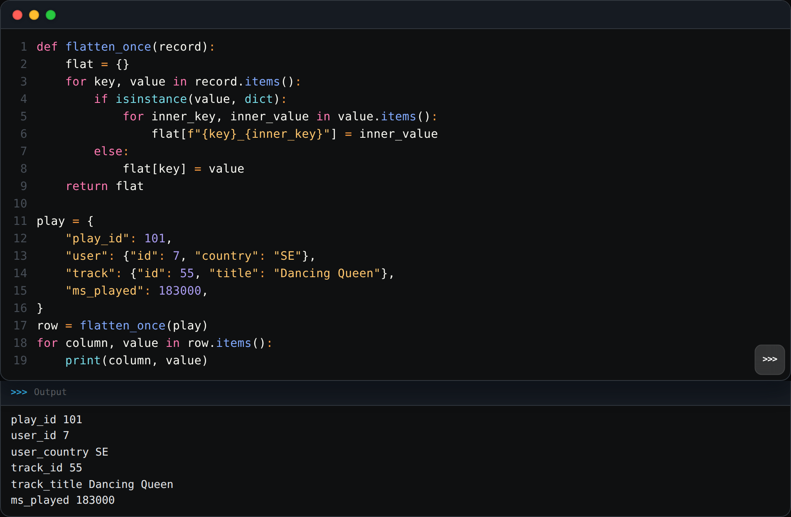

```python
def flatten_once(record):
    flat = {}
    for key, value in record.items():
        if isinstance(value, dict):
            for inner_key, inner_value in value.items():
                flat[f"{key}_{inner_key}"] = inner_value
        else:
            flat[key] = value
    return flat

play = {
    "play_id": 101,
    "user": {"id": 7, "country": "SE"},
    "track": {"id": 55, "title": "Dancing Queen"},
    "ms_played": 183000,
}
row = flatten_once(play)
for column, value in row.items():
    print(column, value)
```

| play_id | user_id | user_country | track_id | track_title | ms_played |
| --- | --- | --- | --- | --- | --- |
| 101 | 7 | SE | 55 | Dancing Queen | 183000 |

Columns come out in the record's own key order. Dicts keep insertion order and the loop follows it, so user_id takes the place user held in the original, with user_country right behind it.


<br>

### Deeper nesting takes another pass

flatten_once lifts exactly 1 level. Give the track an album, and the first pass produces a column track_album whose value is still a dict. Feeding that output back into flatten_once lifts the album's fields to track_album_title and track_album_year. Each level of nesting costs a further pass.

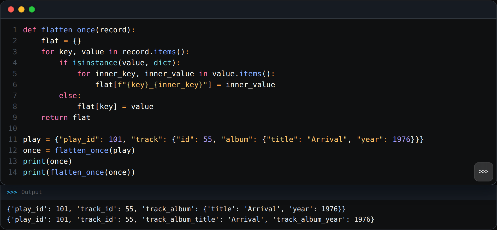

```python
def flatten_once(record):
    flat = {}
    for key, value in record.items():
        if isinstance(value, dict):
            for inner_key, inner_value in value.items():
                flat[f"{key}_{inner_key}"] = inner_value
        else:
            flat[key] = value
    return flat

play = {"play_id": 101, "track": {"id": 55, "album": {"title": "Arrival", "year": 1976}}}
once = flatten_once(play)
print(once)
print(flatten_once(once))
```


<br>

### What flattening loses

Flattening can lose information in 2 ways. Neither raises an error, so both reach the table unnoticed.

#### Colliding names

Suppose a record carries a top-level user_id and also a user dict with an id. Both produce the column user_id. Assigning to a key that already exists replaces its value, so whichever pair the loop reaches second wins, and the earlier value vanishes.

**This record holds both a top-level user_id and a nested user dict. What does the program print?**

```python
play = {"user_id": 9, "user": {"id": 7}}
flat = {}
for key, value in play.items():
    if isinstance(value, dict):
        for inner_key, inner_value in value.items():
            flat[f"{key}_{inner_key}"] = inner_value
    else:
        flat[key] = value
print(flat)
```

- **A.** {'user_id': 9}
- **B.** {'user_id': 7}
- **C.** {'user_id': 9, 'user_id': 7}
- **D.** A TypeError for the repeated key

<details>
<summary>Solution</summary>

**B.** {'user_id': 7}

The top-level pair writes 9 first. Then the nested id writes to user_id as well and replaces the 9 with 7.

**Why the others are wrong**

- **A.** The loop follows key order, so the nested write happens after the top-level one and replaces the 9.
- **C.** A dict holds each key at most once. The second assignment replaces the value instead of adding a second key.
- **D.** Assigning to an existing key is allowed and raises nothing, which is exactly why collisions go unnoticed.

</details>

#### Lists inside a record

A list such as "tags": ["pop", "70s", "disco"] has no single cell to go in. The usual answer is to explode it: produce 1 row per list item and copy the parent's fields onto every row. Each tag becomes queryable, and the parent's values get multiplied: a play with 3 tags becomes 3 rows, and every one of them claims 183000 milliseconds played.

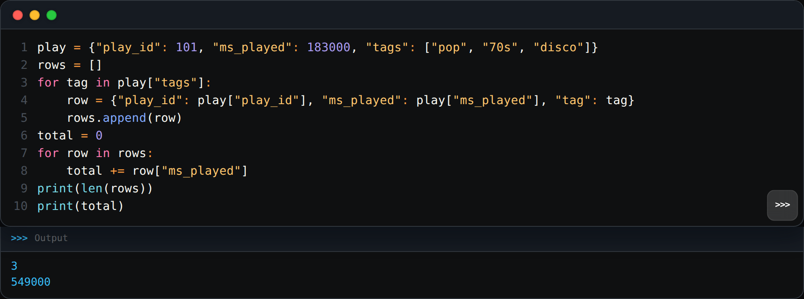

```python
play = {"play_id": 101, "ms_played": 183000, "tags": ["pop", "70s", "disco"]}
rows = []
for tag in play["tags"]:
    row = {"play_id": play["play_id"], "ms_played": play["ms_played"], "tag": tag}
    rows.append(row)
total = 0
for row in rows:
    total += row["ms_played"]
print(len(rows))
print(total)
```

> Totals after an explode
>
> The 549000 above is 3 times the real listening time. Any total over a parent field must count each parent once: sum `ms_played` from the original records, or keep exploded tags in a table of their own that carries `play_id`, so the play rows stay 1 per play.


<br>

---

## Joining Records on a Shared Key

Plays and track details usually live in separate lists. Each play stores only a track_id, while the track's title and artist sit in a catalog list that names each track a single time. Joining pairs them up: for every play, find the catalog record with the same track_id and combine the fields you need into a single row. The field both sides share is the join key.

plays

| play_id | track_id |
| --- | --- |
| 101 | 55 |
| 102 | 56 |
| 103 | 55 |
| 104 | 99 |

tracks

| track_id | title |
| --- | --- |
| 55 | Dancing Queen |
| 56 | Take On Me |


<br>

### The nested-loop join

The direct approach puts a loop inside a loop: for each play, walk the whole catalog and keep the track whose key matches. It produces correct rows, and it compares every play against every track. The 4 plays and 2 tracks above take 8 comparisons. Now picture a day of 1,000,000 plays against a catalog of 100,000 tracks: at Python speeds, that product is hours of work.

```sql
for play in plays:
    for track in tracks:
        if track["track_id"] == play["track_id"]:
            print(play["play_id"], track["title"])
```


<br>

### Build an index once, then look up

A dict goes straight to the value stored under a key without walking the other entries. So spend 1 pass over the catalog building index, a dict that maps each track_id to its track record. Then make 1 pass over the plays, each doing a single index.get(play["track_id"]). Because .get returns None for a missing key, a play that points at an unknown track shows up as a missing match instead of stopping the loop with a KeyError.

https://github.com/user-attachments/assets/6394c484-7d79-4275-9a87-d1919a459735

*Build the index from tracks once, then look up each play; play 104 finds nothing.*

The index costs a pass over the tracks plus a lookup per play, so the work grows with the sum of the 2 list lengths instead of their product. On that daily load, the gap looks like this:

- **100B** — comparisons in the nested-loop join
- **1.1M** — dict operations with an index


<br>

### Unmatched plays: inner or left

Play 104 points at track 99, which the catalog lacks, and the animation's continue dropped it. That is an inner join: only rows with a match on both sides survive. A left join keeps every play and fills the missing fields with None, so the output has exactly as many rows as plays. Choose by what a missing match means: a chart of plays per title can drop it, but a count of total plays must keep it.

inner join of the 4 plays

| play_id | title |
| --- | --- |
| 101 | Dancing Queen |
| 102 | Take On Me |
| 103 | Dancing Queen |

left join of the 4 plays

| play_id | title |
| --- | --- |
| 101 | Dancing Queen |
| 102 | Take On Me |
| 103 | Dancing Queen |
| 104 | None |

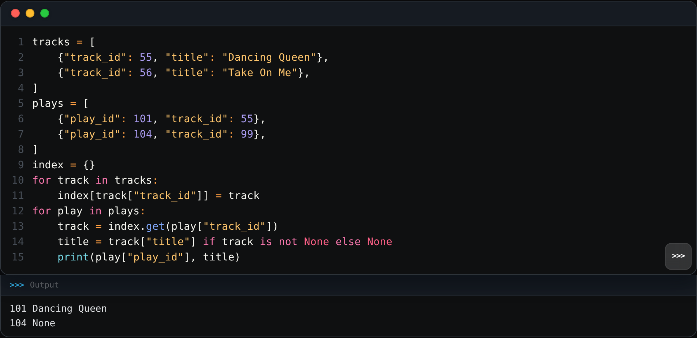

```python
tracks = [
    {"track_id": 55, "title": "Dancing Queen"},
    {"track_id": 56, "title": "Take On Me"},
]
plays = [
    {"play_id": 101, "track_id": 55},
    {"play_id": 104, "track_id": 99},
]
index = {}
for track in tracks:
    index[track["track_id"]] = track
for play in plays:
    track = index.get(play["track_id"])
    title = track["title"] if track is not None else None
    print(play["play_id"], title)
```


<br>

### When the key repeats on the indexed side

The index holds a single value per key. If the catalog lists track 58 twice, say as the studio recording and as a live version, the second assignment replaces the first, and every play of 58 gets the live title. A nested-loop join would instead have produced 2 rows for each of those plays. Before trusting an index, compare len(index) with len(tracks): if they differ, that side repeats keys, and you either store a list of records per key or fix the catalog first.

**The catalog lists track 58 twice. What does the program print?**

```python
tracks = [
    {"track_id": 58, "title": "Africa"},
    {"track_id": 58, "title": "Africa (Live)"},
]
index = {}
for track in tracks:
    index[track["track_id"]] = track
plays = [{"play_id": 105, "track_id": 58}]
for play in plays:
    print(play["play_id"], index[play["track_id"]]["title"])
print(len(index), len(tracks))
```

- **A.** 105 Africa (Live), then 1 2
- **B.** 105 Africa, then 1 2
- **C.** 105 Africa and 105 Africa (Live), then 2 2
- **D.** A KeyError, because key 58 appears twice

<details>
<summary>Solution</summary>

**A.** 105 Africa (Live), then 1 2

The second record overwrites key 58, so the index holds 1 entry for 2 catalog records, and the length check exposes it.

**Why the others are wrong**

- **B.** The length line is right, but the loop stores records in order, so the live version written second is the one kept.
- **C.** That is what a nested-loop join prints. A dict keeps 1 record per key, so the play matches once.
- **D.** Repeating a key raises nothing; the second assignment replaces the first, which is why the length check is needed.

</details>

Which list becomes the index decides what the join can do. Index the side whose key appears once per record and loop over the side whose rows you want in the output. Here that means indexing the catalog and looping over the plays. The loop then visits each play once: an inner join adds a row only when .get returns a record, and a left join adds a row every time, writing None into the fields the missing record would have filled. Reversing the roles, indexing plays by track_id, would keep only the last play of each track.


<br>

---

## Set Math on Dictionary Keys

The joins above matched records 1 at a time. Other questions are about whole collections. Which tracks entered the catalog since yesterday, and which left it? Which fields does one event carry that another lacks? When records sit in dicts keyed by id, those are questions about keys, and keys can be compared with | and &, the set operators you already know, along with - and ^.

d.keys() returns a view that behaves like a set. It supports those 4 operators against another keys view or a plain set, and each result is a new, ordinary set, with no conversion step and no loop. The values view does not, because values can repeat and need not be hashable.


<br>

### Diffing 2 snapshots of a catalog

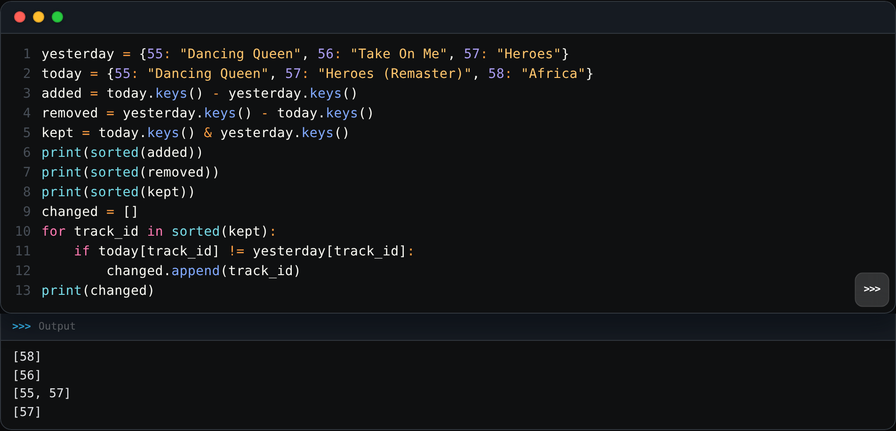

```python
yesterday = {55: "Dancing Queen", 56: "Take On Me", 57: "Heroes"}
today = {55: "Dancing Queen", 57: "Heroes (Remaster)", 58: "Africa"}
added = today.keys() - yesterday.keys()
removed = yesterday.keys() - today.keys()
kept = today.keys() & yesterday.keys()
print(sorted(added))
print(sorted(removed))
print(sorted(kept))
changed = []
for track_id in sorted(kept):
    if today[track_id] != yesterday[track_id]:
        changed.append(track_id)
print(changed)
```

| Expression | Holds | Here |
| --- | --- | --- |
| today.keys() - yesterday.keys() | keys only in today: added | {58} |
| yesterday.keys() - today.keys() | keys only in yesterday: removed | {56} |
| today.keys() & yesterday.keys() | keys in both: kept | {55, 57} |
| today.keys() ^ yesterday.keys() | keys on exactly 1 side | {56, 58} |
| today.keys() \| yesterday.keys() | every key either snapshot has | {55, 56, 57, 58} |

Key math says which ids exist, never what they hold. Track 57 sits in both snapshots, yet its title changed from Heroes to Heroes (Remaster). Finding that takes the last loop in the program: walk the shared keys and compare values. A change feed emits those 3 results. A downstream table inserts the added ids and deletes the removed ones, then updates the rows whose values changed.

> **TIP**
>
> A set has no fixed order, and a set of strings can print in a different order on each run of the same program. Wrap set results in `sorted()` before printing or comparing them, so the same input always gives the same lines. Every set printed in this section goes through `sorted()` for that reason.


<br>

### Comparing the fields of 2 records

The same operators work on the field names of single records. Check 2 events that should share a schema with ^: anything in the result exists on only 1 side, which usually means a field was renamed or dropped upstream. A set of required fields minus a record's keys names exactly what that record is missing, and issubset answers yes or no.

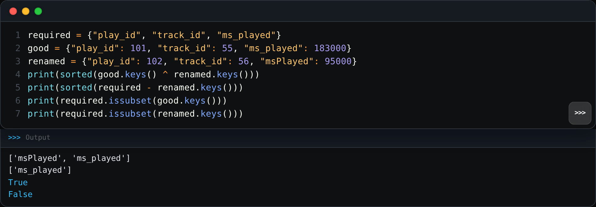

```python
required = {"play_id", "track_id", "ms_played"}
good = {"play_id": 101, "track_id": 55, "ms_played": 183000}
renamed = {"play_id": 102, "track_id": 56, "msPlayed": 95000}
print(sorted(good.keys() ^ renamed.keys()))
print(sorted(required - renamed.keys()))
print(required.issubset(good.keys()))
print(required.issubset(renamed.keys()))
```

Flattened rows bound for a single table need the union of everyone's columns. Start from an empty set, union in each row's keys, then sort the result into a fixed column list. A row missing a column gets None through .get.

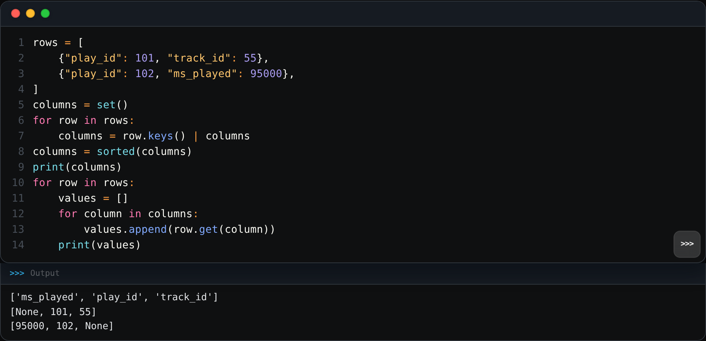

```python
rows = [
    {"play_id": 101, "track_id": 55},
    {"play_id": 102, "ms_played": 95000},
]
columns = set()
for row in rows:
    columns = row.keys() | columns
columns = sorted(columns)
print(columns)
for row in rows:
    values = []
    for column in columns:
        values.append(row.get(column))
    print(values)
```

The union loop grows columns row by row: after the first row it holds play_id and track_id, and the second row adds ms_played. Sorting turns the set into a list with a fixed order, so the column list is the same on every run, and building each row's values by walking that list puts every value under the same column in every row. row.get(column) returns None for the 2 cells the rows lack.

**What does this program print?**

```python
stock_a = {"apple": 3, "pear": 0, "fig": 5}
stock_b = {"pear": 2, "fig": 5, "kiwi": 1}
print(sorted(stock_a.keys() & stock_b.keys()))
print(len(stock_a.keys() | stock_b.keys()))
```

- **A.** ['fig'], then 4
- **B.** ['fig', 'pear'], then 6
- **C.** ['fig', 'pear'], then 4
- **D.** ['apple', 'kiwi'], then 4

<details>
<summary>Solution</summary>

**C.** ['fig', 'pear'], then 4

Fig and pear are keys in both dicts. The union holds 4 keys, apple and kiwi plus those 2, each once.

**Why the others are wrong**

- **A.** The & compares keys, never values. Pear is a key in both dicts even though its counts differ.
- **B.** The first line is right, but | keeps each key once. The 6 comes from adding the 2 dict sizes, which counts pear and fig twice.
- **D.** Those are the keys on only 1 side, which ^ returns. The & keeps keys found in both.

</details>

For 3 of the operators, the answer is the same whichever dict comes first: a.keys() & b.keys() holds the same keys as b.keys() & a.keys(), and the same goes for | and ^. Subtraction is the exception. a.keys() - b.keys() keeps the keys of a that b lacks, so swapping the operands swaps the question. For 2 snapshots, newer minus older names what was added and older minus newer names what was removed; written the wrong way round, every addition is reported as a removal.


<br>

---

## Removing Duplicate Records

Event pipelines deliver some records more than once. A phone that loses its connection mid-upload sends the batch again; a job that crashes and restarts reprocesses its last input. Each copy is a separate dict with identical contents, and counting both inflates every total built on top of them.

For strings or numbers, set(values) removes repeats. For dicts it fails at once: a set stores only hashable values, and a dict is mutable, so Python gives it no hash.

```sql
plays = [
    {"play_id": 101, "track_id": 55},
    {"play_id": 101, "track_id": 55},
]
unique = set(plays)
print(unique)
```

Running it stops at line 5 with TypeError: unhashable type: 'dict', and nothing prints. Building a set means hashing every element, and the first dict already has no hash. A set would lose something even if it accepted dicts: the order the records arrived in. Downstream steps, such as building a listener's play history, expect rows in arrival order, and a set hands its elements back in an order of its own that has nothing to do with arrival.


<br>

### A seen set beside an output list

Split the job between 2 structures. A set holds the ids already kept, so "have I met this record?" becomes a single membership test. A list collects the records to keep, appended as the loop reaches them. The set stores ints, which are hashable; the list stores the dicts, which do not need to be.

https://github.com/user-attachments/assets/f978b8f7-41d8-413b-9dde-5527bcfe3642

*The set answers whether an id was kept; the list keeps the records in arrival order.*

The first copy of 101 is kept and the later copy is skipped, so the output follows first appearance.


<br>

### No id? Fingerprint the whole record

Some feeds carry no reliable id, and a duplicate means every field matches. Build a hashable stand-in for the dict: tuple(sorted(record.items())). The tuple holds the (key, value) pairs, and the sort matters, because 2 equal dicts can store their keys in different orders, and their unsorted tuples then differ.

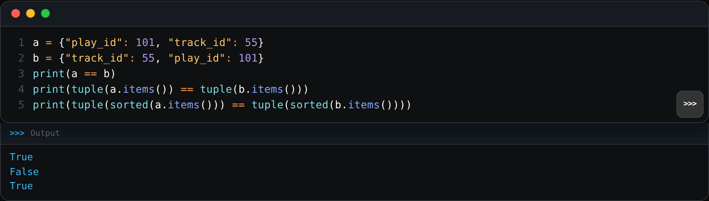

```python
a = {"play_id": 101, "track_id": 55}
b = {"track_id": 55, "play_id": 101}
print(a == b)
print(tuple(a.items()) == tuple(b.items()))
print(tuple(sorted(a.items())) == tuple(sorted(b.items())))
```

The fingerprint takes the id's place in the seen-set loop. The set now holds tuples of (key, value) pairs, which are hashable because every key is a string and every value an int, and 2 records whose fields arrived in different orders collapse to 1 fingerprint.

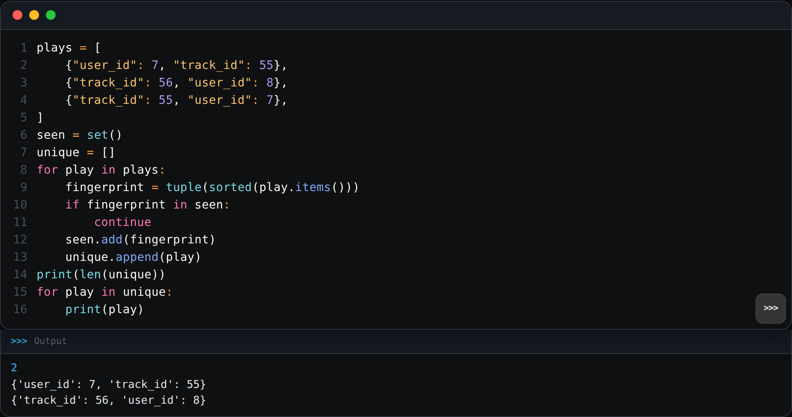

```python
plays = [
    {"user_id": 7, "track_id": 55},
    {"track_id": 56, "user_id": 8},
    {"track_id": 55, "user_id": 7},
]
seen = set()
unique = []
for play in plays:
    fingerprint = tuple(sorted(play.items()))
    if fingerprint in seen:
        continue
    seen.add(fingerprint)
    unique.append(play)
print(len(unique))
for play in unique:
    print(play)
```

> Where fingerprints break
>
> - A value that is a list or a dict makes the tuple unhashable, and adding that tuple to the set raises `TypeError`.
> - Flatten nested records before fingerprinting, so every value is a plain scalar like a number or a string. `None` hashes fine too.
> - A fingerprint treats 2 copies that differ only in an upload timestamp as different records. Leave such fields out of it, or dedupe by id.


<br>

### Keeping the last copy instead

Sometimes a later copy is a correction: a play first reported as started and then as finished. To keep the last copy, store each record in a dict under its id, so every repeat replaces the stored value. A dict remembers where a key was first inserted, and replacing its value does not move it.

**Events for play 101 arrive twice. What does the program print?**

```python
events = [
    {"play_id": 101, "status": "started"},
    {"play_id": 102, "status": "started"},
    {"play_id": 101, "status": "finished"},
]
latest = {}
for event in events:
    latest[event["play_id"]] = event
for event in latest.values():
    print(event["play_id"], event["status"])
```

- **A.** 102 started, then 101 finished
- **B.** 101 started, then 102 started
- **C.** 101 started, 102 started, 101 finished
- **D.** 101 finished, then 102 started

<details>
<summary>Solution</summary>

**D.** 101 finished, then 102 started

Key 101 keeps its first position while its value is replaced by the finished event; 102 follows.

**Why the others are wrong**

- **A.** The statuses are right, but replacing a value leaves key 101 at its first-insertion position, ahead of 102.
- **B.** The third event assigns to key 101 again, so the stored record for 101 becomes the finished one.
- **C.** A dict holds 1 entry per key, so the loop over its values prints 2 lines, not 3.

</details>

In the seen-set loop, the order of 2 lines matters: test membership first, then add. The test checks whether an earlier record already used this id, so it has to run while the set holds only earlier ids. Add the current id before testing and every record finds itself in the set, the first copy of each included, so the output comes back empty. The keep-last version has no such order to get wrong, because a single assignment to latest[event["play_id"]] does the whole job.


<br>

---

## Combining Structures for One Task

Each structure answers some questions at once and others slowly or not at all. A list keeps order and allows repeats but finds an item only by scanning. A set answers membership with a single lookup but keeps no order. A dict finds a value by key and keeps its keys in insertion order. Some tasks need 2 of those answers at the same time, and the fix is to keep 2 structures that describe the same data.

| Question | list | set | dict |
| --- | --- | --- | --- |
| What comes next, in order? | front of the list | no order kept | first key inserted |
| Is X already here? | scans every item | a single lookup | a single lookup, by key |
| What is stored under key K? | scans every item | stores no values | a single lookup |
| Can an entry repeat? | yes | no | keys no, values yes |


<br>

### A play queue: list plus set

A listening queue plays tracks in the order they were added and refuses a track that is already waiting. The list supplies the order. Testing track_id in queue on a list scans it from the front, so a set of queued ids sits beside it to answer that test with a single lookup. The price is a rule: every change touches both structures, inside the same function.

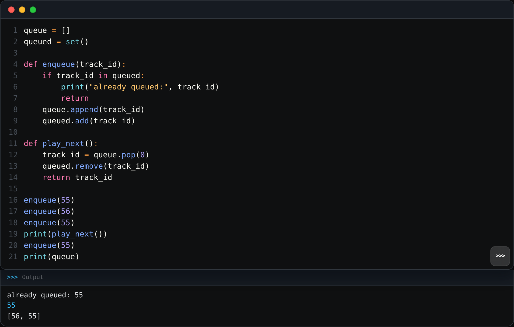

```python
queue = []
queued = set()

def enqueue(track_id):
    if track_id in queued:
        print("already queued:", track_id)
        return
    queue.append(track_id)
    queued.add(track_id)

def play_next():
    track_id = queue.pop(0)
    queued.remove(track_id)
    return track_id

enqueue(55)
enqueue(56)
enqueue(55)
print(play_next())
enqueue(55)
print(queue)
```

Once 55 plays, it leaves both the list and the set, so adding it again succeeds and it joins the back of the queue.

Tracing every call shows the 2 structures moving in step: after each call, the set holds exactly the ids waiting in the list.

| Call | queue | queued | Prints |
| --- | --- | --- | --- |
| enqueue(55) | [55] | {55} | nothing |
| enqueue(56) | [55, 56] | {55, 56} | nothing |
| enqueue(55) | [55, 56] | {55, 56} | already queued: 55 |
| play_next() | [56] | {56} | 55 |
| enqueue(55) | [56, 55] | {55, 56} | nothing |

> The invariant to protect
>
> The set must hold the same ids as the list. If any code path appends without adding or pops without removing, the 2 structures drift apart, and the bug shows up much later: a track refused although it is not waiting, or queued twice. Keep both structures behind the 2 functions and touch them nowhere else.


<br>

### Grouping: a dict of lists

Pairing can also mean nesting. Grouping plays by listener needs lookup by user, which a dict gives, and each user's plays in order with repeats kept, which a list gives. The dict maps each user_id to a list of its own, created the first time that user appears.

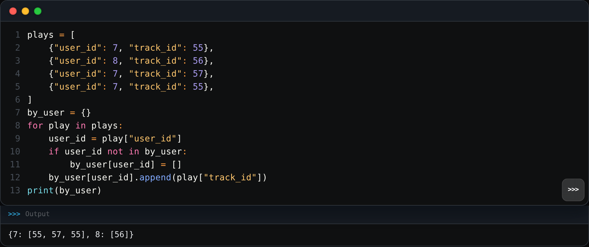

```python
plays = [
    {"user_id": 7, "track_id": 55},
    {"user_id": 8, "track_id": 56},
    {"user_id": 7, "track_id": 57},
    {"user_id": 7, "track_id": 55},
]
by_user = {}
for play in plays:
    user_id = play["user_id"]
    if user_id not in by_user:
        by_user[user_id] = []
    by_user[user_id].append(play["track_id"])
print(by_user)
```

Swap the inner list for a set and each user keeps distinct tracks but loses play order. Keep a list and a set for each user, and the queue pattern from above runs inside every key of by_user.

**A job reads status updates for orders. It must answer "what is the latest status of order X?" and print orders in the order each first showed up. What does it need?**

- **A.** A list of updates plus a set of order_ids
- **B.** A single dict keyed by order_id, assigning each update over the last
- **C.** A dict keyed by order_id plus a list of order_ids for the order
- **D.** A set of (order_id, status) tuples

<details>
<summary>Solution</summary>

**B.** A single dict keyed by order_id, assigning each update over the last

The dict looks up order X by key, and replacing a value keeps the key at its first position, so 1 structure answers both.

**Why the others are wrong**

- **A.** The list finds order X's latest status only by scanning, and the set stores no statuses at all.
- **C.** It works, but the list repeats the insertion order the dict already keeps, and 2 structures mean 2 places to update.
- **D.** A set keeps no order, and an order's several statuses sit side by side with no way to tell which is latest.

</details>


<br>

### From raw events to clean rows

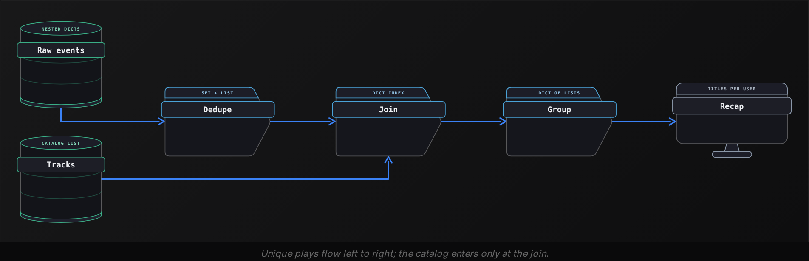

Exercise: [From raw events to clean rows](_exercises/python_data_structures_intermediate_exercise_1.md)


<br>

---

## Putting It All Together

A food delivery app sends order events as nested JSON: the customer and the restaurant are dicts inside each order, each order carries a list of items, and a retried request can send the same order twice. The nightly job must load clean order rows, attach each restaurant's name from a separate restaurant list, report which restaurants joined or left since last night, and build each customer's order history.

- Flattening turns customer and restaurant into customer_id and restaurant_id columns, and the item list becomes its own exploded table keyed by order id, so order totals are not multiplied.
- A seen set of order ids beside an output list drops retried orders while keeping arrival order, before any totals are computed.
- A dict index of restaurants by id joins names onto orders, and comparing len ( index ) with the list length first catches a restaurant listed twice.
- Subtracting last night's restaurant keys from tonight's, and the reverse, names the restaurants that joined and the ones that left.
- A dict of lists keyed by customer id groups each customer's orders in time order, and a set beside each list answers whether that customer has ordered from a restaurant before.


<br>

---

## Key Takeaways

- Flattening lifts nested dict values into prefixed columns, 1 level per pass; name collisions overwrite silently, and exploding a list repeats the parent's values on every row.
- Build a dict index from the side whose key is unique, check len ( index ) against the list, then look each record up with . get : an inner join skips a None , a left join keeps it.
- Keys views support - and & , along with ^ and | , so snapshot diffs and schema checks become a single expression each; sort the result before printing it.
- Dicts cannot go in a set, so dedupe with a set of ids, or of tuple ( sorted ( record . items ( ) ) ) , beside a list that keeps arrival order; a dict keyed by id keeps the last copy instead.
- First check whether a dict's insertion order already covers the task. If no single structure answers every question it asks, pair 2 structures and always change them together.
