# Dictionaries: Advanced

Instagram's web servers run Python. Suppose every request handler on one of those servers reads the same feature-flag dict. One handler sets `flags["new_feed"] = True` to try something, and every user that process serves gets the unfinished feed. Later the flags travel through JSON, and the integer experiment IDs used as keys come back as strings. Who may change a dict, and what survives the trip?


<br>

---

## Read-Only Dictionaries

Passing a dict to a function hands over the same object you hold, so every write the function makes lands in your dict. A shared settings dict gets changed this way by code that only meant to read it:

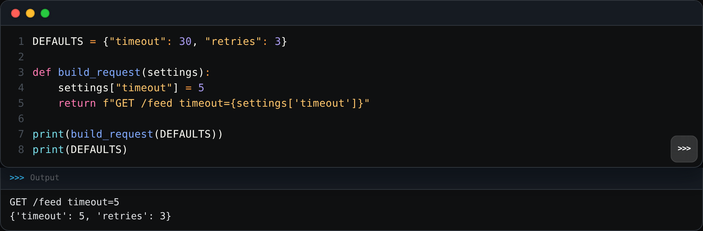

```python
DEFAULTS = {"timeout": 30, "retries": 3}

def build_request(settings):
    settings["timeout"] = 5
    return f"GET /feed timeout={settings['timeout']}"

print(build_request(DEFAULTS))
print(DEFAULTS)
```

Every later reader of `DEFAULTS` now gets a 5-second timeout, and nothing in the error logs points back at `build_request`. You have 2 ways to stop it: give the function its own copy, or give it a view that refuses writes.


<br>

### A view that refuses writes

The standard library's `types` module provides `MappingProxyType`. Wrapping a dict in it gives a read-only view. Every read still works: indexing and iteration, plus `get`, `in`, `len`, `keys()`, `values()` and `items()`. Any attempt to assign or delete raises `TypeError` at that line.

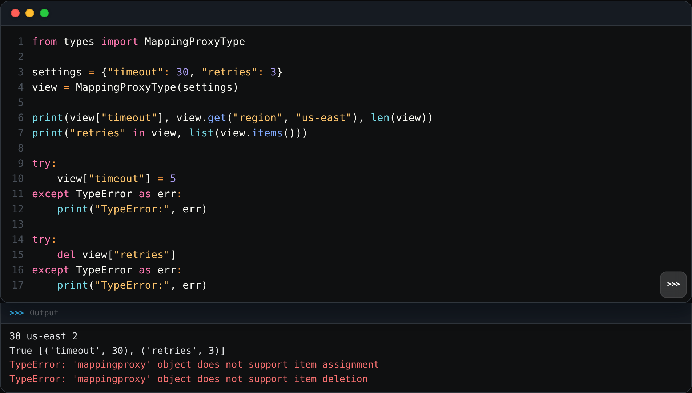

```python
from types import MappingProxyType

settings = {"timeout": 30, "retries": 3}
view = MappingProxyType(settings)

print(view["timeout"], view.get("region", "us-east"), len(view))
print("retries" in view, list(view.items()))

try:
    view["timeout"] = 5
except TypeError as err:
    print("TypeError:", err)

try:
    del view["retries"]
except TypeError as err:
    print("TypeError:", err)
```

The mutating methods are missing from the view entirely. `pop` and `update` are gone, so are `setdefault` and `clear`, and calling any of them raises `AttributeError`. Either way the bad write fails at the line that attempted it, which is where you want to find the bug.

**What happens when this program runs?**

```python
from types import MappingProxyType

config = {"mode": "fast"}
view = MappingProxyType(config)
print(view.get("mode"))
view.pop("mode")
print("done")
```

- **A.** It prints fast, then done
- **B.** It prints fast, then stops with AttributeError
- **C.** It prints fast, then stops with TypeError
- **D.** It stops with AttributeError before printing

<details>
<summary>Solution</summary>

**B.** It prints fast, then stops with AttributeError

Reading with get works through the view. The proxy has no pop method at all, so the lookup of view.pop fails.

**Why the others are wrong**

- **A.** That treats the proxy as a dict. It has no pop method, so the program stops before the last line runs.
- **C.** TypeError comes from view[k] = v or del view[k]. A method call fails earlier, because pop does not exist on the view.
- **D.** The error is right, but get is a read and works through the view, so fast prints before the failing line.

</details>


<br>

### The view follows its dict

A proxy reads through to the dict it wraps and stores nothing itself. The usual design keeps the real dict private to its owner, who can still change it, while every holder of the view sees the new value on its next read. For a snapshot that nobody can change, the owner included, wrap a copy instead.

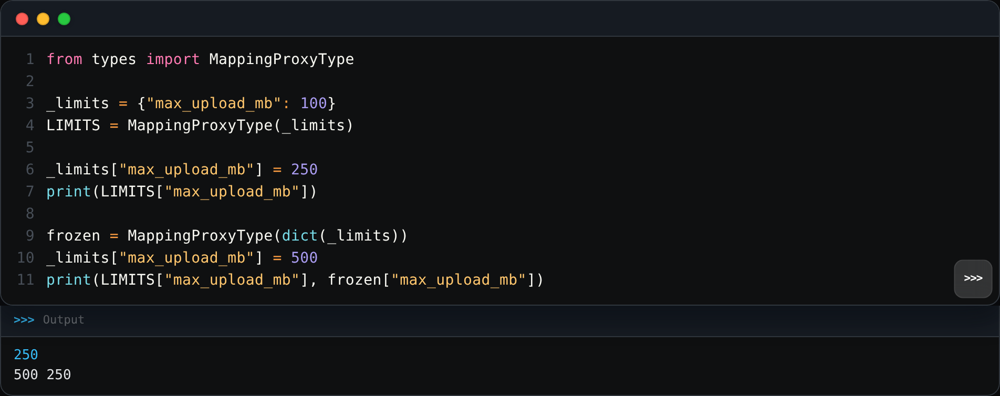

```python
from types import MappingProxyType

_limits = {"max_upload_mb": 100}
LIMITS = MappingProxyType(_limits)

_limits["max_upload_mb"] = 250
print(LIMITS["max_upload_mb"])

frozen = MappingProxyType(dict(_limits))
_limits["max_upload_mb"] = 500
print(LIMITS["max_upload_mb"], frozen["max_upload_mb"])
```


<br>

### Read-only stops at the first level

The proxy blocks writes to its own keys only. A value stored under a key is the same object the wrapped dict holds, so a nested dict or list stays writable through the view. To lock nested dicts as well, rebuild each one as a proxy on the way in. Lists inside still need copying if callers must not change them.

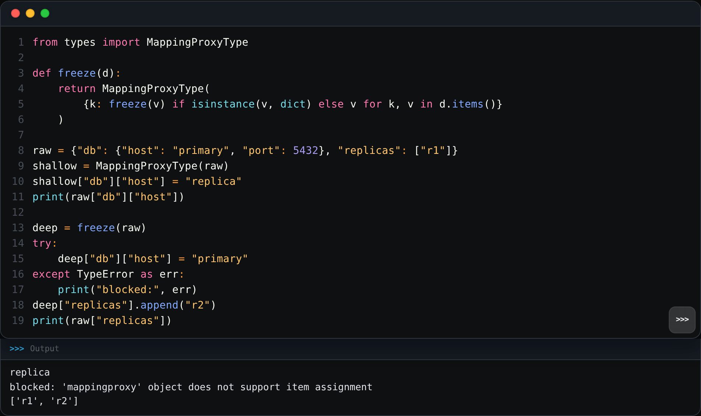

```python
from types import MappingProxyType

def freeze(d):
    return MappingProxyType(
        {k: freeze(v) if isinstance(v, dict) else v for k, v in d.items()}
    )

raw = {"db": {"host": "primary", "port": 5432}, "replicas": ["r1"]}
shallow = MappingProxyType(raw)
shallow["db"]["host"] = "replica"
print(raw["db"]["host"])

deep = freeze(raw)
try:
    deep["db"]["host"] = "primary"
except TypeError as err:
    print("blocked:", err)
deep["replicas"].append("r2")
print(raw["replicas"])
```

| ✓ Pass a copy: dict(d) | ✗ Pass a view: MappingProxyType(d) |
| --- | --- |
| • The callee can change its copy, and your dict stays as it was.<br><br>• A write in the callee goes unnoticed, so a logic bug there stays hidden.<br><br>• Each call pays for a full copy of the dict. | • Any write raises TypeError at the line that tried it.<br><br>• No copy is made, so wrapping a large dict costs almost nothing.<br><br>• The owner's later changes show through, and nested values stay writable. |

**What does this program print?**

```python
limits = dict.fromkeys(["free", "pro"], {"seats": 1})
limits["pro"]["seats"] = 10
print(limits["free"]["seats"], len(limits))
```

- **A.** 1 2
- **B.** 10 1
- **C.** 10 2
- **D.** RuntimeError on the second line

<details>
<summary>Solution</summary>

**C.** 10 2

Both keys hold the same inner dict, so setting seats through pro changes what free reads. The outer dict has 2 keys.

**Why the others are wrong**

- **A.** That assumes each key got its own inner dict. fromkeys stored 1 dict object under both keys.
- **B.** The shared inner dict is right, but limits still has 2 keys: free and pro point at the same value.
- **D.** No loop is running, so nothing changes size during iteration. The write succeeds and lands in the shared dict.

</details>


<br>

---

## Keys That Compare Equal

Predict what this prints before you open the output: 3 keys, 3 different types.

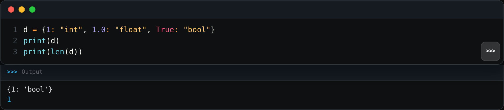

```python
d = {1: "int", 1.0: "float", True: "bool"}
print(d)
print(len(d))
```

The dict saw 3 writes to 1 key. The first key object, the int `1`, stays in place. Each later write found an equal key already stored and replaced only the value, so the last value, `'bool'`, wins. `1.0` and `True` land on the same key as `1` because they compare equal to it with `==` and produce the same hash.


<br>

### Hash first, then equality

A dict decides whether 2 keys are the same in 2 steps. First it calls `hash(key)`, a built-in that turns the key into an integer, and uses that integer to choose where in its internal table to look. Then it compares the key stored there with `==`. Python guarantees that values which compare equal have equal hashes. Ints and floats keep that promise with each other, and so does bool:

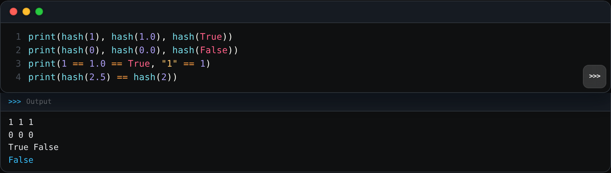

```python
print(hash(1), hash(1.0), hash(True))
print(hash(0), hash(0.0), hash(False))
print(1 == 1.0 == True, "1" == 1)
print(hash(2.5) == hash(2))
```

The string `"1"` and the int `1` are unequal, so they stay 2 keys whatever their hashes. The animation below runs a simplified dict with 8 slots: `put` stores a key in the slot its hash picks, stepping right past slots that hold other keys, and `get` counts the slots it checks.

https://github.com/user-attachments/assets/1289a292-d9b1-4b06-becd-285d0179f36f

*A simplified 8-slot table: the hash picks the slot, and == decides whether it holds the same key.*

Key `11` hashed to slot 3, found `3` already there, and stepped on to slot 4, which is why `get(11)` needed 2 checks. Keys `1.0` and `True` both landed on slot 1, compared equal to the stored `1`, and replaced its value while the key stayed `1`. A miss such as `get(19)` stops at the first empty slot. A real dict also stores each key's hash and compares hashes before calling `==`, so stepping past a slot that holds a different key rarely costs an `==` call.


<br>

### Where equal keys meet in real data

The collapse appears when 2 sources describe the same ID in different types. Here one feed delivers user IDs as ints, another as floats, a third as text:

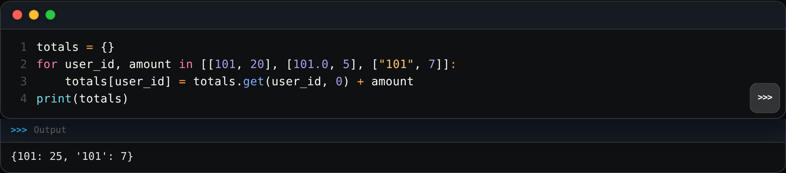

```python
totals = {}
for user_id, amount in [[101, 20], [101.0, 5], ["101", 7]]:
    totals[user_id] = totals.get(user_id, 0) + amount
print(totals)
```

The float row merged into the int key, which is what you want here. The string row became a separate entry, a silent split in the totals. Convert IDs to 1 type where data comes in, before they become keys; `int()` or `str()` will do it.

Floats add 2 more traps. `float("nan")` is unequal to itself, so a fresh NaN never matches a stored one, and `0.1 + 0.2` is a different float from `0.3`. A dict finds a NaN key only when you look it up with the very same object, through an identity check Python runs before `==`:

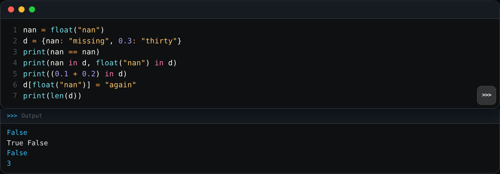

```python
nan = float("nan")
d = {nan: "missing", 0.3: "thirty"}
print(nan == nan)
print(nan in d, float("nan") in d)
print((0.1 + 0.2) in d)
d[float("nan")] = "again"
print(len(d))
```

> **TIP**
>
> Keep floats out of keys where you can: store money as integer cents, timestamps as integer seconds, and replace NaN with `None` before the data reaches a dict.

**What does this program print?**

```python
limits = dict.fromkeys(["free", "pro"], {"seats": 1})
limits["pro"]["seats"] = 10
print(limits["free"]["seats"], len(limits))
```

- **A.** 1 2
- **B.** 10 1
- **C.** 10 2
- **D.** RuntimeError on the second line

<details>
<summary>Solution</summary>

**C.** 10 2

Both keys hold the same inner dict, so setting seats through pro changes what free reads. The outer dict has 2 keys.

**Why the others are wrong**

- **A.** That assumes each key got its own inner dict. fromkeys stored 1 dict object under both keys.
- **B.** The shared inner dict is right, but limits still has 2 keys: free and pro point at the same value.
- **D.** No loop is running, so nothing changes size during iteration. The write succeeds and lands in the shared dict.

</details>


<br>

### Your own classes as keys

An object of your own class equals only itself unless the class defines `__eq__`, and its default hash comes from its identity. To make 2 objects with the same field act as 1 key, define `__eq__` and base `__hash__` on the same fields it compares. A class that defines `__eq__` alone gets `__hash__` set to `None`, so its objects can no longer be keys:

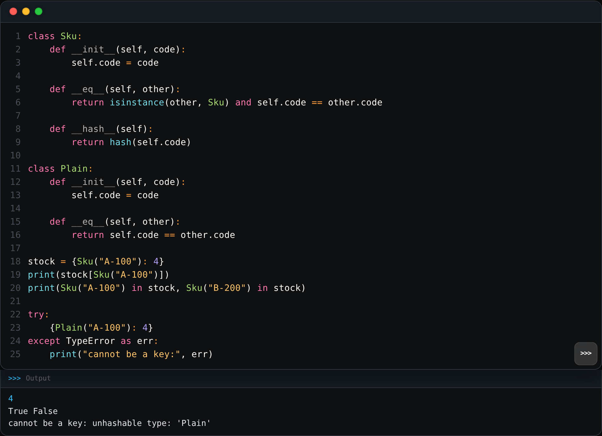

```python
class Sku:
    def __init__(self, code):
        self.code = code

    def __eq__(self, other):
        return isinstance(other, Sku) and self.code == other.code

    def __hash__(self):
        return hash(self.code)

class Plain:
    def __init__(self, code):
        self.code = code

    def __eq__(self, other):
        return self.code == other.code

stock = {Sku("A-100"): 4}
print(stock[Sku("A-100")])
print(Sku("A-100") in stock, Sku("B-200") in stock)

try:
    {Plain("A-100"): 4}
except TypeError as err:
    print("cannot be a key:", err)
```

> The key contract
>
> - If `a == b`, then `hash(a) == hash(b)`. Break this and equal keys land in different slots and never meet.
> - A key's hash must stay fixed while it sits in a dict, so build `__hash__` only from fields you never reassign.
> - Unequal keys may share a hash. The dict still works, at the price of extra `==` checks to tell them apart.


<br>

---

## Dictionary Performance

`x in some_list` starts at index 0 and compares `x` with each item using `==` until 1 matches or the list runs out. A dict hashes `x`, jumps to the slot the hash points at, and compares only there. With the `__eq__` method from the previous section, a class can count its own comparisons, which makes the difference visible:

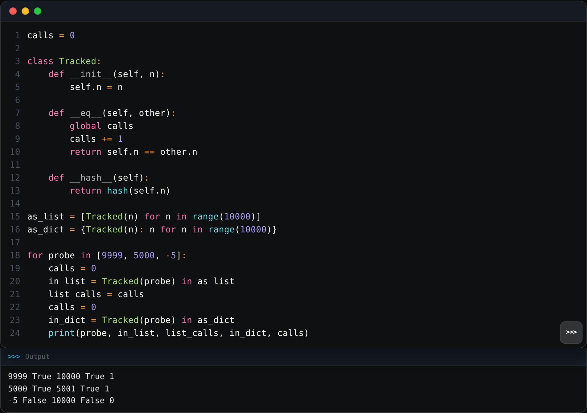

```python
calls = 0

class Tracked:
    def __init__(self, n):
        self.n = n

    def __eq__(self, other):
        global calls
        calls += 1
        return self.n == other.n

    def __hash__(self):
        return hash(self.n)

as_list = [Tracked(n) for n in range(10000)]
as_dict = {Tracked(n): n for n in range(10000)}

for probe in [9999, 5000, -5]:
    calls = 0
    in_list = Tracked(probe) in as_list
    list_calls = calls
    calls = 0
    in_dict = Tracked(probe) in as_dict
    print(probe, in_list, list_calls, in_dict, calls)
```

The list pays for every item before the match, and a miss pays for all of them. The dict pays 1 `==` call for a hit and none for a miss, because no stored hash matched -5. Grow both to 1,000,000 items and the list counts grow with them while the dict counts stay put.


<br>

### Build the lookup dict once, then reuse it

The cost multiplies when a lookup sits inside a loop. Matching each of 50,000 orders to its customer by scanning a list of 20,000 customers repeats the scan for every order. Building a dict keyed by customer ID takes 1 pass over the customers, and after that each order costs 1 lookup.

- **1,000,000,000** — worst-case == checks, scanning a list
- **70,000** — hash lookups and inserts with a dict

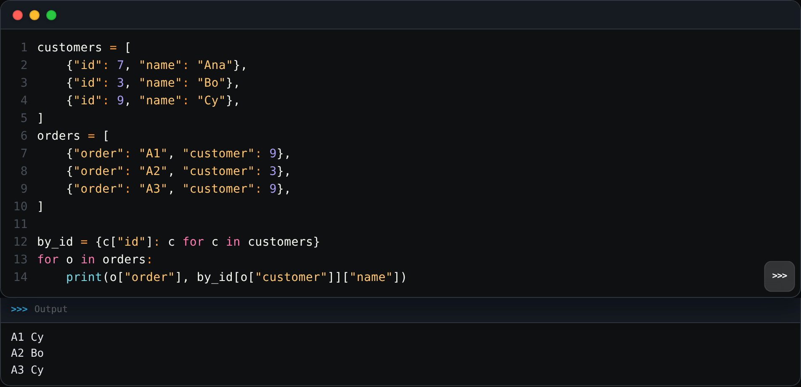

```python
customers = [
    {"id": 7, "name": "Ana"},
    {"id": 3, "name": "Bo"},
    {"id": 9, "name": "Cy"},
]
orders = [
    {"order": "A1", "customer": 9},
    {"order": "A2", "customer": 3},
    {"order": "A3", "customer": 9},
]

by_id = {c["id"]: c for c in customers}
for o in orders:
    print(o["order"], by_id[o["customer"]]["name"])
```

Membership checks speed up the same way. A list named `seen` that grows inside a loop turns every `in` into a longer scan, while a dict whose values you ignore keeps each check at 1 hash. `dict.fromkeys(items)` builds that dict in 1 call with `None` as every value, and since dicts keep insertion order, it also drops repeats while keeping first appearances in place:

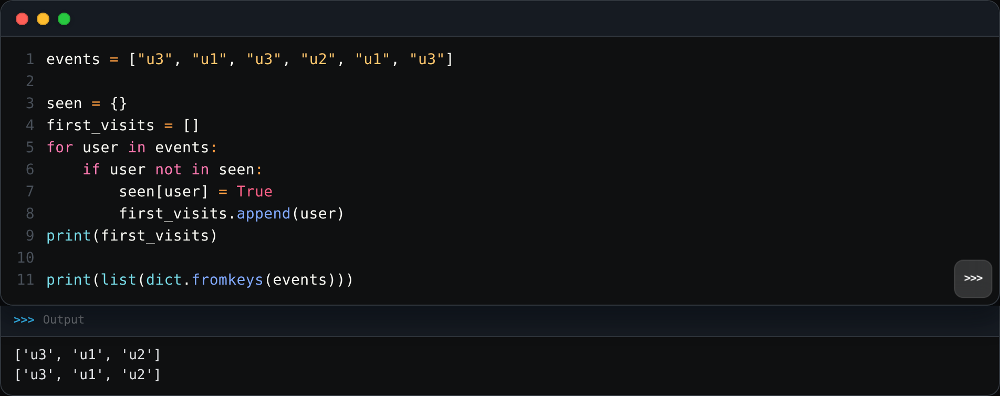

```python
events = ["u3", "u1", "u3", "u2", "u1", "u3"]

seen = {}
first_visits = []
for user in events:
    if user not in seen:
        seen[user] = True
        first_visits.append(user)
print(first_visits)

print(list(dict.fromkeys(events)))
```


<br>

### What a dict does not speed up

Only lookups by key are fast. `"Bo" in by_id.values()` walks every value one by one, the same as a list. If you search by name often, build a second dict keyed by name.

| ✓ Reach for a dict | ✗ Keep a list |
| --- | --- |
| • You look items up by an ID or name many times.<br><br>• You check membership inside a loop.<br><br>• You need the latest value per key, with repeats overwriting. | • You read items by position or slice them.<br><br>• Duplicates and their order are the data.<br><br>• You visit every item anyway, as in a sum or a filter.<br><br>• You check a few items once: building a dict costs a full pass first. |

*A dict uses more memory than a list of the same items: each entry stores the key and its value alongside the key's hash, and the table keeps spare empty slots so new keys find room.*

**flagged_ids is a list of 200,000 card IDs and payments holds 1,000,000 rows. Which change cuts the most work from this function?**

```python
def find_flagged(payments, flagged_ids):
    hits = []
    for p in payments:
        if p["card_id"] in flagged_ids:
            hits.append(p)
    return hits
```

- **A.** Rewrite the loop as a list comprehension over payments
- **B.** Build flagged = dict.fromkeys(flagged_ids) before the loop and test in flagged
- **C.** Turn payments into a dict keyed by card_id before the loop
- **D.** Build dict.fromkeys(flagged_ids) inside the loop, before each check

<details>
<summary>Solution</summary>

**B.** Build flagged = dict.fromkeys(flagged_ids) before the loop and test in flagged

The dict is built in 1 pass, and each of the 1,000,000 checks becomes a hash lookup instead of a list scan.

**Why the others are wrong**

- **A.** The comprehension still runs in flagged_ids against a list for every payment, so each check still scans up to 200,000 IDs.
- **C.** The loop visits every payment anyway, so indexing them gains nothing. The slow part is the membership test against the list.
- **D.** Each check becomes fast, but rebuilding the dict costs a full pass over 200,000 IDs per payment, worse than the scan.

</details>


<br>

---

## Converting Between Dicts and JSON

JSON is a text format for data, and Python's `json` module converts between it and dicts. `json.dumps(d)` returns a string, and `json.loads(text)` parses a string back into Python values. Each JSON type has a Python counterpart:

| Python value | JSON text | After json.loads |
| --- | --- | --- |
| dict | object {...} | dict |
| list | array [...] | list |
| str | "..." string | str |
| int / float | number | int / float |
| True / False | true / false | True / False |
| None | null | None |
| int, float, bool or None key | string key | str key |

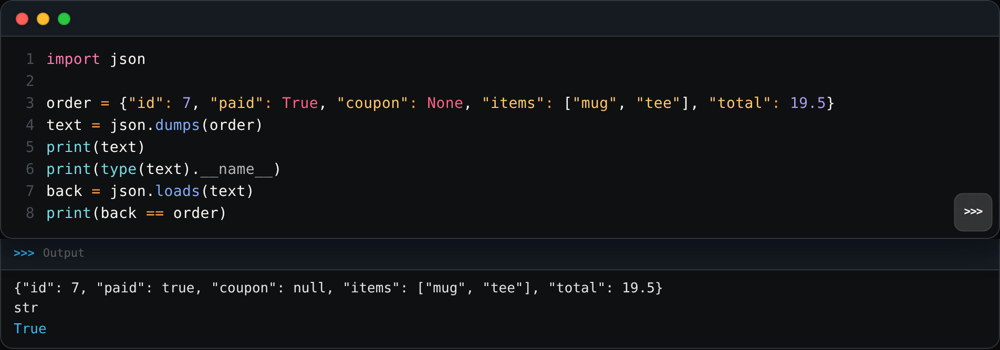

```python
import json

order = {"id": 7, "paid": True, "coupon": None, "items": ["mug", "tee"], "total": 19.5}
text = json.dumps(order)
print(text)
print(type(text).__name__)
back = json.loads(text)
print(back == order)
```

The output is a `str` in JSON spelling, with lowercase `true` and `null` for `None`. Every string sits in double quotes. Loading it gives a dict equal to the original, because every value here has a JSON counterpart and every key was already a string.


<br>

### Keys come back as strings

JSON object keys can only be strings, so `dumps` converts int and float keys to text. Bool and `None` keys get the same treatment, and `loads` has no record of what any of them were. A dict keyed by product ID changes shape on the round trip:

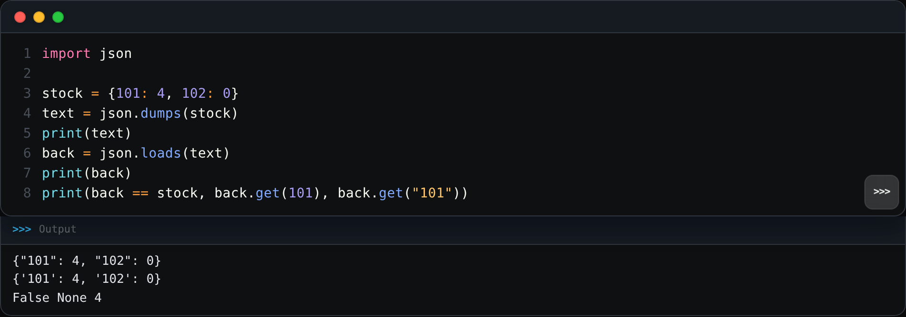

```python
import json

stock = {101: 4, 102: 0}
text = json.dumps(stock)
print(text)
back = json.loads(text)
print(back)
print(back == stock, back.get(101), back.get("101"))
```

The loaded dict is unequal to the original, and a lookup by the int `101` misses. Convert the keys back where you load: `{int(k): v for k, v in back.items()}`. Worse, 2 different keys can turn into the same string. The equal-key collapse happens once inside the dict, then JSON merges what was left:

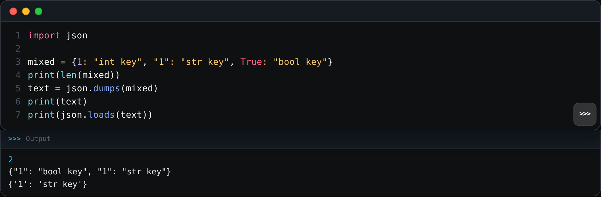

```python
import json

mixed = {1: "int key", "1": "str key", True: "bool key"}
print(len(mixed))
text = json.dumps(mixed)
print(text)
print(json.loads(text))
```

`True` merged into `1` inside the dict, leaving 2 keys. `dumps` then wrote both as `"1"`, producing JSON with a repeated key, and `loads` kept the last value it read for it. The whole round trip ran without raising an error.

**What does this program print?**

```python
limits = dict.fromkeys(["free", "pro"], {"seats": 1})
limits["pro"]["seats"] = 10
print(limits["free"]["seats"], len(limits))
```

- **A.** 1 2
- **B.** 10 1
- **C.** 10 2
- **D.** RuntimeError on the second line

<details>
<summary>Solution</summary>

**C.** 10 2

Both keys hold the same inner dict, so setting seats through pro changes what free reads. The outer dict has 2 keys.

**Why the others are wrong**

- **A.** That assumes each key got its own inner dict. fromkeys stored 1 dict object under both keys.
- **B.** The shared inner dict is right, but limits still has 2 keys: free and pro point at the same value.
- **D.** No loop is running, so nothing changes size during iteration. The write succeeds and lands in the shared dict.

</details>


<br>

### Values JSON cannot hold

Dates and datetimes have no JSON type, and neither do bytes or objects of your own classes, so `dumps` raises `TypeError` at the first one it meets. Its `default` argument takes a function that `dumps` calls on each value it cannot write, and the function's return value is written in its place. Floats fail the other way: `dumps` writes NaN and infinity as `NaN` and `Infinity`, which strict JSON parsers in other languages reject, so pass `allow_nan=False` to fail at the source.

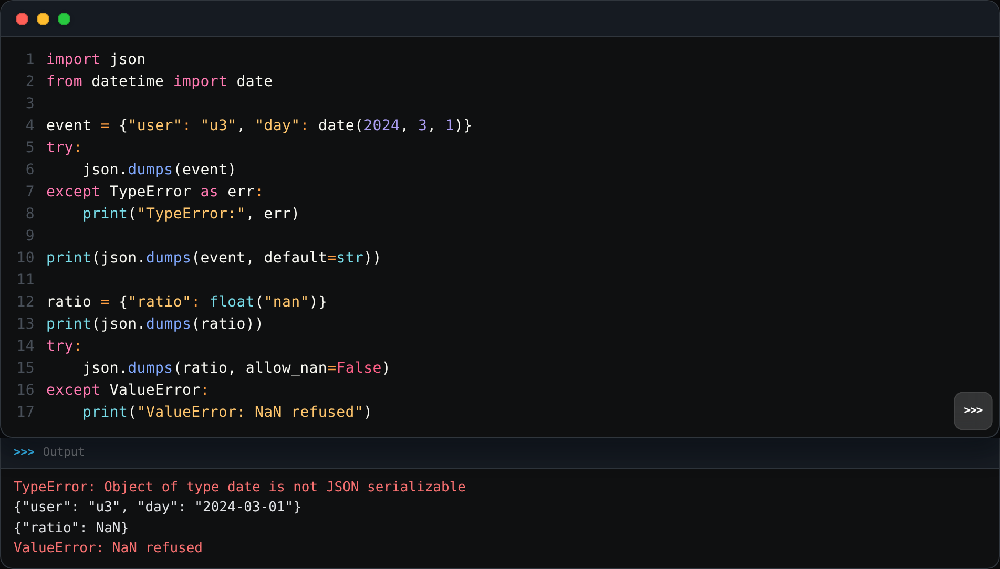

```python
import json
from datetime import date

event = {"user": "u3", "day": date(2024, 3, 1)}
try:
    json.dumps(event)
except TypeError as err:
    print("TypeError:", err)

print(json.dumps(event, default=str))

ratio = {"ratio": float("nan")}
print(json.dumps(ratio))
try:
    json.dumps(ratio, allow_nan=False)
except ValueError:
    print("ValueError: NaN refused")
```

`default=str` keeps the program running, but loading that text gives back the string `"2024-03-01"`, never a `date`. The code reading the JSON has to know which fields to convert back.


<br>

### Stable, readable text

Equal dicts can produce different JSON text, because `dumps` writes keys in insertion order while dict equality ignores order. `sort_keys=True` fixes the order, which matters when you compare outputs as text or store them where a changed byte means a changed file. `indent=2` lays the text out for people to read:

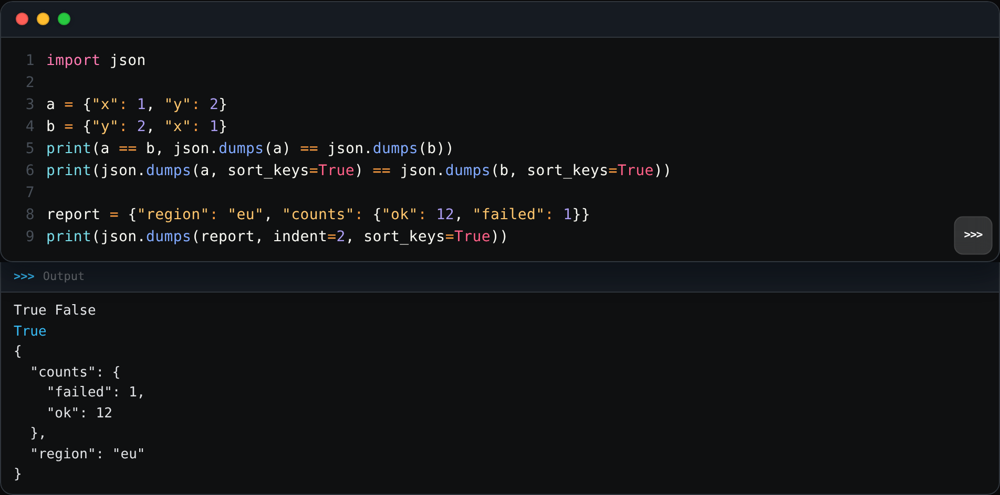

```python
import json

a = {"x": 1, "y": 2}
b = {"y": 2, "x": 1}
print(a == b, json.dumps(a) == json.dumps(b))
print(json.dumps(a, sort_keys=True) == json.dumps(b, sort_keys=True))

report = {"region": "eu", "counts": {"ok": 12, "failed": 1}}
print(json.dumps(report, indent=2, sort_keys=True))
```

> Before a dict goes to JSON
>
> - Keys that are not strings come back as strings. Convert them right after `loads`.
> - `1` and `"1"` both become the same string, so they merge into 1 key on the way back.
> - Dates and your own objects need a `default` function, and come back as whatever it returned.
> - NaN and infinity produce text strict parsers reject. Pass `allow_nan=False` to catch them.


<br>

---

## Dictionary Gotchas

Each trap below runs without an error on at least some inputs, which is how it survives into production code, so predict each output before you open it.


<br>

### Changing size while looping

A dict iterator notices when the dict gains or loses keys and raises `RuntimeError` on its next step. The error arrives after the first deletion has already happened, so the dict is left half cleaned:

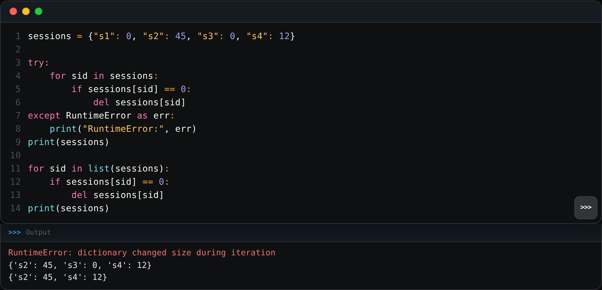

```python
sessions = {"s1": 0, "s2": 45, "s3": 0, "s4": 12}

try:
    for sid in sessions:
        if sessions[sid] == 0:
            del sessions[sid]
except RuntimeError as err:
    print("RuntimeError:", err)
print(sessions)

for sid in list(sessions):
    if sessions[sid] == 0:
        del sessions[sid]
print(sessions)
```

`list(sessions)` is a snapshot of the keys taken before any deletion, so the loop never walks the dict it changes. Building a new dict works too: `{k: v for k, v in sessions.items() if v != 0}`. Assigning a new value to an existing key keeps the size the same and is allowed mid-loop.


<br>

### One list shared by every key

`dict.fromkeys(keys, value)` stores the same `value` object under every key. With an int or a string that is harmless. With a list or a dict, every key points at 1 shared object:

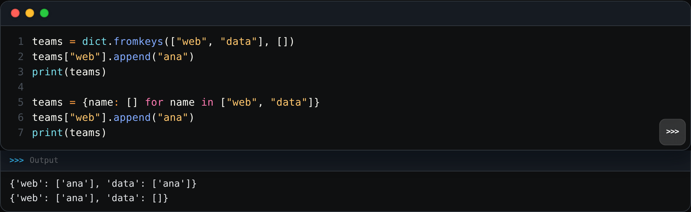

```python
teams = dict.fromkeys(["web", "data"], [])
teams["web"].append("ana")
print(teams)

teams = {name: [] for name in ["web", "data"]}
teams["web"].append("ana")
print(teams)
```

The comprehension evaluates `[]` once per key, so each team gets its own list.

**What does this program print?**

```python
limits = dict.fromkeys(["free", "pro"], {"seats": 1})
limits["pro"]["seats"] = 10
print(limits["free"]["seats"], len(limits))
```

- **A.** 1 2
- **B.** 10 1
- **C.** 10 2
- **D.** RuntimeError on the second line

<details>
<summary>Solution</summary>

**C.** 10 2

Both keys hold the same inner dict, so setting seats through pro changes what free reads. The outer dict has 2 keys.

**Why the others are wrong**

- **A.** That assumes each key got its own inner dict. fromkeys stored 1 dict object under both keys.
- **B.** The shared inner dict is right, but limits still has 2 keys: free and pro point at the same value.
- **D.** No loop is running, so nothing changes size during iteration. The write succeeds and lands in the shared dict.

</details>


<br>

### Falsy values that look missing

`d.get(k)` returns `None` for a missing key, so `if not d.get(k)` fires for a missing key. It also fires for a stored `0` or `""`, and for `[]` and `False` too. When a falsy value is real data, test for the key with `in`:

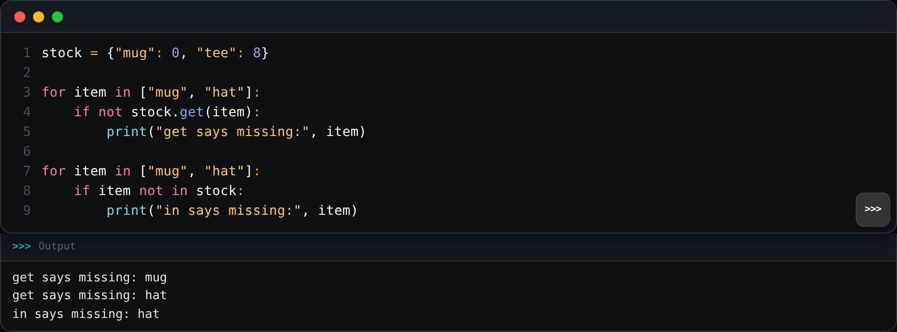

```python
stock = {"mug": 0, "tee": 8}

for item in ["mug", "hat"]:
    if not stock.get(item):
        print("get says missing:", item)

for item in ["mug", "hat"]:
    if item not in stock:
        print("in says missing:", item)
```


<br>

### Updates keep a key's position

Assigning to a key that already exists leaves it where it was. Deleting it and adding it back moves it to the end. Equality ignores order, so 2 dicts can be equal and still loop in different orders:

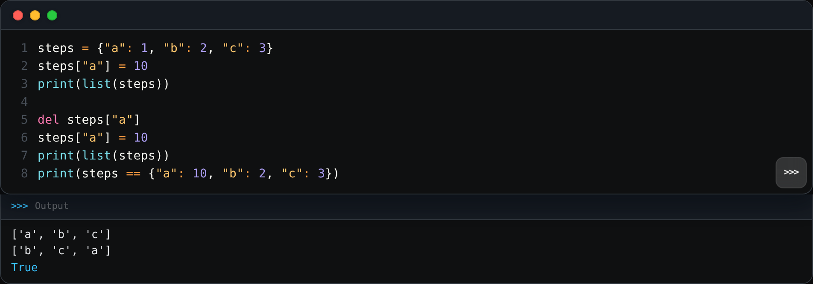

```python
steps = {"a": 1, "b": 2, "c": 3}
steps["a"] = 10
print(list(steps))

del steps["a"]
steps["a"] = 10
print(list(steps))
print(steps == {"a": 10, "b": 2, "c": 3})
```


<br>

### A key that changes after it is stored

A dict files each key under the hash it had when it went in. Reassign a field that `__hash__` reads, and the key stays filed under its old hash. A lookup by the new value goes to the wrong slot, and a lookup by the old value finds a key that no longer compares equal:

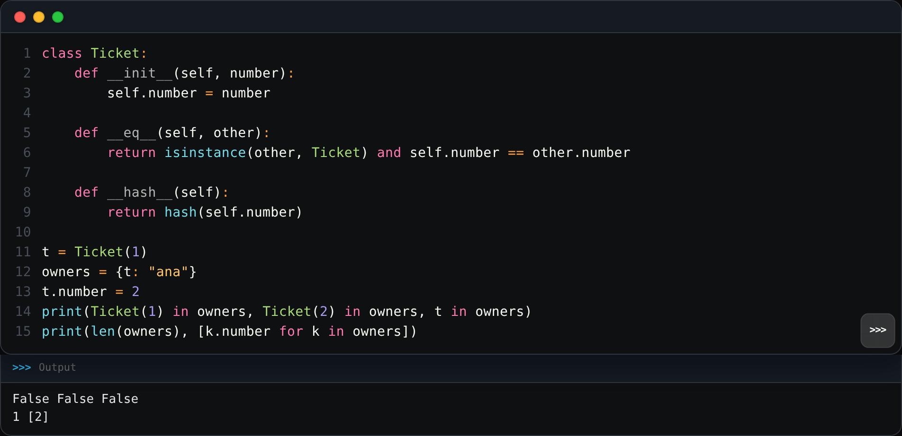

```python
class Ticket:
    def __init__(self, number):
        self.number = number

    def __eq__(self, other):
        return isinstance(other, Ticket) and self.number == other.number

    def __hash__(self):
        return hash(self.number)

t = Ticket(1)
owners = {t: "ana"}
t.number = 2
print(Ticket(1) in owners, Ticket(2) in owners, t in owners)
print(len(owners), [k.number for k in owners])
```

The entry is still in the dict and still counted, yet no lookup can reach it. Keep keys to strings and ints, or to objects whose hashed fields you never reassign.

| ✓ Do | ✗ Don't |
| --- | --- |
| • Loop over list(d) or build a new dict when the loop deletes keys<br><br>• Build per-key lists with {k: [] for k in keys}<br><br>• Test k in d when 0, "" or None are valid values<br><br>• Hash only fields that never change after the object becomes a key | • Delete or add keys while iterating over the dict itself<br><br>• Pass a list or dict as the value to dict.fromkeys<br><br>• Use if not d.get(k) to mean the key is absent<br><br>• Expect reassigning a key to move it to the end of the order |


<br>

---

## Putting It All Together

A payments service loads its merchant risk limits from a JSON document at startup, keys them by merchant ID, and hands them to dozens of request handlers that check every incoming charge against them. A nightly job refreshes the limits and drops merchants that have closed.

- The JSON loader turns merchant IDs into strings, so the service converts keys with int ( ) as it loads, or every lookup by an int ID misses.
- Converting at load time also stops 101 and "101" from splitting 1 merchant into 2 entries with separate limits.
- Handlers receive a MappingProxyType over the limits, so a handler that tries to adjust a limit fails at that line instead of changing it for every later charge.
- Each charge checks its merchant with 1 dict lookup, so adding merchants leaves the check as fast as before, where scanning a list of merchants would slow every charge.
- The refresh job updates the owner's private dict in place: it deletes closed merchants while looping over a snapshot of the keys and assigns new limits to existing keys. It never rebinds the name to a freshly loaded dict, so the handlers' live proxies, which still wrap that same dict, show the new limits on their next read.


<br>

---

## Key Takeaways

- MappingProxyType ( d ) hands out a live, read-only view. Wrap a copy for a snapshot, and remember nested values stay writable.
- A dict finds a key by hash, then confirms with == , so 1.0 and True land on the same key as 1 , while 1 and "1" stay 2 keys.
- Key classes need __eq__ and __hash__ built from the same fields, and those fields must never change while the object is a key.
- A dict lookup costs about the same at any size, while in on a list grows with the list. Build the lookup dict once, outside the loop.
- JSON keys are always strings. Dates and NaN need explicit handling, and sort_keys = True makes the text stable.
- Snapshot keys before deleting in a loop, never share a mutable fromkeys value, and test with in when falsy values are real data.
