# Dictionaries: Beginner

If Spotify stored each track as a list running title, artist, tempo, duration, and someone inserted an album field at position 1, every job reading `track[2]` for tempo would get the artist instead. Playlists would sort by artist name. A dictionary asks for `track["tempo"]` by name, so no insertion can shift it.


<br>

---

## Creating Your First Dictionary

A list stores items by position. That works when the position means something, such as the order of names in a queue, and fails when it does not. Here is a single person stored as a list:

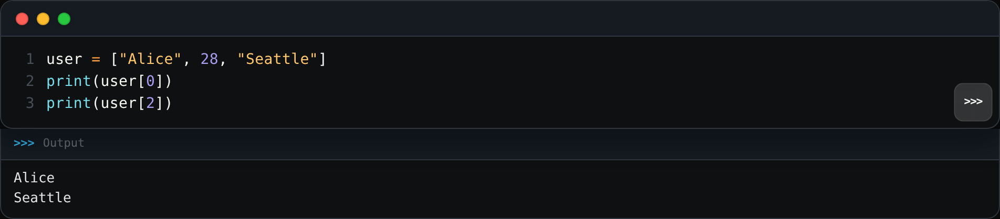

```python
user = ["Alice", 28, "Seattle"]
print(user[0])
print(user[2])
```

`user[0]` is the name and `user[2]` is the city because whoever built the list put them there. Nothing in the code says so, and a reader has to count positions to find out. Insert a phone number at position 1 and every `user[2]` in the program silently returns the age instead of the city. A dictionary removes the counting: each value is stored under a key that you choose, and you ask for the value by that key.


<br>

### The shape of a dictionary

```sql
user = {
    "name": "Alice",
    "age": 28,
    "city": "Seattle",
}
```

Curly braces open and close the dictionary. Inside, each entry puts a colon between its key and its value, and commas separate the entries. The trailing comma after the last pair is optional, and the whole thing fits on a single line when it is short: `{"name": "Alice", "age": 28}`. Python programmers call this type a dict, and the word appears in error messages and documentation.

| Term | Meaning | In the example |
| --- | --- | --- |
| Key | The label you look a value up by | "name", "age", "city" |
| Value | The data stored under a key | "Alice", 28, "Seattle" |
| Pair | One key and its value together | "age": 28 |
| Dictionary | The whole collection of pairs | user |

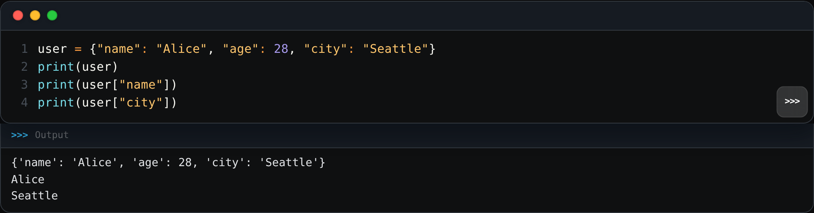

```python
user = {"name": "Alice", "age": 28, "city": "Seattle"}
print(user)
print(user["name"])
print(user["city"])
```

Python prints the dictionary in the order the pairs were written, with single quotes around strings. The lookup `user["name"]` uses square brackets the way a list does, but what goes between them is a key rather than a position. `"name"` means the same thing on every line of the program, no matter how many pairs come before it.

As a list

| Position | Value |
| --- | --- |
| 0 | Alice |
| 1 | 28 |
| 2 | Seattle |

As a dictionary

| Key | Value |
| --- | --- |
| name | Alice |
| age | 28 |
| city | Seattle |

Both tables hold the same 3 values. In the left table the labels live in your head. In the right table they live in the data, so a program can read and check them.

Reach for a dictionary when

- Each value answers a question with a name, such as what is this user's city
- Values may be added later and position would shift
- A reader should understand a lookup without counting


<br>

### Keys are unique, values are free

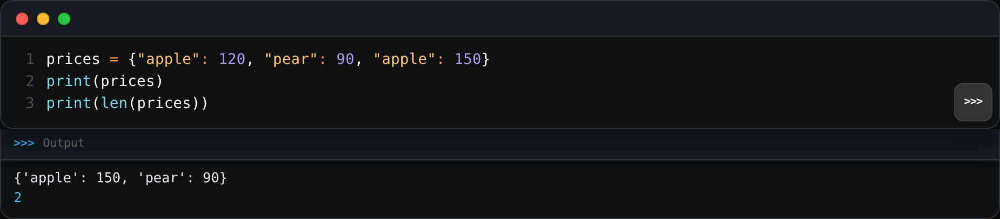

```python
prices = {"apple": 120, "pear": 90, "apple": 150}
print(prices)
print(len(prices))
```

A key appears once in a dictionary. Writing `"apple"` twice in the literal raises no error: the second value overwrites the first, so the dictionary ends up with 2 pairs and `prices["apple"]` is 150. `len()` counts pairs the same way it counts items in a list.

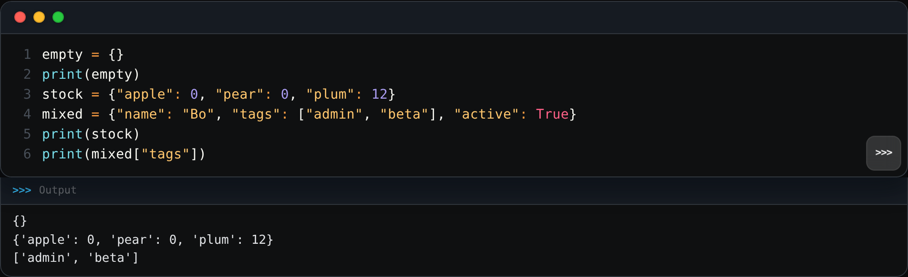

```python
empty = {}
print(empty)
stock = {"apple": 0, "pear": 0, "plum": 12}
mixed = {"name": "Bo", "tags": ["admin", "beta"], "active": True}
print(stock)
print(mixed["tags"])
```

`{}` with nothing inside is an empty dictionary, and most real dictionaries start that way and fill up as a program runs. A value can be anything Python can store, even a whole list, as `"tags"` shows. Values may repeat freely, which is why both `"apple"` and `"pear"` hold 0 at the same time, while keys cannot repeat.

> **TIP**
>
> Name a dictionary after what it maps, the way `prices` and `stock` are named; `user` follows the same pattern. Name each key for what its value means. `d["x"]` tells a reader nothing; `product["weight_kg"]` tells them everything they need.


<br>

Exercise: [Creating Your First Dictionary](_exercises/python_dictionaries_beginner_exercise_1.md)

**What does this program print?**

```python
ages = {"ana": 31, "ben": 25}
print("ana" in ages, 31 in ages, "cara" not in ages)
```

- **A.** True True True
- **B.** True False False
- **C.** True False True
- **D.** A traceback, because 31 is an integer

<details>
<summary>Solution</summary>

**C.** True False True

"ana" is a key, 31 is a value and not a key, and "cara" is absent so not in is True.

**Why the others are wrong**

- **A.** in checks keys only. 31 is a value, so 31 in ages is False.
- **B.** "cara" isn't a key, so "cara" not in ages is True.
- **D.** Any value can be tested with in; an integer that is not a key gives False, with no error.

</details>

Writing a literal from scratch takes the same 3 pieces of punctuation for every pair: quotes around a string key, a colon after it, and a comma before the next pair. The value follows the colon in whatever form it needs, so text gets quotes and a number does not: `40` and `"40"` are different values. Here is a desk lamp written one pair per line, the layout most code uses once a dictionary grows past 2 or 3 pairs:

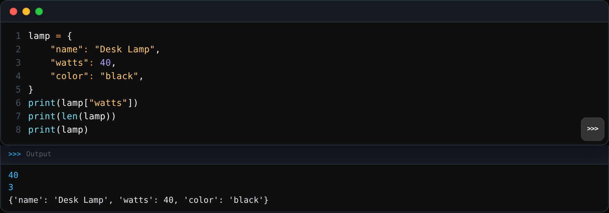

```python
lamp = {
    "name": "Desk Lamp",
    "watts": 40,
    "color": "black",
}
print(lamp["watts"])
print(len(lamp))
print(lamp)
```

The layout changes nothing about the dictionary: Python ignores line breaks inside the braces, so this `lamp` matches the one-line version pair for pair. Putting a pair on each line makes a missing colon or comma stand out, because every line inside the braces ends the same way.


<br>

---

## Reading and Updating Values

Reading a value is the lookup from the previous section: square brackets with the key inside. That lookup fails when the key is missing, and adding a new key uses the same brackets on the left of an assignment.


<br>

### Square brackets demand that the key exist

```sql
user = {"name": "Alice", "age": 28}
print(user["name"])
print(user["email"])
```

The first `print` runs and shows `Alice`. The second asks for `"email"`, which the dictionary doesn't hold, and Python stops the program with a `KeyError`. The last line of the traceback names the missing key in quotes, which is the first place to look when you see one. No `print` after line 3 would run.


<br>

### .get() asks politely

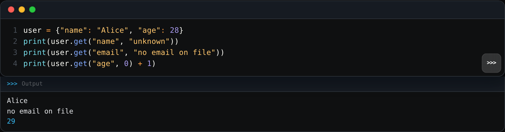

```python
user = {"name": "Alice", "age": 28}
print(user.get("name", "unknown"))
print(user.get("email", "no email on file"))
print(user.get("age", 0) + 1)
```

`user.get(key, default)` looks the key up and returns its value when the key exists. When it does not, it returns the default you passed instead of stopping the program. The third line shows that the returned value is ordinary data: `user.get("age", 0)` is 28 here, so adding 1 prints 29. You can leave the default off and write `user.get("email")`, in which case a missing key returns a special value called `None` that stands for no value; a later lesson covers `None`, and until then passing a default keeps every result predictable.

*.get never adds anything. After user.get("email", "none") the dictionary still has 2 pairs, the same as before the call.*

| ✓ d[key] | ✗ d.get(key, default) |
| --- | --- |
| • Returns the value when the key exists<br><br>• Stops the program with KeyError when it does not<br><br>• Use it when a missing key is a bug you want to notice | • Returns the value when the key exists<br><br>• Returns the default when it does not<br><br>• Use it when a missing key is a normal case, such as an optional setting |


<br>

### Writing with square brackets

Assignment through square brackets has the same shape as reading, with the lookup on the left of `=`. If the key is new, Python adds the pair; if the key already exists, Python replaces its value. Step through this program and watch the dictionary change:

https://github.com/user-attachments/assets/23a8d4e7-e5b2-4bd9-b092-8822b132d268

After line 5 the dictionary has 3 pairs, and after line 9 it still has 3: `"age"` kept its single pair while its value went from 28 to 29. Brackets behave differently for reads and writes, because reading a missing key crashes and writing to a missing key creates it. Every `=` with brackets on the left either adds or replaces, and never raises a `KeyError`.

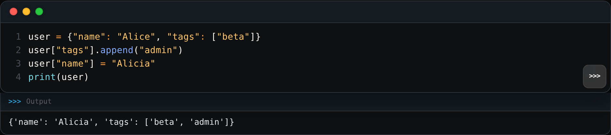

```python
user = {"name": "Alice", "tags": ["beta"]}
user["tags"].append("admin")
user["name"] = "Alicia"
print(user)
```

When a value is a list, `user["tags"]` hands you that list, and `.append` changes it in place, so the dictionary sees the new tag without any assignment back. Replacing `"name"` works as before. Reading and writing combine in 1 line: `stock["apple"] = stock["apple"] + 2` adds 2 to the old count read on the right and stores the sum under the same key.

> 3 operations with the same brackets
>
> - user["age"] reads: KeyError if the key is missing
> - user["age"] = 29 writes: adds or replaces, never a KeyError
> - user.get("age", 0) reads with a fallback: never a KeyError, never adds


<br>

Exercise: [Reading and Updating Values](_exercises/python_dictionaries_beginner_exercise_2.md)

**What does the last line print?**

```python
stock = {"apple": 3}
stock["pear"] = 5
stock["apple"] = stock["apple"] + 2
print(stock.get("plum", 0), stock["apple"], len(stock))
```

- **A.** 0 3 2
- **B.** A traceback, because "plum" was never added
- **C.** 0 5 3
- **D.** 0 5 2

<details>
<summary>Solution</summary>

**D.** 0 5 2

plum is missing so .get gives 0, apple was raised to 5, and the 2 keys are apple and pear.

**Why the others are wrong**

- **A.** Line 3 turns apple's 3 into 5 by adding 2 and writing the sum back, so apple is 5 by the print.
- **B.** .get with a default returns 0 for a missing key and never raises.
- **C.** .get does not add "plum", so the dictionary holds only apple and pear: 2 pairs.

</details>

One more worked case before you write your own. An update line runs its right side first: Python evaluates the right side, lookup and arithmetic included, and only then stores the result under the key on the left. A new key needs no such read, because there is nothing to read yet.

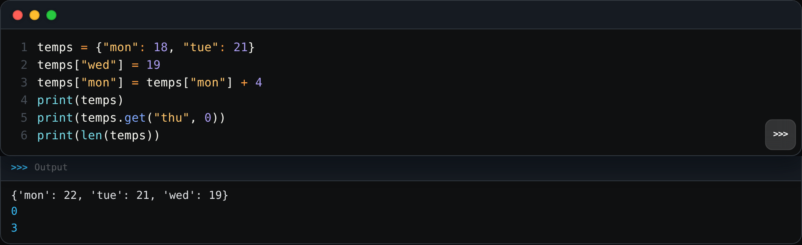

```python
temps = {"mon": 18, "tue": 21}
temps["wed"] = 19
temps["mon"] = temps["mon"] + 4
print(temps)
print(temps.get("thu", 0))
print(len(temps))
```

`"wed"` joins at the end through a plain assignment, and `"mon"` keeps its first position while its value goes from 18 to 22. The `.get` for `"thu"` returns 0 and leaves the dictionary at 3 pairs. Writing `temps["thu"] + 4` on the right of an assignment would have stopped the program with a `KeyError`, since a missing key can't be read with brackets.


<br>

---

## Removing Items

Most dictionaries also lose pairs, the way a cart empties or a session ends. Python gives 3 ways to take pairs out, and they differ in what they hand back and in what they do when the key is already gone.


<br>

### del removes a pair

https://github.com/user-attachments/assets/e7a2efbb-4afd-4bc6-9dba-005c6102d196

`del user["city"]` removes both the key and its value; the dictionary shrinks from 3 pairs to 2 and `"city"` is gone as if it had never been written. `del` is a statement rather than a function, so it hands nothing back: there is no way to write `x = del user["city"]`.

```sql
user = {"name": "Alice", "age": 28}
del user["age"]
print(user)
del user["age"]
```

Deleting a key that is absent raises the same `KeyError` as reading one. The first `del` succeeds, the `print` shows the 1 remaining pair, and the second `del` stops the program. When a program might delete the same key twice, `del` on its own is unsafe.


<br>

### pop removes and returns

https://github.com/user-attachments/assets/a244ed82-2e00-43fb-97d9-eea006a72285

`user.pop("city")` does 2 things: it removes the pair and it returns the value, so `city` holds `"Seattle"` after the call. That makes `pop` the tool when you still need the value, such as moving an item from a cart to an order. The second call shows the safe form: `user.pop("country", "Unknown")` finds no `"country"` key, leaves the dictionary alone, and returns the default.

```sql
scores = {"ana": 91, "ben": 78}
removed = scores.pop("ben")
print(removed)
print(scores)
print(scores.pop("cara", 0))
print(scores.pop("cara"))
```

`pop` with 1 argument behaves like `del`: a missing key is a `KeyError`. `pop` with 2 arguments never raises for a missing key, because the second argument is what to return when there's nothing to remove. The traceback here comes from the final line only; the 3 prints before it all ran and their output stays on screen.


<br>

### clear empties everything

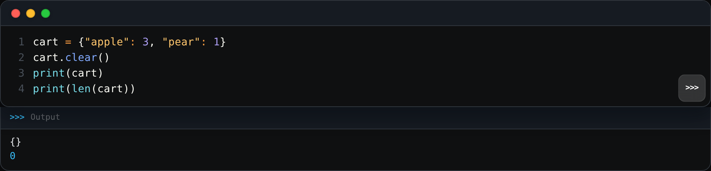

```python
cart = {"apple": 3, "pear": 1}
cart.clear()
print(cart)
print(len(cart))
```

`cart.clear()` removes every pair at once, leaving the dictionary with 0 pairs. The name `cart` still refers to it, and new pairs can be added afterwards with bracket assignment. Calling `clear()` on an already empty dictionary does nothing and raises nothing.

| Operation | Hands back | Key missing |
| --- | --- | --- |
| del d[key] | Nothing | KeyError |
| d.pop(key) | The removed value | KeyError |
| d.pop(key, default) | The removed value, or the default | Returns the default, no error |
| d.clear() | Nothing | No key involved, never errors |

| ✓ Do | ✗ Don't |
| --- | --- |
| • Use pop with a default when a key may already be gone<br><br>• Use pop when you need the value you are removing<br><br>• Use del when the key must exist and a crash should flag the bug | • Don't call del twice on the same key without a check between<br><br>• Do not use pop(key) without a default for optional keys<br><br>• Do not remove pairs one at a time to empty a dictionary; use clear |


<br>

Exercise: [Removing Items](_exercises/python_dictionaries_beginner_exercise_3.md)

Real programs mix the removal tools, and the order of the calls decides what each one finds. Trace this session cleanup line by line:

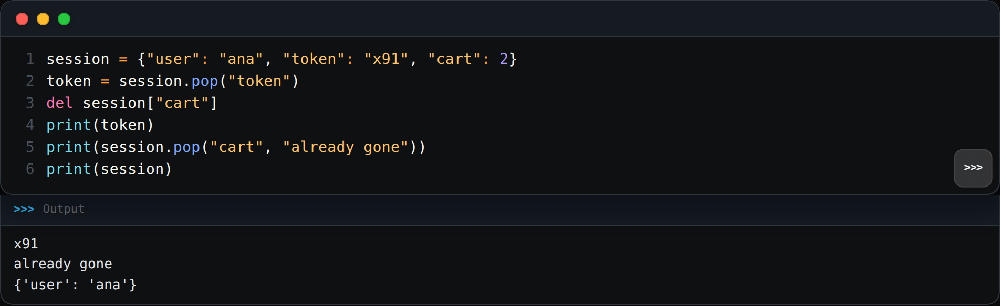

```python
session = {"user": "ana", "token": "x91", "cart": 2}
token = session.pop("token")
del session["cart"]
print(token)
print(session.pop("cart", "already gone"))
print(session)
```

Line 2 takes `"token"` out and keeps its value in `token`. Line 3 removes `"cart"`, so by line 5 the key is absent and `pop` hands back its default instead of a count. Change line 5 to `session.pop("cart")` and the program would print x91, then stop with `KeyError: 'cart'`. Only `"user"` is left at the end.

**What does the print statement show?**

```python
cart = {"apple": 2, "pear": 1, "plum": 4}
taken = cart.pop("pear")
del cart["plum"]
print(taken, cart.pop("plum", "gone"), cart)
```

- **A.** 1 gone {'apple': 2}
- **B.** 1 4 {'apple': 2}
- **C.** A traceback, because "plum" was already removed
- **D.** 1 gone {'apple': 2, 'pear': 1}

<details>
<summary>Solution</summary>

**A.** 1 gone {'apple': 2}

pop returns pear's 1, del removes plum, so the second pop falls back to "gone" and only apple remains.

**Why the others are wrong**

- **B.** del already removed plum on line 3, so there's no 4 left to return.
- **C.** pop with a default never raises for a missing key; it returns the default.
- **D.** pop removes the pair as well as returning its value, so pear is no longer in the dictionary.

</details>


<br>

---

## Checking for Keys and Key Types

Giving `.get` a default handles a missing key by substituting a value. Sometimes you want to ask the question directly: is this key here? Python answers with the `in` operator, and an `if` uses the answer to pick which branch runs.


<br>

### in and not in

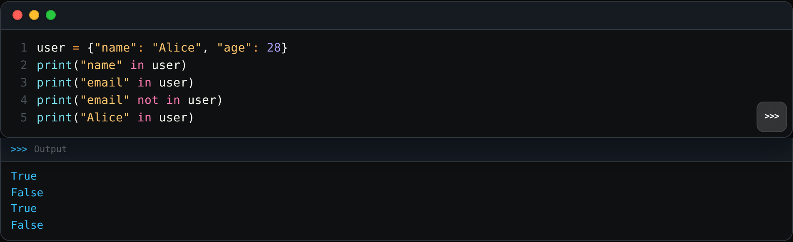

```python
user = {"name": "Alice", "age": 28}
print("name" in user)
print("email" in user)
print("email" not in user)
print("Alice" in user)
```

`"name" in user` is `True` because `"name"` is a key. `"email" in user` is `False`, and `not in` flips the answer. The fourth line is the one people get wrong: `"Alice" in user` is `False` even though `"Alice"` is sitting right there in the dictionary. `in` looks at keys only. Values are reached through their keys, never searched by `in`.

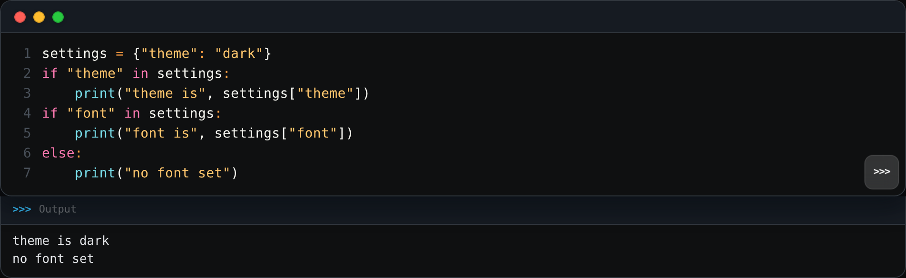

```python
settings = {"theme": "dark"}
if "theme" in settings:
    print("theme is", settings["theme"])
if "font" in settings:
    print("font is", settings["font"])
else:
    print("no font set")
```

This is the pattern: test with `in`, then read with brackets inside the branch where the key is known to exist. The bracket read on line 3 can't raise, because line 2 already confirmed the key. The `else` branch handles the absent case with whatever makes sense, here a message. Compared with `.get`, which folds the test and the fallback into a single expression, `in` lets you run different code on each side.

| ✓ Use in when | ✗ Use .get when |
| --- | --- |
| • The absent case needs its own code, not a stand-in value<br><br>• A loop must decide between creating and updating an entry<br><br>• You want to confirm a key before del or a bracket read | • A default value is all the absent case needs<br><br>• The lookup sits inside a larger expression<br><br>• One line beats an if/else |


<br>

### What can be a key

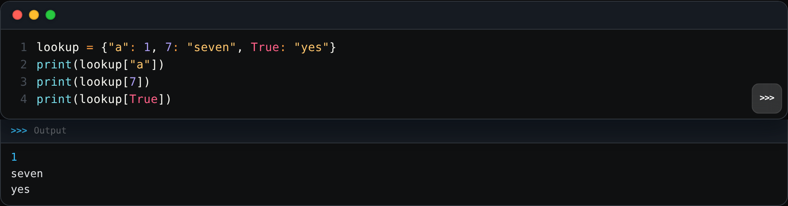

```python
lookup = {"a": 1, 7: "seven", True: "yes"}
print(lookup["a"])
print(lookup[7])
print(lookup[True])
```

Strings are the most common keys. Integers and booleans work as well, and a single dictionary can mix them. Python finds a key by turning it into a number called a hash, and uses that number to choose where the pair is stored. For that to work, a key must never change after it goes in: if it changed, its hash would change, Python would look in the wrong place, and the pair would be lost. None of these 3 types can be changed once created, so all of them qualify.

```sql
bad = {["x", "y"]: 1}
```

A list can change, so Python refuses it as a key before the dictionary is even built. The error is a `TypeError` with the word `unhashable`, which is Python's way of saying the object has no stable hash. The fix depends on what you meant; usually the list belongs on the value side, under a string key such as `"coords"`.

| Type | Allowed as a key | Example |
| --- | --- | --- |
| str | Yes | "name" |
| int | Yes | 404 |
| bool | Yes | True |
| list | No, TypeError | ["a", "b"] |
| dict | No, TypeError | {"a": 1} |

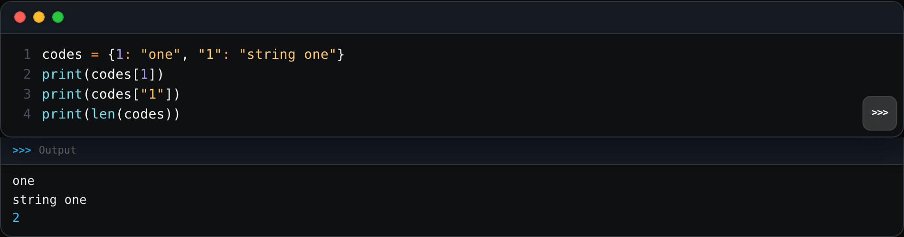

```python
codes = {1: "one", "1": "string one"}
print(codes[1])
print(codes["1"])
print(len(codes))
```

The integer `1` and the string `"1"` are different keys, because they're different values: `1 == "1"` is `False`. A dictionary filled from typed input holds `"42"`, because everything typed arrives as text, so a lookup with the number `42` will miss. Mixing key types is allowed, as the `lookup` example showed, but when keys come from input, settle on either text or numbers for that dictionary's keys so every lookup uses the type the keys were stored with.


<br>

Exercise: [Checking for Keys and Key Types](_exercises/python_dictionaries_beginner_exercise_4.md)

**What does this program print?**

```python
ages = {"ana": 31, "ben": 25}
print("ana" in ages, 31 in ages, "cara" not in ages)
```

- **A.** True True True
- **B.** True False False
- **C.** True False True
- **D.** A traceback, because 31 is an integer

<details>
<summary>Solution</summary>

**C.** True False True

"ana" is a key, 31 is a value and not a key, and "cara" is absent so not in is True.

**Why the others are wrong**

- **A.** in checks keys only. 31 is a value, so 31 in ages is False.
- **B.** "cara" isn't a key, so "cara" not in ages is True.
- **D.** Any value can be tested with in; an integer that is not a key gives False, with no error.

</details>

The `in` test also guards a removal. The Removing Items section showed that a second `del` on the same key crashes; checking first lets the program take whichever branch fits:

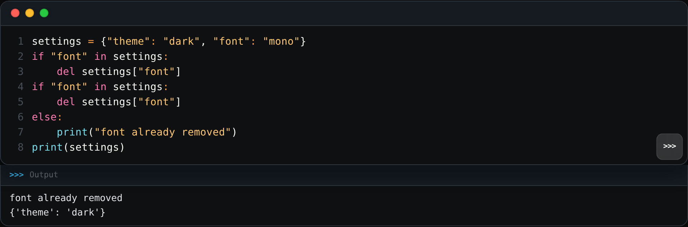

```python
settings = {"theme": "dark", "font": "mono"}
if "font" in settings:
    del settings["font"]
if "font" in settings:
    del settings["font"]
else:
    print("font already removed")
print(settings)
```

The first `if` finds `"font"` and deletes it. The second gets `False` from the same question and runs the `else` branch, so the second `del` never executes. The test and the action name the same key: a check for `"font"` protects a `del` or bracket read of `"font"` and nothing else.


<br>

---

## Real-World Use Cases

Most real programs use dictionaries for 2 jobs: holding settings and counting things.


<br>

### Settings with sensible defaults

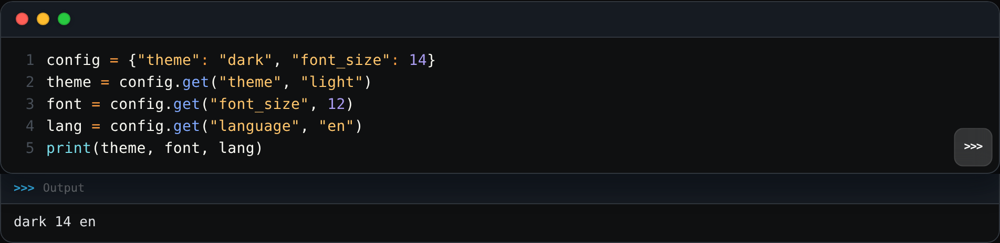

```python
config = {"theme": "dark", "font_size": 14}
theme = config.get("theme", "light")
font = config.get("font_size", 12)
lang = config.get("language", "en")
print(theme, font, lang)
```

A config dictionary holds the settings a user or a deployment changed. Anything they left alone is absent, and `.get` with a default fills it in: `"language"` was never set, so the program runs in `"en"`. The defaults live in the code at the point of use, the overrides live in the dictionary, and neither side needs to know which keys the other has.

| Setting | In config | Default | Value used |
| --- | --- | --- | --- |
| theme | yes | light | dark |
| font_size | yes | 12 | 14 |
| language | no | en | en |


<br>

### Counting with a dictionary

To count how often each word appears in a list, you need 1 counter per distinct word, and you do not know the words in advance. A dictionary with the word as key and the count as value grows a counter the first time each word shows up:

https://github.com/user-attachments/assets/93db25e4-ef35-42be-bd7b-39d48781fdc6

| Word | Already a key | Action | Dictionary after |
| --- | --- | --- | --- |
| apple | no | create apple: 1 | {'apple': 1} |
| banana | no | create banana: 1 | {'apple': 1, 'banana': 1} |
| apple | yes | 1 + 1 = 2 | {'apple': 2, 'banana': 1} |
| cherry | no | create cherry: 1 | {'apple': 2, 'banana': 1, 'cherry': 1} |
| apple | yes | 2 + 1 = 3 | {'apple': 3, 'banana': 1, 'cherry': 1} |
| banana | yes | 1 + 1 = 2 | {'apple': 3, 'banana': 2, 'cherry': 1} |

Depending on the membership test, each word gets one of 2 bracket writes: create the pair with a value of 1, or replace the current count with that count plus 1. After 6 words the dictionary holds 3 pairs, `apple` at 3, `banana` at 2, `cherry` at 1, in the order each word first appeared. The same loop counts anything that can be a key: status codes, letter grades, product ids.

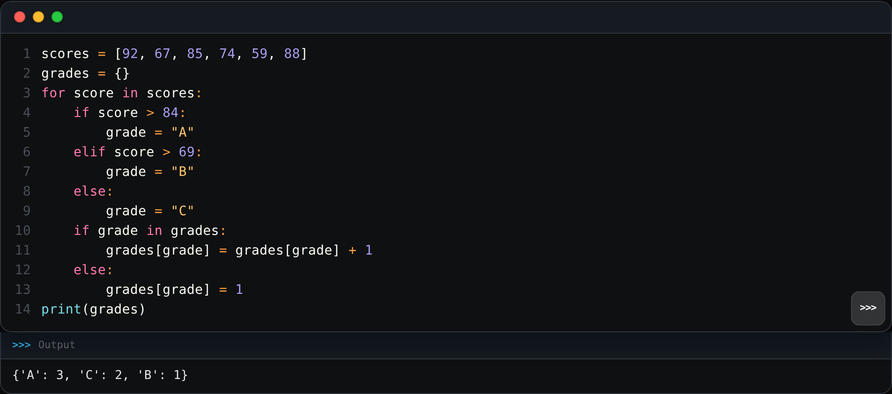

```python
scores = [92, 67, 85, 74, 59, 88]
grades = {}
for score in scores:
    if score > 84:
        grade = "A"
    elif score > 69:
        grade = "B"
    else:
        grade = "C"
    if grade in grades:
        grades[grade] = grades[grade] + 1
    else:
        grades[grade] = 1
print(grades)
```

Here the key is computed before the count. Each score becomes a letter through the `if`/`elif`/`else` chain, and the tally code underneath never changes. `"A"` enters the dictionary first because 92 is the first score, then `"C"` for 67, then `"B"` for 74, so that is the printed order even though B sits between A and C alphabetically.


<br>

### Lookup tables

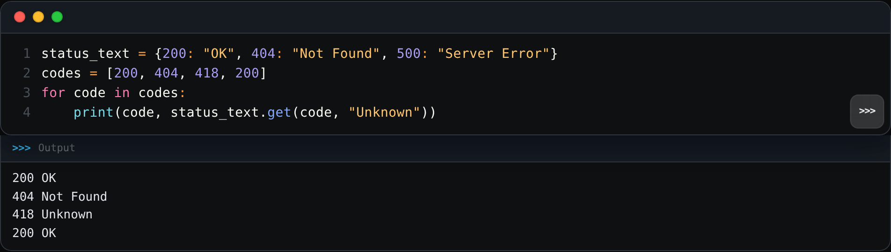

```python
status_text = {200: "OK", 404: "Not Found", 500: "Server Error"}
codes = [200, 404, 418, 200]
for code in codes:
    print(code, status_text.get(code, "Unknown"))
```

A dictionary that translates one value into another is a lookup table. Code 418 has no entry, so `.get` supplies `"Unknown"` and the loop keeps going; a bracket lookup would have crashed on the third code. Lookup tables replace long `if`/`elif` chains: supporting a new status means adding 1 pair, with no new branch to write or test.


<br>

### A tiny inventory

This program starts from a stocked dictionary and runs each order through a membership test before touching the counts with bracket reads and writes. One removal comes at the end. Predict every printed line before you reveal the output.

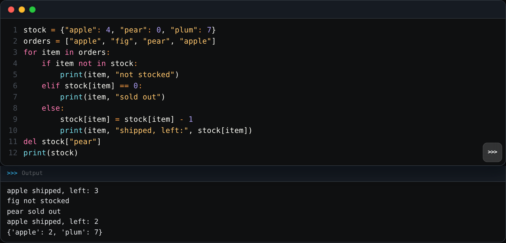

```python
stock = {"apple": 4, "pear": 0, "plum": 7}
orders = ["apple", "fig", "pear", "apple"]
for item in orders:
    if item not in stock:
        print(item, "not stocked")
    elif stock[item] == 0:
        print(item, "sold out")
    else:
        stock[item] = stock[item] - 1
        print(item, "shipped, left:", stock[item])
del stock["pear"]
print(stock)
```

Order by order: `"fig"` fails the `not in` test and prints `not stocked`, with no bracket read ever attempted on it. `"pear"` is a key but its count is 0, so the `elif` catches it. Each `"apple"` order writes back the count minus 1, so the count goes from 4 to 3 to 2. The final `del` drops the sold-out pear, and the printed dictionary shows the 2 remaining products with their updated counts.


<br>

**What does the final line print?**

```python
votes = ["red", "blue", "red", "green", "red"]
tally = {}
for color in votes:
    if color in tally:
        tally[color] = tally[color] + 1
    else:
        tally[color] = 1
print(tally["red"], tally.get("blue", 0), tally.get("pink", 0))
```

- **A.** 2 1 0
- **B.** 3 1 0
- **C.** 3 2 0
- **D.** A traceback at the last get, because pink was never voted for

<details>
<summary>Solution</summary>

**B.** 3 1 0

red is counted 3 times and blue once. pink was never added, so .get returns 0.

**Why the others are wrong**

- **A.** red appears 3 times: the first sets 1, the next 2 each add 1.
- **C.** blue appears once in votes, so its count stays at 1.
- **D.** .get with a default handles a missing key without raising.

</details>

Two dictionaries often work as a pair: one counts what happened, the other holds settings that judge the counts. Here a `limits` config caps how many of each item an order may hold, and any item without its own entry gets a default limit of 1:

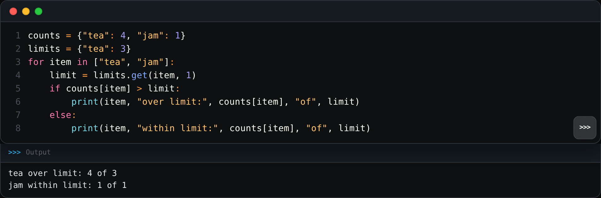

```python
counts = {"tea": 4, "jam": 1}
limits = {"tea": 3}
for item in ["tea", "jam"]:
    limit = limits.get(item, 1)
    if counts[item] > limit:
        print(item, "over limit:", counts[item], "of", limit)
    else:
        print(item, "within limit:", counts[item], "of", limit)
```

`"tea"` is over its own limit of 3 with a count of 4. `"jam"` has no entry in `limits`, so `.get` supplies 1, and a count of 1 is not greater than 1. The counts are read with brackets because the loop only asks for items it knows were counted; the limits are read with `.get` because most items have no entry of their own.


<br>

---

## Putting It All Together

A Shopify merchant's storefront loads its settings and tracks sales during a flash sale. The store's config dictionary holds the handful of settings the merchant changed, such as the theme and currency, and the checkout code reads every setting with .get and a default, so a merchant who never touched the language setting still gets English. Each incoming order carries a product id, and a counting loop keeps a dictionary of units sold per product: a membership test decides whether to create the entry at 1 or read the count and add 1. When a product sells out, its entry is popped with a default so that a duplicate sold-out signal cannot crash the sale, and the returned count is what the dashboard shows as the final total.

- The config dictionary is the settings pattern from Section 4, built with the literal syntax from Section 0 and read with .get from Section 1.
- The units-sold loop is the counting pattern, which rests on the in test from Section 3 choosing between the 2 bracket writes from Section 1.
- Popping a sold-out product with a default is the safe removal from Section 2, chosen because the returned count is still needed.
- Product ids are strings everywhere in the system, which keeps the key type consistent so that lookups from the order feed and the dashboard find the same pairs.


<br>

---

## Key Takeaways

- A dictionary stores values under keys you choose, so a lookup reads by name instead of by counted position.
- d[key] reads and crashes with KeyError when the key is absent; d.get(key, default) reads and returns the default instead.
- d[key] = value adds the pair when the key is new and replaces the value when it exists, and never raises a KeyError.
- del removes a pair and returns nothing, while pop also returns the value. Given a default, pop is the only way to remove one key that never crashes when the key is already gone.
- in and not in test keys only, never values, and a membership test before a bracket read makes the read safe.
- Keys must be values that can't change. Strings and integers qualify, as do booleans, while lists and dictionaries raise TypeError.
- Configs read with .get and counting loops with in cover most of what dictionaries do in everyday programs.
