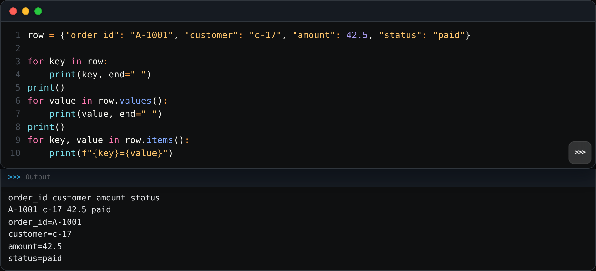
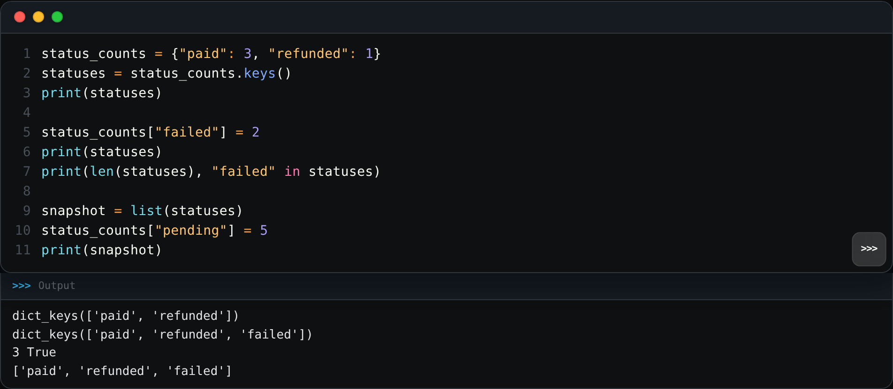
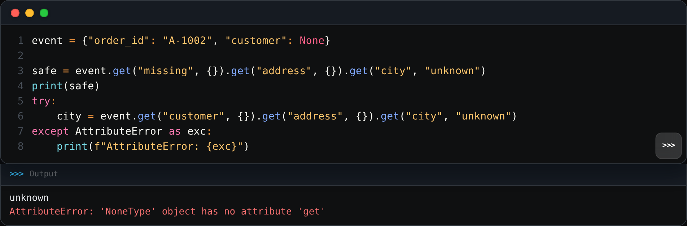

# Dictionaries: Intermediate

A nightly order job reads 2 million JSON events. Each one is a dict holding a nested customer, a list of line items and a status that sometimes arrives as null. Layering job settings over defaults, collecting events per customer and cleaning records before load all come down to a handful of dict operations. Get one wrong and a single job's override leaks into every job after it.


<br>

---

## Iterating and Dictionary Views

### 3 ways to walk a dict

A `for` loop over a dict yields its keys. 3 methods choose something else for each pass: `.keys()` yields keys, `.values()` yields values, and `.items()` yields `(key, value)` tuples that the loop header unpacks into 2 names. All of them walk entries in insertion order, guaranteed since Python 3.7, meaning the order in which each key was first added. For sorted order, call `sorted()` explicitly.



```python
row = {"order_id": "A-1001", "customer": "c-17", "amount": 42.5, "status": "paid"}

for key in row:
    print(key, end=" ")
print()
for value in row.values():
    print(value, end=" ")
print()
for key, value in row.items():
    print(f"{key}={value}")
```

Choose by what the loop body reads. Summing amounts needs `.values()`. Comparing column names needs the bare loop or `.keys()`, which yield the same keys in the same order, so teams pick one by convention. Anything that uses both halves of an entry needs `.items()`. Looping over keys and reading `row[key]` inside also works, but it pays a second hash lookup per entry and hides from the next reader that the body wanted pairs.


<br>

### Views read the live dict

The 3 methods return view objects (`dict_keys`, `dict_values`, `dict_items`) that hold no copy of the data. A view reads the dict each time it is used, so creating one costs the same for 4 keys as for 4 million, and it shows keys added after the view was made.



```python
status_counts = {"paid": 3, "refunded": 1}
statuses = status_counts.keys()
print(statuses)

status_counts["failed"] = 2
print(statuses)
print(len(statuses), "failed" in statuses)

snapshot = list(statuses)
status_counts["pending"] = 5
print(snapshot)
```

`list(statuses)` copied the keys at that moment, so the later `pending` key never reached `snapshot`. A snapshot is what code needs before indexing (`statuses[0]` raises `TypeError: 'dict_keys' object is not subscriptable`) and before adding or removing keys while looping. Changing a dict's size during a loop over its live view raises `RuntimeError`, a trap the Advanced tier covers in its gotchas section.


<br>

### Keys views act like sets

A keys view tests membership with `in` at hash speed and supports the set operators `&`, `|`, `-` and `^`, each returning a real `set`. That turns a schema drift check into 2 subtractions. A values view supports neither: `42.5 in row.values()` compares against every value in turn, so its cost grows with the dict.

```sql
EXPECTED = {"order_id": str, "customer": str, "amount": float, "currency": str}
row = {"order_id": "A-1001", "customer": "c-17", "amount": 42.5, "status": "paid"}

missing = sorted(EXPECTED.keys() - row.keys())
unexpected = sorted(row.keys() - EXPECTED.keys())
print(missing, unexpected)
```


<br>

### Writing many keys with update

`d.update(other)` writes every pair from `other` into `d`. A key already present keeps its position and takes the new value; a new key goes on the end. The argument can be a dict, any iterable of 2-item pairs, or keyword arguments. The method changes `d` in place and returns `None`, so `row = row.update(...)` throws the dict away and leaves `row` bound to `None`.

```sql
row = {"order_id": "A-1001", "amount": 42.5, "status": "paid"}
row.update({"status": "refunded", "refund_id": "R-88"})
row.update([("currency", "GBP")])
row.update(source="web")
print(row)
```


<br>

### Read or insert with setdefault

`d.setdefault(key, default)` returns `d[key]` when the key exists. When it does not, it stores `default` under that key first and returns the stored object. `.get(key, default)` returns the same value in both cases but never writes, and that write is the whole difference: after `setdefault`, the key is in the dict.

```sql
first_order = {}
events = [("c-17", "A-1001"), ("c-22", "A-1002"), ("c-17", "A-1003")]
for customer, order_id in events:
    first_order.setdefault(customer, order_id)
print(first_order)
```

Keeping the first value per key is one use. The other, returning a mutable object that the caller then fills, drives the grouping pattern in the nested-data section. The `default` argument is evaluated on every call, even when the key already exists, so `setdefault(key, load_lookup())` calls `load_lookup()` once per record whether it is needed.


<br>

---

## Merging Dictionaries

A pipeline job's settings usually arrive in layers: package defaults, then overrides for the environment, then whatever this run passed on the command line. Combining them applies one rule over and over: when 2 dicts share a key, the dict merged later wins. Python has 4 spellings of that rule, and they split on whether the left-hand dict is changed.

| Spelling | Gives back | Changes the left dict | Python |
| --- | --- | --- | --- |
| `a.update(b)` | None; `a` holds the result | Yes | Any |
| `a |= b` | `a`, holding the result | Yes | 3.9+ |
| `a | b` | A new dict | No | 3.9+ |
| `{\*\*a, \*\*b}` | A new dict | No | 3.5+ |

```sql
DEFAULTS = {"batch_size": 500, "retries": 3, "timeout_s": 30}
env = {"retries": 5}
cli = {"batch_size": 1000}

config = DEFAULTS | env | cli
print(config)
print(DEFAULTS)
```

Read the chain left to right as lowest priority to highest: the layer that must win goes last. Key position follows a separate rule. A key keeps the slot of its first appearance and only its value changes, so `{"a": 1, "b": 2} | {"b": 9, "a": 7}` gives `{'a': 7, 'b': 9}`, in the left dict's order. Code that writes merged dicts out as CSV rows gets its column order from the defaults.


<br>

### Why in-place merges leak

A module-level `DEFAULTS` lives as long as the process. A runner that loops over 3 jobs and calls `DEFAULTS.update(job_overrides)` leaves job 1's `retries: 0` in place when job 2 builds its config, and job 2 never asked for it. Tests that run one job per process never catch this. `|` and `{**a, **b}` build a fresh dict on every call, so the shared base never changes. `update` and `|=` belong on dicts the current code owns, such as one it built a line earlier.

`{**a, **b}` also accepts literal keys after the unpacks: `{**DEFAULTS, **env, "run_id": run_id}` stamps a value no earlier layer can override. `|` requires a dict on both sides and raises `TypeError` for a list of pairs, while `|=` and `update` accept any iterable of pairs.


<br>

### Merges are one level deep

Every spelling merges the top level only. A key whose value is a dict is replaced whole by the later dict's value, so an override that mentions only `sink.path` drops `sink.format`.

```sql
DEFAULTS = {"retries": 3, "sink": {"format": "parquet", "path": "s3://lake/orders"}}
override = {"sink": {"path": "s3://lake/orders_v2"}}

print(DEFAULTS | override)
fixed = DEFAULTS | override | {"sink": DEFAULTS["sink"] | override.get("sink", {})}
print(fixed)
```

The fix merges the nested level explicitly and puts that result last, so it beats the wholesale replacement from `override`. Configs nested 3 or 4 levels deep need a merge function that repeats this step at every level where both sides hold a dict.

With the order settled, one choice remains: which spelling the runner uses for each job.

**A runner builds configs for 3 jobs in a row from a module-level DEFAULTS dict. Which line applies each job's overrides on top of the defaults without job 1's settings reaching job 2?**

- **A.** DEFAULTS.update(overrides); config = DEFAULTS
- **B.** config = overrides | DEFAULTS
- **C.** config = DEFAULTS | overrides
- **D.** DEFAULTS |= overrides; config = DEFAULTS

<details>
<summary>Solution</summary>

**C.** config = DEFAULTS | overrides

A new dict per job with the overrides on the right, so they win shared keys and DEFAULTS is never written.

**Why the others are wrong**

- **A.** update writes into DEFAULTS, so job 2 starts from job 1's overrides, and config is a second name for that same dict.
- **B.** This builds a new dict, but the defaults sit on the right and win every shared key, so no override takes effect.
- **D.** |= changes DEFAULTS in place, the same leak as update.

</details>


<br>

---

## Nested Dictionaries and Lists

An order event from an API arrives as a dict whose values are dicts and lists, several levels deep. Each bracket evaluates to an object and the next bracket applies to that object, so `event["items"][1]["sku"]` reads as: the items list, its second element, that element's sku.

```sql
event = {
    "order_id": "A-1001",
    "customer": {"id": "c-17", "address": {"city": "Leeds", "country": "GB"}},
    "items": [{"sku": "SKU-4", "qty": 2}, {"sku": "SKU-9", "qty": 1}],
}
print(event["customer"]["address"]["city"])
print(event["items"][1]["sku"])

event["customer"]["address"]["postcode"] = "LS1"
event["items"].append({"sku": "SKU-2", "qty": 5})
print(len(event["items"]), event["customer"]["address"])
```

Writes follow the same path: every bracket except the last reads an object, and the last one writes into it. The postcode lands in the inner address dict in place, and `append` grows the list the `items` key already holds. A write through a level that does not exist fails on the read before it, so `event["billing"]["city"] = "York"` raises `KeyError: 'billing'`.


<br>

### When a level is missing or null

A bracket path raises `KeyError` at the first missing level, and the message names only that key, not where it sat in the path. The standard guard chains `.get(key, {})`: a missing level returns an empty dict, and the next `.get` runs against that. It covers absent keys. It does not cover a key that is present with the value `None`, which is how JSON `null` arrives.



```python
event = {"order_id": "A-1002", "customer": None}

safe = event.get("missing", {}).get("address", {}).get("city", "unknown")
print(safe)
try:
    city = event.get("customer", {}).get("address", {}).get("city", "unknown")
except AttributeError as exc:
    print(f"AttributeError: {exc}")
```

The default in `.get("customer", {})` applies only when the key is absent. Here the key is present, so `.get` returns `None` and the next call fails. Writing `(event.get("customer") or {})` treats absent and null alike, since `None or {}` evaluates to `{}`. Any other falsy value at that level, such as an empty string, also becomes `{}`, which is usually what code reading nested data wants.

> **TIP**
>
> APIs send `null` for an empty nested object at least as often as they leave the key out, and `json.loads` turns it into `None`. Code reading nested API data should expect both shapes at every level it walks.

Past 3 levels, chained guards stop being readable. A small helper walks a path and returns the default as soon as a level is not a dict:

```sql
def dig(record, *path, default=None):
    current = record
    for key in path:
        if not isinstance(current, dict):
            return default
        current = current.get(key)
    return default if current is None else current

print(dig(event, "customer", "address", "city", default="unknown"))
```

Complete the loop so every event prints its city or `unknown`, including the event whose customer is null and the one with no address.


<br>

### Grouping many items under one key

A dict of lists answers questions like which orders each customer placed. The loop needs a list under the key before it can append, and `setdefault(key, [])` supplies it: on a customer's first order it stores a new empty list and returns it, and on every later order it returns the list already stored. `.append` then grows that stored list in place.

https://github.com/user-attachments/assets/44c6bcf5-d315-4caf-bf58-629112c85c94

*setdefault stores an empty list on a customer's first order and returns the stored list every time after.*

Writing `by_customer[customer] = [order_id]` instead replaces the list on every order, and `c-17` ends up holding only `A-1003`. The `setdefault` version works because a list is mutable, so the caller changes the stored object. A running total per key holds an int, which `+=` on the returned value cannot change inside the dict, so totals use `totals[key] = totals.get(key, 0) + amount`. `collections.defaultdict(list)` does the same grouping job from the standard library.


<br>

---

## Copying Dictionaries

`job_config = DEFAULTS` copies nothing. A variable is a name bound to an object, and that assignment binds a second name to the same dict, so a write through either name changes the single dict both see. `job_config is DEFAULTS` is `True`, and it stays `True` however many keys either name writes.


<br>

### Shallow copies: new slots, shared values

`d.copy()`, `dict(d)`, `{**d}`, and the `|` and `{**a, **b}` merges from the merging section build a new outer dict; `update` and `|=` build nothing, since they write into the left dict. The new dict's key slots are its own, so assigning `copy["retries"] = 0` leaves the original's slot alone. The objects in those slots are the same objects as in the original, so a nested list or dict is shared, and mutating it through either dict shows in both.

https://github.com/user-attachments/assets/8ba32e24-5e98-4959-af6a-636555ed0949

*alias shares the whole dict; shallow owns its slots but shares the tags list.*

The run makes 3 kinds of write. `alias["retries"] = 5` changes `defaults` because `alias` is `defaults`. `shallow["retries"] = 0` leaves `defaults` at 5 because `shallow` has its own slots. `shallow["tags"].append("pii")` changes no slot at all: it mutates the list both slots point to, so the final `is` check prints `True`.

| ✓ .copy() (shallow) | ✗ copy.deepcopy (deep) |
| --- | --- |
| • New outer dict with its own key slots<br><br>• Nested lists and dicts shared with the source<br><br>• Cost grows with the number of top-level keys<br><br>• Right for flat records and nested data nobody mutates | • New container at every level<br><br>• Nothing shared at any depth<br><br>• Visits every nested object and records each in a memo dict<br><br>• Right when code mutates nested data it does not own |


<br>

### Getting a copy with nothing shared

There are 2 fixes, and the choice depends on how much of the structure the code will change. `copy.deepcopy(d)` rebuilds every nested dict and list, so no object is shared. To survive cycles it records each object it copies in a memo dict and dispatches on every object's type in Python code, while `.copy()` is one pass in C over the top-level slots. On an order record with a few dozen fields across 2 or 3 nested levels, `deepcopy` typically runs tens to hundreds of times slower than `.copy()`.

Worked out for the nightly job: at roughly 20 microseconds per `deepcopy` against well under 1 microsecond per `.copy()`, copying each of the 2 million events once adds about 40 seconds of CPU to every run. A pipeline that copies each record at 3 stages pays that 3 times, around 2 minutes. When code changes only one nested field, the cheaper fix is to copy that level and share the rest:

```sql
import copy

record = {"order_id": "A-1001", "meta": {"source": "web"}, "items": [{"sku": "SKU-4"}]}

full = copy.deepcopy(record)
targeted = {**record, "meta": record["meta"].copy()}

targeted["meta"]["replayed"] = True
print(record["meta"], full["items"] is record["items"])
```

`targeted` owns its `meta` dict and still shares `items` with `record`, which is safe as long as nothing appends to `items`. Merged configs follow the same rule: `DEFAULTS | job` shares the nested `sink` dict with DEFAULTS, so `config["sink"]["path"] = ...` rewrites the defaults for every later job.


<br>

### Copy at the boundary

Functions are where shared state bites. A dict passed as an argument is the caller's object, so a function that adds a field to it, or to anything nested inside it, edits the caller's data. A function that returns a modified record should copy each level it changes before changing it. The function below tags replayed events and was meant to leave its input alone.


<br>

---

## Dictionary Comprehensions

A dict comprehension builds a whole dict in one expression: `{key_expr: value_expr for item in iterable if condition}`. Python runs the `for` over the iterable, skips items where the optional `if` is false, evaluates the key and value expressions for each remaining item, and inserts the pair. The result is always a new dict, and the source is left as it was.

```sql
row = {"Order_ID": "A-1001", "Amount": "42.50", "Coupon": None, "Status": "paid"}

renamed = {key.lower(): value for key, value in row.items()}
present = {key: value for key, value in renamed.items() if value is not None}
typed = {key: float(value) if key == "amount" else value for key, value in present.items()}
print(typed)
```

These 3 shapes cover most daily use: transform keys, filter pairs, transform values. An `if ... else` inside the value expression is a ternary and picks a value for every item; an `if` after the `for` is a filter and drops items. Putting `if ... else` after the `for` is a `SyntaxError`. Filtering this way is also how to remove keys from a dict: build the smaller dict instead of deleting while looping.


<br>

### Any iterable, not only dicts

The source can be anything iterable. Pairing a CSV header with a row of values goes through `zip`, and indexing a list of records by id reads each record for both the key and the value.

```sql
header = ["order_id", "customer", "amount"]
values = ["A-1001", "c-17", "42.5"]
record = {col: val for col, val in zip(header, values)}

orders = [
    {"order_id": "A-1001", "status": "paid"},
    {"order_id": "A-1002", "status": "paid"},
    {"order_id": "A-1001", "status": "refunded"},
]
by_id = {o["order_id"]: o["status"] for o in orders}
print(record)
print(by_id)
```

`A-1001` appears twice and the dict holds only `refunded`. A comprehension inserts pairs in iteration order, and a repeated key overwrites the earlier value while keeping its first slot. For a stream of change events that is deduplication keeping the latest state; anywhere else it is silent data loss. `dict(zip(header, values))` builds the same `record` and is the shorter choice when nothing needs transforming or filtering.


<br>

### Where a comprehension stops

Each item produces 1 assignment and the last one per key wins, so a comprehension cannot collect several items under a key; that stays a `setdefault` loop. It also cannot read the dict it is building or catch an exception per item, and when the logic needs either, a plain loop is clearer. Values it passes through untouched are the source's own objects, so `{k: v for k, v in record.items()}` shares nested lists with `record` the same way `.copy()` does.

Inverting a lookup with a comprehension inherits the overwrite rule.

**codes = {"GB": "United Kingdom", "UK": "United Kingdom", "DE": "Germany"} is inverted with names = {name: code for code, name in codes.items()}. What does names["United Kingdom"] hold?**

- **A.** 'GB'
- **B.** 'UK'
- **C.** ['GB', 'UK']
- **D.** It raises KeyError

<details>
<summary>Solution</summary>

**B.** 'UK'

Both pairs produce the key United Kingdom, and the later assignment wins.

**Why the others are wrong**

- **A.** GB is inserted first, but the UK pair writes the same key afterwards and replaces its value.
- **C.** A comprehension assigns 1 value per item and never builds a list; collecting both needs a setdefault loop.
- **D.** The key exists; the comprehension wrote it twice.

</details>

The habits worth keeping from all 5 sections:

| ✓ Do | ✗ Don't |
| --- | --- |
| • Loop with .items() when the body needs both key and value<br><br>• Take list(d) before indexing a view or changing keys mid-loop<br><br>• Merge with DEFAULTS \| overrides, highest priority on the right<br><br>• Read nullable levels with (d.get(k) or {})<br><br>• Copy each nested level a function changes, or deepcopy the record | • Don't update or \|= a module-level defaults dict<br><br>• Don't expect a merge to combine nested dicts; it replaces them<br><br>• Don't treat new = old or .copy() as a full copy of nested data<br><br>• Don't group with a comprehension; repeated keys keep only the last<br><br>• Don't write row = row.update(...); update returns None |


<br>

---

## Putting It All Together

A retailer's nightly order load runs 3 regional jobs in one Python process. Each job layers its region's settings over shared defaults, reads nested customer data from API events where some customers arrive as null, collects line items per customer, and cleans every record before writing it to the warehouse.

- Building each region's config with DEFAULTS | region keeps one region's retries out of the next, and putting the region last lets its values win.
- Those merged configs share the nested sink dict with DEFAULTS, so a region that changes its output path copies sink first or rewrites the defaults for the jobs after it.
- Reading (event.get("customer") or {}) survives the null customers, and setdefault(customer_id, []) collects each customer's orders in arrival order.
- A comprehension lowercases column names and drops None values per record, and a keys-view difference against the expected schema flags drift before anything loads.


<br>

---

## Key Takeaways

- Views from .keys(), .values() and .items() read the live dict; list() takes a snapshot, and keys views support set operations.
- In every merge spelling the later dict wins shared keys; update and |= change the left dict, while | and {\*\*a, \*\*b} build a new one.
- Merges and copies work one level deep: nested dicts are replaced or shared, never combined or cloned.
- Read nested data with (d.get(k) or {}) to survive missing and null levels; setdefault(k, []) collects many items under one key.
- A comprehension builds a new dict from any iterable; repeated keys keep the last value, so grouping stays a loop.
