# Python Expressions: Advanced

At Discord, every message ID is a 64-bit snowflake that the public API ships as a string. Your nightly job loads yesterday's message events, but one stage let a parser read IDs as floats. Now 2 different messages carry the same ID, and the dedupe step is deleting real chat history. Fixing it, and decoding the timestamp hidden inside each ID, takes every operator in this lesson.


<br>

---

## Floating-Point Surprises

A Python float is 64 bits holding a binary fraction: a sum of fractions whose denominators are powers of 2, like 1/2 or 1/8. The decimal 0.75 is 1/2 + 1/4, so it fits exactly. The decimal 0.1 has no finite binary form: in base 2 it is 0.000110011001100... with 1100 repeating forever. The hardware keeps the leading digits and rounds off the rest, so the variable holds the nearest number the format can represent, which sits a hair above one tenth.

- **53 bits** — binary precision of every float
- **15 digits** — decimal digits a float always keeps

| Decimal | Binary expansion | Stored exactly? |
| --- | --- | --- |
| 0.5 | 0.1 | yes |
| 0.25 | 0.01 | yes |
| 0.75 | 0.11 | yes |
| 0.1 | 0.000110011... | no |
| 0.2 | 0.00110011... | no |
| 0.3 | 0.0100110011... | no |

Decimal(0.1) from the decimal module prints the value a float really holds, digit for digit, because building a Decimal from a float copies the stored binary value without rounding it. Run the example and compare the sums: the inexact values carry their tiny errors into the addition, while the exact ones add cleanly.

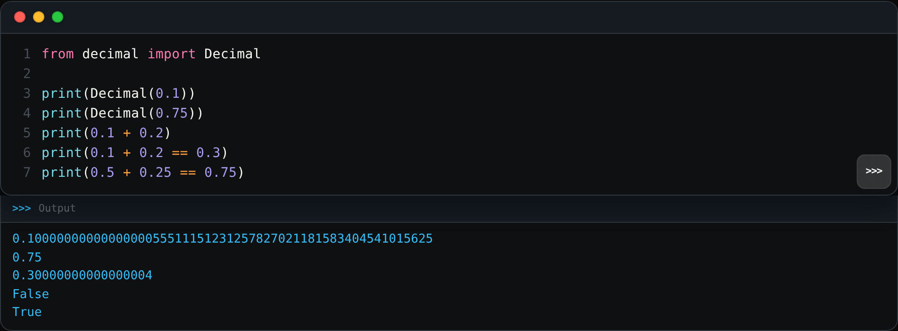

```python
from decimal import Decimal

print(Decimal(0.1))
print(Decimal(0.75))
print(0.1 + 0.2)
print(0.1 + 0.2 == 0.3)
print(0.5 + 0.25 == 0.75)
```


<br>

### Small errors add up

Each addition rounds its result to the nearest representable float, and those roundings do not cancel. Adding 0.1 to a running total 10 times walks the total away from the decimal you expect. A pipeline that adds up 100,000 fees of 10 cents as floats ends the day at 10000.000000018848 instead of 10000.0, and a reconciliation that tests with == reports a mismatch that no accountant can find.

https://github.com/user-attachments/assets/66bd5f80-2d24-4ea5-8fd8-a3e5ed17bf4c

*The total drifts at the 3rd addition, prints clean again at the 4th, and stays off from the 8th on.*


<br>

### Compare with a tolerance

== on floats asks whether 2 stored binary values match bit for bit, so 0.1 + 0.2 == 0.3 is False. math.isclose(a, b) asks whether they differ by at most a relative tolerance, rel_tol=1e-09 by default: one billionth of the larger value's size. A relative tolerance scales with the numbers, so it works for 3 rupees and 3 billion bytes alike. It breaks next to zero: one billionth of 0 is 0, so even a microscopic drift fails. Pass abs_tol whenever one side can be 0.

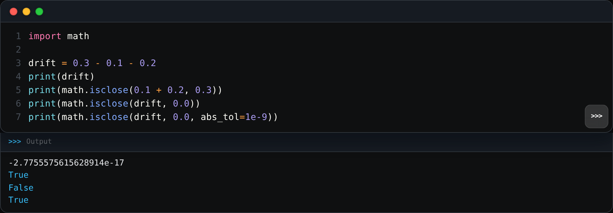

```python
import math

drift = 0.3 - 0.1 - 0.2
print(drift)
print(math.isclose(0.1 + 0.2, 0.3))
print(math.isclose(drift, 0.0))
print(math.isclose(drift, 0.0, abs_tol=1e-9))
```


<br>

### Rounding works on the stored value

round(x, 2) rounds the stored binary value, and it breaks exact ties toward the even digit, a rule called banker's rounding, so round(2.5) is 2. The literal 2.675 is stored as slightly less than 2.675, so it rounds down to 2.67 before any tie rule applies. For money or any figure a person audits, build a Decimal from a string, which keeps the decimal digits you typed, and choose the tie rule with quantize.

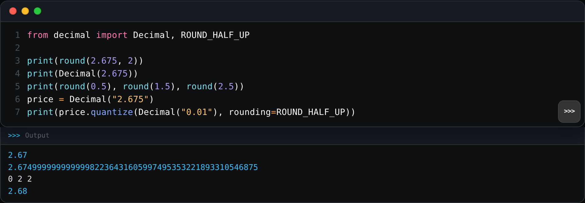

```python
from decimal import Decimal, ROUND_HALF_UP

print(round(2.675, 2))
print(Decimal(2.675))
print(round(0.5), round(1.5), round(2.5))
price = Decimal("2.675")
print(price.quantize(Decimal("0.01"), rounding=ROUND_HALF_UP))
```


<br>

### Integers too big for a float

Up to 2\*\*53, which is 9007199254740992, a float can hold every whole number. Past that point the gap between neighbouring floats grows to 2, then 4, then more, so an integer that lands between them is rounded to a neighbour. A 64-bit ID that passes through a float can come back as a different ID, which is why Discord's API documentation says its snowflake IDs are always returned as strings.

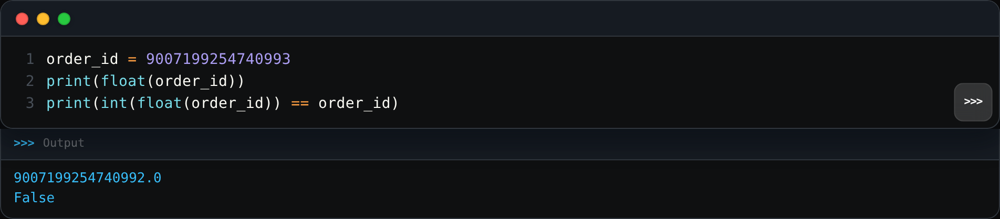

```python
order_id = 9007199254740993
print(float(order_id))
print(int(float(order_id)) == order_id)
```


| ✓ Do | ✗ Don't |
| --- | --- |
| • Compare floats with math.isclose, adding abs_tol when a side can be 0<br><br>• Build each Decimal from a string, as in Decimal("19.99")<br><br>• Store money as integer cents or as Decimal<br><br>• Keep IDs as int or str from source to warehouse | • Test floats with == or !=<br><br>• Pass a float to Decimal() and expect the digits you typed<br><br>• Expect round() to send every .5 upward<br><br>• Let a parser read 64-bit IDs into floats |

**Both 0.125 and 0.375 are eighths, so both are stored exactly. What does this print?**

```python
print(round(0.125, 2), round(0.375, 2))
```

- **A.** 0.12 0.38
- **B.** 0.13 0.38
- **C.** 0.13 0.37
- **D.** 0.12 0.37

<details>
<summary>Solution</summary>

**A.** 0.12 0.38

Both are exact ties, so banker's rounding picks the even last digit: 2 for the first value, 8 for the second.

**Why the others are wrong**

- **B.** The value 0.375 does become 0.38, but 0.125 is also an exact tie, and the even digit there is 2, giving 0.12.
- **C.** This rounds the first tie up and the second down, which is backwards: the even digits are 2 and 8.
- **D.** The first value, 0.125, does land on 0.12, but the tie at 0.375 goes to the even digit 8, giving 0.38.

</details>

Totals are where the drift becomes a business problem. A refund ledger adds its amounts one at a time, and the payout it must match was added in a different order or computed elsewhere, so the 2 floats can disagree in their final digits: 0.1 + 0.1 + 0.1 prints 0.30000000000000004. A reconciliation written as math.isclose(refunds, payout) accepts that difference and still catches a missing refund, which is off by whole cents.


<br>

---

## Short-circuit Evaluation

and and or evaluate their left operand first and stop the moment the answer is settled. If the left side of and is false, the whole expression is false whatever the right side holds, so Python returns the left operand and never evaluates the right. If the left side of or is true, the same thing happens in mirror image. A skipped operand does nothing at all, so a function call inside it never runs and a division inside it never gets the chance to raise an error.

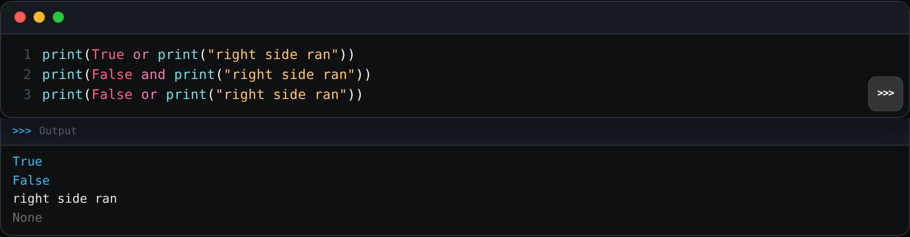

```python
print(True or print("right side ran"))
print(False and print("right side ran"))
print(False or print("right side ran"))
```

print returns None, which makes it a witness: its message appears only when Python reaches the right operand. On the third line Python does reach it, and the value of the whole or is whatever that right operand returned, None.

| Expression | Left operand is | Right operand evaluated? | Result |
| --- | --- | --- | --- |
| `a and b` | false | no | `a` |
| `a and b` | true | yes | `b` |
| `a or b` | true | no | `a` |
| `a or b` | false | yes | `b` |

Read the Result column closely: and and or hand back an operand, unchanged. True and 7 is 7, and None or False is False. The next section pins down exactly which values count as false; for now bools and None are enough.


<br>

### Put the guard on the left

Because the right operand runs only when needed, a cheap test on the left can protect a risky one on the right. Dividing by a row count is safe when row_count != 0 comes first. Reversing the operands evaluates the division before the test gets a chance to stop it.

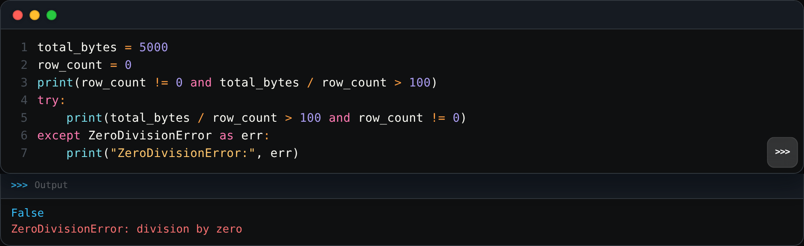

```python
total_bytes = 5000
row_count = 0
print(row_count != 0 and total_bytes / row_count > 100)
try:
    print(total_bytes / row_count > 100 and row_count != 0)
except ZeroDivisionError as err:
    print("ZeroDivisionError:", err)
```

The same ordering protects against None. In latency is not None and latency > 500, a missing reading stops at the left test; the reversed form evaluates None > 500 and raises TypeError. Ordering also saves work: when 99 rows in 100 fail a quick comparison on the left, an expensive conversion on the right runs for only 1 of them.


<br>

### Chains stop at the deciding operand

> Reading a chain
>
> - `a and b and c` returns the first false operand, or `c` when every operand is true.
> - `a or b or c` returns the first true operand, or `c` when none is.
> - Operands after the deciding one are never evaluated.
> - `and` binds tighter than `or`, so `a or b and c` means `a or (b and c)`.

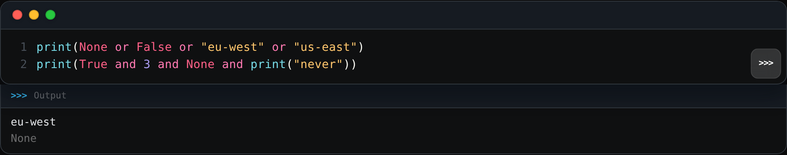

```python
print(None or False or "eu-west" or "us-east")
print(True and 3 and None and print("never"))
```

The first chain finds its first true operand in "eu-west" and returns it; "us-east" is never examined. The second runs into None as its first false operand and returns it, so the print at the end never fires and the word never appears.


<br>

### Defaults with or, and their trap

label = configured_label or "unlabeled" keeps the configured value when it is set and falls back when it is None. The fallback also fires for every other false value. A retry setting of 0 means 'never retry', yet configured_retries or 3 replaces it with 3, because 0 counts as false. When a false value is a legitimate setting, test for None with is, since or cannot tell 0 from a missing value.

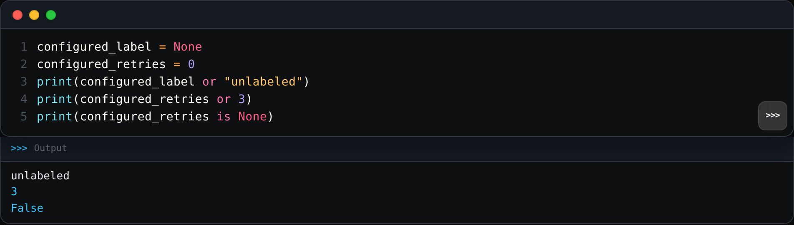

```python
configured_label = None
configured_retries = 0
print(configured_label or "unlabeled")
print(configured_retries or 3)
print(configured_retries is None)
```

The third line keeps the setting intact: configured_retries is None is False, because 0 is a value and not a missing one. Defaults also chain. cli_region or env_region or "us-east" returns the first setting that is filled in, which lets a job prefer a command-line flag, then an environment value, then a hard-coded fallback, all in one expression. Every link in that chain has the retry setting's problem: a link holding 0 or an empty string is skipped as if it were unset.

**What does this program print?**

```python
count = 0
print(count == 0 or 10 / count > 1)
print(count > 0 and int("abc") > 1)
```

- **A.** ZeroDivisionError on the first print
- **B.** True, then a ValueError
- **C.** True, then False
- **D.** False, then False

<details>
<summary>Solution</summary>

**C.** True, then False

Each line stops before its risky operand: or stops at True on the first, and and stops at False on the second.

**Why the others are wrong**

- **A.** Because count == 0 evaluates to True, or has its answer before it reaches the division.
- **B.** The first line is right. On the second, count > 0 evaluates to False, which settles the and before int("abc") is reached.
- **D.** With count at 0, the comparison count == 0 gives True, which or returns without looking further.

</details>


<br>

---

## Truthy and Falsy Values

Every Python object has a truth value. You can read it with bool(x), and and consults it, as do or and not. Among the built-in types, the false values form a short, fixed list: False, None, every numeric zero (0, 0.0, Decimal("0.00")), and every empty container ("", [], (), {}). Every other built-in value is truthy, including several a human would read as false. A class you define can set its own truth value, which the last part of this section covers.

| Value | bool(value) | Why |
| --- | --- | --- |
| `0` | False | numeric zero |
| `-1` | True | any nonzero number |
| `0.0` | False | numeric zero |
| `float("nan")` | True | NaN is not zero |
| `""` | False | empty string |
| `" "` | True | a space is a character |
| `"0"` | True | a 1-character string |
| `"False"` | True | a 5-character string |
| `None` | False | always false |
| `[]` | False | empty list |
| `[0]` | True | a list holding 1 item |

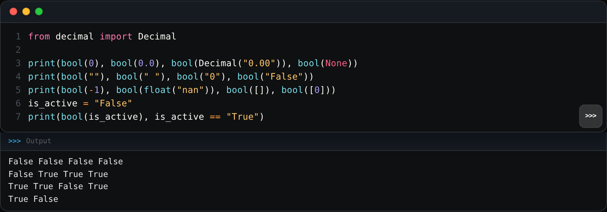

```python
from decimal import Decimal

print(bool(0), bool(0.0), bool(Decimal("0.00")), bool(None))
print(bool(""), bool(" "), bool("0"), bool("False"))
print(bool(-1), bool(float("nan")), bool([]), bool([0]))
is_active = "False"
print(bool(is_active), is_active == "True")
```

The last line is a classic ingestion bug. A CSV export or a web form delivers is_active as the text "False", and bool() reports True for any non-empty string. bool() checks emptiness and ignores meaning, so a text flag needs an explicit comparison against the spelling the source uses.

> **TIP**
>
> A NaN reading is doubly sneaky: `bool(float("nan"))` is `True`, so it passes a truthiness check, and every comparison with NaN (`==`, `<`, `<=`, `>`, `>=`) gives `False`, even `float("nan") == float("nan")`, while `!=` is `True`. Use `math.isnan(x)` to find NaN rows before they reach a filter.


<br>

### What not, and, or return

not x always returns a real bool: not "" is True and not 5 is False. and and or still return an operand, now judged by truthiness: "" or "unknown" is "unknown", 0 and 1/0 is 0 without dividing, and "eu" and 42 is 42. Because bool is a subclass of int, True + True is 2, which is why adding up comparison results counts how many were true.

**What does this print?**

```python
row_count = 4
ok = (wide := 5000 / row_count > 1000) and row_count > 2
print(ok, wide)
```

- **A.** True True
- **B.** True 1250.0
- **C.** 1250.0 True
- **D.** NameError for wide

<details>
<summary>Solution</summary>

**A.** True True

The walrus wraps the whole comparison, so wide holds True, and row_count > 2 makes ok True.

**Why the others are wrong**

- **B.** That needs (wide := 5000 / row_count) > 1000; here the walrus wraps the comparison, so wide is a bool.
- **C.** ok is the value of the and, and both of its operands evaluate to the bool True.
- **D.** The walrus is the left operand of and, so it runs on every path and wide always exists.

</details>


<br>

### Falsy and missing are different facts

The retry setting in the short-circuit section already showed or treating 0 and None as the same value. What remains is choosing the right test for each field, and the field's meaning decides it. For units_sold, a store that sold 0 units reported a real number, while a store whose feed never arrived reported None. units_sold is None finds broken feeds; units_sold == 0 finds stores that opened and sold nothing. A daily report usually needs both counts, kept apart, because one is an engineering incident and the other is a sales fact. Keep truthiness for fields where every false value means the same thing. In an optional comment field, "" and None both mean nobody wrote one.

| ✓ Truthiness: not units_sold | ✗ Identity: units_sold is None |
| --- | --- |
| • None: flagged<br><br>• 0: flagged<br><br>• 12: passes<br><br>• Fits when every false value means nothing arrived | • None: flagged<br><br>• 0: passes<br><br>• 12: passes<br><br>• Fits when 0 is a real measurement |


<br>

### Truth values for your own classes

An instance of a class you define is truthy by default, whatever its attributes hold. Defining __bool__ lets the class decide: Python calls it whenever the object meets bool() or not, and the same goes for and and or. The method must return a real bool; returning 1 raises TypeError: __bool__ should return bool, returned int.

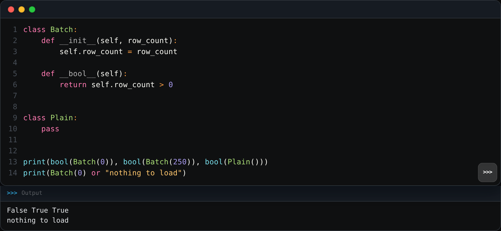

```python
class Batch:
    def __init__(self, row_count):
        self.row_count = row_count

    def __bool__(self):
        return self.row_count > 0


class Plain:
    pass


print(bool(Batch(0)), bool(Batch(250)), bool(Plain()))
print(Batch(0) or "nothing to load")
```

Batch(0) is false because its __bool__ returned False, so or passes over it and returns the fallback string. Plain() defines no __bool__ and is truthy even though it holds nothing. A loader can then treat an empty batch like any other false value, with the class itself deciding what empty means.


<br>

---

## Bitwise Operators on Integers

An int is stored as bits too, one per power of 2. bin(13) returns '0b1101': 8 + 4 + 1. Bitwise operators work on those columns one position at a time, with no carrying between them, which lets an integer hold many independent yes or no answers.

| Row | bit 3 (8) | bit 2 (4) | bit 1 (2) | bit 0 (1) | Value |
| --- | --- | --- | --- | --- | --- |
| `12` | 1 | 1 | 0 | 0 | 12 |
| `10` | 1 | 0 | 1 | 0 | 10 |
| `12 & 10` | 1 | 0 | 0 | 0 | 8 |
| `12 | 10` | 1 | 1 | 1 | 0 | 14 |
| `12 ^ 10` | 0 | 1 | 1 | 0 | 6 |

| Operator | Rule | Example | Result |
| --- | --- | --- | --- |
| `&` | 1 where both bits are 1 | `12 & 10` | `8` |
| `|` | 1 where either bit is 1 | `12 | 10` | `14` |
| `^` | 1 where the 2 bits differ | `12 ^ 10` | `6` |
| `~` | flips every bit, giving `-x - 1` | `~12` | `-13` |
| `<<` | shifts left, filling with 0s | `3 << 2` | `12` |
| `>>` | shifts right, dropping low bits | `12 >> 2` | `3` |


<br>

### Packing flags into one integer

Give each yes or no fact its own bit, written 1 << n. A single integer then holds all of them. Discord's permission system works this way: its developer documentation assigns VIEW_CHANNEL to 1 << 10 and SEND_MESSAGES to 1 << 11, with ATTACH_FILES going to 1 << 15, so a role's permissions travel as a single number. | grants a flag and & ~ revokes it. ^ toggles the flag, and & tests it.

https://github.com/user-attachments/assets/e64334e8-4f07-4b52-86ff-7b0a8a20ed27

*Grant with |=, revoke with &= ~, toggle with ^=, test with a parenthesized &.*

Watch the test lines: perms & ATTACH_FILES keeps only that bit, so the result is either 0 or the flag's own value, 32768. Comparing with != 0 turns it into a bool, and by the truthiness rules bool(perms & ATTACH_FILES) gives the same answer.

> Shifts rank below arithmetic
>
> `&` and `^` rank above the comparisons in Python, as does `|`, so `perms & SEND_MESSAGES != 0` already means `(perms & SEND_MESSAGES) != 0`; the parentheses are for the next reader. The shifts `<<` and `>>` sit lower in the table than `+` and `-`. That makes `1 << 10 + 1` equal to `1 << 11`, which is 2048, while `(1 << 10) + 1` is 1025. Parenthesize any line that mixes shifts with arithmetic.

**What does this print?**

```python
row_count = 4
ok = (wide := 5000 / row_count > 1000) and row_count > 2
print(ok, wide)
```

- **A.** True True
- **B.** True 1250.0
- **C.** 1250.0 True
- **D.** NameError for wide

<details>
<summary>Solution</summary>

**A.** True True

The walrus wraps the whole comparison, so wide holds True, and row_count > 2 makes ok True.

**Why the others are wrong**

- **B.** That needs (wide := 5000 / row_count) > 1000; here the walrus wraps the comparison, so wide is a bool.
- **C.** ok is the value of the and, and both of its operands evaluate to the bool True.
- **D.** The walrus is the left operand of and, so it runs on every path and wide always exists.

</details>

^ also diffs 2 snapshots. An audit job that stores a role's permissions each day can compute before ^ after: every bit that changed comes out as 1, and every unchanged bit as 0. Masking the diff with & after keeps the grants, and masking with & before keeps the revokes.

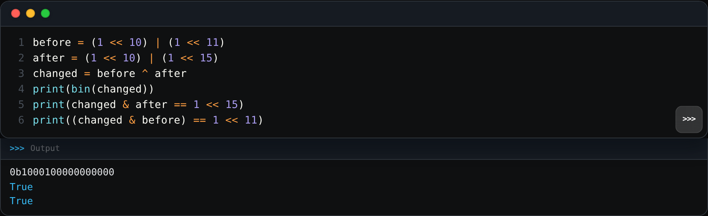

```python
before = (1 << 10) | (1 << 11)
after = (1 << 10) | (1 << 15)
changed = before ^ after
print(bin(changed))
print(changed & after == 1 << 15)
print((changed & before) == 1 << 11)
```

Bit 15 comes out as the grant of ATTACH_FILES and bit 11 as the revoke of SEND_MESSAGES. The middle line has no parentheses and still prints True, because & runs before ==; the last line keeps them only so a reader sees the grouping at a glance.


<br>

### Reading fields out of a packed ID

Shifts and masks pull apart a number built from several fields. Discord documents its snowflake IDs as 64 bits in 4 fields: the top 42 bits count milliseconds since the Discord epoch, 1420070400000 (the first second of 2015), bits 17 to 21 hold an internal worker ID, bits 12 to 16 an internal process ID, and the low 12 bits an increment. That puts 22 bits below the timestamp, so id >> 22 drops them and leaves the timestamp. id & 0xFFF keeps the lowest 12, because 0xFFF is 12 ones in binary.

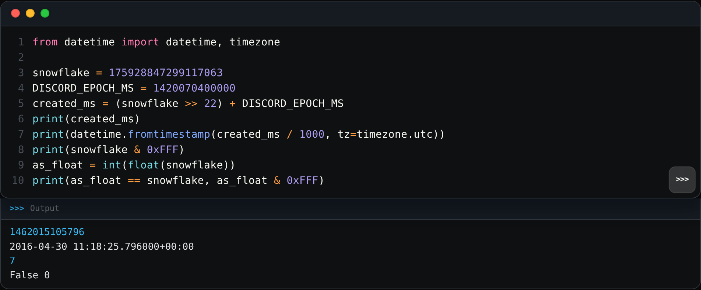

```python
from datetime import datetime, timezone

snowflake = 175928847299117063
DISCORD_EPOCH_MS = 1420070400000
created_ms = (snowflake >> 22) + DISCORD_EPOCH_MS
print(created_ms)
print(datetime.fromtimestamp(created_ms / 1000, tz=timezone.utc))
print(snowflake & 0xFFF)
as_float = int(float(snowflake))
print(as_float == snowflake, as_float & 0xFFF)
```

The last line joins this section to the first: the ID passes through float, its low bits round away, and the increment reads 0 where the real value is 7. The timestamp survives this time only because it sits in the high bits, which the float keeps.

> **TIP**
>
> Python integers have no fixed width, so `~FLAG` is a negative number: `~(1 << 15)` is `-32769`. In two's complement that value has every bit set except bit 15, so `perms & ~FLAG` clears exactly that bit, which is all a revoke needs.


<br>

---

## Walrus Operator (:=)

name := expression evaluates the expression, binds the result to name, and hands the same value to whatever surrounds it. Plain = is a statement and cannot sit inside a larger expression. :=, nicknamed the walrus operator for its eyes and tusks, is an expression. It arrived in Python 3.8, so any 3.8 or later interpreter accepts it.

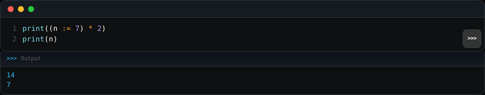

```python
print((n := 7) * 2)
print(n)
```


<br>

### Parentheses decide what gets bound

:= binds more loosely than every other operator, so the comparisons and even and and or are evaluated before it. Inside the parentheses, count := 3 > 2 binds count to the result of 3 > 2, which is the bool True, and the 3 itself is never stored. Wrap the walrus around exactly the value you want to keep.

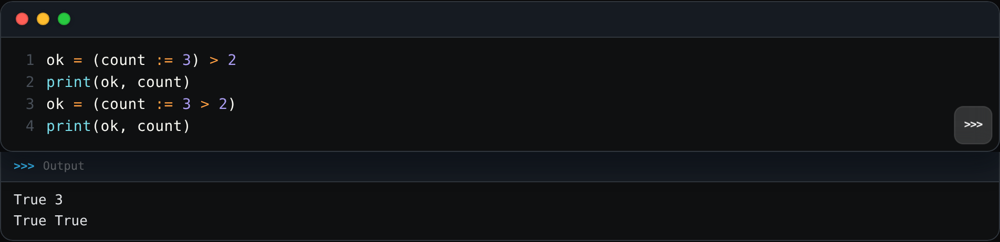

```python
ok = (count := 3) > 2
print(ok, count)
ok = (count := 3 > 2)
print(ok, count)
```

> Where the walrus is refused
>
> - A bare statement: `total := 5` alone on a line is a `SyntaxError`; write `total = 5`.
> - The right side of `=` without parentheses: `x = y := 5` is a `SyntaxError`.
> - Attributes: `(self.count := 1)` is refused, because only a plain name can be bound.
> - Augmented forms: Python has no `+:=`.


<br>

### Compute once, test, then reuse

The walrus pays off where an expression needs a value twice: once to test it and once to report it. Paired with a short-circuit guard, it computes the average row width only after the zero check passes, and keeps the result for the next line.

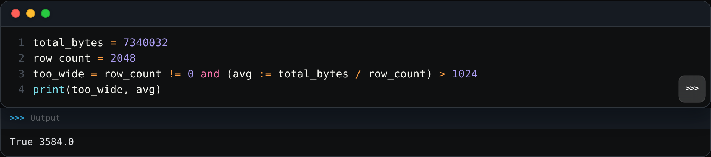

```python
total_bytes = 7340032
row_count = 2048
too_wide = row_count != 0 and (avg := total_bytes / row_count) > 1024
print(too_wide, avg)
```

The binding happens only if Python reaches the walrus. Set row_count to 0 and and stops at its left operand, so the name avg is never created and reading it raises NameError.

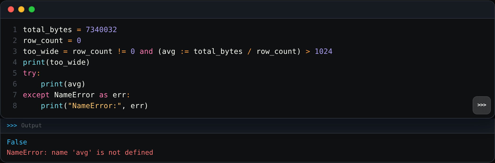

```python
total_bytes = 7340032
row_count = 0
too_wide = row_count != 0 and (avg := total_bytes / row_count) > 1024
print(too_wide)
try:
    print(avg)
except NameError as err:
    print("NameError:", err)
```


<br>

### A guard over a stream of readings

The animation pulls 3 readings from a generator and checks each on a single line. The walrus captures the reading, the identity test lets the real zero through as a reading, and the comparison runs only when the feed produced a number.

https://github.com/user-attachments/assets/9e010464-dd92-450c-8a28-a2d97a730210

*r3 is None, so the comparison on that line never runs.*

The last print shows why the identity test matters. With truthiness in its place, the reading of 0.0 short-circuits to the float 0.0, and a report treating that value as a check result would mix a measurement into a yes or no column.

| ✓ Do | ✗ Don't |
| --- | --- |
| • Wrap every walrus in parentheses around the exact value to keep<br><br>• Bind the value where it is first needed, then reuse the name<br><br>• Read a name bound inside and or or only on the path that bound it | • Pack several walruses into a line nobody can scan<br><br>• Use := where an ordinary = statement on its own line reads fine<br><br>• Read a walrus name after a short-circuit that may have skipped it |

**What does this print?**

```python
row_count = 4
ok = (wide := 5000 / row_count > 1000) and row_count > 2
print(ok, wide)
```

- **A.** True True
- **B.** True 1250.0
- **C.** 1250.0 True
- **D.** NameError for wide

<details>
<summary>Solution</summary>

**A.** True True

The walrus wraps the whole comparison, so wide holds True, and row_count > 2 makes ok True.

**Why the others are wrong**

- **B.** That needs (wide := 5000 / row_count) > 1000; here the walrus wraps the comparison, so wide is a bool.
- **C.** ok is the value of the and, and both of its operands evaluate to the bool True.
- **D.** The walrus is the left operand of and, so it runs on every path and wide always exists.

</details>

A pipeline step like this one usually breaks through a small edit, and most such edits are one of 3 slips: a guard moved to the right of the division it protects, so the division runs first; a revoke written with |, which can only turn bits on, where & ~ was needed; and a float result checked with == after it took a different arithmetic path from its target. The next program contains one of each.


<br>

---

## Putting It All Together

A Discord analytics job ingests a day of message events. Each event carries a snowflake ID, the sender role's permission integer, an attachment count with a total byte size, and a spam score as a float that can be missing. The job must keep IDs exact, derive each message's creation time, flag messages from roles without SEND_MESSAGES, compute bytes per attachment without crashing on text-only messages, and check averaged spam scores against a 0.3 threshold.

- The ID stays an int , because a float rounds away the low increment bits, and ( id >> 22 ) + 1420070400000 recovers the creation time.
- ( perms & SEND_MESSAGES ) != 0 keeps only that bit and turns it into a bool; the parentheses make the grouping plain to a reader, since & already runs before != .
- attachment_count != 0 and ( per_file := total_bytes / attachment_count ) > 8000000 guards the division and keeps the ratio for the report.
- A spam score of 0.0 is a real score, so the job tests score is not None , which lets 0.0 through.
- Averaged scores are matched against the threshold with math . isclose , never == , since summing floats drifts.


<br>

---

## Key Takeaways

- A float holds the nearest binary fraction, so compare floats with math . isclose and round money as a Decimal built from a string.
- Integers above 2 \*\* 53 lose their low digits in a float; keep IDs as int or str .
- and and or evaluate left to right, stop at the deciding operand, and return that operand.
- Put the protective test on the left so the risky operand never runs when it would fail.
- False and None are false, as is every numeric zero and every empty container. Values like "0" and "False" are truthy, and so is [ 0 ] .
- Test is None when 0 or an empty string is a real value.
- | grants a flag and & ~ revokes it; ^ toggles it and & tests it. & already runs before == , while + runs before << .
- := binds and returns a value inside an expression, and binds only if Python reaches it.
