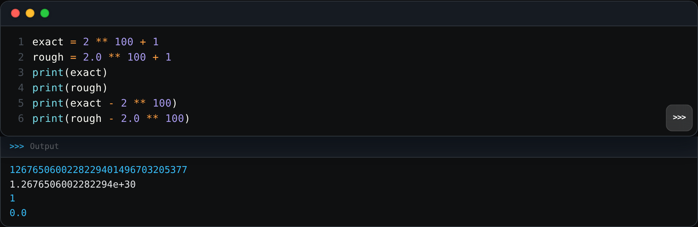
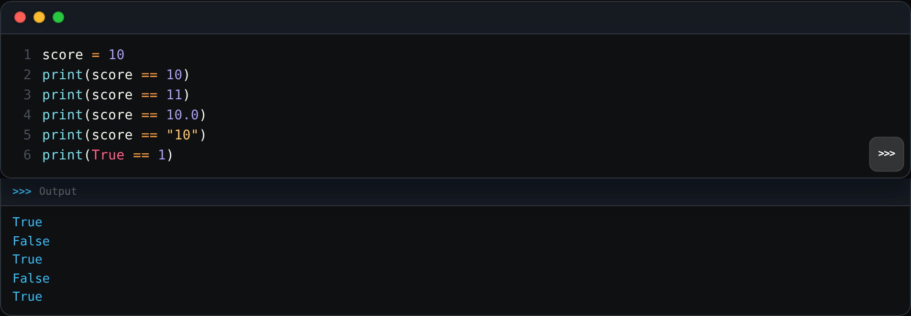
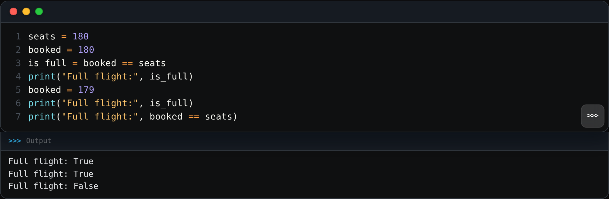
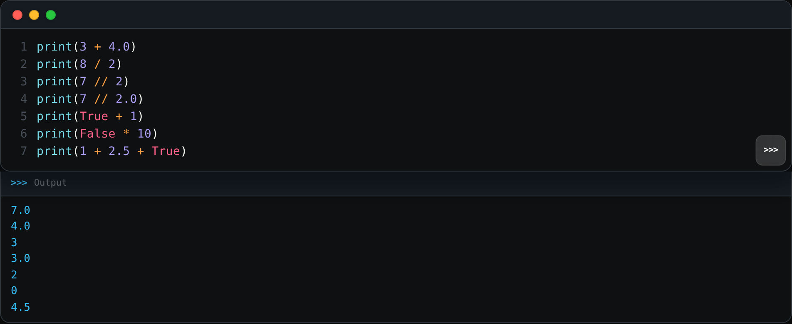
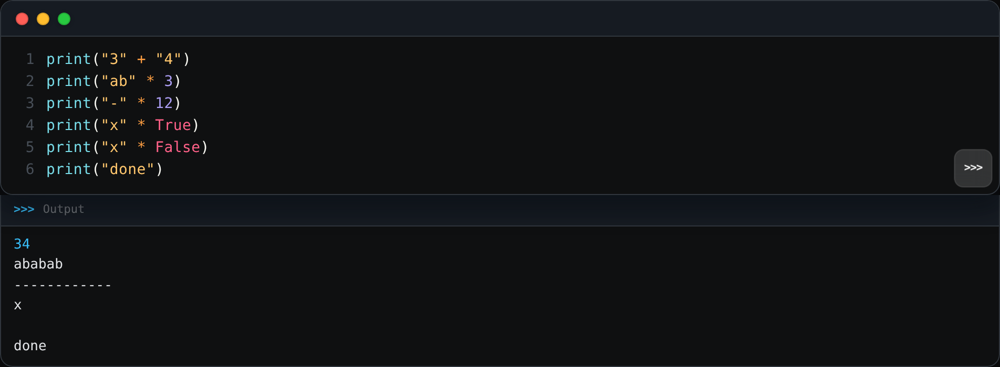
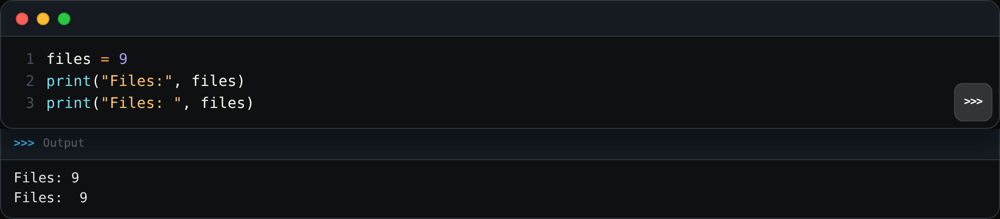
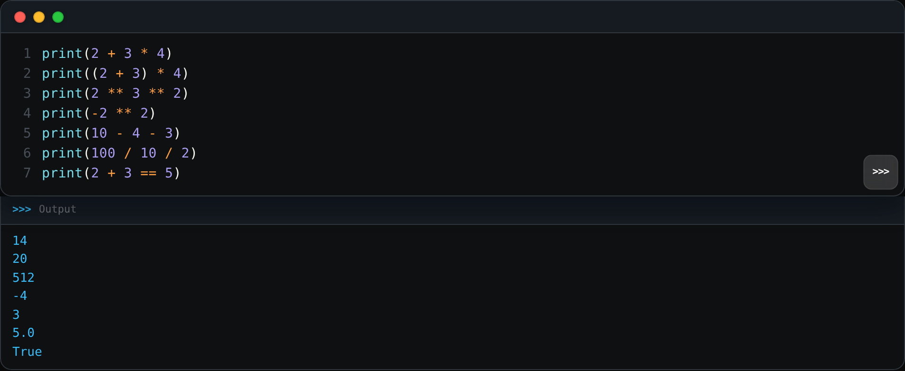

# Python Expressions: Beginner

An engineer at Spotify building one listener's Wrapped summary has `minutes = 48213` and a template string in the pipeline, and the line that glues them together reads `"You listened for " + minutes`. Whether that line prints a greeting or stops the whole job depends on what Python does when text meets a number.


<br>

---

## How Computers Store Data

Run `price = 10` and Python does 3 things. It builds an integer object holding 10 somewhere in memory, it records that the object's type is `int`, and it attaches the name `price` to that object. The name is a label stuck on the outside; the object is the thing that takes up space. Keeping the label and the object apart explains almost everything else in this lesson.


<br>

### Bits, bytes and objects

Memory is a long row of numbered slots called bytes, and every value Python builds occupies a run of consecutive bytes starting at some address. The object stores more than the raw number: it carries a type tag so Python knows how to read the bytes, a count of how many names point at it, and then the value itself. That bookkeeping is why a Python integer takes more room than the 8 bytes a C program would spend on the same number.

| Value | Type | Bytes it occupies |
| --- | --- | --- |
| 42 | int | 28 |
| 3.14 | float | 24 |
| True | bool | 28 |
| "hi" | str | 51 |
| "" | str | 49 |

*Sizes as reported by CPython 3.9 on a 64-bit machine. A 2-character string costs 2 bytes more than an empty one; the other 49 bytes are the object's bookkeeping.*

- **8** — bits per byte
- **256** — patterns a byte can hold
- **64** — bits in every float

A float always fits in the same fixed number of bits, so there's a largest value it can hold and a limit to how many digits it keeps. An `int` has no such ceiling. When a whole number outgrows the bytes it started with, Python allocates a bigger object for it, so arithmetic on huge integers stays exact.



```python
exact = 2 ** 100 + 1
rough = 2.0 ** 100 + 1
print(exact)
print(rough)
print(exact - 2 ** 100)
print(rough - 2.0 ** 100)
```

The integer keeps all 31 digits, including the 1 added at the end. The float prints as `1.2676506002282294e+30`, meaning 1.2676506002282294 times 10 to the power 30. Subtracting `2.0 ** 100` back out leaves `0.0`, so the added 1 never reached the stored value. A float holds about 16 significant digits and spends them on the leading part of the number, which means the tail is rounded away. In data work, counts of rows and bytes are whole numbers, and so are timestamps, which is why they're kept as `int` for as long as possible.


<br>

### A name points at an object

Assignment with a name on the right side copies the arrow, never the object. After `saved = price`, both names point at the same integer, and nothing has been duplicated. When `price` is later assigned 20, Python points `price` at an object holding 20: a pre-built one for a small number like this, a freshly built one for a larger number. Either way only the `price` arrow swings, and `saved` keeps pointing where it always did. Step through the run below and watch each name move.

https://github.com/user-attachments/assets/5ae2ddba-ca01-472b-ab58-8c1e3d732f7b

*Reassigning price builds a new object; saved keeps pointing at the old one.*

The final 3 lines make the same point with text. `label + "!"` builds a brand new string `"ok!"`, then the name `label` is moved onto it. The original `"ok"` object is unchanged, because `+` builds its result separately and never edits the string it read from. An object that nothing refers to any more is freed, and its bytes are reused.

> What a variable holds
>
> - A variable holds a reference to an object, never the object's bytes themselves
> - Assigning one name to another makes both refer to the same object
> - Reassigning a name points it at a different object and leaves the old one alone
> - Every object knows its own type; names carry no type at all

**What does this program print?**

```python
base = 10
bonus = 5
years = 2
print(base + bonus * years ** 2)
```

- **A.** 60
- **B.** 900
- **C.** 40
- **D.** 30

<details>
<summary>Solution</summary>

**D.** 30

years ** 2 runs first and gives 4, then bonus * 4 gives 20, then base + 20 gives 30.

**Why the others are wrong**

- **A.** That is (base + bonus) * years ** 2. Without parentheses, + runs last.
- **B.** That is ((base + bonus) * years) ** 2, with + done first and the exponent covering everything. ** binds tightest and applies only to years.
- **C.** That is (base + bonus * years) * years, which spreads the exponent across the whole left side. ** applies to the single operand beside it.

</details>

In `stock = stock - 5` the same name sits on both sides. Python evaluates the right side first, using the object `stock` points at now, and only then moves the name onto the result. Tracing a program means noting where each name points after every line, as in this table.

| Line | points | start |
| --- | --- | --- |
| points = 30 | 30 | not yet assigned |
| start = points | 30 | 30 |
| points = points + 8 | 38 | 30 |


<br>

---

## Variables and Naming

A name is the label you stick on an object. Python lets you spell it with letters and digits plus the _ character, as long as the first character is not a digit. Upper and lower case count as different characters: `total` is one name, and `Total` and `TOTAL` are 2 more. A space ends a name, as does a hyphen or any other punctuation, which is why `order total` reads as 2 names and `order-total` reads as a subtraction.


<br>

### Which spellings Python accepts

| Name | Accepted? | Why |
| --- | --- | --- |
| row_count | yes | letters and an underscore |
| row2 | yes | a digit may appear after the first character |
| _cache | yes | an underscore may start a name |
| 2nd_row | no | a name cannot begin with a digit |
| row-count | no | the hyphen is read as subtraction |
| row count | no | the space splits it into 2 names |
| class | no | a keyword Python reserves for itself |
| Class | yes | keywords are case sensitive, so this spelling is free |

The last 2 rows point at a short list of words with fixed meaning in the language. `True`, `False`, `None`, `and`, `or`, `not`, `if`, `for`, `while`, `def`, `class`, `import`, `return` are on it, and the list has a few more. Assigning to one of them stops the program before it starts, with a `SyntaxError` on that line.

```sql
membership_class = "gold"
class_ = "gold"
```

- **35** — keywords Python 3.9 reserves
- **3** — character kinds allowed in a name


<br>

### Case matters, and so does spelling

Because `Total` and `total` are unrelated names, a typo in one place produces a name that was never assigned. Python reports that the moment the line runs, after any earlier lines have already produced their output.

```sql
Total = 40
print(Total)
print(total)
```


<br>

### Names that already mean something

`print` is a name too, attached at startup to the built-in object that writes to the screen. Nothing stops you from reattaching it to an integer. The assignment succeeds, and the very next call fails, because an integer can't be called.

```sql
print = 5
print("hello")
```

> **TIP**
>
> print and type are built-in names, not reserved words, and so are max and sum, so Python lets you overwrite any of them. Treat them as taken anyway: pick a name like max_price instead of max, and the built-in stays usable for the rest of the program.


<br>

### Conventions that make names readable

Python only enforces the spelling rules above. The rest is convention, followed almost universally so that code reads the same across teams. Variable names are lowercase words joined by the _ character, which is called snake case. A value meant to stay fixed for the whole program is spelled in capitals, such as `MAX_RETRIES = 3`, a signal to readers rather than a lock. And a name says what the value is, so that a line can be read without scrolling up to the assignment.

| ✓ Names that hide the meaning | ✗ Names that carry it |
| --- | --- |
| • x = 1200<br><br>• tmp = x \* 12<br><br>• d = 30<br><br>• flag = tmp == 14400 | • monthly_rent = 1200<br><br>• yearly_rent = monthly_rent \* 12<br><br>• days_in_month = 30<br><br>• is_full_year = yearly_rent == 14400 |

In pipeline code the strongest names say where a value came from and what unit it is in. `orders_raw_count` and `orders_clean_count` can sit side by side without confusion, and `timeout_seconds` can't be mistaken for milliseconds. A name that took 5 extra characters to type saves the next reader a trip through the whole file.

| ✓ Do | ✗ Don't |
| --- | --- |
| • Use snake_case for variables: rows_loaded, not rowsLoaded<br><br>• Spell constants in capitals: BATCH_SIZE = 500<br><br>• Name the unit when it matters: timeout_seconds, size_mb<br><br>• Make booleans read as a question: is_ready, has_header | • Reuse one letter for several things: x for a price and later for a count<br><br>• Shadow a built-in: list, sum, max, min, print<br><br>• Encode the type in the name: str_name, int_count<br><br>• Rely on case to tell 2 names apart: Total and total |

**Which line will Python refuse to run?**

- **A.** 1st_batch = 100
- **B.** batch_1st = 100
- **C.** Batch = 100
- **D.** _batch = 100

<details>
<summary>Solution</summary>

**A.** 1st_batch = 100

A name can't start with a digit. Python stops with a SyntaxError on this line before running anything.

**Why the others are wrong**

- **B.** Digits are allowed anywhere after the first character, so this is a valid, if awkward, name.
- **C.** A capital letter is a letter. This is a valid name. batch is a different name, and so is BATCH.
- **D.** A name may begin with the _ character, so this spelling is accepted.

</details>

A `NameError` quotes the exact spelling Python looked up and failed to find. Compare it character by character with the assignment that was meant to create it: a single capital letter makes a separate name. The misspelled assignment ran without complaint, so the error appears later, at the first line that reads the name.


<br>

---

## Assignment vs. Equality

A single `=` is a statement: it takes the object produced by the expression on its right and binds the name on its left to it. It produces no value of its own, which is why `=` can never sit inside a larger expression. A double `==` is an operator: it compares the objects on both sides and produces a `bool`, which is either `True` or `False`. That result is an ordinary value. You can print it or store it, and another operator can take it as input.

| Line | Kind | What happens | Value produced |
| --- | --- | --- | --- |
| count = 5 | statement | binds count to the object 5 | none |
| count == 5 | expression | compares count with 5 | True |
| count == 6 | expression | compares count with 6 | False |
| same = count == 5 | statement | evaluates the comparison, then binds same to the result | none |

Read `=` aloud as "is set to" and `==` as "is equal to", and most mistakes disappear before they're typed. The run below changes `actual` twice and compares it after each change. Notice that the comparison on line 3 is evaluated once, when that line runs, and the stored `check` does not update when `actual` changes later.

https://github.com/user-attachments/assets/e5859872-be05-4cac-95dc-8cd2b6d118ff

*check keeps the True it was given on line 3, whatever actual does afterwards.*

Line 7 prints `True` even though `actual` is 4 by then, because `check` refers to the `bool` object built on line 3, and nothing has rebound it. Line 8 makes `actual` point at the very object `expected` points at, so the final comparison is `True` again.


<br>

### Equality looks at values, and at types

`==` asks whether 2 objects represent the same value. Numbers compare by their numeric value, so an `int` can equal a `float`. `True` equals 1 as well, because a `bool` is an integer underneath. A string never equals a number, even when the digits match, because the text `"10"` and the integer 10 are different kinds of object, and `==` between them reports `False` rather than failing.



```python
score = 10
print(score == 10)
print(score == 11)
print(score == 10.0)
print(score == "10")
print(True == 1)
```

That fourth line is the one that bites in data work. A value read from a CSV column arrives as text, and comparing it with a number is legal and always `False`, so a check that looks correct passes nothing. The later lesson on type conversions shows how to turn the text into a number before comparing.


<br>

### What the left side of = may be

The left side of an assignment names a place to attach the object. A literal like `5` or an expression like `score + 1` is not a place, so Python rejects the whole program before running a single line.

| Line | What Python reports |
| --- | --- |
| 5 = score | SyntaxError: cannot assign to literal |
| score + 1 = 11 | SyntaxError: cannot assign to operator |
| score + 1 == 11 | accepted: a comparison, True when score is 10 |


<br>

### Storing the answer to a question

Because `==` produces a value, a comparison can be stored under a name and reused. Name the stored `bool` as a question so the later line reads naturally, and remember that it records the answer at the moment it was computed.



```python
seats = 180
booked = 180
is_full = booked == seats
print("Full flight:", is_full)
booked = 179
print("Full flight:", is_full)
print("Full flight:", booked == seats)
```

> **TIP**
>
> A stored comparison is a snapshot. If the inputs can change, compare again at the point where the answer matters instead of trusting a bool computed several lines earlier.

**What does this program print?**

```python
base = 10
bonus = 5
years = 2
print(base + bonus * years ** 2)
```

- **A.** 60
- **B.** 900
- **C.** 40
- **D.** 30

<details>
<summary>Solution</summary>

**D.** 30

years ** 2 runs first and gives 4, then bonus * 4 gives 20, then base + 20 gives 30.

**Why the others are wrong**

- **A.** That is (base + bonus) * years ** 2. Without parentheses, + runs last.
- **B.** That is ((base + bonus) * years) ** 2, with + done first and the exponent covering everything. ** binds tightest and applies only to years.
- **C.** That is (base + bonus * years) * years, which spreads the exponent across the whole left side. ** applies to the single operand beside it.

</details>

Before writing a line, decide what it is for: changing what a name points at, or producing an answer. Storing an answer uses `=` at the left with `==` on its right side. Rebinding a name uses a single `=` alone. `==` compares numeric value, so it answers `True` when an `int` meets a `float` that holds the same number.


<br>

---

## Mixing Types in One Expression

Every operator looks at the type of the object on each side before it does anything. For `+`, 2 numbers add and 2 strings join. A number next to a string has no meaning, so Python stops with a `TypeError` instead of guessing. The table lists what each pairing produces.

| Left | Operator | Right | Result | Example |
| --- | --- | --- | --- | --- |
| int | + - \* \*\* | int | int | 3 + 4 gives 7 |
| int | + - \* \*\* | float | float | 3 + 4.0 gives 7.0 |
| int | / | int | float | 8 / 2 gives 4.0 |
| int | // | float | float | 7 // 2.0 gives 3.0 |
| bool | + - \* | int | int | True + 1 gives 2 |
| str | + | str | str | "3" + "4" gives "34" |
| str | \* | int | str | "ab" \* 3 gives "ababab" |
| str | + | int | TypeError | "3" + 4 fails |
| str | \* | str | TypeError | "3" \* "4" fails |
| str | - / | str | TypeError | "10" - "1" fails |


<br>

### Numbers and booleans mix freely

Among numeric types, the result takes the wider type. An `int` beside a `float` produces a `float`, and `/` produces a `float` even when both sides are `int` and the division is exact. A `bool` behaves as the integer 1 or 0 inside arithmetic, which is occasionally handy and more often a sign that the wrong value reached the expression.



```python
print(3 + 4.0)
print(8 / 2)
print(7 // 2)
print(7 // 2.0)
print(True + 1)
print(False * 10)
print(1 + 2.5 + True)
```


<br>

### Text has its own arithmetic

`+` between 2 strings joins them, and `*` between a string and an `int` repeats it. Neither one does any numeric work: `"3" + "4"` produces the 2-character text `"34"`, because both operands are text. A `bool` works as the repeat count too, since it is an `int` underneath.



```python
print("3" + "4")
print("ab" * 3)
print("-" * 12)
print("x" * True)
print("x" * False)
print("done")
```

*The fifth line is empty: a string repeated 0 times is the empty string, and printing it still ends the line.*


<br>

### The combinations that fail

Python raises a `TypeError` when a string sits beside a number under `+`. It does the same for `-` or `*` between 2 strings, and for any `/` involving text. The program runs normally up to that line, prints whatever it printed, and stops. The message names both types, which tells you which operand carried the wrong kind of value.

```sql
minutes = 48213
print("Building summary")
message = "You listened for " + minutes
print(message)
```

The order of the operands changes the message, because Python asks the left object first. Every outcome in the table is the same stop.

| Expression | Message |
| --- | --- |
| "3" + 4 | TypeError: can only concatenate str (not "int") to str |
| 4 + "3" | TypeError: unsupported operand type(s) for +: 'int' and 'str' |
| "3" \* "4" | TypeError: can't multiply sequence by non-int of type 'str' |
| "10" - "1" | TypeError: unsupported operand type(s) for -: 'str' and 'str' |
| True + "!" | TypeError: unsupported operand type(s) for +: 'bool' and 'str' |


<br>

### Let print do the joining

`print` takes any number of values separated by commas, converts each one to text on its own, and writes them with a space between. That is the route for showing a number next to a label without an operator in between. Turning a number into a string yourself is covered in a later lesson on type conversions.

```sql
count = 5
print("Rows:", count)
print("Rows: " + count)
```

> Before an operator runs
>
> - Both numbers: the result takes the wider type, and / always gives a float
> - bool with a number: True counts as 1, False as 0
> - str + str joins, str \* int repeats
> - str with int under +, or str with str under - \* /: TypeError, program stops

**What does this line print?**

```python
print(True + True + "!")
```

- **A.** A TypeError, because 2 + "!" has no meaning
- **B.** 2!
- **C.** TrueTrue!
- **D.** 3

<details>
<summary>Solution</summary>

**A.** A TypeError, because 2 + "!" has no meaning

Addition runs left to right. True + True produces the int 2, then 2 + "!" pairs an int with a str under +, which raises the error.

**Why the others are wrong**

- **B.** That would need Python to convert 2 to text before joining, and + never converts between numbers and strings.
- **C.** True is a bool, and + on 2 bools adds them as 1 + 1. No text is produced until the string appears, and by then the left side is an int.
- **D.** The string "!" has no numeric value, so nothing can be added to reach 3. The expression fails.

</details>

The comma route adds exactly 1 space between arguments, on top of any spaces inside the text. A label written for joining with `+` usually ends in a space, so drop it when you switch, or the output shows 2.



```python
files = 9
print("Files:", files)
print("Files: ", files)
```

The second output line has 2 spaces between the colon and the 9: one from the label and one added by `print`. When a `+` line fails because one side is a number, replace it with a print call that passes the label and the value as separate arguments. Trim the label's trailing space in the same edit.

Each operator needs the pair it accepts. A repeat count stands on the other side of `*` from the string: `"-" * 4` gives `----`, while `"-" * "4"` fails. The same `int` added to a `float` gives a `float`, so `4 + 0.5` is `4.5`.


<br>

---

## Operators and Readability

When an expression holds several operators, Python applies them in a fixed order rather than left to right across the whole line. `**` goes first. `*` and `/` share the next level with  and `%`. Below them sit `+` and `-`, and `==` comes last. Within one level, evaluation runs left to right, except for `**`, which runs right to left. Parentheses override all of it, and they're also the only way to tell a reader what you meant.

| Level | Operators | Direction | Example |
| --- | --- | --- | --- |
| 1 (first) | ( ) | innermost first | (2 + 3) \* 4 gives 20 |
| 2 | \*\* | right to left | 2 \*\* 3 \*\* 2 gives 512 |
| 3 | - (sign) | applies to the operand beside it | -2 \*\* 2 gives -4 |
| 4 | \* / // % | left to right | 100 / 10 / 2 gives 5.0 |
| 5 | + - | left to right | 10 - 4 - 3 gives 3 |
| 6 (last) | == | after all arithmetic | 2 + 3 == 5 gives True |



```python
print(2 + 3 * 4)
print((2 + 3) * 4)
print(2 ** 3 ** 2)
print(-2 ** 2)
print(10 - 4 - 3)
print(100 / 10 / 2)
print(2 + 3 == 5)
```

Line 3 is the surprising one: `2 ** 3 ** 2` is `2 ** 9`, which is 512, while `(2 ** 3) ** 2` would be 64. Line 4 is the other: the exponent binds tighter than the minus sign, so the result is the negative of 4. Both are legal, and both are the kind of line a colleague will misread, which is the reason to add parentheses even where Python does not need them.


<br>

### Parentheses say what you meant

The run below computes a bill 2 ways. The first adds tax on top of the subtotal, the second doubles the subtotal and takes a quarter of that, and the only difference on the page is a pair of parentheses.

https://github.com/user-attachments/assets/a274acae-c5ae-4f8f-b31a-72676107f3f0

*Multiplication runs first in total; the parentheses force the addition first in wrong.*


<br>

### Name the steps

A long expression is right or wrong in one go, and a reader has to hold every intermediate value in their head to check it. Breaking it into named steps gives each value a name, lets you print any step while you're investigating, and makes the operator order a smaller concern because each line holds 1 or 2 operators at most. The 2 programs below print the same number, 37.5.

```sql
print((20 * 3 + 20 * 3 * 0.25) * (1 - 0.5))
```

```sql
unit_price = 20
quantity = 3
tax_rate = 0.25
discount = 0.5
subtotal = unit_price * quantity
with_tax = subtotal + subtotal * tax_rate
total = with_tax * (1 - discount)
print(total)
```


<br>

### Spacing and layout

Python ignores spaces inside an expression: `a*b+c` runs the same as `a * b + c`. The convention is 1 space on each side of `=` and `==`. The lower-precedence operators get the same spacing, while a higher-precedence operator loses its spaces so the grouping shows: `a*b + c`. A line longer than about 80 characters gets split by naming part of it, as above.

| ✓ Do | ✗ Don't |
| --- | --- |
| • Add parentheses wherever 2 operators of different levels meet<br><br>• Put 1 space around =, == and the + or - of an expression<br><br>• Name an intermediate result if the line needs explaining<br><br>• Keep \*\* and a minus sign apart with parentheses: (-2) \*\* 2 or -(2 \*\* 2) | • Rely on readers knowing that \*\* runs right to left<br><br>• Pack 6 operators into one print call<br><br>• Mix spaced and unspaced operators at the same level: a+b \* c<br><br>• Reuse a name for a different quantity 2 lines later |

**What does this program print?**

```python
base = 10
bonus = 5
years = 2
print(base + bonus * years ** 2)
```

- **A.** 60
- **B.** 900
- **C.** 40
- **D.** 30

<details>
<summary>Solution</summary>

**D.** 30

years ** 2 runs first and gives 4, then bonus * 4 gives 20, then base + 20 gives 30.

**Why the others are wrong**

- **A.** That is (base + bonus) * years ** 2. Without parentheses, + runs last.
- **B.** That is ((base + bonus) * years) ** 2, with + done first and the exponent covering everything. ** binds tightest and applies only to years.
- **C.** That is (base + bonus * years) * years, which spreads the exponent across the whole left side. ** applies to the single operand beside it.

</details>

A fixed fee plus a per-item cost needs no parentheses, because `*` runs before `+`: `5.0 + 4 * 1.5` multiplies to 6.0 first and sums to 11.0. Swap the 2 operators and `5.0 * 4 + 1.5` gives 21.5. Working the line through with real numbers shows whether each operator sits where it belongs.

String operators share the same precedence. In `"-" * 3 + "x"` the repetition runs first and produces `---`. The join then gives `---x`. Writing `"x" + "-" * 3` gives `x---` for the same reason: the `*` on the right finishes before the join begins.


<br>

---

## Putting It All Together

Back at Spotify, the Wrapped job holds minutes = 48213 and builds its headline with "You listened for " + minutes. The run prints its first log line and then stops with a TypeError at line 3, before a single listener's summary is written. The engineer swaps the join for a comma-separated print with the label "You listened for", and adds a check that the per-listener total equals the sum of its daily parts, stored under totals_match and computed after the last daily value is added rather than before.

- The integer 48213 lives as one object in memory, and every name that refers to it, including the one passed to print, points at that same object rather than a copy.
- The name minutes states its unit, so nobody reading the headline line wonders whether 48213 counts seconds or songs.
- "You listened for " + minutes fails because + sees a str on the left and an int on the right; print with a comma converts each argument on its own, and dropping the label's trailing space keeps a single space in the output.
- totals_match = per_listener == daily_sum is a snapshot, so it's placed after the final daily value is added; computed any earlier, it would keep an answer that no longer matches the total.
- The daily sum is written as named steps rather than one long line, so the operator order never has to be reasoned about during a 3am incident.


<br>

---

## Key Takeaways

- A variable is a name attached to an object in memory; assigning one name from another copies the arrow, and reassigning moves only that one name.
- Names use letters and digits plus the _ character, and cannot start with a digit or be a keyword. Case matters, and the convention is snake_case with descriptive words.
- A single = binds a name and produces nothing; a double == compares 2 values and produces a bool, computed once at the line where it appears.
- Operators check types first. Numbers mix with bools, and strings support joining and repetition. A string beside a number under + stops the program with a TypeError.
- \*\* runs before \* and /, which run before + and -, with == last; parentheses and named intermediate steps make the order visible to the next reader.
