# Python Expressions: Intermediate

A Stripe engineer is tracing a dispute. The merchant's checkout sent the amount as the text "4999", a retry counter climbed in single steps, and the refund field for the order came back empty. Whether the payment is compared as text or as cents, whether the counter truly incremented, and whether empty means None or zero decides who gets the money.


<br>

---

## Type Conversions

Every value in Python has exactly one type, and the operators act according to that type. `19 + 99` adds 2 numbers and gives 118, while `"19" + "99"` joins 2 strings and gives `"1999"`. Text is how data arrives from a keyboard, a web form or a spreadsheet export, so a program that wants arithmetic has to convert first.

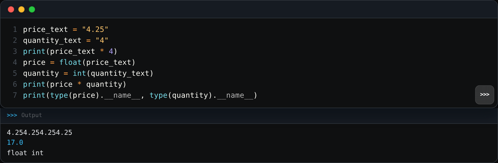

```python
price_text = "4.25"
quantity_text = "4"
print(price_text * 4)
price = float(price_text)
quantity = int(quantity_text)
print(price * quantity)
print(type(price).__name__, type(quantity).__name__)
```

The first print repeats the text 4 times, because `*` on a string means repeat. After `float()` and `int()` turn the text into numbers, the same `*` multiplies. The product shows as `17.0` because any arithmetic that involves a float produces a float, even when the result is a whole number.


<br>

### The 3 converters you will use most

| Call | Result | What happened |
| --- | --- | --- |
| `int("42")` | `42` | digits parsed as a whole number |
| `int(7.9)` | `7` | fraction dropped toward zero |
| `int(-7.9)` | `-7` | still toward zero, so -7 and never -8 |
| `int(True)` | `1` | True counts as 1, False as 0 |
| `float("2.5")` | `2.5` | text parsed as a decimal |
| `float(3)` | `3.0` | whole number widened to a float |
| `float("1e3")` | `1000.0` | scientific notation accepted |
| `str(42)` | `"42"` | number written out as text |
| `str(3.0)` | `"3.0"` | the decimal point survives |

`int()` on a float never rounds. `int(7.9)` gives 7 and `int(7.1)` gives 7, because the conversion keeps the whole part and discards the rest. When you need the nearest whole number, that's a different operation, and this lesson leaves it alone: the point here is that `int()` only ever removes.


<br>

### Conversions that lose data

A conversion is a one way trip whenever the target type cannot hold everything the source held. `int(7.9)` throws away the `.9`, and converting back with `float()` gives `7.0`. Text has the same problem in the other direction: a number has no leading zeros, so a US postal code that starts with 0 loses a digit the moment it becomes an `int`.

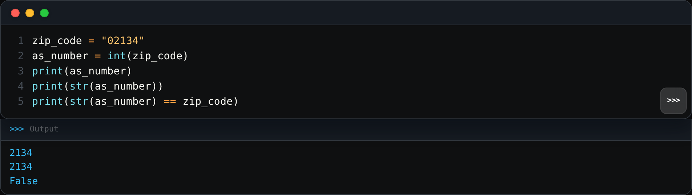

```python
zip_code = "02134"
as_number = int(zip_code)
print(as_number)
print(str(as_number))
print(str(as_number) == zip_code)
```

The code round trips as `"2134"`, which a shipping label would reject. Postal codes, phone numbers and account identifiers are made of digits, but you never add or multiply them, so keep them as `str`. Convert to a number only when the value is about to be used as one.

| Start | Convert | Convert back | What was lost |
| --- | --- | --- | --- |
| `7.9` | `int()` gives `7` | `float()` gives `7.0` | the fraction |
| `"02134"` | `int()` gives `2134` | `str()` gives `"2134"` | the leading zero |
| `42` | `str()` gives `"42"` | `int()` gives `42` | nothing |
| `3.0` | `int()` gives `3` | `float()` gives `3.0` | nothing |


<br>

### int() refuses a decimal point

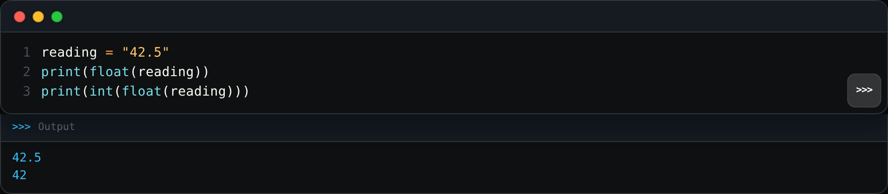

```python
reading = "42.5"
print(float(reading))
print(int(float(reading)))
```

`int()` reads a string as a whole number and refuses anything else, including a decimal point: `int(reading)` on this text stops with `ValueError: invalid literal for int() with base 10: '42.5'`. The fix takes 2 steps: `int(float(reading))` parses the decimal first and then drops the fraction, giving the `42` on the last line. The ValueError quotes the exact text it rejected, so the traceback shows what the string really contained, which matters when the culprit is a stray space or a currency symbol you didn't know was there.

> What int() accepts in a string
>
> - Digits with an optional sign: "42", "-7" and "+15" all convert
> - Leading and trailing spaces: " 42 " gives 42
> - Digit separators: "1_000" gives 1000
> - Rejected: a decimal point, a comma, a currency symbol or empty text


<br>

### Converting the other way for display

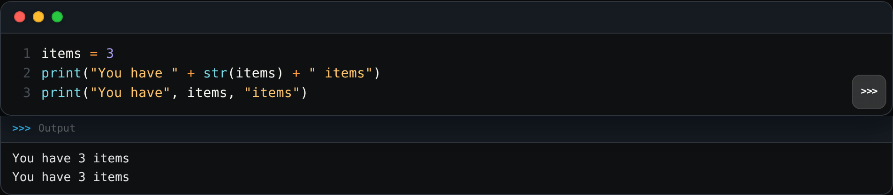

```python
items = 3
print("You have " + str(items) + " items")
print("You have", items, "items")
```

Writing `"You have " + items` without the conversion stops with `TypeError: can only concatenate str (not "int") to str`, because `+` needs both operands to be strings before it will concatenate. `str(items)` produces `"3"`, which joins without complaint. `print()` with several arguments separated by commas converts each one for you, as line 3 shows, so it needs no `str()` call; the explicit conversion is for the moment you build one string to keep.

> **TIP**
>
> Convert at the edge of your program, right where text arrives, and keep numbers as numbers from then on. Code that converts the same value in 3 places has 3 chances to do it differently.

**What does this program print?**

```python
first = [1, 2]
second = [1, 2]
third = first
first += [3]
print(second == third, second is third, first is third)
```

- **A.** True False True
- **B.** False False True
- **C.** False True True
- **D.** True True False

<details>
<summary>Solution</summary>

**B.** False False True

+= extends the shared list, so third now has 3 items and differs from second, which was never the same object; first and third still share one list.

**Why the others are wrong**

- **A.** After first += [3], first and third hold 3 items while second holds 2, so second == third is False.
- **C.** second and third were built as separate lists; different objects are never identical however their contents compare.
- **D.** first and third name the same object throughout, because += on a list changes it in place without rebinding.

</details>

Each converter matches the shape of the text it reads: `float()` for text with a decimal point, `int()` for whole digits. Handing `"12.5"` to `int()` would stop with the ValueError from earlier, and once both values are numbers, a float times an int gives a float.


<br>

---

## Comparison Operators

A comparison takes 2 values and produces a `bool`, which is either `True` or `False`. That result is a value like any other: you can print it, store it in a variable, or feed it into a larger expression. Later lessons use it to steer which lines run; this one makes sure you can predict the result before it drives anything.

| Operator | Question asked | Example | Result |
| --- | --- | --- | --- |
| `==` | equal value? | `5 == 5.0` | `True` |
| `!=` | different value? | `5 != 5` | `False` |
| `<` | less than? | `3 < 7` | `True` |
| `>` | greater than? | `3 > 7` | `False` |
| `<=` | less than or equal? | `7 <= 7` | `True` |
| `>=` | greater than or equal? | `6 >= 7` | `False` |

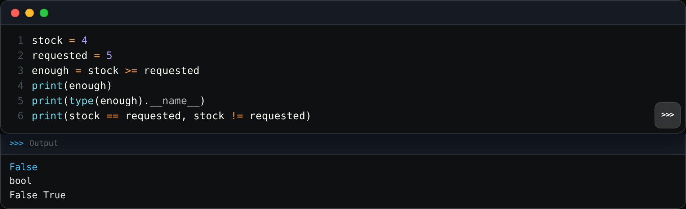

```python
stock = 4
requested = 5
enough = stock >= requested
print(enough)
print(type(enough).__name__)
print(stock == requested, stock != requested)
```

`enough` holds `False`, and the variable name reads as the question it answers. Naming a comparison result this way pays off whenever the same condition would otherwise appear twice. `==` and `!=` are exact opposites: for any pair of values, exactly one of them is `True`.


<br>

### Numbers compare by value

`5 == 5.0` is `True` because Python compares the numeric value, and the int 5 and the float 5.0 stand for the same quantity. `True == 1` is also `True`, since `bool` is a kind of int, with `True` worth 1 and `False` worth 0. A string of digits plays by other rules: `"5" == 5` is `False` with no error, because a string and a number can never be equal, however alike they look when printed.


<br>

### Strings compare character by character

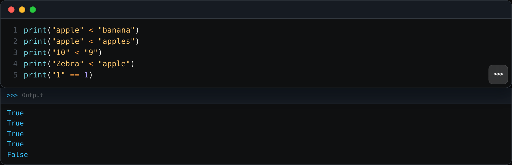

```python
print("apple" < "banana")
print("apple" < "apples")
print("10" < "9")
print("Zebra" < "apple")
print("1" == 1)
```

Python walks both strings from the left and decides at the first position where they differ. `"apple"` is less than `"banana"` because `"a"` comes before `"b"` at the first position. `"apple"` runs out before `"apples"` does, and a shorter string that matches so far counts as smaller. `"10" < "9"` is `True` because the first characters are `"1"` and `"9"`, and the second character is never consulted. Every character has a numeric code, and uppercase letters have smaller codes than lowercase ones, which is why `"Zebra"` sorts before `"apple"`.

- **48** — code for the digit 0
- **65** — code for uppercase A
- **97** — code for lowercase a

Ordering a string against a number goes further than `False`: `"10" < 9` raises `TypeError: '<' not supported between instances of 'str' and 'int'`. That ordering has no sensible answer, so Python stops instead of guessing. Equality behaves differently: `"1" == 1` quietly gives `False`, because asking whether 2 things are the same is always answerable, and for different types the answer is no. Both outcomes point to one habit: convert the text with `int()` before comparing it to a number.

> Comparisons across types
>
> - int, float and bool compare with each other by numeric value
> - str compares with str, one character code at a time
> - str against a number: == gives False, and < > <= >= raise TypeError
> - bool against int: True acts as 1 and False as 0


<br>

### Comparing after converting

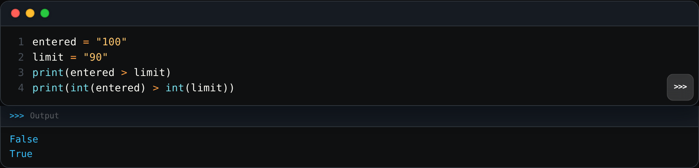

```python
entered = "100"
limit = "90"
print(entered > limit)
print(int(entered) > int(limit))
```

As text, `"100"` loses to `"90"` because `"1"` comes before `"9"`. As numbers, 100 wins. Scores that were never converted will order 100 before 11 and before 2, and the bug shows up as results that look almost right, which is the hardest kind to notice. The conversion is one call per side, and it turns a question about characters into a question about quantities.


*Testing 2 floats for exact equality has its own pitfalls, which a later lesson covers. Comparisons between ints, between strings, and between an int and a float are safe to reason about today.*

| ✓ Do | ✗ Don't |
| --- | --- |
| • Convert text with int() or float() before comparing it to a number<br><br>• Store a comparison in a well named variable when you use it twice<br><br>• Expect int and float to compare by numeric value | • Expect "5" == 5 to be True; it's False with no warning<br><br>• Order a str against an int; that raises TypeError<br><br>• Rely on text ordering for numbers held as strings |

**What does this program print?**

```python
first = [1, 2]
second = [1, 2]
third = first
first += [3]
print(second == third, second is third, first is third)
```

- **A.** True False True
- **B.** False False True
- **C.** False True True
- **D.** True True False

<details>
<summary>Solution</summary>

**B.** False False True

+= extends the shared list, so third now has 3 items and differs from second, which was never the same object; first and third still share one list.

**Why the others are wrong**

- **A.** After first += [3], first and third hold 3 items while second holds 2, so second == third is False.
- **C.** second and third were built as separate lists; different objects are never identical however their contents compare.
- **D.** first and third name the same object throughout, because += on a list changes it in place without rebinding.

</details>

Asking whether a shelf covers an order means asking whether the stock is at least the amount wanted, which is `>=`. When one side arrives as text, convert it first, because an ordering operator between a str and an int raises before it produces any answer.


<br>

---

## Augmented Assignment

A running total repeats one shape of statement: read the variable, change it, store it back under the same name. `total = total + 5` says `total` twice. The augmented form `total += 5` says it once and does the same work: it evaluates the right side, applies the operator to the current value, and binds the result to the name.

| Shorthand | Spelled out |
| --- | --- |
| `total += 5` | `total = total + 5` |
| `total -= 5` | `total = total - 5` |
| `total \*= 2` | `total = total \* 2` |
| `total /= 2` | `total = total / 2` |
| `total //= 2` | `total = total // 2` |
| `total %= 2` | `total = total % 2` |
| `total \*\*= 2` | `total = total \*\* 2` |

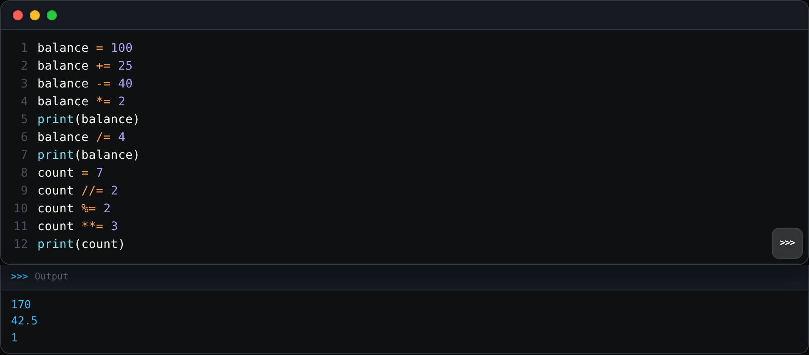

```python
balance = 100
balance += 25
balance -= 40
balance *= 2
print(balance)
balance /= 4
print(balance)
count = 7
count //= 2
count %= 2
count **= 3
print(count)
```

Follow `balance` line by line: 125, then 85, then 170. The `/=` step gives `42.5` and changes the type along the way, because `/` always produces a float even when the division is exact. `count` goes 3, then 1, then 1. Each shorthand follows the rule of its own operator, including the type of the result, so `//=` keeps an int and `/=` never does.

The right side can be any expression, and it's evaluated fully before the operator is applied. `total += bonus * 2` doubles `bonus` first and then adds. Strings accept `+=` too: `label += "!"` builds a new string with the exclamation mark on the end and binds `label` to it, since a string, once made, never changes.


<br>

### A number is replaced, a list is changed

This section introduces one new kind of value, far enough to show the difference. A list is a sequence of values in square brackets, `["apple", "pear"]`, and `+` between 2 lists builds a longer list. Lists get their own lessons later; here they stand in for every value that can be changed after it is made. Play the animation and watch what each name points at after every line.

https://github.com/user-attachments/assets/620a0e50-afa1-4bbf-9170-f0677b64468f

*+= on a number rebinds one name; += on a list changes the object both names share; = with + builds a new list.*

`alias_total = total` makes a second name for the same `10`. When `total += 5` runs, Python has no way to change the number 10 itself: an int is immutable, so it creates a new `15` and points `total` at it, while `alias_total` still points at `10`. The list behaves differently. `cart += ["fig"]` extends the existing list object in place, and `alias_cart` names that same object, so printing either shows 3 items. The last step, `cart = cart + ["plum"]`, builds a brand new list, and only `cart` moves to it.

| ✓ Immutable: int, float, str, bool | ✗ Mutable: list |
| --- | --- |
| • += computes a new value<br><br>• The name is rebound to the result<br><br>• Other names for the old value keep it<br><br>• x += 1 and x = x + 1 behave identically | • += changes the object in place<br><br>• The name stays on the same object<br><br>• Every other name for the object sees the change<br><br>• x += [1] and x = x + [1] differ |

> The question to ask before +=
>
> Does any other name point at this value? For a number or a string the answer never matters, because the old value survives untouched under the other name. For a list, `+=` reaches through every name at once, which is what you want for a shared shopping cart and a surprise for a copy you believed was private.


<br>

### The typo that assigns instead of adding

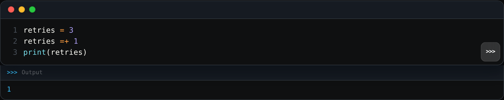

```python
retries = 3
retries =+ 1
print(retries)
```

`=+ 1` parses as `= +1`, a plain assignment of positive 1. Nothing is added, no error is raised, and `retries` becomes 1. The 2 characters in the wrong order are a frequent cause of counters that reset instead of counting, and because the program runs cleanly the mistake only shows in the numbers it reports.

> **TIP**
>
> When a count comes out as 1 or as a small negative number no matter how many updates ran, search the code for =+ and =- before anything else.

**What does this program print?**

```python
first = [1, 2]
second = [1, 2]
third = first
first += [3]
print(second == third, second is third, first is third)
```

- **A.** True False True
- **B.** False False True
- **C.** False True True
- **D.** True True False

<details>
<summary>Solution</summary>

**B.** False False True

+= extends the shared list, so third now has 3 items and differs from second, which was never the same object; first and third still share one list.

**Why the others are wrong**

- **A.** After first += [3], first and third hold 3 items while second holds 2, so second == third is False.
- **C.** second and third were built as separate lists; different objects are never identical however their contents compare.
- **D.** first and third name the same object throughout, because += on a list changes it in place without rebinding.

</details>

A program with a `=+` typo runs to the end and prints a wrong number, so the evidence sits in the output: a total equal to the last amount added means that line replaced the value instead of adding to it.


<br>

---

## Multiple Assignment

One assignment statement can set several names. The left side lists the names separated by commas, the right side lists values the same way, and Python pairs them up by position. Python evaluates the entire right side first, and only then binds the names, from left to right.

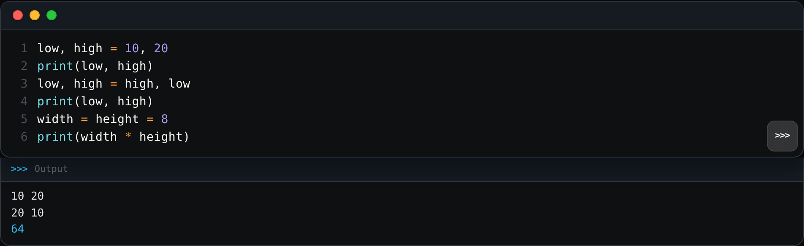

```python
low, high = 10, 20
print(low, high)
low, high = high, low
print(low, high)
width = height = 8
print(width * height)
```

Line 3 is the swap. Python evaluates `high, low` to the values 20 and 10 while both names still hold their old values, then assigns 20 to `low` and 10 to `high`. Without this form, a swap needs a third variable to park one value while the other moves across.

```sql
temp = low
low = high
high = temp
```


<br>

### Values that come from expressions

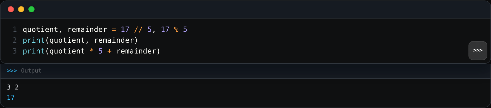

```python
quotient, remainder = 17 // 5, 17 % 5
print(quotient, remainder)
print(quotient * 5 + remainder)
```

Each value on the right can be a full expression. Division and remainder belong together, so computing them in one statement keeps the 2 results next to each other and makes the relationship visible: 3 groups of 5 plus 2 left over rebuilds 17. The last line checks that arithmetic.


<br>

### Chained assignment: one value, several names

`width = height = 8` binds the value 8 to `height` and to `width`. Both names point at the same object, which costs nothing when the value is a number, because a number cannot change. It matters as soon as the value can.

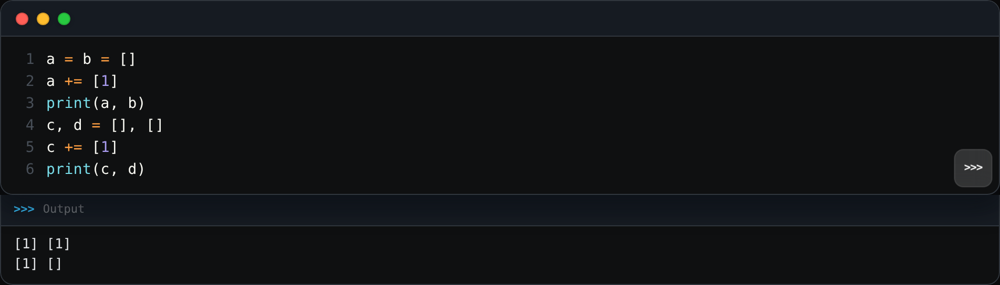

```python
a = b = []
a += [1]
print(a, b)
c, d = [], []
c += [1]
print(c, d)
```

`a = b = []` creates 1 list and 2 names for it, so extending through `a` shows up through `b`, exactly as in the previous section. `c, d = [], []` evaluates 2 separate `[]` expressions and creates 2 lists. Chained assignment suits numbers and strings, and lists only when you mean to share one; for anything changeable that should stay independent, give each name its own value.


<br>

### Mismatched counts on each side

| Statement | What Python raises |
| --- | --- |
| `x, y = 1, 2, 3` | `ValueError: too many values to unpack (expected 2)` |
| `x, y, z = 1, 2` | `ValueError: not enough values to unpack (expected 3, got 2)` |

Python checks the count before binding anything, so a mismatch leaves every name on the left as it was. The message states how many names were waiting and, for the shortfall case, how many values arrived. Read the number after `expected` as the count of names on the left side.


<br>

### One statement versus several

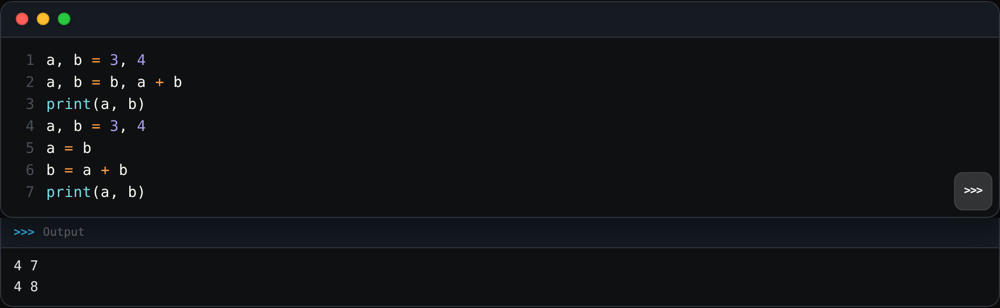

```python
a, b = 3, 4
a, b = b, a + b
print(a, b)
a, b = 3, 4
a = b
b = a + b
print(a, b)
```

The paired form computes `a + b` with the old `a`, which is 3, giving 7. The separate statements update `a` first, so `a + b` becomes `4 + 4`. Whenever a new value depends on an old value that is also being replaced, the single statement is the one that reads every old value.

> When to pair names in one statement
>
> - Swapping 2 values without a temporary variable
> - Unpacking a quotient and remainder, or a width and a height
> - Updating 2 values where each depends on the other's old value
> - Setting several counters to 0 at the start, with chained assignment

> **TIP**
>
> Pair names only when they belong together, such as a low and a high bound. A line that assigns 5 unrelated values is harder to read than 5 lines, and harder to search when one of them is wrong.

**What does this program print?**

```python
first = [1, 2]
second = [1, 2]
third = first
first += [3]
print(second == third, second is third, first is third)
```

- **A.** True False True
- **B.** False False True
- **C.** False True True
- **D.** True True False

<details>
<summary>Solution</summary>

**B.** False False True

+= extends the shared list, so third now has 3 items and differs from second, which was never the same object; first and third still share one list.

**Why the others are wrong**

- **A.** After first += [3], first and third hold 3 items while second holds 2, so second == third is False.
- **C.** second and third were built as separate lists; different objects are never identical however their contents compare.
- **D.** first and third name the same object throughout, because += on a list changes it in place without rebinding.

</details>

A swap works on text as well as on numbers, since the right side only reads the old values. The order of the names on the right is the order in which the names on the left receive them.


<br>

---

## None and Identity

A variable that exists but has nothing meaningful to hold yet needs a value that says so. Python provides exactly one: `None`. It has its own type, `NoneType`, and there is only ever 1 `None` object in a running program. Using 0 or an empty string for missing data confuses the absence of a value with a real value that happens to be 0 or empty.

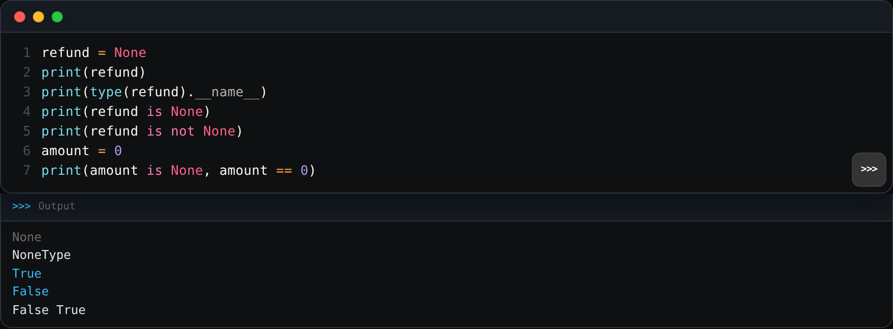

```python
refund = None
print(refund)
print(type(refund).__name__)
print(refund is None)
print(refund is not None)
amount = 0
print(amount is None, amount == 0)
```

`refund` is `None`: no refund has been recorded. `amount` is 0: a refund of zero dollars was recorded. Those are 2 different facts, and the last line shows the test that tells them apart. `is None` asks whether the variable points at the one `None` object; `== 0` asks whether the value is numerically zero.


<br>

### is compares identity, == compares value

Every object in a program has an identity, a number that stays fixed for the object's lifetime, and `id()` returns it. `a is b` is `True` exactly when `id(a) == id(b)`: the 2 names refer to one object. `a == b` asks a looser question, whether the 2 values count as equal, and 2 separate objects can answer yes.

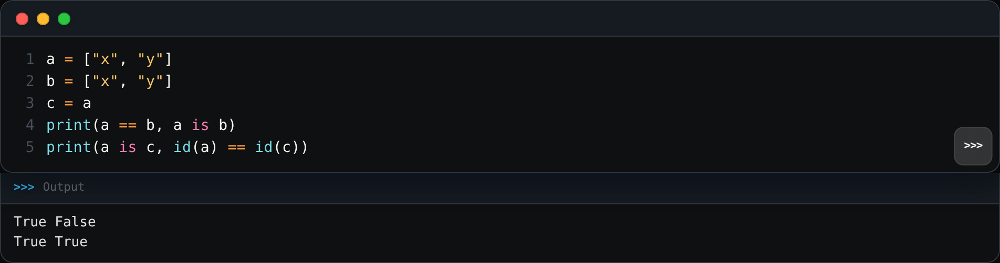

```python
a = ["x", "y"]
b = ["x", "y"]
c = a
print(a == b, a is b)
print(a is c, id(a) == id(c))
```

`a` and `b` are 2 lists built separately with the same contents: equal, and separate. `c = a` adds a name to the first list, so `a is c` holds. This is the aliasing picture from the augmented assignment section, now with the operator that tests for it directly.

| Question | Operator | Example | Result |
| --- | --- | --- | --- |
| Same contents? | `==` | `[1] == [1]` | `True` |
| Same object? | `is` | `[1] is [1]` | `False` |
| Missing? | `is None` | `x = None` then `x is None` | `True` |
| Present? | `is not None` | `0 is not None` | `True` |


<br>

### Why None gets is and everything else gets ==

`refund == None` also prints `True`, so why does Python's style guide ask for `is None`? Because `None` is a single object, identity is the precise question, and `is` cannot be redefined. A type may define its own meaning for `==`, and some do, which can make `== None` return something other than a plain `True` or `False`. `is` has no such escape hatch. The reverse applies to numbers and strings: they can be equal while living in separate objects, so `is` between them gives answers that depend on how the interpreter chose to store them.


<br>

### The None you did not expect

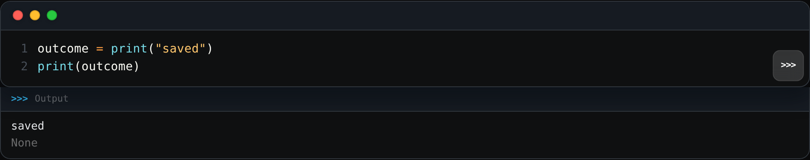

```python
outcome = print("saved")
print(outcome)
```

`print()` displays its arguments and then hands back `None`, because it has nothing else to give. Storing that result and treating it as text leads to a `TypeError` one line later. Any time a variable unexpectedly prints as `None`, the first suspect is a call whose result was stored when only its screen output was wanted.

> **TIP**
>
> Start a variable at None when its real value arrives later, and test for None before using it. A reader of your code then knows that None is a possible state, and the test documents where that state ends.

| ✓ Do | ✗ Don't |
| --- | --- |
| • Write x is None and x isn't None for missing value checks<br><br>• Use == to compare numbers, strings and lists by value<br><br>• Start a variable at None when its real value arrives later | • Compare with == None; it reads as a value check and can be redefined<br><br>• Use is between 2 numbers or 2 strings<br><br>• Store the result of print(); it's always None |

**What does this program print?**

```python
first = [1, 2]
second = [1, 2]
third = first
first += [3]
print(second == third, second is third, first is third)
```

- **A.** True False True
- **B.** False False True
- **C.** False True True
- **D.** True True False

<details>
<summary>Solution</summary>

**B.** False False True

+= extends the shared list, so third now has 3 items and differs from second, which was never the same object; first and third still share one list.

**Why the others are wrong**

- **A.** After first += [3], first and third hold 3 items while second holds 2, so second == third is False.
- **C.** second and third were built as separate lists; different objects are never identical however their contents compare.
- **D.** first and third name the same object throughout, because += on a list changes it in place without rebinding.

</details>

The fix for a stored `print()` result is to keep its 2 jobs apart: put the text in the variable, then pass the variable to `print()` at the moment it should appear on screen.


<br>

---

## Putting It All Together

An Instacart shopper app receives an order: item quantities arrive as text from the customer's form, the store's shelf counts are integers, substitutions get appended to a shared list that both the shopper's screen and the customer's screen read, and the tip field is empty until checkout finishes.

- The quantity "3" must become int("3") before the comparison against a shelf count of 2, or the app orders a str against an int and crashes.
- A comparison such as shelf >= wanted is stored in a named bool and printed on the shopper's screen as whether the item can be fulfilled.
- Appending a substitution with substitutions += [item] updates the one list both screens share, where substitutions = substitutions + [item] would leave the customer's screen stale.
- Swapping a requested item for its substitute in a single statement, requested, substitute = substitute, requested, reads both old values before either changes.
- The tip starts as None, so tip is None means the customer hasn't decided, while tip == 0 means they chose to leave nothing: 2 facts the app must keep apart.


<br>

---

## Key Takeaways

- int(), float() and str() convert between types; int() drops fractions and numbers drop leading zeros, so keep identifiers as text.
- Comparisons produce a bool; numbers compare by value, strings compare character by character, and ordering a str against a number raises TypeError.
- Augmented assignment evaluates the right side once and applies the operator; on a number it rebinds the name, on a list it changes the shared object.
- A multiple assignment evaluates its whole right side before binding any name, which is what makes a swap work in one line.
- None marks a missing value; test for it with is None, and keep == for comparing values.
