# Python Foundations: Advanced

Overnight at Spotify, a job turns a day of listening events into the counts that feed the Wrapped recap. The export runs to gigabytes, 1 line per play. A malformed line at 3 a.m. must not stop the job, the file must never be read whole into memory, and every open handle has to close. This lesson is the Python that makes that job survive the night.


<br>

---

## Handling Errors With try and except

### What an uncaught error does

The traceback lesson showed what happens when a line fails: Python prints the traceback and the program stops on that line. Every line after it never runs. For a script that parses 1 field typed at the keyboard, stopping is fine. For a nightly job on the 40,000th line of a 2 million line export, stopping throws away 39,999 lines of finished work because 1 line held `12x` where a number belonged.

```sql
raw = "12x"
count = int(raw)
print("parsed", count)
```

The last line of its traceback reads `ValueError: invalid literal for int() with base 10: '12x'`. `ValueError` is the exception's type, and the type is what an `except` clause matches on.


<br>

### try and except

A `try` block holds the lines that might fail. An `except` block names an exception type and holds the lines to run when that type is raised inside the `try`. When the failing line raises, Python abandons the rest of the `try` block, runs the matching `except` block, and continues with the first line after it as though nothing had gone wrong.

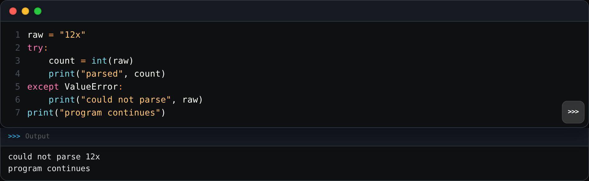

```python
raw = "12x"
try:
    count = int(raw)
    print("parsed", count)
except ValueError:
    print("could not parse", raw)
print("program continues")
```

`print("parsed", count)` never ran: the jump happened at `int(raw)`, 1 line above it, and `count` was never assigned. Change `raw` to `"12"` and the output flips to `parsed 12` followed by `program continues`, with the `except` block skipped entirely. The `except` block runs only when the `try` is abandoned, and the jump undoes nothing. Every line above the failing one has already run, and whatever those lines assigned or wrote stays done, which is why a `try` should hold only the lines that can fail. Below, the third line of the `try` fails after the first 2 have printed and assigned.

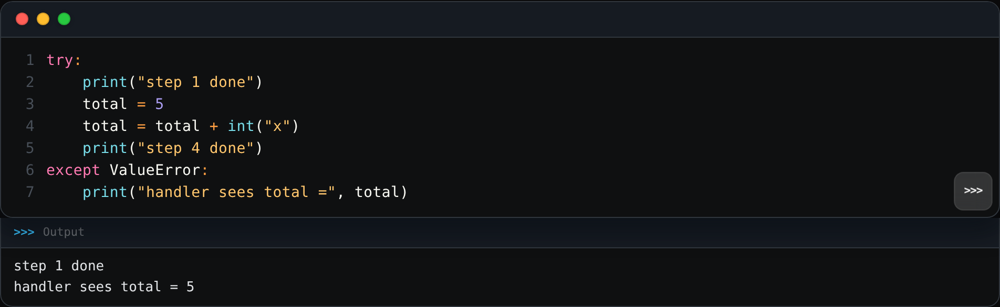

```python
try:
    print("step 1 done")
    total = 5
    total = total + int("x")
    print("step 4 done")
except ValueError:
    print("handler sees total =", total)
```


<br>

### Keeping the error message

Writing `except ValueError as err` stores the exception object in `err`. Printing it gives the same message the traceback would have shown, so a log can record what went wrong while the program keeps going. Watch `count` in the run below: it keeps the `0` assigned before the `try`, because the assignment inside the `try` never completed.

https://github.com/user-attachments/assets/170a5b91-2e52-4d74-8d8d-e6ba5b0cb6e3

*The failing line jumps straight to the except block; count keeps its earlier value.*


<br>

### Matching the right type

An `except` clause catches only the type it names. `except ValueError` does nothing for a `ZeroDivisionError`, which then travels on as if no `try` were there and stops the program. Pick the type from the last line of the traceback you are trying to survive.

| Line | Exception it raises |
| --- | --- |
| `int("12x")` | `ValueError` |
| `10 / 0` | `ZeroDivisionError` |
| `1 + "a"` | `TypeError` |
| `print(totl)` | `NameError` |
| `open("missing.txt")` | `FileNotFoundError` |

Several `except` clauses can follow 1 `try`, each for a different type; Python checks them top to bottom and runs the first that matches. Writing `except:` with no type catches everything, including the `NameError` from a typo, so the bug hides behind a `skipped` message for weeks while the output comes out wrong. Name the type.

> **TIP**
>
> The last line of a traceback names the type to put after except. Copy it exactly as printed, capitals included: ZeroDivisionError, FileNotFoundError.


<br>

### finally runs no matter what

A `finally` block after the `except` clauses runs whether the `try` succeeded, was rescued by an `except`, or raised something nothing caught. It is where cleanup goes: closing a file, releasing a connection, writing a final log line.

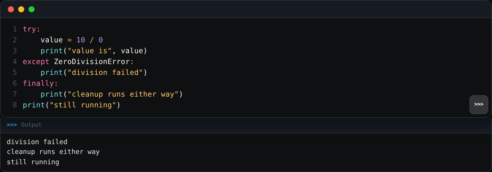

```python
try:
    value = 10 / 0
    print("value is", value)
except ZeroDivisionError:
    print("division failed")
finally:
    print("cleanup runs either way")
print("still running")
```

| ✓ Do | ✗ Don't |
| --- | --- |
| • Name the exception type you expect, taken from the traceback<br><br>• Keep the try block to the lines that can fail<br><br>• Print or log err so every skipped record is visible | • Write a bare except: that swallows typos and real bugs alike<br><br>• Wrap a whole program in a single try<br><br>• Catch an error and continue with no message at all |


<br>

### Practice

**What does this program print before it ends?**

```python
class Res:
    def __enter__(self):
        print("open")
        return self

    def __exit__(self, exc_type, exc, tb):
        print("close")

with Res() as r:
    print("step 1")
    int("oops")
    print("step 2")
print("after")
```

- **A.** open, step 1, step 2, close, after
- **B.** open, step 1, then a ValueError traceback with no close
- **C.** open, step 1, close, after
- **D.** open, step 1, close, then a ValueError traceback

<details>
<summary>Solution</summary>

**D.** open, step 1, close, then a ValueError traceback

The raise inside the block triggers __exit__, which prints close; its None return lets the ValueError continue, and no handler catches it, so the program stops.

**Why the others are wrong**

- **A.** int("oops") raises ValueError, so step 2 never runs and the exception stops the program before after.
- **B.** __exit__ runs on every way out of the block, including an exception, so close prints before the traceback.
- **C.** __exit__ returns None, so the ValueError continues past the with and stops the program before after prints.

</details>

A handler can do more than print. When a field is missing or malformed, the `except` block can assign a fallback value, so the lines after the `try` always find the variable set. Below, an empty duration field becomes 0 seconds instead of stopping the job, and the program carries on with a usable number whichever block ran.

```sql
raw = ""
try:
    seconds = int(raw)
except ValueError:
    seconds = 0
print("seconds is", seconds)
```


<br>

---

## Reading and Writing Files

### Opening a file

`open()` takes a path and a mode and returns a file object: a handle with methods for reading and writing. The file's bytes stay on disk; the object remembers a position in them, which starts at 0. When the work is done, `close()` releases the handle, and anything still buffered in memory is written out.

```sql
f = open("plays.txt", "r")
text = f.read()
f.close()
print(text)
```

| Mode | What open() does |
| --- | --- |
| `"r"` | Read; raises FileNotFoundError when the path does not exist |
| `"w"` | Write; creates the file, or empties it when it already exists |
| `"a"` | Append; creates the file, or writes after its existing content |
| `"x"` | Create; raises FileExistsError when the path already exists |

The runnable examples below use `io.StringIO`, which the `io` module provides: a file that lives in memory instead of on disk. Its `read` and `readline` methods work like a real file's, as do `write` and `close`, so every line transfers to a real `open()` call unchanged. The string handed to it is the file's content, and `\n` inside that string is the newline character, the point where a text editor would start a new line.


<br>

### Reading moves a position

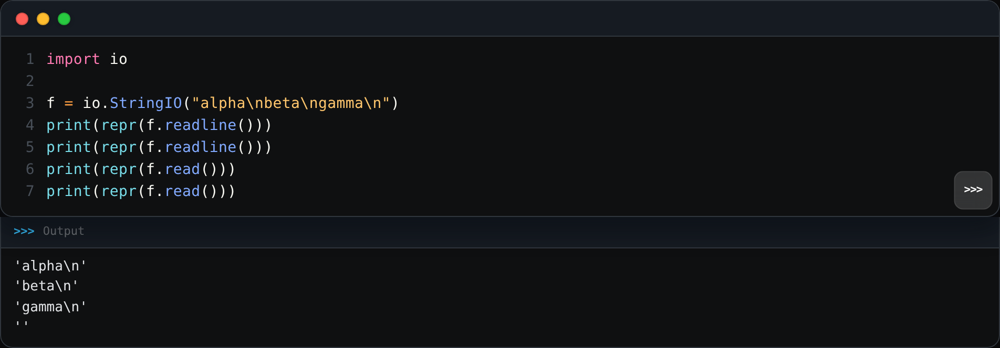

```python
import io

f = io.StringIO("alpha\nbeta\ngamma\n")
print(repr(f.readline()))
print(repr(f.readline()))
print(repr(f.read()))
print(repr(f.read()))
```

`repr` shows each string as Python would write it, so the `\n` ending each line is visible. The position advanced with every call: 2 `readline` calls consumed 2 lines, `read()` returned everything from the position to the end, and a second `read()` found nothing left and returned the empty string `''`. A file never rewinds on its own.


<br>

### One line at a time

`read()` loads the whole file into 1 string, so an export of 6 gigabytes costs 6 gigabytes of memory before any work starts. A file object can be looped over instead: `for line in f:` runs its indented block once per line, holding only the current line. `for` is a loop, which a later lesson covers in full; here it does 1 job, visiting each line in order from the first to the last.

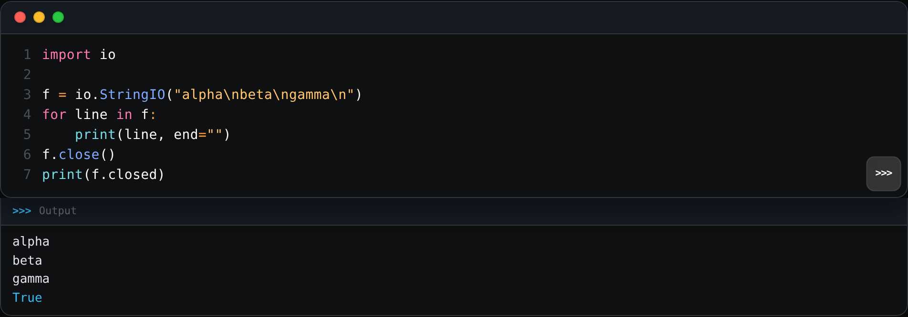

```python
import io

f = io.StringIO("alpha\nbeta\ngamma\n")
for line in f:
    print(line, end="")
f.close()
print(f.closed)
```

Each line already ends with `\n`, and `print` adds a newline of its own, so `end=""` tells `print` to add nothing and the output keeps single spacing. After `close()`, the attribute `f.closed` reports `True`, and any further `read` on `f` raises `ValueError: I/O operation on closed file`.


<br>

### Writing

Mode `"w"` empties the file the moment `open()` is called, before any `write()`: a program that opens `counts.csv` with `"w"` and crashes on the very next line has already destroyed the old counts. `write()` puts a string at the position and returns the number of characters written, which the interactive shell echoes as a bare number such as `5`. It adds no newline, so each written line should end in `\n`, or the next `write` continues on the same line. `getvalue()` belongs to `StringIO` alone: it returns everything written, the content a disk file would hold after `close()`.

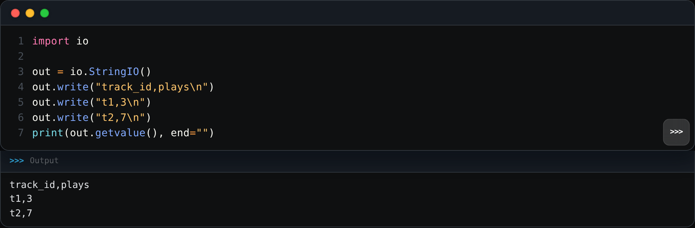

```python
import io

out = io.StringIO()
out.write("track_id,plays\n")
out.write("t1,3\n")
out.write("t2,7\n")
print(out.getvalue(), end="")
```


<br>

### Writing the result back safely

A job that opens its own output with `"w"` and crashes halfway leaves a half-written file, and the previous good version is already gone. The safe order is to write to a temporary name, close it, then rename it over the real name with `os.replace`. The rename is a single operation, so anything reading `counts.csv` sees either the old complete file or the new complete file, never a half of either.

```sql
import os

out = open("counts.tmp", "w")
out.write("track_id,plays\n")
out.write("t1,3\n")
out.close()
os.replace("counts.tmp", "counts.csv")
```

> What close() does
>
> - Flushes the write buffer: written text sits in memory until the buffer fills, flush() is called, or close() runs
> - Releases the handle: the operating system caps how many files 1 process may hold open at once
> - Marks the object closed; any later read or write raises ValueError instead of touching the file

Opening a path that does not exist in mode `"r"` raises `FileNotFoundError`, a case for the previous section: a job on its first ever run can catch it and start from an empty result instead of dying.

```sql
try:
    f = open("counts.csv", "r")
    previous = f.read()
    f.close()
except FileNotFoundError:
    print("no previous counts, starting empty")
    previous = ""
```


<br>

### Practice

**What does this program print?**

```python
import io

f = io.StringIO("a\nb\n")
first = f.readline()
rest = f.read()
again = f.read()
print(repr(first), repr(rest), repr(again))
```

- **A.** 'a\n' 'a\nb\n' 'a\nb\n'
- **B.** 'a\n' 'b\n' 'b\n'
- **C.** 'a\n' 'b\n' ''
- **D.** 'a' 'b' ''

<details>
<summary>Solution</summary>

**C.** 'a\n' 'b\n' ''

readline() consumed the first line, read() returned everything from there to the end, and the second read() at the end returned ''.

**Why the others are wrong**

- **A.** read() starts from the current position, which readline() already moved past the first line, and it never rewinds to the start.
- **B.** The first read() moved the position to the end, so the second read() has nothing left and returns the empty string.
- **D.** Lines read from a file keep their trailing newline, and repr shows it as \n inside the quotes.

</details>

Double spacing is what a line-by-line read prints when `end=""` is left out. Each line arrives from the file with its own `\n` at the end, and `print` writes a second `\n` after it, so every line is followed by an empty one. Here is the 3-line file `"alpha\nbeta\ngamma\n"` traced through both calls:

| repr(line) | print(line) writes | print(line, end="") writes |
| --- | --- | --- |
| `'alpha\n'` | alpha, newline, newline | alpha, newline |
| `'beta\n'` | beta, newline, newline | beta, newline |
| `'gamma\n'` | gamma, newline, newline | gamma, newline |


<br>

---

## Defining a Class

### Data that belongs together

A play count belongs to a track id. Held in `t1_name` and `t1_plays` as separate variables, the 2 values have nothing in the program tying them together, and a job tracking 500 tracks needs 1,000 variables. A class is a blueprint for an object that holds a group of variables, called attributes, together with the functions that work on them, called methods. Building an object from the blueprint is called making an instance.


<br>

### The smallest useful class

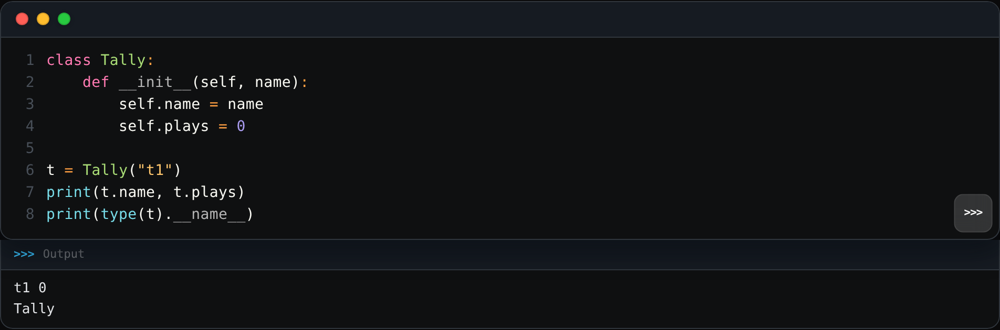

```python
class Tally:
    def __init__(self, name):
        self.name = name
        self.plays = 0

t = Tally("t1")
print(t.name, t.plays)
print(type(t).__name__)
```

Line by line: `class Tally:` opens an indented block that defines the blueprint. `def` gives an indented block of code a name, and the block runs each time that name is called; functions get a lesson of their own later, and inside a class each one is a method. `__init__` is the method Python calls when `Tally("t1")` runs, with `self` standing for the new object being built. `self.name = name` stores the argument on that object, and `self.plays = 0` gives every new tally a starting count. The finished object is bound to `t`, and `t.name` reads the attribute back. `type(t)` reports the class it was built from, and that class's `__name__` attribute holds its name, `Tally`, the way `type(3).__name__` gives `int`.


<br>

### Methods change their own object

`a.add(3)` is a shorthand: Python looks up `add` in `Tally` and calls it with `a` as `self` and `3` as `count`. The method changes `a.plays` and nothing else, so `b` keeps its own count. Two objects built from 1 class share the methods and hold separate attributes. The run below shows both objects on the stage as their counts move.

https://github.com/user-attachments/assets/ea2c96dc-f435-4a16-b5ae-07cdb129c5e6

*Each call to add changes the plays attribute of the object it was called on.*


<br>

### Returning a value

A method can hand a value back to its caller with `return` instead of printing it. The call then stands for that value, so it can be stored in a variable or passed straight to `print`. Below, `share` divides this tally's plays by a total it is given.

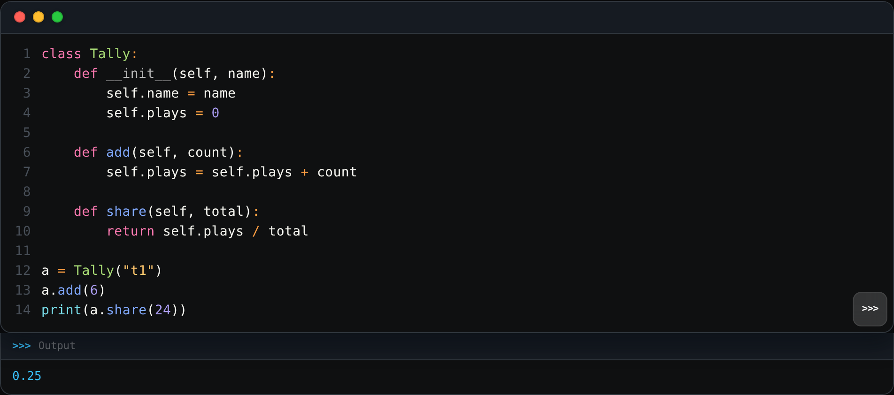

```python
class Tally:
    def __init__(self, name):
        self.name = name
        self.plays = 0

    def add(self, count):
        self.plays = self.plays + count

    def share(self, total):
        return self.plays / total

a = Tally("t1")
a.add(6)
print(a.share(24))
```

> The self rule
>
> - Every method's first parameter is self, and the call supplies it: a.add(3) passes a as self and 3 as count
> - Leaving self out of the header raises TypeError: add() takes 1 positional argument but 2 were given
> - Attributes live on self: a plain plays = 0 inside a method is a temporary name that vanishes when the method ends


<br>

### Practice

**What does the last line print?**

```python
class Box:
    def __init__(self):
        self.items = 0

    def put(self, n):
        self.items = self.items + n

x = Box()
y = Box()
x.put(2)
x.put(2)
y.put(5)
print(x.items, y.items)
```

- **A.** 9 9
- **B.** 4 9
- **C.** 4 5
- **D.** 2 5

<details>
<summary>Solution</summary>

**C.** 4 5

x received 2 twice for a total of 4 while y received 5; each object keeps its own items attribute.

**Why the others are wrong**

- **A.** items is stored on self, and each Box() call builds a new object with its own items, so the 2 counts never combine.
- **B.** y.put(5) changes y.items alone; x's 4 is never added into y.
- **D.** put adds n to the existing items rather than replacing it, so the second x.put(2) brings x.items to 4.

</details>

The `self.` prefix is what makes a change stick. Inside a method, `ticks = ticks + 1` written without it names a temporary variable that has no value yet, so the call stops with `UnboundLocalError: local variable 'ticks' referenced before assignment`. Leaving `self` out of the header fails at the call instead, with the `TypeError` from the rule above. Both mistakes break the same contract: a method receives its object and writes to it.

```sql
class Meter:
    def __init__(self):
        self.ticks = 0

    def tick(self):
        ticks = ticks + 1
```


<br>

---

## Generators

### Work that waits to be asked

`f.read()` returns the whole file as 1 string before any work starts, so the memory bill equals the file's size. `for line in f` pays for 1 line at a time. A generator is how you write a function with that second behavior: it produces values 1 at a time when asked and holds only what it needs to produce the next one.


<br>

### yield pauses a function

A function that contains `yield` is a generator function. Calling it runs none of its lines; it returns a generator object. Each call to `next()` on that object runs the function until the next `yield`, hands out the value written there, and freezes with every variable intact until the following `next()`.

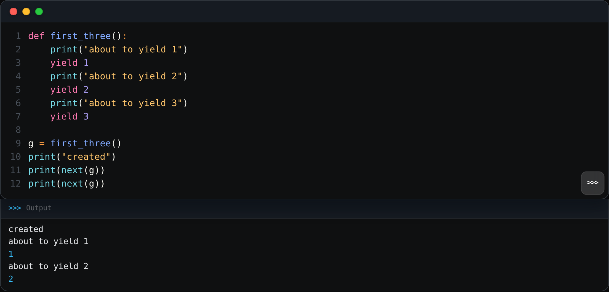

```python
def first_three():
    print("about to yield 1")
    yield 1
    print("about to yield 2")
    yield 2
    print("about to yield 3")
    yield 3

g = first_three()
print("created")
print(next(g))
print(next(g))
```

`created` printed first, before anything inside the function ran. The first `next(g)` ran lines 2 and 3 and stopped at the `yield`, so `print` received the `1`. The second `next` resumed at line 4. Line 6 has not run and will not until a third `next` arrives. A `next` after the final `yield` raises `StopIteration` to signal that the generator has nothing more. `try` and `except` handle it like any other exception.

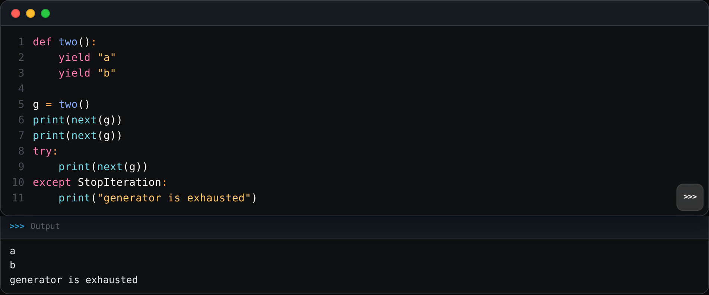

```python
def two():
    yield "a"
    yield "b"

g = two()
print(next(g))
print(next(g))
try:
    print(next(g))
except StopIteration:
    print("generator is exhausted")
```


<br>

### Looping over a generator

A `for` loop calls `next()` for you and stops quietly at `StopIteration`, which makes a generator a natural fit for `for`. The generator below wraps a file: it reads 1 line and yields it converted, then reads the next line only when the loop asks. `int()` ignores surrounding whitespace, so the `\n` ending each line causes no error.

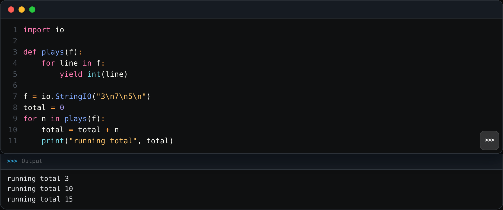

```python
import io

def plays(f):
    for line in f:
        yield int(line)

f = io.StringIO("3\n7\n5\n")
total = 0
for n in plays(f):
    total = total + n
    print("running total", total)
```

At no point does the program hold more than 1 line of the file. The run below stands a list of 3 lines in for the file and doubles each value on its way through. Watch `n` and `total` change: each time the generator yields, its frame steps off the stack with `line` and its place in the loop intact, then steps back on when the loop asks for the next value. Python discards that frame only after the last line has been read.

https://github.com/user-attachments/assets/3bccad6e-e2a4-4ef8-9ff3-470dfefc8ec8

*The generator yields 1 converted line, doubled, then waits for the loop to ask for the next.*

|  | f.read() | Generator over f |
| --- | --- | --- |
| Memory held | The whole file | 1 line |
| When the work happens | All of it before the first result | As each value is requested |
| Stopping early | The whole file was already read | The remaining lines are never read |


<br>

### A generator runs once

A generator remembers how far it got, and when it reaches the end it stays there. A second loop over the same generator object receives nothing and its block never runs. To go through the data again, call the generator function again for a fresh object.

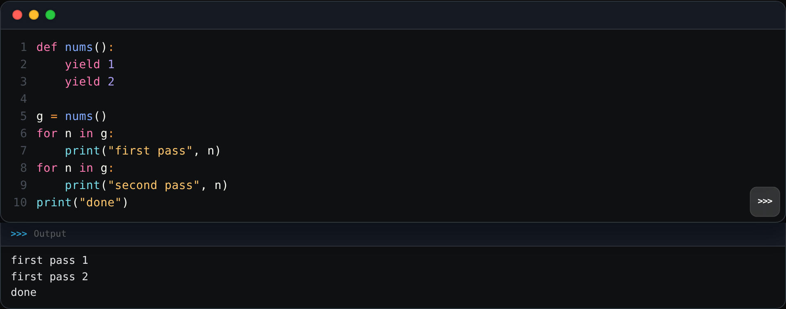

```python
def nums():
    yield 1
    yield 2

g = nums()
for n in g:
    print("first pass", n)
for n in g:
    print("second pass", n)
print("done")
```


<br>

### Practice

**In what order do the printed lines appear?**

```python
def gen():
    print("start")
    yield "x"
    print("middle")
    yield "y"
    print("end")

g = gen()
a = next(g)
print(a)
b = next(g)
print(b)
```

- **A.** start, middle, end, x, y
- **B.** start, x, middle, y
- **C.** start, x, middle, y, end
- **D.** x, y

<details>
<summary>Solution</summary>

**B.** start, x, middle, y

The first next() prints start and pauses at yield "x"; the second resumes there and runs as far as yield "y", printing middle on the way. No third next() is made, so end never prints.

**Why the others are wrong**

- **A.** Calling gen() runs nothing; the body runs only as far as each next() asks, pausing at every yield.
- **C.** end sits after the second yield and needs a third next() to run, which the program never makes.
- **D.** The print calls inside the generator run as part of each next(), so start and middle appear before their values.

</details>

One `yield` written inside a `for` loop produces as many values as the loop has passes. Each request from the outer loop resumes the generator just after the `yield`, finishes that pass, takes the next line and pauses at the `yield` again. Here is `plays(f)` from earlier, 1 request at a time. Its input starts with `3` and `7` and ends with `5`:

| Request | Line the generator reads | Value yielded | total after |
| --- | --- | --- | --- |
| 1st `next()` | `'3\n'` | 3 | 3 |
| 2nd `next()` | `'7\n'` | 7 | 10 |
| 3rd `next()` | `'5\n'` | 5 | 15 |
| 4th `next()` | none left | `StopIteration`, loop ends | 15 |


<br>

---

## Context Managers

### The gap between open and close

The file section called `close()` by hand. Between `open()` and `close()` sit the lines that do the work, and when 1 of them raises, Python jumps out of the block and `close()` never runs. The handle then stays open until Python gets around to discarding the file object, and nothing in the language promises when that will be. A job that opens a file per customer and keeps those objects alive, or runs on an interpreter that collects them late, leaks a handle on every error until the operating system refuses to open more. The `finally` block from the error section fixes this, and `with` is a shorter way to write the same guarantee.

```sql
f = open("plays.txt", "r")
try:
    text = f.read()
finally:
    f.close()
```

```sql
with open("plays.txt", "r") as f:
    text = f.read()
```

`with` calls `open()` and binds the result to `f`. After the indented block runs, it closes `f`, even if the block raised. The 2 programs do identical work; the second cannot forget the cleanup, because the cleanup is part of the statement.

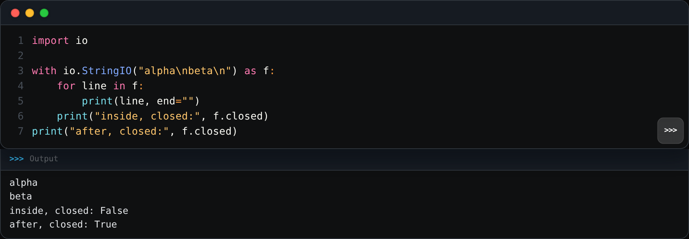

```python
import io

with io.StringIO("alpha\nbeta\n") as f:
    for line in f:
        print(line, end="")
    print("inside, closed:", f.closed)
print("after, closed:", f.closed)
```

`f` is still a name after the block, and the object it points to has been closed; `f.closed` reports the change the moment the block ends.


<br>

### Objects that know how to clean up

`with` works on any object that defines 2 methods. `__enter__` runs at the top of the block, and whatever it returns is what `as` binds. `__exit__` runs when the block ends, receiving 3 arguments that describe the exception when 1 was raised and are all `None` otherwise. A file object defines both, and its `__exit__` calls `close()`. A class of your own can define them for any resource that needs releasing.

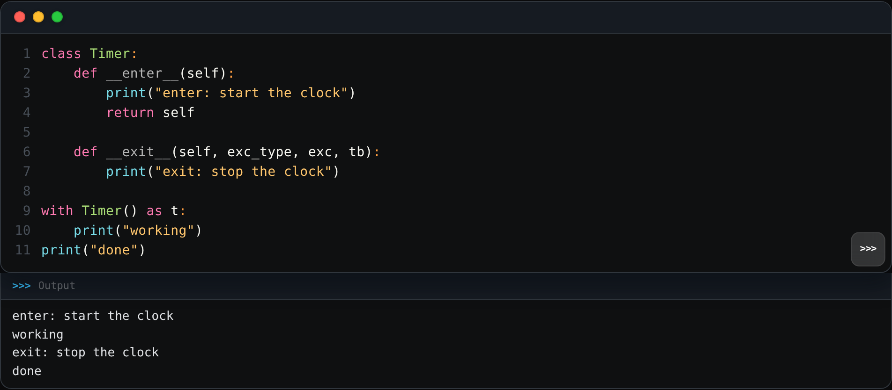

```python
class Timer:
    def __enter__(self):
        print("enter: start the clock")
        return self

    def __exit__(self, exc_type, exc, tb):
        print("exit: stop the clock")

with Timer() as t:
    print("working")
print("done")
```


<br>

### Cleanup when the block raises

The run below puts a division by zero inside the block and a `try` around the whole `with`. Watch the order: `__exit__` prints before the handler outside does.

https://github.com/user-attachments/assets/8cea4a8b-cfbf-4dfe-89cc-c325c83f6294

*__exit__ runs before the exception reaches the handler outside the with.*

The division failed inside the block, so Python ran `__exit__` first, passing the exception's class as `exc_type`, and only then let the `ZeroDivisionError` continue outward to the `except` wrapped around the `with`. Cleanup happened before the error was handled. An `__exit__` that returns `True` tells Python the exception is dealt with, and nothing outside the `with` ever sees it; returning `None`, as this one does by having no `return`, lets the exception travel on.

> What __exit__ receives
>
> - exc_type: the exception class, ZeroDivisionError for example; None when the block finished normally
> - exc: the exception object, whose message print() would show, or None
> - tb: the traceback object, or None
> - Return True to suppress the exception; return None to let it continue past the with


<br>

### Two resources in one with

A copy job needs a source and a destination open together. One `with` can hold both, separated by a comma, and closes them in reverse order when the block ends. An error on any line inside still closes both.

```sql
with open("plays.txt", "r") as src, open("plays.tmp", "w") as dst:
    for line in src:
        dst.write(line)
```


<br>

### Practice

**What does this program print before it ends?**

```python
class Res:
    def __enter__(self):
        print("open")
        return self

    def __exit__(self, exc_type, exc, tb):
        print("close")

with Res() as r:
    print("step 1")
    int("oops")
    print("step 2")
print("after")
```

- **A.** open, step 1, step 2, close, after
- **B.** open, step 1, then a ValueError traceback with no close
- **C.** open, step 1, close, after
- **D.** open, step 1, close, then a ValueError traceback

<details>
<summary>Solution</summary>

**D.** open, step 1, close, then a ValueError traceback

The raise inside the block triggers __exit__, which prints close; its None return lets the ValueError continue, and no handler catches it, so the program stops.

**Why the others are wrong**

- **A.** int("oops") raises ValueError, so step 2 never runs and the exception stops the program before after.
- **B.** __exit__ runs on every way out of the block, including an exception, so close prints before the traceback.
- **C.** __exit__ returns None, so the ValueError continues past the with and stops the program before after prints.

</details>

`with` calls `__exit__` with 4 arguments every time: the object as `self`, then the 3 exception slots, filled with `None` when the block finished normally. A header that lists only `self` accepts 1 of them, so the call fails after the indented block has already run, with `TypeError: __exit__() takes 1 positional argument but 4 were given`. The traceback follows the block's own prints, and the cleanup line inside `__exit__` never prints.

```sql
class Lock:
    def __enter__(self):
        return self

    def __exit__(self):
        print("released")
```


<br>

---

## Putting It All Together

The nightly Spotify job that turns a day of listening events into per-track play counts: it opens the day's export, converts each line, adds the result to a tally per track, and writes the counts file that downstream reports read the next morning.

- The export is opened inside with , so the handle closes even when a line in the middle raises.
- A generator wraps the file and yields 1 parsed line at a time, so a gigabyte export costs the memory of 1 line.
- The conversion of each line sits in a try , and except ValueError as err logs the malformed line and moves on instead of stopping the job.
- Each track's name and running count live together on a Tally object, and its add method is the only code that changes the count.
- The counts are written to a temporary name and renamed with os . replace , so the morning reports read a complete file or yesterday's, never a half of either.


<br>

---

## Key Takeaways

- try holds the lines that can fail, except SomeType names what to catch, and finally runs on every way out.
- A file object keeps a position: readline ( ) and read ( ) advance it, and for line in f visits lines without loading the file whole.
- Write to a temporary name and os . replace it over the real one, so a crash never leaves a half-written output behind.
- A class bundles attributes stored on self with the methods that change them; every object built from it has its own attributes.
- yield turns a function into a generator that produces 1 value per next ( ) . The generator runs once and raises StopIteration at the end.
- with calls __enter__ on entry and __exit__ on every exit, so cleanup runs even when the block raises.
