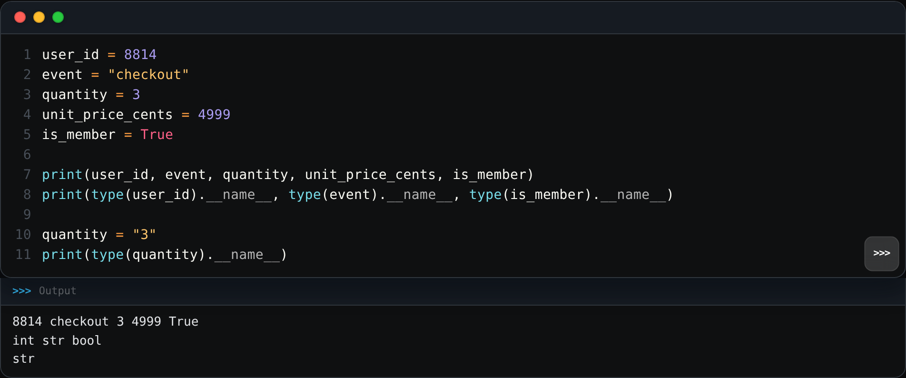
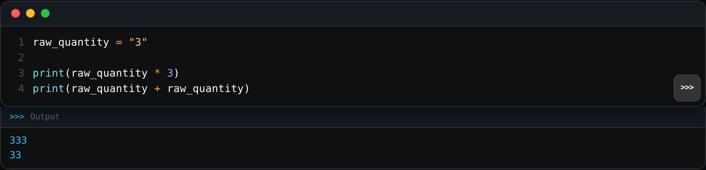
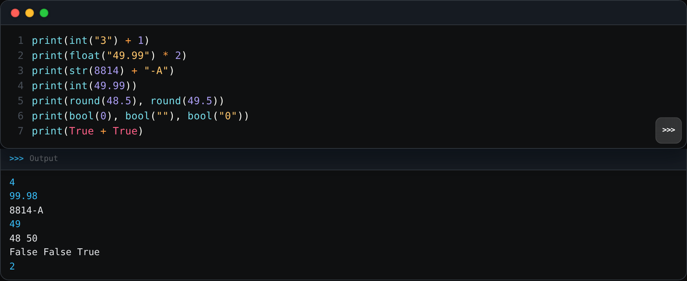
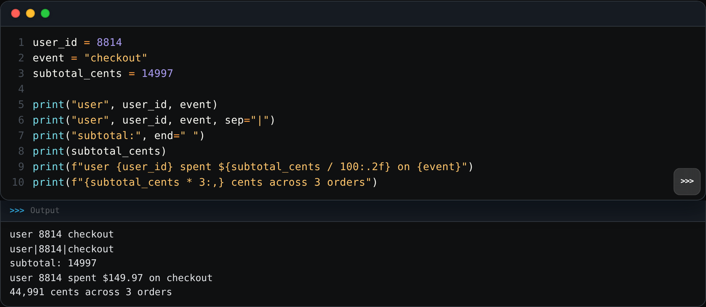
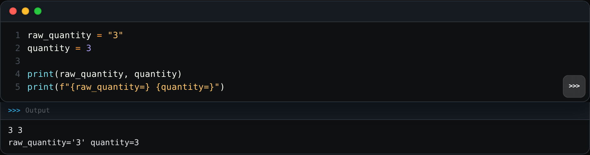
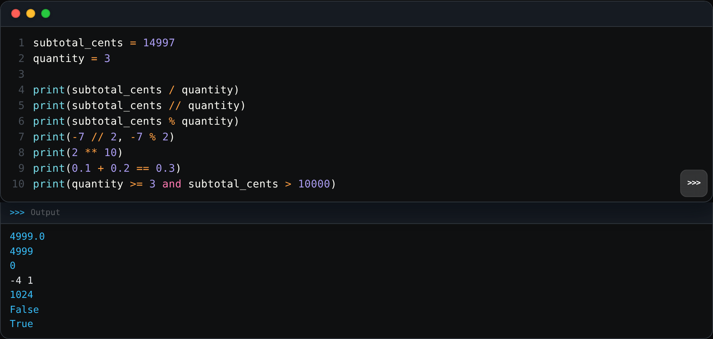
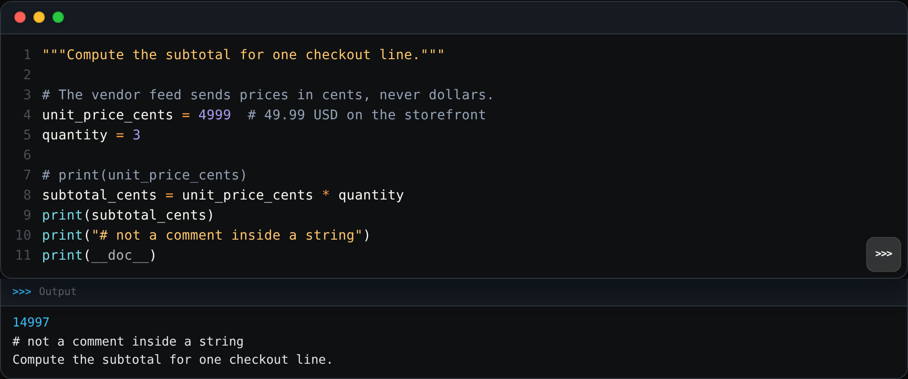

# Python Foundations: Beginner

A loader for an online store read the quantity 3 from a CSV, added the 3 units from a second order, and wrote 33 to the warehouse. Nothing failed. The quantity had arrived as text, and text plus text is longer text. Every line of Python stores values under names, and the kind of value a name holds decides what the code does with it. That decision starts with assignment.


<br>

---

## Variables and Assignment

A Python variable is a name attached to a value. The line `quantity = 3` builds the integer object 3 and binds the name `quantity` to it, with no declaration beforehand and no type written next to the name. The type belongs to the value, so the same name can point at an integer on one line and a string on the next, and `type(quantity)` reports whatever the name currently points at.


<br>

### Assignment reads right to left

Python evaluates everything to the right of the = first, producing a single value, and only then binds the name on the left to it. That order is what makes quantity = quantity + 1 legal: the right side computes the current 3 plus 1, and the name is then rebound to the new 4. The 3 itself is untouched, because rebinding moves the name rather than changing the object. The 4 lines below show what that means for a second name that shared the old value.

https://github.com/user-attachments/assets/a2c8df44-4792-4f87-9704-03da58eb833c

*Rebinding quantity moves one name; reserved still points at 3.*

The second line binds `reserved` to the same 3, so for a moment both names sit on one object. The third line builds a new 4 and moves only `quantity`. `reserved` still reads 3, so the last line prints `4 3`. An int cannot be changed in place, so rebinding is the only way a counter changes, and 2 names on one int never interfere. The picture of names as labels on objects matters again for lists, which can change in place under every name bound to them.


<br>

### Values carry the type, names carry nothing



```python
user_id = 8814
event = "checkout"
quantity = 3
unit_price_cents = 4999
is_member = True

print(user_id, event, quantity, unit_price_cents, is_member)
print(type(user_id).__name__, type(event).__name__, type(is_member).__name__)

quantity = "3"
print(type(quantity).__name__)
```

The first printed line shows 5 values of 3 different kinds, each under a name that says what it holds. `type(...).__name__` asks for the type's bare name: `int` for 8814, `str` for the event text, `bool` for `is_member`. After the rebinding on the last 2 lines, `quantity` reports `str`, because it now points at the text `"3"`, and nothing warned that a count had turned into text. The loader that stored 33 went wrong at exactly this point.


<br>

### Legal names and good names

A name is letters, digits and underscores, and it cannot begin with a digit. Names are case-sensitive, so `quantity`, `Quantity` and `QUANTITY` are 3 unrelated variables. A capitalisation typo on the left of an `=` silently creates a new name and leaves the intended one unchanged. The same typo on a name being read raises `NameError` on exactly that line. Python's style guide, PEP 8, asks for lowercase snake_case, `unit_price_cents` rather than `unitPriceCents`, and the libraries a data engineer reads follow it.

- unit_price_cents: lowercase words joined by underscores, with the unit in the name
- 2nd_order: refused with a SyntaxError, a name cannot start with a digit
- unit-price: parsed as unit minus price, 2 names and a subtraction
- sum = 0: legal, and it shadows the built-in sum() for the rest of the file
- unitPriceCents: legal camelCase, which reads as another language's habit

Python refuses its 35 reserved keywords as names with a `SyntaxError`, so `class = "gold"` never runs. Built-in names such as `sum`, `max` and `list` are ordinary names. `sum = 0` runs, and the next `sum(prices)` in that file fails with `TypeError: 'int' object is not callable`, possibly 200 lines from the assignment that caused it.

> **TIP**
>
> Prefix booleans so they read as questions (`is_member`, `has_discount`), use plurals for collections (`prices`, `orders`), and keep single letters for loop counters and maths.


<br>

### A name that was never bound

The most common error in a new programmer's first week is a `NameError`: the code reads a name that no assignment has bound yet, because of a typo, a capital letter, or an assignment that sits below the line that uses it. Python reports the exact name it could not find, and the fix is to match the spelling of the name that was bound.

Exercise: [A name that was never bound](_exercises/python_foundations_beginner_exercise_1.md)

Reading the name in the message and searching the file for it is the whole technique, and it works the same way when the missing name is a variable assigned further down the file than the line that reads it.


<br>

---

## Data Types

### The type decides what an operator does

Every value carries a type, and an operator inspects the types of its operands before deciding what to do. `*` between 2 ints multiplies. `*` between a str and an int repeats the text that many times. `*` between a str and a float has no meaning and raises `TypeError`. The symbol is identical in all 3 cases; the types pick the behaviour. The 4 types met on every line of a data job are `int` for whole numbers of any size, `float` for numbers with a fractional part, `str` for text, and `bool` for `True` and `False`.



```python
raw_quantity = "3"

print(raw_quantity * 3)
print(raw_quantity + raw_quantity)
```

Both lines run and both answers are wrong. With an int, `*` repeats the text, so `333`. Between 2 strings, `+` joins them, which is how the loader turned 3 and 3 into 33. Multiplying the text by the float 49.99 instead raises `TypeError: can't multiply sequence by non-int of type 'float'`, because repetition needs a whole count. That error is the kinder outcome: it stops the job on the failing line, while a plausible wrong number reaches the warehouse unnoticed.


<br>

### Converting between types

Each type's name is also a function that builds a value of that type from another one. `int("3")` parses the text and returns the integer 3; `int("49.99")` raises `ValueError: invalid literal for int() with base 10: '49.99'` because the text holds a decimal point, while `float("49.99")` accepts it. `int(" 3 ")` with surrounding whitespace works, and `int("3 units")` does not. Values read from a CSV file or an HTTP query string stay strings until the code converts them, and so do environment variables, which is why a loader's first job is usually a column of conversions.



```python
print(int("3") + 1)
print(float("49.99") * 2)
print(str(8814) + "-A")
print(int(49.99))
print(round(48.5), round(49.5))
print(bool(0), bool(""), bool("0"))
print(True + True)
```

Conversion toward a narrower type loses information. `int(49.99)` is 49: the fractional part is discarded rather than rounded, and `int(-49.99)` is -49, truncating toward 0. `round()` is a separate operation: `round(48.5)` is 48 and `round(49.5)` is 50, because Python rounds a half to the even neighbour to avoid bias across many sums. `bool()` is `False` for zero numbers, the empty string, `None` and empty containers, and `True` for nonzero numbers and non-empty strings, including the text `"0"`, so a flag that arrives as `"0"` goes through `int` first. `True + True` is 2 because `bool` is a subclass of `int`, which lets a sum over comparisons count matching rows.

Exercise: [Converting between types](_exercises/python_foundations_beginner_exercise_2.md)


<br>

### Why 0.1 plus 0.2 is not 0.3

A `float` is a binary fraction with a fixed number of bits, and most decimal fractions have no exact binary form, the same way 1/3 has no exact decimal form. `0.1 + 0.2` evaluates to `0.30000000000000004`. Each error is tiny, roughly 1 part in 10 quadrillion, but it accumulates across a sum of thousands of rows and shows up as a total that differs from the ledger in the last cents. Money is therefore stored as an integer count of cents, which is why the running example carries `unit_price_cents = 4999` rather than 49.99, and converted to dollars only at the moment a human reads it.

- **53 bits** — of precision in every Python float

One more value sits beside the 4 types: `None`, the single object Python uses for a missing value. A database driver returns SQL NULL as `None` and a JSON `null` parses to it, while an empty CSV field arrives as the empty string `""`, on which `int("")` raises `ValueError`. The check is `amount is None`, with `is`, because only one `None` exists. Adding a `None` onto a running int total raises `TypeError: unsupported operand type(s) for +: 'int' and 'NoneType'`, which is how one empty row stops a nightly sum.

> **TIP**
>
> When a value from a file or an API behaves strangely, `print(type(value), repr(value))` settles it in one line: `repr` shows the quotes around a string, plus a trailing space or newline such as `'3\n'` that a plain print hides.


<br>

---

## Print Statements

`print` takes any number of arguments, converts each one to text with `str()`, joins them with a separator and writes the result to standard output followed by an end marker. The separator defaults to a single space and the end marker to a newline, and both are keyword arguments: `sep="|"` produces a pipe-delimited line, and `end=""` keeps the cursor on the same line for the next call. Standard output is a stream, so in a scheduled job everything `print` writes lands in the task log rather than on a screen, and a `print()` with no arguments writes a bare newline.


<br>

### f-strings

An f-string is a string literal with an `f` before the opening quote, inside which any expression in curly braces is evaluated at runtime and its result spliced into the text. `f"user {user_id}"` substitutes the value; `f"{subtotal_cents / 100}"` runs the division first. A colon inside the braces starts a format spec, a small language that controls how the value is rendered: `:.2f` fixes 2 decimal places, `:,` inserts thousands separators, and `:>10` right-aligns the value in a 10-character column.



```python
user_id = 8814
event = "checkout"
subtotal_cents = 14997

print("user", user_id, event)
print("user", user_id, event, sep="|")
print("subtotal:", end=" ")
print(subtotal_cents)
print(f"user {user_id} spent ${subtotal_cents / 100:.2f} on {event}")
print(f"{subtotal_cents * 3:,} cents across 3 orders")
```

The second line shows the same 3 values delimited with `|`, which is how a quick export to a delimited file begins. The third and fourth calls together produce a single line, because the first of them ended with a space instead of a newline. The f-string divides inside the braces and renders the result with 2 decimals, so the cents integer reads as dollars with no extra variable. The last line applies `:,` to an integer expression computed inside the braces, and 44991 comes out as `44,991`.

The spec sits after the colon and reads in a fixed order: fill and alignment, then width, then the comma, then precision, then the type letter. `f"{amount:>12,.2f}"` right-aligns a number with thousands separators and 2 decimals in 12 characters, which is how a report column lines up. A spec that rounds for display changes nothing in the value: `f"{149.97:.0f}"` shows `150` while the stored number stays 149.97, which is the kind of mismatch that sends an analyst hunting for a 3-cent discrepancy between a report and the table underneath it.

Exercise: [f-strings](_exercises/python_foundations_beginner_exercise_3.md)


<br>

### The = specifier for debugging

An `=` after the expression inside the braces, added in Python 3.8, prints the expression's source text with an equals sign after it, then the value's `repr`. The `repr` is the point: it keeps the quotes on a string, so a value that is still text cannot pass for a number. It also combines with a format spec, and `f"{subtotal_cents / 100=:.2f}"` prints `subtotal_cents / 100=149.97`.



```python
raw_quantity = "3"
quantity = 3

print(raw_quantity, quantity)
print(f"{raw_quantity=} {quantity=}")
```

The plain `print` shows `3 3`, and nothing on that line separates the text from the integer. The `=` form shows the quotes on `'3'`, which is the clue that would have caught the text quantity before it reached a table. In a nightly loader, a line such as `print(f"{row_count=} {rejected_rows=}")` after each stage leaves a log where every number is printed next to its name, which is faster to read during an incident than a row of bare integers.


<br>

---

## Basic Operators

### The 7 arithmetic operators

Arithmetic on ints and floats uses 7 operators, `+`, `-`, `*`, `/`, , `%` and `**`, and the result's type depends on the operator as much as on the operands. On 2 ints, `+`, `-`, `*`,  and `%` return an int, and so does `**` with a non-negative exponent, however large the result: Python integers have no overflow, so `2 ** 100` is a 31-digit number. A negative exponent gives a float, so `2 ** -1` is `0.5`, and any operation with a float operand returns a float. True division `/` always returns a float, even when exact, so `14997 / 3` is `4999.0`.

is floor division and `%` is modulo, and the 2 are defined together so that `a == (a  b) * b + a % b` holds for every pair of operands. Floor division rounds toward negative infinity rather than toward 0, so `-7  2` is -4 rather than -3, and the remainder takes the sign of the divisor: `-7 % 2` is 1. That pairing is what makes `%` safe for wrapping an index or a weekday around, and it differs from C and Java, where the remainder takes the sign of the dividend.



```python
subtotal_cents = 14997
quantity = 3

print(subtotal_cents / quantity)
print(subtotal_cents // quantity)
print(subtotal_cents % quantity)
print(-7 // 2, -7 % 2)
print(2 ** 10)
print(0.1 + 0.2 == 0.3)
print(quantity >= 3 and subtotal_cents > 10000)
```

The first 3 lines are the 3 answers to the same division: the quotient as a float, the quotient as a whole number, and what was left over, which is 0 because 3 units at 4999 cents each sum to exactly 14997. The sixth line prints `False` because `0.1 + 0.2` rounds to `0.30000000000000004` while the literal `0.3` rounds to a different double. Float equality is reliable only when both sides were produced the same way, which is one more reason to keep money in integer cents and compare the ints.


<br>

### Comparison and boolean operators

The 6 comparison operators `==`, `!=`, `<`, `<=`, `>` and `>=` return a `bool`, and they chain: `10000 < subtotal_cents <= 20000` tests both conditions at once, with `subtotal_cents` evaluated once. Comparing an int with a float works numerically, so `3 == 3.0` is `True`. Comparing an int with a str for order raises `TypeError: '<' not supported between instances of 'int' and 'str'`, and for equality returns `False` without complaint: `3 == "3"` is `False`, the text-versus-number mismatch wearing a different operator.

The boolean operators are `and`, `or` and `not`. They combine conditions and short-circuit: `quantity > 0 and total / quantity > 100` never divides when the quantity is 0, because `and` stops at the first falsy operand. They also return an operand rather than a plain `True` or `False`, so `amount or 100` substitutes a default of 100 when a field is `None`. The trap is that a real reading of 0.0 is falsy too and becomes 100, while `100 if amount is None else amount` replaces only the missing value.


<br>

### Precedence and augmented assignment

Operators bind in a fixed order, and `-2 ** 2` is -4 because the power binds tighter than the unary minus, while `3 + 4 * 2` is 11 because multiplication binds tighter than addition. Parentheses cost nothing and remove the question, so `(subtotal_cents * 85)  100` reads the intent even where they change nothing. Augmented assignment, `total += amount`, evaluates the right side, applies the operator to the current value and rebinds the name, and every arithmetic operator has one: `-=`, `*=`, `//=`, `%=`.

| Level | Operators | Example |
| --- | --- | --- |
| Binds first | `\*\*` | `-2 \*\* 2` is -4 |
| 2 | unary `-` | `-x \* 2` negates first |
| 3 | `\*`, `/`, `//`, `%` | `3 + 4 \* 2` is 11 |
| 4 | `+`, `-` | `10 - 2 - 3` is 5, left to right |
| 5 | `==`, `!=`, `<`, `<=`, `>`, `>=` | `1 + 2 < 4` is True |
| 6 | `not` | `not 3 > 4` is True |
| 7 | `and` | `a or b and c` is `a or (b and c)` |
| Binds last | `or` | `x or y` returns the first truthy |

Exercise: [Precedence and augmented assignment](_exercises/python_foundations_beginner_exercise_4.md)


<br>

---

## Comments

A comment starts at a `#` and runs to the end of the line, and the interpreter discards it before the line runs. A `#` inside a string literal is text rather than a comment, which is how `print("order #8814")` prints the hash. Comments exist for the next reader of the file, who is usually the author 6 months later, during an incident, with no memory of why a line is the way it is. The code already says what it does; a comment that earns its place says why, or records a fact about the data that the code cannot show.


<br>

### What a comment is for

| ✓ Comments that earn their place | ✗ Comments that cost the reader |
| --- | --- |
| • A fact about the data the code cannot show: the vendor feed sends prices in cents<br><br>• A reason for a surprising choice: half rounds to even to match the ledger<br><br>• A reference: the spec, ticket or formula a line implements<br><br>• A warning: this column has been nullable since the 2025 migration | • quantity = 3 # set quantity to 3, which the code already says<br><br>• A commented-out block kept in case it is needed again<br><br>• A comment that was true 3 edits ago and nobody updated<br><br>• A header with the author's name and date, which version control records |



```python
"""Compute the subtotal for one checkout line."""

# The vendor feed sends prices in cents, never dollars.
unit_price_cents = 4999  # 49.99 USD on the storefront
quantity = 3

# print(unit_price_cents)
subtotal_cents = unit_price_cents * quantity
print(subtotal_cents)
print("# not a comment inside a string")
print(__doc__)
```

The first line of the file is a string literal on its own, and a string in that position at the top of a file, a function or a class is a docstring: Python keeps it, exposes it as `__doc__`, and tools such as `help()` and documentation generators read it. The commented-out `print` never ran, and the `#` inside the last string printed as a character. The comment on the price line records a unit, which is the single most useful fact a comment can carry in a data job, since a wrong unit produces a number that looks right.


<br>

### Comments that lie

A comment is text the interpreter never checks, so nothing stops it from drifting out of date. `discount = subtotal * 0.15 # 10% loyalty discount` has one number in the code and a different one in the comment, and a reader has no way to know which was intended. The habit that prevents drift is moving the fact into code the interpreter will enforce: a name such as `loyalty_rate = 0.15` states the rate once, and a comment beside it then explains where 0.15 came from rather than repeating it.

A few conventions mark comments that tooling reads. `# TODO:` and `# FIXME:` are collected by editors and linters so unfinished work can be listed. `# noqa` on a line tells the linter to skip that line. A first line beginning `#!/usr/bin/env python3` tells the operating system which interpreter runs the file. Each of these is still a comment to Python itself, discarded before the line runs, which is why a typo in one never raises an error.

**A loader computes subtotal_cents = unit_price_cents * quantity and stores the result. Which comment beside that line earns its place?**

- **A.** # multiply the price by the quantity
- **B.** # vendor feed sends cents; the dashboard divides by 100 on display
- **C.** # written by J. Park, 2026-03-04
- **D.** # TODO

<details>
<summary>Solution</summary>

**B.** # vendor feed sends cents; the dashboard divides by 100 on display

A unit and a downstream dependency are facts the code cannot show, and both are what the next reader needs during an incident.

**Why the others are wrong**

- **A.** The line already says this, and the comment adds a second copy that can drift out of date.
- **C.** Version control records the author and the date of every line, with more accuracy than a comment.
- **D.** A marker with no description leaves the reader guessing what is unfinished.

</details>

| ✓ Do | ✗ Don't |
| --- | --- |
| • Name values for what they hold, with the unit in the name: unit_price_cents<br><br>• Convert text from files and APIs with int() or float() before arithmetic; flags go through int()<br><br>• Keep money as integer cents and format to dollars only for display<br><br>• Use parentheses wherever precedence is a question, and augmented assignment for counters<br><br>• Write comments that record a unit, a reason or a reference | • Rebind a built-in name such as sum, max or list<br><br>• Compare floats with == or use or for a default where 0.0 is a real reading<br><br>• Trust print(x) to tell text from numbers; use the = specifier<br><br>• Leave a comment that restates the code or a block of commented-out code<br><br>• Let a constant live in a comment instead of in a named variable |


<br>

---

## Putting It All Together

A nightly job at an online store reads yesterday's checkout lines from a CSV export, where every field arrives as text, and writes a revenue summary to the finance team's channel. The first version added 2 quantities as text and reported 33 units; the second divided a discount before subtracting it and reported a total 100 times too large. The current version converts each column on the way in, keeps every amount in integer cents, and prints a formatted line the team reads each morning.

- Each column lands under a name that says what it holds and its unit, unit_price_cents rather than price , so a reviewer can see the unit without a comment.
- int ( ) on the quantity and int ( round ( float ( price ) \* 100 ) ) on the price turn text into the types arithmetic needs, and a print ( f"{raw=}" ) during development showed the quotes that gave the text away.
- The total is computed with \* , - and on ints inside parentheses, compared against a threshold with a chained comparison, and only divided by 100 at the print.
- The summary line is an f-string with : , .2 f , so 1,497,300 cents reads as $14,973.00 in the channel while the stored value stays a whole number.
- A docstring names the job and a comment on the conversion line records that the export carries dollars with decimals, which is the fact that would otherwise be rediscovered during the next incident.


<br>

---

## Key Takeaways

- A variable is a name bound to a value; assignment evaluates the right side first and rebinds the name, leaving other names on the old value untouched.
- The value carries the type, and the type picks what an operator does: "3" \* 3 is 333 , and text from files stays text until int() or float() converts it.
- print joins its arguments with sep and ends with end; an f-string evaluates expressions in braces, and a format spec such as : , .2 f controls the rendering.
- / always returns a float, and % floor toward negative infinity, \*\* binds tighter than unary minus, and parentheses settle precedence for free.
- A comment records a unit, a reason or a reference the code cannot show; a comment that restates the code drifts and lies.
