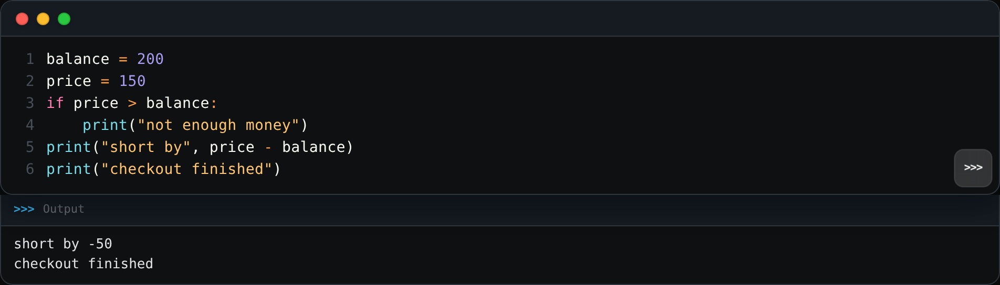
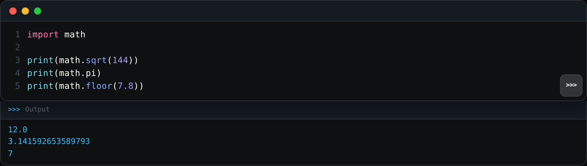
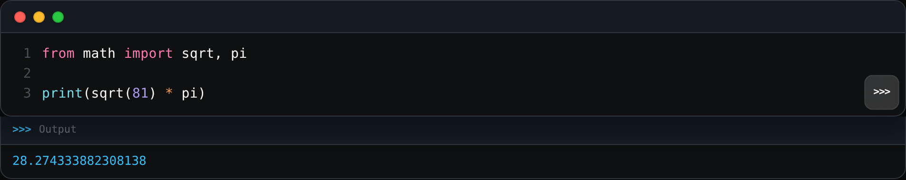
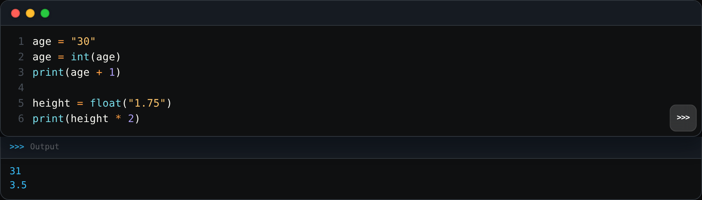
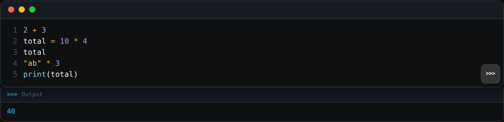

# Python Foundations: Intermediate

A new engineer at Dropbox, where the desktop sync client has been written in Python for years, pastes a 20-line script that counts files in a folder and runs it. The terminal answers with 4 lines that start with Traceback. Whether she reads those lines as noise or as a map to the exact failing line decides whether she ships today or spends the afternoon guessing.


<br>

---

## Indentation and Code Blocks

In most programs, some lines run only when a condition holds, some run again and again, and some wait until they are called by name. Python decides which lines belong to such a group by looking at how far each line is indented. A header line ends with a colon, and every line indented beneath it is part of the header's block. The block ends at the first line that steps back to the header's own indentation.

```sql
balance = 120
price = 150
if price > balance:
    print("not enough money")
    print("short by", price - balance)
print("checkout finished")
```

`if` runs its block only when the expression after it is True. Here `price > balance` is True, so both indented prints run, and then line 6 runs because it was never inside the block. Swap the numbers so the condition is False and the indented lines are skipped, while line 6 still runs. Now watch what one change in spacing does to the same 6 lines.



```python
balance = 200
price = 150
if price > balance:
    print("not enough money")
print("short by", price - balance)
print("checkout finished")
```

Line 5 lost its 4 spaces, so it left the block. It now runs on every checkout and reports a negative shortfall to a customer who has plenty of money. The text of the program changed by 4 characters and the program's meaning changed completely, which is why Python treats indentation as part of the code.

**What does this program print?**

```python
score = 40
if score > 50:
    print("pass")
    score = score + 10
print(score)
```

- **A.** 40, because the condition is False and only the final print is outside the block
- **B.** pass, then 50, because every line after the if belongs to it
- **C.** 50, because the addition on line 4 is at a different level from the print above it
- **D.** pass, then 40, because print runs before the condition is checked

<details>
<summary>Solution</summary>

**A.** 40, because the condition is False and only the final print is outside the block

score is 40, so 40 > 50 is False and lines 3 and 4 are skipped. Line 5 is at the margin and runs regardless, printing 40.

**Why the others are wrong**

- **B.** Only the 2 indented lines belong to the if, and the condition is False, so neither runs.
- **C.** Lines 3 and 4 are both indented 4 spaces, so they share the if block and are skipped together.
- **D.** The condition on line 2 is checked first; nothing inside the block runs when it is False.

</details>


<br>

### The 3 headers you will meet most

Each ends with a colon and owns the indented lines under it

- if price > 100: runs its block once, and only when the expression is True
- for i in range(5): runs its block once per value, with i holding the current one each pass
- def total(price): names its block and runs none of it now; the block runs each time total(...) is called later

Each header gets a lesson of its own later. What matters here is the shape they share: a colon, then an indented block, then a return to the left margin. Press play on the loop below and watch the single indented line run 5 times while the header hands `i` a new value on each pass.

https://github.com/user-attachments/assets/bdeebf64-b168-4f98-82bd-f8dedfc17314

A `def` block differs in timing. When the file runs past line 1, Python stores the 2 indented lines under the name `calculate_total` and runs none of them. They run on line 5, when the name is called with 100 and 0.08, and the result 108.0 travels back to be stored in `result` and printed.

https://github.com/user-attachments/assets/ae4dd6e4-a86a-45c0-9836-a203d5fe34c3


<br>

### Blocks inside blocks

A block can hold another header, which opens a deeper block one level further in. Each level is, by convention, 4 more spaces; Python requires only that every line of one block is indented the same amount. In the program below, ask of every line which header owns it. Lines 4 and 5 sit 8 spaces in, so they belong to the `if`, which itself belongs to the `for`. Line 6 sits 4 spaces in, belongs to the `for` alone and runs on every pass. Line 7 is back at the margin and runs once, after the loop has finished all 4 passes.

https://github.com/user-attachments/assets/1d2919dd-183b-43f9-a864-0f878a2d9561

*Lines at 8 spaces run only when i > 1; the line at 4 spaces runs every pass; the margin line runs once.*


<br>

### Indentation errors that stop the program

Python does not guess at a block's borders, so 3 mistakes stop the program before any line runs. A header with nothing indented under it, and a line indented where no header asked for it, each raise an IndentationError. Indenting some lines of one block with a tab and others with spaces raises a TabError, because a tab and 4 spaces look identical on screen and differ to the interpreter. Each report names the line, so open the file at that line and count the spaces.

| What you wrote | Error | Message |
| --- | --- | --- |
| if 3 > 2: followed by print("yes") at the margin | IndentationError | expected an indented block |
| print("hi") pushed in 4 spaces after a plain line, with no header above it | IndentationError | unexpected indent |
| one line of a block indented with a tab, the other lines of that block with spaces | TabError | inconsistent use of tabs and spaces in indentation |

| ✓ Do | ✗ Don't |
| --- | --- |
| • Indent with 4 spaces per level, every time<br><br>• End every header line with a colon<br><br>• Set your editor to insert spaces when you press Tab<br><br>• Return to the margin to close a block | • Mix tabs and spaces in one file<br><br>• Indent a line that no header asked for<br><br>• Use 2 spaces in one block and 4 in another<br><br>• Expect a blank line to end a block; only dedenting does |

Exercise: [Indentation and Code Blocks](_exercises/python_foundations_intermediate_exercise_1.md)


<br>

---

## Importing Modules

Python ships with hundreds of modules, each a file of code written and tested for you: square roots, random numbers, dates, text in JSON form. Python loads a module only when you ask for it. The `import` statement finds the module's file, runs it once, and binds the module's name in your program so you can reach what it holds with a dot.



```python
import math

print(math.sqrt(144))
print(math.pi)
print(math.floor(7.8))
```

Read `math.sqrt` as the sqrt that lives inside math. After line 1 the name `math` refers to the module, and the dot looks inside it for a name. `sqrt` returns a float even for a perfect square, `pi` is a plain float with 15 digits after the point, and `floor` drops the fraction and hands back an int. Leave out line 1 and the name `math` means nothing to the program.

```sql
print(math.sqrt(144))
```

The program stops on its first line with a NameError, the same error a misspelled variable produces. The module exists on disk, but nothing in this program has named it yet. Section 3 reads traceback lines in full; for now, a NameError on a module's name means a missing import.


<br>

### 2 ways to import

`import math` brings in the whole module under one name, and every use carries the prefix. `from math import sqrt, pi` copies those 2 names into your program, so you call `sqrt(81)` with no prefix. The second form reads shorter, at the cost of hiding where `sqrt` came from when someone reads line 40 of your file.



```python
from math import sqrt, pi

print(sqrt(81) * pi)
```

| ✓ import math | ✗ from math import sqrt |
| --- | --- |
| • One name is added to your program: math<br><br>• Every use carries the prefix: math.sqrt(2)<br><br>• The origin of each name is visible at the call<br><br>• Safe when 2 modules both define a sqrt | • The name sqrt is added directly<br><br>• Calls read shorter: sqrt(2)<br><br>• A reader scrolls to the top to find the origin<br><br>• A later from cmath import sqrt silently replaces it |

> **TIP**
>
> Put every import at the top of the file, one per line. A reader then sees in the first few lines everything the program depends on, and Python loads each module once no matter how many lines import it.

**Which line fails when this program runs, and with what error?**

```python
from math import sqrt

print(sqrt(16))
print(math.floor(2.7))
```

- **A.** Line 1 raises ImportError, because sqrt can only be reached after import math has run
- **B.** Line 3 raises TypeError, because sqrt accepts floats only and 16 is an int
- **C.** Nothing fails, and the program prints 4.0 followed by 2
- **D.** Line 4 raises NameError, because the from form bound sqrt only and the name math was never created

<details>
<summary>Solution</summary>

**D.** Line 4 raises NameError, because the from form bound sqrt only and the name math was never created

from math import sqrt copies the one name sqrt. No name math exists in the program, so math.floor fails with name 'math' is not defined, after 4.0 has already printed.

**Why the others are wrong**

- **A.** The from form is complete on its own; line 1 succeeds and binds sqrt.
- **B.** sqrt accepts ints and returns 4.0; line 3 prints without trouble.
- **C.** The first print does show 4.0, but the second needs the name math, which was never bound.

</details>


<br>

### A tour of the standard library

| Module | What it holds | One name inside |
| --- | --- | --- |
| math | square roots, rounding, constants | math.sqrt(x) |
| random | random numbers and random choices | random.randint(1, 6) |
| datetime | dates, times and the gaps between them | datetime.date.today() |
| json | turning JSON text into Python values and back | json.loads(text) |
| os | the operating system: paths, folders, environment | os.getcwd() |
| time | pausing, and measuring elapsed seconds | time.sleep(2) |

Each of these is installed with Python itself, so `import json` works on any machine that has Python and nothing else. Naming a module that does not exist, or misspelling one, fails at the import line with a ModuleNotFoundError rather than somewhere later in the program.

```sql
import maths
```


<br>

### Importing your own file

A module is any file ending in `.py`, including the ones you write. Save the constants and helpers that 2 scripts share in a file named `pricing.py`, and both scripts can `import pricing`. The module's name is the filename without `.py`, and Python looks for it first in the folder the running script lives in.

```sql
TAX_RATE = 0.08

def with_tax(price):
    return price * (1 + TAX_RATE)
```

```sql
import pricing

print(pricing.TAX_RATE)
print(pricing.with_tax(100))
```

Importing `pricing` runs every line of `pricing.py` once, top to bottom, which is how `TAX_RATE` gets its value and `with_tax` gets defined. A print at the top level of `pricing.py` would run at import time too, which surprises people the first time a bare import produces output. Keep a module's top level to constants and definitions, and the importing script decides what gets printed.

Exercise: [Importing Modules](_exercises/python_foundations_intermediate_exercise_2.md)


<br>

---

## Reading Input From the User

Every program so far had its values written into the code. `input()` lets the person running the program supply a value while it runs. The call shows its prompt text, pauses, waits for the user to type and press Enter, and then hands back whatever was typed. The program resumes on the next line with that text stored wherever you assigned it.

```sql
name = input("Your name: ")
print("Hello,", name)
```

The prompt is ordinary text, so end it with a space or the cursor sits jammed against the colon. Whatever comes back is a string, every time. Type 42 and `input` returns `"42"`, 2 characters that happen to be digits. Press Enter with nothing typed and it returns `""`, the empty string. Spaces typed before or after the value survive as well.

| User types | Value stored | Type |
| --- | --- | --- |
| Maya | "Maya" | str |
| 42 | "42" | str |
| 3.5 | "3.5" | str |
| (Enter, nothing typed) | "" | str |
| 7 | " 7 " | str |


<br>

### Adding a number to typed text

Treating that string as a number is the most frequent mistake in a first program with `input`. The program below stands in for a session where the user typed 30 at an Age prompt; the variable holds exactly what `input` would have returned, so the result is the same as the live version.

```sql
age = "30"
print(age + 1)
```

Python refuses because `+` between a string and an int has no single meaning: join them, or add them? The message says which reading it took, concatenation, and what it could not accept, the int. Before any arithmetic, convert the text to a number with `int()` or `float()`. Each is a function that reads a string of digits and returns the matching numeric value.



```python
age = "30"
age = int(age)
print(age + 1)

height = float("1.75")
print(height * 2)
```

`int()` accepts digits with an optional leading sign and ignores spaces around them, so `int(" 7 ")` returns 7. `float()` accepts those plus a decimal point, so `float("3")` returns 3.0. Text that isn't a number, such as letters or, for `int()`, a decimal point, makes the conversion fail with a ValueError, the signal that the type was right and the content was wrong.

```sql
print(int("  7  "))
print(float("3"))
print(int("ten"))
```

The first 2 lines printed before line 3 failed, because a program runs every line up to the one that raises. `int("3.5")` fails the same way, since a decimal point is not a digit; convert through `float()` when the user may type a fraction.

**The user types 7 at the prompt. What does this program print?**

```python
count = input("How many? ")
print(count * 3)
```

- **A.** 21, because input returns an int when every character typed is a digit
- **B.** 73, because the 3 is attached to the end of the string
- **C.** 777, because count holds the string "7" and a string times 3 is the string repeated
- **D.** A TypeError, because a string cannot be multiplied by an int

<details>
<summary>Solution</summary>

**C.** 777, because count holds the string "7" and a string times 3 is the string repeated

count is "7", a str. The * operator between a str and an int repeats the str, so "7" * 3 is "777". int(count) * 3 would print 21.

**Why the others are wrong**

- **A.** input never inspects the characters; it returns the str "7" no matter what was typed.
- **B.** Multiplying a str by an int repeats the str; it does not append the digit.
- **D.** str * int is allowed and repeats the string; it is str + int that raises TypeError.

</details>


<br>

### Convert at the moment of reading

The usual shape wraps the `input` call directly in the conversion, so the variable never holds the raw string and no later line can forget to convert it.

```sql
price = float(input("Price: "))
quantity = int(input("Quantity: "))
total = price * quantity
print("Total:", total)
```

| Price typed | Quantity typed | Result |
| --- | --- | --- |
| 2.50 | 4 | Total: 10.0 |
| 19.99 | 2 | Total: 39.98 |
| 5 | 2 | Total: 10.0 |
| abc | (never asked) | ValueError raised at line 1 |
| 2.50 | 1.5 | ValueError raised at line 2 |

The fourth row shows the program dying at line 1, so the Quantity prompt never appears. The last row shows that `int()` rejects a fraction even though a human would read 1.5 as a number. Checking the text before converting, and asking again when it fails, uses tools from a later lesson; for now the rule is that the conversion line is where bad input surfaces.

> What input() guarantees
>
> - It always returns a str, for digits and for an empty line alike
> - It drops the Enter keypress; the newline is never part of the value
> - It keeps every other character typed, spaces included
> - It blocks: nothing after it runs until the user presses Enter

Exercise: [Reading Input From the User](_exercises/python_foundations_intermediate_exercise_3.md)


<br>

---

## Reading a Traceback

When a line raises an error that nothing handles, Python stops and prints a traceback: a report of where the program was when it failed. A new programmer sees a wall of text. The wall has 4 parts, and only 2 of them matter on a first read: the last line and the line above it.

```sql
price = 100
total = price * 1.08
print(totl)
```

| Traceback line | What it tells you |
| --- | --- |
| Traceback (most recent call last): | A report follows; the frames are ordered so the one that failed comes last |
| File "main.py", line 3, in <module> | The file and the line number; <module> means top level, outside any def |
| print(totl) | The source text of that line, copied so the problem can be spotted without opening the file |
| NameError: name 'totl' is not defined | The error's name, a colon, then its message: what went wrong in Python's words |

Read it bottom up. The last line names the kind of failure and says which name was missing. The line above shows the code, where the misspelling is visible. Only then is the line number needed, to go and fix it. The first line is a fixed header and carries nothing specific to this failure.


<br>

### The error name picks the category

The error's name sorts the failure into a category, and each category points at a different kind of fix. The message after the colon narrows it to the specific name, type or value involved.

| Error name | Python is saying | The usual cause |
| --- | --- | --- |
| NameError | this name has never been assigned | a typo, a use above the assignment, or a missing import |
| TypeError | this operation does not work on these types | a str where a number was needed, often from input() |
| ValueError | the type is right and the content is wrong | int("ten") or int("3.5") |
| ZeroDivisionError | the right side of / was 0 | a count or a total that turned out empty |
| ModuleNotFoundError | no module with this name was found | a misspelled import, or a file in the wrong folder |
| IndentationError | the block structure cannot be parsed | a missing or an extra level of indentation |


<br>

### More than one frame

When the failing line sits inside a `def` block, the traceback shows 2 frames: the call that started things, then the line inside the function that raised. Most recent call last means the frame at the bottom is the one that was running when the error happened.

```sql
def average(total, count):
    return total / count

print(average(10, 0))
```

| Traceback line | Frame |
| --- | --- |
| Traceback (most recent call last): | header |
| File "main.py", line 4, in <module> | frame 1: the call |
| print(average(10, 0)) | frame 1 source |
| File "main.py", line 2, in average | frame 2: inside average |
| return total / count | frame 2 source |
| ZeroDivisionError: division by zero | the error |

The bottom frame says line 2 divided by zero. The frame above explains why `count` was 0: line 4 passed it in. The fix belongs at line 4, or at whatever produced the 0, rather than at line 2, which did exactly what it was written to do. A traceback marks where the error surfaced; the cause can be any line that ran earlier.

> The reported line and the real cause
>
> A TypeError on line 9 that adds rate to a float may trace back to line 2, where rate was assigned the string "0.08" instead of the number 0.08. Start at the reported line, then follow each name in it upward to the line where it got its value, and keep going until you find the value that doesn't match its use.

**What does the last line of this program's traceback say, and which line holds the mistake? Names assigned at the top of the file are visible inside the def.**

```python
rate = "0.08"
price = 200

def with_tax(amount):
    return amount * (1 + rate)

print(with_tax(price))
```

- **A.** NameError: name 'rate' is not defined, raised at line 5, because rate was assigned outside the def
- **B.** TypeError: unsupported operand type(s) for +: 'int' and 'str', raised at line 5; the mistake is on line 1, where rate is a string
- **C.** TypeError raised at line 7, because with_tax was called with an int instead of a float
- **D.** ValueError raised at line 1, because "0.08" cannot be stored in a variable

<details>
<summary>Solution</summary>

**B.** TypeError: unsupported operand type(s) for +: 'int' and 'str', raised at line 5; the mistake is on line 1, where rate is a string

1 + "0.08" has no meaning, so line 5 raises. The bottom frame points at line 5, but the value that caused it was created on line 1. Writing rate = 0.08 fixes it and the program prints 216.0.

**Why the others are wrong**

- **A.** rate is assigned at the top of the file, so the name resolves inside the def. The failure comes from its type.
- **C.** An int amount multiplies fine. The call on line 7 appears as the upper frame, not the failing one.
- **D.** Any string can be stored in a variable; line 1 runs without complaint and the failure appears later.

</details>


<br>

### Errors with no traceback header

A SyntaxError or IndentationError appears before the program runs a single line, because Python reads the whole file first and couldn't parse it. The report skips the Traceback header, shows the file and line, the offending source, a caret under the point where parsing gave up, and the error name. There's no frame to list, since nothing was executing. A traceback with the header always means the file parsed and some line actually ran.

Exercise: [Reading a Traceback](_exercises/python_foundations_intermediate_exercise_4.md)


<br>

---

## Trying Code in the Interactive Shell

Running `python` with a filename executes a script: Python reads the file, runs it top to bottom, and exits. Running `python` with no filename opens the interactive shell. It shows a `>>>` prompt, runs each line the moment you press Enter, and waits for the next one. Everything in this lesson works in both, with one difference that changes how each is used.

| You type at >>> | The shell shows |
| --- | --- |
| 2 + 3 | 5 |
| total = 10 \* 4 | (nothing; an assignment has no value to show) |
| total | 40 |
| "ab" \* 3 | 'ababab' |
| print(total) | 40 |
| import math | (nothing) |
| math.sqrt(2) | 1.4142135623730951 |

The shell prints the value of any expression you type, with no `print` call, and shows a string with quotes around it so that `'40'` and `40` can be told apart. A script does none of that. Put the same lines in a file and run it, and only the `print` line produces output.



```python
2 + 3
total = 10 * 4
total
"ab" * 3
print(total)
```

Lines 1, 3 and 4 were computed and their results thrown away. In a script, output comes from `print` alone; in the shell, output also comes from the expression echo. A value you saw in the shell goes silent in a script until you wrap it in `print`.

**You paste these 3 lines from a shell session into a file and run it as a script. What is printed?**

```python
import math
math.sqrt(49)
print(math.floor(7.0 / 2))
```

- **A.** 7.0 and then 3, the same 2 values the shell showed
- **B.** 3.5 and then 3, because floor prints its argument before rounding
- **C.** A NameError, because math is bound in the shell session and not in the file
- **D.** 3 only, because the sqrt result is computed and discarded when a script runs a bare expression

<details>
<summary>Solution</summary>

**D.** 3 only, because the sqrt result is computed and discarded when a script runs a bare expression

Line 2 evaluates to 7.0 and nothing keeps or prints it. Line 3 computes 7.0 / 2, which is 3.5, floors it to 3, and prints it.

**Why the others are wrong**

- **A.** The shell echoed 7.0 because line 2 is a bare expression; a script discards it.
- **B.** floor returns 3 and prints nothing itself; only the outer print produces output.
- **C.** Line 1 of the file imports math, so the name is bound before line 2 runs.

</details>


<br>

### Blocks in the shell

A header line in the shell switches the prompt to `...`, meaning a block is open. Type the indented lines, then press Enter on an empty line to close the block and run it. That blank line is what the shell needs, unlike a script, where dedenting alone closes a block.

| Prompt | You type | Shell shows |
| --- | --- | --- |
| >>> | for i in range(3): |  |
| ... | print(i \* 10) |  |
| ... | (empty line) | 0, then 10, then 20 |
| >>> | i | 2 |

In the last row, `i` still holds its final value after the loop, because the shell remembers every name you assign until you close it. Close the shell with `exit()` or Ctrl-D and all of it is gone, which is why anything worth keeping goes in a file.


<br>

### Which one, when

| ✓ Interactive shell | ✗ Script |
| --- | --- |
| • Checking what an expression evaluates to<br><br>• Seeing what a function returns before relying on it<br><br>• Looking around a module: dir(math) lists every name in it<br><br>• Trying one line of a bigger script on its own<br><br>• Reproducing a traceback with the exact values that caused it | • Anything you will run twice<br><br>• Programs longer than a handful of lines<br><br>• Work that reads input() or prints for a user<br><br>• Code someone else will read or run<br><br>• Anything that must survive closing the terminal |

The 2 work together. Try an expression in the shell until it gives the value you want, paste that line into the script, and run the script. When a traceback points at a line, type that line into the shell with the same values to watch the failure up close. `dir(math)` and `help(math.floor)` answer most questions about a module faster than a search does.


<br>

Exercise: [Trying Code in the Interactive Shell](_exercises/python_foundations_intermediate_exercise_5.md)

The script below pulls the 5 sections into one short script: an import, an indented block, a value standing in for user input, and a bug that produces a traceback. Predict the traceback first, then decide the fix.

**The variable typed stands in for what input() returned. Where does this script fail, and what fixes it?**

```python
import math

typed = "12.25"
if typed > 0:
    root = math.sqrt(typed)
    print("root:", root)
print("done")
```

- **A.** Line 5 raises TypeError because math.sqrt refuses a string; converting inside the block is enough
- **B.** Line 4 raises TypeError: '>' not supported between instances of 'str' and 'int'; writing typed = float("12.25") on line 3 fixes it, and the script prints root: 3.5 and then done
- **C.** Line 1 raises ModuleNotFoundError because math is available in the shell only
- **D.** Nothing fails; it prints root: 3.5 and then done, because the if block converts the value

<details>
<summary>Solution</summary>

**B.** Line 4 raises TypeError: '>' not supported between instances of 'str' and 'int'; writing typed = float("12.25") on line 3 fixes it, and the script prints root: 3.5 and then done

typed is a str, and str > int has no meaning. Converting at the moment of reading gives 12.25, the condition is True, sqrt returns 3.5, and the margin-level print runs afterwards.

**Why the others are wrong**

- **A.** Line 4 runs before line 5 and fails first, since comparing a str to an int is not allowed.
- **C.** math is part of the standard library and imports in any script.
- **D.** No line converts typed; the comparison on line 4 meets a str and raises.

</details>

A traceback reports only the first failure, because the program stops there. Fix that line and rerun, and the program gets further, which can expose a second bug of another kind, such as a print whose indentation keeps it from ever running.


<br>

---

## Putting It All Together

An analyst at Dropbox writes a 30-line script that asks for a folder name and a minimum age in days, imports datetime, and prints every file in that folder older than the minimum, then a summary count. The first run prints a traceback ending in TypeError, because the minimum age typed at the second prompt was compared to an int while still a str.

- The traceback's bottom frame points at the comparison line, and following the name upward lands on the second input() call, the one asking for the minimum age, which returned a string; int() belongs on that call.
- After the fix, the summary line prints once per file instead of once, because the summary print was indented into the loop; moving it back to the margin runs it a single time.
- Opening the shell, importing datetime and typing datetime.date.today() shows what the module returns before the analyst relies on it inside the script.
- Every import sits at the top of the file, so the next person to open it sees in 2 lines that the script depends on datetime and os and nothing else.


<br>

---

## Key Takeaways

- A colon opens a block and indentation decides which lines belong to it; 4 spaces moved can change what a program does.
- import loads a module's file once and binds its name; math.sqrt reads as the sqrt inside math, and a missing import shows up as a NameError.
- input() always returns a str; int() or float() turns it into a number, and a ValueError at that line means the user typed something that isn't one.
- Read a traceback from the bottom: the error name and message, then the failing line, then the frames above it to find where the bad value came from.
- The shell echoes every expression and forgets everything on exit; a script prints only what print asks for and is the home of anything you will run again.
