# Functional Programming: Advanced

Instagram's web backend runs on Python. Picture a job there that scans a day of like events for the first 50 that came from accounts created that day. Load the day into a list and the worker runs out of memory before scanning starts. Chain lazy iterators over frozen records, wrapped in a retry decorator, and the job stops after 50 matches, holding one page of events in memory.


<br>

---

## Lambda Functions

A lambda expression builds a function object without a def statement and without a name. Writing lambda params: expression evaluates to a function. Calling that function binds the arguments to the parameters, evaluates the expression and returns the result. There is no return keyword: the single expression is the return value.

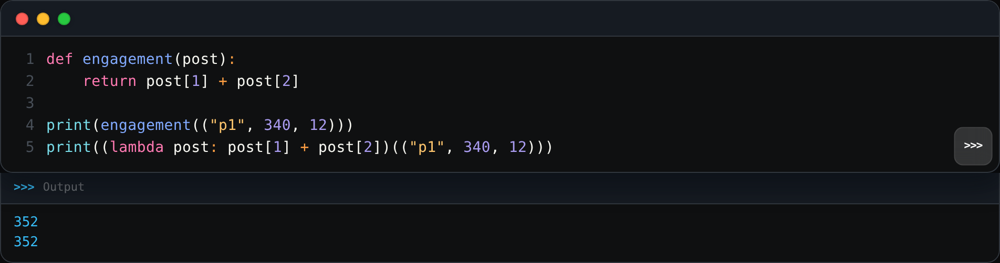

```python
def engagement(post):
    return post[1] + post[2]

print(engagement(("p1", 340, 12)))
print((lambda post: post[1] + post[2])(("p1", 340, 12)))
```

Both calls print 352. The second line builds a function, calls it where it stands and discards it, which is legal and rarely useful. A lambda pays off when you hand it to code that calls it for you.


<br>

### Where a lambda earns its place

Several built-ins take a function as an argument: the `key` of `sorted`, `min` and `max`, and the first argument of `map` and `filter`. `functools.reduce`, which you import before calling it, takes its folding function the same way. In those slots the function is used once, at the spot where it is written, and a def elsewhere would add a name the reader has to go and find.

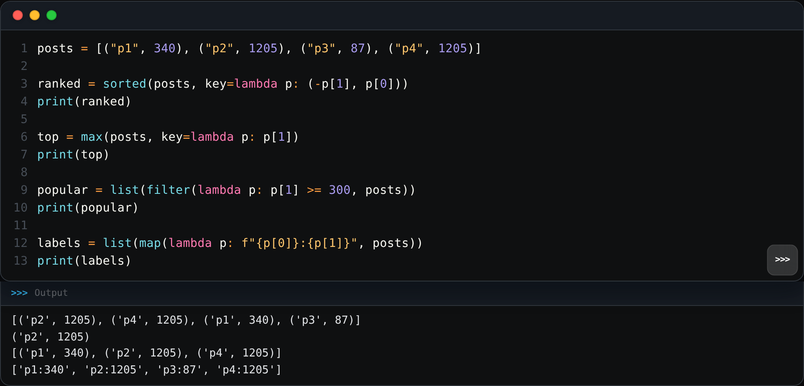

```python
posts = [("p1", 340), ("p2", 1205), ("p3", 87), ("p4", 1205)]

ranked = sorted(posts, key=lambda p: (-p[1], p[0]))
print(ranked)

top = max(posts, key=lambda p: p[1])
print(top)

popular = list(filter(lambda p: p[1] >= 300, posts))
print(popular)

labels = list(map(lambda p: f"{p[0]}:{p[1]}", posts))
print(labels)
```

The tuple key (-p[1], p[0]) sorts by likes descending, then by id ascending, which breaks the tie between p2 and p4. Negating the number flips only that part of the order; reverse=True would flip the ids as well. max returns the first post it meets with the highest key, so p2 also wins that tie.


<br>

### What fits in the body

The body is a single expression. A conditional expression, a function call, arithmetic and a comprehension are all expressions, so they fit. An assignment, a `return`, a loop, a `try` block or a second line are statements, and writing any of them inside a lambda is a SyntaxError.

| ✓ Fits in a lambda | ✗ Needs a def |
| --- | --- |
| • lambda n: "viral" if n > 1000 else "normal"<br><br>• lambda p: p[1] \* 2 + p[2]<br><br>• lambda xs: [x for x in xs if x > 0]<br><br>• lambda a, b=0, \*rest: a + b + len(rest) | • A variable assigned with = partway through<br><br>• A for or while loop<br><br>• A try and except around a risky step<br><br>• A docstring explaining a business rule<br><br>• Several steps that each deserve a name |

Lambdas accept every parameter form a def does: defaults, `*args`, `**kwargs` and keyword-only parameters after a bare `*`. A lambda built inside a loop is a closure like any other, so it falls into the same late-binding trap, and a `k=k` default fixes it the same way.


<br>

### When a def is the better choice

Every lambda carries the same `__name__`, `'<lambda>'`, so a traceback raised inside one names no function and leaves you guessing which of a dozen lambdas failed. Binding a lambda to a variable with `=` keeps that anonymous name and saves nothing over a def; PEP 8, Python's style guide, says to write the def.

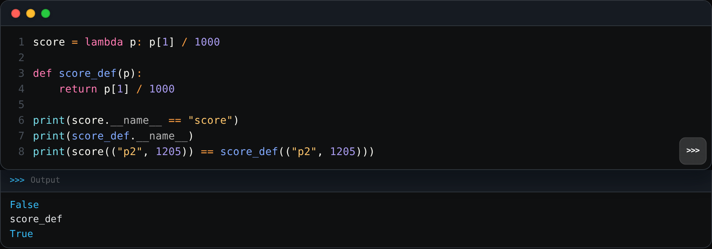

```python
score = lambda p: p[1] / 1000

def score_def(p):
    return p[1] / 1000

print(score.__name__ == "score")
print(score_def.__name__)
print(score(("p2", 1205)) == score_def(("p2", 1205)))
```

> **TIP**
>
> For plain field access, `operator.itemgetter(1)` builds the same function as `lambda p: p[1]`, and `itemgetter(1, 0)` returns both fields as a tuple. `operator.attrgetter("user")` does the same for attributes.

**What does this program print?**

```python
from functools import reduce

def pipe(*steps):
    return lambda value: reduce(lambda acc, step: step(acc), steps, value)

trim = pipe(str.strip, str.lower, lambda s: s[:3])
print(trim("  INSTAGRAM "))
```

- **A.** i: the slice runs first, then lower, then strip
- **B.** ins: strip, then lower, then the first 3 characters
- **C.** INS: str.lower is skipped because it is unbound
- **D.** TypeError: str.strip is missing the string to strip

<details>
<summary>Solution</summary>

**B.** ins: strip, then lower, then the first 3 characters

str.strip gives INSTAGRAM, str.lower gives instagram, and the lambda keeps the first 3 characters, ins.

**Why the others are wrong**

- **A.** That is compose order, right to left. pipe hands its steps to reduce in the order written, so str.strip runs first.
- **C.** Calling str.lower with a string argument is the same as calling .lower() on that string, so the step runs.
- **D.** reduce passes the accumulator as the argument, so str.strip(acc) receives the string it needs.

</details>


<br>

### Keys computed from several fields

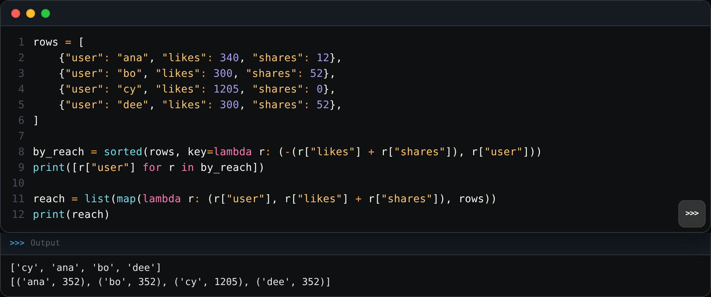

```python
rows = [
    {"user": "ana", "likes": 340, "shares": 12},
    {"user": "bo", "likes": 300, "shares": 52},
    {"user": "cy", "likes": 1205, "shares": 0},
    {"user": "dee", "likes": 300, "shares": 52},
]

by_reach = sorted(rows, key=lambda r: (-(r["likes"] + r["shares"]), r["user"]))
print([r["user"] for r in by_reach])

reach = list(map(lambda r: (r["user"], r["likes"] + r["shares"]), rows))
print(reach)
```

The key adds likes and shares inside the lambda and negates the sum, so the largest reach sorts first. The user name after it settles the 3-way tie at 352 in alphabetical order. `sorted` calls a key function once per item and compares the stored keys, so the addition runs 4 times here, never once per comparison. The `map` call reuses the same expression to turn each row into a `(user, reach)` pair.


<br>

---

## Frozen Dataclasses

A pipeline hands each record from step to step, and Python passes a reference to the same object every time. If any step changes the record in place, every variable, list and earlier result holding that reference sees the change. Knowing what a record contains at a given line then means tracing every place it has been.


<br>

### The bug a shared record causes

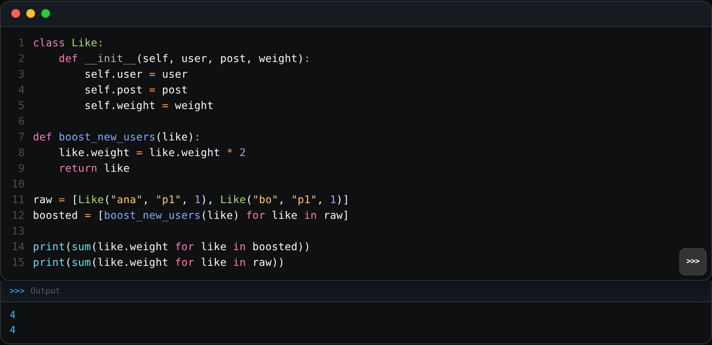

```python
class Like:
    def __init__(self, user, post, weight):
        self.user = user
        self.post = post
        self.weight = weight

def boost_new_users(like):
    like.weight = like.weight * 2
    return like

raw = [Like("ana", "p1", 1), Like("bo", "p1", 1)]
boosted = [boost_new_users(like) for like in raw]

print(sum(like.weight for like in boosted))
print(sum(like.weight for like in raw))
```

The raw total should still be 2. `boost_new_users` changed the object it received and returned that same object, so `raw` and `boosted` are 2 lists of the same 2 records. The comprehension looks like it builds new values, and nothing at the call site says otherwise.


<br>

### Sealing a record with frozen=True

The standard library module dataclasses writes the routine parts of a record class. Put @dataclass(frozen=True) above a class with annotated fields and Python generates __init__, __repr__ and __eq__ from those fields, plus a __setattr__ that raises FrozenInstanceError on any assignment. The Decorators section below explains how the @ line works; for now, what matters is the sealed class it produces.

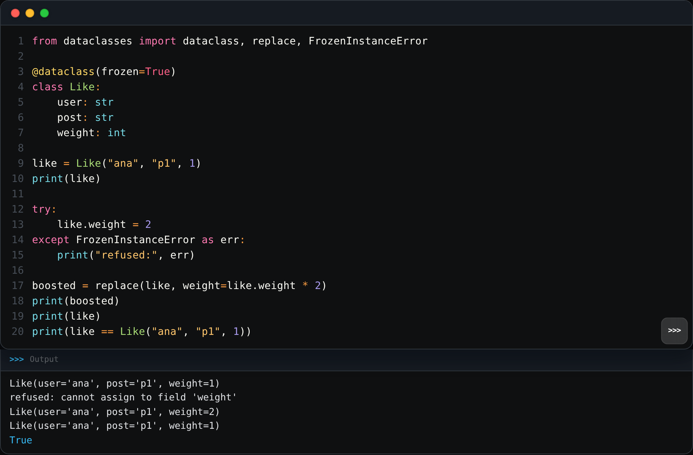

```python
from dataclasses import dataclass, replace, FrozenInstanceError

@dataclass(frozen=True)
class Like:
    user: str
    post: str
    weight: int

like = Like("ana", "p1", 1)
print(like)

try:
    like.weight = 2
except FrozenInstanceError as err:
    print("refused:", err)

boosted = replace(like, weight=like.weight * 2)
print(boosted)
print(like)
print(like == Like("ana", "p1", 1))
```

`replace` builds a new instance with the named fields changed and every other field carried over. The original `like` still reports weight 1 and will for as long as it exists, so a step that read it before the boost is unaffected.

Plain class: the boost edits in place

| Reference | ana's weight | Object |
| --- | --- | --- |
| raw[0] | 2 | #1 |
| boosted[0] | 2 | #1 |

Frozen: the boost builds a new record

| Reference | ana's weight | Object |
| --- | --- | --- |
| raw[0] | 1 | #1 |
| boosted[0] | 2 | #2 |


<br>

### What a pipeline gains from frozen records

Guarantees a frozen record gives you

- A value you read stays the value you read: no later step can edit it under you.
- Steps cannot reach into each other's data, so each can be checked alone.
- Records are hashable: frozen=True with the default eq=True generates __hash__ from the fields.
- A cached result stays correct, because the argument it came from cannot drift.

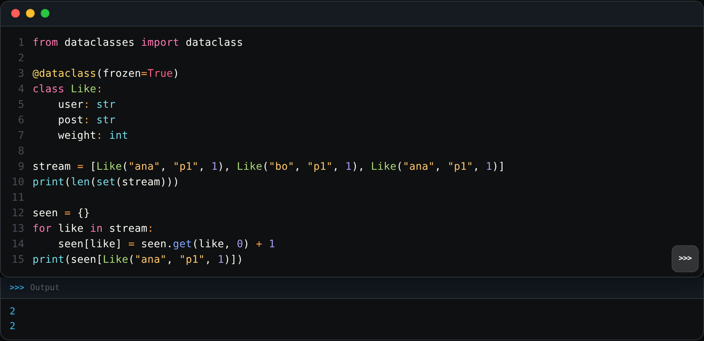

```python
from dataclasses import dataclass

@dataclass(frozen=True)
class Like:
    user: str
    post: str
    weight: int

stream = [Like("ana", "p1", 1), Like("bo", "p1", 1), Like("ana", "p1", 1)]
print(len(set(stream)))

seen = {}
for like in stream:
    seen[like] = seen.get(like, 0) + 1
print(seen[Like("ana", "p1", 1)])
```

The set keeps 2 records because ana's repeated like hashes and compares equal to her first. Objects of a plain class without `__eq__` compare by identity, so a set of them would keep all 3.


<br>

### Frozen stops at the first level

`frozen=True` blocks assigning to a field. It does nothing to the object a field points at. A list stored in a frozen record can still be appended to, and the record's contents change while assignment to the field is still refused. This is the shallow-copy problem from the lists lessons, inside a record.

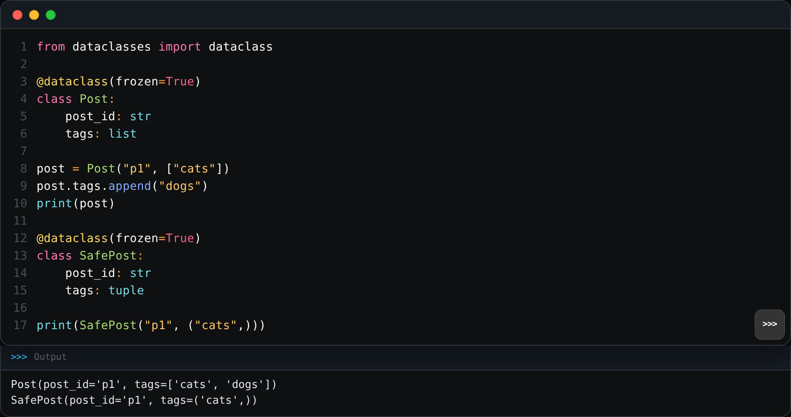

```python
from dataclasses import dataclass

@dataclass(frozen=True)
class Post:
    post_id: str
    tags: list

post = Post("p1", ["cats"])
post.tags.append("dogs")
print(post)

@dataclass(frozen=True)
class SafePost:
    post_id: str
    tags: tuple

print(SafePost("p1", ("cats",)))
```

The list field also breaks hashing: `hash(post)` raises `TypeError: unhashable type: 'list'`, so a `Post` cannot go in a set or serve as a cache key. Swapping the list for a tuple fixes both problems.

> Field types that keep a record frozen
>
> - `tuple` in place of `list`
> - `frozenset` in place of `set`
> - Another frozen dataclass for a nested record
> - `str`, `int`, `float`, `bool` and `None`, which cannot change already

**What does this program print?**

```python
from functools import reduce

def pipe(*steps):
    return lambda value: reduce(lambda acc, step: step(acc), steps, value)

trim = pipe(str.strip, str.lower, lambda s: s[:3])
print(trim("  INSTAGRAM "))
```

- **A.** i: the slice runs first, then lower, then strip
- **B.** ins: strip, then lower, then the first 3 characters
- **C.** INS: str.lower is skipped because it is unbound
- **D.** TypeError: str.strip is missing the string to strip

<details>
<summary>Solution</summary>

**B.** ins: strip, then lower, then the first 3 characters

str.strip gives INSTAGRAM, str.lower gives instagram, and the lambda keeps the first 3 characters, ins.

**Why the others are wrong**

- **A.** That is compose order, right to left. pipe hands its steps to reduce in the order written, so str.strip runs first.
- **C.** Calling str.lower with a string argument is the same as calling .lower() on that string, so the step runs.
- **D.** reduce passes the accumulator as the argument, so str.strip(acc) receives the string it needs.

</details>

The fix for the shared-record bug is a step that returns a new record and leaves its input alone. With frozen records, `replace` is how such a step changes a field, and `map` applies the step across a batch.

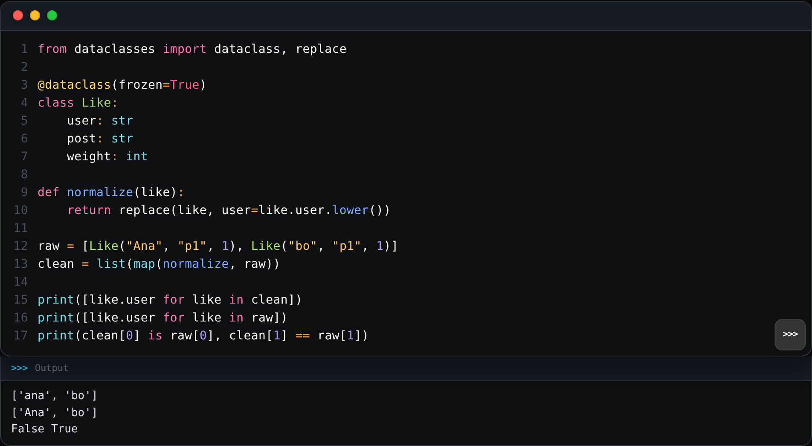

```python
from dataclasses import dataclass, replace

@dataclass(frozen=True)
class Like:
    user: str
    post: str
    weight: int

def normalize(like):
    return replace(like, user=like.user.lower())

raw = [Like("Ana", "p1", 1), Like("bo", "p1", 1)]
clean = list(map(normalize, raw))

print([like.user for like in clean])
print([like.user for like in raw])
print(clean[0] is raw[0], clean[1] == raw[1])
```

Every call to `replace` builds a new instance, even when no field changes value: bo's cleaned record compares equal to the original yet is a separate object. `raw` still holds the casing it arrived with, so a later step that needs the original spelling, such as one that audits the source data, reads it unchanged. Testing `normalize` means checking its return value and nothing else.


<br>

---

## Decorators

A decorator is a function that takes a function and returns a function. Writing @log_calls on the line above def rank means rank = log_calls(rank), run right after the def. The name rank now points at whatever log_calls returned, and the original survives only if that returned function holds on to it.

```sql
def rank(likes):
    return likes // 100

rank = log_calls(rank)


@log_calls
def rank(likes):
    return likes // 100
```


<br>

### Writing a decorator

The returned function is usually a closure called `wrapper`. It accepts `*args` and `**kwargs` so it can stand in for a function of any signature, does its extra work, calls the original through the closure variable, and returns the original's result.

https://github.com/user-attachments/assets/5431d0c9-3125-49e4-ae95-004e34d7ddd6

*rank(1205) enters wrapper first, which prints, calls the original rank through func, then prints its result*

While `rank` runs, the stage holds 2 frames: `wrapper` outside, `rank` inside. The caller asked for `rank` and got `wrapper`, which reached the original through `func`.


<br>

### Keeping the original's name with functools.wraps

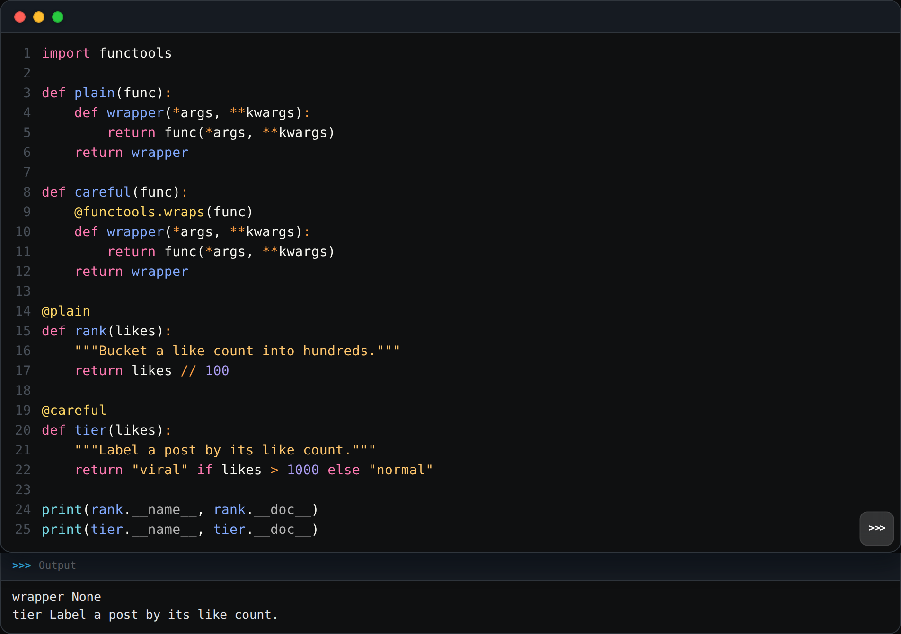

```python
import functools

def plain(func):
    def wrapper(*args, **kwargs):
        return func(*args, **kwargs)
    return wrapper

def careful(func):
    @functools.wraps(func)
    def wrapper(*args, **kwargs):
        return func(*args, **kwargs)
    return wrapper

@plain
def rank(likes):
    """Bucket a like count into hundreds."""
    return likes // 100

@careful
def tier(likes):
    """Label a post by its like count."""
    return "viral" if likes > 1000 else "normal"

print(rank.__name__, rank.__doc__)
print(tier.__name__, tier.__doc__)
```

Without help, every decorated function reports itself as `wrapper` in tracebacks, logs and `help()`. `functools.wraps(func)` copies `__name__`, `__doc__` and the other identifying attributes from `func` onto `wrapper`, and stores the original as `wrapper.__wrapped__`. It is itself a decorator, applied to the inner function, so it costs a single line.


<br>

### Decorators that take arguments

`@retry(times=3)` contains a call. Python evaluates `retry(times=3)` first, and whatever that returns is the decorator. A configurable decorator is therefore 3 nested functions: the outer takes the settings, the middle takes the function, and the inner runs on every call.

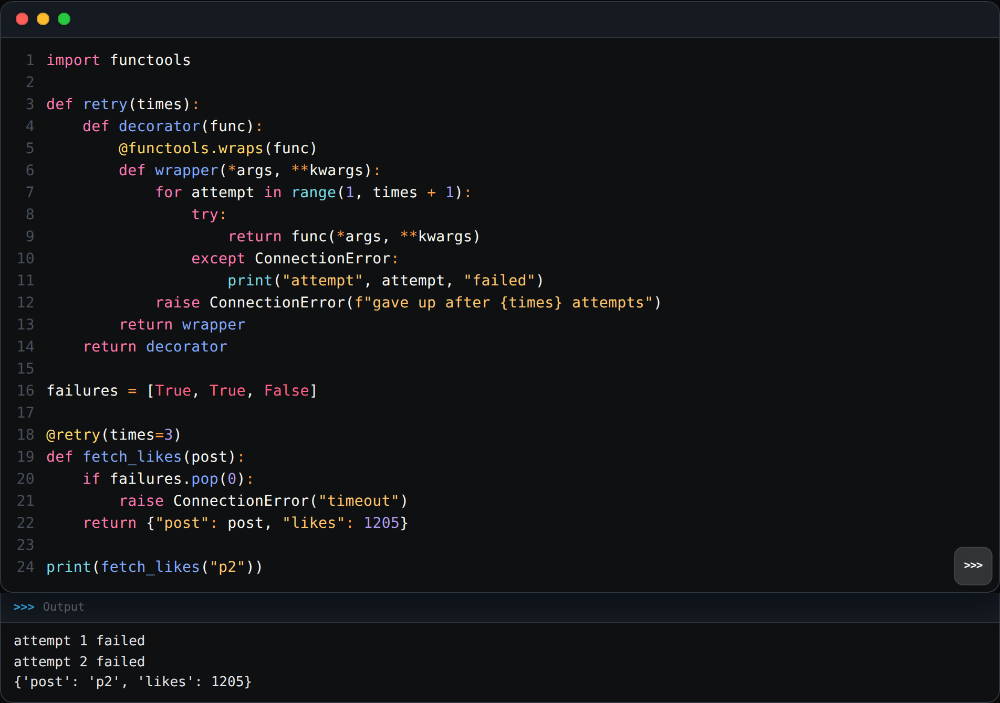

```python
import functools

def retry(times):
    def decorator(func):
        @functools.wraps(func)
        def wrapper(*args, **kwargs):
            for attempt in range(1, times + 1):
                try:
                    return func(*args, **kwargs)
                except ConnectionError:
                    print("attempt", attempt, "failed")
            raise ConnectionError(f"gave up after {times} attempts")
        return wrapper
    return decorator

failures = [True, True, False]

@retry(times=3)
def fetch_likes(post):
    if failures.pop(0):
        raise ConnectionError("timeout")
    return {"post": post, "likes": 1205}

print(fetch_likes("p2"))
```

The `failures` list stands in for a flaky network so the run repeats exactly: the first 2 calls raise and the third returns. `@dataclass(frozen=True)` from the previous section has this shape too: `dataclass(frozen=True)` returns a decorator, which receives the class and returns it with the generated methods attached.


<br>

### Stacking decorators

Decorators stack, and the one nearest `def` is applied first: `@a` above `@b` above `def f` means `f = a(b(f))`. At call time `a`'s wrapper starts first and calls `b`'s wrapper, which calls `f`, and the result comes back out through `b` and then `a`.

**What does this program print?**

```python
from functools import reduce

def pipe(*steps):
    return lambda value: reduce(lambda acc, step: step(acc), steps, value)

trim = pipe(str.strip, str.lower, lambda s: s[:3])
print(trim("  INSTAGRAM "))
```

- **A.** i: the slice runs first, then lower, then strip
- **B.** ins: strip, then lower, then the first 3 characters
- **C.** INS: str.lower is skipped because it is unbound
- **D.** TypeError: str.strip is missing the string to strip

<details>
<summary>Solution</summary>

**B.** ins: strip, then lower, then the first 3 characters

str.strip gives INSTAGRAM, str.lower gives instagram, and the lambda keeps the first 3 characters, ins.

**Why the others are wrong**

- **A.** That is compose order, right to left. pipe hands its steps to reduce in the order written, so str.strip runs first.
- **C.** Calling str.lower with a string argument is the same as calling .lower() on that string, so the step runs.
- **D.** reduce passes the accumulator as the argument, so str.strip(acc) receives the string it needs.

</details>


<br>

### Caching with functools.lru_cache

`functools.lru_cache` is the memoization dict from the functions lessons, packaged as a decorator: it stores each result under the call's arguments and returns the stored value when the same arguments come back. It needs hashable arguments and assumes a pure function, which frozen records and pure steps provide.

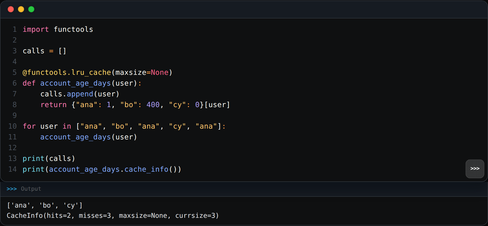

```python
import functools

calls = []

@functools.lru_cache(maxsize=None)
def account_age_days(user):
    calls.append(user)
    return {"ana": 1, "bo": 400, "cy": 0}[user]

for user in ["ana", "bo", "ana", "cy", "ana"]:
    account_age_days(user)

print(calls)
print(account_age_days.cache_info())
```

The `calls` list shows which calls ran the body: 3 of the 5 did, and the other 2 came from the cache. In real code that side effect would be a bug, since a cache hit skips it.


<br>

---

## Lazy Pipelines With itertools

Generators, map and filter all return iterators: objects that compute their next item only when something calls next() on them. Chain them, and each stage pulls from the stage before it. The consumer at the end requests a single item, the request travels back to the source, that item travels forward through every stage, and the source produces nothing more until the next request.

https://github.com/user-attachments/assets/f20b23e3-12b8-4c3f-b90c-121e71f30487

*Each next() pulls a single event through both stages; cy:0 is never read because nothing asks for it*

The trace alternates read, parse, got. A list-based version would read all 3 events, then parse all 3, before handing anything over, holding every event in memory at once. The chain holds the current item per stage, so its memory stays the same whether the source has 3 events or 300 million.


<br>

### The itertools building blocks

| Function | Yields | Stops |
| --- | --- | --- |
| `islice(it, n)` | The first n items | After n items, leaving the rest unread |
| `takewhile(pred, it)` | Items while pred is true | At the first false item, which it consumes and drops |
| `dropwhile(pred, it)` | Everything from the first false item on | When the source ends |
| `chain(a, b)` | All of a, then all of b | When b ends |
| `count(start)` | start, start + 1, start + 2, ... | Never |
| `accumulate(it)` | Running totals | When the source ends |
| `groupby(it, key)` | (key, group) for each run of equal keys | When the source ends |

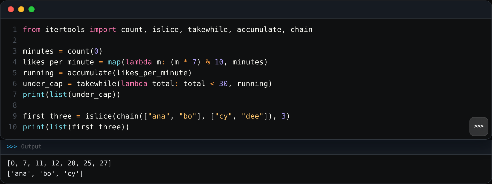

```python
from itertools import count, islice, takewhile, accumulate, chain

minutes = count(0)
likes_per_minute = map(lambda m: (m * 7) % 10, minutes)
running = accumulate(likes_per_minute)
under_cap = takewhile(lambda total: total < 30, running)
print(list(under_cap))

first_three = islice(chain(["ana", "bo"], ["cy", "dee"]), 3)
print(list(first_three))
```

`count(0)` never runs out, yet the program ends. `takewhile` stops asking once a running total reaches 30, so `map` and `accumulate` each produce 8 values and the source is asked for 8 minutes. The eighth total, 36, was pulled to be tested and then dropped. `islice` stops after 3 names without touching `dee`.


<br>

### An iterator can be read once

An iterator remembers its position and has no rewind. Once a consumer has drained it, the next consumer receives no items and no error. Handing the same iterator to 2 steps is a frequent lazy-pipeline bug.

**What does this program print?**

```python
from functools import reduce

def pipe(*steps):
    return lambda value: reduce(lambda acc, step: step(acc), steps, value)

trim = pipe(str.strip, str.lower, lambda s: s[:3])
print(trim("  INSTAGRAM "))
```

- **A.** i: the slice runs first, then lower, then strip
- **B.** ins: strip, then lower, then the first 3 characters
- **C.** INS: str.lower is skipped because it is unbound
- **D.** TypeError: str.strip is missing the string to strip

<details>
<summary>Solution</summary>

**B.** ins: strip, then lower, then the first 3 characters

str.strip gives INSTAGRAM, str.lower gives instagram, and the lambda keeps the first 3 characters, ins.

**Why the others are wrong**

- **A.** That is compose order, right to left. pipe hands its steps to reduce in the order written, so str.strip runs first.
- **C.** Calling str.lower with a string argument is the same as calling .lower() on that string, so the step runs.
- **D.** reduce passes the accumulator as the argument, so str.strip(acc) receives the string it needs.

</details>

When 2 steps need the same items, build a list if the data fits in memory, or call `itertools.tee(it, 2)` for 2 independent iterators. `tee` buffers every item one copy has read and the other has not, so it saves memory only while both copies advance close together.


<br>

### groupby groups consecutive runs

`groupby` starts a new group every time the key changes between neighbouring items. It never looks back, which is what lets it stay lazy, and it means a key that reappears later in unsorted input becomes a second group.

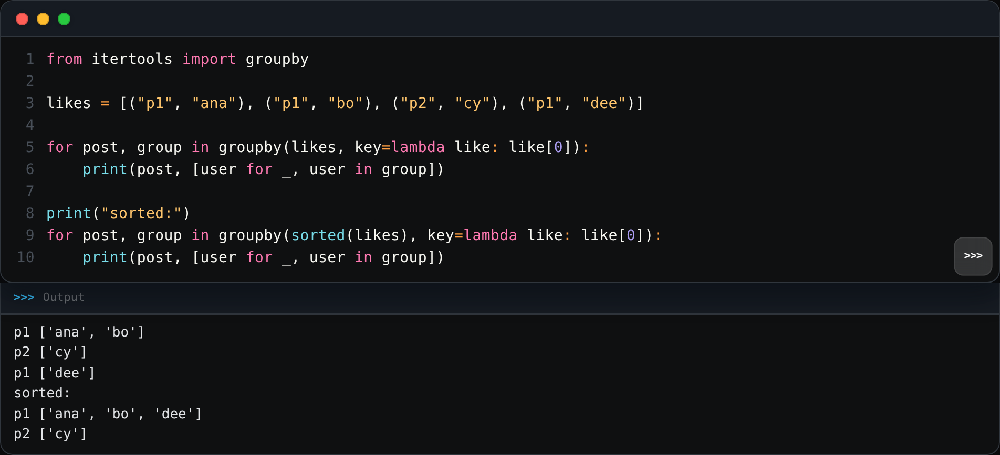

```python
from itertools import groupby

likes = [("p1", "ana"), ("p1", "bo"), ("p2", "cy"), ("p1", "dee")]

for post, group in groupby(likes, key=lambda like: like[0]):
    print(post, [user for _, user in group])

print("sorted:")
for post, group in groupby(sorted(likes), key=lambda like: like[0]):
    print(post, [user for _, user in group])
```

Sorting first fixes the grouping but turns the stream into a list. A real stream often arrives ordered by the key already, such as events written per post or per hour, and `groupby` relies on that order. Each `group` reads from the shared source, so consume it before asking for the next key: advancing skips whatever the previous group left unread.


<br>

---

## Function Composition

Composition builds a new function from 2 existing ones. compose(f, g) returns a function that calls g and hands its result to f, so compose(f, g)(x) equals f(g(x)). The result is an ordinary function object: you can name it, pass it, store it in a dict, or compose it again.

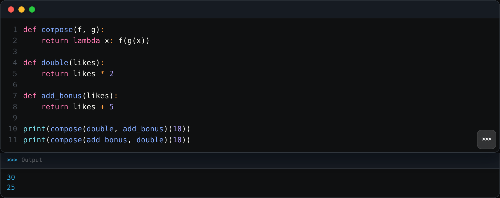

```python
def compose(f, g):
    return lambda x: f(g(x))

def double(likes):
    return likes * 2

def add_bonus(likes):
    return likes + 5

print(compose(double, add_bonus)(10))
print(compose(add_bonus, double)(10))
```

Reading `compose(double, add_bonus)` left to right names `double` first, yet `add_bonus` runs first: 10 becomes 15, then 30. Swapping the arguments gives 25. That right-to-left order follows the math notation f(g(x)), and misreading it is a frequent source of composition bugs.


<br>

### A pipe reads in the order it runs

For more than 2 steps, a left-to-right `pipe` is easier to check against the path the data takes. `reduce` does the work: the accumulator starts as the input value, and each step replaces it with `step(accumulator)`.

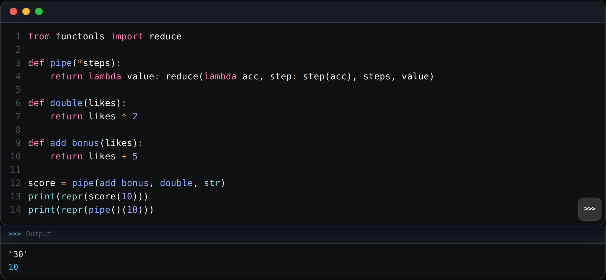

```python
from functools import reduce

def pipe(*steps):
    return lambda value: reduce(lambda acc, step: step(acc), steps, value)

def double(likes):
    return likes * 2

def add_bonus(likes):
    return likes + 5

score = pipe(add_bonus, double, str)
print(repr(score(10)))
print(repr(pipe()(10)))
```

`pipe(add_bonus, double, str)` runs in the order written and returns the string `'30'`. `pipe()` with no steps returns its input unchanged, because `reduce` with an initial value and nothing to fold returns that initial value. An empty pipeline is the identity function, so a pipeline built from a configuration list that turns out empty still behaves.


<br>

### Composing steps that take a stream

Composition stays lazy when every step takes an iterable and returns an iterator. The composed pipeline is then a single function from stream to stream, and nothing runs until a consumer pulls. A step that needs a setting comes from `partial`; a step that is a single expression comes from a lambda inside `map` or `filter`.

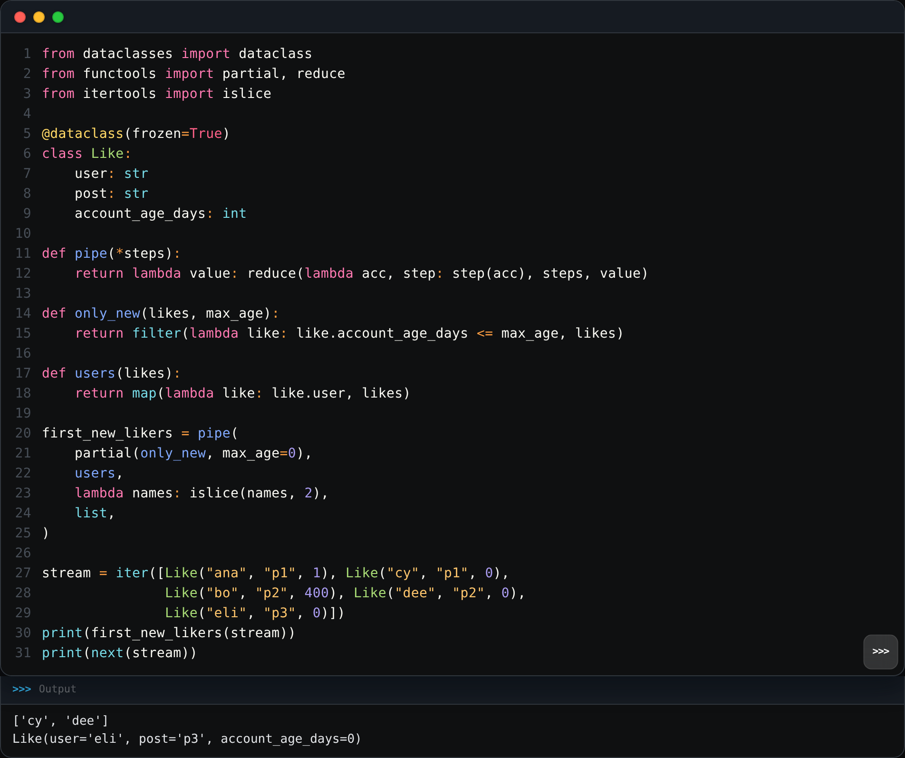

```python
from dataclasses import dataclass
from functools import partial, reduce
from itertools import islice

@dataclass(frozen=True)
class Like:
    user: str
    post: str
    account_age_days: int

def pipe(*steps):
    return lambda value: reduce(lambda acc, step: step(acc), steps, value)

def only_new(likes, max_age):
    return filter(lambda like: like.account_age_days <= max_age, likes)

def users(likes):
    return map(lambda like: like.user, likes)

first_new_likers = pipe(
    partial(only_new, max_age=0),
    users,
    lambda names: islice(names, 2),
    list,
)

stream = iter([Like("ana", "p1", 1), Like("cy", "p1", 0),
               Like("bo", "p2", 400), Like("dee", "p2", 0),
               Like("eli", "p3", 0)])
print(first_new_likers(stream))
print(next(stream))
```

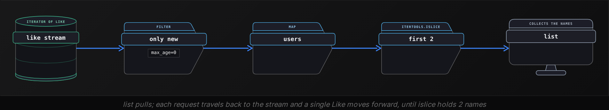

The pipeline printed 2 names, and `next(stream)` then returned eli's record, so the run pulled exactly 4 events: ana and bo were read and rejected, cy and dee passed. `partial(only_new, max_age=0)` fixed the setting and left a 1-argument step. The lambda adapts `islice`, whose count is a second positional argument that `partial` cannot fill on its own.


<br>

### Rules that keep composed steps safe

| ✓ Do | ✗ Don't |
| --- | --- |
| • Give each step a single input and a single output, so any 2 steps can be joined<br><br>• Pass frozen records between steps so no step can edit another's data<br><br>• Make stream steps take an iterable and return an iterator<br><br>• Name a composed pipeline after what it produces, as with first_new_likers<br><br>• Test each step alone on a 3-item list before composing | • Mix compose order and pipe order in the same codebase<br><br>• Let a step print, write or mutate as a side effect<br><br>• Hand the same iterator to 2 steps<br><br>• Put list() mid-stream unless a step needs every item at once<br><br>• Hide a 5-line step inside a lambda |

**What does this program print?**

```python
from functools import reduce

def pipe(*steps):
    return lambda value: reduce(lambda acc, step: step(acc), steps, value)

trim = pipe(str.strip, str.lower, lambda s: s[:3])
print(trim("  INSTAGRAM "))
```

- **A.** i: the slice runs first, then lower, then strip
- **B.** ins: strip, then lower, then the first 3 characters
- **C.** INS: str.lower is skipped because it is unbound
- **D.** TypeError: str.strip is missing the string to strip

<details>
<summary>Solution</summary>

**B.** ins: strip, then lower, then the first 3 characters

str.strip gives INSTAGRAM, str.lower gives instagram, and the lambda keeps the first 3 characters, ins.

**Why the others are wrong**

- **A.** That is compose order, right to left. pipe hands its steps to reduce in the order written, so str.strip runs first.
- **C.** Calling str.lower with a string argument is the same as calling .lower() on that string, so the step runs.
- **D.** reduce passes the accumulator as the argument, so str.strip(acc) receives the string it needs.

</details>


<br>

---

## Putting It All Together

The Instagram like-scan job, assembled: fetch_page(page), wrapped in @retry(times=3), requests a single page of like events and returns it as a list. A generator loops over page numbers, calls fetch_page and yields each event as a frozen Like record. A pipe of a partial filter for accounts aged 0 days, a map to user names and an islice of 50 turns that stream into the list of first same-day likers. An lru_cache on the account-age lookup means a user who liked 200 posts is looked up once.

- Frozen Like records are hashable, which lets lru_cache and set-based deduplication key on them.
- Lambdas fill the small slots in the pipe: the filter predicate, the map projection and the islice adapter.
- @retry wraps fetch_page , a plain function that returns its page, so the try covers the whole request and a timeout re-requests only that page. Wrapping the generator would retry nothing, because calling it returns at once.
- islice at the end of the pipe is what stops the pull, so the job requests only as many pages as it needs to find 50 matches.
- Because every step takes and returns an iterator, pipe composes them without building a list until the final step.


<br>

---

## Key Takeaways

- A lambda is a single-expression function for an argument slot such as a key ; anything that needs a name, a docstring or statements gets a def.
- @dataclass ( frozen = True ) refuses field assignment and makes records hashable; replace builds changed copies, and freezing stops at the first level.
- @d above def f means f = d ( f ) ; use functools . wraps , and remember the decorator nearest def wraps first.
- Chained iterators pull a single item per request from the source, so islice and takewhile can end an infinite stream, and each iterator is read once.
- compose ( f , g ) runs g first, pipe runs left to right, and steps that take and return iterators keep a composed pipeline lazy.
