# Functional Programming: Beginner

Stripe's published price for a US card payment is 2.9% plus 30 cents. Imagine the invoice, the refund and the month-end audit report each computing that fee with the same function. If that function quietly remembered earlier calls, or edited the list of payments it was handed, 2 reports could disagree on the same charge. This lesson is about writing functions nobody has to double-check.


<br>

---

## Pure Functions

### Same Inputs, Same Output

A pure function follows 2 rules. Its result depends only on the arguments it receives, and running it changes nothing outside itself: no list grows, no variable elsewhere moves, nothing prints. Call it with 10000 today or next year, on your laptop or a server, and you get the same answer back.

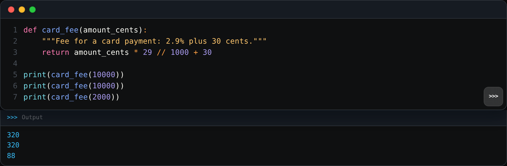

```python
def card_fee(amount_cents):
    """Fee for a card payment: 2.9% plus 30 cents."""
    return amount_cents * 29 // 1000 + 30

print(card_fee(10000))
print(card_fee(10000))
print(card_fee(2000))
```

Three calls, 3 answers, and the 2 calls with 10000 agree. That agreement is the whole value. You can test `card_fee` with a single comparison, `card_fee(10000) == 320`, and the test means the same thing every time it runs. You can read the 1-line body and know everything the function will ever do, because nothing outside it can change the result. You can also move the function to another file or another program and it keeps working, since it brings nothing with it and needs nothing set up.


<br>

### Where Impurity Creeps In

An impure function breaks one of the 2 rules. The usual way is reaching outside: a list or dict defined at the top of the program that the function reads or edits without being handed it.

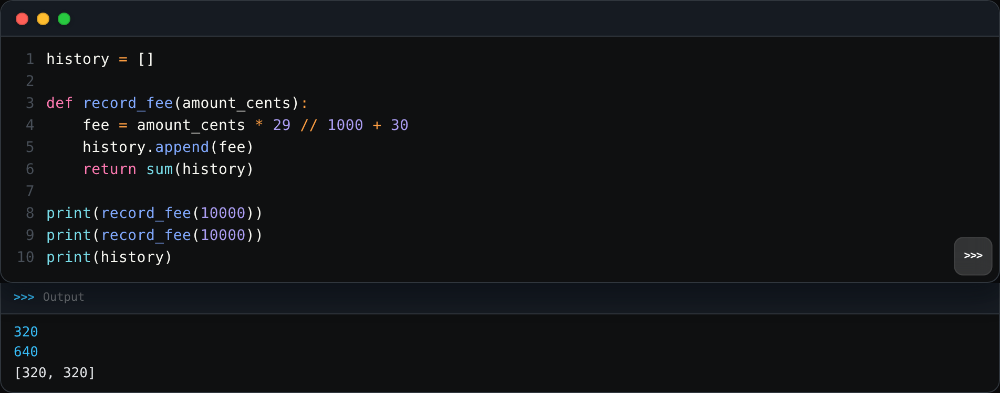

```python
history = []

def record_fee(amount_cents):
    fee = amount_cents * 29 // 1000 + 30
    history.append(fee)
    return sum(history)

print(record_fee(10000))
print(record_fee(10000))
print(history)
```

The 2 calls get the same argument and return different numbers, because `record_fee` reads `history`, a hidden input that grows on every call. It also appends to `history`, a change the caller never asked for. Whoever tests `record_fee` now has to know what ran before it, and whoever reads `history` later has to know who touched it. Both costs come from the same line, `history.append(fee)`.

| ✓ Pure | ✗ Impure |
| --- | --- |
| • Reads only its parameters<br><br>• Returns a value and does nothing else<br><br>• Same arguments, same result, every call<br><br>• Tested with 1 call and 1 comparison | • Reads a variable defined outside it<br><br>• Appends to, pops from or reassigns something it was not given<br><br>• Prints, or depends on time or chance<br><br>• Needs the program's history to predict |


<br>

### Keep the Printing at the Edge

Printing is a side effect too, so a function that prints is impure. Programs still have to print. The pattern is to compute in pure functions and print in the code that calls them, so the math stays testable and the output stays in one place.

```sql
def card_fee(amount_cents):
    return amount_cents * 29 // 1000 + 30

def fee_report(amounts):
    fees = []
    for cents in amounts:
        fees.append(card_fee(cents))
    return fees

report = fee_report([10000, 2000, 500])
print("fees:", report)
print("total:", sum(report))
```

Both `card_fee` and `fee_report` are pure: `fee_report` builds its own list and hands it back. The 2 `print` calls sit outside, where output belongs. The fees come out as `[320, 88, 44]` and the total as 452. If a report later needs the fees in a different order or a different format, `fee_report` stays as it is and only the printing lines change.

> **TIP**
>
> When a function is hard to test, look for a hidden input first. If you have to set up something other than the arguments before calling it, that something is an input the signature does not admit to.

**Which of these 4 functions is pure?**

```python
rates = {"card": 29, "bank": 8}
count = []

def fee_a(cents):
    return cents * rates["card"] // 1000

def fee_b(cents, rate):
    return cents * rate // 1000

def fee_c(cents):
    count.append(1)
    return cents * 29 // 1000

def fee_d(cents):
    print(cents * 29 // 1000)
```

- **A.** fee_a, because it changes nothing and returns a number
- **B.** fee_b, because it reads only its 2 parameters
- **C.** fee_c, because the list it appends to is its own
- **D.** fee_d, because it uses nothing but cents and 2 constants

<details>
<summary>Solution</summary>

**B.** fee_b, because it reads only its 2 parameters

Every value it uses arrives as an argument and it does nothing except return. fee_b(10000, 29) is 290 on every call, in any program.

**Why the others are wrong**

- **A.** It changes nothing, but it reads rates, a dict it was never given. Change rates["card"] and fee_a(10000) changes with it, so the result depends on more than the arguments.
- **C.** count is defined outside fee_c, so every call grows a list the caller never asked about. The return value is stable, but the side effect makes it impure.
- **D.** Printing is a side effect, and fee_d returns nothing at all, so a caller cannot even use its result. Pure functions return their answer instead of printing it.

</details>


<br>

### Turning an Impure Function Pure

Most impure functions become pure with 2 moves. Every hidden input becomes a parameter, so the caller hands it over. Every hidden change becomes a return value, so the caller decides what to do with it.

```sql
rates = {"card": 29, "bank": 8}

def fee_with_rate(cents, rate):
    return cents * rate // 1000

def fee_list(amounts, rate):
    fees = []
    for cents in amounts:
        fees.append(fee_with_rate(cents, rate))
    return fees

card_fee_now = fee_with_rate(10000, rates["card"])
bank_fees = fee_list([10000, 2000], rates["bank"])
print(card_fee_now)
print(bank_fees)
```

`rates` still exists, but now only the calling code reads it: `rates["card"]` is looked up at the call and arrives in the function as 29. So `card_fee_now` is 290 and `bank_fees` is `[80, 16]`, and calling either function again with the same arguments gives the same values. The running total that `record_fee` kept in `history` becomes the caller's choice too: a caller that wants one appends each returned fee to a list it owns and calls `sum` on it. The arithmetic stays pure, and the 1 piece of remembered state sits where every reader of the calling code can see it.


<br>

---

## New Values Instead of Mutation

### The List You Pass In Is the List You Have

When you pass a list or dict to a function, the function receives that same object, with no copy made. Any `append`, `pop` or item assignment inside the function shows up in the caller's variable the moment it happens. The 2 functions below return the same uppercase codes and differ only in what they leave behind.

https://github.com/user-attachments/assets/197181fa-ef12-4783-ae94-797972af2307

*upper_new leaves raw alone; upper_in_place rewrites the list raw names.*

After `upper_new(raw)`, `raw` still prints `['us', 'fr', 'de']` and `clean` holds the uppercase list. After `upper_in_place(raw)`, `raw` itself prints `['US', 'FR', 'DE']`. Both calls returned a list, but the second one also rewrote the caller's data, and the caller finds out only by printing. Watch the stage during `upper_in_place`: there is 1 list, and the line `codes[i] = codes[i].upper()` writes into it under both names at once.


<br>

### Why Mutation Costs You Later

Take an order kept as a dict, and a function that applies a 500 cent discount for the receipt. The accounting record still needs the original total.

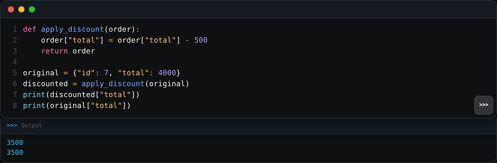

```python
def apply_discount(order):
    order["total"] = order["total"] - 500
    return order

original = {"id": 7, "total": 4000}
discounted = apply_discount(original)
print(discounted["total"])
print(original["total"])
```

Both lines print 3500. The 4000 is gone, and `original` has become a misleading name. The fix is to build a fresh dict from the old one's values and leave the old one as it was.

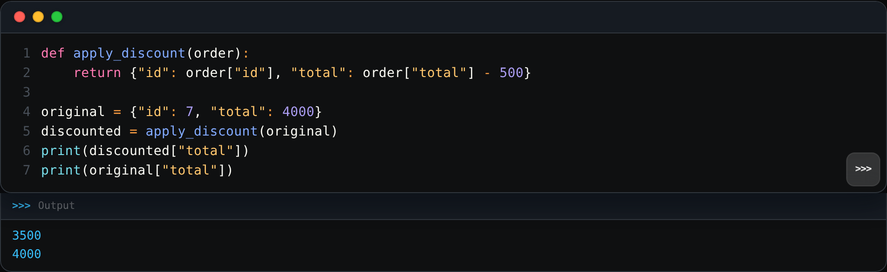

```python
def apply_discount(order):
    return {"id": order["id"], "total": order["total"] - 500}

original = {"id": 7, "total": 4000}
discounted = apply_discount(original)
print(discounted["total"])
print(original["total"])
```

Now 2 dicts exist, one per meaning, and either can be printed, stored or passed on without affecting the other. Building a new value costs a little memory. Mutating costs every reader of the program the same question on every call: who else holds this object right now?


<br>

### Mutating Methods Return None

A second reason to prefer new values: the methods that change a list in place, such as `append`, give nothing back. Code that expects a result from them receives `None`.

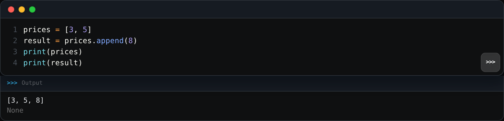

```python
prices = [3, 5]
result = prices.append(8)
print(prices)
print(result)
```

The list grew, but `result` holds `None`, and anything that tries `result[0]` next fails. A function that builds and returns a new list never leaves a caller holding `None` by mistake, and it can be used in the middle of an expression, such as `upper_new(raw)[0]`, which gives `'US'`, or `len(upper_new(raw))`, which gives 3, because it always produces a value.

| ✓ Do | ✗ Don't |
| --- | --- |
| • Create a fresh list or dict inside the function and return it<br><br>• Read the caller's data and leave its contents as you found them<br><br>• Name the returned value for what it is, such as clean or discounted | • Assign into a parameter's items, such as codes[i] = codes[i].upper()<br><br>• Call append, pop or remove on an argument<br><br>• Expect a value back from append, pop or remove |

**What does this program print?**

```python
def total(amounts: list[int]) -> int:
    return sum(amounts)

print(total([1.5, 2.5]))
```

- **A.** An error, because the items are floats and the hint says int
- **B.** 4.0, because the hint does not change what sum returns
- **C.** 4, because the return hint converts the result to int
- **D.** [1.5, 2.5], because sum returns the list unchanged

<details>
<summary>Solution</summary>

**B.** 4.0, because the hint does not change what sum returns

sum([1.5, 2.5]) is 4.0, a float. The -> int hint describes the author's intention and has no effect on the value.

**Why the others are wrong**

- **A.** Hints are stored, never checked at run time. Python passes the list in and sum adds the floats as usual.
- **C.** A return hint converts nothing. The function returns whatever its body returns, here the float 4.0.
- **D.** sum adds the items of a list and returns 1 number. The result is 4.0, and the hint plays no part in it.

</details>


<br>

### Rewriting an In-Place Function

The repair for `add_tax` keeps its loop and changes where the results go. Instead of writing into `amounts`, it fills a list it created itself.

```sql
def add_tax(amounts):
    taxed = []
    for amount in amounts:
        taxed.append(amount + 10)
    return taxed

base = [100, 200]
taxed = add_tax(base)
print(base)
print(taxed)
```

This version prints `[100, 200]` for `base` and `[110, 210]` for `taxed`. It still calls `append`, and that is allowed: `taxed` is a list the function made 1 line earlier, so no caller can be holding it yet. The rule in the list above is about whose object you change. Appending to your own new list is how most of these functions are built; appending to, popping from or assigning into an argument is what reaches back into the caller. The loop also reads more plainly, `for amount in amounts`, since it no longer needs an index to write back to.


<br>

---

## Functions as Objects

### def Makes an Object and Names It

The statement `x = 5` creates an int and gives it the name `x`. The statement `def card_fee(...)` does the same job: it creates a function object and gives it the name `card_fee`. That object can be given a second name, stored in a list, placed in a dict or handed to another function, exactly as 5 can.

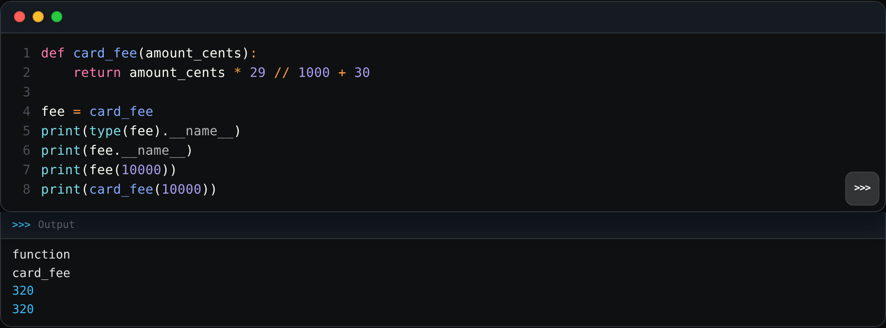

```python
def card_fee(amount_cents):
    return amount_cents * 29 // 1000 + 30

fee = card_fee
print(type(fee).__name__)
print(fee.__name__)
print(fee(10000))
print(card_fee(10000))
```

`fee = card_fee` copies the name, not the function: both names point at 1 object, which is why `fee.__name__` still says `card_fee`. Every function carries its own name in `__name__`. The parentheses are what call it. `card_fee` on its own is the object; `card_fee(10000)` is the number 320.

> **TIP**
>
> Forgetting the parentheses is the most common mistake here. `print(card_fee)` shows a description of the function object, its name and a memory address; `print(card_fee(10000))` shows 320. If a line prints a function's description where you wanted a number, a pair of parentheses is missing.

- Give it another name: fee = card_fee
- Put it in a list: rules = [card_fee, bank_fee]
- Store it under a key: fee_for["card"] = card_fee
- Pass it as an argument: twice(card_fee, 10000)
- Return it from another function: return card_fee


<br>

### Functions in Lists and Dicts

Because a function is a value, a dict can map a payment method to the function that prices it. The lookup replaces a chain of `if` branches, and adding a method means adding 1 entry and 1 small function.

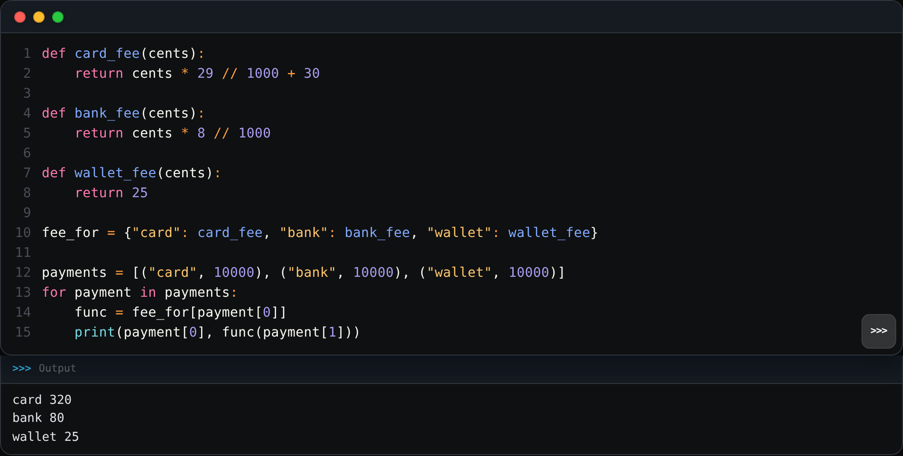

```python
def card_fee(cents):
    return cents * 29 // 1000 + 30

def bank_fee(cents):
    return cents * 8 // 1000

def wallet_fee(cents):
    return 25

fee_for = {"card": card_fee, "bank": bank_fee, "wallet": wallet_fee}

payments = [("card", 10000), ("bank", 10000), ("wallet", 10000)]
for payment in payments:
    func = fee_for[payment[0]]
    print(payment[0], func(payment[1]))
```

`fee_for[payment[0]]` gives back a function, and `func(payment[1])` calls it. The 3 fee rules live in 3 small functions, and the dict is the only place that knows which name goes with which. The loop never checks what kind of payment it is holding.


<br>

### Passed In and Handed Back

A function can also arrive as an argument and leave as a return value. `twice` takes any 1-argument function and applies it 2 times; `style_for` picks one of 2 string functions and returns it without calling it.

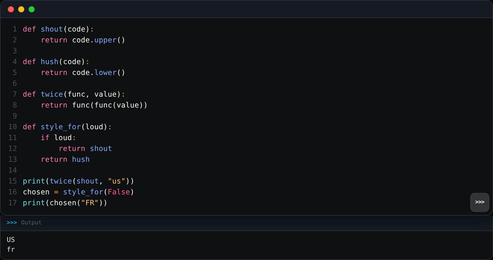

```python
def shout(code):
    return code.upper()

def hush(code):
    return code.lower()

def twice(func, value):
    return func(func(value))

def style_for(loud):
    if loud:
        return shout
    return hush

print(twice(shout, "us"))
chosen = style_for(False)
print(chosen("FR"))
```

`twice(shout, "us")` computes `shout("US")`, which is still `US`. `style_for(False)` returns the `hush` object itself, and `chosen("FR")` calls it for `fr`. In both cases the function moved around the program the way an int or a string would. The next section turns that movement into a technique.

**What does the last line print?**

```python
def double(n):
    return n * 2

def square(n):
    return n * n

ops = [double, square]
print(ops[1](4) + ops[0](4))
```

- **A.** 24, because ops[1](4) is 16 and ops[0](4) is 8
- **B.** 12, because ops[1](4) is 8 and ops[0](4) is 4
- **C.** A line describing 2 function objects joined by +
- **D.** An error, because a list cannot hold functions

<details>
<summary>Solution</summary>

**A.** 24, because ops[1](4) is 16 and ops[0](4) is 8

ops[1] is square, so ops[1](4) is 16. ops[0] is double, so ops[0](4) is 8. The sum is 24.

**Why the others are wrong**

- **B.** Lists index from 0, so ops[0] is double and ops[1] is square. Swapping them gives 8 and 16, and double(4) is 8, never 4.
- **C.** Both items are followed by (4), so both are called and return ints. Printing a function description happens only when the parentheses are missing.
- **D.** A function is a value like any other, and a list can hold it. ops[1] is the square function, and ops[1](4) calls it.

</details>


<br>

### The Name or the Call

The parentheses matter most when a function goes into a list or a dict, because the container keeps whatever the expression produced at the moment it was built.

```sql
def shout(code):
    return code.upper()

stored = {"loud": shout}
called = {"loud": shout("us")}

print(stored["loud"]("fr"))
print(called["loud"])
```

`stored` holds the function, so every lookup can call it on new input: `stored["loud"]("fr")` prints `FR`. `called` holds what `shout("us")` returned when the dict was built, the string `US`, so its lookup prints `US` and nothing more. The call ran once and will not run again. Trying `called["loud"]("fr")` stops the program with a `TypeError`, because a string cannot be called. When a dict is meant to choose behaviour, as `fee_for` did, its values are bare function names.


<br>

---

## Writing Higher-Order Functions

### The Same Loop, Written Again

Here are 2 functions from a payments module. One converts every amount to cents, the other uppercases every currency code.

```sql
def all_to_cents(amounts):
    result = []
    for amount in amounts:
        result.append(amount * 100)
    return result

def all_upper(codes):
    result = []
    for code in codes:
        result.append(code.upper())
    return result
```

The 2 functions share a shape: make a list, loop, append, return. Their variable names differ, but the only real difference is the expression inside `append`, `amount * 100` in one and `code.upper()` in the other. A higher-order function takes that expression as a parameter, a function, and keeps the loop in 1 place. Two of them run below: `apply_to_all` transforms every item, and `keep_if` keeps the items a test approves.

https://github.com/user-attachments/assets/c14c4b17-06e7-4d08-b423-b3f2507ad545

*Each higher-order function owns the loop; the function passed in decides per item.*

`apply_to_all(to_cents, prices)` calls `to_cents` on 3, -2 and 5 and returns `[300, -200, 500]`. `keep_if(is_refund, cents)` calls `is_refund` on each of those and keeps only `-200`. The last line prints `prices` unchanged, `[3, -2, 5]`, because both helpers build new lists. The loops were written once; `to_cents` and `is_refund` are the only new code a new task needs, and each of them is a 1-line pure function that can be checked on its own.


<br>

### Returning a Function Picks a Rule Once

The other direction is a function that returns a function. `fee_function_for` chooses the pricing rule for a payment method, and `total_fees` calls it 1 time before the loop instead of testing the method on every item.

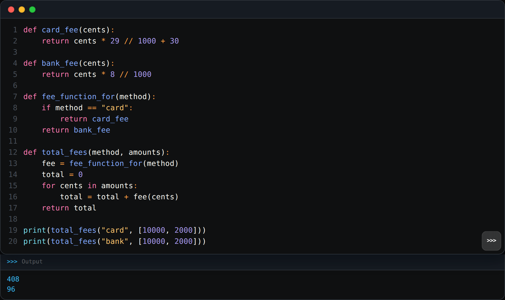

```python
def card_fee(cents):
    return cents * 29 // 1000 + 30

def bank_fee(cents):
    return cents * 8 // 1000

def fee_function_for(method):
    if method == "card":
        return card_fee
    return bank_fee

def total_fees(method, amounts):
    fee = fee_function_for(method)
    total = 0
    for cents in amounts:
        total = total + fee(cents)
    return total

print(total_fees("card", [10000, 2000]))
print(total_fees("bank", [10000, 2000]))
```

For `"card"` the fees are 320 and 88, total 408. For `"bank"` they are 80 and 16, total 96. The `if` runs once per batch, and the loop body reads the same for every method, because `fee` is already the right function by the time the loop starts. A fourth payment method means a fourth small function and 1 more branch in `fee_function_for`; `total_fees` does not change.

> Three shapes of higher-order function
>
> - Takes a function and applies it: apply_to_all(func, items) returns 1 result per item
> - Takes a function and tests with it: keep_if(test, items) returns the items that pass
> - Returns a function: fee_function_for(method) hands back the rule to use

> **TIP**
>
> Name the function parameter for the role it plays, such as test, func or rule, and make it the first parameter. Readers then see what kind of thing to pass before they see the data it will run on.

Each shape keeps 1 division of labour: the higher-order function owns the loop and never looks inside an item itself. The function passed in or returned does all the per-item work. When that per-item function is pure and the loop builds a new list, the whole pipeline is pure, and `prices` printing unchanged at the end of the animation is the proof.

**What does this program print?**

```python
def total(amounts: list[int]) -> int:
    return sum(amounts)

print(total([1.5, 2.5]))
```

- **A.** An error, because the items are floats and the hint says int
- **B.** 4.0, because the hint does not change what sum returns
- **C.** 4, because the return hint converts the result to int
- **D.** [1.5, 2.5], because sum returns the list unchanged

<details>
<summary>Solution</summary>

**B.** 4.0, because the hint does not change what sum returns

sum([1.5, 2.5]) is 4.0, a float. The -> int hint describes the author's intention and has no effect on the value.

**Why the others are wrong**

- **A.** Hints are stored, never checked at run time. Python passes the list in and sum adds the floats as usual.
- **C.** A return hint converts nothing. The function returns whatever its body returns, here the float 4.0.
- **D.** sum adds the items of a list and returns 1 number. The result is 4.0, and the hint plays no part in it.

</details>


<br>

### Stopping at the First Match

`count_if` has to see every item to count them. Some questions are settled by the first item that passes, and a `return` inside the loop ends the whole function there.

```sql
def is_refund(cents):
    return cents < 0

def has_any(test, items):
    for item in items:
        if test(item):
            return True
    return False

print(has_any(is_refund, [300, -200, 500]))
print(has_any(is_refund, [10, 20]))
```

The first call prints `True`: `is_refund(-200)` passes, `return True` runs, and 500 is never tested. The second prints `False`, and only there does the line after the loop run, because only a loop that finishes without returning reaches it. The 2 returns split the work: the one inside the loop answers as soon as an item passes, and the one after it gives the answer for when none did. `has_any` is still a higher-order function: the test arrives as a parameter, so the same loop answers 'is there a refund?' or 'is there a payment over 100?' with a different 1-line test.


<br>

---

## Type Hints for Function Signatures

### Annotations on Parameters and Returns

A type hint is a note written into the signature. A colon after a parameter name gives the type the function expects there; an arrow before the final colon gives the type it returns. Python stores the notes and otherwise runs the function unchanged.

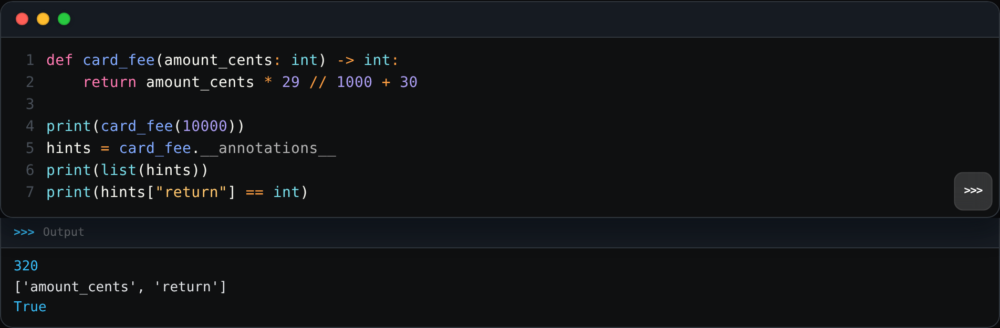

```python
def card_fee(amount_cents: int) -> int:
    return amount_cents * 29 // 1000 + 30

print(card_fee(10000))
hints = card_fee.__annotations__
print(list(hints))
print(hints["return"] == int)
```

The call works as before. The other 2 lines show where the hints went: a dict on the function object named `__annotations__`, keyed by parameter name with `'return'` for the result, and the value under each key is the type itself, so `hints["return"] == int` is `True`. Anyone reading the signature, an editor, or a type checking tool can see that `card_fee` wants an int and gives one back, without running it and without opening the body.


<br>

### Hints Describe, They Do Not Enforce

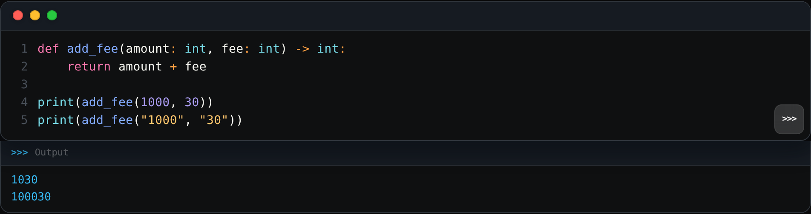

```python
def add_fee(amount: int, fee: int) -> int:
    return amount + fee

print(add_fee(1000, 30))
print(add_fee("1000", "30"))
```

The second call passes 2 strings into parameters hinted as `int`, and Python runs it anyway: `+` on strings is concatenation, so the result is the string `'100030'`. A hint changes no behaviour. Its value is that a reader, or a checker run before the program, can spot the mismatch instead of discovering it as a 100030 cent fee on a customer's statement.

| Hint | What it says the value is | Example value |
| --- | --- | --- |
| int | a whole number | 320 |
| str | text | "us" |
| float | a number with a decimal point | 2.9 |
| bool | True or False | True |
| list[int] | a list whose items are ints | [320, 88] |
| dict[str, int] | string keys with int values | {"card": 29} |
| tuple[str, int] | a pair of a string and an int | ("card", 10000) |
| None | used as -> None: returns nothing | (return type only) |

Container hints name their contents in square brackets: `list[str]` says a list of strings, `dict[str, int]` says string keys and int values. A return hint of `list[int]` tells the caller a list of ints comes back, so the function returns a value rather than `None`. The hint cannot say whether that list is new or the caller's own. `upper_in_place`, which rewrote `raw` and returned it, could carry `-> list[str]` just as truthfully as `upper_new`, which builds a fresh list. Only the body decides that, so checking for mutation still means reading the loop.

```sql
def apply_to_all(func, items: list) -> list:
    result = []
    for item in items:
        result.append(func(item))
    return result

def keep_refunds(cents: list[int]) -> list[int]:
    result = []
    for value in cents:
        if value < 0:
            result.append(value)
    return result
```

`keep_refunds` can be hinted fully: ints in, a list of ints out, and the body builds that list new. `apply_to_all` is harder. The hint for a parameter that is itself a function needs a tool from a later lesson, so `func` is left bare and the rest of the signature is still annotated. Partial hints are normal; every hint you can write is 1 fewer question for the next reader, and a bare `list` still says more than nothing.

**What does this program print?**

```python
def total(amounts: list[int]) -> int:
    return sum(amounts)

print(total([1.5, 2.5]))
```

- **A.** An error, because the items are floats and the hint says int
- **B.** 4.0, because the hint does not change what sum returns
- **C.** 4, because the return hint converts the result to int
- **D.** [1.5, 2.5], because sum returns the list unchanged

<details>
<summary>Solution</summary>

**B.** 4.0, because the hint does not change what sum returns

sum([1.5, 2.5]) is 4.0, a float. The -> int hint describes the author's intention and has no effect on the value.

**Why the others are wrong**

- **A.** Hints are stored, never checked at run time. Python passes the list in and sum adds the floats as usual.
- **C.** A return hint converts nothing. The function returns whatever its body returns, here the float 4.0.
- **D.** sum adds the items of a list and returns 1 number. The result is 4.0, and the hint plays no part in it.

</details>


<br>

### Hinting Dicts and Functions That Return Nothing

Hints earn the most on signatures with several parameters of different kinds, where a reader would otherwise have to open the body to learn which argument is which.

```sql
def rate_fee(rates: dict[str, int], method: str, cents: int) -> int:
    return cents * rates[method] // 1000

def show_fee(label: str, fee: int) -> None:
    print(label, fee)

show_fee("card", rate_fee({"card": 29}, "card", 10000))
```

The first signature is a complete call guide: a dict from method names to int rates, a method name, an amount in cents, and an int back, here 290. `-> None` on `show_fee` says the opposite thing: call it for the line it prints and do not keep its result. That is the same trap as `result = prices.append(8)`, now stated in the signature where a reader sees it before writing the call. The program prints `card 290`.

#### Lists of Dicts Have 2 Layers

A list of dicts can be changed at 2 levels: the list itself, and each dict inside it. A function can build a brand new list and still hand the caller's data back changed, if the loop writes a key into each old dict before appending it.

```sql
def with_status(orders):
    labelled = []
    for order in orders:
        fresh = {"id": order["id"], "total": order["total"]}
        fresh["status"] = "paid"
        labelled.append(fresh)
    return labelled

orders = [{"id": 1, "total": 10000}]
done = with_status(orders)
print(done[0])
print(orders[0])
```

The line that writes `"status"` targets `fresh`, a dict made on the line before it, so `done[0]` prints `{'id': 1, 'total': 10000, 'status': 'paid'}` and `orders[0]` still prints `{'id': 1, 'total': 10000}`. Had the loop written `order["status"] = "paid"` and appended `order`, both prints would show the status key, because the new list would be holding the caller's own dicts.


<br>

---

## Putting It All Together

A payments team ships a fee engine that prices every transaction in a day's batch. card_fee, bank_fee and wallet_fee are 3 pure 1-line functions, each hinted int to int. A dict maps each payment method name to its function, and price_all(rule, amounts) applies the chosen rule to a batch and returns a new list, leaving the batch of raw amounts untouched for the audit export that runs after it.

- Pure fee functions mean the audit export and the customer statement, computed by different code paths, land on the same cents.
- Returning a new list from price_all lets the raw amounts be reused by the export, with no copy made by hand first.
- Storing the 3 fee functions in a dict replaces 3 if branches with a single lookup.
- price_all captures the loop once, so a new payment method is 1 small function plus 1 dict entry, and price_all is unchanged.
- The hints on every signature tell the next engineer that amounts are ints in cents and the result is a list[int] before a line runs; the body is what keeps that list separate from the batch.


<br>

---

## Key Takeaways

- A pure function reads only its parameters and changes nothing outside itself, so 1 call and 1 comparison test it for good.
- A list or dict passed to a function is the caller's own object; building and returning a new one keeps the caller's data as it was.
- Mutating methods such as append return None, so a function that returns a fresh value is also safer to use inside expressions.
- A def creates an object with a name; that object can be renamed, stored in a list or dict, passed as an argument or returned.
- A higher-order function owns the loop once and takes the per-item rule as a parameter, or returns the rule to use.
- Type hints state what a function expects and gives back; Python stores them and never enforces them.
