# Functional Programming: Intermediate

Picture a Friday evening at Uber: a pricing job builds a fare function for each city in a loop, with Chicago at 1.2x surge, Boston at 1.5x and Austin at 1.8x. The audit report shows riders in all 3 cities charged 1.8x. Nothing crashed, and every line looks right. Whether riders are billed correctly comes down to when a closure reads its variable.


<br>

---

## Folding a Sequence With reduce

functools.reduce takes a function of 2 arguments and a sequence, and folds the sequence into a single value. It calls the function on the first 2 items, calls it again on that result and the third item, and keeps going left to right until the items run out. The function's first parameter is the running result, called the **accumulator**. The second parameter is the next item.

Watch it fold 4 batch row counts. The step function prints every call, so you can follow the accumulator from call to call.

https://github.com/user-attachments/assets/239d2174-51f6-4a10-8888-ffdd2b7bb339

*With no starting value, the first batch becomes the first accumulator, so 4 items make 3 calls.*


<br>

### Giving reduce a starting value

A third argument, the **initializer**, becomes the first accumulator, and the step then runs once per item: 4 batches make 4 calls. The initializer matters in 2 situations. The first is a sequence that can be empty. With no initializer and no items, reduce has nothing to return and raises TypeError: reduce() of empty sequence with no initial value, while reduce(add_rows, [], 0) returns 0. The second is a result whose type differs from the items. One case is a list of table names, which are strings, folded into a total character count, which is an int:

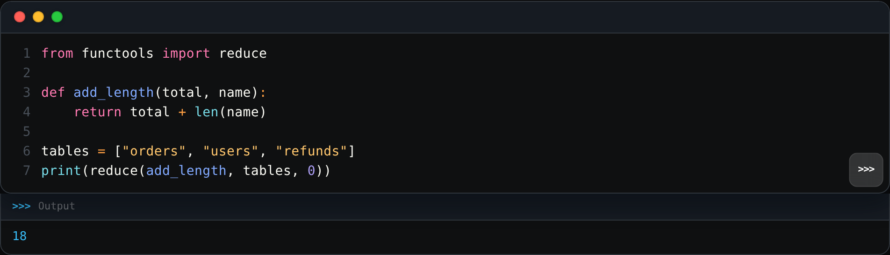

```python
from functools import reduce

def add_length(total, name):
    return total + len(name)

tables = ["orders", "users", "refunds"]
print(reduce(add_length, tables, 0))
```

With `0`, the first call is `add_length(0, "orders")`, and the total stays an int: 6, then 11, then 18. Drop the `0` and the first item, the string `"orders"`, becomes the accumulator. The first call then runs `"orders" + len("users")`, which is `"orders" + 5`, and Python raises `TypeError: can only concatenate str (not "int") to str`. Without an initializer, the accumulator starts out as the first item, with that item's type.

The dict merge below needs its `{}` for the first situation. Each file reports row counts per table, the items and the result are both dicts, and on some nights the job receives no files at all. The step copies the accumulator with `dict(acc)` before adding to it, so it stays pure and returns a new value on every call.

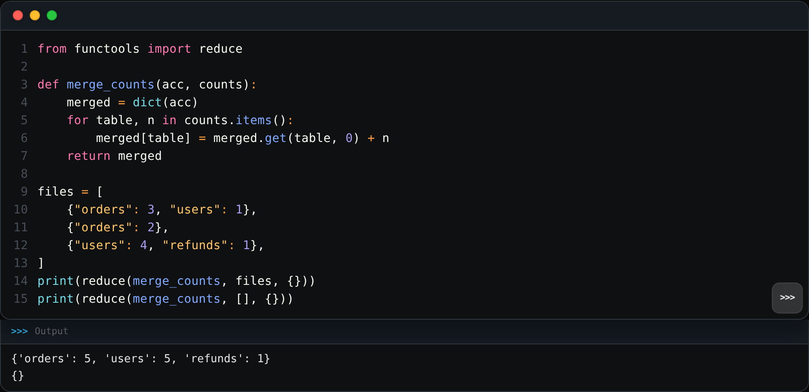

```python
from functools import reduce

def merge_counts(acc, counts):
    merged = dict(acc)
    for table, n in counts.items():
        merged[table] = merged.get(table, 0) + n
    return merged

files = [
    {"orders": 3, "users": 1},
    {"orders": 2},
    {"users": 4, "refunds": 1},
]
print(reduce(merge_counts, files, {}))
print(reduce(merge_counts, [], {}))
```

Delete both `{}` arguments and the first file's dict becomes the starting accumulator. The first print stays the same, because `merge_counts` copies whatever accumulator it receives. The second call then raises the `TypeError` instead of printing `{}`.


<br>

### Order matters, and operator helps

Since the fold runs left to right, the grouping is fixed: `reduce(f, [a, b, c])` computes `f(f(a, b), c)`. For addition and merging counts, grouping makes no difference to the answer. For subtraction or division it does. The `operator` module provides Python's operators as named functions, such as `operator.add`, `operator.mul` and `operator.getitem`, so you can pass them to reduce without writing a `def` for each.

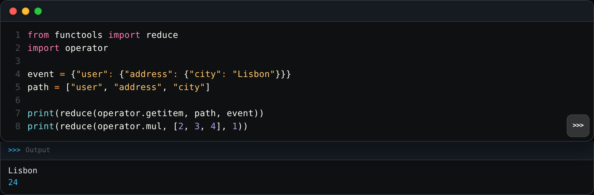

```python
from functools import reduce
import operator

event = {"user": {"address": {"city": "Lisbon"}}}
path = ["user", "address", "city"]

print(reduce(operator.getitem, path, event))
print(reduce(operator.mul, [2, 3, 4], 1))
```

`operator.getitem(d, k)` returns `d[k]`, so folding a key path over a nested record descends a level per key: `event["user"]`, then `["address"]`, then `["city"]`. The `1` initializer for the product works the way `0` does for a sum: it is the value that leaves the result unchanged.

**What does this print?**

```python
def build_rules():
    rules = []
    for limit in [10, 20, 30]:
        def check(n):
            return n < limit
        rules.append(check)
    limit = 5
    return rules

for rule in build_rules():
    print(rule(8))
```

- **A.** True 3 times, because each check kept its own limit from the loop
- **B.** False 3 times, because every check reads limit after it was set to 5
- **C.** True 3 times, because every check reads the loop's final value, 30
- **D.** NameError, because limit stops existing once the loop has finished

<details>
<summary>Solution</summary>

**B.** False 3 times, because every check reads limit after it was set to 5

The checks run after build_rules returns. By then limit was rebound to 5, and 8 < 5 is False.

**Why the others are wrong**

- **A.** No check captured a value. All 3 share the variable limit, and they read it only when called.
- **C.** The loop leaves limit at 30, but limit = 5 rebinds the variable afterwards, and the checks read the latest value.
- **D.** A loop variable stays defined after the loop, and the closures keep its cell alive after build_rules returns.

</details>


<br>

### When a plain loop reads better

Reduce reads well when the step is a single named operation and the accumulator is a single value. It reads worse when the accumulator carries several pieces of state or the step needs branches. Here is an average computed both ways:

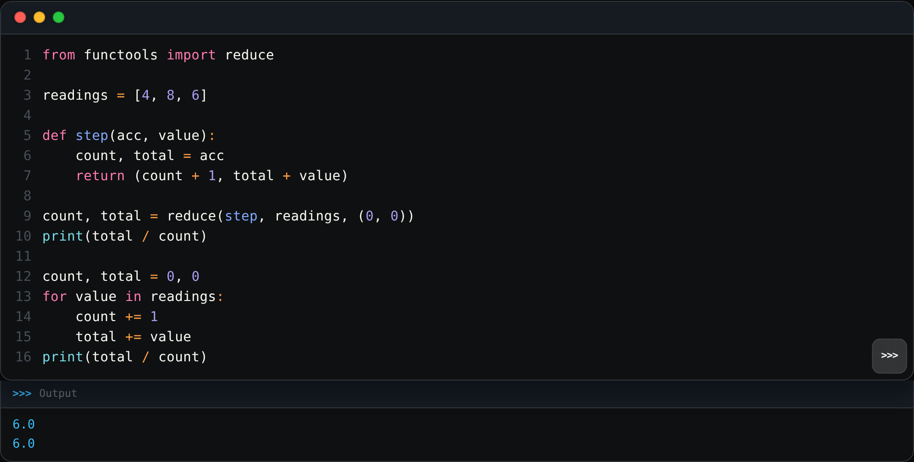

```python
from functools import reduce

readings = [4, 8, 6]

def step(acc, value):
    count, total = acc
    return (count + 1, total + value)

count, total = reduce(step, readings, (0, 0))
print(total / count)

count, total = 0, 0
for value in readings:
    count += 1
    total += value
print(total / count)
```

Both print `6.0`. The loop names each piece of state on its own line, while the reduce version packs `count` and `total` into a tuple that the reader unpacks mentally at every call. For totals, largest values and smallest values, `sum()`, `max()` and `min()` beat both, since each names its intent in a word.

| ✓ Do | ✗ Don't |
| --- | --- |
| • Use reduce when the step is a single named function, like operator.add or merge_counts<br><br>• Pass an initializer whenever the sequence can be empty<br><br>• Return a new accumulator from the step instead of changing the old one | • Don't use reduce to total or find the largest or smallest; use sum, max or min<br><br>• Don't pack 3 or more pieces of state into a tuple accumulator; write the loop<br><br>• Don't put branches in a step function the reader must trace call by call |


<br>

---

## Partial Application With partial

`functools.partial(func, *args, **kwargs)` returns a new callable that remembers some of `func`'s arguments. When you call it, it runs `func` with the remembered arguments plus the ones you pass now. Fixed positional arguments go in front of the caller's positional arguments, and fixed keywords are merged with the caller's keywords.

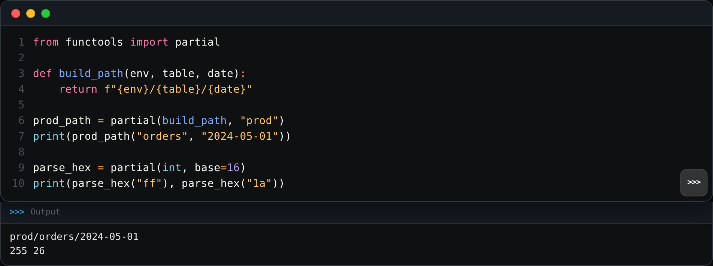

```python
from functools import partial

def build_path(env, table, date):
    return f"{env}/{table}/{date}"

prod_path = partial(build_path, "prod")
print(prod_path("orders", "2024-05-01"))

parse_hex = partial(int, base=16)
print(parse_hex("ff"), parse_hex("1a"))
```

`prod_path` needs only `table` and `date`, because `env` is already filled with `"prod"`. `parse_hex` presets `base` by keyword, and that works on built-ins like `int` as well as on functions you write.


<br>

### Which parameter a preset fills

A fixed positional argument always lands in the leftmost parameter. That works when the value you want to preset comes first in the signature, and silently goes wrong when it comes later. To preset a later parameter, fix it by name.

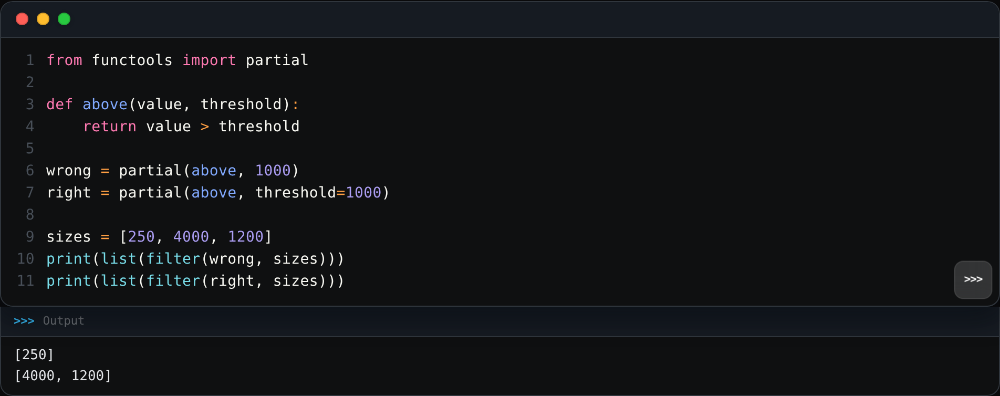

```python
from functools import partial

def above(value, threshold):
    return value > threshold

wrong = partial(above, 1000)
right = partial(above, threshold=1000)

sizes = [250, 4000, 1200]
print(list(filter(wrong, sizes)))
print(list(filter(right, sizes)))
```

`wrong(x)` runs `above(1000, x)`, which asks whether 1000 is larger than `x`, so the filter keeps the small file and drops the 2 large ones. No error is raised, and the result is reversed. `right` fills `threshold` and leaves `value` open for `filter` to supply.


<br>

### Overriding and colliding arguments

A keyword fixed by `partial` behaves like a default: the caller can pass the same keyword again and the caller's value wins. A partial object also exposes its parts as `.func`, `.args` and `.keywords`, which helps when a log line should say what a preset function will do.

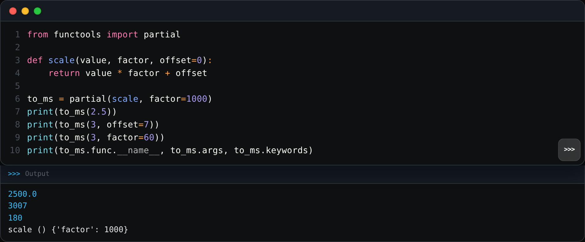

```python
from functools import partial

def scale(value, factor, offset=0):
    return value * factor + offset

to_ms = partial(scale, factor=1000)
print(to_ms(2.5))
print(to_ms(3, offset=7))
print(to_ms(3, factor=60))
print(to_ms.func.__name__, to_ms.args, to_ms.keywords)
```

The third call replaces `factor` with 60, giving `3 * 60 + 0`, and the stored `.keywords` stay untouched. Positional values cannot be overridden this way. If the caller's positional arguments reach a parameter that is already fixed by keyword, Python raises `TypeError` and names the parameter that received 2 values.

**What happens when this runs?**

```python
def load(rows):
    def is_valid(row):
        return row["id"] is not None
    return list(filter(is_valid, rows))

print(len(load([{"id": 1}, {"id": None}])))
print(is_valid({"id": 2}))
```

- **A.** It prints 1, then raises NameError, because is_valid is local to load
- **B.** It prints 1, then True, because calling load already defined is_valid
- **C.** It raises NameError on the first print, because filter can't see is_valid
- **D.** It prints 2, then True, because an id of None still counts as valid

<details>
<summary>Solution</summary>

**A.** It prints 1, then raises NameError, because is_valid is local to load

is_valid is a local name inside load, and it disappears when load returns. The module-level call finds no such name.

**Why the others are wrong**

- **B.** The def did run, but it bound the name inside the scope of load, which ended when load returned.
- **C.** load passes the function object itself to filter, so filter never looks the name up.
- **D.** None is not None is False, so the second row is filtered out and len returns 1.

</details>


<br>

### Partial or a small def?

| ✓ partial(build_path, "prod") | ✗ def prod_path(table, date) |
| --- | --- |
| • A single line, with no new def to read<br><br>• Links back to the original through .func<br><br>• Presets arguments and adds no logic | • Can add checks, formatting or logging around the call<br><br>• Has its own name and docstring<br><br>• Takes 2 or more lines for what may be a pure preset |

Use `partial` when you hand a function to `map`, `filter` or `sorted(key=...)` and it needs an extra argument those tools never pass. `map` calls its function with 1 argument per item, so presetting `ndigits` turns `round` into a function `map` can use:

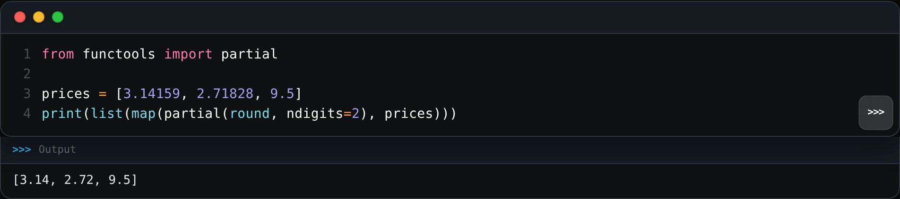

```python
from functools import partial

prices = [3.14159, 2.71828, 9.5]
print(list(map(partial(round, ndigits=2), prices)))
```

> **TIP**
>
> Stacking presets costs nothing extra: `partial(partial(build_path, "prod"), "orders")` produces a single partial object whose `.args` is `("prod", "orders")`, so a call reaches `build_path` in one step.


<br>

---

## Nested Functions

A `def` can sit inside another function's body. Python executes that inner `def` each time the outer function runs, building a fresh function object and binding it to a local name. Like every local, the name goes away when the outer function returns, so no other code in the module can call the helper.

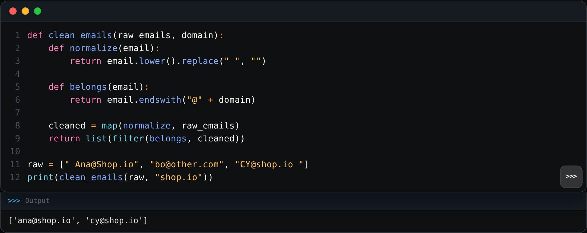

```python
def clean_emails(raw_emails, domain):
    def normalize(email):
        return email.lower().replace(" ", "")

    def belongs(email):
        return email.endswith("@" + domain)

    cleaned = map(normalize, raw_emails)
    return list(filter(belongs, cleaned))

raw = [" Ana@Shop.io", "bo@other.com", "CY@shop.io "]
print(clean_emails(raw, "shop.io"))
```

`normalize` and `belongs` exist only while `clean_emails` runs, so anyone reading the module sees a single public function. `belongs` also uses `domain` without receiving it as a parameter: it reads the variable from the function it sits inside. That keeps `belongs` at 1 parameter, which is what `filter` passes per item.

Written at module level, `belongs` would need `domain` as a second parameter, and you would bridge the gap with `partial(belongs, domain=domain)`. The nested version reaches the same result by reading `domain` from the scope around it.


<br>

### How Python finds a name

When a nested function uses a name, Python searches 4 scopes in order and stops at the first match: the inner function's own **local** names, then the **enclosing** function's names, then the module's **global** names, then Python's **built-in** names such as len and print. Local and global are familiar from earlier work. Enclosing is the layer nesting adds.

| Scope | Where the name is assigned | Example from the email code |
| --- | --- | --- |
| Local | In the inner function itself | `email`, inside `belongs` |
| Enclosing | In the function around it | `domain`, read by `belongs` |
| Global | At the top level of the module | `raw` |
| Built-in | Supplied by Python | `map`, `filter`, `list` |


<br>

### Assigning creates a new local

Reading an enclosing name needs no declaration. Assigning to it behaves differently: an assignment anywhere in the inner function makes that name belong to the inner function for its whole body, and the enclosing variable keeps its value.

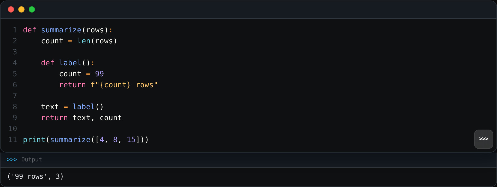

```python
def summarize(rows):
    count = len(rows)

    def label():
        count = 99
        return f"{count} rows"

    text = label()
    return text, count

print(summarize([4, 8, 15]))
```

`label` gets its own `count`, set to 99, while the `count` in `summarize` stays 3. Rebinding the enclosing variable takes a keyword of its own, which arrives with closures.

**What happens when this runs?**

```python
def load(rows):
    def is_valid(row):
        return row["id"] is not None
    return list(filter(is_valid, rows))

print(len(load([{"id": 1}, {"id": None}])))
print(is_valid({"id": 2}))
```

- **A.** It prints 1, then raises NameError, because is_valid is local to load
- **B.** It prints 1, then True, because calling load already defined is_valid
- **C.** It raises NameError on the first print, because filter can't see is_valid
- **D.** It prints 2, then True, because an id of None still counts as valid

<details>
<summary>Solution</summary>

**A.** It prints 1, then raises NameError, because is_valid is local to load

is_valid is a local name inside load, and it disappears when load returns. The module-level call finds no such name.

**Why the others are wrong**

- **B.** The def did run, but it bound the name inside the scope of load, which ended when load returned.
- **C.** load passes the function object itself to filter, so filter never looks the name up.
- **D.** None is not None is False, so the second row is filtered out and len returns 1.

</details>


<br>

### When to nest and when not to

| ✓ Do | ✗ Don't |
| --- | --- |
| • Nest a helper that only 1 function uses and that reads that function's parameters<br><br>• Nest to hand map, filter or sorted a 1-argument function built from outer values<br><br>• Keep nested helpers to a few lines so the outer function stays readable | • Don't nest a helper you want to test alone; a test can't reach a local function<br><br>• Don't nest logic that 2 functions need; move it to module level<br><br>• Don't stack 3 levels of nesting; every level adds a scope to track |

*Python builds a fresh function object for each nested def every time the outer function runs. The cost is small, but for a function called millions of times inside a loop, a module-level helper skips it.*


<br>

---

## Closures

A nested function can also be the return value. When make_range_check below returns check, its parameters low and high would normally disappear with the call, yet check still reads them, so Python keeps them alive and attaches them to the returned function. A function packaged with the enclosing variables it uses is a **closure**. A function that builds and returns closures is a **function factory**.

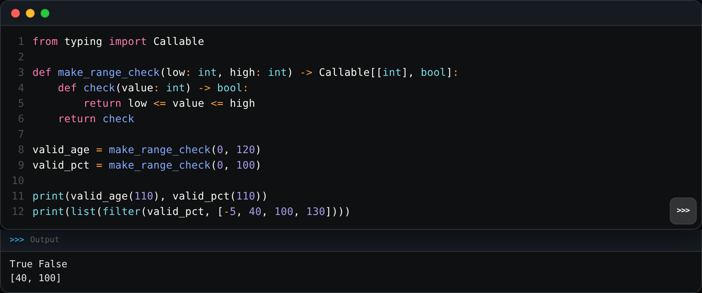

```python
from typing import Callable

def make_range_check(low: int, high: int) -> Callable[[int], bool]:
    def check(value: int) -> bool:
        return low <= value <= high
    return check

valid_age = make_range_check(0, 120)
valid_pct = make_range_check(0, 100)

print(valid_age(110), valid_pct(110))
print(list(filter(valid_pct, [-5, 40, 100, 130])))
```

`valid_age` and `valid_pct` run identical code and answer differently, because each call to `make_range_check` creates a new `low` and `high`, and the returned `check` carries that call's pair. The hint `Callable[[int], bool]` says the factory returns a function that takes an `int` and returns a `bool`.

> Factories that turn up in pipelines
>
> - `make_range_check(low, high)`: a validator per column, built from a config
> - `make_prefixer("stg_")`: a renamer per pipeline layer
> - `make_counter(name)`: a running count per table, kept between calls


<br>

### Where captured variables live

Python stores each captured variable in a **cell**, a small container that the outer function and the closure share. A function lists the names it captures in __code__.co_freevars and holds the cells themselves in __closure__, a tuple you can index.

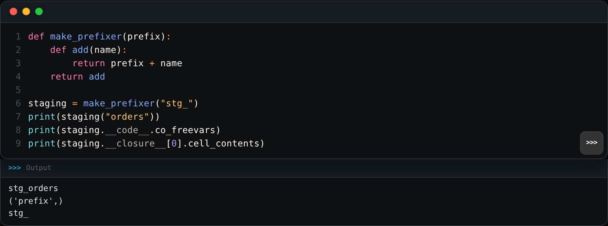

```python
def make_prefixer(prefix):
    def add(name):
        return prefix + name
    return add

staging = make_prefixer("stg_")
print(staging("orders"))
print(staging.__code__.co_freevars)
print(staging.__closure__[0].cell_contents)
```

A cell is the variable's storage, so the closure reads whatever the cell holds at the moment it runs. If the outer function rebinds `prefix` before returning, the closure sees the new value, and the last section of this lesson shows that behaviour turning into a bug.


<br>

### Keeping state with nonlocal

In the make_counter factory below, the inner function increment runs count += 1 on the factory's own count, which starts at 0. Assigning to a captured name follows the rule from nested functions: the name becomes local to increment. Without a declaration, count += 1 would try to read a local that has no value yet, and Python raises UnboundLocalError. Declaring `nonlocal` count at the top of increment tells Python that count belongs to the enclosing function, so the assignment updates the shared cell instead.

Every call to `make_counter` creates a fresh cell, so 2 counters keep separate counts:

https://github.com/user-attachments/assets/7a59768f-8288-484c-82a1-741f6712cd4a

*Each make_counter call creates its own count cell, so the third orders() call continues from 2.*

> **TIP**
>
> Mutating a captured list or dict, as in `seen.append(row_id)`, needs no `nonlocal`, because it changes the object and leaves the name bound to it. You need `nonlocal` when the inner function assigns to the name itself, with `=` or an augmented operator like `+=`.

| ✓ Closure factory | ✗ partial |
| --- | --- |
| • Wraps new logic around the captured values<br><br>• Can update its state between calls with nonlocal<br><br>• Lists captured names in __code__.co_freevars | • Presets arguments of a function that already exists<br><br>• Keeps its preset values fixed for its whole life<br><br>• Lists preset values in .args and .keywords |

**What does the last line print?**

```python
def make_tracker():
    total = 0
    def add(n):
        nonlocal total
        total += n
        return total
    return add

a = make_tracker()
b = make_tracker()
a(5)
b(2)
print(a(10), b(1))
```

- **A.** 17 18, because a and b update a single shared total
- **B.** 10 1, because total goes back to 0 on every call to add
- **C.** 15 3, because a and b each keep their own total cell
- **D.** UnboundLocalError, because total is assigned inside add

<details>
<summary>Solution</summary>

**C.** 15 3, because a and b each keep their own total cell

a goes from 5 to 15, and b goes from 2 to 3. The print shows the values returned by the last call to each.

**Why the others are wrong**

- **A.** Each call to make_tracker runs in a new scope with its own total, so the trackers never see each other's additions.
- **B.** total = 0 runs once per make_tracker call. add only adds to the cell, which keeps its value between calls.
- **D.** The nonlocal total line makes the assignment update the enclosing variable, so no local is created.

</details>

Leave out the `nonlocal` line and the factory itself runs without complaint: the failure waits for the first call to the returned function. Python settles each name's scope when it reads the inner `def`, before any line of it runs, so `count += 1` makes `count` local to the whole body. The traceback's last line reads `UnboundLocalError: local variable 'count' referenced before assignment`, and the frame above it names the inner function and its `count += 1` line. An assignment in an inner function to a name the outer function defines is the signal to add `nonlocal`.


<br>

---

## The Late-Binding Closure Trap

A closure reads a captured variable at the moment it runs, from the cell it shares with the enclosing function. Create closures inside a loop and they all capture the same loop variable, because the loop rebinds a single name on every pass. Call them after the loop and every one of them sees the loop's final value.

Here is the pricing bug from the start of the lesson. Each `price` function should apply its own city's surge multiplier, and the last 2 prints check what the functions share.

https://github.com/user-attachments/assets/b2a6848f-2df5-4093-bd98-9bac5df8cf0f

*All 3 functions read the same rate cell, which holds 1.8 once the loop ends.*

The `False` confirms there are 3 distinct function objects in the dict. The `True` shows what they have in common: the same cell for `rate`. There is a single `rate` variable in `build_pricers`, the loop rebinds it 3 times, and none of the functions runs until the loop is over and `rate` holds 1.8.


<br>

### When the trap fires and when it doesn't

The bug needs 2 ingredients: a closure created inside a loop, and a call that happens after the loop variable has moved on. Call `price(10)` inside the loop body, right after the `def`, and you get 12.0, 15.0 and 18.0, because each call reads `rate` while it still holds the current city's multiplier. The trap shows up in code that stores functions for later: dicts of pricers, lists of validation rules, handlers registered to run at the end of a job.

Signs of the trap in a code review

- A def inside a for loop whose body reads the loop variable
- Functions stored in a list or dict and called after the loop ends
- Every stored function returning the result meant for the last item


<br>

### Three ways to bind each value now

Each fix moves the binding from call time to creation time, so every function holds its own value.

#### Fix 1: a default argument

Default values are evaluated once, when the `def` statement runs. Writing `def price(fare, rate=rate)` copies the current `rate` into that function's default on each pass, so the function stops reading the shared cell.

#### Fix 2: a factory function

Move the `def` into a factory such as `make_pricer(rate)`. Every factory call runs in its own scope with its own `rate` cell, and nothing rebinds that cell after the call returns.

#### Fix 3: partial

`partial(multiply, rate)` evaluates `rate` immediately and stores the value in the partial object's `.args`. All 3 fixes, side by side in a single run:

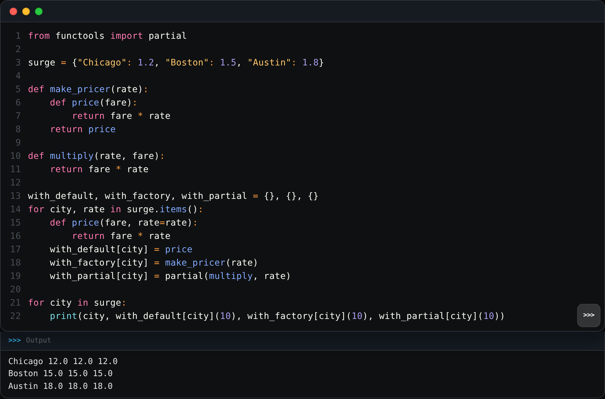

```python
from functools import partial

surge = {"Chicago": 1.2, "Boston": 1.5, "Austin": 1.8}

def make_pricer(rate):
    def price(fare):
        return fare * rate
    return price

def multiply(rate, fare):
    return fare * rate

with_default, with_factory, with_partial = {}, {}, {}
for city, rate in surge.items():
    def price(fare, rate=rate):
        return fare * rate
    with_default[city] = price
    with_factory[city] = make_pricer(rate)
    with_partial[city] = partial(multiply, rate)

for city in surge:
    print(city, with_default[city](10), with_factory[city](10), with_partial[city](10))
```

| Fix | When the value is bound | Trade-off |
| --- | --- | --- |
| Default argument `rate=rate` | When the `def` runs, once per pass | A caller can pass `rate=` and override it |
| Factory `make_pricer(rate)` | When the factory is called, in a new scope | An extra function to name and read |
| `partial(multiply, rate)` | When the partial object is created | Needs a function whose first parameter is the rate, or a keyword |

The default-argument fix leaves `rate` as a real parameter, so a caller who passes a second argument replaces the stored multiplier and gets no error. The stored value sits in the function's `__defaults__` tuple, the counterpart of `__closure__` for this fix:

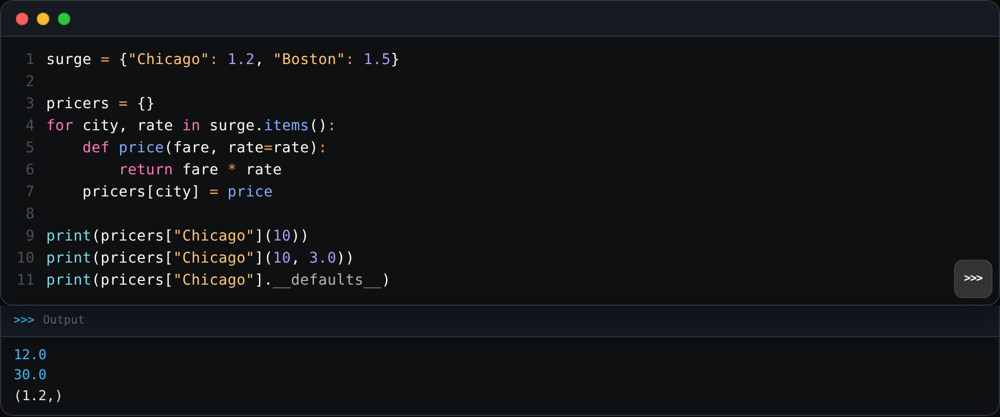

```python
surge = {"Chicago": 1.2, "Boston": 1.5}

pricers = {}
for city, rate in surge.items():
    def price(fare, rate=rate):
        return fare * rate
    pricers[city] = price

print(pricers["Chicago"](10))
print(pricers["Chicago"](10, 3.0))
print(pricers["Chicago"].__defaults__)
```

The second call returns 30.0 because `3.0` arrives by position and fills `rate`. The `(1.2,)` in `__defaults__` is untouched, so the next 1-argument call returns 12.0 again. A default works for any loop variable that a stored function reads, and a column name is fixed the same way as a multiplier.


**What does this print?**

```python
def build_rules():
    rules = []
    for limit in [10, 20, 30]:
        def check(n):
            return n < limit
        rules.append(check)
    limit = 5
    return rules

for rule in build_rules():
    print(rule(8))
```

- **A.** True 3 times, because each check kept its own limit from the loop
- **B.** False 3 times, because every check reads limit after it was set to 5
- **C.** True 3 times, because every check reads the loop's final value, 30
- **D.** NameError, because limit stops existing once the loop has finished

<details>
<summary>Solution</summary>

**B.** False 3 times, because every check reads limit after it was set to 5

The checks run after build_rules returns. By then limit was rebound to 5, and 8 < 5 is False.

**Why the others are wrong**

- **A.** No check captured a value. All 3 share the variable limit, and they read it only when called.
- **C.** The loop leaves limit at 30, but limit = 5 rebinds the variable afterwards, and the checks read the latest value.
- **D.** A loop variable stays defined after the loop, and the closures keep its cell alive after build_rules returns.

</details>


<br>

---

## Putting It All Together

A nightly data quality job checks 40 tables before the morning dashboards refresh. A config dict maps each column to its allowed range, and the job must build a validator per column, run every validator over each batch of rows, and combine the per-batch failure counts into a single report.

- A factory make_range_check ( low , high ) builds each column's validator as a closure, so the rule's logic is written once and the config supplies the numbers
- The validators are created in a loop over the config, so calling the factory inside the loop, rather than writing a bare inner def , gives every column its own range
- Where an existing function needs the column name preset, partial ( count_failures , column = name ) hands map a function that takes 1 row at a time
- Small nested helpers such as is_null ( row ) live inside the batch function and read its settings without adding names to the module
- Per-batch failure dicts are merged with reduce ( merge_counts , batches , { } ) , and the { } initializer keeps a night with no batches from raising TypeError


<br>

---

## Key Takeaways

- reduce ( step , items , start ) folds left to right, and passing start keeps an empty sequence from raising TypeError
- Prefer sum , max , min or a loop when the step needs branches or several pieces of state
- partial fills the leftmost positional parameters; preset later ones by keyword, and callers can override preset keywords
- A nested def is a local name: hidden from the rest of the module, rebuilt per call, able to read enclosing variables
- A returned inner function is a closure; its captured variables live in cells, and nonlocal lets it rebind them
- Closures read their cells at call time, so closures built in a loop share the final value unless a default, a factory or partial binds each one
