# Functions: Advanced

At Stripe, the API counts money in the smallest currency unit, so 2500 means $25.00. A refund script that calls `refund(charge, 25, 2500)` leaves its reader guessing: was that a 25-cent refund with a $25 fee, or the reverse? Python will run that call either way. This lesson builds functions that refuse it by name and raise instead of guessing. Later sections split a long function into parts you can check one at a time, then add a cache for repeated lookups and a recursive walker for nested webhook payloads.


<br>

---

## Keyword-Only and Positional-Only

Python fills parameters from positional arguments strictly left to right and never asks what the values mean. A call that passes 2 integers in the wrong order runs cleanly and hands back a wrong integer. This refund helper takes an amount and a processing fee, and both are counts of cents.

```sql
def net_refund(amount_cents, fee_cents):
    return amount_cents - fee_cents

print(net_refund(2500, 25))
print(net_refund(25, 2500))
```

The first call returns 2475 and the second returns -2475. A reviewer reading `net_refund(25, 2500)` cannot tell which number is the fee, and Python raises nothing. The cure is to make the caller write the names.


<br>

### Keyword-only: every parameter after \*

A bare `*` in a signature closes the positional slots. Each parameter after it must be passed as `name=value`, and a positional value aimed at one of them raises `TypeError` before the body runs.

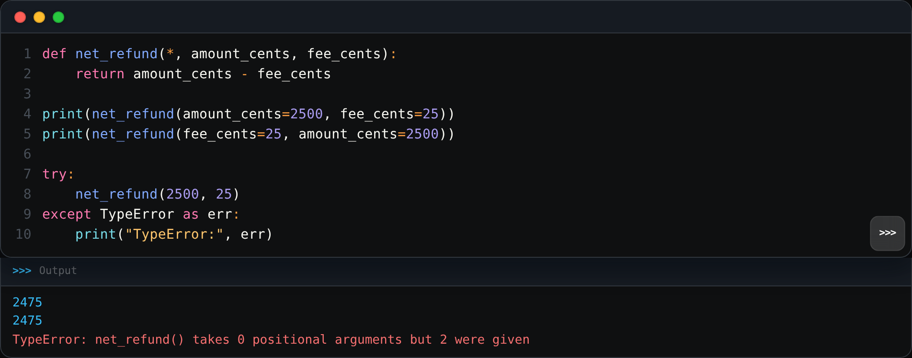

```python
def net_refund(*, amount_cents, fee_cents):
    return amount_cents - fee_cents

print(net_refund(amount_cents=2500, fee_cents=25))
print(net_refund(fee_cents=25, amount_cents=2500))

try:
    net_refund(2500, 25)
except TypeError as err:
    print("TypeError:", err)
```

Named arguments may arrive in any order because Python matches them by name. The rule mirrors `*args`: a parameter written after `*args` can only be filled by keyword, since `*args` swallows every remaining positional value. A bare `*` keeps that rule and accepts no extra values. A keyword-only parameter with no default is still required, so `net_refund(amount_cents=2500)` fails with `missing 1 required keyword-only argument: 'fee_cents'`.


<br>

### Positional-only: every parameter before /

A `/` works the other way. Parameters to its left can only be filled by position, so no call site ever writes their names. Because no caller depends on those names, you can rename the parameters later without breaking anything, and the name stays free inside `**kwargs`, which matters when callers pass arbitrary labels.

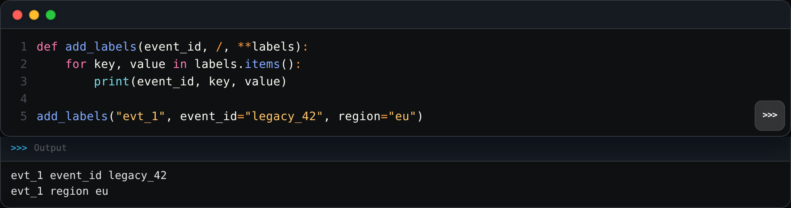

```python
def add_labels(event_id, /, **labels):
    for key, value in labels.items():
        print(event_id, key, value)

add_labels("evt_1", event_id="legacy_42", region="eu")
```

Without the `/`, the keyword `event_id="legacy_42"` would collide with the positional `"evt_1"`, and Python would raise `add_labels() got multiple values for argument 'event_id'`. With it, the label lands in `labels` beside `region`.


<br>

### All 3 zones in a single signature

| Where the parameter sits | How the caller passes it | When to choose it |
| --- | --- | --- |
| Before `/` | By position only | The name is internal and may change |
| Between `/` and `\*` | By position or by name | Ordinary parameters with no special risk |
| After `\*` | By name only | Values a reader could swap or misread |

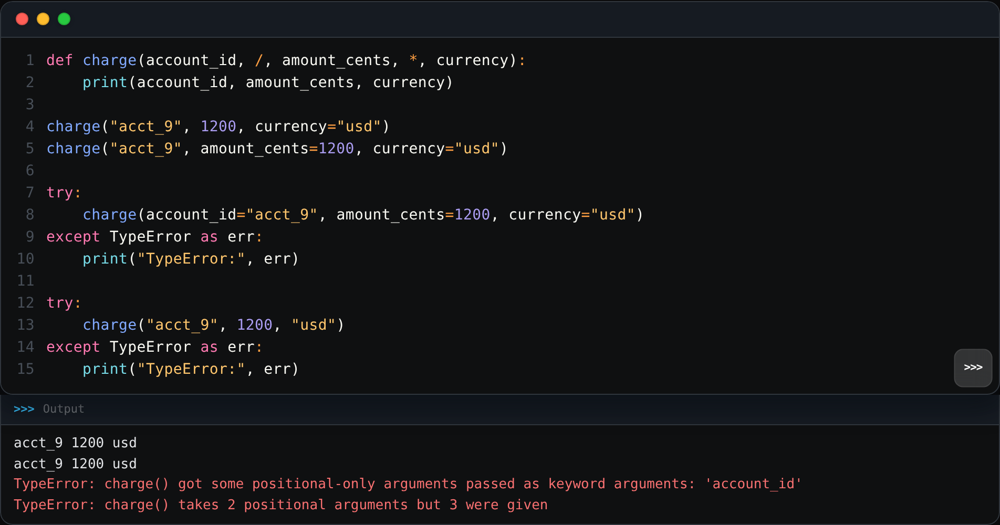

```python
def charge(account_id, /, amount_cents, *, currency):
    print(account_id, amount_cents, currency)

charge("acct_9", 1200, currency="usd")
charge("acct_9", amount_cents=1200, currency="usd")

try:
    charge(account_id="acct_9", amount_cents=1200, currency="usd")
except TypeError as err:
    print("TypeError:", err)

try:
    charge("acct_9", 1200, "usd")
except TypeError as err:
    print("TypeError:", err)
```

The first 2 calls differ only in how `amount_cents` arrives, and the middle zone accepts it either way. Naming `account_id` breaks the `/` rule. Passing `"usd"` as a third positional value breaks the `*` rule: the signature has 2 positional slots, and Python reports 3 values for them.

**Which call to export_table runs without raising TypeError?**

```python
def export_table(table, /, path, *, fmt, overwrite=False):
    print(table, path, fmt, overwrite)
```

- **A.** export_table("orders", "/tmp/o", "csv")
- **B.** export_table(table="orders", path="/tmp/o", fmt="csv")
- **C.** export_table("orders", path="/tmp/o", fmt="csv")
- **D.** export_table("orders", "/tmp/o", overwrite=True)

<details>
<summary>Solution</summary>

**C.** export_table("orders", path="/tmp/o", fmt="csv")

table arrives by position, path may be named because it sits between the markers, and fmt is named as required. overwrite keeps its default.

**Why the others are wrong**

- **A.** Only table and path take positions. The third value has no slot because fmt is keyword-only, so Python raises TypeError.
- **B.** Naming path and fmt is fine, but table sits before / and can't be passed by name, so the call fails.
- **D.** The positions are right, but fmt has no default and was never supplied, so Python reports a missing keyword-only argument.

</details>

> **TIP**
>
> Keyword-only is the marker to reach for first. Any boolean flag, or 2 neighbouring parameters of the same type, read better as `name=value`: `export(rows, compress=True)` says what `export(rows, True)` hides.


<br>

---

## Raising Errors From a Function

A function makes a promise through its return value: `parse_cents` promises a whole number of cents. When a row holds `"n/a"`, the function can't keep that promise, and it has 2 choices. It can return a stand-in such as `-1` or `None` and hope every caller checks for it, or it can raise an exception and return nothing at all.


<br>

### What a quiet failure costs

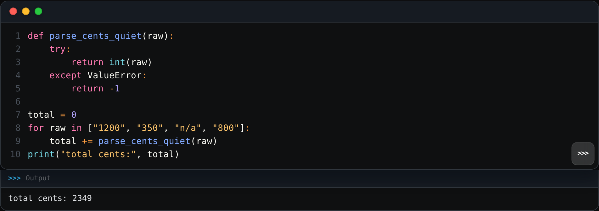

```python
def parse_cents_quiet(raw):
    try:
        return int(raw)
    except ValueError:
        return -1

total = 0
for raw in ["1200", "350", "n/a", "800"]:
    total += parse_cents_quiet(raw)
print("total cents:", total)
```

The readable rows add up to 2350 cents, but the `-1` blended into the sum: the report is off by 1 cent, the `"n/a"` row vanished, and no line of output says anything went wrong. Returning `None` fails in a different place. The `+=` line raises `TypeError: unsupported operand type(s) for +=: 'int' and 'NoneType'`, which points at the loop instead of the bad row, and every caller has to remember an `is None` check to avoid it.


<br>

### A raise stops the function and travels up

`raise ValueError("message")` creates an exception object and throws it. The function stops on that line and returns nothing, and the exception goes to whoever called it. If that caller wrapped the call in a matching `try`/`except`, the `except` branch runs. If not, the exception climbs to the caller's caller, and on up, until something catches it or the program ends with a traceback.

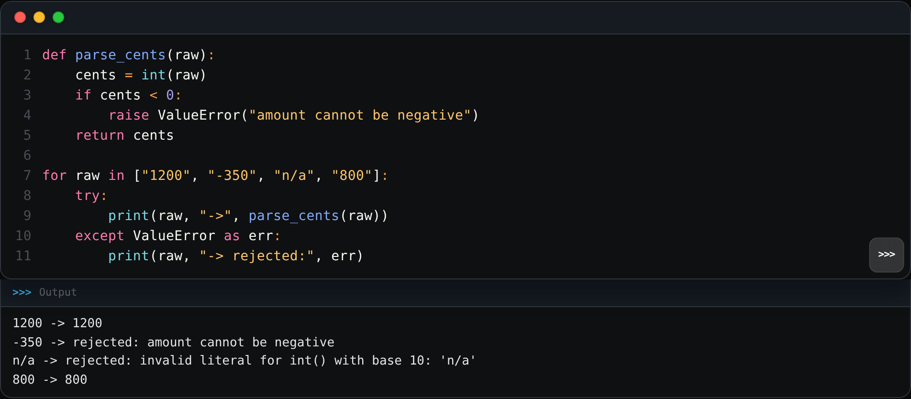

```python
def parse_cents(raw):
    cents = int(raw)
    if cents < 0:
        raise ValueError("amount cannot be negative")
    return cents

for raw in ["1200", "-350", "n/a", "800"]:
    try:
        print(raw, "->", parse_cents(raw))
    except ValueError as err:
        print(raw, "-> rejected:", err)
```

`int("n/a")` raises its own `ValueError`, and `parse_cents` lets it pass through because it has nothing to add. A negative amount converts without complaint, so the rule against it has to come from the function itself, which raises. The loop decides what a bad row means for this job; here it reports the row and moves on.

https://github.com/user-attachments/assets/8846d6d4-e909-4cdf-b515-0cd6b625beef

*Each rejected row leaves parse_cents at the line that fails, and the except branch in load_batch counts it*

`load_batch` returns `(2000, 2)`: 2000 cents from the 2 clean rows and a reject count the job can log or alert on. A wrong number never passes for a right one anywhere in the run.

**What does this program print?**

```python
calls = 0

def fetch_region(store_id):
    global calls
    cache = {}
    if store_id not in cache:
        calls += 1
        cache[store_id] = "eu-west"
    return cache[store_id]

for _ in range(4):
    fetch_region(118)
print(calls)
```

- **A.** 1: the region for store 118 is stored on the first call and reused
- **B.** 4: cache = {} runs on every call, so each call starts empty
- **C.** 0: calls inside the function is a separate local variable
- **D.** 4: a dict cannot use an integer like 118 as a key, so nothing is stored

<details>
<summary>Solution</summary>

**B.** 4: cache = {} runs on every call, so each call starts empty

Each call creates a fresh local dict, the in check fails 4 times, and calls grows 4 times.

**Why the others are wrong**

- **A.** It is stored, but in a dict that is thrown away when the call returns. The next call builds a new empty one.
- **C.** global calls makes the function update the module's calls, so the count is visible after the loop.
- **D.** The count is right, but integers are valid dict keys. The store works; the dict is discarded at the end of each call.

</details>


<br>

### Choosing the exception type

| Situation | Raise | Example message |
| --- | --- | --- |
| Right type, unacceptable value | `ValueError` | amount cannot be negative |
| Argument of the wrong type | `TypeError` | rows must be a list |
| Lookup key is missing | `KeyError` | no rate for gbp |
| A rule specific to your data | a subclass you define | refund exceeds original charge |

Callers catch by type, so the type is part of the function's interface. A custom exception is a class that names an existing exception in parentheses, which makes it a kind of that exception. After `class RefundTooLarge(ValueError): pass`, an `except ValueError` still catches it, and a caller who cares about this case alone can write `except RefundTooLarge`. The message names the rule that broke, for whoever reads the log.

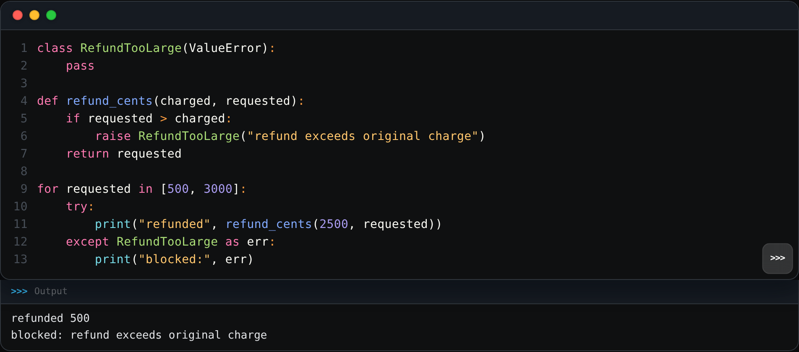

```python
class RefundTooLarge(ValueError):
    pass

def refund_cents(charged, requested):
    if requested > charged:
        raise RefundTooLarge("refund exceeds original charge")
    return requested

for requested in [500, 3000]:
    try:
        print("refunded", refund_cents(2500, requested))
    except RefundTooLarge as err:
        print("blocked:", err)
```

| ✓ Do | ✗ Don't |
| --- | --- |
| • Raise as soon as the function knows it can't return a correct value<br><br>• Pick the type a caller would catch: ValueError, TypeError, KeyError or a subclass<br><br>• Write a message that names the rule the input broke<br><br>• Catch where someone can decide between skipping or quarantining the row and stopping the job | • Signal failure by returning -1 or 0, or by returning an empty string<br><br>• Catch an error inside a helper only to return None<br><br>• Wrap a call in except Exception and carry on without a record<br><br>• Use the same exception type for every failure in a module |


<br>

---

## Helper Decomposition

When one function body parses and validates each row, then converts it and reports the result, the only way to check it is to build a whole batch to run through it and then read the printout. When the total comes out wrong, the fault could sit anywhere in it. Here is such a function for payment rows, with each rate stored as US cents per 100 units of the row's currency.

```sql
def process_batch(rows, rates):
    total = 0
    rejected = 0
    for row in rows:
        try:
            cents = int(row["amount"])
        except ValueError:
            rejected += 1
            continue
        if cents < 0:
            rejected += 1
            continue
        if row["currency"] not in rates:
            rejected += 1
            continue
        total += cents * rates[row["currency"]] // 100
    print("total usd cents:", total)
    print("rejected:", rejected)
```


<br>

### Cut along the jobs

Name each job in the body with a short phrase. Here the first job turns a row into a non-negative number of cents, and the second checks that a rate exists before converting. A third counts good and bad rows to hand back the result. Each phrase becomes a helper that takes what it needs as parameters and either returns its result or raises when it cannot produce one. The original function shrinks to a coordinator that calls the helpers and decides what a failure means for the batch.

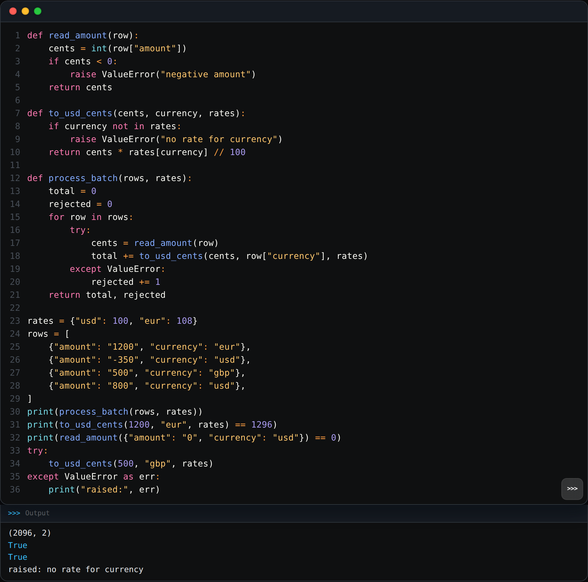

```python
def read_amount(row):
    cents = int(row["amount"])
    if cents < 0:
        raise ValueError("negative amount")
    return cents

def to_usd_cents(cents, currency, rates):
    if currency not in rates:
        raise ValueError("no rate for currency")
    return cents * rates[currency] // 100

def process_batch(rows, rates):
    total = 0
    rejected = 0
    for row in rows:
        try:
            cents = read_amount(row)
            total += to_usd_cents(cents, row["currency"], rates)
        except ValueError:
            rejected += 1
    return total, rejected

rates = {"usd": 100, "eur": 108}
rows = [
    {"amount": "1200", "currency": "eur"},
    {"amount": "-350", "currency": "usd"},
    {"amount": "500", "currency": "gbp"},
    {"amount": "800", "currency": "usd"},
]
print(process_batch(rows, rates))
print(to_usd_cents(1200, "eur", rates) == 1296)
print(read_amount({"amount": "0", "currency": "usd"}) == 0)
try:
    to_usd_cents(500, "gbp", rates)
except ValueError as err:
    print("raised:", err)
```

The coordinator has a single reject path where it had 3: any helper that raises `ValueError` sends the row to the same `except`. It returns `(2096, 2)`, a pair other code can use. The 1296 inside that total is 1200 euro cents at 1.08 dollars per euro, rounded down by .

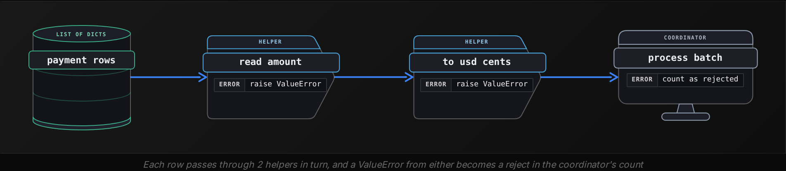


<br>

### Each helper gets its own check

The last 3 checks in that program each test a single rule with values typed in place, including the failure path for a currency with no rate. Before the split, testing the conversion meant building a row inside a batch and reading printed text. Now a broken rule points at the helper that owns it.

| ✓ The 18-line version | ✗ Helpers plus a coordinator |
| --- | --- |
| • Checking the conversion means building a batch and reading printed text<br><br>• Separate reject paths in 3 places, each with its own continue<br><br>• Prints the totals, so no other code can use them<br><br>• A new rule means editing the middle of the loop | • Each rule is checked by a line with values typed in place<br><br>• A single reject path: any ValueError from any helper<br><br>• Returns (total, rejected) for other code to use<br><br>• A new rule is a new raise in the helper that owns it |


<br>

### Where helpers go wrong

Splitting can go too far, or cut in the wrong place. A helper that needs 6 parameters is usually 2 jobs, or a piece separated from the data it works on. Reading a global variable means the helper can't be checked by its arguments alone, because the same call returns different values as the global changes. Printing the result instead of returning it leaves a check by eye as the only option. A good cut is a helper you can describe in a short phrase with no "and" in it, and check with 1 line.

**The program prints 450 and then a second line. What's the second line, and why?**

```python
discount_pct = 10

def final_price(cents):
    price = cents - cents * discount_pct // 100
    print(price)

print(final_price(500) == 450)
```

- **A.** False: final_price prints 450 but returns None, and None == 450 is false
- **B.** True: the function computes 450, and that value is compared with 450
- **C.** False: the global discount_pct cannot be read inside the function
- **D.** A TypeError: == cannot compare a number with None

<details>
<summary>Solution</summary>

**A.** False: final_price prints 450 but returns None, and None == 450 is false

A function with no return statement returns None. Printing shows a value on screen, and only return hands a value to the caller.

**Why the others are wrong**

- **B.** The 450 went to the screen. The caller received None, which is what the comparison saw.
- **C.** Reading a global inside a function works without any global statement, and the price really is 450.
- **D.** == works between any 2 values and returns False when they differ. Operators like + are the ones that fail on None.

</details>

> **TIP**
>
> Name a helper for what it returns or decides: `to_usd_cents`, `read_amount`, `is_settled`. A name like `handle_row` or `step2` means its job was never pinned down, and the next change will pile more into it.


<br>

---

## Memoization with Dicts

In a batch, the same calls repeat with the same arguments: the rate for `"eur"` on every euro payment, the region for store 118 on every sale from that store. When a function's result depends only on its arguments, the first answer stays the answer, and computing it again is wasted work. Memoization stores each answer in a dict keyed by the arguments and returns the stored value on every later call.

The pattern takes 3 lines inside the function. If the key is missing from the cache, compute the value and store it; either way, return what the cache holds. In the program below, `slow_rate` stands in for an expensive lookup and counts how often it runs.

https://github.com/user-attachments/assets/4487dede-14af-445e-83ed-92f96fa01917

*Across 8 events with 3 distinct currencies, slow_rate runs once per currency and the dict answers every repeat*

`slow_rate` ran 3 times for 8 events, once per distinct currency. The cache lives at module level, outside both functions, so it outlasts every call. `cached_rate` changes the dict's contents without rebinding the name `rate_cache`, so it needs no `global` statement; `slow_rate` needs one because `calls += 1` rebinds `calls`.


<br>

### The key must hold every input

A cache is correct only when its key captures everything the result depends on. If a rate depends on the currency and the day, a cache keyed by currency alone hands back day 1's rate for every later day. A tuple of the arguments covers both, and tuples work as dict keys because they can't change after they're created. A list can't be a key: `cache[["eur", 2]]` raises `TypeError: unhashable type: 'list'`.

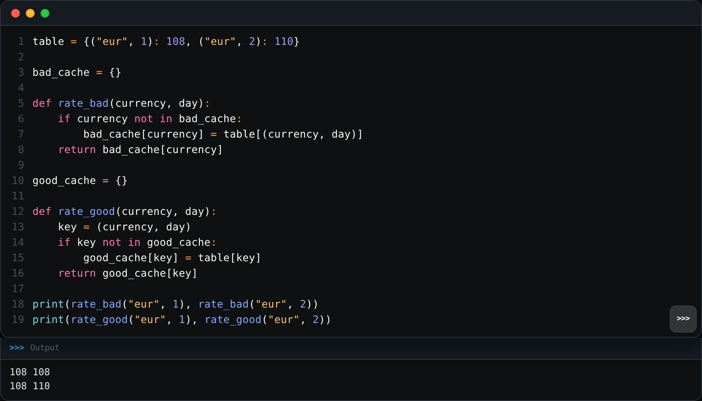

```python
table = {("eur", 1): 108, ("eur", 2): 110}

bad_cache = {}

def rate_bad(currency, day):
    if currency not in bad_cache:
        bad_cache[currency] = table[(currency, day)]
    return bad_cache[currency]

good_cache = {}

def rate_good(currency, day):
    key = (currency, day)
    if key not in good_cache:
        good_cache[key] = table[key]
    return good_cache[key]

print(rate_bad("eur", 1), rate_bad("eur", 2))
print(rate_good("eur", 1), rate_good("eur", 2))
```

`rate_bad("eur", 2)` returns 108 because the key `"eur"` was already stored on day 1. `rate_good` stores `("eur", 1)` and `("eur", 2)` as separate keys and returns each day's own rate.


<br>

### Before you add a cache

> Memoize only when all of these hold
>
> - The result depends on the arguments alone: the function reads no clock or file, and no global changes its answer
> - The same arguments really do repeat; unique ids gain nothing and fill memory
> - Stored results stay true for as long as the cache lives, such as a single batch run
> - The number of distinct keys fits in memory: 3 currencies yes, 50 million user ids no

The pattern also handles failures correctly. If the expensive call raises, the line that stores into the cache never finishes, so nothing is stored and the next call with that key tries again. A lookup that failed on bad input is never remembered as an answer.

Where the dict is created decides whether the cache works at all. A `cache = {}` line inside the function runs on every call, so each call starts with an empty dict, the `in` check always fails, and no lookup is ever saved.

**What does this program print?**

```python
calls = 0

def fetch_region(store_id):
    global calls
    cache = {}
    if store_id not in cache:
        calls += 1
        cache[store_id] = "eu-west"
    return cache[store_id]

for _ in range(4):
    fetch_region(118)
print(calls)
```

- **A.** 1: the region for store 118 is stored on the first call and reused
- **B.** 4: cache = {} runs on every call, so each call starts empty
- **C.** 0: calls inside the function is a separate local variable
- **D.** 4: a dict cannot use an integer like 118 as a key, so nothing is stored

<details>
<summary>Solution</summary>

**B.** 4: cache = {} runs on every call, so each call starts empty

Each call creates a fresh local dict, the in check fails 4 times, and calls grows 4 times.

**Why the others are wrong**

- **A.** It is stored, but in a dict that is thrown away when the call returns. The next call builds a new empty one.
- **C.** global calls makes the function update the module's calls, so the count is visible after the loop.
- **D.** The count is right, but integers are valid dict keys. The store works; the dict is discarded at the end of each call.

</details>


<br>

---

## Recursion Basics

A loop handles nesting only as deep as the loops you wrote. An event payload with lists inside dicts inside lists, to a depth that varies from row to row, needs a function that treats each inner piece the way it treats the whole. A recursive function does that by calling itself on a smaller part of its own input.

Every recursive function has 2 parts. The **base case** answers directly, without calling itself, for input small enough to need no further splitting. The **recursive case** calls the function on a smaller piece and builds its answer from the result. Each call gets a frame of its own, with its own local variables, and a frame waits until the call it made returns.

https://github.com/user-attachments/assets/c1d315e1-2eee-4aef-b13a-8c383f097a04

*factorial(5) stacks 5 frames, and each waits for the call below it to return*

`factorial(1)` is the base case and returns 1 without calling anything. Then the frames close from the bottom up: `factorial(2)` returns 2 and `factorial(3)` returns 6. By the time `factorial(5)` returns 120, `factorial(4)` has already returned 24. Without the base case the calls would never stop descending.


<br>

### Nested lists of any depth

https://github.com/user-attachments/assets/0112a31a-0ac9-4c26-9c3d-3771c064267c

*Each inner list opens a deeper frame, and the subtotals add up as those frames return*

The loop covers a single level, and the recursive call covers everything below it. A number is a leaf and adds itself; a list hands its contents to a fresh call. The base case here is implicit: a list holding no inner lists finishes its loop without calling `sum_nested` again. The same 8-line function sums `[1, 2]` or a list nested 40 levels deep, and for this input the total is 28.


<br>

### Dicts and lists mixed together

Event payloads mix dicts and lists. The function below checks which kind of container it holds, recurses into every value inside it, and counts anything else as 1 leaf.

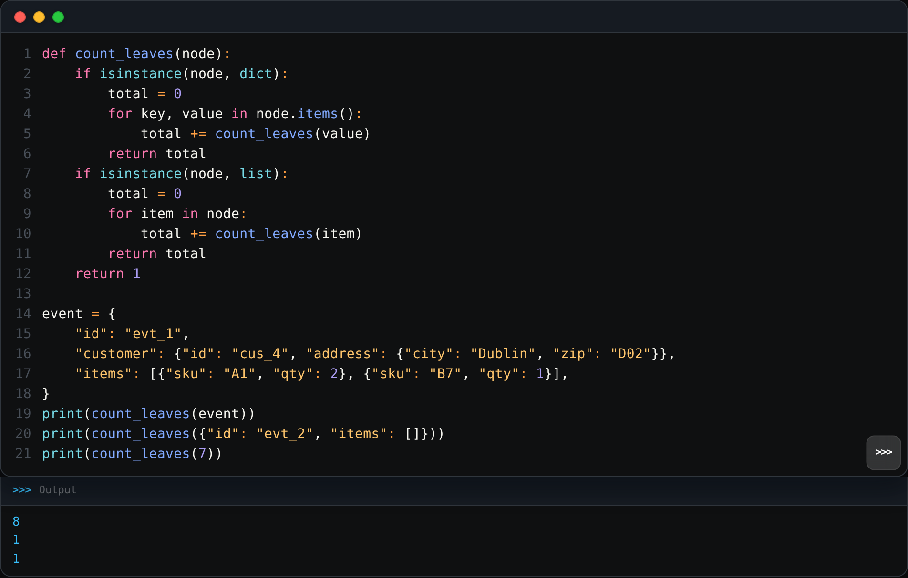

```python
def count_leaves(node):
    if isinstance(node, dict):
        total = 0
        for key, value in node.items():
            total += count_leaves(value)
        return total
    if isinstance(node, list):
        total = 0
        for item in node:
            total += count_leaves(item)
        return total
    return 1

event = {
    "id": "evt_1",
    "customer": {"id": "cus_4", "address": {"city": "Dublin", "zip": "D02"}},
    "items": [{"sku": "A1", "qty": 2}, {"sku": "B7", "qty": 1}],
}
print(count_leaves(event))
print(count_leaves({"id": "evt_2", "items": []}))
print(count_leaves(7))
```

The empty `items` list contributes 0 because its loop never runs, and the bare `7` counts as 1 leaf because it falls through to the last `return`. No extra code handles either edge case; the structure of the function covers them.

**What does this program print, line by line?**

```python
def show(data, depth):
    for item in data:
        if isinstance(item, list):
            show(item, depth + 1)
        else:
            print(item, depth)

show([1, [2, [3]], 4], 1)
```

- **A.** Lines 1 1, 4 1, 2 2, 3 3
- **B.** Lines 1 1, 2 2, 3 3, 4 3
- **C.** Lines 1 1, 2 2, 3 3, 4 1
- **D.** Lines 1 1, 2 1, 3 1, 4 1

<details>
<summary>Solution</summary>

**C.** Lines 1 1, 2 2, 3 3, 4 1

The traversal goes as deep as each inner list before continuing, and the outer frame prints 4 with its own depth of 1.

**Why the others are wrong**

- **A.** The for loop reaches the inner list before it reaches 4, and it finishes that inner call before moving on.
- **B.** Each call has its own depth. When the inner calls return, the outer frame's depth is still 1.
- **D.** Each recursive call receives depth + 1, so values found inside lists print with larger depths.

</details>


<br>

### The call stack has a ceiling

- **1000** — Python's default recursion limit

Every waiting frame takes memory, so Python caps how many can be open at once and raises `RecursionError` past the cap; `sys.getrecursionlimit()` reports the current cap. A missing or unreachable base case hits that ceiling within a fraction of a second. Nested payloads rarely go deeper than a few dozen levels, so recursion suits them. A chain of 100,000 records, each pointing to the next, belongs in a `while` loop.


<br>

### Recursion meets a memo dict

A payload nests its amounts at different depths, and many of them share a currency. The walker below recurses through dicts and lists until it reaches a dict holding an `amount`, which is its base case, and converts that amount through `cached_rate` from the memoization section. Any other leaf, such as an id string, adds 0.

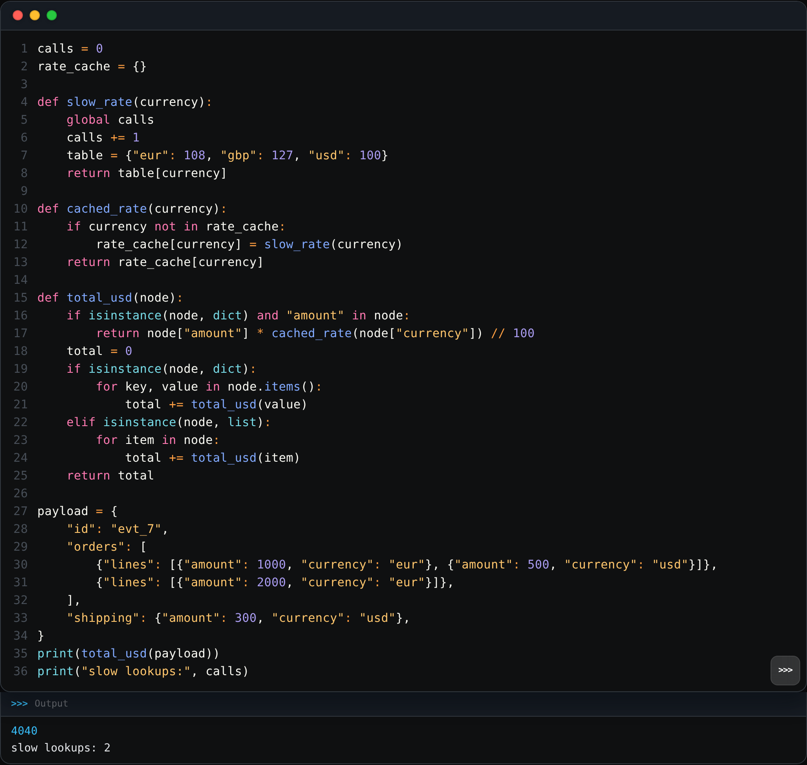

```python
calls = 0
rate_cache = {}

def slow_rate(currency):
    global calls
    calls += 1
    table = {"eur": 108, "gbp": 127, "usd": 100}
    return table[currency]

def cached_rate(currency):
    if currency not in rate_cache:
        rate_cache[currency] = slow_rate(currency)
    return rate_cache[currency]

def total_usd(node):
    if isinstance(node, dict) and "amount" in node:
        return node["amount"] * cached_rate(node["currency"]) // 100
    total = 0
    if isinstance(node, dict):
        for key, value in node.items():
            total += total_usd(value)
    elif isinstance(node, list):
        for item in node:
            total += total_usd(item)
    return total

payload = {
    "id": "evt_7",
    "orders": [
        {"lines": [{"amount": 1000, "currency": "eur"}, {"amount": 500, "currency": "usd"}]},
        {"lines": [{"amount": 2000, "currency": "eur"}]},
    ],
    "shipping": {"amount": 300, "currency": "usd"},
}
print(total_usd(payload))
print("slow lookups:", calls)
```

The walker finds 4 amounts, 3 inside order lines and 1 directly under the payload, and returns 4040 US cents. The euro lines contribute 1080 and 2160; the dollar amounts add 500 and 300. Only 2 slow lookups ran, 1 per distinct currency, because the second euro amount found its rate already in `rate_cache`.


<br>

---

## Putting It All Together

Picture a nightly reconciliation job at Stripe over 2 million webhook events. Each event is a nested JSON payload holding an amount in the smallest currency unit, a currency code and a list of line items. The job converts every amount to US cents, totals them, and reports how many events it rejected and why.

- The conversion helper takes amount_cents and currency as keyword-only parameters, so a call that passes them by position fails with TypeError before any event is totalled; every call site has to name amount_cents and currency .
- A missing exchange rate raises ValueError inside the helper, and the coordinator counts the event as rejected instead of adding 0 to the total.
- Parsing and conversion each get their own helper, as does totalling, and each is checked with 1 line, so a wrong total points at the helper that owns the rule.
- Rates are memoized in a dict keyed by ( currency , day ) , so 2 million events trigger a single slow lookup per distinct pair.
- A recursive walker reaches the amount fields however deeply each event nests its line items, and stays far below the recursion limit because payloads are shallow.


<br>

---

## Key Takeaways

- A bare \* makes every later parameter name-only and / makes every earlier one position-only, so the call site names every value a reader could swap.
- A function that cannot return a correct value raises a specific exception with a message naming the broken rule; stand-ins like - 1 and None move the failure somewhere harder to find.
- Split a long function along its jobs into helpers that take parameters and either return or raise. Each helper gets checked with 1 line, while a coordinator decides what a failure means.
- A memo dict at module level, keyed by every input the result depends on, turns repeat calls into lookups, and it stays correct only while the stored results stay true.
- Recursion reaches nesting of any depth with a base case that stops and a recursive case that shrinks the input, each call holding its own locals in its own frame.
- A recursive walk and a memo dict work together: the walker found 4 amounts in a nested payload, and the cache held the cost to 2 slow lookups, 1 per currency.
