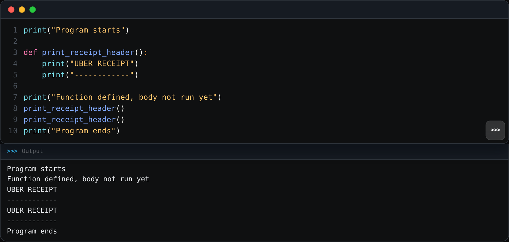
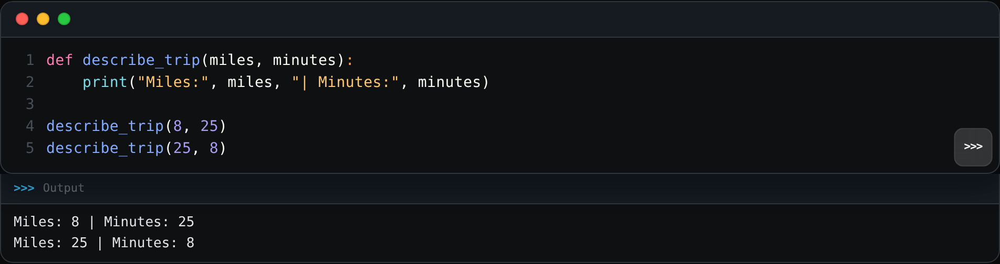
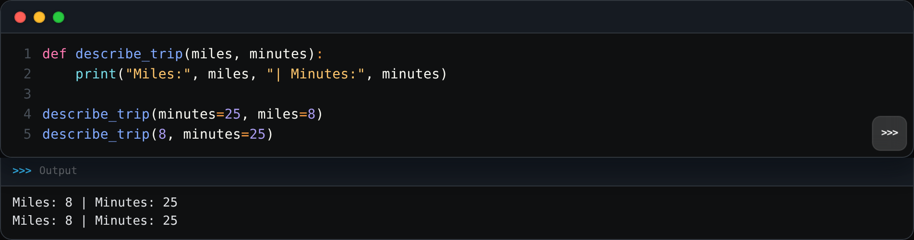
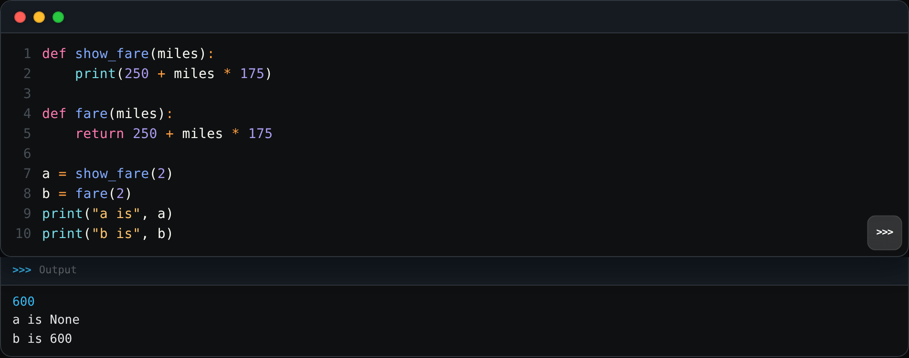
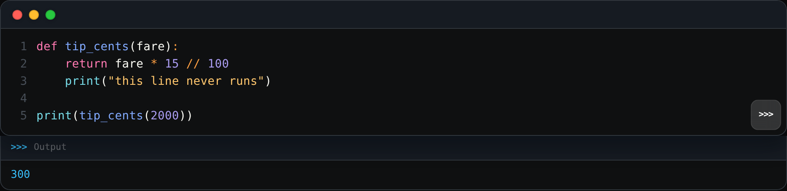
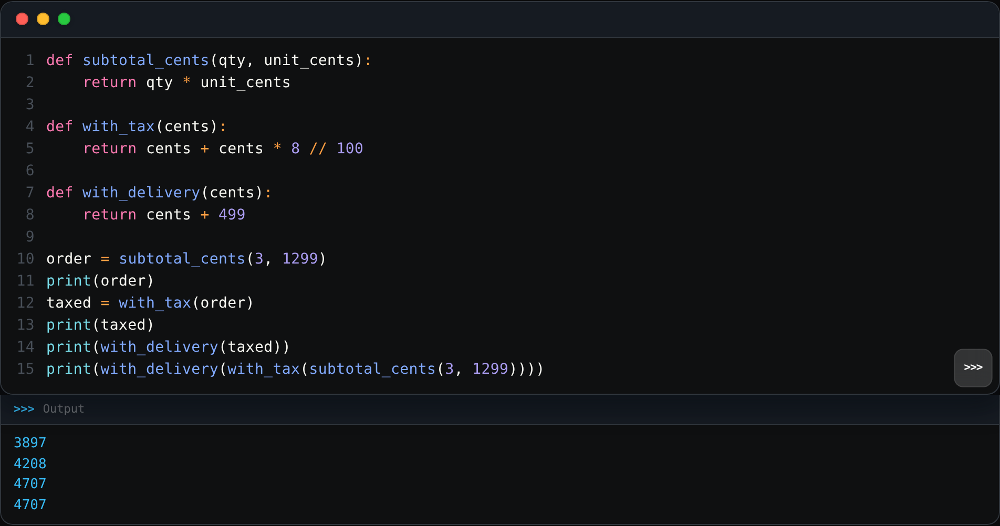
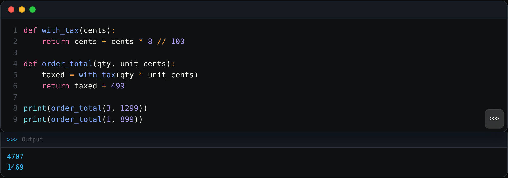
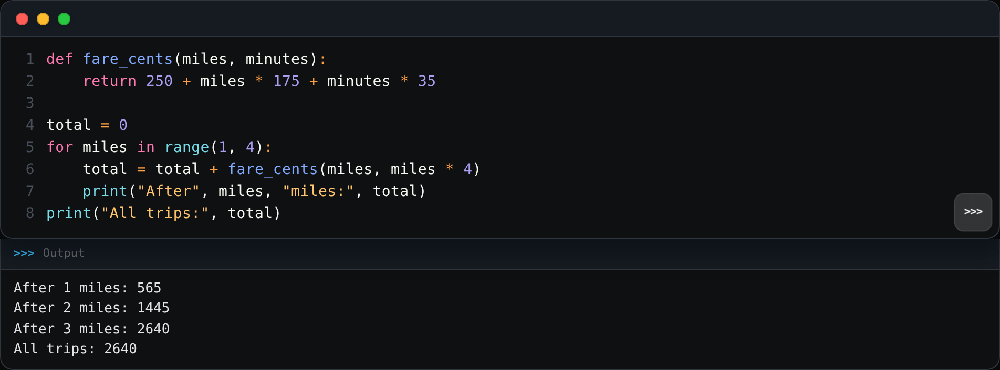
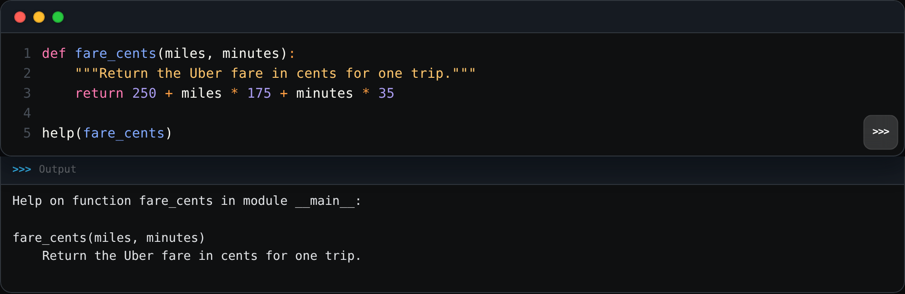
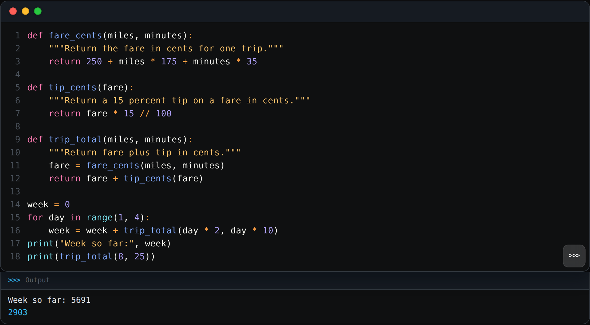

# Functions: Beginner

An Uber rider taps Confirm and the app quotes a fare. The formula behind it, a pickup charge plus a rate per mile plus a rate per minute, is copied into the pricing screen, the receipt screen and the driver earnings screen. A product manager raises the pickup charge, an engineer edits 2 of the 3 copies, and riders and drivers see different totals for the same trip.


<br>

---

## Defining with def

Uber prices a trip in cents: 250 for the pickup, 175 for every mile driven and 35 for every minute in the car. A program that quotes 3 trips with this formula writes the arithmetic out 3 times:

```sql
trip_1 = 250 + 3 * 175 + 12 * 35
print("Trip 1:", trip_1)
trip_2 = 250 + 8 * 175 + 25 * 35
print("Trip 2:", trip_2)
trip_3 = 250 + 1 * 175 + 6 * 35
print("Trip 3:", trip_3)
```

Every pair of lines repeats the same 3 multiplications with different numbers. When the pickup charge rises to 300, each copy needs its own edit, and a copy that goes unedited quotes the old price. A function stores the arithmetic once under a name, and every place that needs a quote calls that name.


<br>

### The def statement

The smallest function takes no input at all. This one prints the 2 lines that open every Uber receipt:

```sql
def print_receipt_header():
    print("UBER RECEIPT")
    print("------------")
```

The first line is the header: the keyword `def`, the function's name, a pair of parentheses and a colon. Every indented line under it belongs to the function and is called its body. The body ends where the indentation ends, the same way the body of an `if` or a `for` does.

> Anatomy of a definition
>
> - `def` tells Python that a function definition starts here
> - `print_receipt_header` is the name the program will call later
> - `()` holds the parameter names, empty when the function needs no input
> - `:` closes the header, and the indented body follows

Running the `def` line creates the function and attaches the body to the name, and that is all it does: nothing inside the body runs. The body runs when the program calls the function, which means writing its name followed by parentheses. This program prints before the definition, prints after it, and then calls the function twice:



```python
print("Program starts")

def print_receipt_header():
    print("UBER RECEIPT")
    print("------------")

print("Function defined, body not run yet")
print_receipt_header()
print_receipt_header()
print("Program ends")
```

The 2 lines of the body printed twice, once per call, and nothing from the body appeared until the first call. Defining is a description of what will happen; calling is when it happens.


<br>

### Define first, call second

Python runs a program from the top down, and a function's name does not exist until its `def` line has run. Calling the name on a line above the definition fails with a `NameError`, the same error a misspelled variable raises:

```sql
print_total()

def print_total():
    print("Total: 1195 cents")
```

Running it prints nothing. The call on line 1 runs before the definition has had a chance to, and Python stops with `NameError: name 'print_total' is not defined`. The message gives the type of failure and the name Python could not find. Moving the call below the `def` block fixes it, because by then the name exists.


<br>

### Naming a function

A function name follows the rules for variable names: letters, digits and underscores, no spaces, no leading digit. Because a function does something, its name usually starts with a verb, so a reader of `print_receipt_header()` knows what will happen without opening the body.

| ✓ Do | ✗ Don't |
| --- | --- |
| • Start with a verb: print_receipt, check_balance, send_alert<br><br>• Use lowercase words joined by underscores<br><br>• Say what the body does, in full words | • Reuse a built-in name such as print or range for your own function<br><br>• Abbreviate to the point of guessing: prh()<br><br>• Give 2 functions names that differ by one letter |


<br>

### The fare formula as a function

The function below holds the Uber formula once. The names in its parentheses, `miles` and `minutes`, stand in for the numbers each trip supplies, and the next section covers how a call fills them. Step through the run and watch the body execute 3 times with 3 sets of numbers:

https://github.com/user-attachments/assets/c29dc841-103b-4d51-9444-18560fe08066

*Each call runs the body once with its own miles and minutes.*

Three calls, one copy of the arithmetic. Raising the pickup charge to 300 now means editing one number on one line, and every trip quoted after that edit uses the new price.

**How many lines does this program print?**

```python
def beep():
    print("beep")

for i in range(3):
    beep()
beep()
```

- **A.** 3, one per loop pass
- **B.** 4, one per call
- **C.** 5, counting the def line
- **D.** 1, the body is one line

<details>
<summary>Solution</summary>

**B.** 4, one per call

The loop runs the body 3 times and the final call runs it once more, so 4 lines of beep.

**Why the others are wrong**

- **A.** The loop calls beep 3 times, and the call on the last line runs the body a fourth time.
- **C.** The def line creates the function and prints nothing; only calls run the body.
- **D.** The body is one line, but it runs once per call, and the program makes 4 calls.

</details>

A working function needs both halves: the `def` keyword that opens the header, and a call that writes the name followed by parentheses. Leave out `def` and Python rejects the header line before anything runs. Write the name without its parentheses and the body stays silent, because the parentheses are what tell Python to run it. The call can sit anywhere below the definition, as many times as the program needs.


<br>

---

## Parameters and Arguments

In the header `def describe_trip(miles, minutes)`, the names `miles` and `minutes` are parameters: variables the body uses for values that do not exist yet. In the call `describe_trip(8, 25)`, the values 8 and 25 are arguments: the data that fills those variables for this one run of the body. A parameter is a slot; an argument is what goes into it.

```sql
def describe_trip(miles, minutes):
    print("Miles:", miles)
    print("Minutes:", minutes)

describe_trip(8, 25)
```

| Call | miles holds | minutes holds | Prints |
| --- | --- | --- | --- |
| describe_trip(8, 25) | 8 | 25 | Miles: 8 then Minutes: 25 |
| describe_trip(1, 6) | 1 | 6 | Miles: 1 then Minutes: 6 |
| describe_trip(40, 90) | 40 | 90 | Miles: 40 then Minutes: 90 |


<br>

### Positional arguments are matched by order

With no other information, Python matches arguments to parameters by position: the first argument goes into the first parameter, the second into the second. Python checks nothing about meaning, so swapping the 2 numbers in the call swaps what the function believes about the trip:



```python
def describe_trip(miles, minutes):
    print("Miles:", miles, "| Minutes:", minutes)

describe_trip(8, 25)
describe_trip(25, 8)
```

The second call describes a 25 mile, 8 minute trip, which no car in a city can drive, and Python reports it without complaint. The order of arguments is the caller's responsibility.


<br>

### Keyword arguments are matched by name

Writing `parameter=value` in a call names the slot, so the position no longer matters. Both calls below produce the same line, and the second one mixes the 2 styles:



```python
def describe_trip(miles, minutes):
    print("Miles:", miles, "| Minutes:", minutes)

describe_trip(minutes=25, miles=8)
describe_trip(8, minutes=25)
```

One rule governs mixing: every positional argument comes before every keyword argument. The call `describe_trip(miles=8, 25)` is refused before the program starts, with the message `positional argument follows keyword argument`, because Python has no way to know which slot the bare 25 belongs in. Keyword arguments earn their keystrokes when a function takes several numbers of the same type: `describe_trip(miles=8, minutes=25)` reads as a sentence, while `describe_trip(8, 25)` asks the reader to remember the header.


<br>

### The count has to match

A function with 2 parameters needs exactly 2 arguments. Supplying fewer leaves a slot empty, and Python stops the call before the body runs:

```sql
def describe_trip(miles, minutes):
    print("Miles:", miles, "| Minutes:", minutes)

describe_trip(8)
```

Running it raises `TypeError: describe_trip() missing 1 required positional argument: 'minutes'`. The message names the function and the empty slot. Supplying too many arguments fails the same way, with `describe_trip() takes 2 positional arguments but 3 were given`. Either way the body never starts, so a `print` inside it leaves no trace in the output.

> **TIP**
>
> A parameter lives only while its call runs. After `describe_trip(8, 25)` finishes, the name `miles` is gone, and using it on the next line raises a `NameError`. The rules behind this, called scope, have a lesson of their own later in the track.


<br>

### Every call fills the slots again

A call inside a loop runs the body once per pass, and each pass delivers new arguments. Surge pricing multiplies a base fare by a level from 1 to 3; the loop below passes the same `cents` each time and a different `multiplier`, and the final call fills both slots by keyword:

https://github.com/user-attachments/assets/a8447bd3-5127-4d95-a81e-d9dd725789c6

*Three positional calls from the loop, then one call that fills both slots by keyword.*

On each pass `multiplier` takes the loop's current value, and `total` is computed fresh from that pass's arguments. The keyword call at the end lists `multiplier` before `cents`, and the output shows that the order in the call made no difference.

**What does the second call print?**

```python
def label(first, second):
    print(second, first)

label(2, 5)
label(second=2, first=5)
```

- **A.** 2 5, the body printing second first
- **B.** 5 2, matching the first call
- **C.** 5 2 and 2 5 on one line
- **D.** A TypeError for out-of-order keywords

<details>
<summary>Solution</summary>

**A.** 2 5, the body printing second first

The keywords put 5 into first and 2 into second, and the body prints second before first.

**Why the others are wrong**

- **B.** That is the first call's output; the keyword call fills the slots the other way round.
- **C.** Each call prints its own line, and the question asks only about the second one.
- **D.** Keyword arguments may appear in any order; only bare positional arguments depend on order.

</details>

When a program runs without errors but reports a trip that cannot exist, check each call against the header, slot by slot. Line up the first argument with the first parameter and the second with the second, and ask whether each value makes sense in that slot. A swapped pair of numbers is the bug Python never reports, because 25 is as valid a mile count as 8. The fix is to swap them back, or to name the slots with keywords.


<br>

---

## Return Values

`print_fare` from the first section shows a number on the screen and that is the end of it: the program cannot add that fare to another, compare it with a limit or store it for a receipt. The `return` statement hands a value back to the line that made the call, where it can be used like any other value. The 2 functions below compute the same number and differ only in what they do with it:



```python
def show_fare(miles):
    print(250 + miles * 175)

def fare(miles):
    return 250 + miles * 175

a = show_fare(2)
b = fare(2)
print("a is", a)
print("b is", b)
```

The call `show_fare(2)` printed 600 as a side effect but handed nothing back, so `a` holds `None`, the value Python uses for the absence of a value. Any function that reaches the end of its body without meeting a `return` hands back `None`. The call `fare(2)` printed nothing and handed back 600, which the assignment stored in `b`.

| ✓ print(value) | ✗ return value |
| --- | --- |
| • Sends text to the screen for a person to read<br><br>• The calling line receives None<br><br>• Belongs where a person needs to see the value: a receipt line, a progress report, a final answer | • Sends the value to the calling line for the program to use<br><br>• The calling line receives the value<br><br>• Belongs in every function whose result feeds another step |


<br>

### Using the returned value

A returned value can be stored in a variable, added to another, or multiplied right there in the calling expression. Two trips are priced, summed and surged in the run below:

https://github.com/user-attachments/assets/2abe1207-b924-4ba1-9396-c2075ee0490a

*A returned value is stored, added and multiplied like any other number.*

`fare_cents(3, 12)` evaluates to 1195 inside the last expression, and the multiplication by 2 happens on that number before `surge_total` is assigned. A call that returns a value is an expression, so it fits anywhere a number fits.


<br>

### return ends the function at once

When Python reaches a `return`, the function stops immediately, even if more lines follow. A function with several `return` statements inside `if` blocks therefore hands back the value of the first condition that holds. Step through the fare bands and count how many conditions each call tests:

https://github.com/user-attachments/assets/39cd9046-69a8-48d4-b0be-3ec2663a8e31

*Each call stops at the first band its fare meets; 300 falls through every check to the last return.*

The fare 4200 passes the range check, meets `cents >= 4000` and leaves with `Premium` without touching the rest; 300 fails every band check and falls through to the final `return`. The order of the checks carries the logic: because 4200 is also at least 2000, swapping the Premium and Long checks would label it `Long`. The range check sits first for the same reason, so that 60000 is rejected before `cents >= 4000` can claim it.



```python
def tip_cents(fare):
    return fare * 15 // 100
    print("this line never runs")

print(tip_cents(2000))
```

The `print` after the `return` is unreachable: no call can ever execute it, and leaving it there misleads the next reader into expecting output that never comes.


<br>

### When None reaches arithmetic

The mistake that follows from confusing the 2 statements is using the result of a printing function in a calculation. The program below prints the total, then tries to add 100 to what the call handed back:

```sql
def show_total(cents):
    print("Total:", cents)

result = show_total(1195)
print(result + 100)
```

The program prints `Total: 1195`, then stops with `TypeError: unsupported operand type(s) for +: 'NoneType' and 'int'`. `result` holds `None`, and `+` has no meaning between `NoneType` and `int`. The fix is one line: replace the print with `return cents`, and let the caller print when it wants to.

**What does this program print?**

```python
def grade(points):
    if points >= 50:
        return "pass"
    return "fail"
    print("done")

print(grade(80))
print(grade(20))
```

- **A.** pass, then done, then fail
- **B.** pass, then fail, then done
- **C.** pass, then None
- **D.** pass, then fail

<details>
<summary>Solution</summary>

**D.** pass, then fail

80 takes the first return and 20 falls to the second; the print after it never runs.

**Why the others are wrong**

- **A.** The print sits after an unconditional return, so no call ever reaches it.
- **B.** Code after a return is unreachable, so done is never printed by either call.
- **C.** Every path through grade reaches a return, so neither call hands back None.

</details>

The value after `return` can be any expression, from a single variable to a whole calculation. Python computes the expression first, using the parameter values from this call, and then hands back the result: `return miles * 175` with `miles` holding 4 hands back 700. The caller never sees the expression, only the number it produced.


<br>

---

## Calling and Storing

An Uber Eats order passes through 3 pricing steps: the items are multiplied out, tax is added to that subtotal, and a delivery fee is added to the taxed amount. Each step is a function, and the result of one is the argument of the next. The program runs the chain twice, once storing every intermediate value and once nesting the calls:



```python
def subtotal_cents(qty, unit_cents):
    return qty * unit_cents

def with_tax(cents):
    return cents + cents * 8 // 100

def with_delivery(cents):
    return cents + 499

order = subtotal_cents(3, 1299)
print(order)
taxed = with_tax(order)
print(taxed)
print(with_delivery(taxed))
print(with_delivery(with_tax(subtotal_cents(3, 1299))))
```

Both routes reach 4707. In the nested call, Python evaluates the innermost call first, because the outer calls need its result as their argument:

| Step | Expression being evaluated | Value |
| --- | --- | --- |
| 1 | subtotal_cents(3, 1299) | 3897 |
| 2 | with_tax(3897) | 4208 |
| 3 | with_delivery(4208) | 4707 |
| 4 | print(4707) | prints 4707 |

Reading a nested call means reading from the inside out, the opposite of left to right. Watch the 2 versions run one after the other and note that the chained line produces the same 4707 without ever naming `order` or `taxed`:

https://github.com/user-attachments/assets/1bdc412b-7339-426f-944d-1e3bc34eaf3b

*Stored steps and a nested call reach the same 4707; the nested call evaluates from the inside out.*

> **TIP**
>
> Store the intermediate value when a later line needs it, when it deserves a name, or when more than 3 calls would nest and the line no longer reads at a glance. Chain the calls when the middle values have no use outside this one expression, as in the 3-call line above.


<br>

### A function can call another function

A call can sit inside another function's body as well as at the top level of the program. A body can call any function that has been defined by the time the body runs, which lets one function wrap the whole chain:



```python
def with_tax(cents):
    return cents + cents * 8 // 100

def order_total(qty, unit_cents):
    taxed = with_tax(qty * unit_cents)
    return taxed + 499

print(order_total(3, 1299))
print(order_total(1, 899))
```

`order_total` calls `with_tax` in its own body, waits for the answer, then adds the delivery fee. The second order, 1 item at 899 cents, pays 71 cents of tax (8 percent of 899, rounded down by ) and 499 for delivery.


<br>

### Calls inside loops and conditions

A returned value is at home anywhere an expression is: added to a running total inside a loop, or compared against a limit in an `if`. The loop below prices 3 trips of growing length, each lasting 4 minutes per mile, and keeps the sum:



```python
def fare_cents(miles, minutes):
    return 250 + miles * 175 + minutes * 35

total = 0
for miles in range(1, 4):
    total = total + fare_cents(miles, miles * 4)
    print("After", miles, "miles:", total)
print("All trips:", total)
```

On each pass the call receives the loop's `miles` and 4 times that for minutes; the 3 fares are 565, 880 and 1195. A call in a condition works the same way: `if fare_cents(8, 25) > 2000:` computes 2525 first, and only then does the comparison choose the branch.

**In what order do the 3 functions run, and what is printed?**

```python
def double(n):
    return n * 2

def add_one(n):
    return n + 1

def square(n):
    return n * n

print(double(add_one(square(3))))
```

- **A.** double, add_one, square, printing 20
- **B.** double, add_one, square, printing 49
- **C.** square, add_one, double, printing 20
- **D.** square, add_one, double, printing 19

<details>
<summary>Solution</summary>

**C.** square, add_one, double, printing 20

3 squared is 9, plus 1 is 10, doubled is 20; the innermost call runs first and its result feeds outward.

**Why the others are wrong**

- **A.** The outer call cannot start until its argument exists, so double runs last, even though 20 is the right number.
- **B.** Reading left to right would square 7 at the end, but the innermost call runs first and the outermost last.
- **D.** The order is right, but 19 would need add_one to run after double, which the nesting rules out.

</details>

To write a nested call yourself, list the steps in the order they must happen, then build the line from the inside out: the first step is the innermost call, and each later step wraps the one before it. In the question above, squaring came first, so `square(3)` sat at the center and `double` wrapped everything else.


<br>

---

## Docstrings

A function at Uber is read far more often than it is written: by the engineer on call at 3 a.m., by the teammate who wants to reuse it, by the person deciding whether a change is safe. A docstring is a string placed as the first line of the body that explains what the function does, what it expects and what it hands back. Python stores it with the function, which no comment can claim:

```sql
def fare_cents(miles, minutes):
    """Return the Uber fare in cents for one trip.

    miles: whole miles driven
    minutes: whole minutes the rider spent in the car
    The fare is 250 plus 175 per mile plus 35 per minute.
    """
    return 250 + miles * 175 + minutes * 35
```

The 3 double quotes on each end let the string span several lines, which a single quote on each end does not allow. The first line is a one-sentence summary that starts with a verb and ends with a period; a blank line separates it from the details, which name each parameter and say what the return value means, unit included. A closing `"""` on its own line marks the end.


<br>

### Python keeps the docstring

A comment is dropped when the program runs. A docstring stays attached to the function, and the built-in `help` function prints it along with the header. Editors show that same stored docstring as a description when a cursor hovers over a function name:



```python
def fare_cents(miles, minutes):
    """Return the Uber fare in cents for one trip."""
    return 250 + miles * 175 + minutes * 35

help(fare_cents)
```

`help` reports the function's name, its parameters in order, and the docstring under them, with no need to open the body. A one-line docstring like this one fits a function whose parameters explain themselves.


<br>

### Docstrings and comments

| ✓ Docstring | ✗ Comment |
| --- | --- |
| • First statement in the body, in triple quotes<br><br>• Says what the function does, for the people who call it<br><br>• Stored with the function and shown by help() | • Any line, starting with #<br><br>• Says why a line is written the way it is, for the people editing the body<br><br>• Dropped when the program runs |

Position is the whole test. A triple-quoted string that comes after another statement in the body is an ordinary expression that Python evaluates and discards, so `help` shows no description for it. The function below contains a string that looks like a docstring:

**What does help(tip_cents) show for this function?**

```python
def tip_cents(fare):
    rate = 15
    """Return a 15 percent tip in cents."""
    return fare * rate // 100
```

- **A.** The header tip_cents(fare) with no description under it
- **B.** The header and the description Return a 15 percent tip in cents.
- **C.** A SyntaxError, because a string cannot follow an assignment
- **D.** The header and the description rate = 15

<details>
<summary>Solution</summary>

**A.** The header tip_cents(fare) with no description under it

The string comes second in the body, after rate = 15, so Python does not record it as the docstring.

**Why the others are wrong**

- **B.** Only a string placed first in the body becomes the docstring; this one sits after an assignment.
- **C.** A bare string is a valid statement anywhere in a body; here it is evaluated and discarded.
- **D.** help never shows body code; it shows the docstring, and this function has none.

</details>

| ✓ Do | ✗ Don't |
| --- | --- |
| • Put the docstring on the line right after the def header<br><br>• Start with a verb: Return, Print, Check<br><br>• Name the unit of every number: cents, miles, minutes<br><br>• Update the docstring in the same edit that changes the behavior | • Restate the code line by line<br><br>• Describe a parameter the function no longer has<br><br>• Use a comment above def for what the function does<br><br>• Write a docstring longer than the body of a 1-line function |


<br>

### A documented pricing module

The program below brings the 5 sections together: 3 documented functions, one calling another, used inside a loop that totals a driver's first 3 trips of the week, then a direct call. Predict both printed lines before running it; the trips are 2, 4 and 6 miles, lasting 10, 20 and 30 minutes.



```python
def fare_cents(miles, minutes):
    """Return the fare in cents for one trip."""
    return 250 + miles * 175 + minutes * 35

def tip_cents(fare):
    """Return a 15 percent tip on a fare in cents."""
    return fare * 15 // 100

def trip_total(miles, minutes):
    """Return fare plus tip in cents."""
    fare = fare_cents(miles, minutes)
    return fare + tip_cents(fare)

week = 0
for day in range(1, 4):
    week = week + trip_total(day * 2, day * 10)
print("Week so far:", week)
print(trip_total(8, 25))
```

The first trip is 950 cents of fare plus a 142 cent tip, the second 1650 plus 247, the third 2350 plus 352, and the 3 totals sum to 5691. The airport run at 8 miles and 25 minutes is 2525 plus a 378 cent tip. Every number came from one copy of each formula, and `help(trip_total)` would tell a teammate what the function does without reading a line of its body.


<br>

---

## Putting It All Together

Uber's pricing team raises the per-minute rate for one city from 35 to 40 cents. The change is a one-number edit inside fare_cents, because the rider quote, the receipt and the driver earnings screen all call that one function with their own miles and minutes instead of carrying copies of the formula. The returned cents flow into tip_cents and trip_total, the weekly earnings loop picks up the new rate on its next pass, and the engineer on call reads the docstring to confirm the function still expects whole miles and whole minutes before approving the change.

- Defining with def is what makes the rate change a single edit: one body, called from 3 screens, in place of 3 copies that drift apart.
- Parameters and arguments let the same fare_cents serve every trip, each call filling miles and minutes with that trip's numbers.
- Return values are why the fare can feed the tip and the total: a printed fare would leave trip_total holding None.
- Calling and storing turns 3 small functions into a pipeline, fare into tip into total, inside the loop that sums a driver's week.
- The docstring on fare_cents tells the reviewer the units and the formula without a trace through the body, which is what makes the change safe to approve.


<br>

---

## Key Takeaways

- A def statement creates a function and attaches a body to a name; the body runs only when the name is called with parentheses, and only after the def line has run.
- Parameters are the slots in the header, arguments are the values in the call; positional arguments fill slots by order, keyword arguments by name, and the count must match.
- return hands a value back to the calling line and ends the function at once; a function that reaches the end of its body without a return hands back None.
- A call that returns a value is an expression, so it can be stored, nested inside another call, summed in a loop or compared in an if; nested calls evaluate from the inside out.
- A docstring is a triple-quoted string on the first line of the body; Python stores it with the function and help() shows it, while a comment is dropped when the program runs.
