# Functions: Intermediate

It's the week before Spotify Wrapped, and one helper, `rank_artists(user, year=2025)`, ranks every listener's top artists for their summary card. One card builder leaves out the year, another passes 3 genres, a third adds `region="BR"`. Whether each call runs, and which year's listening ends up on millions of cards, depends on how that one function declares its parameters.


<br>

---

## Default Parameters

A default parameter carries a value written into the `def` line. When a call leaves that argument out, Python uses the written value. When the call supplies one, the supplied value wins. Pipeline helpers rely on this: most loads append and allow 3 retries, so those become the defaults, and the rare job that needs something else says so at the call.

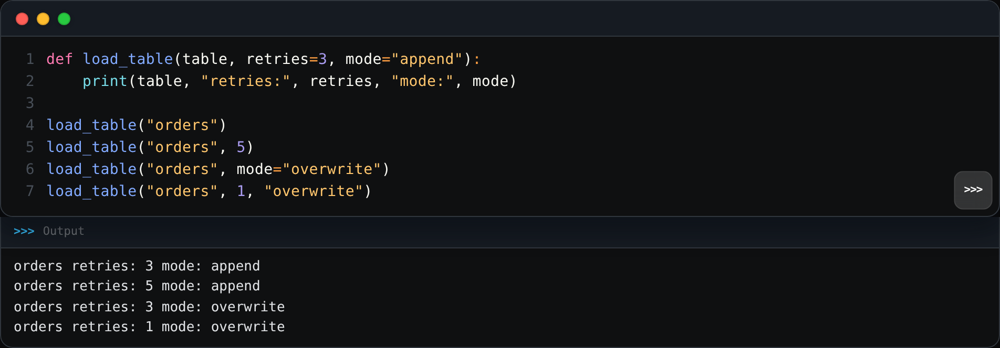

```python
def load_table(table, retries=3, mode="append"):
    print(table, "retries:", retries, "mode:", mode)

load_table("orders")
load_table("orders", 5)
load_table("orders", mode="overwrite")
load_table("orders", 1, "overwrite")
```

In the second call, `5` lands in `retries` because it is the second argument. The third call names `mode` so it can change `mode` without touching `retries`, and `retries` keeps its default. The fourth call sets both by position. Only `table` is required, so `load_table()` with no arguments fails with `TypeError: load_table() missing 1 required positional argument: 'table'`.

> How Python matches a call
>
> - Positional arguments fill parameters left to right.
> - Keyword arguments then fill the parameters they name.
> - Any parameter still empty takes its default.
> - A required parameter still empty stops the call with a `TypeError`.
> - A positional argument written after a keyword argument is a `SyntaxError`.


<br>

### Required parameters come first

Writing `def load_table(retries=3, table):` stops Python at the `def` line with a `SyntaxError`, before any call runs. Its message reports a parameter without a default placed after a parameter with one. The rule protects left-to-right filling. In `load_table("orders")` the single argument would go to the first parameter, `retries`, and `table` would get nothing. With every required parameter ahead of every defaulted one, a positional call always has an unambiguous match.


<br>

### A default is computed once

The expression after `=` runs once, when Python executes the `def` statement, and its result is stored with the function. Calls reuse the stored value and never evaluate the expression again. In this example the default reads a top-level setting that changes before the first call:

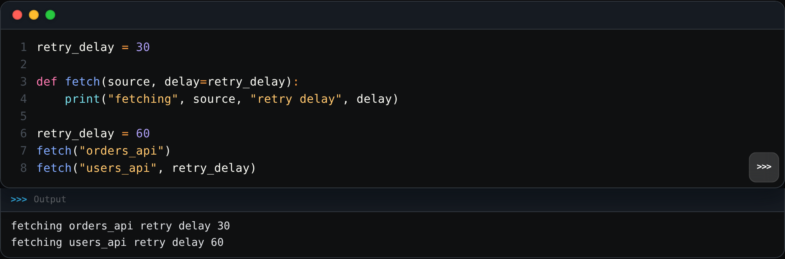

```python
retry_delay = 30

def fetch(source, delay=retry_delay):
    print("fetching", source, "retry delay", delay)

retry_delay = 60
fetch("orders_api")
fetch("users_api", retry_delay)
```

The first call prints 30 although `retry_delay` is 60 by then, because `delay` captured 30 when the `def` ran. The second call passes the current value itself and sees 60. The rule causes worse bugs when the default is a list or dict. Python builds that one object at definition time and every call that falls back to the default shares it, so whatever one call adds to it is still there in the next.

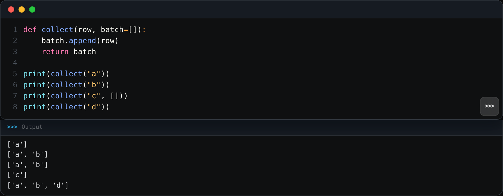

```python
def collect(row, batch=[]):
    batch.append(row)
    return batch

print(collect("a"))
print(collect("b"))
print(collect("c", []))
print(collect("d"))
```

`.append(row)` adds `row` to the end of the list. The second call passed only `"b"` and got back `['a', 'b']`, because both calls appended to the single list Python built when the `def` ran. In a pipeline, that is the second batch quietly carrying the first batch's rows. The third call passes its own empty list, so `batch` is that new list and the shared one is left alone. The fourth call leaves `batch` out again and gets `['a', 'b', 'd']`: the shared list was waiting with the earlier rows still in it.


<br>

### None as the not-given signal

When the fallback has to be read at call time, set the parameter's default to `None` and fill in the real value inside the function:

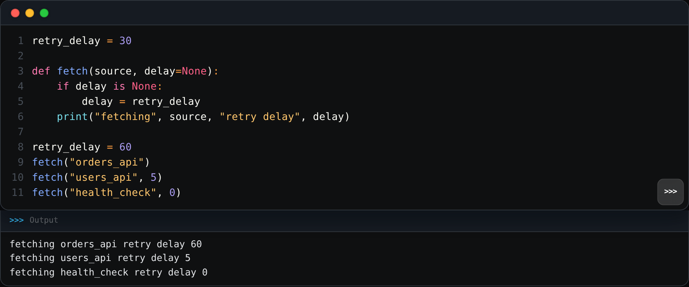

```python
retry_delay = 30

def fetch(source, delay=None):
    if delay is None:
        delay = retry_delay
    print("fetching", source, "retry delay", delay)

retry_delay = 60
fetch("orders_api")
fetch("users_api", 5)
fetch("health_check", 0)
```

`None` works as the marker because no caller means it as a real delay. The test is `is None`, which matches `None` and nothing else, so the health check that asks for 0 seconds gets 0 instead of the 60-second fallback. The same pattern fixes `collect`: default `batch` to `None`, and under the `is None` check write `batch = []`, so every call that leaves `batch` out builds a new empty list of its own.

**What does this program print?**

```python
def connect(host, port=5432):
    print(host, port)

settings = {"host": "db-1", "port": 6543, "timeout": 30}
connect(**settings)
```

- **A.** It prints db-1 6543, and timeout is ignored because connect has no use for it
- **B.** It prints db-1 5432, because the default wins when the dict has extra keys
- **C.** It raises TypeError: connect() missing 1 required positional argument: 'host'
- **D.** It raises TypeError: connect() got an unexpected keyword argument 'timeout'

<details>
<summary>Solution</summary>

**D.** It raises TypeError: connect() got an unexpected keyword argument 'timeout'

**settings becomes host="db-1", port=6543, timeout=30. With no timeout parameter and no ** parameter, the call fails before the body runs.

**Why the others are wrong**

- **A.** Python never drops a keyword argument. A key with no matching parameter and no ** parameter to collect it stops the call.
- **B.** A supplied value always replaces a default, and this call never reaches print anyway because of the extra key.
- **C.** The "host" key becomes host="db-1", so host is supplied. The failure comes from the key that matches nothing.

</details>

| ✓ Do | ✗ Don't |
| --- | --- |
| • Put every required parameter before the first defaulted one<br><br>• Choose defaults that match what most calls need<br><br>• Default to None when the fallback must be read at call time<br><br>• Pass a rarely changed option by keyword, as in mode="overwrite" | • Don't default a parameter to a list or dict, which every call shares<br><br>• Don't expect a default to follow later changes to a global<br><br>• Don't use a real value such as 0 as the not-given marker |


<br>

---

## Multiple Return Values

A `return` statement hands back one value, and that value can hold several results. Writing `return valid, rejected` packs both into a tuple, an ordered group of values that cannot be changed after it is built. The caller takes the tuple apart with the same multiple assignment as `a, b = 1, 2`. One loop over the data can then report everything it counted, instead of 2 functions each walking the same rows.

https://github.com/user-attachments/assets/ff541a00-ba48-4977-b431-1e40cfc55e05

*One call returns one tuple; unpacking gives each slot a name.*

Step through it and watch `result`. The function sends back one object, `(3, 2)`, and `print` shows it in parentheses because it is a tuple. The line `good, bad = result` then assigns by position: `good` gets the first slot and `bad` the second. Most code skips the middle name and unpacks straight from the call, as in `good, bad = split_valid(orders)`.

| ✓ Separate count functions | ✗ One function returning a pair |
| --- | --- |
| • count_valid(orders) and count_rejected(orders) each loop over every row<br><br>• Each function repeats the same if amount > 0 test<br><br>• The 2 counts drift apart if one test is edited and the other is not | • split_valid(orders) loops once and fills both counters<br><br>• The amount > 0 test is written once<br><br>• Valid plus rejected always equals the number of rows |


<br>

### The names must match the slots

Unpacking succeeds only when the left side has exactly one name per value. Here is what happens to the 2 values that `split_valid(orders)` returns:

| Left side | What happens |
| --- | --- |
| `good, bad =` | `good` is 3 and `bad` is 2 |
| `result =` | `result` holds the whole tuple `(3, 2)` |
| `good, bad, extra =` | `ValueError: not enough values to unpack (expected 3, got 2)` |
| `good =`, then `good + 1` | `TypeError: can only concatenate tuple (not "int") to tuple` |

The last row fails late. Storing the result in a single name works, and the error appears afterward, wherever the code expects a number. When a caller needs only some of the results, unpack the unwanted ones into `_`, an ordinary variable name that tells readers the value is ignored: `good, _ = split_valid(orders)`. The `_` still fills a slot, so the count must match.


<br>

### Unpacking results inside a loop

Multiple return values fit pipeline loops well. Each call returns its pair, the loop unpacks it on the spot, and a running total collects one of the slots across batches:

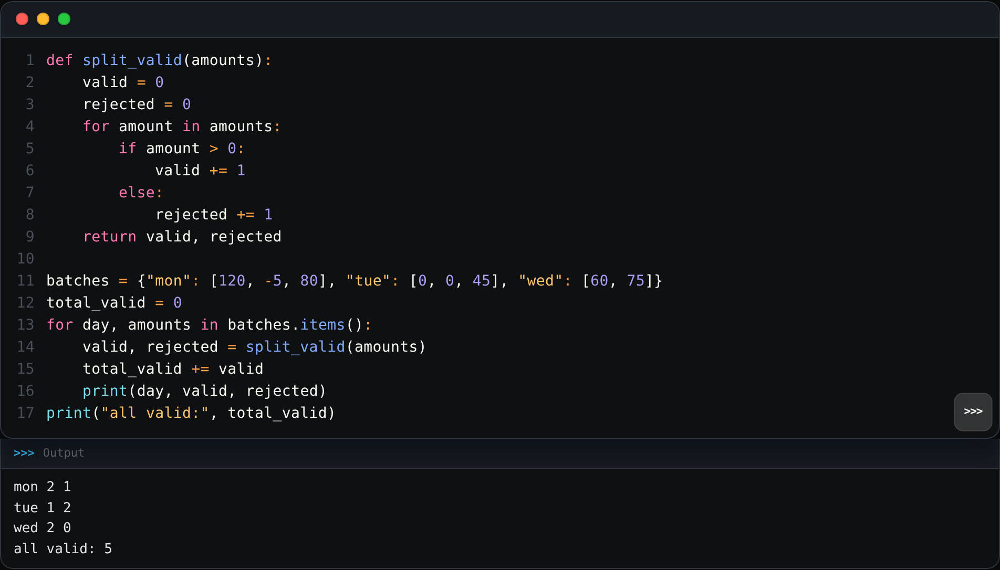

```python
def split_valid(amounts):
    valid = 0
    rejected = 0
    for amount in amounts:
        if amount > 0:
            valid += 1
        else:
            rejected += 1
    return valid, rejected

batches = {"mon": [120, -5, 80], "tue": [0, 0, 45], "wed": [60, 75]}
total_valid = 0
for day, amounts in batches.items():
    valid, rejected = split_valid(amounts)
    total_valid += valid
    print(day, valid, rejected)
print("all valid:", total_valid)
```


<br>

### Every exit returns the same shape

An early exit can break callers. A bare `return` sends back `None`, and `None` has no slots to unpack. Predict the output:

**What does this program print?**

```python
def connect(host, port=5432):
    print(host, port)

settings = {"host": "db-1", "port": 6543, "timeout": 30}
connect(**settings)
```

- **A.** It prints db-1 6543, and timeout is ignored because connect has no use for it
- **B.** It prints db-1 5432, because the default wins when the dict has extra keys
- **C.** It raises TypeError: connect() missing 1 required positional argument: 'host'
- **D.** It raises TypeError: connect() got an unexpected keyword argument 'timeout'

<details>
<summary>Solution</summary>

**D.** It raises TypeError: connect() got an unexpected keyword argument 'timeout'

**settings becomes host="db-1", port=6543, timeout=30. With no timeout parameter and no ** parameter, the call fails before the body runs.

**Why the others are wrong**

- **A.** Python never drops a keyword argument. A key with no matching parameter and no ** parameter to collect it stops the call.
- **B.** A supplied value always replaces a default, and this call never reaches print anyway because of the extra key.
- **C.** The "host" key becomes host="db-1", so host is supplied. The failure comes from the key that matches nothing.

</details>

The fix gives every exit the same shape: each one returns 2 values, with `None` in the slot that has no answer. Callers can then unpack on every path and check that one slot:

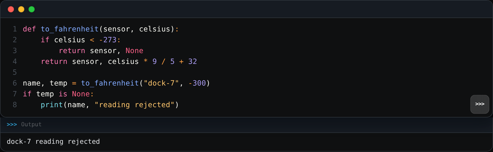

```python
def to_fahrenheit(sensor, celsius):
    if celsius < -273:
        return sensor, None
    return sensor, celsius * 9 / 5 + 32

name, temp = to_fahrenheit("dock-7", -300)
if temp is None:
    print(name, "reading rejected")
```

> **TIP**
>
> Past 3 or 4 returned values, callers start swapping slots, and `count, total` unpacks without complaint even when the function returned `total, count`. When a function has that many results to give back, a dictionary with named keys keeps them apart.


<br>

---

## Local vs Global Scope

Every call to a function gets its own private set of names, called its local scope. Parameters live there, along with every name the function assigns, and Python discards the whole set when the call returns. Names assigned at the top level of the file live in the global scope, which lasts for the whole run. Scope rules decide which of 2 same-named variables a line of code sees.

https://github.com/user-attachments/assets/9cffb1b8-aca5-4645-a79e-299e353d55f9

*The name rows_loaded exists twice: a local one inside load, and one global.*

The assignment inside `load` created a second `rows_loaded`, local to that call, and set it to 40. The global one never changed. `report` only reads the name, so it finds the global 0, and the last line prints 0 too. A local name that hides a global with the same spelling is called shadowing.


<br>

### Where Python looks up a name

When a function defined at the top level of a file reads a name, Python searches 3 places in order and uses the first match. Every function in this lesson is defined that way:

| Order | Scope | What lives there |
| --- | --- | --- |
| 1 | Local | Parameters and names assigned in the current call, such as `table` and `count` |
| 2 | Global | Names assigned at the top level of the file, such as `rows_loaded` |
| 3 | Built-in | Names Python provides, such as `print`, `range` and `isinstance` |

A name found in none of them raises `NameError`. That includes a function's local after the call has returned: once `load` finishes, `count` exists nowhere, so a top-level `print(count)` fails with `NameError: name 'count' is not defined`.

> **TIP**
>
> A `for` loop follows the same rules. At the top level of a file its loop variable is a global and keeps its last value after the loop. Inside a function it is local to that call and disappears when the call returns.


<br>

### Assignment decides scope for the whole body

Python decides which names are local before the function runs, by scanning its body. A name assigned anywhere in the body, including through `+=`, is local everywhere in that body, even on lines above the assignment. Predict what this does:

**What happens when this program runs?**

```python
processed = 0

def mark_done():
    processed += 1
    print(processed)

mark_done()
```

- **A.** It raises UnboundLocalError, because += makes processed a local that has no value yet
- **B.** It prints 1, because += reads the global 0 and adds 1 to it
- **C.** It raises NameError: name 'processed' is not defined, since functions cannot see globals
- **D.** It prints 0, because the call works on its own copy of processed

<details>
<summary>Solution</summary>

**A.** It raises UnboundLocalError, because += makes processed a local that has no value yet

The += assigns to processed, so the name is local in all of mark_done. Computing processed + 1 reads that local before it has any value. The message after UnboundLocalError: is worded differently across Python versions, but the exception is the same.

**Why the others are wrong**

- **B.** That would happen if the body only read processed. The += also assigns, which makes the name local, so the global is never consulted.
- **C.** Functions can read globals, as report did above. The error here is more specific: the local name exists but holds no value yet.
- **D.** Python copies nothing from the globals into a call. The local processed starts with no value at all, so the read fails.

</details>

Python makes this decision even when the assignment never runs. Below, `report(False)` skips the `if` body, yet `print(mode)` still raises the same `UnboundLocalError`. The line `mode = "overwrite"` exists in the body, and that alone makes `mode` local throughout:

```sql
mode = "append"

def report(force):
    print(mode)
    if force:
        mode = "overwrite"

report(False)
```


<br>

### Changing a global on purpose

A `global` statement at the top of a function tells Python that a name means the global variable, so assignments update it instead of creating a local:

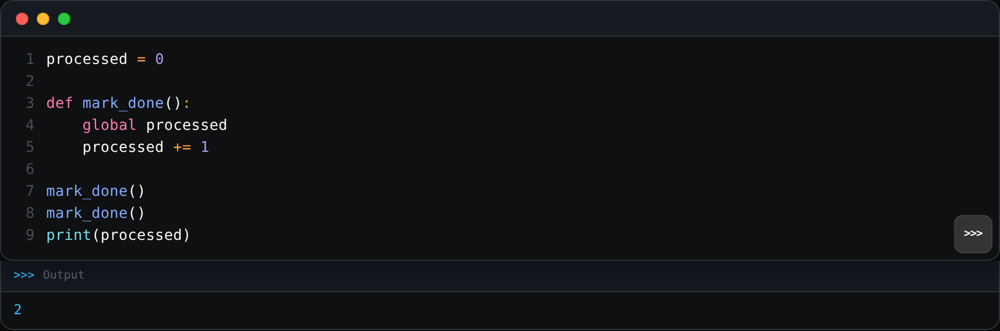

```python
processed = 0

def mark_done():
    global processed
    processed += 1

mark_done()
mark_done()
print(processed)
```

That works, but now any function can change `processed`, and tracking down a wrong count means checking every function that declares it global. Passing the value in and returning the new one keeps each change visible where the call happens:

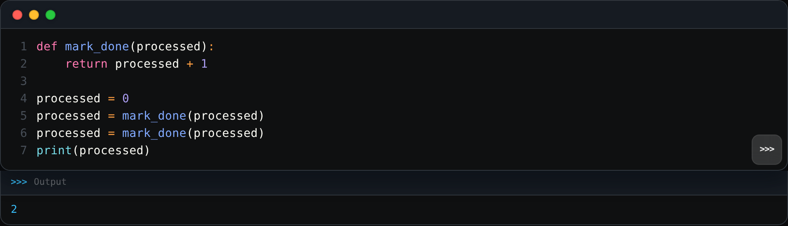

```python
def mark_done(processed):
    return processed + 1

processed = 0
processed = mark_done(processed)
processed = mark_done(processed)
print(processed)
```

| ✓ With global | ✗ Pass in, return out |
| --- | --- |
| • mark_done() changes processed, and the call line doesn't show it<br><br>• Finding every writer means searching each function for global processed<br><br>• Every pipeline that calls it shares one counter | • processed = mark_done(processed) shows the input and the update<br><br>• The function depends only on its parameters, so it can be tested alone<br><br>• Each caller picks the counter to update, so 2 jobs can keep separate counts |


<br>

---

## \*args for Variadics

Some functions take a number of inputs that varies per call: the file sizes in one partition, the columns to check for nulls, the tables to refresh. A parameter written with a star, `*sizes`, gathers every positional argument that no earlier parameter took and stores them as a tuple. The caller passes the values separately and never builds a container.

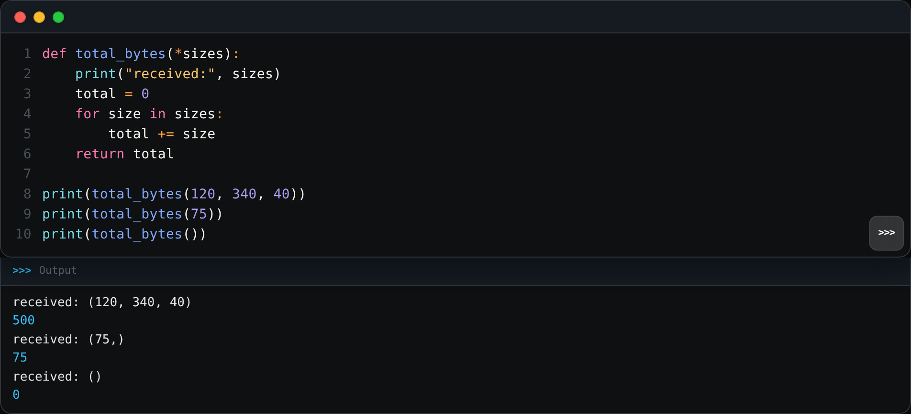

```python
def total_bytes(*sizes):
    print("received:", sizes)
    total = 0
    for size in sizes:
        total += size
    return total

print(total_bytes(120, 340, 40))
print(total_bytes(75))
print(total_bytes())
```

The tuple can have any length. One argument gives `(75,)`, where the trailing comma marks a 1-value tuple. No arguments gives the empty tuple `()`, which the loop walks 0 times, so the total stays 0. The name after the star is a convention: `*args` is the common generic name, and a descriptive one like `*sizes` documents what belongs there.


<br>

### Fixed parameters come before the star

Named parameters still work ahead of a starred one. Python fills them first, left to right, and the star takes whatever is left:

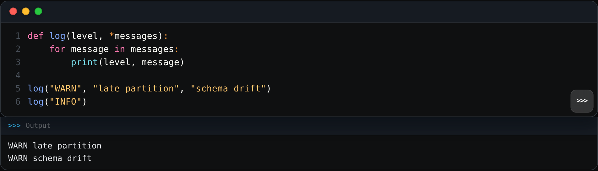

```python
def log(level, *messages):
    for message in messages:
        print(level, message)

log("WARN", "late partition", "schema drift")
log("INFO")
```

`log("INFO")` prints nothing: `level` takes the only argument and `messages` is empty. A defaulted parameter placed before the star is filled the same way, which causes a common surprise:

**What does this program print?**

```python
def connect(host, port=5432):
    print(host, port)

settings = {"host": "db-1", "port": 6543, "timeout": 30}
connect(**settings)
```

- **A.** It prints db-1 6543, and timeout is ignored because connect has no use for it
- **B.** It prints db-1 5432, because the default wins when the dict has extra keys
- **C.** It raises TypeError: connect() missing 1 required positional argument: 'host'
- **D.** It raises TypeError: connect() got an unexpected keyword argument 'timeout'

<details>
<summary>Solution</summary>

**D.** It raises TypeError: connect() got an unexpected keyword argument 'timeout'

**settings becomes host="db-1", port=6543, timeout=30. With no timeout parameter and no ** parameter, the call fails before the body runs.

**Why the others are wrong**

- **A.** Python never drops a keyword argument. A key with no matching parameter and no ** parameter to collect it stops the call.
- **B.** A supplied value always replaces a default, and this call never reaches print anyway because of the extra key.
- **C.** The "host" key becomes host="db-1", so host is supplied. The failure comes from the key that matches nothing.

</details>

The bug raises no error, which makes it expensive: the job copies only `b.csv`, and later code treats `'a.csv'` as a retry count. With what you know now, there are 2 safer shapes. Leave `retries` out of a function that takes a variable number of files, or take the files as one list parameter so `retries` can stay optional. A later lesson adds a third shape that fixes this inside the signature.

| ✓ Take *files | ✗ Take one list parameter |
| --- | --- |
| • Callers usually write the values out: copy_files("archive", "a.csv", "b.csv")<br><br>• The count changes from call to call<br><br>• No defaulted parameter needs to sit before the star | • Callers usually hold the values in a list already<br><br>• Other parameters can keep defaults without being captured<br><br>• The call shows where the group of values starts and ends |


<br>

### Spreading a list into a call

The star also works in the other direction. In a call, `*` in front of a list spreads its items into separate positional arguments:

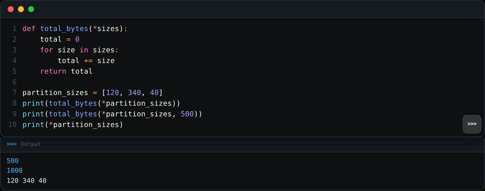

```python
def total_bytes(*sizes):
    total = 0
    for size in sizes:
        total += size
    return total

partition_sizes = [120, 340, 40]
print(total_bytes(*partition_sizes))
print(total_bytes(*partition_sizes, 500))
print(*partition_sizes)
```

Inside the function, `sizes` is `(120, 340, 40)` in the first call and `(120, 340, 40, 500)` in the second. Calling `total_bytes(partition_sizes)` without the star makes `sizes` a tuple holding one list, and the loop's `total += size` fails with `TypeError: unsupported operand type(s) for +=: 'int' and 'list'`.

| Star written in | Direction | Example |
| --- | --- | --- |
| The `def` line | Many arguments gathered into one tuple | `def total_bytes(\*sizes):` |
| A call | One list spread into many arguments | `total_bytes(\*partition_sizes)` |


<br>

---

## \*\*kwargs for Keywords

A parameter written with 2 stars, `**options`, gathers every keyword argument that no named parameter matched and stores them in a dictionary. Each key is the argument's name as a string, each value is what the caller passed, and the order is the order of the call. With it, a function accepts settings whose names it doesn't know in advance, such as the tags on a job or the options a writer passes on to storage.

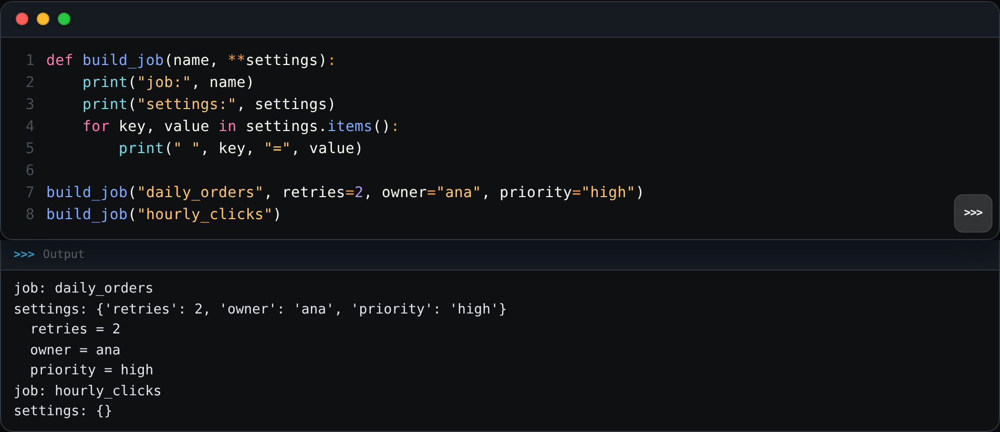

```python
def build_job(name, **settings):
    print("job:", name)
    print("settings:", settings)
    for key, value in settings.items():
        print(" ", key, "=", value)

build_job("daily_orders", retries=2, owner="ana", priority="high")
build_job("hourly_clicks")
```

`name` is matched first, so it never appears in `settings`. With no extra keywords, `settings` is the empty dict `{}` and the loop runs 0 times. Because `settings` is an ordinary dictionary, the `.items()` loop you already use for dicts works on it unchanged.


<br>

### Named parameters claim their keywords first

When the function also declares a parameter by name, a keyword with that name goes to the parameter, and the dictionary never sees it. A wrapper can pass its own dictionary along with `**` in a call, which spreads the dictionary back into keyword arguments:

https://github.com/user-attachments/assets/e480eb11-0391-45f2-ae6c-da218d9b9366

*run_step holds 3 options; write_table claims mode and keeps the other 2.*

Watch the 2 `options` dictionaries. In `run_step` it holds 3 keys, because `run_step` names none of them. The call `write_table(table, **options)` spreads them back into `mode="overwrite", compression="zstd", partitions=8`. `mode` matches a named parameter, so the `options` inside `write_table` holds only the other 2. The wrapper forwards settings it never inspects, so adding a writer option needs no change to `run_step`.


<br>

### Spreading a dict that does not fit

Spreading a dictionary with `**` checks every key against the function's parameters. A function without its own `**` parameter has nowhere to put a key it does not name:

**What does this program print?**

```python
def connect(host, port=5432):
    print(host, port)

settings = {"host": "db-1", "port": 6543, "timeout": 30}
connect(**settings)
```

- **A.** It prints db-1 6543, and timeout is ignored because connect has no use for it
- **B.** It prints db-1 5432, because the default wins when the dict has extra keys
- **C.** It raises TypeError: connect() missing 1 required positional argument: 'host'
- **D.** It raises TypeError: connect() got an unexpected keyword argument 'timeout'

<details>
<summary>Solution</summary>

**D.** It raises TypeError: connect() got an unexpected keyword argument 'timeout'

**settings becomes host="db-1", port=6543, timeout=30. With no timeout parameter and no ** parameter, the call fails before the body runs.

**Why the others are wrong**

- **A.** Python never drops a keyword argument. A key with no matching parameter and no ** parameter to collect it stops the call.
- **B.** A supplied value always replaces a default, and this call never reaches print anyway because of the extra key.
- **C.** The "host" key becomes host="db-1", so host is supplied. The failure comes from the key that matches nothing.

</details>

The opposite clash fails too. `connect("db-2", host="db-1")` supplies `host` twice, once by position and once by name, and raises `TypeError: connect() got multiple values for argument 'host'`. Python refuses to choose between 2 values for one parameter.


<br>

### The full signature order

All 4 kinds of parameter can appear in one `def`. This lesson writes them in this order, which is the most common one:

| Position | Parameter | What it receives |
| --- | --- | --- |
| 1 | `table` | A required argument, by position or by name |
| 2 | `mode="append"` | An optional argument with a fallback |
| 3 | `\*paths` | Every leftover positional argument, as a tuple |
| 4 | `\*\*options` | Every leftover keyword argument, as a dict |

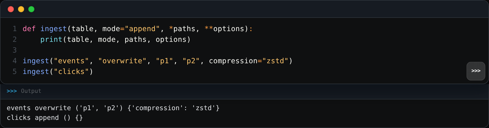

```python
def ingest(table, mode="append", *paths, **options):
    print(table, mode, paths, options)

ingest("events", "overwrite", "p1", "p2", compression="zstd")
ingest("clicks")
```

Positional arguments fill `table`, then `mode`, then spill into `paths`. Keyword arguments match parameter names first, then spill into `options`. `**options` must always be the last parameter, so a `def` that places it before `*paths` is a `SyntaxError`. The other positions allow more than the table shows. A parameter written after the star, as in `def ingest(table, *paths, mode="append", **options):`, is valid: `*paths` takes every leftover positional argument, so `mode` can only be set by name, as in `mode="overwrite"`. That's the third shape promised for the `copy_files` bug, and a later lesson covers it.

> **TIP**
>
> With named parameters, a typo such as `retires=2` fails at once with an unexpected keyword argument error. With `**options` the typo lands in the dict as a key named `retires`, and the job runs with the default retry count. Collect with `**` only the settings the function forwards or records.

| ✓ Do | ✗ Don't |
| --- | --- |
| • Give each option the function reads its own named parameter<br><br>• Use \*\*options when the function forwards settings it does not read<br><br>• Keep the order: required, defaulted, \*args, \*\*kwargs | • Don't spread a dict into a function unless every key names a parameter<br><br>• Don't use \*\*options to avoid writing a clear signature<br><br>• Don't forward one \*\*options to 2 functions that accept different names |


<br>

---

## Putting It All Together

Back to the week before Spotify Wrapped. The helper that ranks a listener's artists grows into rank_artists(user, year=None, \*genres, \*\*filters) and is called from dozens of card builders. A builder with no year needs the current Wrapped year read at call time. A genre card passes several genres, a regional card adds region="BR", and every caller needs the ranked artists back together with the minutes played.

- year = None with an is None check reads the global WRAPPED_YEAR on every call. A default written as year = WRAPPED_YEAR would keep the value the global held when the def ran, even after the global is updated for the next Wrapped.
- Because year sits before \* genres , a genre card that calls rank_artists ( user , "pop" , "rock" ) sends "pop" into year , so genre cards must pass the year explicitly.
- return artists , minutes lets one pass over the play history serve both numbers, and the exit for a user with no plays still returns 2 values so no card builder's unpacking fails.
- \*\* filters lets the helper forward region = "BR" to the query function without naming every filter, and a misspelled filter fails loudly only if that query function has no \*\* of its own.
- The Wrapped year lives in one global that the helper reads and never assigns, so no card builder can change it by accident.


<br>

---

## Key Takeaways

- A default is evaluated once, when def runs. Use None and fill the value inside the function when the fallback must be read at call time.
- return a , b returns one tuple. Unpacking needs exactly one name per slot, and every exit should return the same number of values.
- Assigning to a name anywhere in a function makes it local throughout that function. Pass values in and return results instead of reaching for global .
- \* args gathers leftover positional arguments into a tuple, and \* in a call spreads a list back out into arguments.
- \*\* kwargs gathers leftover keyword arguments into a dict, and \*\* in a call spreads a dict back into keywords that must match parameter names.
