# Lists: Advanced

Instagram's backend runs on Python, so suppose a signup job there gives each new account its default story settings by copying a single template list of lists. A teen account turns off replies, and the 40,000 accounts created that hour lose replies too. If the copy line protects them, nothing happens; if it spreads the change, you spend the afternoon on an incident.


<br>

---

## List Comprehensions

A list comprehension builds a new list from an existing iterable in a single expression: `[expression for item in iterable]`. Python runs the loop, evaluates the expression once per item, and collects each result into a fresh list, in source order. Code that used to start with an empty list and fill it in a loop with `append` becomes a line that states what the list contains.

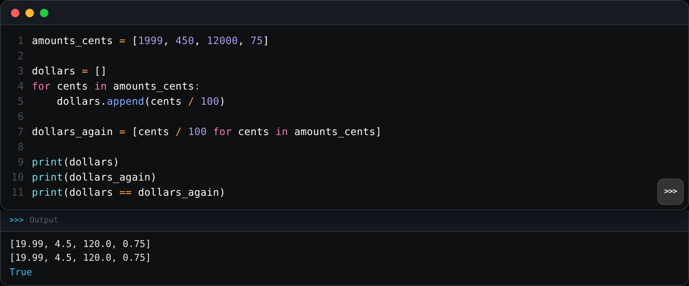

```python
amounts_cents = [1999, 450, 12000, 75]

dollars = []
for cents in amounts_cents:
    dollars.append(cents / 100)

dollars_again = [cents / 100 for cents in amounts_cents]

print(dollars)
print(dollars_again)
print(dollars == dollars_again)
```

Both lists are equal, and `amounts_cents` is untouched: the comprehension only reads its source. The table names the parts you will find in every comprehension.

| Part | In the example | What Python does with it |
| --- | --- | --- |
| Expression | `cents / 100` | Evaluated once per item; its value becomes the next item of the new list |
| Loop variable | `cents` | Bound to each source item in turn, visible only inside the brackets |
| Iterable | `amounts_cents` | Read from start to end; a string, a `range` or a generator works too |
| Filter (optional) | `if cents > 0` | Checked before the expression; items that fail are skipped |


<br>

### Filtering with a trailing if

An `if` clause after the `for` decides which items reach the expression. Items that fail it are skipped, so the result can be shorter than the source. This payments feed mixes charges with refunds, stored as negative cents, and zero-value test events. The report wants charges only, in dollars.

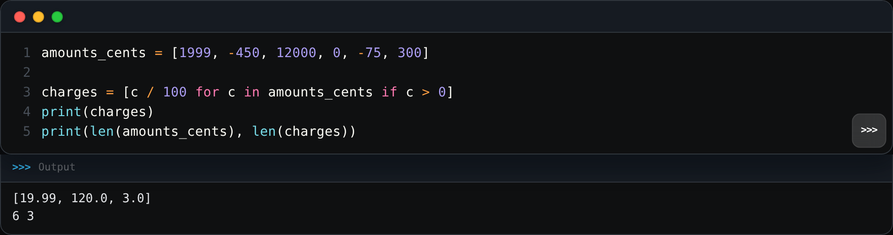

```python
amounts_cents = [1999, -450, 12000, 0, -75, 300]

charges = [c / 100 for c in amounts_cents if c > 0]
print(charges)
print(len(amounts_cents), len(charges))
```


<br>

### Transforming with if-else in front

To keep every item but compute it differently, put a conditional expression in the expression slot: `a if condition else b`. It's the conditional assignment you already write on a single line, placed before the `for`. Every source item produces an output, so the length never changes.

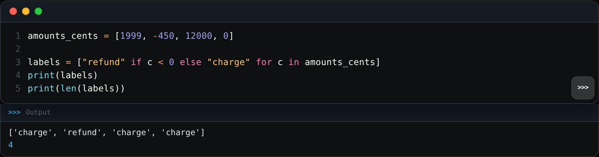

```python
amounts_cents = [1999, -450, 12000, 0]

labels = ["refund" if c < 0 else "charge" for c in amounts_cents]
print(labels)
print(len(labels))
```

| ✓ if after for: filter | ✗ if-else before for: transform |
| --- | --- |
| • [c for c in xs if c > 0]<br><br>• Decides whether an item appears<br><br>• Takes no else; adding one is a SyntaxError<br><br>• Result can be shorter than the source | • [c if c > 0 else 0 for c in xs]<br><br>• Decides what an item becomes<br><br>• The else is required<br><br>• Result always matches the source's length |

*Both can appear together: ["big" if c > 10000 else "small" for c in xs if c > 0] drops non-positive amounts, then labels the rest.*


<br>

### Several for clauses

A comprehension can hold more than one `for`. The clauses run in the order you would nest the loops, outer loop first, so reading them left to right as indented loops tells you what comes out. A common use turns a list of batches into a list of rows.

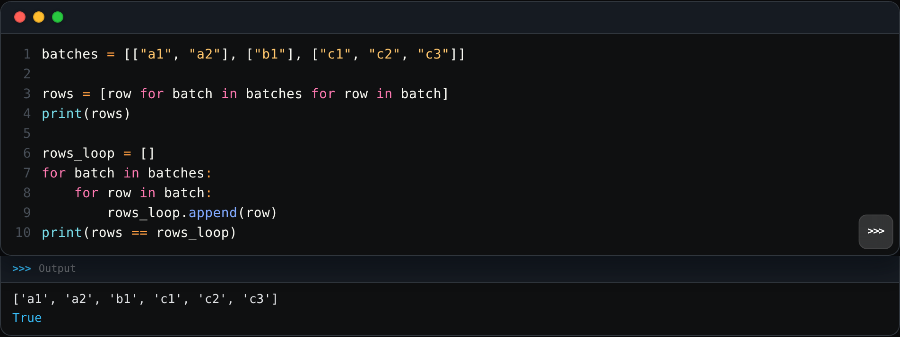

```python
batches = [["a1", "a2"], ["b1"], ["c1", "c2", "c3"]]

rows = [row for batch in batches for row in batch]
print(rows)

rows_loop = []
for batch in batches:
    for row in batch:
        rows_loop.append(row)
print(rows == rows_loop)
```

Reverse the clauses to `[row for row in batch for batch in batches]` and Python evaluates `batch` before any clause defines it: a NameError, or a silent wrong answer if an earlier `batch` variable is still around. A comprehension can also sit in the expression slot of another. `[[r * c for c in range(3)] for r in range(2)]` gives `[[0, 0, 0], [0, 1, 2]]`, and every pass of the outer loop builds a separate inner list, a detail the next section depends on.


<br>

### The loop variable stays inside

A `for` loop leaves its variable bound after it ends. A comprehension runs in its own scope, so its loop variable vanishes with it and never overwrites a name outside.

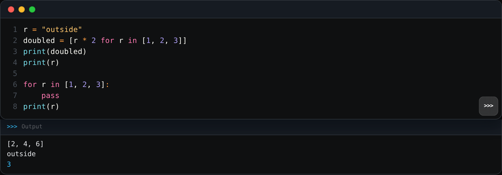

```python
r = "outside"
doubled = [r * 2 for r in [1, 2, 3]]
print(doubled)
print(r)

for r in [1, 2, 3]:
    pass
print(r)
```


<br>

### When a loop reads better

A comprehension exists to produce a list. `[print(r) for r in rows]` prints each row and also builds a throwaway list of `None` values, because `print` returns `None`. Write a `for` loop when the point is a side effect, or when the logic needs several conditions and transforms that would crowd a single line. When you only need to scan the values once, parentheses instead of brackets give a generator expression, as in `any(c < 0 for c in amounts_cents)`, which stops at the first refund and builds no list.

| ✓ Do | ✗ Don't |
| --- | --- |
| • Use a comprehension when the goal is a new list<br><br>• Filter with a trailing if; transform with if-else up front<br><br>• Order for clauses the way you would nest the loops | • Don't call functions for their side effects inside a comprehension<br><br>• Don't put else after a trailing filter if<br><br>• Don't expect a comprehension's loop variable to exist afterwards |

**What does this program print?**

```python
import copy

base = [["load"], ["publish"]]
plan = [steps[:] for steps in base]
plan[0].append("check")
undo = [copy.deepcopy(plan)]
plan[1] = plan[1] + ["notify"]
plan = undo.pop()
print(base, plan)
```

- **A.** [['load'], ['publish']] [['load', 'check'], ['publish', 'notify']]
- **B.** [['load', 'check'], ['publish']] [['load', 'check'], ['publish']]
- **C.** [['load'], ['publish']] [['load', 'check'], ['publish']]
- **D.** [['load'], ['publish']] [['load'], ['publish']]

<details>
<summary>Solution</summary>

**C.** [['load'], ['publish']] [['load', 'check'], ['publish']]

base was never touched; plan is restored from the saved deep copy, which has check but not notify.

**Why the others are wrong**

- **A.** The deep copy in undo was taken before notify was added, so restoring it drops that step.
- **B.** The comprehension copied each inner list, so appending check to plan[0] leaves base[0] alone.
- **D.** The saved state was copied after check was appended, so the restored plan keeps it.

</details>

When you write a comprehension that both filters and converts, fill its slots by asking 2 questions in order: which items should survive, and what each survivor should become. The first answer is the condition after the `for`, and the second is the expression before it. Only survivors reach the expression, so a division placed there never runs on an item the filter dropped.


<br>

---

## References and Shallow Copies

A variable holds a reference to a list object stored elsewhere in memory. The statement `b = a` copies the reference, so afterwards both names reach the same object, and a change made through either name is visible through the other. You already know the tool that reveals this: `is` compares identity and returns `True` when 2 names point at a single object.

https://github.com/user-attachments/assets/4b917fb0-6b70-4e3f-a9f7-1f58c57f7ae3

The append and the item assignment both went through `alias`, and `original` shows both, because there was only ever a single list. Python never copies a list unless you ask it to.


<br>

### Mutating the object vs rebinding the name

Calling a method changes the object, and so does assigning to an item or running `del` on one, so every name for it sees the change. A plain `name = ...` assignment looks similar but only points that single name at a different object, and it leaves the old object and its other names alone.

| Statement | What it does | Visible through original? |
| --- | --- | --- |
| `alias.append(4)` | Mutates the shared list | Yes |
| `alias[0] = 99` | Replaces a slot in the shared list | Yes |
| `del alias[0]` | Removes a slot from the shared list | Yes |
| `alias = [7, 8]` | Points `alias` at a new list | No |
| `del alias` | Deletes the name `alias` only | No |


<br>

### Functions get the caller's list

Passing a list to a function binds the parameter to the object the caller holds. No copy happens at the call. A cleaning helper that edits its argument therefore edits the caller's data, which is how a raw batch kept for auditing ends up already cleaned.

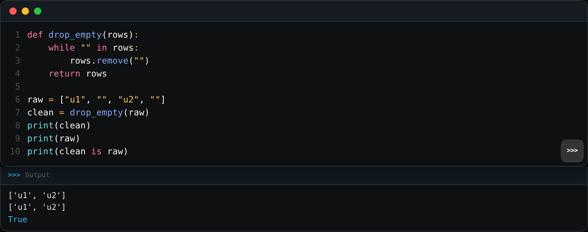

```python
def drop_empty(rows):
    while "" in rows:
        rows.remove("")
    return rows

raw = ["u1", "", "u2", ""]
clean = drop_empty(raw)
print(clean)
print(raw)
print(clean is raw)
```

`clean is raw` prints `True`: the helper returned the very list it was given. Whether that's a bug depends on whether the caller still needed the raw rows.


<br>

### Shallow copies: a new outer list

`a.copy()` gives you a new list. `a[:]` and `list(a)` do the same: each creates a new outer list and fills it with the references the original holds. For a flat list of numbers or strings that is all the independence you need, because those items can only be replaced, never changed in place. Replacing a slot in the copy leaves the original's slot alone. Items that are themselves lists get shared between the copy and the original.

https://github.com/user-attachments/assets/51a607ae-139b-4067-a1bf-5dbd60939142

`backup[1] = 60` replaced a slot in the new outer list, so `config[1]` is still 30. `backup[0].append("apac")` followed the reference in slot 0 into the inner list both outer lists point at, so `config` shows `"apac"` too. The last 2 lines confirm it: separate outer lists, a shared inner list.


<br>

### Multiplying a list of lists

Multiplying a list repeats its references. `[0] * 3` repeats a reference to `0` 3 times, which is harmless because a slot holding `0` can only be replaced. `[[0] * 3] * 3` repeats a reference to the same inner list 3 times, so a change to any row shows in every row. A comprehension evaluates `[0] * 3` anew for each row, so each row is its own list.

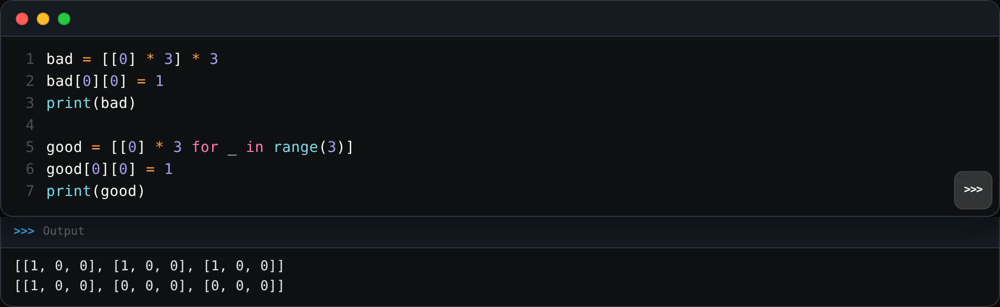

```python
bad = [[0] * 3] * 3
bad[0][0] = 1
print(bad)

good = [[0] * 3 for _ in range(3)]
good[0][0] = 1
print(good)
```


<br>

### Default arguments are built once

Python evaluates a default value once, when `def` runs. Every call that omits the argument receives that same object, so a list default collects items across calls.

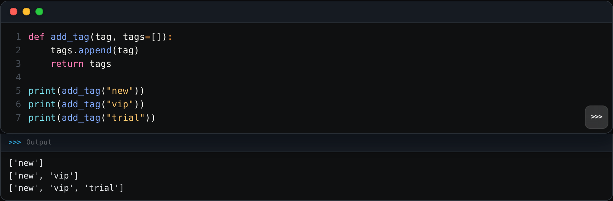

```python
def add_tag(tag, tags=[]):
    tags.append(tag)
    return tags

print(add_tag("new"))
print(add_tag("vip"))
print(add_tag("trial"))
```

The fix defaults to `None` and builds the list inside the function, so each call that omits `tags` gets a new empty list.

```sql
def add_tag(tag, tags=None):
    if tags is None:
        tags = []
    tags.append(tag)
    return tags
```

> Where shared lists show up in pipelines
>
> - A helper cleans its argument in place, and the raw batch the caller kept for auditing changes with it.
> - A grid of per-hour counters built with `*` adds every count to every hour.
> - A function with `rows=[]` as a default keeps rows from the previous call.
> - A shallow copy of a list of rows still shares each row, so editing a field in the copy edits the source.

**Predict the output.**

```python
data = [5, 2, 8]
a = data
b = sorted(data)
data.reverse()
print(a, b)
```

- **A.** [5, 2, 8] [2, 5, 8]
- **B.** [8, 2, 5] [2, 5, 8]
- **C.** [8, 2, 5] [8, 5, 2]
- **D.** None [2, 5, 8]

<details>
<summary>Solution</summary>

**B.** [8, 2, 5] [2, 5, 8]

a is data, reversed in place; sorted made b a separate list before the reverse.

**Why the others are wrong**

- **A.** a = data binds a second name, so a is the list that reverse() changed.
- **C.** b came from sorted(), a new list, so reversing data does not reorder it.
- **D.** reverse() returned None, but nothing stored that result; a still names the list.

</details>

The `None` default fixes the shared list for a concrete reason. Every call that omits the argument still receives the same default object, but `None` is never mutated. The `[]` sits inside the function body, and the body runs on every call, so each call that reaches `tags = []` builds a separate list.


<br>

---

## Deep Copies

A deep copy duplicates the whole structure. `copy.deepcopy(x)` from the standard `copy` module walks every list inside `x`, however deeply nested, and builds a new one for each, so nothing mutable is shared with the original. Numbers and strings are reused, which is safe because nobody can change them. The same module's `copy.copy(x)` makes a shallow copy, equivalent to `x.copy()` for a list.

https://github.com/user-attachments/assets/e357f9e5-a705-4a56-b5a7-586f3e28bed8

Appending `"apac"` to the original's inner list reaches `shallow`, which shares that inner list, and misses `deep`, which got its own. The final line prints the identity checks: `True` for the shallow copy, `False` for the deep one.

|  | b = a | b = a.copy() | b = copy.deepcopy(a) |
| --- | --- | --- | --- |
| New outer list? | No | Yes | Yes |
| New inner lists? | No | No | Yes, at every depth |
| `b.append(x)` changes `a`? | Yes | No | No |
| `b[0].append(x)` changes `a`? | Yes | Yes | No |
| Extra memory | None | The outer list | Every list inside |


<br>

### Equal contents, separate objects

`==` compares lists item by item, descending into nested lists, so a deep copy is equal to its source. `is` compares identity, and a deep copy shares no list with its source at any level.

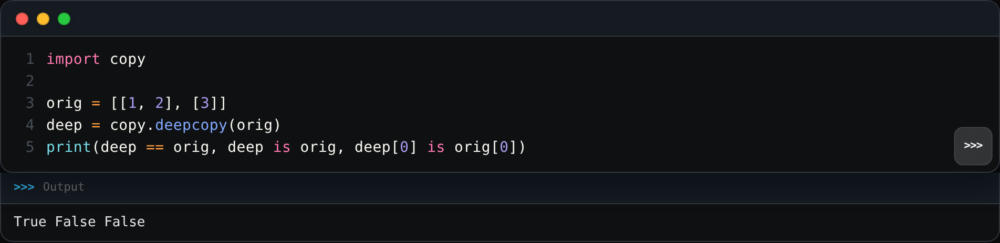

```python
import copy

orig = [[1, 2], [3]]
deep = copy.deepcopy(orig)
print(deep == orig, deep is orig, deep[0] is orig[0])
```


<br>

### Shared references survive the copy

If the original holds the same inner list twice, `deepcopy` copies it once and puts that copy in both places. During the call it records every object it has already copied and reuses the copy when it meets the object again. The result keeps the source's pattern of sharing internally while sharing nothing with the source. The same record lets it copy a list that contains itself without looping forever.

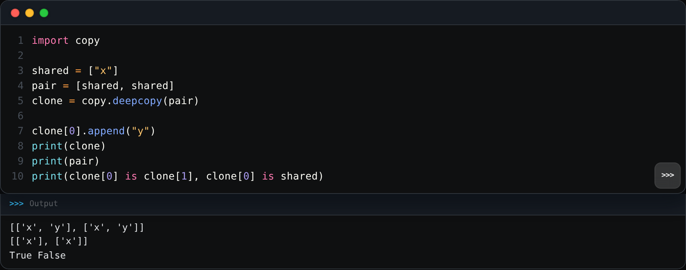

```python
import copy

shared = ["x"]
pair = [shared, shared]
clone = copy.deepcopy(pair)

clone[0].append("y")
print(clone)
print(pair)
print(clone[0] is clone[1], clone[0] is shared)
```


<br>

### Objects inside lists

`deepcopy` also copies instances of your own classes, attribute by attribute. A template job definition can be deep-copied into a run and the run's step list changed, with the template left as it was.

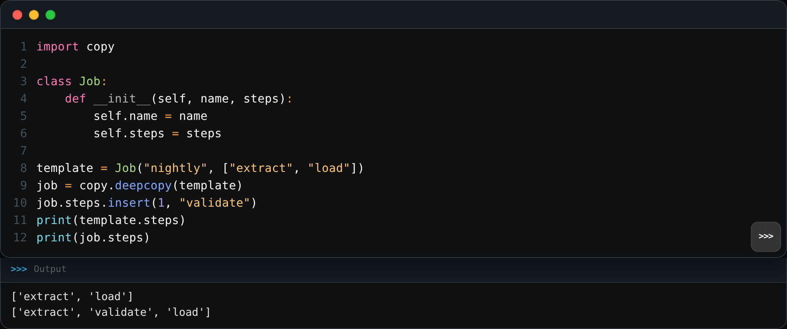

```python
import copy

class Job:
    def __init__(self, name, steps):
        self.name = name
        self.steps = steps

template = Job("nightly", ["extract", "load"])
job = copy.deepcopy(template)
job.steps.insert(1, "validate")
print(template.steps)
print(job.steps)
```

With `copy.copy(template)` instead, the new `Job` would share `template.steps`, and the `insert` would change both.


<br>

### What a deep copy costs

A deep copy duplicates every container inside the structure. The time and memory it needs grow with the total number of nested lists and objects. On a batch of 200,000 rows, each a list of plain values, it builds 200,001 new lists. Some objects can't be copied at all: a generator or an open file raises a `TypeError`, because a half-consumed stream has no meaningful second copy.

When you know the shape, copy only the levels you will change. Rows stored as flat lists need 2 levels, and a comprehension handles them: `[row[:] for row in rows]`. It copies each row without inspecting the values inside, and it runs faster than `deepcopy` because it skips the per-object record keeping.

| ✓ A shallow copy is enough when | ✗ Reach for a deep copy when |
| --- | --- |
| • The items are values you only replace, like numbers and strings<br><br>• You will change which items the list holds or their order, never edit an inner list<br><br>• Sharing the inner rows is intended because nobody edits them | • You'll edit inner lists or object attributes in the copy<br><br>• The nesting depth varies or is unknown<br><br>• A template must stay unchanged across many runs |

**What does this program print?**

```python
import copy

base = [["load"], ["publish"]]
plan = [steps[:] for steps in base]
plan[0].append("check")
undo = [copy.deepcopy(plan)]
plan[1] = plan[1] + ["notify"]
plan = undo.pop()
print(base, plan)
```

- **A.** [['load'], ['publish']] [['load', 'check'], ['publish', 'notify']]
- **B.** [['load', 'check'], ['publish']] [['load', 'check'], ['publish']]
- **C.** [['load'], ['publish']] [['load', 'check'], ['publish']]
- **D.** [['load'], ['publish']] [['load'], ['publish']]

<details>
<summary>Solution</summary>

**C.** [['load'], ['publish']] [['load', 'check'], ['publish']]

base was never touched; plan is restored from the saved deep copy, which has check but not notify.

**Why the others are wrong**

- **A.** The deep copy in undo was taken before notify was added, so restoring it drops that step.
- **B.** The comprehension copied each inner list, so appending check to plan[0] leaves base[0] alone.
- **D.** The saved state was copied after check was appended, so the restored plan keeps it.

</details>

The copy functions live in a module, so a program needs `import copy` at the top and the module name in front of each call, as in `copy.deepcopy(x)`. A bare `deepcopy(x)` raises `NameError: name 'deepcopy' is not defined` unless the program imported it by name with `from copy import deepcopy`.


<br>

---

## Lists as Stacks

A stack hands back items in the reverse of the order they arrived: the last item in is the first item out. A Python list does this with 2 methods that both work at the right-hand end. `append(x)` pushes `x` onto the top, and `pop()` with no argument removes the top item and returns it. Neither method moves the other items, so a push or a pop stays fast however tall the stack gets.

https://github.com/user-attachments/assets/14fc67b6-03b7-4b49-be99-1ae64198595b

| Stack operation | List code | On an empty stack |
| --- | --- | --- |
| Push | `stack.append(x)` | Works |
| Pop | `stack.pop()` | IndexError: pop from empty list |
| Peek at the top | `stack[-1]` | IndexError: list index out of range |
| Check for empty | `not stack` | `True` |
| Size | `len(stack)` | `0` |

An empty list is falsy, so `while stack:` runs until the stack is drained and `if stack:` guards a pop. Without the guard, popping an empty stack raises an IndexError.

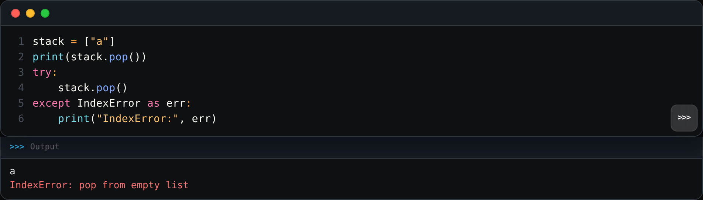

```python
stack = ["a"]
print(stack.pop())
try:
    stack.pop()
except IndexError as err:
    print("IndexError:", err)
```


<br>

### Undo is a stack

Undo needs the most recent change first, which is the order a stack returns. Before each edit, push the current value. Undoing pops the last saved value and restores it. Rolling back a sequence of applied schema changes has the same shape: each applied change is pushed, and a rollback pops them newest first.

https://github.com/user-attachments/assets/ca8f6eb4-9ce4-4c6e-acc2-2de1824fcc6e


<br>

### Matching brackets

Checking that brackets nest correctly in a config string or a SQL expression is a stack problem. Push each opening bracket. When a closing bracket arrives, the top of the stack must be its partner, and anything else means the brackets cross. At the end, an empty stack means every opener was closed. The `PAIRS` lookup maps each closer to its opener, the same dict-based dispatch you have written before.

https://github.com/user-attachments/assets/f53ae612-03a1-4fc0-8dca-c7b2dbd64a9f

*One call on ([)]: the ) arrives while [ is on top of the stack, so the check fails*

On `"([)]"`, the function pushes `(` and then `[`. When `)` arrives, `[` is on top, so the function returns `False` at the third character without reading the last. The `not stack` test in the same condition catches a closer with nothing open, like `"())"`. It short-circuits before `pop()` could raise.


<br>

### Walking nested data without recursion

A recursive function keeps its unfinished work on Python's call stack. Holding that work in a list instead avoids the recursion limit on deeply nested input. Pop an item; if it is a list, push its children; otherwise record it. Pushing the children in reversed order puts the first child on top, so values come out in reading order.

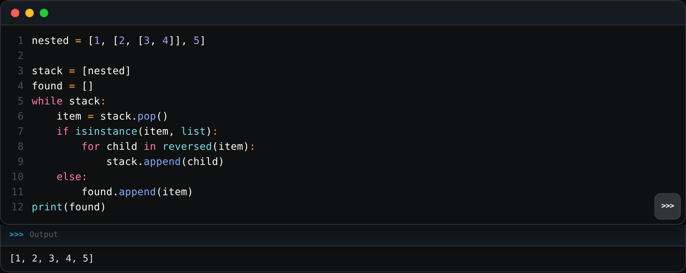

```python
nested = [1, [2, [3, 4]], 5]

stack = [nested]
found = []
while stack:
    item = stack.pop()
    if isinstance(item, list):
        for child in reversed(item):
            stack.append(child)
    else:
        found.append(item)
print(found)
```


<br>

### Why a list makes a poor queue

A queue is first-in first-out, and `pop(0)` gives that order from a list, but removing slot 0 shifts every remaining item one slot to the left, so each call does work proportional to the list's length. `pop()` at the end shifts nothing. Python has a structure built for removing from the front, covered in a later lesson; until then, keep lists for stacks.

- **999,999** — slots shifted by pop(0) on 1M items
- **0** — slots shifted by pop() on 1M items

**What does this program print?**

```python
import copy

base = [["load"], ["publish"]]
plan = [steps[:] for steps in base]
plan[0].append("check")
undo = [copy.deepcopy(plan)]
plan[1] = plan[1] + ["notify"]
plan = undo.pop()
print(base, plan)
```

- **A.** [['load'], ['publish']] [['load', 'check'], ['publish', 'notify']]
- **B.** [['load', 'check'], ['publish']] [['load', 'check'], ['publish']]
- **C.** [['load'], ['publish']] [['load', 'check'], ['publish']]
- **D.** [['load'], ['publish']] [['load'], ['publish']]

<details>
<summary>Solution</summary>

**C.** [['load'], ['publish']] [['load', 'check'], ['publish']]

base was never touched; plan is restored from the saved deep copy, which has check but not notify.

**Why the others are wrong**

- **A.** The deep copy in undo was taken before notify was added, so restoring it drops that step.
- **B.** The comprehension copied each inner list, so appending check to plan[0] leaves base[0] alone.
- **D.** The saved state was copied after check was appended, so the restored plan keeps it.

</details>


<br>

---

## In-Place vs Return Value

Python list methods follow a convention: a method that changes the list in place returns `None`. That `None` signals that the work happened to the object you called it on. Functions and operators that leave the original alone hand back something new instead. Knowing which group a call belongs to tells you both what happens to your list and what you get back.

https://github.com/user-attachments/assets/f677ecc4-6a8a-4534-846c-23e162905715

`numbers.sort()` reordered `numbers` and returned `None`, which landed in `result`. To keep the original order and get a sorted version, call the built-in `sorted()`, which reads any iterable and returns a new list.

https://github.com/user-attachments/assets/1a84f4db-fe37-46ca-8147-29b6af0f77b1

| Call | Changes the list? | Returns |
| --- | --- | --- |
| `lst.append(x)`, `lst.extend(xs)`, `lst.insert(i, x)` | Yes | `None` |
| `lst.remove(x)`, `lst.clear()` | Yes | `None` |
| `lst.sort()`, `lst.reverse()` | Yes | `None` |
| `lst.pop()` | Yes | The removed item |
| `lst.copy()`, `lst[a:b]`, `lst + other` | No | A new list |
| `sorted(lst)` | No | A new list |
| `reversed(lst)` | No | An iterator over the list |
| `lst.index(x)`, `lst.count(x)` | No | A number |

`pop()` is the in-place method with a useful return value, the item it removed, and stacks rely on it. `reversed(lst)` returns an iterator that reads the list backwards on demand; wrap it in `list()` to get a new list.


<br>

### Assigning the result of an in-place call

Writing `rows = rows.append(x)` stores the `None` that `append` returned, and the name no longer reaches the list. The next method call on `rows` fails, often several lines after the line with the mistake.

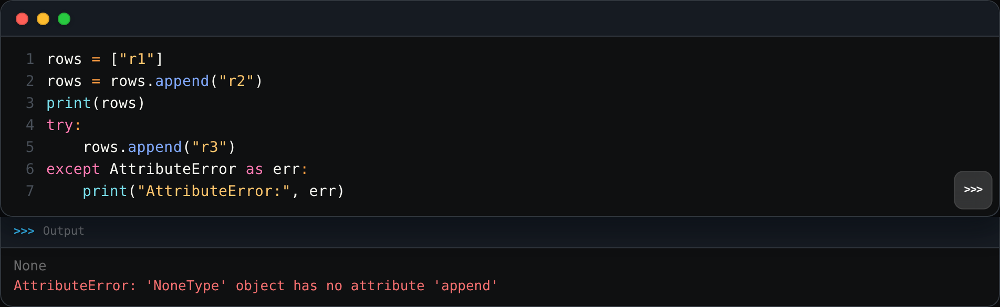

```python
rows = ["r1"]
rows = rows.append("r2")
print(rows)
try:
    rows.append("r3")
except AttributeError as err:
    print("AttributeError:", err)
```


<br>

### += changes the list, + makes a new one

For lists, `a += b` extends `a` in place, the same as `a.extend(b)`, and every alias sees the new items. `a = a + b` builds a new list and points `a` at it, so aliases keep the old list. The augmented assignment you learned on numbers behaves differently here because a list can change in place and an integer cannot.

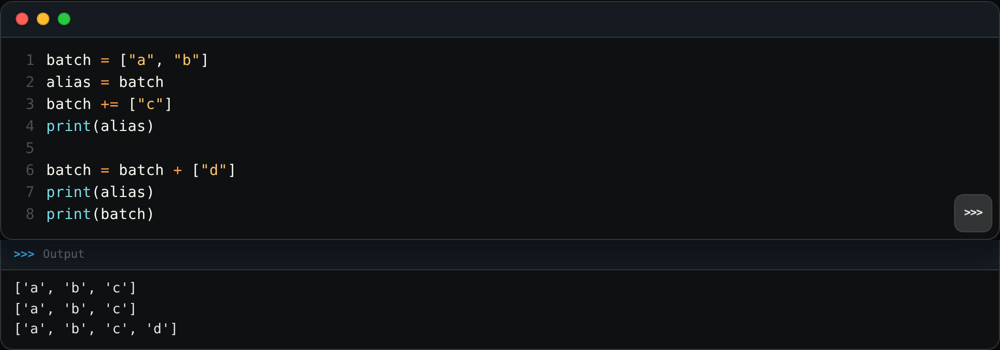

```python
batch = ["a", "b"]
alias = batch
batch += ["c"]
print(alias)

batch = batch + ["d"]
print(alias)
print(batch)
```


<br>

### Choosing a form in a pipeline

| ✓ In place: sort(), extend(), += | ✗ New value: sorted(), +, slicing |
| --- | --- |
| • Your code owns the list and no other name needs the old contents<br><br>• The list is large and a second copy would double its memory<br><br>• The call returns None, so write it as its own statement | • The input must survive, such as a raw batch kept for auditing<br><br>• A caller passed the list in and didn't ask for changes<br><br>• You want the result back as the return value of the call |

> **TIP**
>
> Give your own functions the same contract. A helper either mutates its argument and returns `None`, or leaves the argument alone and returns a new list. The `drop_empty` helper from earlier did both, which is why its caller couldn't tell the raw batch had changed.

**Predict the output.**

```python
data = [5, 2, 8]
a = data
b = sorted(data)
data.reverse()
print(a, b)
```

- **A.** [5, 2, 8] [2, 5, 8]
- **B.** [8, 2, 5] [2, 5, 8]
- **C.** [8, 2, 5] [8, 5, 2]
- **D.** None [2, 5, 8]

<details>
<summary>Solution</summary>

**B.** [8, 2, 5] [2, 5, 8]

a is data, reversed in place; sorted made b a separate list before the reverse.

**Why the others are wrong**

- **A.** a = data binds a second name, so a is the list that reverse() changed.
- **C.** b came from sorted(), a new list, so reversing data does not reorder it.
- **D.** reverse() returned None, but nothing stored that result; a still names the list.

</details>


<br>

### A plan with undo

Exercise: [A plan with undo](_exercises/python_lists_advanced_exercise_1.md)

This last problem uses everything from the earlier sections. It has shallow and deep copies, including one made by a comprehension, next to a stack of saved states and calls that either change a list or return a new one. Trace each name to the object it points at before you answer.

**What does this program print?**

```python
import copy

base = [["load"], ["publish"]]
plan = [steps[:] for steps in base]
plan[0].append("check")
undo = [copy.deepcopy(plan)]
plan[1] = plan[1] + ["notify"]
plan = undo.pop()
print(base, plan)
```

- **A.** [['load'], ['publish']] [['load', 'check'], ['publish', 'notify']]
- **B.** [['load', 'check'], ['publish']] [['load', 'check'], ['publish']]
- **C.** [['load'], ['publish']] [['load', 'check'], ['publish']]
- **D.** [['load'], ['publish']] [['load'], ['publish']]

<details>
<summary>Solution</summary>

**C.** [['load'], ['publish']] [['load', 'check'], ['publish']]

base was never touched; plan is restored from the saved deep copy, which has check but not notify.

**Why the others are wrong**

- **A.** The deep copy in undo was taken before notify was added, so restoring it drops that step.
- **B.** The comprehension copied each inner list, so appending check to plan[0] leaves base[0] alone.
- **D.** The saved state was copied after check was appended, so the restored plan keeps it.

</details>

The in-place rule bites hardest when you sort nested data. `row.sort()` reorders whichever list `row` names, so if a working copy shares its inner lists with the source, sorting the copy's rows reorders the source's rows too. The copy has to reach the inner lists, the 2-level pattern from the deep copy section, before any in-place call runs.


<br>

---

## Putting It All Together

Back in the Instagram signup job, a template list of lists holds the default story settings, and every account created that hour needs settings it can edit without touching any other account, plus an undo for its own last change.

- Handing each account template or template . copy ( ) shares the inner lists, so a single account turning off replies changes all 40,000.
- copy . deepcopy ( template ) , or [ row [ : ] for row in template ] while the template stays 2 levels deep, gives every account its own inner lists.
- A per-account history stack saves a deep copy before each change, so undo pops the previous settings back without touching other accounts.
- Building per-account rows with a comprehension instead of [ [ . . . ] ] \* n avoids repeated references to a single inner list.
- settings . sort ( ) returns None , so the job writes it as a statement and uses sorted ( ) wherever the template's order must survive.


<br>

---

## Key Takeaways

- A comprehension builds a new list: a trailing if filters items, an if - else in front transforms them, and for clauses run in nested-loop order.
- Assignment copies a reference. Mutating through any name changes the shared object; rebinding a name changes only that name.
- copy ( ) makes a new outer list that still shares every inner list, and so do [ : ] and list ( ) . [ [ 0 ] \* 3 ] \* 3 repeats a single row.
- copy . deepcopy duplicates every level and keeps internal sharing intact, at a cost that grows with everything inside.
- append and pop ( ) at the end of a list make a stack. Undo and bracket matching both rely on one, and so does walking nested data without recursion.
- In-place methods return None . sorted ( ) returns a new list, as do + and slicing, while += on a list extends it in place.
