# Lists: Beginner

On Spotify, the Queue screen behind the Now Playing view is an ordered list of track IDs. Tapping Add to Queue appends a track at the end, a finished song comes off the front, and dragging a track out of the queue deletes it by position. Each move is a single list operation, and an off-by-one index plays the wrong song to millions of listeners.


<br>

---

## Creating Lists

A list holds any number of values in one variable, in the order you wrote them. Where a plain variable stores 1 score, a list stores 3 scores or 300 of them and keeps track of which came first. Python writes a list as square brackets around values separated by commas.

```sql
scores = [88, 92, 75]
days = ["Mon", "Tue", "Wed", "Thu"]
prices = [4.99, 12.50, 0.75]
empty = []
```

The brackets mark where the list starts and ends, and each comma separates 1 item from the next. scores holds 3 integers, days holds 4 strings, prices holds 3 floats, and empty holds nothing at all, which still counts as a list.

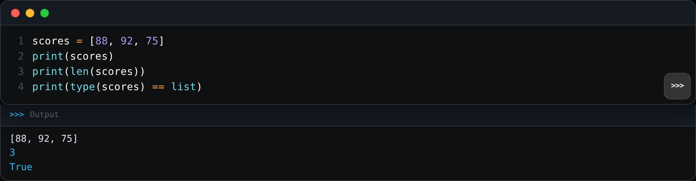

```python
scores = [88, 92, 75]
print(scores)
print(len(scores))
print(type(scores) == list)
```

print shows the whole list in its bracket form, so every item is visible at once. len counts the items and returns 3 for scores. type(scores) == list is True, the same way type(88) == int and type("Mon") == str are both True. A list is a type of its own, and the values inside it keep their own types.


<br>

### Items keep their order

A list remembers the sequence you gave it. A for loop visits each item from first to last, the same way it walks through range, except the loop variable receives the item itself rather than a count. The list below prints its 3 cities in the order they were written, every time the program runs.

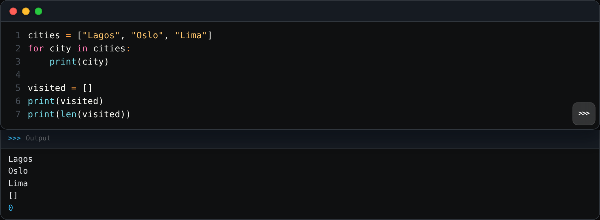

```python
cities = ["Lagos", "Oslo", "Lima"]
for city in cities:
    print(city)

visited = []
print(visited)
print(len(visited))
```

The empty list prints as [] and has length 0. A loop over an empty list runs its body 0 times and moves on. Many programs begin with an empty list and add items as they go, which Section 2 covers in detail.


<br>

### Any type can go inside

A list takes values of any type, and a single list can mix them. A row from a spreadsheet fits in 1 list: the passenger's name and seat number sit beside the bag weight and a flag for whether the ticket is paid.

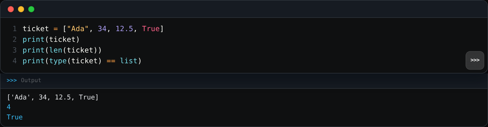

```python
ticket = ["Ada", 34, 12.5, True]
print(ticket)
print(len(ticket))
print(type(ticket) == list)
```

*Python prints strings inside a list with single quotes, even when you typed double quotes. Both spellings make the same string, and the quotes are part of the display rather than part of the value.*

| List | Items | len() |
| --- | --- | --- |
| [88, 92, 75] | 3 integers | 3 |
| ["Mon", "Tue"] | 2 strings | 2 |
| ["Ada", 34, True] | a string, an int and a bool | 3 |
| [4.99] | 1 float | 1 |
| [] | nothing | 0 |

A list of 1 item is still a list, written with brackets around the lone value. The brackets, not the number of items, make something a list.

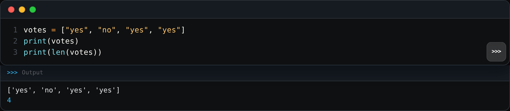

```python
votes = ["yes", "no", "yes", "yes"]
print(votes)
print(len(votes))
```

A list keeps repeated values too. Each "yes" is its own item in its own place, so 4 votes give a length of 4 even though only 2 different words appear. Section 3 depends on this, when a grocery list holds the same item twice.

> **TIP**
>
> Name a list for what it holds, in the plural: `scores`, `cities`, `prices`. A loop variable can then take the singular `for city in cities` so the code reads as a sentence.

> One list, many values
>
> - Square brackets open and close a list; commas separate the items.
> - Items keep the order they were written in, and a for loop visits them in that order.
> - Any type can go inside, and types can mix within 1 list.
> - `len(items)` returns the count, which is 0 for `[]`.


<br>

### len gives you a number

`len` returns an ordinary integer, so you can store it, do arithmetic with it or test it in an if like any other number. A small hotel keeps its booked guests and its waiting list as 2 separate lists. The front desk wants the total of both and the gap between them, and it also wants to know how many of its 5 rooms are still free.

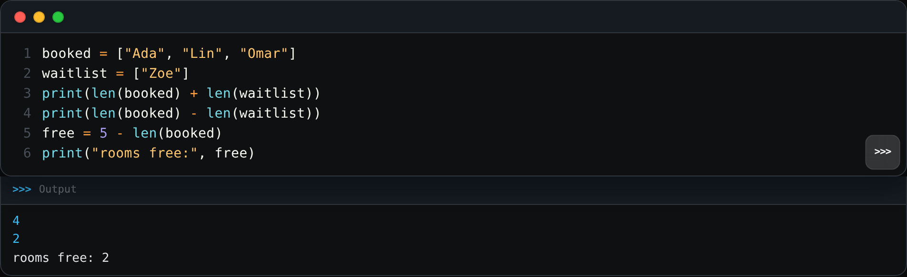

```python
booked = ["Ada", "Lin", "Omar"]
waitlist = ["Zoe"]
print(len(booked) + len(waitlist))
print(len(booked) - len(waitlist))
free = 5 - len(booked)
print("rooms free:", free)
```

An empty list adds 0 to any total, so a sum of lengths counts exactly the items present. If the waiting list were `[]`, the first line would print 3 and the second would print 3 as well.

**What does this program print?**

```python
parts = ["cpu", "ram"]
if len(parts) > 2:
    print(parts[2])
else:
    print(parts[-1])
```

- **A.** It prints cpu
- **B.** It raises IndexError
- **C.** It prints ram
- **D.** It prints an empty line

<details>
<summary>Solution</summary>

**C.** It prints ram

len(parts) is 2, so the condition is false and the else branch prints parts[-1], the last item.

**Why the others are wrong**

- **A.** Index -1 is the last item, which is "ram". "cpu" sits at index 0.
- **B.** The guard sees that 2 items exist, so parts[2] never runs and no error occurs.
- **D.** Both branches print an item from the list. Neither branch prints an empty string.

</details>


<br>

---

## Accessing Items by Index

Every item in a list sits at a numbered position called its index, and the numbering starts at 0. The first item is at index 0, the second at index 1, and the last item of a list with 4 items is at index 3. To read an item, write the list's name followed by the index in square brackets.

| Item | Mon | Tue | Wed | Thu |
| --- | --- | --- | --- | --- |
| Index | 0 | 1 | 2 | 3 |
| Negative index | -4 | -3 | -2 | -1 |

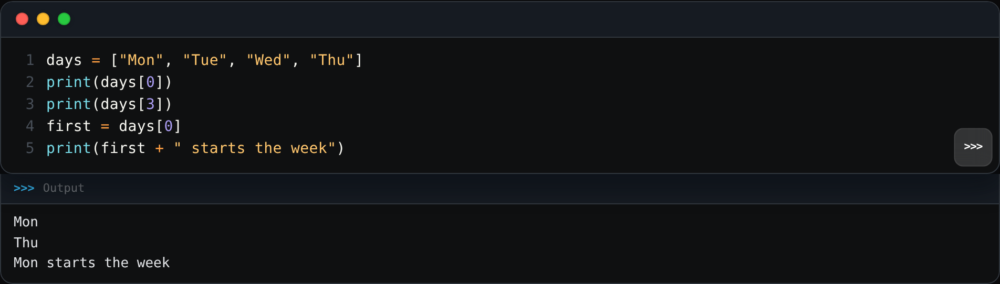

```python
days = ["Mon", "Tue", "Wed", "Thu"]
print(days[0])
print(days[3])
first = days[0]
print(first + " starts the week")
```

days[0] is an expression with a value, so it goes anywhere a value goes: inside print, on the right of an assignment, or joined to another string with +. The index can be a variable too: with i = 2, days[i] is "Wed".


<br>

### Counting from the end

A negative index counts backwards from the end. Index -1 is the last item, -2 the one before it, and -4 is the first item of a 4-item list. This saves working out the length first: the last item is at -1 whether the list has 4 items or 4000.

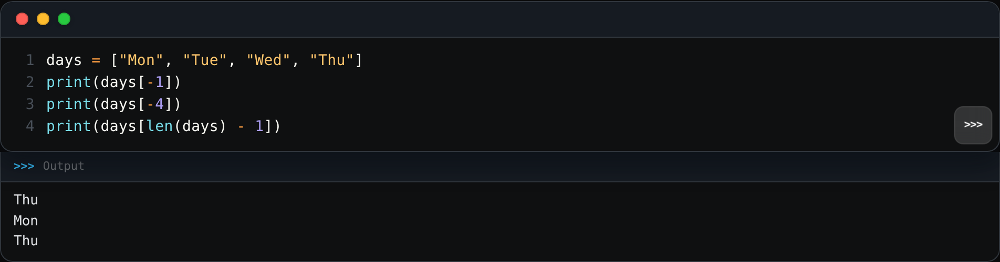

```python
days = ["Mon", "Tue", "Wed", "Thu"]
print(days[-1])
print(days[-4])
print(days[len(days) - 1])
```

The third line shows the long way to reach the last item: the length is 4, the last index is 3, so len(days) - 1 lands on "Thu". Negative indexing does the same arithmetic for you.


<br>

### Past the end

An index that names no item stops the program. A list of 3 items has indexes 0 through 2, so asking for index 3 raises an IndexError, and nothing after that line runs. The first print below succeeds and the second one ends the program.

```sql
colors = ["red", "green", "blue"]
print(colors[2])
print(colors[3])
print("done")
```

Run, this program prints blue and then stops with a traceback whose last line is IndexError: list index out of range. The word done never prints. That message always means the number in the brackets was too large for the list, or too negative: index -4 on this 3-item list fails the same way. Section 4 shows how to check before asking.


<br>

### Replacing an item

The same bracket form on the left of = writes a value into a position. The old item goes away and the new one takes its index; the list keeps its length. Press play and watch index 2 change.

https://github.com/user-attachments/assets/4d64b256-d8f9-4134-8ae0-df8d4a60dfca

Index 2 held "Mars" and after the assignment it holds "Earth". The other 3 items stay where they were, and the final line shows index 0 replaced as well. Assigning to an index that doesn't exist, such as planets[4] on this 4-item list, raises the same IndexError as reading one.


<br>

### Index plus loop

range(len(tasks)) produces 0, 1, 2 for a list of 3 items, exactly the valid indexes. Looping over that range gives you both the position and, through tasks[i], the item at it.

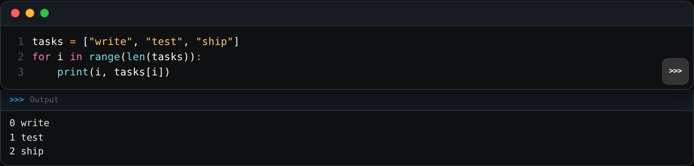

```python
tasks = ["write", "test", "ship"]
for i in range(len(tasks)):
    print(i, tasks[i])
```

> **TIP**
>
> Reach for `range(len(...))` only when the position matters. When you only need the items, `for task in tasks` is the clearer loop, and it can't go out of range.

**What does this program print?**

```python
parts = ["cpu", "ram"]
if len(parts) > 2:
    print(parts[2])
else:
    print(parts[-1])
```

- **A.** It prints cpu
- **B.** It raises IndexError
- **C.** It prints ram
- **D.** It prints an empty line

<details>
<summary>Solution</summary>

**C.** It prints ram

len(parts) is 2, so the condition is false and the else branch prints parts[-1], the last item.

**Why the others are wrong**

- **A.** Index -1 is the last item, which is "ram". "cpu" sits at index 0.
- **B.** The guard sees that 2 items exist, so parts[2] never runs and no error occurs.
- **D.** Both branches print an item from the list. Neither branch prints an empty string.

</details>


<br>

### The third item is at index 2

People count positions from 1 and Python counts indexes from 0, so the item a person calls third sits at index 2: subtract 1 from the position. Counting from the back needs no subtraction, because the last item is -1, the second to last is -2, and so on.

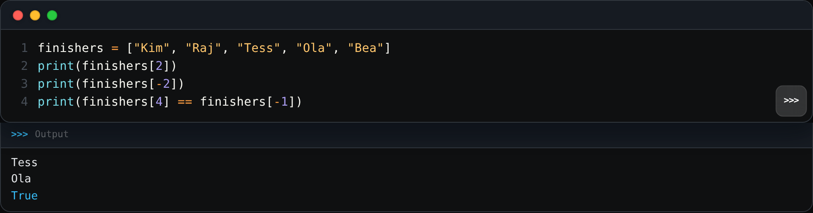

```python
finishers = ["Kim", "Raj", "Tess", "Ola", "Bea"]
print(finishers[2])
print(finishers[-2])
print(finishers[4] == finishers[-1])
```

On a list of 5 items, index -1 names the same item as index 4, and -3 matches 2: a negative index is the positive one minus the length. Forgetting the minus 1 reads the item next door to the one you wanted, and Python raises no error to warn you, because that neighbour sits at a valid index.


<br>

---

## Adding Items to Lists

Lists change size while a program runs. The append method adds 1 item to the end, in place: the list itself grows and no new list comes back. Call it with a dot after the list's name and the new item in parentheses.

https://github.com/user-attachments/assets/29ec8dbe-5890-4bc8-a776-65c7d3df2b3d

After 3 calls, shopping holds 5 items, each new one landing after the previous. The order of the calls becomes the order in the list, so append is the right tool whenever items arrive one at a time and arrival order is the order you want to keep.


<br>

### Building a list in a loop

The most common way to fill a list: start with [], loop, and append each value as you compute it. The loop below squares the numbers 1 through 5 and the list grows by 1 on every pass. Nothing prints until the loop ends, because the point is to keep the results rather than show them.

https://github.com/user-attachments/assets/28155701-d307-4f4a-9dfb-4b0b2654cbc8

The same shape with an if inside keeps only the values that pass a test. The loop below walks the numbers 1 to 10 and appends the ones divisible by 2, so the result has 5 items while the source still has 10. The source list is never changed; a new list collects the matches.

https://github.com/user-attachments/assets/b9f6b6e7-5e63-4396-97aa-28b1319c8022

> The accumulator pattern
>
> - Create an empty list before the loop starts.
> - Compute 1 value on each pass through the loop.
> - Append it, optionally only when an `if` test passes.
> - Use the finished list after the loop ends.

The accumulator works with a while loop as well, when the number of passes is not known in advance. The loop below starts at 3, doubles the value on each pass, and appends every value below 100. The list ends with 6 items because the seventh value, 192, fails the test.

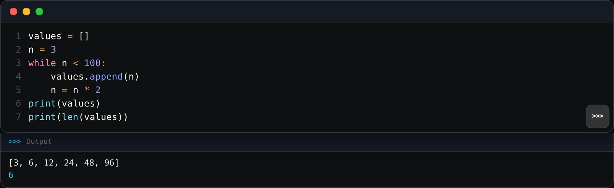

```python
values = []
n = 3
while n < 100:
    values.append(n)
    n = n * 2
print(values)
print(len(values))
```


<br>

### Inserting at a position

insert takes 2 arguments: the index where the new item should sit, and the item itself. Everything from that index onward shifts 1 place to the right to make room, so the item that used to be at index 1 answers to index 2 after the insert.

https://github.com/user-attachments/assets/4b882845-fd04-4aa1-9eaa-d7be854a7188

Index 0 puts the item at the front, which is how an urgent request jumps a queue: the 3 existing items each move 1 place right and the new one takes index 0.

https://github.com/user-attachments/assets/46244ae7-cb6e-4dbc-b9b9-e91aba7423c3

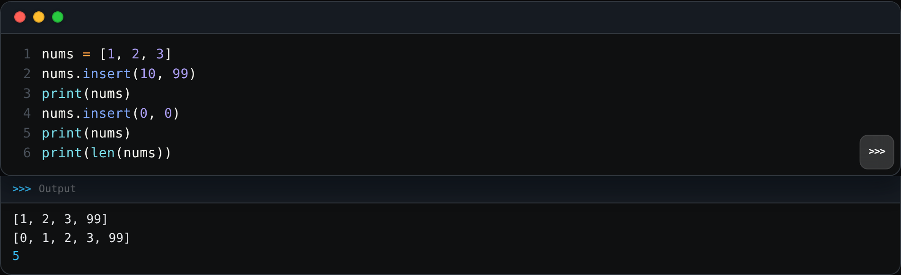

```python
nums = [1, 2, 3]
nums.insert(10, 99)
print(nums)
nums.insert(0, 0)
print(nums)
print(len(nums))
```

An insert index beyond the end raises no error: Python places the item at the end, as append would. Watch for this, because a typo in the index produces a list that looks almost right. The second insert at 0 pushes all 4 items along and the length reaches 5.

| ✓ append(item) | ✗ insert(index, item) |
| --- | --- |
| • Adds at the end<br><br>• Takes 1 argument<br><br>• Never shifts other items<br><br>• Use when arrival order is the order you want | • Adds at a chosen index<br><br>• Takes 2 arguments, index first<br><br>• Shifts later items right by 1<br><br>• Use when the position must be chosen |

> **TIP**
>
> Both methods change the list they are called on and return nothing useful. Write `items.append(x)` on its own line rather than `items = items.append(x)`, which throws the list away.


<br>

### Index first, item second

`insert` reads its first argument as the position and its second as the item, always in that order. On a list of numbers, swapping them raises no error: both arguments are integers, so Python accepts either order and quietly does something else.

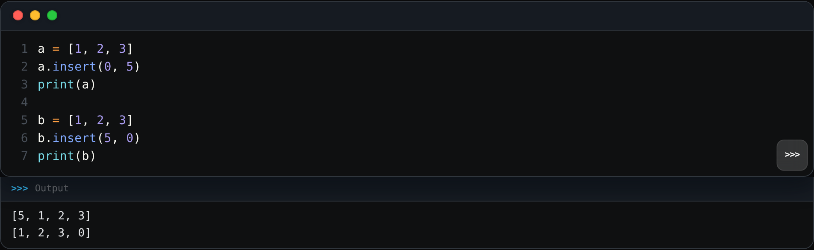

```python
a = [1, 2, 3]
a.insert(0, 5)
print(a)

b = [1, 2, 3]
b.insert(5, 0)
print(b)
```

The first call puts 5 at the front. The second puts 0 at the end, because index 5 lies beyond the end of a 3-item list. With a string item the swap fails loudly instead: an index must be a whole number, so `names.insert("Zed", 0)` raises a TypeError before the list changes.


<br>

---

## Removing Items from Lists

Each way of taking items out of a list differs in what you give it and what you get back. remove takes a value and returns nothing. pop and del both take an index, but only pop hands the removed item back. Pick by what you know: the value, or the position.


<br>

### remove: by value

https://github.com/user-attachments/assets/fa7594b2-4391-4d3c-9a1c-dc84cb130480

groceries held "eggs" twice, and only the first one went. remove searches from the front, deletes the first match and stops. A second remove("eggs") would delete the other one, and a third would fail, because the value is no longer there.

```sql
cart = ["pen", "ink"]
cart.remove("pen")
print(cart)
cart.remove("pen")
print(cart)
```

When run, the program prints ['ink']. Then it stops with a traceback ending in ValueError: list.remove(x): x not in list. The first remove succeeded, so the second found no "pen" left and the last print never ran. The error names the problem as a value problem, which separates it from the index problems below.


<br>

### pop: by index, with a return

https://github.com/user-attachments/assets/f8fa55af-c6be-4a35-babb-6cfe19a2635d

pop() with no argument removes the last item and returns it. pop(1) does the same for index 1. Either way the removed item comes back, so you can store it in a variable or print it, as the animation does with last and middle.

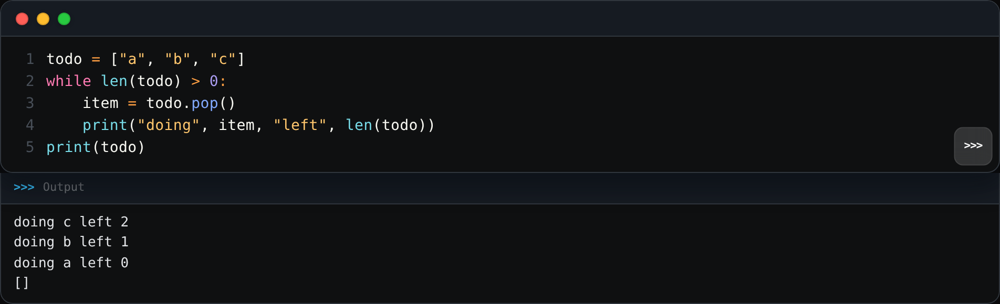

```python
todo = ["a", "b", "c"]
while len(todo) > 0:
    item = todo.pop()
    print("doing", item, "left", len(todo))
print(todo)
```

The loop stops when len(todo) hits 0. Calling pop on an empty list raises IndexError: pop from empty list, which the while condition prevents here by checking the length before each pop.

On a list of numbers, `remove` and `pop` look alike, since each takes a number in parentheses. `remove` reads the number as a value to find, and `pop` reads it as a position.

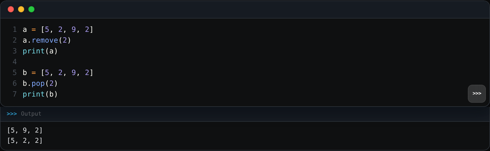

```python
a = [5, 2, 9, 2]
a.remove(2)
print(a)

b = [5, 2, 9, 2]
b.pop(2)
print(b)
```

`a.remove(2)` deleted the first 2 it found, which sat at index 1. `b.pop(2)` went to index 2 and took 9, leaving both 2s in place. The method in front of the parentheses decides what the number means.


<br>

### del: by index, no return

https://github.com/user-attachments/assets/26b5d735-d021-4249-a26e-3747e2f470c0

del numbers[2] deletes the item at index 2. del is a statement rather than a method, so there is no dot and no parentheses after it. After the first del, 40 moves from index 3 to index 2, so a second del numbers[2] would remove 40, not 50.

| Tool | You give | You get back | Fails when |
| --- | --- | --- | --- |
| groceries.remove("eggs") | a value | nothing | the value is absent (ValueError) |
| stack.pop() | an optional index | the removed item | the list is empty or the index is out of range, too large or too negative (IndexError) |
| del numbers[2] | an index | nothing | the index is out of range, too large or too negative (IndexError) |

> **TIP**
>
> Indexes shift after any removal. Removing index 1 from a 4-item list leaves indexes 0 through 2, and the item that sat at 2 now answers to 1. Re-read positions after each removal rather than trusting the old numbers.

**What does this program print?**

```python
parts = ["cpu", "ram"]
if len(parts) > 2:
    print(parts[2])
else:
    print(parts[-1])
```

- **A.** It prints cpu
- **B.** It raises IndexError
- **C.** It prints ram
- **D.** It prints an empty line

<details>
<summary>Solution</summary>

**C.** It prints ram

len(parts) is 2, so the condition is false and the else branch prints parts[-1], the last item.

**Why the others are wrong**

- **A.** Index -1 is the last item, which is "ram". "cpu" sits at index 0.
- **B.** The guard sees that 2 items exist, so parts[2] never runs and no error occurs.
- **D.** Both branches print an item from the list. Neither branch prints an empty string.

</details>


<br>

### Choosing among remove, pop and del

Pick the tool by what you have in hand. If you know the value, such as a guest's name, use `remove`. `pop` fits when you know the position and need the item afterwards, and it also takes negative indexes. When you know the position and have no further use for the item, `del` is enough.

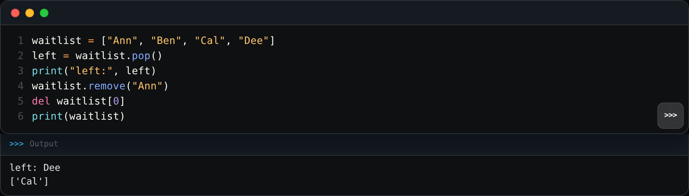

```python
waitlist = ["Ann", "Ben", "Cal", "Dee"]
left = waitlist.pop()
print("left:", left)
waitlist.remove("Ann")
del waitlist[0]
print(waitlist)
```

Dee left the line from the back and her name was kept for the message, so pop fits. Ann cancelled by name, so remove fits. The front slot was dropped with no record, so del fits. Positions close up after each removal: Ben moved from index 1 to index 0 before del ran, so del took Ben and left Cal.


<br>

---

## Safe List Access

Reading an index that doesn't exist, popping from an empty list and removing a value that is not there all stop a program. Each has a check that costs 1 line and runs before the risky call, so the program prints a message and carries on instead of ending with a traceback.


<br>

### Check the length before indexing

A list of n items accepts indexes 0 through n - 1. An index is safe when it's below len(items), and, for counting from the front, at least 0. Compare first, read second.

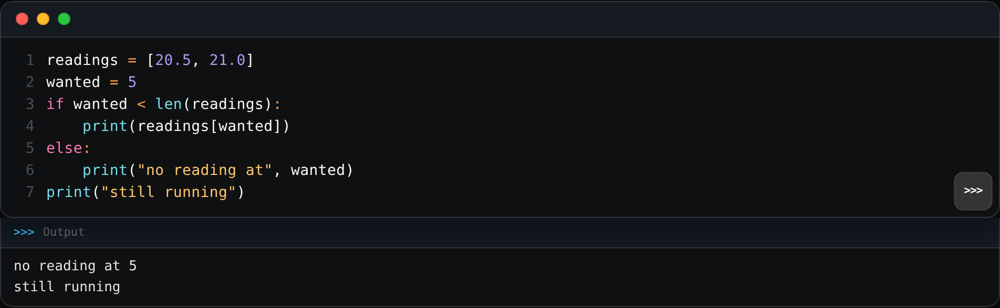

```python
readings = [20.5, 21.0]
wanted = 5
if wanted < len(readings):
    print(readings[wanted])
else:
    print("no reading at", wanted)
print("still running")
```

The else branch prints a message and the program reaches the last line. Without the if, readings[5] would have raised IndexError and "still running" would never appear. The same guard works inside a loop, where and joins the 2 halves of the range check.

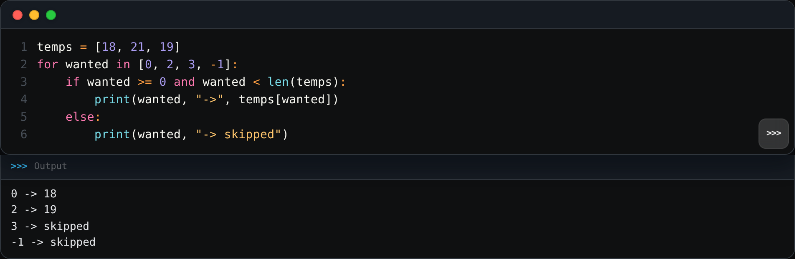

```python
temps = [18, 21, 19]
for wanted in [0, 2, 3, -1]:
    if wanted >= 0 and wanted < len(temps):
        print(wanted, "->", temps[wanted])
    else:
        print(wanted, "-> skipped")
```

This guard treats negative numbers as invalid on purpose. Python would accept temps[-1], but a position that arrives from a form or a counter means a count from the front, and a -1 there is a mistake worth catching rather than a request for the last item.


<br>

### Check for empty before pop

A loop that pops on every pass needs the list to still have items. Testing `len(inbox) > 0` before each pop turns the third and fourth passes into a message instead of a crash.

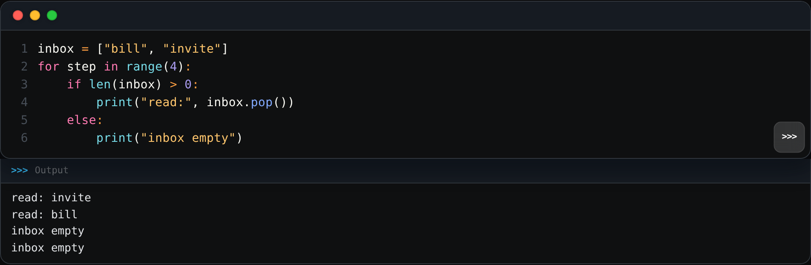

```python
inbox = ["bill", "invite"]
for step in range(4):
    if len(inbox) > 0:
        print("read:", inbox.pop())
    else:
        print("inbox empty")
```

The 2 pops empty the inbox, and from then on the else branch answers. All 4 passes complete, and the program never reaches a pop on an empty list.


<br>

### Count before remove

The count method returns how many times a value appears in the list. A count of 0 means remove would raise ValueError, so test the count first and only remove when it is above 0.

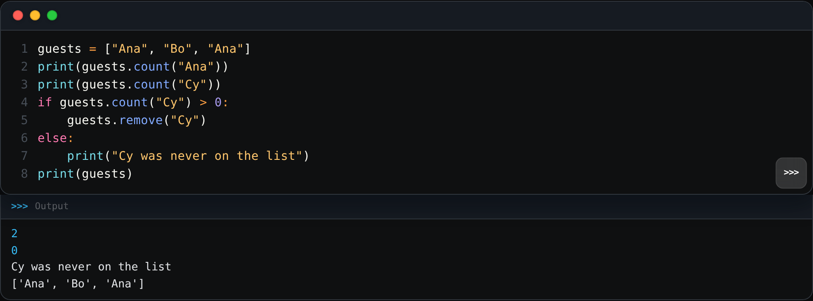

```python
guests = ["Ana", "Bo", "Ana"]
print(guests.count("Ana"))
print(guests.count("Cy"))
if guests.count("Cy") > 0:
    guests.remove("Cy")
else:
    print("Cy was never on the list")
print(guests)
```


<br>

### Guarding the first and last item

`items[0]` and `items[-1]` name positions every non-empty list has, but an empty list has neither a first nor a last item, so both raise IndexError on `[]`. The guard is the same emptiness test used before pop: check the length, then read.

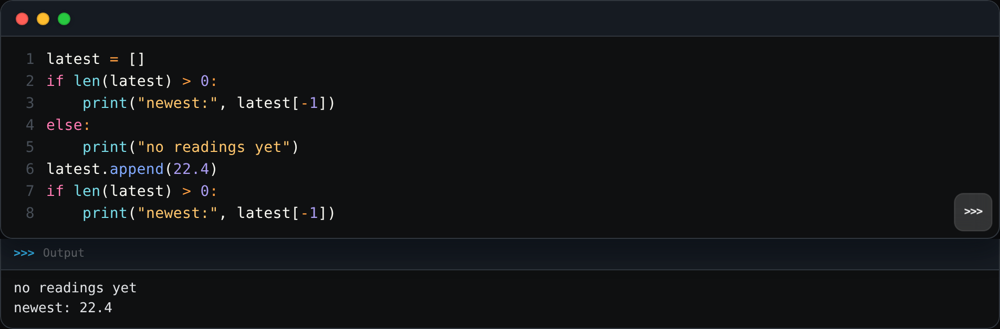

```python
latest = []
if len(latest) > 0:
    print("newest:", latest[-1])
else:
    print("no readings yet")
latest.append(22.4)
if len(latest) > 0:
    print("newest:", latest[-1])
```


<br>

### Wrap it in a function

A function that returns a fallback value when the index is out of range lets the rest of a program read positions without an if at every call site. The caller always gets a value back: the item when it exists, the fallback when it does not.

https://github.com/user-attachments/assets/bba39884-c14e-444a-a261-47a57b14f5a7

*The function returns the item when the index is in range and the fallback otherwise.*

Index 1 passes both halves of the test and "verse" comes back. Index 3 fails the length check and index -1 fails the sign check, so each returns "silence" and the program prints 3 lines with no traceback.

The caller picks the fallback, so each call site decides what missing looks like: 0 for a count, an empty string for a label, "silence" for an empty slot in a playlist. The function only decides whether the index is in range, which keeps it usable for a list of any type.

| ✓ Do | ✗ Don't |
| --- | --- |
| • Compare the index against len() before reading from the list<br><br>• Test len(items) > 0 before every pop()<br><br>• Test count(value) > 0 before remove(value)<br><br>• Return a fallback from a helper so callers always get a value | • Assume a list still has items inside a loop that pops<br><br>• Hard-code an index like 3 without checking the length<br><br>• Call remove on a value you never confirmed is present<br><br>• Let a number from outside the program reach [] unchecked |

**What does this program print?**

```python
parts = ["cpu", "ram"]
if len(parts) > 2:
    print(parts[2])
else:
    print(parts[-1])
```

- **A.** It prints cpu
- **B.** It raises IndexError
- **C.** It prints ram
- **D.** It prints an empty line

<details>
<summary>Solution</summary>

**C.** It prints ram

len(parts) is 2, so the condition is false and the else branch prints parts[-1], the last item.

**Why the others are wrong**

- **A.** Index -1 is the last item, which is "ram". "cpu" sits at index 0.
- **B.** The guard sees that 2 items exist, so parts[2] never runs and no error occurs.
- **D.** Both branches print an item from the list. Neither branch prints an empty string.

</details>


<br>

---

## Putting It All Together

A pizza shop runs its kitchen from a list of order numbers. New orders append to the end, a phoned-in rush order inserts at index 0, the cook pops index 0 to start the next pizza, and a cancelled order is removed by its number. At closing time the display reads index 0 for the next order, and on an empty list that read would crash the screen.

- Appending each new order keeps arrival order, so the list itself is the queue.
- Inserting the rush order at index 0 shifts every waiting order right by 1, which the display must re-read.
- pop(0) returns the order number the cook needs while shrinking the list, where del would lose it.
- remove by order number fails if the customer cancelled twice, so a count check guards it.
- A len() check before reading index 0 turns the closing-time crash into a message that says the kitchen is clear.


<br>

---

## Key Takeaways

- A list, written as square brackets around comma-separated values, keeps them in order. len ( ) counts them.
- Indexes start at 0, negative indexes count from the end, and an index past either end raises IndexError.
- items [ i ] = value replaces an item in place without changing the length.
- append adds at the end and insert ( index , item ) adds at a position, shifting later items right.
- remove deletes by value, pop deletes by index and returns the item, del deletes by index and returns nothing.
- Checking the length before the risky call keeps the program running, and so does an emptiness check or a count check.
