# Lists: Intermediate

It's December at Spotify, and the year-end recap needs each listener's top 5 songs from a ranked list of 50, a single history merged from 12 monthly lists, recent plays shown newest first, and a check that a song is not already queued. An off-by-one slice shows 4 songs instead of 5. Every one of those steps is a list operation.


<br>

---

## List Slicing

A slice pulls a run of consecutive items out of a list and returns them as a new list. You already know the syntax from strings: `daily_rows[start:stop]` takes the items from position `start` up to, but not including, position `stop`. What comes back is always a list, even when the run holds a single item or none at all.

Every example in this section uses the same list: the number of rows a pipeline loaded on each of 8 days, oldest day first.

| Day | Rows loaded | Index | Negative index |
| --- | --- | --- | --- |
| Day 1 | 120 | 0 | -8 |
| Day 2 | 135 | 1 | -7 |
| Day 3 | 98 | 2 | -6 |
| Day 4 | 160 | 3 | -5 |
| Day 5 | 142 | 4 | -4 |
| Day 6 | 155 | 5 | -3 |
| Day 7 | 171 | 6 | -2 |
| Day 8 | 149 | 7 | -1 |

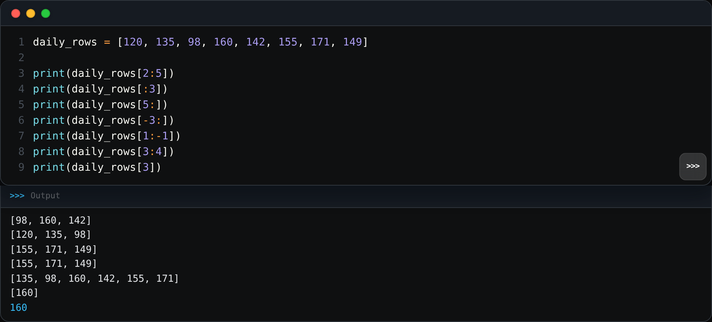

```python
daily_rows = [120, 135, 98, 160, 142, 155, 171, 149]

print(daily_rows[2:5])
print(daily_rows[:3])
print(daily_rows[5:])
print(daily_rows[-3:])
print(daily_rows[1:-1])
print(daily_rows[3:4])
print(daily_rows[3])
```

Compare the last 2 lines. `daily_rows[3:4]` is a 1-item list, `[160]`, while `daily_rows[3]` is the number `160` itself. Code that expects a number and receives a list fails at the next arithmetic step, so pick the form you need. When `start` and `stop` both fall inside the list, the slice holds `stop - start` items: `[2:5]` always returns 3. When `start` sits at or after `stop`, the count bottoms out at 0 and the slice is empty: `daily_rows[5:2]` returns `[]`. Python raises no error and doesn't walk backwards.


<br>

### Defaults and negative positions

Leaving out `start` means from the first item, and leaving out `stop` means through the last. Negative positions count from the end, as they do for strings, so `[-3:]` reads as the last 3 items however long the list grows. That matters in a daily job: a report on the most recent 3 days shouldn't hard-code `[5:]`, because tomorrow the list holds 9 items and `[5:]` returns 4 of them.


<br>

### A step skips items

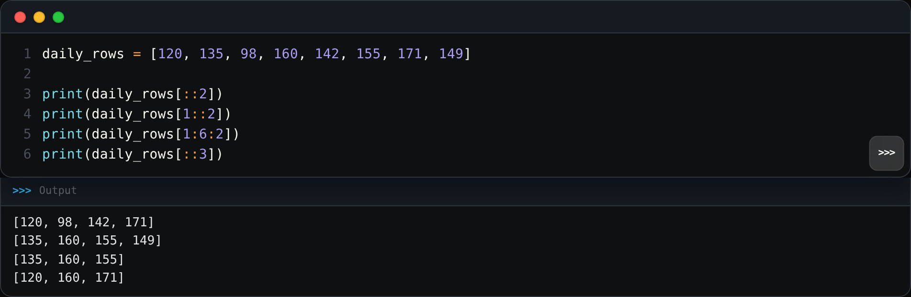

```python
daily_rows = [120, 135, 98, 160, 142, 155, 171, 149]

print(daily_rows[::2])
print(daily_rows[1::2])
print(daily_rows[1:6:2])
print(daily_rows[::3])
```

The third number is the step. Python takes the item at `start` and jumps ahead by the step to take the next one, repeating until it reaches `stop`. With a step of 2, `[::2]` returns every odd day from 1 to 7. `[1::2]` returns every even day from 2 to 8. A pipeline uses this to split records into 2 alternating halves, or to sample every 3rd record for a spot check.


<br>

### Slices do not raise IndexError

Indexing a position past the end raises `IndexError`. Slicing past the end does not: Python clips `start` and `stop` to the edges of the list and returns whatever falls between them, possibly an empty list. `daily_rows[5:20]` returns the 3 items from position 5 through 7. `daily_rows[20:30]` returns `[]`. That helps when you want up to N items from a list that might be shorter, and hurts when a short result should have stopped the job, because nothing warns you.

> **TIP**
>
> When a slice must hold a fixed number of items, check its length right after slicing. `len(daily_rows[-7:])` is 7 only when at least 7 days have loaded; with 4 days it is 4, and no error tells you.


<br>

### A slice is a separate list

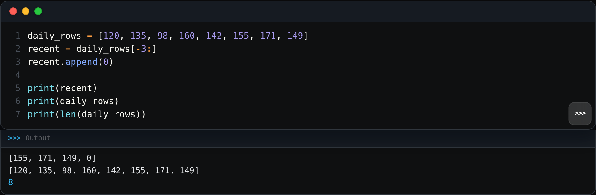

```python
daily_rows = [120, 135, 98, 160, 142, 155, 171, 149]
recent = daily_rows[-3:]
recent.append(0)

print(recent)
print(daily_rows)
print(len(daily_rows))
```

Appending to `recent` leaves `daily_rows` with its original 8 items, because the slice built a new list holding the same values. `daily_rows[:]`, a slice with both ends left out, is the shortest way to get a full separate list that you can change without touching the original.


<br>

### Predicting a stepped slice

To predict a slice with a step, write out the positions it visits before reading any values. For `daily_rows[2:7:2]`, start at position 2 and add 2 each time. That visits every even position up to 6. The next would be 8, which is past the stop of 7, so the walk ends. Only then look up the values: `[98, 142, 171]`. Listing positions first catches 2 frequent mistakes: counting the stop position as included, and forgetting that the step jumps over the items in between.

**What does this program print?**

```python
ids = [104, 220, 104, 315]
target = "104"
if target in ids:
    print(ids.index(target))
else:
    print("not found")
print(ids.count(104))
```

- **A.** 0 then 2
- **B.** A ValueError from index()
- **C.** not found then 2
- **D.** not found then 1

<details>
<summary>Solution</summary>

**C.** not found then 2

"104" matches no integer item, so the else branch prints not found. count(104) uses the integer and finds positions 0 and 2.

**Why the others are wrong**

- **A.** The count is right, but target is the string "104", and a string never equals the integer 104, so in is False.
- **B.** The in guard is False, so the else branch runs and index() is never called.
- **D.** The first line is right, but count() checks every item, and 104 appears at positions 0 and 2.

</details>


<br>

---

## Combining Lists

A pipeline rarely receives everything in a single list. Records arrive in batches, a list per file or per day, and a later step needs them as one sequence. Python has several ways to put lists together, and the difference behind many bugs is where the result ends up: in a new list, or in an existing list that grows?


<br>

### The + operator builds a new list

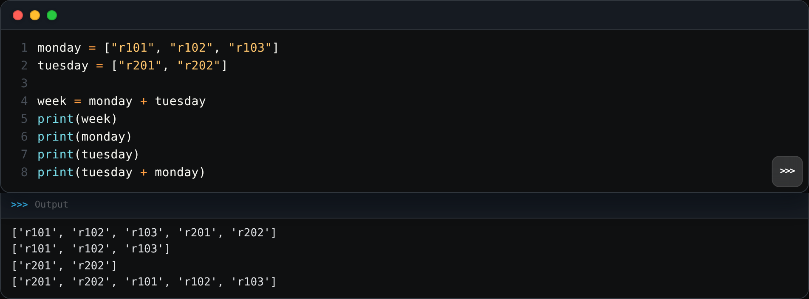

```python
monday = ["r101", "r102", "r103"]
tuesday = ["r201", "r202"]

week = monday + tuesday
print(week)
print(monday)
print(tuesday)
print(tuesday + monday)
```

`+` copies the items of the left list, then the items of the right list, into a brand-new list. Neither input changes, and order follows the operands: `tuesday + monday` puts Tuesday first. Both sides must be lists. `monday + "r104"` raises `TypeError: can only concatenate list (not "str") to list`, so wrap a single item in brackets: `monday + ["r104"]`.


<br>

### extend() grows the list you already have

https://github.com/user-attachments/assets/0ef9af0e-b43b-40fc-bad6-52a136ce3c08

`team_a.extend(team_b)` adds each item of `team_b` to the end of `team_a`. Afterwards `team_a` holds 5 names and `team_b` still holds its 2, and no third list exists. For lists, `team_a += team_b` behaves like `extend()`: it adds to the existing list rather than building a new one.


<br>

### append() vs extend()

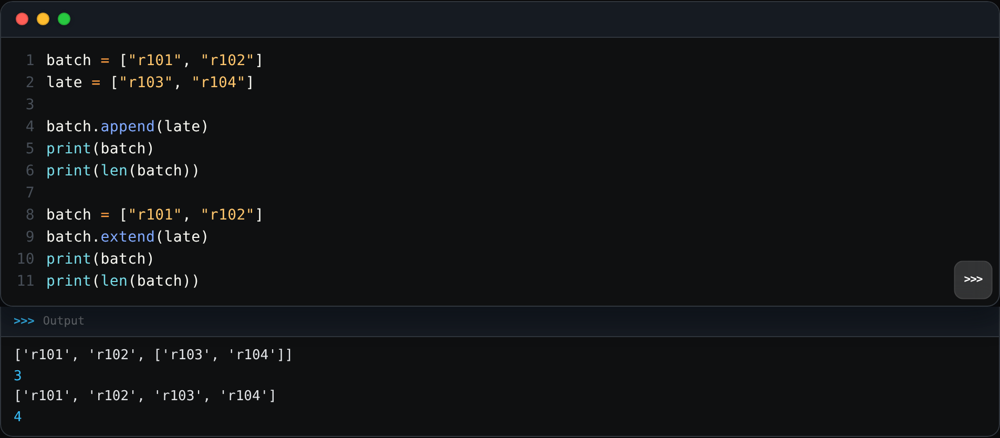

```python
batch = ["r101", "r102"]
late = ["r103", "r104"]

batch.append(late)
print(batch)
print(len(batch))

batch = ["r101", "r102"]
batch.extend(late)
print(batch)
print(len(batch))
```

`append()` adds its argument as a single item, whatever that argument is. Given a list, it adds the whole list as one element, so `batch` ends with a nested list and has a length of 3. A loop over that `batch` would hand its third pass a list where it expects an ID. `extend()` walks through its argument and adds each item separately, giving the 4 IDs you meant.

> **TIP**
>
> `extend()` adds the items of whatever you pass, and the items of a string are its characters. `batch.extend("r105")` adds 4 items, one per character: first `'r'` and `'1'`, then `'0'` and `'5'`. Use `append()` for one item and `extend()` for a list of items.


<br>

### Repeating a list with \*

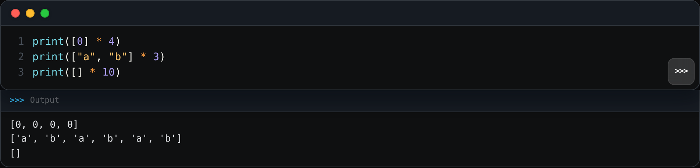

```python
print([0] * 4)
print(["a", "b"] * 3)
print([] * 10)
```

Multiplying a list by an integer `n` builds a new list holding its items `n` times over. `[0] * 7` is a common way to start 7 daily counters before a loop fills them in. Numbers and strings repeat this way, and so does `None`. An empty list repeated any number of times stays empty.

| Expression | Result | Changes an existing list? |
| --- | --- | --- |
| `a + b` | New list: items of a, then b | No |
| `a += b` | a grows by the items of b | Yes, a |
| `a.extend(b)` | a grows by the items of b | Yes, a |
| `a.append(b)` | a grows by 1 item: the list b | Yes, a |
| `a \* 3` | New list: items of a, 3 times | No |


<br>

### Gathering many lists in a loop

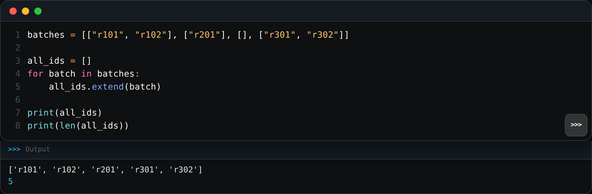

```python
batches = [["r101", "r102"], ["r201"], [], ["r301", "r302"]]

all_ids = []
for batch in batches:
    all_ids.extend(batch)

print(all_ids)
print(len(all_ids))
```

Starting from an empty list and extending once per batch is the standard pattern for gathering many lists into one. The empty batch adds nothing and raises no error. Writing `all_ids = all_ids + batch` gives the same result, but builds a fresh list on every pass and copies everything gathered so far, which slows down as the total grows.


<br>

### Which list does each line touch?

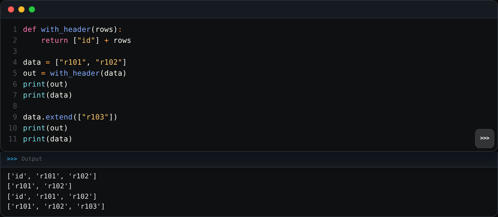

```python
def with_header(rows):
    return ["id"] + rows

data = ["r101", "r102"]
out = with_header(data)
print(out)
print(data)

data.extend(["r103"])
print(out)
print(data)
```

When several names are in play, track each one line by line. `with_header()` combines with `+`, so it hands back a separate list and leaves its argument with the 2 IDs it started with. Extending `data` afterwards changes `data` alone: `out` still prints 3 items. A function that builds its result with `+` is the safer choice whenever the caller still needs its input as it was.

**What does this program print?**

```python
ids = [104, 220, 104, 315]
target = "104"
if target in ids:
    print(ids.index(target))
else:
    print("not found")
print(ids.count(104))
```

- **A.** 0 then 2
- **B.** A ValueError from index()
- **C.** not found then 2
- **D.** not found then 1

<details>
<summary>Solution</summary>

**C.** not found then 2

"104" matches no integer item, so the else branch prints not found. count(104) uses the integer and finds positions 0 and 2.

**Why the others are wrong**

- **A.** The count is right, but target is the string "104", and a string never equals the integer 104, so in is False.
- **B.** The in guard is False, so the else branch runs and index() is never called.
- **D.** The first line is right, but count() checks every item, and 104 appears at positions 0 and 2.

</details>


<br>

---

## Comparing Lists

Two lists are equal when they have the same length and every pair of items in matching positions is equal. Python starts at position 0 of both lists and moves forward one position at a time until it finds a pair that differs. Order counts: `[1, 2, 3] == [3, 2, 1]` is `False` because position 0 holds 1 on the left and 3 on the right.

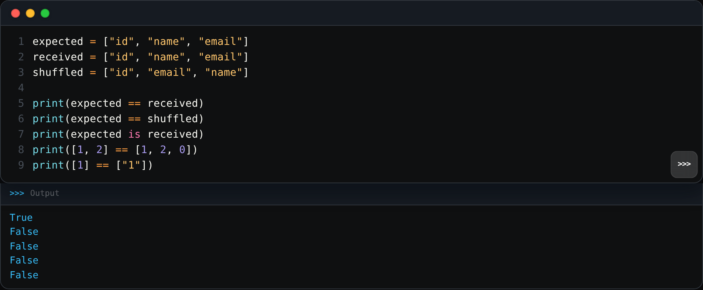

```python
expected = ["id", "name", "email"]
received = ["id", "name", "email"]
shuffled = ["id", "email", "name"]

print(expected == received)
print(expected == shuffled)
print(expected is received)
print([1, 2] == [1, 2, 0])
print([1] == ["1"])
```

A pipeline uses `==` this way to check a file's header against the columns it expects. `shuffled` holds the right names in the wrong order and fails the check, which is what you want when columns are read by position. `is` asks a different question. As with `None`, it tests whether 2 names refer to the same object. Here `expected` and `received` are separate lists that happen to hold equal items. Compare contents with `==`. The last line shows that the integer `1` and the string `"1"` are unequal, and comparing them raises no error.


<br>

### Which list sorts first

`<` and `<=` use the same walk, as do `>` and `>=`. Python finds the first position where the items differ, and that single pair decides the whole comparison; everything after it is ignored. Strings compare the same way: `"apple" < "apricot"` is settled at the third letter, where `p` comes before `r`.

https://github.com/user-attachments/assets/7c4a2e7c-9315-45bd-b48b-b4f640fb2f99

*The first differing position decides; if none differs, the shorter list is smaller.*

The function in the animation does by hand what `<` does for you. In the first call, position 0 holds 3 on both sides, position 1 holds 9 against 10, and 9 is smaller, so the left list sorts first. The trailing 1 and 0 are never looked at. In the second call every shared position matches, so length breaks the tie: a list that is the start of a longer list sorts before it.

| Comparison | Deciding position | Result |
| --- | --- | --- |
| `[2, 9] < [3, 0]` | 0: 2 vs 3 | True |
| `[5, 1, 7] < [5, 1, 4]` | 2: 7 vs 4 | False |
| `[4, 4] < [4, 4, 1]` | None; left is shorter | True |
| `[4, 4] < [4, 4]` | None; same length | False |
| `[4, 4] <= [4, 4]` | None; equal lists | True |
| `[] < [0]` | None; left is shorter | True |


<br>

### Version numbers: lists beat strings

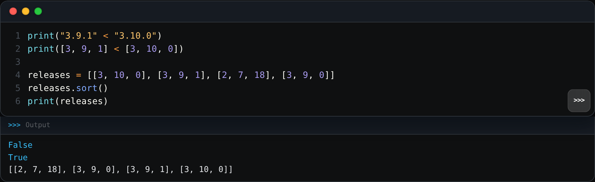

```python
print("3.9.1" < "3.10.0")
print([3, 9, 1] < [3, 10, 0])

releases = [[3, 10, 0], [3, 9, 1], [2, 7, 18], [3, 9, 0]]
releases.sort()
print(releases)
```

Compared as strings, `"3.9.1"` and `"3.10.0"` first differ at the third character. There `9` meets `1`, and because the character `9` is larger, the string comparison calls 3.9.1 the newer release. Stored as lists of integers, the same versions compare 9 against 10 and come out right. The `sort()` method rearranges a list from smallest to largest by applying `<` to its items, so a list of version lists lands in release order with no extra code. Dates stored as `[year, month, day]` sort correctly for the same reason.


<br>

### When items cannot be compared

Python compares only up to the deciding position, so types further along never meet. `[1, "x"] < [2, 0]` is `True`: position 0 settles it before `"x"` faces `0`. If the first items match, as they do in `[1, "x"] < [1, 0]`, Python has to compare a string with an integer at position 1. That raises `TypeError: '<' not supported between instances of 'str' and 'int'`. `==` never raises this way, because items of different types count as unequal.

> Rules for comparing lists
>
> - `==` needs equal length and equal items at every position.
> - `<` and `>` are decided by the first position where the items differ.
> - If one list is the start of the other, the shorter one is smaller.
> - Types are compared only at the positions Python reaches.

**Which line raises a TypeError?**

```python
a = [0, "late"] < [1, "ok"]
b = [0, "late"] == [0, 7]
c = [0, "late"] < [0, 7]
d = ["0", 5] < ["0", 6]
```

- **A.** Line a, because a string sits at position 1 of the left list
- **B.** Line b, because == cannot compare a string with an integer
- **C.** Line d, because a string is compared before the integers
- **D.** Line c, because position 0 ties and position 1 meets str and int

<details>
<summary>Solution</summary>

**D.** Line c, because position 0 ties and position 1 meets str and int

0 equals 0, so Python moves to position 1 and must decide whether "late" is less than 7, which raises TypeError.

**Why the others are wrong**

- **A.** Position 0 holds 0 against 1, which settles the comparison as True before position 1 is reached.
- **B.** == treats items of different types as unequal and returns False without raising.
- **C.** Position 0 compares "0" with "0", 2 strings that are equal, then position 1 compares 5 with 6.

</details>


<br>

---

## Reversing Lists

Many lists are stored oldest first, because that's the order items arrive in, and read newest first, because the latest entries matter most. Python offers 3 ways to flip the order. They give back different things, and choosing the wrong one usually shows up as a `None` or as a list you didn't mean to change.


<br>

### reverse() flips the list itself

https://github.com/user-attachments/assets/d2e25bb0-7bba-491b-b4aa-4d306391ef47

`letters.reverse()` reorders the items inside `letters`: after the call, the same list holds `e` first and `a` last. No new list is created, and the method returns `None`, the value Python uses for no result.

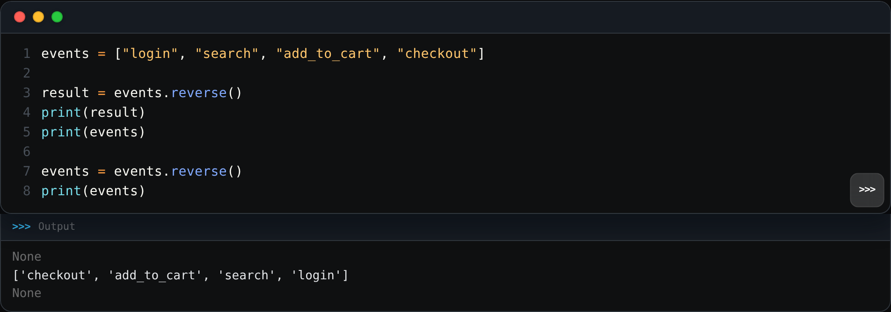

```python
events = ["login", "search", "add_to_cart", "checkout"]

result = events.reverse()
print(result)
print(events)

events = events.reverse()
print(events)
```

The last 2 lines show a common bug. `events.reverse()` flips the list. The assignment then replaces `events` with `None`, which is what the method returns, so the data is gone. The next line that indexes `events` fails with `TypeError: 'NoneType' object is not subscriptable`. Call `reverse()` on a line of its own and keep using the same name.


<br>

### [::-1] builds a reversed copy

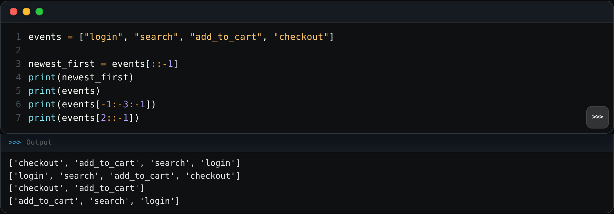

```python
events = ["login", "search", "add_to_cart", "checkout"]

newest_first = events[::-1]
print(newest_first)
print(events)
print(events[-1:-3:-1])
print(events[2::-1])
```

A step of `-1` walks from the end toward the front. With both ends left out, `[::-1]` visits every item backwards and returns a new list, leaving `events` in its original order. With a negative step the defaults swap: an empty `start` means the last item and an empty `stop` means past the first. So `events[2::-1]` starts at position 2 and walks back to the front, and `events[-1:-3:-1]` takes positions -1 and -2, stopping before -3.

> **TIP**
>
> To get the newest 3 events in newest-first order, write `events[-3:][::-1]`: the first slice picks the last 3, the second flips them. A reviewer can follow it in reading order, while the single slice `events[:-4:-1]` builds the same list in a form that takes a moment to decode.


<br>

### reversed() for looping backwards

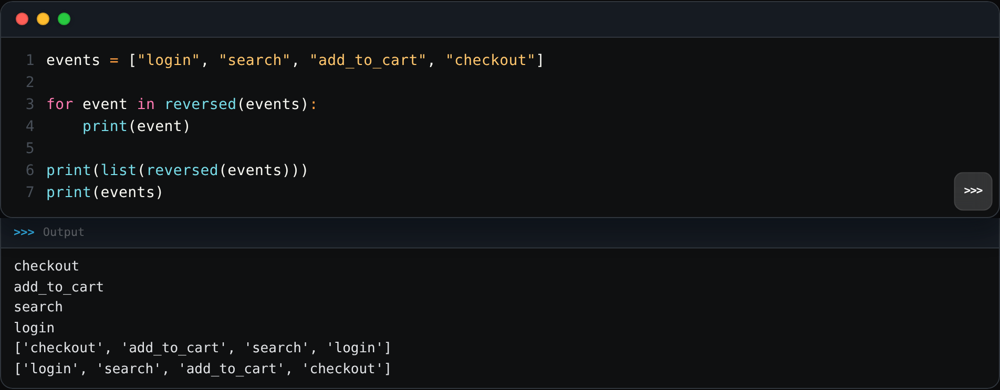

```python
events = ["login", "search", "add_to_cart", "checkout"]

for event in reversed(events):
    print(event)

print(list(reversed(events)))
print(events)
```

`reversed(events)` hands out the items from last to first, one per pass of a `for` loop, without building a reversed list and without changing `events`. It reads the original list as the loop runs, which makes it the cheapest choice when you only walk backwards once. Printing it directly shows a description of an object instead of the items; wrap it in `list()` when you need a real list.

| Tool | Gives back | Original list | Use it when |
| --- | --- | --- | --- |
| `events.reverse()` | None | Reordered | The list should stay flipped from now on |
| `events[::-1]` | A new reversed list | Unchanged | You need both orders, or a backwards slice |
| `reversed(events)` | Items for a loop, last first | Unchanged | You loop backwards once |

**What does this program print?**

```python
ids = [104, 220, 104, 315]
target = "104"
if target in ids:
    print(ids.index(target))
else:
    print("not found")
print(ids.count(104))
```

- **A.** 0 then 2
- **B.** A ValueError from index()
- **C.** not found then 2
- **D.** not found then 1

<details>
<summary>Solution</summary>

**C.** not found then 2

"104" matches no integer item, so the else branch prints not found. count(104) uses the integer and finds positions 0 and 2.

**Why the others are wrong**

- **A.** The count is right, but target is the string "104", and a string never equals the integer 104, so in is False.
- **B.** The in guard is False, so the else branch runs and index() is never called.
- **D.** The first line is right, but count() checks every item, and 104 appears at positions 0 and 2.

</details>


<br>

---

## Searching in Lists

Searching a list means asking whether a value is there and, if it is, where it sits and how many times it appears. `in` checks for the value, while `index()` finds its position and `count()` counts it. Underneath, they work the same way: start at position 0 and compare each item with `==` until the answer is known.

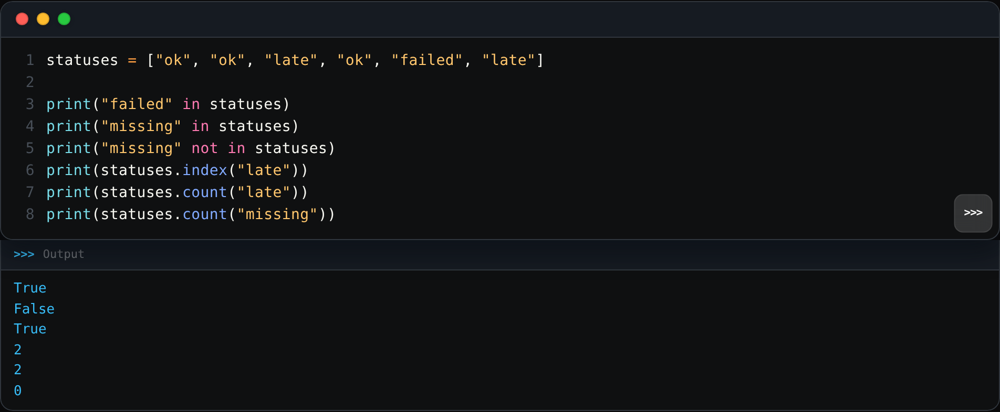

```python
statuses = ["ok", "ok", "late", "ok", "failed", "late"]

print("failed" in statuses)
print("missing" in statuses)
print("missing" not in statuses)
print(statuses.index("late"))
print(statuses.count("late"))
print(statuses.count("missing"))
```

`in` returns `True` or `False`, and `not in` returns the opposite, which reads well in a guard clause. `index()` returns the position of the first match only, so the second `"late"` at position 5 is never reported. `count()` returns how many items equal the value, and 0 when none do.

https://github.com/user-attachments/assets/be902b5e-eb94-4b4d-93a8-297bc0078f2e

*A search checks items from position 0 and stops at the first match.*

The animation shows the work behind every search. Finding `"failed"` takes 5 checks because it sits at position 4, and the loop stops at the first match. A value near the front costs a few checks; a value near the end, or one that is missing, costs a check for every item. On a list of a few hundred items nobody notices. Inside a loop that tests each incoming record against a list of 1,000,000 IDs, every missing ID costs 1,000,000 comparisons, and a later lesson covers structures built for fast lookups.


<br>

### index() raises when the value is missing

`statuses.index("missing")` raises `ValueError: 'missing' is not in list`, which stops the program. Check with `in` first, or use a loop that returns `None` when nothing matches, as the animation's function does. `index()` also accepts a starting position: `statuses.index("late", 3)` begins searching at position 3 and returns 5, the second late batch.

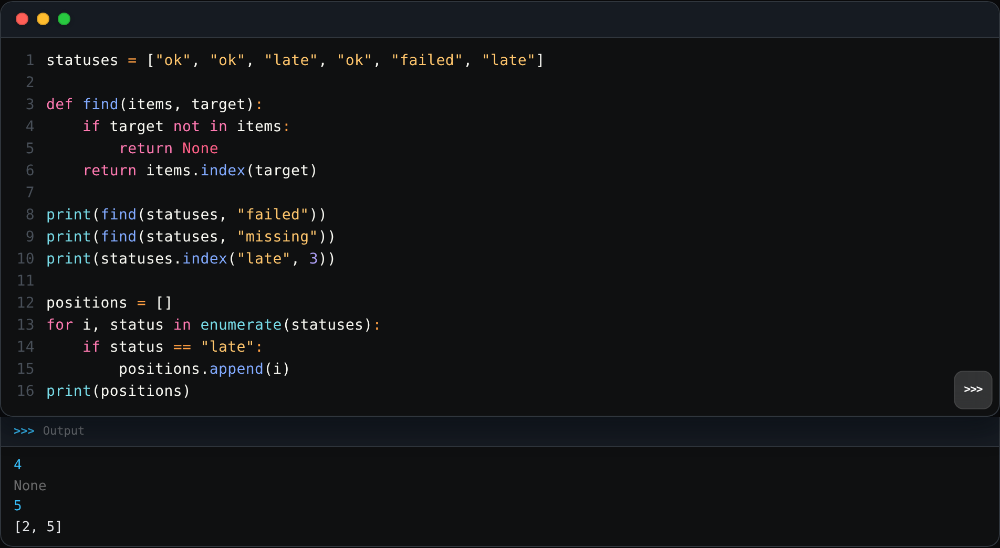

```python
statuses = ["ok", "ok", "late", "ok", "failed", "late"]

def find(items, target):
    if target not in items:
        return None
    return items.index(target)

print(find(statuses, "failed"))
print(find(statuses, "missing"))
print(statuses.index("late", 3))

positions = []
for i, status in enumerate(statuses):
    if status == "late":
        positions.append(i)
print(positions)
```

The guard in `find()` turns a crash into a `None` the caller can test with `is None`, at the cost of scanning the list twice when the value is present. The `enumerate()` loop at the end collects every matching position, which `index()` alone cannot do.


<br>

### Searching by a condition

`in` and `index()` look for one exact value. To find the first item that meets a condition, such as the first day with fewer than 100 rows, write the loop yourself and stop with `break`. The loop's `else` runs only when the loop finished without breaking, which is exactly the not-found case.

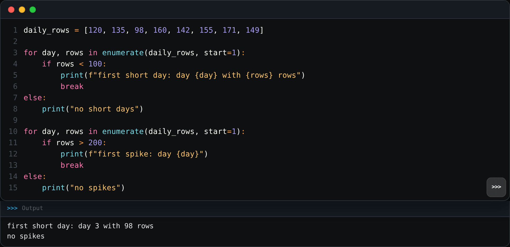

```python
daily_rows = [120, 135, 98, 160, 142, 155, 171, 149]

for day, rows in enumerate(daily_rows, start=1):
    if rows < 100:
        print(f"first short day: day {day} with {rows} rows")
        break
else:
    print("no short days")

for day, rows in enumerate(daily_rows, start=1):
    if rows > 200:
        print(f"first spike: day {day}")
        break
else:
    print("no spikes")
```


<br>

### What counts as a match

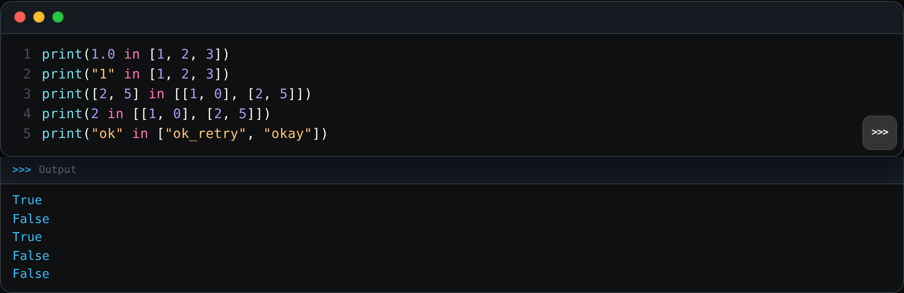

```python
print(1.0 in [1, 2, 3])
print("1" in [1, 2, 3])
print([2, 5] in [[1, 0], [2, 5]])
print(2 in [[1, 0], [2, 5]])
print("ok" in ["ok_retry", "okay"])
```

Every search compares with `==`, so the equality rules from comparing lists decide what matches. The float `1.0` equals the integer `1` and is found. The string `"1"` doesn't equal the integer `1`, which is how IDs read from text quietly fail to match IDs stored as numbers. An item can itself be a list, and `[2, 5]` matches only a whole item equal to it, so `2` isn't found even though it appears inside an item. On a list of strings, `in` matches whole items: `"ok"` is not found in `["ok_retry", "okay"]`, while `in` on a single string finds substrings.

**What does this program print?**

```python
ids = [104, 220, 104, 315]
target = "104"
if target in ids:
    print(ids.index(target))
else:
    print("not found")
print(ids.count(104))
```

- **A.** 0 then 2
- **B.** A ValueError from index()
- **C.** not found then 2
- **D.** not found then 1

<details>
<summary>Solution</summary>

**C.** not found then 2

"104" matches no integer item, so the else branch prints not found. count(104) uses the integer and finds positions 0 and 2.

**Why the others are wrong**

- **A.** The count is right, but target is the string "104", and a string never equals the integer 104, so in is False.
- **B.** The in guard is False, so the else branch runs and index() is never called.
- **D.** The first line is right, but count() checks every item, and 104 appears at positions 0 and 2.

</details>

| ✓ Do | ✗ Don't |
| --- | --- |
| • Guard index() with in when the value might be missing<br><br>• Convert IDs to one type before searching a list of IDs<br><br>• Pass a start to index() to step past a match you already handled<br><br>• Use a loop with break and else to find the first item meeting a condition | • Don't expect index() to report more than the first match<br><br>• Don't run in against a huge list once per record inside a loop<br><br>• Don't expect in on a list to match part of a string item<br><br>• Don't count matches with a loop when count() does it in one call |


<br>

---

## Putting It All Together

A Spotify data engineer is building the year-end recap for a listener. Plays arrive as 12 monthly lists of song IDs, oldest first. A ranking step produces a list of song IDs ordered by play count. The recap job ships in numbered releases such as 2.10.0, and the app suggests a song only when it is not among the listener's recent plays.

- The 12 monthly lists are gathered into one history with extend ( ) in a loop, since append ( ) would nest each month as a single item.
- The top songs come from ranked [ : 5 ] , and the slice still works for a listener who played only 3 songs, returning 3 without an error.
- The recent-plays panel shows history [ - 10 : ] [ : : - 1 ] , newest first, without reversing the stored history that other steps read in order.
- Releases stored as lists like [ 2 , 10 , 0 ] compare with < to pick the newest, where comparing the strings would rank 2.9.0 above 2.10.0.
- Before suggesting a song, not in checks the recent plays, with every ID converted to the same type so == can match.


<br>

---

## Key Takeaways

- A slice [ start : stop : step ] returns a new list and never raises IndexError; negative positions count from the end.
- + and \* build new lists. extend ( ) grows an existing list, as do += and append ( ) , and append ( ) adds a list as a single nested item.
- Lists compare item by item: == needs every position equal, and < is decided by the first position that differs, with the shorter list smaller on a tie.
- reverse ( ) flips the list and returns None , [ : : - 1 ] makes a reversed copy, and reversed ( ) feeds a backwards loop.
- in scans from the front comparing with == , as do index ( ) and count ( ) . Guard index ( ) with in and keep IDs to one type.
