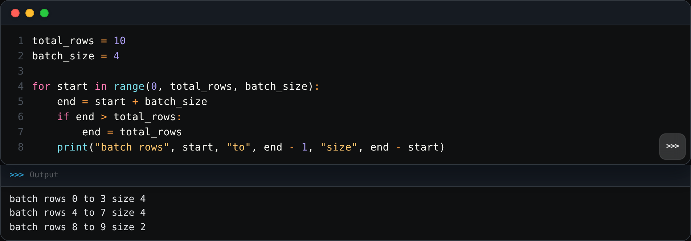
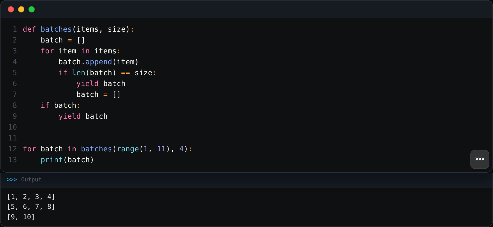
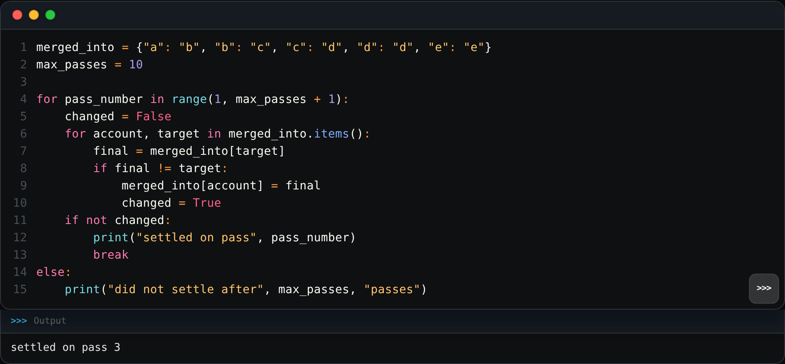
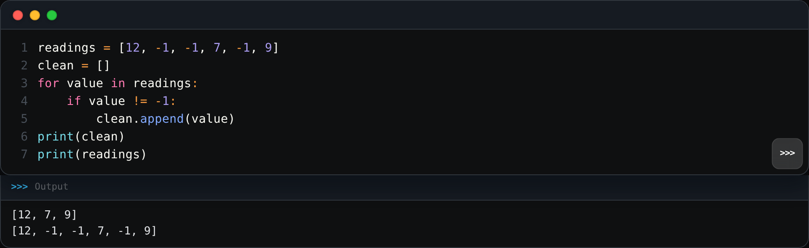
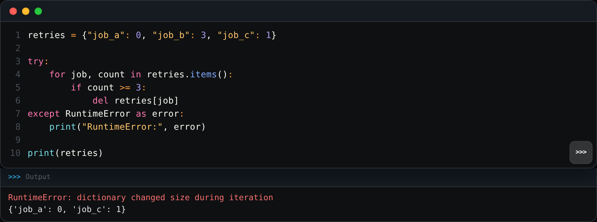
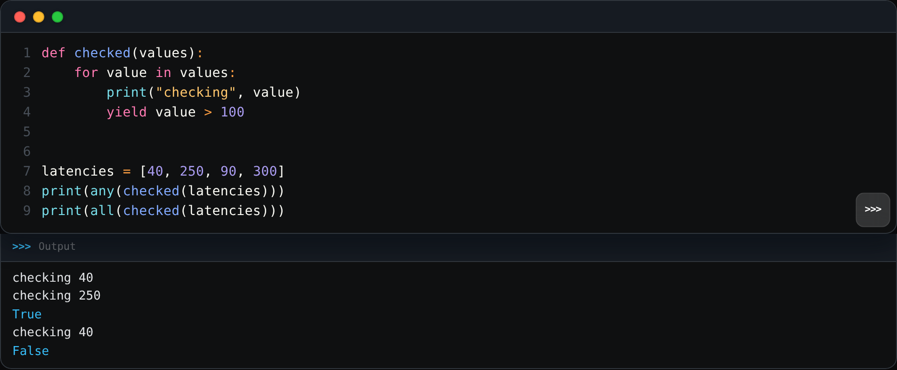
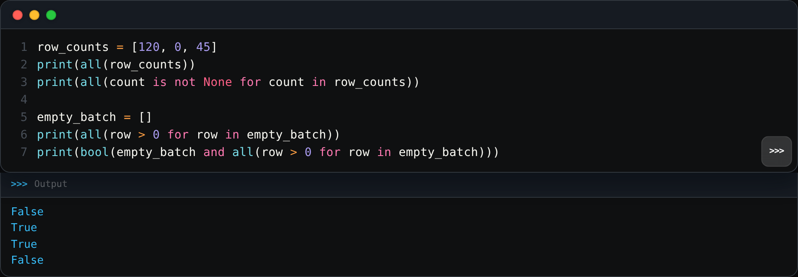
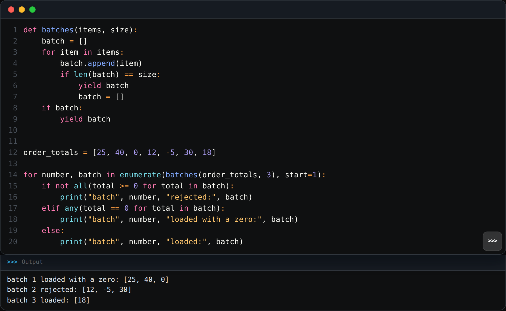

# Loops: Advanced

It is 11:58 PM on New Year's Eve at Uber, and the job you own watches ride requests across a city, minute by minute. It sums the last 10 minutes on every tick, sends events to pricing 500 at a time, drops cancelled rides without skipping any, and must not lose the 37 events left at the end. Whether it keeps up comes down to 5 loop patterns.


<br>

---

## Iterating in Fixed-Size Chunks

### Why data moves in batches

Most systems that receive data cap how much they accept per call: a bulk insert takes a limited number of rows per statement, and an HTTP API takes a limited number of records per request. One row per call pays a network round trip for every row, and everything in 1 call gets rejected. A batch loop hands the data over in groups of a fixed size. It also has to decide what happens to the rows left over when the total does not divide evenly.


<br>

### Batch boundaries from a range step

When the data is a list of known length, range(0, total_rows, batch_size) produces each batch's first index. The end is the start plus the batch size. When that would run past the total, the end is pulled back to the total.



```python
total_rows = 10
batch_size = 4

for start in range(0, total_rows, batch_size):
    end = start + batch_size
    if end > total_rows:
        end = total_rows
    print("batch rows", start, "to", end - 1, "size", end - start)
```

Stepping by 4 from 0 gives 3 starts, the last at 8. For the third batch, start + batch_size is 12, past the 10 rows that exist, so the clamp sets end to 10 and the batch holds 2 rows. Without the clamp, code that reads rows up to end - 1 would ask for row 10 and raise an IndexError.

To know the batch count in advance, divide the total by the size and round up. Floor division rounds down, so add batch_size - 1 first: (10 + 4 - 1) // 4 is 13 // 4, which is 3. When the total divides evenly, the added amount falls short of the next multiple, so (12 + 3) // 4 is still exactly 3.

**This loop splits 13 rows into batches of 5. Where does the last batch start, and how many rows does it hold?**

```python
total_rows = 13
batch_size = 5

for start in range(0, total_rows, batch_size):
    end = start + batch_size
    if end > total_rows:
        end = total_rows
    print(start, end - start)
```

- **A.** It starts at 10 and holds 5 rows: the step of 5 gives every batch the same size
- **B.** It starts at 15 and holds 0 rows: the range produces 1 start past the end
- **C.** It starts at 10 and holds 3 rows: the clamp pulls the end from 15 back to 13
- **D.** It starts at 12 and holds 1 row: the last batch begins at the final index

<details>
<summary>Solution</summary>

**C.** It starts at 10 and holds 3 rows: the clamp pulls the end from 15 back to 13

end is 15, the clamp sets it to 13, and 13 - 10 is 3. The loop prints 0 5, then 5 5, then 10 3.

**Why the others are wrong**

- **A.** The clamp runs on the last batch: 10 + 5 is 15, past the 13 rows, so end becomes 13 and the size is 3.
- **B.** range(0, 13, 5) stops before 13, so the last start it produces is 10. A start of 15 is never produced.
- **D.** Batch starts come only from the range step, so they are multiples of 5 below 13.

</details>


<br>

### The accumulator: batches from any iterable

A range step needs the length up front. A generator, a file read line by line, or a stream of events has no length until it ends. The accumulator form handles all of these sources. It appends each item to a batch list, and when the list reaches the batch size, it hands the list off and starts a new empty one. batch.append(event) adds 1 item to the end of the list, and len(batch) counts its items.

https://github.com/user-attachments/assets/fcac86b1-a1f0-4083-b712-62be19ac87d5

When the for loop ends, batch still holds 'e7', which never reached size 3. The if batch: check relies on truthiness: an empty list is falsy, so the final send runs only when items are left over. With 6 events, the second send would empty the list and the check would skip.

> The lost tail
>
> Forgetting the flush after the loop is a classic batch bug, and tests rarely catch it because round test sizes divide evenly. A nightly job that loads 1,000,003 rows in batches of 1,000 drops the last 3 rows every night and raises nothing.


<br>

### Packaging the accumulator as a generator

A generator function packages the accumulator, so every batch loop becomes a single for batch in batches(...) line and the tail is handled in 1 place. def batches(items, size): names a reusable block of code that takes 2 inputs. Each yield batch hands 1 batch to the for loop that asked for it and pauses there. When the loop asks for the next batch, the code resumes on the line after the yield.



```python
def batches(items, size):
    batch = []
    for item in items:
        batch.append(item)
        if len(batch) == size:
            yield batch
            batch = []
    if batch:
        yield batch


for batch in batches(range(1, 11), 4):
    print(batch)
```

The input here is a range, and the generator never asks for its length, so the same code batches anything you can loop over, including a file or another generator. The generator yields lazily, so only 1 batch sits in memory at a time while the job pages through millions of rows.

**This loop collects 11 order IDs in batches of 4 and has no flush after it. What does it print?**

```python
order_ids = [101, 102, 103, 104, 105, 106, 107, 108, 109, 110, 111]
batch = []
for order_id in order_ids:
    batch.append(order_id)
    if len(batch) == 4:
        print("sent", len(batch))
        batch = []
print("unsent", len(batch))
```

- **A.** sent 4, sent 4, unsent 0: the reset inside the loop empties the last batch too
- **B.** sent 4, sent 4, unsent 3: IDs 109 to 111 are still waiting when the loop ends
- **C.** sent 4, sent 4, sent 3, unsent 0: the loop sends the short batch on its last pass
- **D.** sent 4, sent 4, sent 4: the final batch is padded up to the batch size

<details>
<summary>Solution</summary>

**B.** sent 4, sent 4, unsent 3: IDs 109 to 111 are still waiting when the loop ends

The loop sends a full batch at ID 104 and another at 108. The last 3 IDs never reach size 4, so without an if batch: flush they would be lost.

**Why the others are wrong**

- **A.** The reset runs only when the batch reaches 4. The last 3 IDs, 109 through 111, never get there, so they are still in the list.
- **C.** The send is inside if len(batch) == 4, and 3 is not 4, so the last pass appends 111 and sends nothing.
- **D.** Python does not pad a list, so the final batch holds exactly the 3 IDs that were appended to it.

</details>


<br>

---

## Sliding Window Pattern

### A window that moves 1 step at a time

A sliding window is a run of k consecutive items that moves along a sequence 1 position per step. A rolling average on a dashboard, an alert on more than 50 errors in any 5 minutes, and the busiest hour of a day all ask the same question of every stretch of a fixed length. Here are 7 minutes of ride requests with k = 3.

| Window | Minutes | Values | Sum |
| --- | --- | --- | --- |
| 0 | 0 to 2 | 4, 7, 2 | 13 |
| 1 | 1 to 3 | 7, 2, 9 | 18 |
| 2 | 2 to 4 | 2, 9, 5 | 16 |
| 3 | 3 to 5 | 9, 5, 1 | 15 |
| 4 | 4 to 6 | 5, 1, 8 | 14 |

Compare 2 neighbouring rows. Window 1 drops 4 and picks up 9, but it keeps the 7 and 2 from window 0. Each step shares k - 1 items with the step before it. Summing every window from scratch adds those shared items again each time.


<br>

### Re-summing versus sliding

```sql
requests = [4, 7, 2, 9, 5, 1, 8]
k = 3

for start in range(len(requests) - k + 1):
    window_sum = 0
    for i in range(start, start + k):
        window_sum += requests[i]
    print(start, window_sum)
```

The sliding version keeps 1 running total. Each step adds requests[i] as it enters on the right and subtracts requests[i - k] as it leaves on the left. That is 2 operations per step, whatever the window size. Take a full day of per-minute counts, 1,440 values, with a 60-minute window. Re-summing reads each value roughly 60 times. Sliding reads each value at most twice, as it enters and again as it leaves.

- **82,860** — additions to re-sum every window
- **2,820** — operations to slide the window

https://github.com/user-attachments/assets/529ced9f-fec7-4c54-825e-5edf1b937067

The first loop builds the opening window once, by adding every item. From i = 3 on, each step is a single line. Adding 9 and subtracting 4 turns 13 into 18, the new best, so best_start records minute 1. The later sums fall from 16 down to 14 and never beat it. The code stores i - k + 1 because i is where a window ends, and a report wants where it starts.

**A sliding sum over [5, 2, 8, 1] with k = 2 holds 10 for the window [2, 8]. Which update moves it to the window [8, 1]?**

- **A.** window_sum += 1 - 5: add the new item, subtract the first item of the list
- **B.** window_sum += 1: add the new item and keep everything already in the total
- **C.** window_sum -= 8: subtract the item that the next window keeps
- **D.** window_sum += 1 - 2: add the item entering, subtract the item leaving

<details>
<summary>Solution</summary>

**D.** window_sum += 1 - 2: add the item entering, subtract the item leaving

10 + 1 - 2 is 9, the sum of 8 and 1. With i = 3, this is values[i] - values[i - k].

**Why the others are wrong**

- **A.** 5 left the window a step earlier. Subtracting it again gives 6, which is the sum of no window.
- **B.** That gives 11, which still counts the 2 that has left the window.
- **C.** 8 stays in the new window. Removing it gives 2, and the new item 1 is never added.

</details>


<br>

### Windows that grow and shrink

Some questions have no fixed width. Finding the longest run of consecutive log messages that fits in a 6 KB packet needs a window whose size is the answer. A variable window keeps 2 indexes. right moves forward 1 item per iteration, and left moves forward only while the window breaks the rule.

https://github.com/user-attachments/assets/bd3b5db7-ba6a-4d03-b2d4-743b1d307d1f

At message 3, a 4 KB message pushes the total to 10, so the inner while drops messages 0 through 2 until the total is back to 4. Messages 4 and 5 join message 3 for 6 KB, exactly the limit, so nothing drops. When message 6 pushes the total to 8, message 3 is dropped. After message 7 arrives, the window holds messages 4 to 7, which total 5 KB and make the longest run. Message 8, at 5 KB, forces 3 more drops.

A while inside a for looks like it could multiply the work, so count the moves instead. left only increases and never passes the end of the list. Over the whole run it advances at most 9 times for 9 messages. The inner loop's total work is therefore capped by the length of the list, the same cap as the outer loop.

> When shrinking from the left is safe
>
> - Adding an item can only push the window further from valid, and removing an item only brings it closer.
> - Sizes and durations can't go below zero, and neither can counts, so a sum-under-a-limit window qualifies.
> - With negative values, dropping an item can raise the total, and the shrink step can throw away the best answer.


<br>

---

## Looping Until Nothing Changes

### When 1 pass is not enough

Some data only settles after several passes, and the number of passes depends on the data. Customer accounts get merged into other accounts, and those accounts get merged again: a into b, b into c, c into d. Replacing each account's target with its target's target shortens every chain. A long chain needs that step repeated. The loop for this job keeps making full passes until a pass changes nothing.

```sql
changed = True
while changed:
    changed = False
    for item in data:
        if needs_fixing:
            fix_item
            changed = True
```

The pattern comes down to 3 lines. changed starts as True so the first pass runs. It resets to False at the top of each pass, so a pass reports only its own work. Every line that edits the data sets it back to True. The loop exits after the first pass in which no fix fired, so the final pass edits nothing and only confirms. Below, merged_into[target] reads the value stored under a key, and assigning to merged_into[account] replaces it.

https://github.com/user-attachments/assets/d9cb6d37-6023-4d6a-8170-9d84a68597a4

| After | a | b | c | d | e | Changed |
| --- | --- | --- | --- | --- | --- | --- |
| start | b | c | d | d | e |  |
| pass 1 | c | d | d | d | e | yes |
| pass 2 | d | d | d | d | e | yes |
| pass 3 | d | d | d | d | e | no |

b gets its final answer in pass 1, because its target c pointed at d from the start. The same pass moves a to c, which is closer but not final, and pass 2 finishes a. Pass 3 finds nothing to fix, and that empty pass ends the loop. Assigning to merged_into[account] during .items() is safe because it replaces a value and leaves the keys alone. The next section covers what happens when the keys change.

The pass count depends on the order of the keys. With d listed first and a last, pass 1 resolves the whole chain, because each account reads a target that was fixed earlier in the same pass. Pass 2 then confirms. The loop is correct in either order, which is its value: nobody has to work out the right order.


<br>

### Putting a ceiling on the passes

A rule that undoes another rule, or data that never converges, keeps a while-changed loop running forever. A production version caps the passes with a loop else. It uses a for over pass numbers, a break when a pass changes nothing, and an else that runs only when the cap ran out without that break.



```python
merged_into = {"a": "b", "b": "c", "c": "d", "d": "d", "e": "e"}
max_passes = 10

for pass_number in range(1, max_passes + 1):
    changed = False
    for account, target in merged_into.items():
        final = merged_into[target]
        if final != target:
            merged_into[account] = final
            changed = True
    if not changed:
        print("settled on pass", pass_number)
        break
else:
    print("did not settle after", max_passes, "passes")
```

Each pass is a full walk over the data, so the work is passes times items. A cap of 10 that fires deserves an alert. It means either the data has chains longer than anyone expected, or 2 rules are fighting.

**The capped loop above runs on the same 5 accounts with max_passes = 2. What does it print?**

- **A.** did not settle after 2 passes: pass 2 still changed a, so no pass confirmed
- **B.** settled on pass 2: by the end of pass 2 every account points at its final target
- **C.** settled on pass 3: the else clause grants 1 extra pass when the cap is reached
- **D.** nothing at all: the else clause runs only when the loop ends through break

<details>
<summary>Solution</summary>

**A.** did not settle after 2 passes: pass 2 still changed a, so no pass confirmed

Pass 2 sets a to d, so changed is True and there's no break. When the range runs out the else runs, and the confirming pass 3 never happens.

**Why the others are wrong**

- **B.** The data is settled, but the loop learns that only from a pass that changes nothing, and pass 2 changed a.
- **C.** The else adds no pass. It runs once, after the last pass the range allowed.
- **D.** It is the reverse. A loop's else runs when the loop finishes without a break.

</details>

> **TIP**
>
> Set `changed = True` on the line next to every edit. A branch that edits the data without setting the flag lets the loop exit while some records are still half settled.


<br>

---

## Modifying While Looping

### Why removing during a for loop skips items

A for loop over a list keeps a hidden position. It reads index 0, then 1, then 2, until the position passes the end. readings.remove(value) deletes the first item equal to value and shifts every later item 1 place left. The hidden position does not shift with them, so the item that slides into the current slot is never visited.

https://github.com/user-attachments/assets/8cb2b74a-b9d5-419a-bc76-ea6d3260bcfe

| Position | Value read | Action | List afterwards |
| --- | --- | --- | --- |
| 0 | 12 | keep | [12, -1, -1, 7, -1, 9] |
| 1 | -1 | remove | [12, -1, 7, -1, 9] |
| 2 | 7 | keep | [12, -1, 7, -1, 9] |
| 3 | -1 | remove | [12, 7, -1, 9] |
| 4 | none | loop ends | [12, 7, -1, 9] |

The loop goes wrong in 2 ways. The skip hides the -1 that slid into position 1. The second remove then deletes the first -1 in the list, at index 1, which is a different -1 from the one the loop was reading at index 3. The loop never reads 9 at all. Nothing raises an error, so the job finishes and loads a -1 sentinel into the clean table.


<br>

### 3 safe ways to remove items

#### Build a new list

The clearest fix leaves the list being read untouched and appends each value worth keeping to a new list.



```python
readings = [12, -1, -1, 7, -1, 9]
clean = []
for value in readings:
    if value != -1:
        clean.append(value)
print(clean)
print(readings)
```

Every item is read exactly once, and the original survives for logging or a retry. The in-place options below are for when other code holds the same list and must see it shrink.

#### Loop over a copy

list(readings) builds a second list holding the same items. Loop over the copy and remove from the original. The copy never shifts, so every value is visited.

```sql
readings = [12, -1, -1, 7, -1, 9]
for value in list(readings):
    if value == -1:
        readings.remove(value)
print(readings)
```

#### Walk backwards by index

del nums[i] deletes the item at index i and shifts only the items after it. A backward loop has already visited those items, so every index still ahead of it stays valid.

https://github.com/user-attachments/assets/852b8bac-46d3-4435-8c24-3c48be1444f4

range(len(nums) - 1, -1, -1) counts down from 7 to 0, since the stop of -1 is excluded. The program prints After removing evens: [1, 3, 5, 7].


<br>

### Dicts refuse to change size

A dict checks its own size on every step of a loop over it. Deleting or adding a key mid-loop raises a RuntimeError at the next step. Replacing the value of an existing key is allowed, which is why the merge loop in the previous section worked. del retries[job] removes a key and its value.



```python
retries = {"job_a": 0, "job_b": 3, "job_c": 1}

try:
    for job, count in retries.items():
        if count >= 3:
            del retries[job]
except RuntimeError as error:
    print("RuntimeError:", error)

print(retries)
```

The delete went through before the error, so the dict is changed and the loop stopped partway. That is a bad combination for a job that resumes. The fix is the copy again: for job, count in list(retries.items()): freezes the pairs into a list first, and the loop can then delete from the dict freely.

Appending is the one change that a for loop over a list keeps up with, because the hidden position reaches the new items. That makes for n in nums: nums.append(n) run until memory runs out. It also makes a work list possible on purpose. Processing an item appends the follow-up work it reveals, and the loop ends once nothing new is added.

**What happens when this runs?**

```python
counts = [5, 0, 0, 3]
for i in range(len(counts)):
    if counts[i] == 0:
        del counts[i]
print(counts)
```

- **A.** It prints [5, 3]: each zero is deleted when the loop reaches its index
- **B.** It prints [5, 0, 3]: the second zero shifts past the loop and survives
- **C.** It raises IndexError: range(4) was fixed up front and index 3 is gone
- **D.** It raises RuntimeError: a list cannot change size inside a loop over it

<details>
<summary>Solution</summary>

**C.** It raises IndexError: range(4) was fixed up front and index 3 is gone

len(counts) is read once, so i still reaches 3 after the list has shrunk to 3 items, and counts[3] does not exist.

**Why the others are wrong**

- **A.** The first delete shifts the second zero into index 1, which the loop has already passed, so the loop never checks it.
- **B.** The second zero does survive the skip, but the loop goes on to ask for index 3 before the print runs.
- **D.** That check belongs to dicts. A list allows deletes mid-loop, and the stale index is what fails.

</details>


<br>

---

## Using any() and all()

### One question about a whole sequence

any(iterable) returns True if at least 1 item is truthy, and all(iterable) returns True if every item is. Pass either one a generator expression, the parenthesised form of a generator. A loop with a flag then becomes 1 line that reads like the question: is any latency over 100 ms, is every count present? When the generator expression is the only argument, its own parentheses can go.

```sql
latencies = [40, 250, 90, 300]

for ms in latencies:
    if ms > 100:
        slow_found = True
        break
else:
    slow_found = False

slow_found = any(ms > 100 for ms in latencies)
```


<br>

### They stop at the first deciding item

any() stops at the first truthy item, since 1 is enough, and all() stops at the first falsy item. The generator below prints each value as it is checked, so the output shows where each call stopped.



```python
def checked(values):
    for value in values:
        print("checking", value)
        yield value > 100


latencies = [40, 250, 90, 300]
print(any(checked(latencies)))
print(all(checked(latencies)))
```

Out of 4 values, any() needed 2 checks and all() needed 1. Stopping early pays off when each check is slow, such as opening a file or calling a service. It also pays off when the iterable is a generator over millions of rows, because the rows after the deciding one are never produced.


<br>

### Empty input and other traps

any([]) is False, since no item is truthy, and all([]) is True, since no item fails. That second rule is sound logic and a real hazard. A quality gate written as all(row > 0 for row in batch) passes an empty batch, so an upstream outage that delivers 0 rows looks clean. Test for emptiness first with short-circuit and: if batch and all(row > 0 for row in batch):.



```python
row_counts = [120, 0, 45]
print(all(row_counts))
print(all(count is not None for count in row_counts))

empty_batch = []
print(all(row > 0 for row in empty_batch))
print(bool(empty_batch and all(row > 0 for row in empty_batch)))
```

Passing raw values tests their truthiness, and 0 is falsy. all(row_counts) is False because 1 table loaded 0 rows, even when the question was whether every count arrived. Write the condition you mean inside the generator expression, here count is not None. Pass raw values only when truthiness is the test.

> What any() and all() return
>
> - Always `True` or `False`, never an item from the input. `or` and `and` differ here because they return an operand.
> - `any()` of an empty sequence is `False`, and `all()` of an empty sequence is `True`.
> - A generator passed in is consumed up to the item where the call stopped, and later calls see only the rest.

**Both calls share 1 generator. What does this print?**

```python
changes = [-2, 4, 6]
positive = (c > 0 for c in changes)
print(any(positive))
print(all(positive))
```

- **A.** True, then False: all() reaches -2 and finds it is not positive
- **B.** True, then an error: a generator cannot be passed to a second call
- **C.** False, then False: both calls read -2 first and stop there
- **D.** True, then True: any() used up -2 and 4, so all() sees only 6

<details>
<summary>Solution</summary>

**D.** True, then True: any() used up -2 and 4, so all() sees only 6

any() stops at 4. The only value left is 6, which is positive, so all() returns True even though -2 failed.

**Why the others are wrong**

- **A.** any() already consumed -2 and 4. A generator does not restart, so all() never sees -2.
- **B.** Passing it again is allowed. The second call continues from where the first one stopped.
- **C.** any() does not stop on a falsy item. It moves past -2 and stops at 4, returning True.

</details>


<br>

### Capstone: a batch quality gate

The last example combines a batch generator with both checks. Order totals arrive in batches of 3. A batch with any negative total is rejected, and a clean batch that contains a 0 is loaded with a warning. The short final batch goes through the same gate.



```python
def batches(items, size):
    batch = []
    for item in items:
        batch.append(item)
        if len(batch) == size:
            yield batch
            batch = []
    if batch:
        yield batch


order_totals = [25, 40, 0, 12, -5, 30, 18]

for number, batch in enumerate(batches(order_totals, 3), start=1):
    if not all(total >= 0 for total in batch):
        print("batch", number, "rejected:", batch)
    elif any(total == 0 for total in batch):
        print("batch", number, "loaded with a zero:", batch)
    else:
        print("batch", number, "loaded:", batch)
```

not all(total >= 0 for total in batch) and any(total < 0 for total in batch) mean the same thing, by De Morgan's laws from the control flow track. Choose the one that matches how the rule is written down.


<br>

---

## Putting It All Together

Picture the nightly job at Uber that prepares a city's trip data for the pricing team. It reads the day's trip events, drops cancelled rides, resolves rider accounts that were merged into other accounts, finds each city's busiest 60-minute window, and loads the results to a service that takes 500 rows per call.

- Filtering cancelled rides builds a new list as the events stream past, so a shifting index never skips an event.
- Merged rider accounts go through a while-changed loop capped with for-else, so 2 rules that keep undoing each other raise an alert when the passes run out. A merge cycle needs its own check for a chain that returns to itself, because the loop settles a cycle without any warning.
- The busiest window per city slides 1 running total across 1,440 minutes, adding the minute entering and subtracting the minute leaving.
- The load step pulls from a batch generator, and the flush after its loop saves the last partial batch.
- Before each batch is sent, all() checks that every fare is non-negative, with an emptiness test in front so a 0-row batch is never reported clean.


<br>

---

## Key Takeaways

- A batch loop needs a plan for the remainder: clamp the end index, or flush the accumulator once after the loop.
- The accumulator form batches any iterable, including generators that have no length.
- A sliding window updates 1 running value per step: it adds what enters and subtracts what leaves.
- A variable window works when growing only breaks the rule and shrinking only repairs it.
- A while-changed loop settles multi-pass data in any order, and a for-else cap turns a runaway into a clear message.
- Never remove from the list you are looping over: build a new list, loop over a copy, or walk backwards by index.
- any() and all() stop at the first deciding item and return booleans. any() of nothing is False, and all() of nothing is True.
