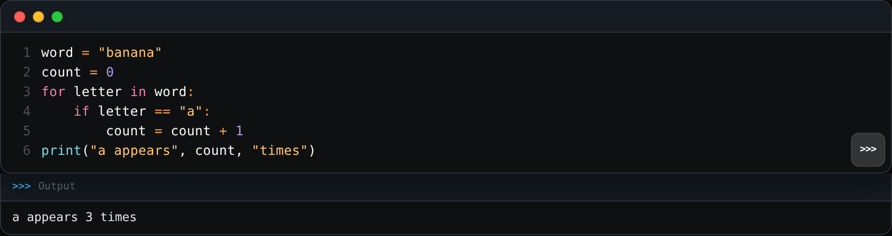
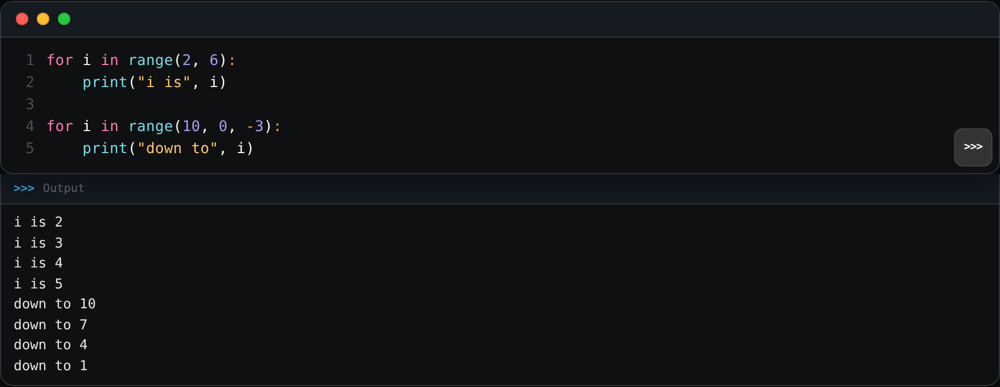
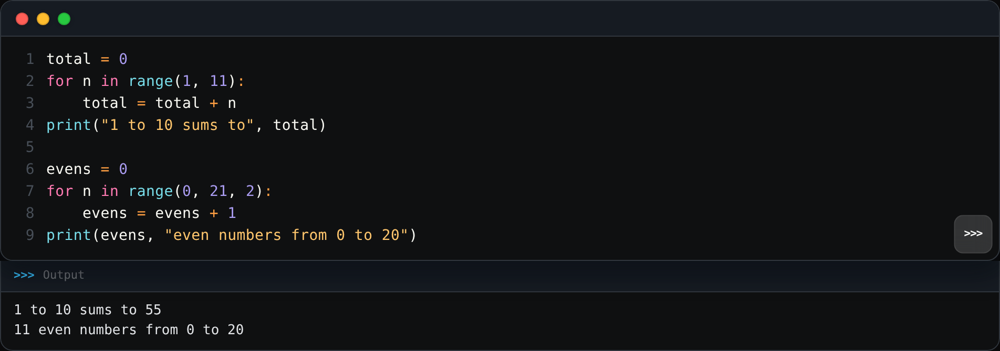
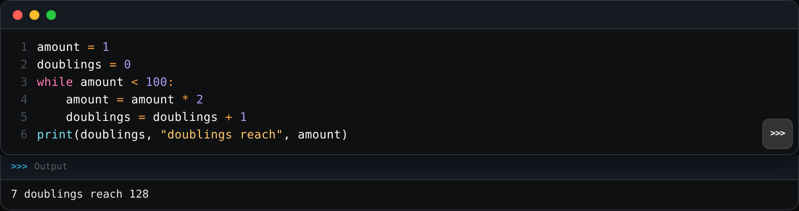
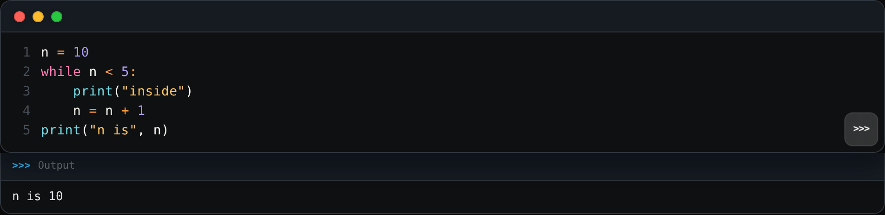
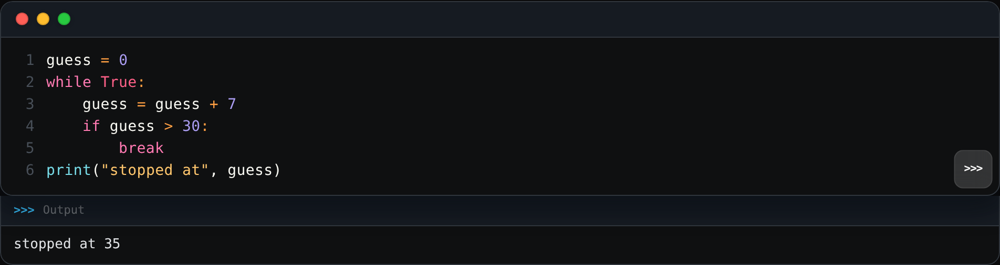
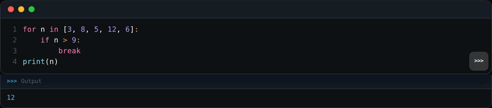
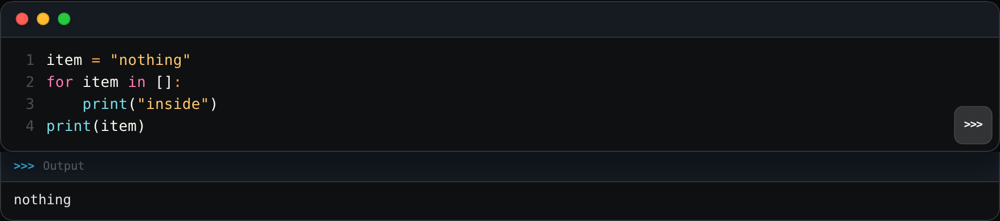

# Loops: Beginner

Spotify Wrapped lands every December, and behind each listener's card sits the same arithmetic repeated for hundreds of millions of accounts: total the minutes played, count the artists, find the one most-played song. That code is written once and run for every account. Inside it, one loop walks every play record, carries a running total, and stops the moment it has what it needs. This lesson builds that loop.


<br>

---

## Iterating with for Loops

A loop runs the same block of code once for every item in a sequence. Greeting 3 friends takes 3 print statements. Greeting 3,000 customers takes a loop, and the loop is the same 2 lines either way, because the number of passes comes from the data and the code stays fixed.

The `for` loop names a variable, then a sequence. for fruit in fruits: reads as "for each fruit in fruits". On every pass, Python assigns the next item to fruit and runs the indented lines under the colon. When the sequence runs out, the loop is over.

A list is a sequence of values written between square brackets and separated by commas, such as ["apple", "banana", "cherry"]. It keeps its items in the order they were written, and a loop visits them in that order: first item first, last item last.

https://github.com/user-attachments/assets/7283b0b1-3b6d-4bd9-9553-aaff6ff6c6d8

The loop body is 1 line, and it runs 3 times. On the first pass fruit holds "apple", on the second "banana", on the third "cherry". After the third pass there is no fourth item, so Python moves to the first line at the loop's own indentation. "Done!" prints once, after the 3 greetings, because it sits outside the body.

| Pass | fruit holds | Line printed |
| --- | --- | --- |
| 1 | "apple" | I like apple |
| 2 | "banana" | I like banana |
| 3 | "cherry" | I like cherry |
| after the loop | "cherry" (unchanged) | Done! |


<br>

### Strings are sequences too

A string is a sequence of characters, so a for loop over a string hands you 1 character per pass. "Python" has 6 characters, so the body below runs 6 times and prints 6 lines of 1 letter each. The loop variable holds a fresh 1-character string on every pass, and the original string is untouched.

https://github.com/user-attachments/assets/9dcc72e3-69b5-4b01-ac8a-8d93806a8e0d


<br>

### Carrying a result across passes

Printing each item is the smallest thing a loop can do. More often the loop builds one answer out of many items: a total, a count, a largest value. The pattern has 3 parts: a variable created before the loop with a starting value, a line inside the loop that updates it, and a line after the loop that uses the finished result.

https://github.com/user-attachments/assets/b36c8b2a-5389-4ebf-ae81-0c243b79f568

| Pass | num | total after the pass |
| --- | --- | --- |
| 1 | 10 | 10 |
| 2 | 20 | 30 |
| 3 | 30 | 60 |
| 4 | 40 | 100 |
| 5 | 50 | 150 |

total = 0 before the loop matters. If that line sat inside the body, total would reset to 0 on every pass and the final answer would be 50, the last number alone. The second loop counts instead of sums: count goes up by 1 only on passes where the `if` is true, which happens for 30, 40 and 50, so it prints 3.

> **TIP**
>
> Indentation decides what repeats. Every line indented under the for runs once per item. The first line back at the loop's own indentation runs once, after the last pass, no matter how many items there were.


<br>

### Practice: counting letters

Run the program below in your head before you reveal its output. The if inside the loop fires only on passes where the character is "a". "banana" has 6 characters, so the body runs 6 times, and count moves on 3 of those passes.



```python
word = "banana"
count = 0
for letter in word:
    if letter == "a":
        count = count + 1
print("a appears", count, "times")
```

Where a print sits decides how often it runs. Indented under the for, it shows the accumulator after every pass, which is how you watch a running total grow. Back at the loop's own indentation, it runs once and shows only the finished value. The question below puts the print inside the body.

**The print sits inside the loop body. What does this program print?**

```python
total = 0
for n in [2, 4, 6]:
    total = total + n
    print(total)
```

- **A.** 2, 4, 6 on 3 separate lines
- **B.** 2, 6, 12 on 3 separate lines
- **C.** 12 on 1 line
- **D.** 6, 12, 18 on 3 separate lines

<details>
<summary>Solution</summary>

**B.** 2, 6, 12 on 3 separate lines

total is 2 after the first pass, 2 + 4 = 6 after the second, and 6 + 6 = 12 after the third. The print runs on every pass, so all 3 values appear.

**Why the others are wrong**

- **A.** Those are the items of the list. The program prints total, which grows with each item.
- **C.** That would be the output if print were outside the loop. Here it is indented under the for, so it runs 3 times.
- **D.** The first pass adds 2 to a total of 0, giving 2, so the first printed line is 2.

</details>

Writing an accumulator from scratch means filling 3 slots in the right places: the starting value on the line above the `for`, the list's name after in on the for line, and the loop variable's name inside the body, spelled exactly as the for line spells it. A sum starts from 0, since adding 0 changes nothing.

A misplaced starting line fails without an error message. Python runs it on every pass, so the accumulator restarts each time, and the value left at the end reflects only the final pass. When a count comes out smaller than the data says it should, check whether its starting assignment sits inside the body.


<br>

---

## range() Function

A for loop needs a sequence to walk. When the sequence you want is a run of numbers, range() builds it for you. range(5) produces 0, 1, 2, 3, 4: it starts at 0, climbs by 1, and stops before 5. The number you pass is the stop, and the stop itself is never produced.

https://github.com/user-attachments/assets/b87ae8d2-d8b6-4649-bc15-e3cb9e657276

The loop makes 5 passes, one per number, and the last printed value is 4. This lines up with how positions are counted in Python: the first position is 0, so the 5 positions of a 5-item sequence are 0 through 4, and range(5) produces exactly those 5 numbers.


<br>

### Start, stop and step

range() accepts 1, 2 or 3 numbers. A single number is the stop, and the start defaults to 0. Given 2, range reads them as the start and the stop. A third number is the step: how far each produced number is from the one before it. A negative step counts down.

| Call | Produces | How many |
| --- | --- | --- |
| range(5) | 0, 1, 2, 3, 4 | 5 |
| range(2, 6) | 2, 3, 4, 5 | 4 |
| range(0, 10, 2) | 0, 2, 4, 6, 8 | 5 |
| range(10, 0, -3) | 10, 7, 4, 1 | 4 |
| range(3, 3) | nothing | 0 |
| range(5, 2) | nothing | 0 |

The stop stays excluded in every form. range(2, 6) ends at 5. range(10, 0, -3) keeps producing values while they are above 0, so 1 is the last one and -2 is never reached. range(5, 2) uses the default step of 1 and can't climb from 5 to a value below 2, so it produces nothing, and a loop over it runs its body 0 times without an error.



```python
for i in range(2, 6):
    print("i is", i)

for i in range(10, 0, -3):
    print("down to", i)
```


<br>

### Repeating something n times

Sometimes the numbers themselves are beside the point and you want the body to run a fixed number of times. range(3) still produces 0, 1 and 2, but the body never reads them. The convention is to name the variable _ to signal to anyone reading the code that nothing uses it.

```sql
for _ in range(3):
    print("Knock")
```


<br>

### Getting the stop right

When a sum should run from 1 to 10 inclusive, the stop is 11. Being off by 1 at the stop is the most common range mistake. The fix is a question: which value should be the last one produced? Pass 1 more than that as the stop. For a step of 2 running from 0 to 20 inclusive, the stop is 21, and 20 is the last value produced.



```python
total = 0
for n in range(1, 11):
    total = total + n
print("1 to 10 sums to", total)

evens = 0
for n in range(0, 21, 2):
    evens = evens + 1
print(evens, "even numbers from 0 to 20")
```

> Rules range() always follows
>
> - The start is included and the stop is excluded: range(2, 6) produces 2, 3, 4, 5.
> - range(n) produces exactly n numbers, 0 through n - 1, so the body runs n times.
> - A step that moves away from the stop, or a start already past the stop, produces nothing and the loop body runs 0 times.

> **TIP**
>
> To count down, the start must be larger than the stop and the step must be negative. range(0, 10, -1) produces nothing, because stepping by -1 from 0 never reaches a value above 10.

**How many lines does this loop print?**

```python
for i in range(3, 12, 4):
    print(i)
```

- **A.** 2 lines: 3 and 7
- **B.** 4 lines: 3, 7, 11 and 15
- **C.** 3 lines: 3, 7 and 11
- **D.** 9 lines: 3 through 11

<details>
<summary>Solution</summary>

**C.** 3 lines: 3, 7 and 11

Start at 3, add 4 to get 7, add 4 to get 11. The next value would be 15, which is not below 12, so range stops at 11.

**Why the others are wrong**

- **A.** After 7 the next value is 11, which is below the stop of 12, so 11 is produced as well.
- **B.** The value 15 is past the stop of 12, so range stops before it.
- **D.** The step of 4 skips 3 numbers between each produced value, so only every fourth number appears.

</details>

Working backwards from a wanted sequence to a range call takes 3 readings. The first value is the start. The gap between neighbours is the step. The stop is any number past the last value and at most 1 step beyond it, and last value + 1 is the safe choice. For 3, 6, 9 that gives range(3, 10, 3).

A countdown reads the same way with a negative step. The start is the first number printed and the step is -1. The excluded stop now sits on the low side, so it goes 1 below the last number you want: to end on 3, stop at 2. range(9, 2, -1) produces 9 down to 3.


<br>

---

## Loops with while

A for loop knows how many passes it will make before it starts: 1 per item. A `while` loop does not. It checks a condition, runs the body if the condition is True, then returns to the condition and checks again. It stops the first time the check comes back False, and the number of passes is whatever that takes.

https://github.com/user-attachments/assets/9cd99612-fc07-47e5-88b0-82d92ee2d2fd

| Check | count < 5 | Body prints | count after the body |
| --- | --- | --- | --- |
| 1 | 0 < 5 is True | Count is 0 | 1 |
| 2 | 1 < 5 is True | Count is 1 | 2 |
| 3 | 2 < 5 is True | Count is 2 | 3 |
| 4 | 3 < 5 is True | Count is 3 | 4 |
| 5 | 4 < 5 is True | Count is 4 | 5 |
| 6 | 5 < 5 is False | nothing, loop ends | 5 |

The check runs 6 times and the body runs 5 times. On the sixth check count is 5, 5 < 5 is False, and Python jumps to the line after the loop. A while loop that ends because its condition fails has this shape: the condition is tested 1 more time than the body runs, and the final test is the one that fails. A break statement can end a loop before its condition ever fails.


<br>

### Setup, condition and progress in a while loop

- Setup, before the loop: give the variable the condition depends on its starting value, such as count = 0.
- Condition, on the while line: an expression that is True while the loop should keep going.
- Progress, inside the body: a line that moves the variable toward making the condition False.

The progress line is the one that gets dropped. Without count = count + 1, count stays 0, 0 < 5 stays True, and the loop prints "Count is 0" without end. A program stuck like this never reaches the line after the loop, and the only way to stop it is to stop the program from outside.

```sql
count = 0
while count < 5:
    print("Count is", count)

print("Loop finished!")
```


<br>

### When the number of passes is unknown

A while loop is the better fit when the stopping point depends on the values, which a range cannot know in advance. How many times must 1 be doubled before it passes 100? The loop can find out by doubling until the condition fails.



```python
amount = 1
doublings = 0
while amount < 100:
    amount = amount * 2
    doublings = doublings + 1
print(doublings, "doublings reach", amount)
```

The amounts go 1, 2, 4, 8, 16, 32, 64, 128. The loop doubles 7 times, and the check 128 < 100 is the one that fails. The final amount is 128, past the target: the body runs in full on the pass that crosses 100, and only the next check stops the loop. A while loop can overshoot its target by up to 1 pass's worth of change: here the last pass moved from 64 to 128, and 128 lands 28 past 100.


<br>

### Zero passes

Because the check comes before the body, a while loop whose condition is False at the start runs its body 0 times. Nothing inside it prints, and every variable keeps the value it had before the while line.



```python
n = 10
while n < 5:
    print("inside")
    n = n + 1
print("n is", n)
```

| ✓ Reach for for | ✗ Reach for while |
| --- | --- |
| • You have a list or a string to walk through.<br><br>• You know the number of passes up front, so range(n) fits.<br><br>• Python moves to the next item for you, so there is no progress line to forget. | • The stopping point depends on values computed during the loop.<br><br>• You repeat until a target is reached, such as doubling past 100.<br><br>• You write the progress line yourself, and the loop runs until your condition fails. |

**What does this program print?**

```python
n = 1
while n * n < 50:
    n = n + 1
print(n)
```

- **A.** 7
- **B.** 8
- **C.** 49
- **D.** 64

<details>
<summary>Solution</summary>

**B.** 8

n climbs 1 through 7 while its square stays below 50. At n = 7 the check 49 < 50 passes and n becomes 8. At n = 8 the check 64 < 50 fails, and 8 is the value left in n.

**Why the others are wrong**

- **A.** When n is 7, 49 < 50 is True, so the body runs once more and n becomes 8.
- **C.** The program prints n, the counter. 49 is the last square that passed the check, which is never stored.
- **D.** The square 64 is what fails the check. The variable printed is n itself, which is 8.

</details>

The comparison on the while line decides the last value the body sees. while n > 0 lets the body run for 1 and stops when n is 0. while n >= 0 also lets 0 through, so the body runs 1 extra time. When a loop prints 1 value too many or too few, test the boundary value against the condition by hand.

A target such as "the first value that is at least X" turns into a condition by asking when the loop should keep going: while the value is still short of X. To find the first multiple of 3 that is at least 20, start from m = 0, loop while m < 20: with m = m + 3 as the progress line, and the loop stops on 21.


<br>

---

## Using break and continue

Inside a loop body, 2 statements can change the loop's course. `break` ends the loop at once: the rest of the body is skipped, no more passes happen, and Python moves to the first line after the loop. `continue` ends only the current pass: the rest of the body is skipped, and the loop moves to the next item, or in a while loop, back to the condition check.


<br>

### break: stop searching once found

https://github.com/user-attachments/assets/65b78346-bdff-4667-be77-d5e8995048fe

The list has 6 numbers, and only 4 passes run. The first 3 passes fail the if, print "Checked:", and move on. On the fourth pass -2 passes the if, "Found negative: -2" prints, and break ends the loop before the "Checked:" line runs and before 7 and 8 are ever visited. "Search complete" prints because it sits after the loop at the outer indentation, and break only skips what's inside the loop.

| num | num < 0 | What happens |
| --- | --- | --- |
| 1 | False | prints Checked: 1 |
| 5 | False | prints Checked: 5 |
| 3 | False | prints Checked: 3 |
| -2 | True | prints Found negative: -2, then break |
| 7, 8 | never tested | loop already ended |


<br>

### continue: skip this one

https://github.com/user-attachments/assets/cc7e947f-6a09-464f-8c00-a0ac9572fe44

All 5 passes happen here. On the passes for -2 and -4, continue jumps straight to the next item, so the print(num) below it never runs for those 2 values. The output is 1, 3, 5 on 3 lines, then "Done". Compare that with break, which would have stopped the whole loop at -2 and printed only 1.

| ✓ break | ✗ continue |
| --- | --- |
| • Ends the entire loop.<br><br>• No further items are visited.<br><br>• Execution continues at the first line after the loop.<br><br>• Use it when the answer is found and the rest is wasted work. | • Ends only the current pass.<br><br>• The next item is visited as usual.<br><br>• Execution jumps to the top of the loop.<br><br>• Use it to skip items that fail a test while keeping the loop running. |


<br>

### Did the loop find it?

After a loop that uses break, the code following it cannot tell on its own whether the loop stopped early or ran out of items. A flag variable records the answer: set it to False before the loop, set it to True right before the break, and test it afterwards with an if. If the loop finishes without ever reaching the break, the flag is still False.

https://github.com/user-attachments/assets/17f979fe-3d29-4c09-ae40-ed726f776e44


<br>

### break inside while

while True: is a loop whose condition never fails on its own, so a `break` inside it is the only way out. The pattern suits loops where the exit test belongs in the middle of the body, after some work has been done on the pass, rather than at the top.



```python
guess = 0
while True:
    guess = guess + 7
    if guess > 30:
        break
print("stopped at", guess)
```

The check guess > 30 fails for 7, 14, 21 and 28, so those passes finish and the loop goes round again. At 35 the check passes, break fires, and the print after the loop shows 35.


<br>

### continue can skip the progress line in while

In a while loop, continue jumps back to the condition check. If the progress line sits after the continue, the pass skips it, the condition sees the same value again, and the loop never ends. In a for loop this cannot happen, because Python itself moves to the next item.

```sql
n = 0
while n < 5:
    if n == 2:
        continue
    print(n)
    n = n + 1
```

| ✓ Do | ✗ Don't |
| --- | --- |
| • Use break the moment a search succeeds, so the remaining items are never visited.<br><br>• Pair break with a flag when code after the loop needs to know whether it fired.<br><br>• Put the progress line before any continue in a while loop. | • Expect lines after a break inside the body to run; they are skipped on that pass.<br><br>• Use continue where wrapping the rest of the body in an if would read better.<br><br>• Rely on the loop variable alone to tell you whether a break happened. |

**The remainder n % 3 is 0 for multiples of 3. What does this loop print?**

```python
for n in range(1, 7):
    if n % 3 == 0:
        continue
    print(n)
```

- **A.** 1, 2, 4, 5 each on its own line
- **B.** 1, 2, 3, 4, 5, 6 each on its own line
- **C.** 1, 2 then the loop stops at 3
- **D.** 3 and 6 each on its own line

<details>
<summary>Solution</summary>

**A.** 1, 2, 4, 5 each on its own line

range(1, 7) produces 1 through 6. On the passes for 3 and 6, continue skips the print, so the other 4 values appear.

**Why the others are wrong**

- **B.** The continue fires for 3 and 6, and the print below it does not run on those passes.
- **C.** That describes break. continue skips 1 pass and the loop carries on with 4.
- **D.** The print runs on the passes where the if is False, which are the values that are not multiples of 3.

</details>

The order of lines inside the body decides whether the item that triggers `break` gets processed. When the if holding break comes before the print, the triggering item ends the loop without being printed. When the print comes first, that item is printed and then the loop ends. Either way, the line after the loop runs once.

Swapping `continue` for `break` turns a filter into a stop sign. In a loop that sums only positives, continue drops each negative and keeps adding the rest. A break in that spot ends the sum at the first negative, so every positive after it is lost and the total comes out low with no error to warn you.


<br>

---

## Loop Variable Scope

A loop variable in Python is an ordinary variable. The for loop assigns to it on every pass, and the loop ending does not delete it or reset it. Whatever value it was given last is still there, and code after the loop can read it. This is useful, and it is also a source of surprises when you expect the variable to vanish.

https://github.com/user-attachments/assets/91446557-6ca0-4cc2-8110-1f7263692dee

*Each loop variable survives its loop and holds the last value assigned to it.*

| Loop | Last assignment to the variable | Value after the loop |
| --- | --- | --- |
| for i in range(3) | i = 2 on the third pass | 2 |
| for n in [4, 9, 2] | n = 2 on the third pass | 2 |
| while count < 13 | count = 13 inside the body | 13 |

The first loop's last assignment was i = 2, so "after 2" prints. The second loop's last item was 2, so n is 2 while total holds the full sum of 15. The while loop reads differently: count is a variable the body increments, and its final value is the first one that made count < 13 False. That is why it reads 13. When a while loop ends because its check fails, the counter holds the value that failed it; if a break ends the loop, the counter keeps whatever the body last assigned.


<br>

### break leaves the variable on the found item

When break fires, the loop variable holds the item of the pass that triggered it, because no later pass happens to overwrite it. A search loop can hand its result to the code after it this way: the loop variable is the thing that was found.



```python
for n in [3, 8, 5, 12, 6]:
    if n > 9:
        break
print(n)
```

Values 3, 8 and 5 fail the if, and 12 passes it. The break fires while n is 12, so 6 is never assigned and the print shows 12. Without the break, the loop would run to the end and the same print would show 6, the last item.


<br>

### A loop that never runs

If the sequence is empty, the body runs 0 times and the loop variable is never assigned. Reading it afterwards raises a NameError if no earlier line created it, the same error you get from any variable that was never assigned. If an earlier line did create it, it keeps that earlier value, because the loop never touched it.

```sql
for item in []:
    print(item)

print(item)
```



```python
item = "nothing"
for item in []:
    print("inside")
print(item)
```


<br>

### Reusing a name

Loops that use the same variable name share 1 variable. After the second loop, the name holds the second loop's last value, and the first loop's final value is gone. Distinct names such as price and name, or row and col, show at a glance which loop last wrote to a variable, and they keep a later loop from quietly overwriting a value you still need.

> Predicting a value after a loop
>
> - A for loop variable holds the last item visited: the final item if the loop ran to the end, or the item that triggered break.
> - If a while loop ends because its condition fails, the counter holds the first value that made it False; if break ends it, the counter holds what the last pass assigned.
> - A loop over an empty sequence never assigns its variable, so the variable is either missing or still holds an earlier value.
> - Accumulators like total keep whatever the last pass left in them, and nothing resets them.

**What does this program print?**

```python
n = 1
while n * n < 50:
    n = n + 1
print(n)
```

- **A.** 7
- **B.** 8
- **C.** 49
- **D.** 64

<details>
<summary>Solution</summary>

**B.** 8

n climbs 1 through 7 while its square stays below 50. At n = 7 the check 49 < 50 passes and n becomes 8. At n = 8 the check 64 < 50 fails, and 8 is the value left in n.

**Why the others are wrong**

- **A.** When n is 7, 49 < 50 is True, so the body runs once more and n becomes 8.
- **C.** The program prints n, the counter. 49 is the last square that passed the check, which is never stored.
- **D.** The square 64 is what fails the check. The variable printed is n itself, which is 8.

</details>

Predicting a for variable after a break means finding the first item, in list order, that passes the if, and stopping there. Later items are never assigned, even ones that would also pass. Over [2, 15, 30] with a break on n > 10, n ends at 15, and 30 never reaches the variable.

When a printed value belongs to the wrong loop, look for a name that 2 loops share. The second loop's assignments land in the same variable, so once it ends, the first loop's value is gone. Giving each loop a variable named for its own data, such as name and score, keeps both values.


<br>

---

## Putting It All Together

Picture 1 listener's Spotify Wrapped card computed from their play records by a short program. One for loop walks the records and carries a running total of minutes, the way the accumulate example carried its sum. A second loop counts how many records clear a 30-second mark, skipping the rest with continue, because a track skipped after 5 seconds should not count as a play. A while loop keeps pulling the next page of records until a page comes back empty, since nobody knows up front how many pages a heavy listener has. And a search for the first record from a brand-new artist uses break the moment it finds one, with a found flag so the card can say whether that discovery ever happened.

- The running total of minutes is the accumulator pattern from section 0: a variable created before the loop, updated on every pass, read once after.
- Skipping plays under 30 seconds is continue from section 3: the pass ends early, the loop keeps going, and the count only moves for plays that qualify.
- Paging until an empty page arrives is a while loop from section 2, because the number of passes depends on the data and cannot be written as a range.
- Stopping at the first new-artist record is break from section 3, and the found flag answers the question the loop variable alone cannot: did the break ever fire?
- After the search loop, the loop variable holds the record that triggered the break, which is section 4's rule for predicting a variable's value once a loop ends.


<br>

---

## Key Takeaways

- A for loop runs its indented body once per item of a list or string, assigning each item to the loop variable in order.
- range(start, stop, step) produces numbers from start up to but never including stop; range(n) gives exactly n numbers, 0 through n - 1.
- A while loop tests its condition before every pass; when it ends because the condition fails, the condition is tested 1 more time than the body runs.
- Every while loop needs setup, a condition and a progress line; without progress the condition never changes and the loop never ends.
- break ends the whole loop and jumps to the line after it; continue ends only the current pass.
- Loop variables outlive their loops: a for variable holds the last item visited, and when a while loop ends because its check fails, its counter holds the value that failed it.
