# Loops: Intermediate

Each year Spotify Wrapped shows every listener their top songs. Picture the job that builds it: a list of track names beside a list of play counts, a dict of minutes per artist, a grid of plays per month. It numbers the top 5, pairs the columns, walks the dict, scans the grid, and must notice the listener whose search finds nothing before an empty card ships.


<br>

---

## enumerate() for Index

A `for` loop over a list hands you each item and says nothing about where that item sat. Data work keeps asking for the position: a validation step has to name the row that failed, a cleanup has to write a corrected value back into the right slot, and a progress line has to say how far a batch has got. The usual first attempt is a counter bumped by hand, and it drifts the moment the body skips ahead.

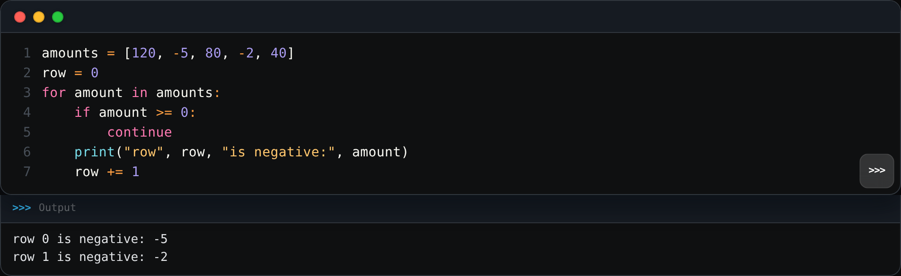

```python
amounts = [120, -5, 80, -2, 40]
row = 0
for amount in amounts:
    if amount >= 0:
        continue
    print("row", row, "is negative:", amount)
    row += 1
```

The negative amounts sit at positions 1 and 3, and the report says 0 and 1. The `continue` sends control back to the top of the loop before `row += 1` runs, so the counter counts only the steps that reached the bottom of the body. Moving the increment higher would fix this copy until someone adds another `continue` above it. The position should come from the loop itself, which is what `enumerate()` provides.

https://github.com/user-attachments/assets/7e418fa1-5c4f-4512-ac29-f84fb29f1980

enumerate(amounts) wraps the list, and each step of the loop receives a pair: the **position** first, the **item** second. The header for i, amount in enumerate(amounts): splits each pair into 2 names with the same multiple assignment as a, b = 1, 2. Python moves the position forward on every step whatever the body does, so a continue can no longer knock it out of line with the list.

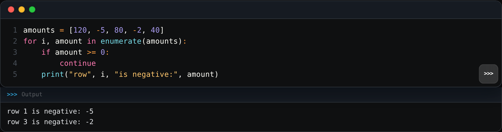

```python
amounts = [120, -5, 80, -2, 40]
for i, amount in enumerate(amounts):
    if amount >= 0:
        continue
    print("row", i, "is negative:", amount)
```

| Step | i | amount | Reaches print? |
| --- | --- | --- | --- |
| 1 | 0 | 120 | no |
| 2 | 1 | -5 | yes |
| 3 | 2 | 80 | no |
| 4 | 3 | -2 | yes |
| 5 | 4 | 40 | no |

> **TIP**
>
> Write 2 names after `for`. With a single name, as in `for pair in enumerate(amounts)`, each step binds the whole pair, which prints as `(0, 120)`, and a test like `pair < 0` stops with a TypeError because a pair cannot be compared with a number.


<br>

### Choosing where the count starts

Positions start at 0 because list indexes do. A report that people read counts from 1, so `enumerate` takes a `start` argument that sets the first number. It renumbers the positions and moves nothing: the first item handed out is still the one stored at index 0.

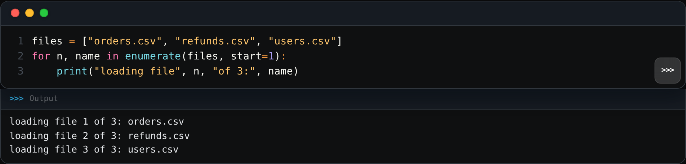

```python
files = ["orders.csv", "refunds.csv", "users.csv"]
for n, name in enumerate(files, start=1):
    print("loading file", n, "of 3:", name)
```


<br>

### Writing back through the position

Position matters most when the loop changes the list. Assigning to the loop variable, `amount = 0`, points that name at a new value and leaves the list as it was. Assigning through the index, `amounts[i] = 0`, replaces the value stored in the list. The program below tries both.

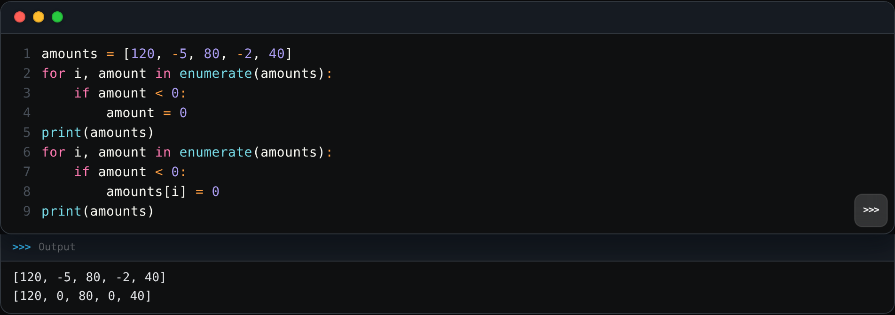

```python
amounts = [120, -5, 80, -2, 40]
for i, amount in enumerate(amounts):
    if amount < 0:
        amount = 0
print(amounts)
for i, amount in enumerate(amounts):
    if amount < 0:
        amounts[i] = 0
print(amounts)
```

> The start=1 trap
>
> `start` renumbers the counter, and the list keeps its 0-based indexes. Using a counter from `enumerate(xs, start=1)` as an index reaches 1 slot to the right of the item in hand, and on the last item it asks for a slot past the end, which stops the program with an IndexError.

**This loop is meant to replace the 20 with 99. What does it print?**

```python
prices = [10, 20, 30]
for i, price in enumerate(prices, start=1):
    if price == 20:
        prices[i] = 99
print(prices)
```

- **A.** [10, 99, 30]
- **B.** [10, 20, 99]
- **C.** [99, 20, 30]
- **D.** [10, 20, 30]

<details>
<summary>Solution</summary>

**B.** [10, 20, 99]

The 20 arrives paired with 2, so prices[2] = 99 overwrites the 30. The next step reads index 2, sees 99, and its test fails.

**Why the others are wrong**

- **A.** That needs the counter to match the index, which start=0 gives. With start=1, the 20 at index 1 arrives paired with 2.
- **C.** Index 0 is never written. The only assignment uses the counter paired with the 20, and that counter is 2.
- **D.** The test does match once, at the 20, so 1 assignment runs and the list changes.

</details>

So `start=1` belongs where the counter is only shown to a person, in a printed line or a report row. Any read or write into the list keeps using the default 0-based counter, which matches the indexes the list actually has.


<br>

---

## zip() Parallel Iteration

Data often arrives column by column: a list of user IDs, a list of countries and a list of play counts, where position 2 in each list describes the same user. Reading a user means taking the same position from every list. With `enumerate` that is `for i, user in enumerate(users):` plus `countries[i]` and `plays[i]` in the body, which works and puts an index on every line that reads a column.

`zip(users, countries)` walks the lists in lockstep. Its first step pairs the first item of each list, its second step the second items, and so on, so `for user, country in zip(users, countries):` binds 1 name per list and needs no index. It accepts any number of lists, and the count of names after `for` has to match the count of lists passed in.

https://github.com/user-attachments/assets/93d25d7a-6aef-4615-a3fc-560cdb87b9f0

*Each step takes the next name and the next age together*

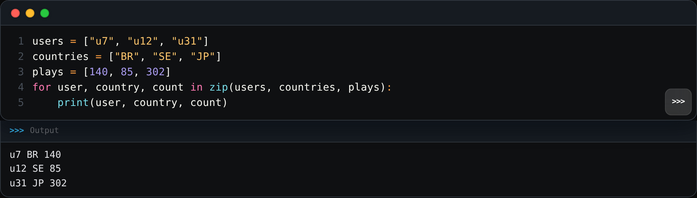

```python
users = ["u7", "u12", "u31"]
countries = ["BR", "SE", "JP"]
plays = [140, 85, 302]
for user, country, count in zip(users, countries, plays):
    print(user, country, count)
```

| ✓ Counter plus indexes | ✗ zip |
| --- | --- |
| • One list drives the loop and the rest are read by position<br><br>• Every column read is a [i] that can name the wrong list<br><br>• A short list fails with an IndexError partway through | • All lists advance together, 1 item each per step<br><br>• Each column gets its own name in the header<br><br>• A short list ends the loop early and raises nothing |


<br>

### The shortest list decides

`zip` stops the moment any of its lists runs out. It raises no error and prints no warning, and the leftover items in the longer lists are never visited.

https://github.com/user-attachments/assets/791abc6e-19d6-4df4-a986-9af4e1a0d1e4

*Diana and the numbers 3, 4 and 5 have no partner, so zip never visits them*

In a pipeline, that silence is the risk. Suppose the country lookup failed for the last user and `countries` came back 1 item short. A loop over `zip(users, countries, plays)` writes 2 rows where there should be 3, and nothing in the output shows that `u31` went missing.

| Position | users | countries | plays | zip step |
| --- | --- | --- | --- | --- |
| 0 | u7 | BR | 140 | 1 |
| 1 | u12 | SE | 85 | 2 |
| 2 | u31 | missing | 302 | never reached |

> **TIP**
>
> Before the loop, test `len(users) == len(countries) == len(plays)` and report the mismatch instead of loading when it is False. From Python 3.10, `zip(users, countries, plays, strict=True)` raises a ValueError on a length mismatch, but 3.9 has no such option.


<br>

### Positions and parallel values together

When the row number matters too, wrap the zip in enumerate: `for i, (user, count) in enumerate(zip(users, plays)):`. Each step of `enumerate` delivers a position and an item, and here the item is itself a pair made by `zip`. The parentheses copy that shape: `i` takes the position and `(user, count)` splits the inner pair. Without them, Python sees 3 names for a value with 2 parts and stops with `ValueError: not enough values to unpack (expected 3, got 2)`.

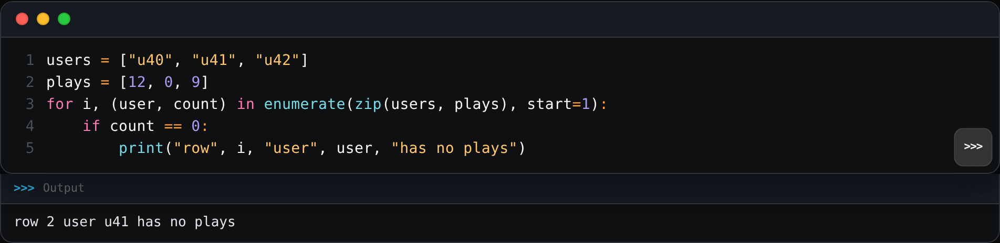

```python
users = ["u40", "u41", "u42"]
plays = [12, 0, 9]
for i, (user, count) in enumerate(zip(users, plays), start=1):
    if count == 0:
        print("row", i, "user", user, "has no plays")
```


<br>

### Turning 2 lists into a dict

A frequent job for `zip` is building a lookup from 2 columns. The first list supplies the keys, the second supplies the values, and the loop assigns each pair.

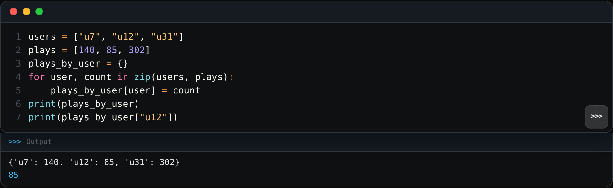

```python
users = ["u7", "u12", "u31"]
plays = [140, 85, 302]
plays_by_user = {}
for user, count in zip(users, plays):
    plays_by_user[user] = count
print(plays_by_user)
print(plays_by_user["u12"])
```

If a key appears twice in the first list, the later assignment overwrites the earlier one, and the dict ends up with fewer entries than the lists have items.

**The names list has 4 items and the scores list has 3. What does this program print?**

```python
names = ["ana", "ben", "cal", "dee"]
scores = [3, 9, 4]
total = 0
for name, score in zip(names, scores):
    total += score
print(total)
```

- **A.** IndexError, since dee has no matching score
- **B.** 16, then a ValueError for the unpaired dee
- **C.** Nothing, since zip refuses lists of unequal length
- **D.** 16, from the 3 pairs zip makes before stopping

<details>
<summary>Solution</summary>

**D.** 16, from the 3 pairs zip makes before stopping

zip pairs ana with 3, ben with 9 and cal with 4, then stops. The total is 3 + 9 + 4, which is 16.

**Why the others are wrong**

- **A.** zip never reads past the end of a list. It stops when scores runs out, so dee is never reached.
- **B.** No error appears for dee. The loop ends cleanly after 3 pairs and the extra name is skipped.
- **C.** zip accepts lists of any lengths. It runs for as many steps as the shortest list has items.

</details>

Building a lookup with `zip` takes 3 pieces: an empty dict created before the loop, a header with 1 name per list, and a body that assigns the second name's value under the first name as the key.


<br>

---

## Iterating Dict Items

Once records are keyed in a dict, a loop can walk 3 things: the keys, the values, or both at once. A plain `for` over a dict walks its keys, in the order they were first inserted. The program below walks the same dict all 3 ways.

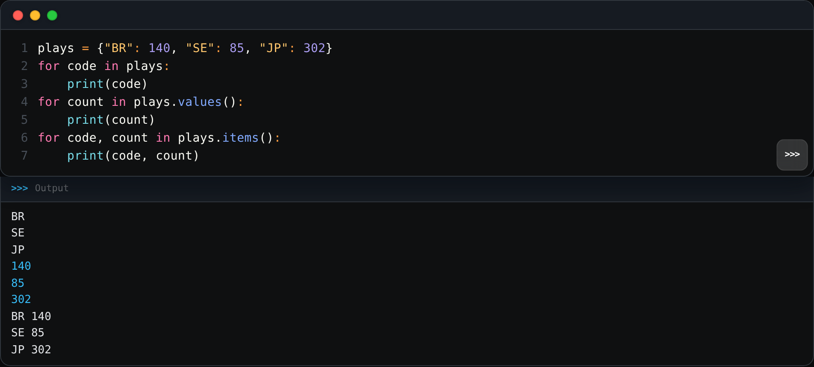

```python
plays = {"BR": 140, "SE": 85, "JP": 302}
for code in plays:
    print(code)
for count in plays.values():
    print(count)
for code, count in plays.items():
    print(code, count)
```

| Loop header | Each step binds | Reach for it when |
| --- | --- | --- |
| `for code in plays:` | a key | the body needs the keys, or reads only some values |
| `for count in plays.values():` | a value | keys play no part, as in a total |
| `for code, count in plays.items():` | a key and its value | the body uses both, the common case |

https://github.com/user-attachments/assets/d9a493b7-75b1-4de2-9b01-1f48b20a14c8

*Each step hands the loop 1 key and the value stored under it*

`.items()` delivers each key together with its value, the same shape `zip(keys, values)` would make, so 2-name unpacking carries over unchanged. A keys loop that reads `plays[code]` in its body reaches the same values with an extra lookup per step and an extra place to mistype the key.


<br>

### Counting first, reporting second

A dict is often built by a loop and read by the next. The first loop below counts signups per country: a code seen for the first time gets a new key set to 1, and a repeat adds 1 to the stored count. The second loop reports the totals through `.items()`.

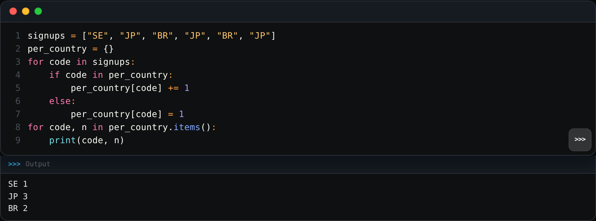

```python
signups = ["SE", "JP", "BR", "JP", "BR", "JP"]
per_country = {}
for code in signups:
    if code in per_country:
        per_country[code] += 1
    else:
        per_country[code] = 1
for code, n in per_country.items():
    print(code, n)
```

The report lists SE, then JP, then BR, which is the order the codes first appeared in `signups`. A dict keeps insertion order and nothing more, so a report sorted by name or by count needs a sorting step of its own.


<br>

### Forgetting .items()

Drop `.items()` from the header and the loop goes back to walking keys, so `for code, count in plays:` tries to split each key into 2 names. What happens next depends on the key. A key like `"Alice"` has 5 characters, and Python stops with `ValueError: too many values to unpack (expected 2)`. A 2-letter country code has exactly 2 characters, so the split succeeds: `code` gets the first letter, `count` gets the second, and the loop runs to the end printing nonsense.

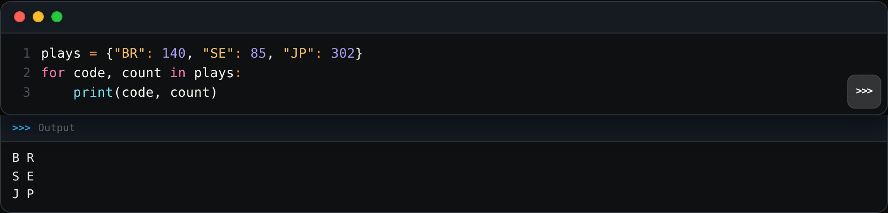

```python
plays = {"BR": 140, "SE": 85, "JP": 302}
for code, count in plays:
    print(code, count)
```


<br>

### Filtering into a new dict

A filtered result goes into a new dict that the loop fills as it walks the original, which is the first step of the animation below, followed by a curve applied to every score and a search for the top scorer.

https://github.com/user-attachments/assets/80f3b14d-4523-4ec3-971a-91c49127eb38

*The curve changes values under existing keys, so the keys stay the same throughout*

| ✓ Do | ✗ Don't |
| --- | --- |
| • Use .items() whenever the body needs both the key and its value<br><br>• Use .values() for totals and checks where the keys play no part<br><br>• Build filtered or reshaped results in a new dict | • Unpack 2 names from a dict without .items()<br><br>• Look up d[k] in a keys loop when .items() already hands you the value |

**This dict has a 2-letter key and a 3-letter key. What does the loop print?**

```python
plays = {"US": 9, "GBR": 4}
for code, count in plays:
    print(code, count)
```

- **A.** U S, then ValueError: too many values to unpack (expected 2)
- **B.** US 9, then GBR 4, one line per key with its value
- **C.** ValueError: too many values to unpack, before any output
- **D.** U S, then G B, splitting off each key's first 2 letters

<details>
<summary>Solution</summary>

**A.** U S, then ValueError: too many values to unpack (expected 2)

The loop walks keys. US splits into 2 letters and prints, then GBR offers 3 letters for 2 names and the loop stops.

**Why the others are wrong**

- **B.** That output needs .items(). Without it the loop never sees the values 9 and 4.
- **C.** The first key, US, has exactly 2 characters, so its step succeeds and prints before the error.
- **D.** Unpacking takes every item of a value, never the first 2. A 3-letter key is too many for 2 names.

</details>

Every error of this kind is fixed in the header, never in the body. With `.items()` added, each step offers exactly 2 parts, a key and its value, whatever the length of the key.


<br>

---

## Nested Loops

A loop placed inside another loop runs its whole course once for every step of the outer one. With 3 outer steps and 2 inner steps, the inner body runs 6 times, in a fixed order: both inner steps for outer step 1, then both for outer step 2, then both for outer step 3.

https://github.com/user-attachments/assets/d9605ee0-370c-40bf-b701-b32bbc3d584b


<br>

### Walking a grid

Tabular data often arrives as a list of rows in which every row is itself a list of cells. That shape is a grid. `sales[1]` is the second row, a list, and `sales[1][2]` indexes into that list for its third cell. The outer loop takes the rows and the inner loop takes the cells of the row in hand.

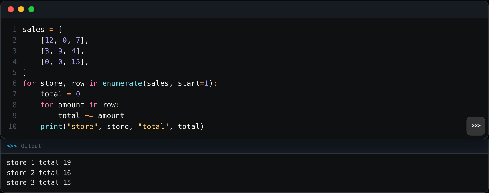

```python
sales = [
    [12, 0, 7],
    [3, 9, 4],
    [0, 0, 15],
]
for store, row in enumerate(sales, start=1):
    total = 0
    for amount in row:
        total += amount
    print("store", store, "total", total)
```

Where `total = 0` sits decides what it counts. Inside the outer loop it resets for each store. Moved above the outer loop, it never resets, and the 3 lines read 19, 35 and 50: running totals across all stores.

Wrapping both levels in `enumerate` gives every cell a pair of coordinates, which is how a data check reports where a bad value sits.

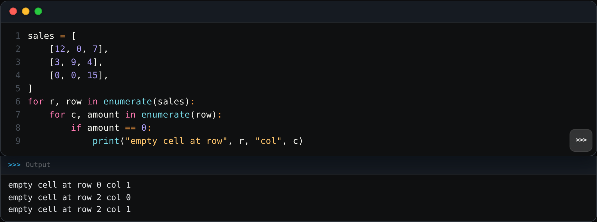

```python
sales = [
    [12, 0, 7],
    [3, 9, 4],
    [0, 0, 15],
]
for r, row in enumerate(sales):
    for c, amount in enumerate(row):
        if amount == 0:
            print("empty cell at row", r, "col", c)
```

> **TIP**
>
> Give each loop its own variable. If the inner loop reuses the outer loop's name, say `i`, the outer loop still steps through its own items, but for the rest of each outer pass `i` holds the inner loop's last value.


<br>

### Generating combinations

The second use of nested loops is pairing items. Looping over the same list twice makes every item meet every item: 4 teams give 16 pairs, including each team against itself and every match listed in both orders. To list each match once, start the inner loop 1 position past the outer one with `range(i + 1, 4)`.

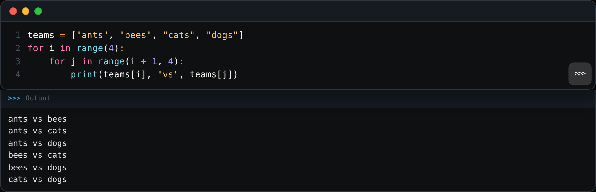

```python
teams = ["ants", "bees", "cats", "dogs"]
for i in range(4):
    for j in range(i + 1, 4):
        print(teams[i], "vs", teams[j])
```

| i | teams[i] | j takes | Pairs printed |
| --- | --- | --- | --- |
| 0 | ants | 1, 2, 3 | 3 |
| 1 | bees | 2, 3 | 2 |
| 2 | cats | 3 | 1 |
| 3 | dogs | nothing | 0 |

The work a nested loop does is the outer size multiplied by the inner size. A 3 by 3 grid costs 9 inner steps. Comparing 2 lists of records item against item costs far more, and that comparison is where nested loops usually turn slow. A later lesson on joining records removes that inner loop entirely.

- **1,000,000** — inner steps for 2 lists of 1,000
- **499,500** — unique pairs among 1,000 records


<br>

### break exits only the inner loop

`break` ends the innermost loop it sits in. In a grid search, finding the target breaks the cell loop, and the row loop moves on to the next row unless something tells it to stop as well. The usual signal is a variable set at the moment of the find and checked right after the inner loop.

https://github.com/user-attachments/assets/3f7d984d-3d3a-450b-9315-9dc779bb1607

*The break ends the scan of row 1, and the check after it ends the row loop*

**Every row of this grid holds a 5. What does the program print?**

```python
grid = [[1, 5], [5, 2], [3, 5]]
hits = 0
for row in grid:
    for value in row:
        if value == 5:
            hits += 1
            break
print(hits)
```

- **A.** 1, since the first break ends the whole search
- **B.** 6, since break skips only the current comparison
- **C.** 3, since each break ends only that row's scan
- **D.** 2, since break also skips the row after a match

<details>
<summary>Solution</summary>

**C.** 3, since each break ends only that row's scan

Each row's 5 adds 1 and breaks the cell loop. The row loop then moves on, so all 3 rows count once.

**Why the others are wrong**

- **A.** A break leaves only the loop it sits in. The row loop carries on to rows 2 and 3, and each holds a 5.
- **B.** There are 6 cells, but only 3 of them hold a 5, so hits cannot reach 6 whatever break does.
- **D.** break touches nothing outside its own loop. The next row is scanned in full, starting from its first cell.

</details>

Stopping the whole scan takes 3 pieces: a variable set when the match is recorded, a `break` in the inner loop, and an `if` on that variable placed after the inner loop at the outer loop's indentation, holding a second `break`.


<br>

---

## Loop else Clauses

The grid search in the previous section kept `found_row` and `found_col` for 2 jobs: holding where the match sat, and telling the code after the loops whether a match happened at all. Python has a clause for the second job. A `for` or `while` loop can carry an `else` block, and the block runs only when the loop ends without a `break`.

https://github.com/user-attachments/assets/f184029b-8348-4333-9892-60c3f35e8ced

*The first loop runs out of numbers and reaches else, while the second breaks at 4 and skips it*

Read the `else` as "no break". In the first search no number is even, the loop runs out of items, and the `else` prints its message. In the second, the 4 triggers `break`, which skips the `else` along with the rest of the loop. The clause lines up with `for` because it belongs to the loop.

| How the loop ended | Does else run? |
| --- | --- |
| It ran out of items | Yes |
| A `break` fired | No |
| The list was empty, so the body never ran | Yes |
| Some steps took `continue`, then items ran out | Yes |
| A `while` condition turned false | Yes |

The empty-list row catches people out. A loop over `[]` finishes at once without a `break`, so its `else` runs. For a search that is the right answer: nothing in an empty list matched, and the not-found branch should fire.


<br>

### An else in the wrong column

Indentation decides which statement owns an `else`. Indent it under the `if` inside the loop and it becomes that `if`'s branch, which runs for every item that fails the test, before the search has finished.

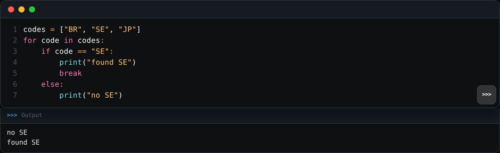

```python
codes = ["BR", "SE", "JP"]
for code in codes:
    if code == "SE":
        print("found SE")
        break
    else:
        print("no SE")
```

The program reports SE missing and then reports it found. Moving `else:` 4 spaces to the left attaches it to the `for`, and the output shrinks to `found SE`.


<br>

### while loops take else too

A `while` loop takes an `else` under the same rule: the block runs when the condition turns false and is skipped when a `break` ends the loop. That fits retry logic, where a job tries a load up to 3 times, stops early on success, and reports failure only after using every attempt. The outcomes below stand in for 3 load attempts.

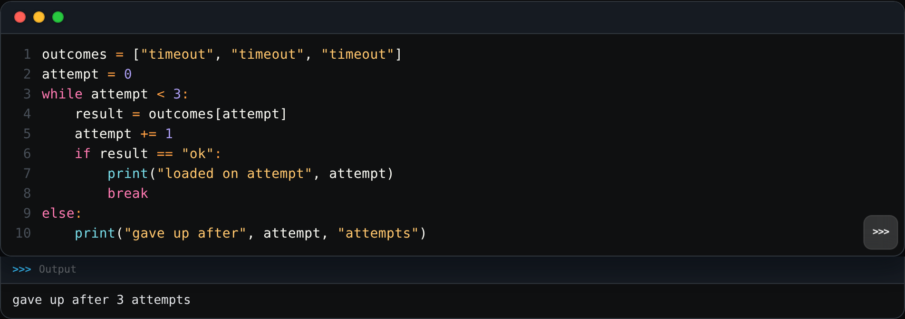

```python
outcomes = ["timeout", "timeout", "timeout"]
attempt = 0
while attempt < 3:
    result = outcomes[attempt]
    attempt += 1
    if result == "ok":
        print("loaded on attempt", attempt)
        break
else:
    print("gave up after", attempt, "attempts")
```

Change the second outcome to `"ok"` and the program prints `loaded on attempt 2` and never reaches the `else`.


<br>

### Leaving 2 loops at once

A loop `else` can also replace the found-variable from the grid search. Give the inner loop an `else: continue` and put a `break` straight after it. When the inner loop runs out of items, its `else` sends the outer loop on to the next line. When the inner loop breaks, the `else` is skipped and the `break` below it ends the outer loop too. The outer loop's own `else` reports a grid with no match.

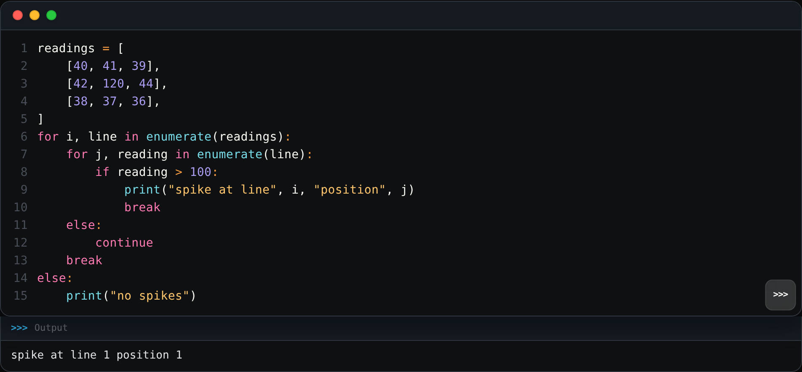

```python
readings = [
    [40, 41, 39],
    [42, 120, 44],
    [38, 37, 36],
]
for i, line in enumerate(readings):
    for j, reading in enumerate(line):
        if reading > 100:
            print("spike at line", i, "position", j)
            break
    else:
        continue
    break
else:
    print("no spikes")
```

*Both versions give the same result. A found-variable reads more plainly to someone who has never met a loop else, so match whichever style the surrounding code already uses.*

**No batch arrived today, so batches is empty. What does the program print?**

```python
batches = []
for batch in batches:
    if batch == "bad":
        print("stopping at bad batch")
        break
else:
    print("all batches clean")
print("done")
```

- **A.** done only, as an empty loop skips its else
- **B.** all batches clean, then done
- **C.** stopping at bad batch, then done
- **D.** Nothing, as looping over an empty list fails

<details>
<summary>Solution</summary>

**B.** all batches clean, then done

The loop finishes at once with no break, so its else prints, and the last line runs after the loop.

**Why the others are wrong**

- **A.** The else is skipped only by break. A loop with nothing to visit ends without one, so the clause runs.
- **C.** That line sits inside the body, and the body never runs when the list is empty.
- **D.** A for over an empty list is legal. It runs 0 steps and carries on with the code after it.

</details>


<br>

### One check that uses all 5 tools

The program below checks hourly row counts for 3 tables. `zip` pairs each table name with its row of counts, `enumerate` supplies the hour, the inner loop stops at the first empty hour, its `else` marks tables that never had one, and an `.items()` loop prints the status dict.

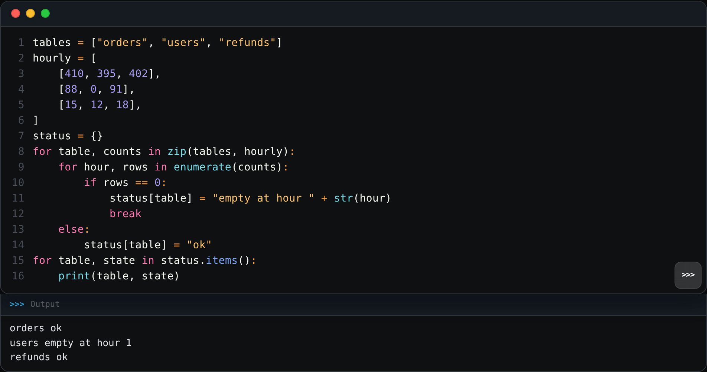

```python
tables = ["orders", "users", "refunds"]
hourly = [
    [410, 395, 402],
    [88, 0, 91],
    [15, 12, 18],
]
status = {}
for table, counts in zip(tables, hourly):
    for hour, rows in enumerate(counts):
        if rows == 0:
            status[table] = "empty at hour " + str(hour)
            break
    else:
        status[table] = "ok"
for table, state in status.items():
    print(table, state)
```

In that program the inner loop's `else` sits in the same column as `for hour, rows in enumerate(counts):`, 4 spaces in from the outer `for`. Moved 4 spaces left, it would belong to the outer loop and run once, after every table had been checked.


<br>

---

## Putting It All Together

At Spotify, picture the job that prepares Wrapped cards. For each listener it holds a list of track names, a parallel list of play counts, a dict of minutes per artist and a grid of plays by month, and it must never ship a card whose top songs are missing.

- zip pairs the track names with their play counts, and enumerate ( . . . , start = 1 ) numbers the top 5 the way the card shows them.
- . items ( ) walks minutes per artist, so each artist's name stays attached to its total while the job picks the top artist.
- Nested loops scan the month-by-track grid, and the inner break ends a month's scan at the first track over the threshold.
- A for over the listener's play counts breaks at the first count above zero, and its else catches a listener with no plays, whose card is held back before it ships empty.


<br>

---

## Key Takeaways

- enumerate ( xs , start = 1 ) attaches a position to each item that no continue can knock out of step, and start renumbers without moving any item.
- zip walks lists in lockstep and stops at the shortest without a word, so confirm parallel lists hold equal counts first.
- A loop over a dict walks keys. . values ( ) gives the values, . items ( ) gives both, and a missing . items ( ) can split keys into letters.
- An inner loop runs in full for each outer step, costs the product of the 2 sizes, and break exits only the inner one.
- A loop's else runs only when no break fired, including when the loop had nothing to visit.
