# Problem Solving: Advanced

In November, Spotify's Wrapped team must compute every listener's year: minutes played across any chosen stretch of days, the longest daily listening streak, and 2 tracks that together fill a 10-minute gap. A nested loop over every pair of daily rows would finish long after New Year. The 5 patterns here replace that check of every pair with 1 or 2 passes, plus at most 1 sort.


<br>

---

## Two-Pointer Technique

A **two-pointer** solution keeps 2 indexes into one sequence and moves them based on the values they point at. Neither pointer ever reverses direction. Starting from opposite ends, left only rises while right only falls. Each step shrinks the gap between them by at least 1, so on a list of n items the loop ends within n - 1 steps. The skill lies in proving that each move discards only values that can't be part of the answer.


<br>

### Pointers that meet in the middle

A palindrome reads the same in both directions: character 0 must equal the last character, character 1 must equal the second to last, and so on inward. Put `left` at the start and `right` at the end, compare the 2 characters, then step both pointers toward the middle. The first mismatch ends the check, and if the pointers meet without one, every mirrored pair matched.

https://github.com/user-attachments/assets/f213603d-d8ff-4f3a-8bc8-37055081731d

On `"racecar"` the loop starts by comparing indexes 0 and 6, then moves inward 1 step at a time to 1 and 5 and finally to 2 and 4. After that `left` and `right` both sit at 3, the `while` test fails, and the middle `e` needs no partner. On `"hello"` the very first comparison of `h` against `o` returns `False`. The 3 letters between them are never read.


<br>

### Pair sums on a sorted list

A list of track lengths in minutes is sorted ascending, and a 10-minute ad-free gap should be filled by exactly 2 tracks. Start `left` at the shortest track and `right` at the longest, then add them. A total below the target can only grow if `left` moves up to a longer track, and a total above it can only shrink if `right` moves down to a shorter one.

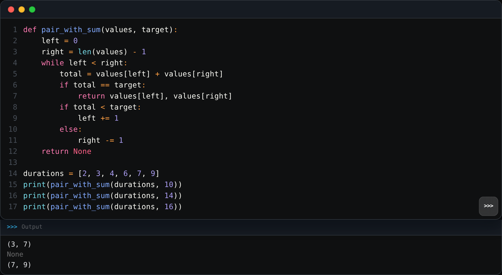

```python
def pair_with_sum(values, target):
    left = 0
    right = len(values) - 1
    while left < right:
        total = values[left] + values[right]
        if total == target:
            return values[left], values[right]
        if total < target:
            left += 1
        else:
            right -= 1
    return None

durations = [2, 3, 4, 6, 7, 9]
print(pair_with_sum(durations, 10))
print(pair_with_sum(durations, 14))
print(pair_with_sum(durations, 16))
```

| Step | left | right | Total | Next move |
| --- | --- | --- | --- | --- |
| 1 | 0 | 5 | 2 + 9 = 11 | too big: right -= 1 |
| 2 | 0 | 4 | 2 + 7 = 9 | too small: left += 1 |
| 3 | 1 | 4 | 3 + 7 = 10 | match: return (3, 7) |


<br>

### Why a move never skips the answer

Take the trace above for a target of 10. Step 1 computes 2 + 9 = 11 and overshoots. Since 2 is the shortest track still in play, every other partner for 9 would overshoot by more, so 9 belongs to no valid pair and dropping it loses nothing. Step 2 is the mirror case: 2 + 7 = 9 falls short, 7 is the longest track still in play, so 2 has no partner left that reaches 10.

Every step removes one value with proof that it cannot be in any valid pair, which is why the input must be sorted. On unsorted values `values[left]` is no longer guaranteed to be the shortest track still in play. Without that guarantee the loop can walk past a pair that exists.

> Signs a problem fits 2 pointers
>
> - The input is sorted, or can be read from both ends with a known order.
> - Moving one pointer has a one-way effect: the total or the gap only grows, or only shrinks.
> - The answer is a single pair or window of the input, or positions that mirror each other.


<br>

### Pointers moving the same way

Pointers can also travel in the same direction. To remove duplicates from a sorted list in place, a `read` index visits every item while a `write` index marks where the next distinct value goes. Sorting already put equal values next to each other, so a value is new exactly when it differs from the last value written.

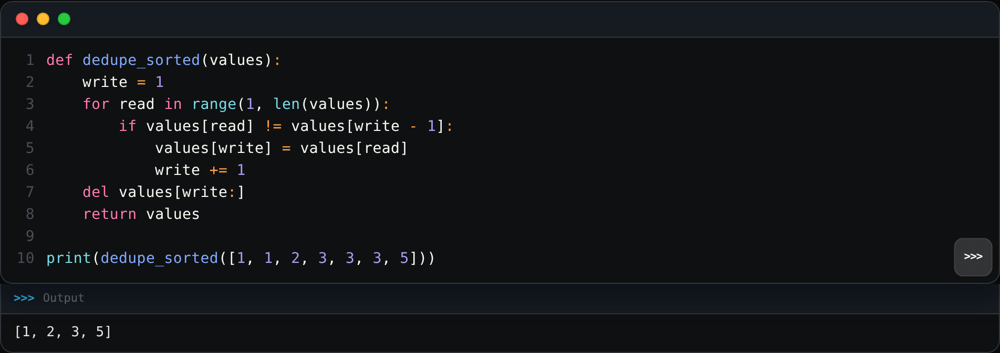

```python
def dedupe_sorted(values):
    write = 1
    for read in range(1, len(values)):
        if values[read] != values[write - 1]:
            values[write] = values[read]
            write += 1
    del values[write:]
    return values

print(dedupe_sorted([1, 1, 2, 3, 3, 3, 5]))
```

Trace it on `[1, 1, 2, 3, 3, 3, 5]`. Both indexes start at 1. The 1 at position 1 equals the last value written, `values[0]`, so it's skipped and only `read` advances. The 2 at position 2 differs, so it's copied to position 1 and `write` becomes 2. The first 3 lands at position 2, the next 2 copies of 3 match it and are skipped, and 5 lands at position 3. `write` ends at 4, and `del values[write:]` cuts the 3 stale items at positions 4 to 6. `write` never passes `read`, so a copy never overwrites a value that hasn't been read yet.

**What does this print, and how many totals does the loop compute before it stops?**

```python
def pair_with_sum(values, target):
    left = 0
    right = len(values) - 1
    while left < right:
        total = values[left] + values[right]
        if total == target:
            return values[left], values[right]
        if total < target:
            left += 1
        else:
            right -= 1
    return None

print(pair_with_sum([1, 4, 5, 8, 11], 13))
```

- **A.** None, since the pointers cross before any total reaches 13
- **B.** (4, 8) after 3 totals, the third total being 4 + 8
- **C.** (5, 8) after 4 totals: 12, 15, 12, then 13
- **D.** (5, 8) after 2 totals, because 11 and then 1 are dropped

<details>
<summary>Solution</summary>

**C.** (5, 8) after 4 totals: 12, 15, 12, then 13

First 1 + 11 = 12 moves left, 4 + 11 = 15 moves right, 4 + 8 = 12 moves left, and 5 + 8 = 13 matches.

**Why the others are wrong**

- **A.** The fourth total, 5 + 8, is exactly 13, so the function returns while left is still below right.
- **B.** That third total is 12, below 13, so left moves on and the loop keeps going.
- **D.** The first total is too small, so 1 is dropped first, and 2 more totals follow before the match.

</details>

Each branch moves the pointer whose value caused the miss. A total below the target means the smaller value is too small, so `left` steps up to a larger one; a total above it means the larger value is too big, so `right` steps down. Swap the 2 moves and the walk heads away from the answer: on `[2, 3, 4, 6, 7, 9]` with a target of 10, the first total of 11 moves `left` up to the 3, and the totals climb to 12 and 13, then to 15 and 16, until the pointers meet and the function returns `None`.


<br>

---

## Hash Map O(1) Lookups

Drop the sorted guarantee. Track lengths now arrive in play order, and the task is to return the positions of 2 that add up to a target. The direct answer tries every pair with a nested loop:

```sql
def two_sum_pairs(nums, target):
    for i in range(len(nums)):
        for j in range(i + 1, len(nums)):
            if nums[i] + nums[j] == target:
                return [i, j]
    return None
```

Starting the inner loop at `i + 1` tries each pair once, yet the count of pairs grows with the square of the list length: double the list and the worst case roughly quadruples.

| Items in the list | Pairs the nested loop may check | Dict lookups in one pass |
| --- | --- | --- |
| 4 | 6 | 4 |
| 1,000 | 499,500 | 1,000 |
| 100,000 | 4,999,950,000 | 100,000 |


<br>

### Turn the search into a lookup

For any number, its partner is fully decided: it must equal `target - num`. The question 'which number pairs with this one?' becomes 'have I already seen the value `target - num`?' A dict answers that with one hash lookup, and the cost of a lookup stays flat whether the dict holds 4 keys or 4 million. The keys are values seen so far, and each maps to the position where it appeared.

https://github.com/user-attachments/assets/8c1ae081-1fe3-4ebb-a968-125babddc915

At position 0 the loop needs 7, which is not in the dict yet, so it stores `{2: 0}`. At position 1 it needs 2, which is a key, so it returns `[0, 1]` and never reads 11 or 15. On a list with no answer, each number is looked up once and stored once, so the work is one pass plus one dict entry per item.


<br>

### Look up first, then store

The order of the 2 dict operations inside the loop decides correctness. Store the current number before checking, and a number can pair with itself:

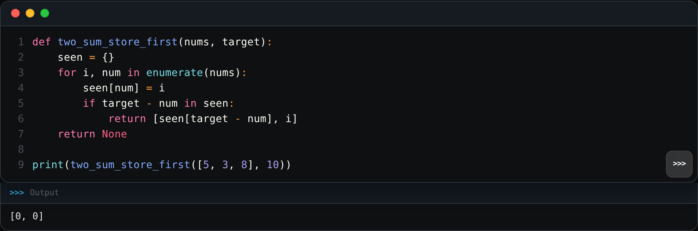

```python
def two_sum_store_first(nums, target):
    seen = {}
    for i, num in enumerate(nums):
        seen[num] = i
        if target - num in seen:
            return [seen[target - num], i]
    return None

print(two_sum_store_first([5, 3, 8], 10))
```

The list `[5, 3, 8]` has no pair that sums to 10, yet the function reports positions 0 and 0: the 5 at position 0 found itself in the dict. Checking first means `seen` holds only earlier positions when the lookup runs. Repeated values still work in that order: on `[5, 5]` with a target of 10, position 1 needs 5, finds the 5 stored at position 0, and returns `[0, 1]`.


<br>

### Grouping is the same move

The nested-loop habit appears outside pair problems too. Splitting play events by user with an outer loop over users and an inner filter over all events reads every event once per user. A dict keyed by user does the split in one pass, sending each event straight to its user's list:

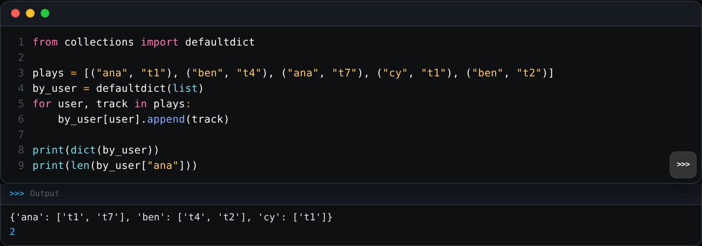

```python
from collections import defaultdict

plays = [("ana", "t1"), ("ben", "t4"), ("ana", "t7"), ("cy", "t1"), ("ben", "t2")]
by_user = defaultdict(list)
for user, track in plays:
    by_user[user].append(track)

print(dict(by_user))
print(len(by_user["ana"]))
```

> Limits of the dict
>
> - Memory: up to one entry per item, so 100,000 numbers can leave 100,000 keys in `seen`.
> - Hashable keys: numbers work as keys, and so do strings and tuples, but a list as a key raises `TypeError`.
> - Exact matches only: 'which seen value is closest to 7?' needs sorted data instead.

**What does this print?**

```python
plays = [5, 9, 3, 9, 1]
best = plays[0]
best_hour = 0
for hour, p in enumerate(plays):
    if p >= best:
        best = p
        best_hour = hour
print(best, best_hour)
```

- **A.** 9 3, because >= lets the later 9 replace the earlier one
- **B.** 9 1, because the first 9 is kept and the second is ignored
- **C.** 5 0, because best starts at plays[0] and never changes
- **D.** 9 4, because best_hour tracks the last hour the loop visits

<details>
<summary>Solution</summary>

**A.** 9 3, because >= lets the later 9 replace the earlier one

Hour 1 sets best to 9, and at hour 3 the test 9 >= 9 is true, so best_hour moves to 3.

**Why the others are wrong**

- **B.** This answer comes from a strict >, which rejects the tie at hour 3; the code uses >=, which accepts it.
- **C.** Best does start at 5, but 9 is greater at hour 1 and replaces it.
- **D.** Best_hour changes only when the test passes, and 1 >= 9 is false at hour 4.

</details>

When the answer needs only whether a value appeared, the positions stored in the dict go unused, and a set does the same work with keys alone. `x in seen` is the same flat-cost hash lookup, and `seen.add(x)` records a value. Finding the first track id played a second time is the two-sum loop with a set: if the current id is already in `seen`, print it and stop; if not, add it. The order matters for the same reason as before: add first, and every id finds itself on its first visit.


<br>

---

## Tracking the Best So Far

Plenty of questions want one winner: the busiest day, the longest streak, the biggest jump. One approach builds a list of every candidate and calls `max` at the end. A tighter one keeps only the best candidate found so far and updates it as each item passes, so its memory stays the same size whether it reads 10 days or 10 years.


<br>

### A running maximum that remembers where

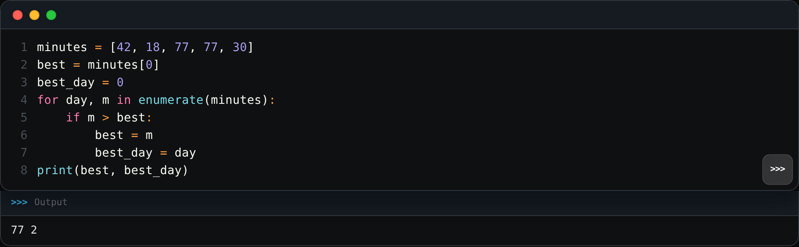

```python
minutes = [42, 18, 77, 77, 30]
best = minutes[0]
best_day = 0
for day, m in enumerate(minutes):
    if m > best:
        best = m
        best_day = day
print(best, best_day)
```

Day 2 and day 3 both reach 77, and the strict `>` keeps the first, printing `77 2`. Change it to `>=` and the later tie replaces the earlier one, printing `77 3`. The comparison operator is a decision about ties, so choose it on purpose.

**What does this print?**

```python
plays = [5, 9, 3, 9, 1]
best = plays[0]
best_hour = 0
for hour, p in enumerate(plays):
    if p >= best:
        best = p
        best_hour = hour
print(best, best_hour)
```

- **A.** 9 3, because >= lets the later 9 replace the earlier one
- **B.** 9 1, because the first 9 is kept and the second is ignored
- **C.** 5 0, because best starts at plays[0] and never changes
- **D.** 9 4, because best_hour tracks the last hour the loop visits

<details>
<summary>Solution</summary>

**A.** 9 3, because >= lets the later 9 replace the earlier one

Hour 1 sets best to 9, and at hour 3 the test 9 >= 9 is true, so best_hour moves to 3.

**Why the others are wrong**

- **B.** This answer comes from a strict >, which rejects the tie at hour 3; the code uses >=, which accepts it.
- **C.** Best does start at 5, but 9 is greater at hour 1 and replaces it.
- **D.** Best_hour changes only when the test passes, and 1 >= 9 is false at hour 4.

</details>


<br>

### Remembering 2 values at once

The biggest rise in daily listeners, from an earlier day to a later one, depends on a pair of days. Subtracting the overall minimum from the overall maximum gives the wrong answer when the peak comes before the trough. Keep 2 running values instead: `lowest`, the smallest count seen so far, and `best_gain`, the largest rise found so far. Each new day is measured against the lowest day before it.

https://github.com/user-attachments/assets/ed0a4f6b-3a48-432e-953e-a744e6159bd1

*Each day is compared only with the lowest day that came before it.*

The loop prints 45, the rise from 95 on day 2 to 140 on day 3. The naive 72 pairs 160 on day 1 with 88 on day 4, a drop in time order, so that rise never happened.


<br>

### The starting value is part of the answer

Starting `best` at 0 looks harmless until every value is negative:

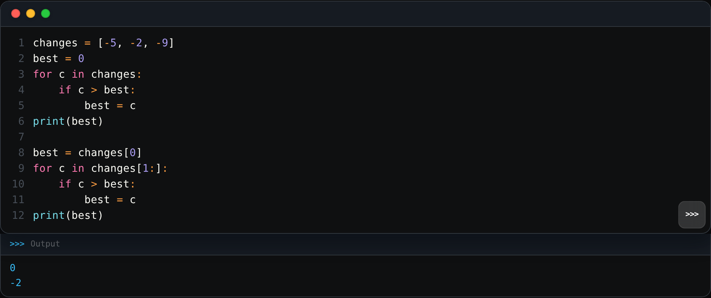

```python
changes = [-5, -2, -9]
best = 0
for c in changes:
    if c > best:
        best = c
print(best)

best = changes[0]
for c in changes[1:]:
    if c > best:
        best = c
print(best)
```

The first loop reports 0, a value that never appears in the list. Starting from `changes[0]` makes the first real item the first candidate. On an empty list that start raises `IndexError`, which is usually right: an empty list has no best value, and a guard clause before the loop can say so in its own words. The rise loop starts `best_gain` at 0 on purpose, meaning 'no rise found'.


<br>

### The best run, built from the current run

Some winners are runs, such as the longest stretch of consecutive days with any listening. Keep `current`, the length of the run that ends today, and `longest`, the best run so far. A listening day extends `current` and offers it to `longest`; a silent day resets `current` to 0.

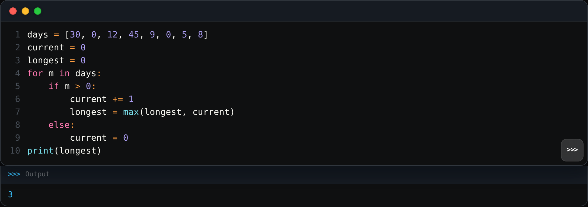

```python
days = [30, 0, 12, 45, 9, 0, 5, 8]
current = 0
longest = 0
for m in days:
    if m > 0:
        current += 1
        longest = max(longest, current)
    else:
        current = 0
print(longest)
```

The winning run is 3 days long. It starts with 12 minutes and 45 minutes and ends on a 9-minute day. The same 2-variable shape finds the largest total over any consecutive run when values can be negative. Now `current` is the best total of a run ending exactly at this item, and that run has 2 choices: extend the run that ended at the previous item, or start fresh here. A run whose total is negative only drags down whatever follows it, so when `current` is negative the next run starts over at the new value. That is `current = max(value, current + value)`. The winning run can end at any item, so `best = max(best, current)` keeps the largest `current` seen.

| Item | Extend: current + item | Restart: item | New current | best |
| --- | --- | --- | --- | --- |
| 3 | no earlier run | 3 | 3 | 3 |
| -4 | 3 + -4 = -1 | -4 | -1 | 3 |
| 5 | -1 + 5 = 4 | 5 | 5 | 5 |


<br>

---

## Prefix Sum Concept

A dashboard lets a listener pick any range of days and shows the minutes played in it. Summing the slice for each query reads the whole range every time: 1,000 queries over a year can read up to 365,000 values, adding the same days again and again. A prefix sum does the adding once.

Build a list prefix where prefix[i] is the total of the first i days, starting with prefix[0] = 0. The total from day first through day last, both included, is prefix[last + 1] - prefix[first]: everything up to and including last, minus everything before first.

| Day | Minutes | prefix[day]: total before it | prefix[day + 1]: total through it |
| --- | --- | --- | --- |
| 0 | 40 | 0 | 40 |
| 1 | 10 | 40 | 50 |
| 2 | 25 | 50 | 75 |
| 3 | 5 | 75 | 80 |
| 4 | 30 | 80 | 110 |
| 5 | 20 | 110 | 130 |

https://github.com/user-attachments/assets/e35f93f5-ce09-4e58-a586-c87f3e2aea89

*The prefix list gains one running total per day, then 3 queries read from it.*

The query for days 2 through 4 reads only the 2 entries 110 and 50, however many days lie between them. Day 3 alone works the same way: `prefix[4] - prefix[3]` is 80 minus 75. The build costs one pass, and each query after it costs one subtraction.


<br>

### The leading 0 in the prefix list

Without the leading 0, `prefix[i]` would hold the total through day `i`, and a range starting at day 0 would subtract `prefix[first - 1]`. In Python that is `prefix[-1]`, the last element, so the query returns a wrong number and raises no error. The 0 at the front gives every range, including one that starts at day 0, the same formula.

> **TIP**
>
> `itertools.accumulate(minutes, initial=0)` yields the same running totals. Wrap it in `list()` to get `[0, 40, 50, 75, 80, 110, 130]` in one line.


<br>

### Prefix sums meet the dict

How many runs of consecutive hours have a net follower change of exactly 7? A run from hour `first` to hour `last` totals 7 when `prefix[last + 1] - prefix[first] == 7`, so at each hour the question is how many earlier running totals equal the current total minus 7. That's the complement lookup from two-sum, with counts in the dict instead of positions.

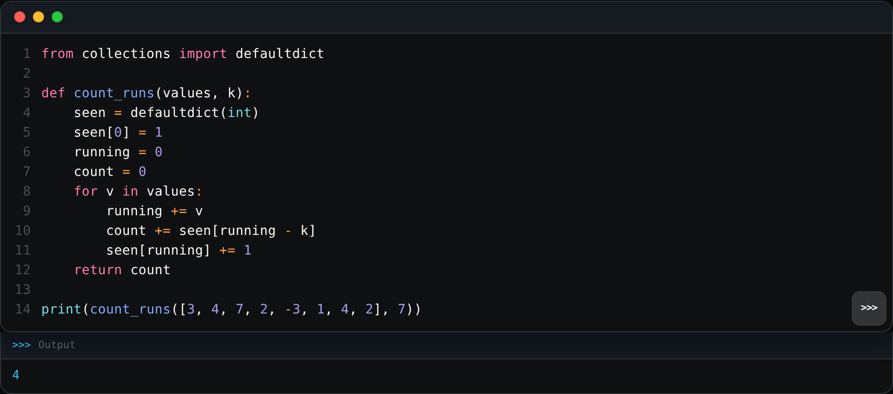

```python
from collections import defaultdict

def count_runs(values, k):
    seen = defaultdict(int)
    seen[0] = 1
    running = 0
    count = 0
    for v in values:
        running += v
        count += seen[running - k]
        seen[running] += 1
    return count

print(count_runs([3, 4, 7, 2, -3, 1, 4, 2], 7))
```

The 4 runs are `3, 4`, then `7`, then `7, 2, -3, 1`, then `1, 4, 2`. The entry `seen[0] = 1` stands for the empty prefix before hour 0, so a run starting at hour 0 gets counted. Negative values rule out a sliding window here, since growing a window no longer guarantees a larger total.

> When prefix sums stop paying
>
> - The data changes between queries: one edited day shifts every prefix value after it.
> - There's only one query: the build is a full pass, the same work as one plain sum.
> - The question is a range maximum or minimum: subtraction undoes a sum, but no subtraction undoes a max.

**With prefix = [0, 40, 50, 75, 80, 110, 130] built from 6 days of minutes, which expression gives the minutes for days 1 through 3, both included?**

- **A.** prefix[3] - prefix[1], the prefix entries at the 2 ends
- **B.** prefix[4] - prefix[1], which is 80 - 40 = 40
- **C.** prefix[4] - prefix[0], the total through day 3 minus the start
- **D.** prefix[3] - prefix[0], the sum of the first 3 days

<details>
<summary>Solution</summary>

**B.** prefix[4] - prefix[1], which is 80 - 40 = 40

Entry 4 is the total through day 3, entry 1 is the total before day 1, and 10 + 25 + 5 = 40.

**Why the others are wrong**

- **A.** That is 75 - 40 = 35: it stops before day 3 and leaves out its 5 minutes.
- **C.** That is 80, which also counts the 40 minutes of day 0.
- **D.** That is 75, the total of days 0 through 2.

</details>

Prefix code goes wrong in 2 places, and both are off by one. The list must start with 0, which gives it 1 more entry than there are days, and a query's end index must be `last + 1`, because entry `i` holds the total of the days before day `i`. A one-day range tests both at once: `range_total(d, d)` has to equal day `d`'s own minutes. Without the `+ 1` it returns 0, and without the leading 0 it returns the next day's minutes instead.


<br>

---

## Sort as Preprocessing

Many problems that look hard on raw input become a single pass once the input is sorted. Sorting puts equal values next to each other, places the closest values side by side, lines up overlapping intervals, and gives 2 pointers the order their proof needs. A sort costs more than one pass, but far less than checking every pair.

- **~20M** — comparisons to sort 1M values
- **~500B** — pairs among 1M values


<br>

### Closest pair: compare only neighbours

Which 2 play timestamps, in seconds, sit closest together? In sorted order the closest pair must be neighbours: a value between them would be closer to each of them than they're to each other. One pass over neighbouring pairs, keeping the smallest gap so far, replaces the check of every pair.

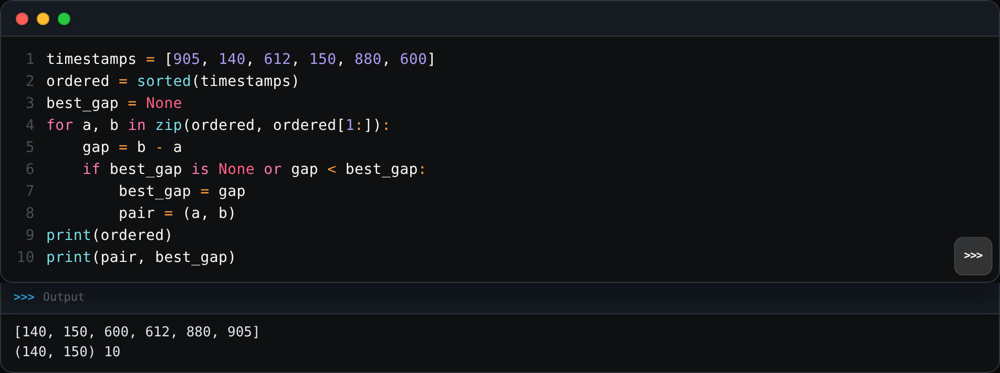

```python
timestamps = [905, 140, 612, 150, 880, 600]
ordered = sorted(timestamps)
best_gap = None
for a, b in zip(ordered, ordered[1:]):
    gap = b - a
    if best_gap is None or gap < best_gap:
        best_gap = gap
        pair = (a, b)
print(ordered)
print(pair, best_gap)
```


<br>

### Merging overlapping sessions

Listening sessions arrive as `(start, end)` hours in any order, and overlapping ones should become one block. After sorting by start, a session can only overlap the block built just before it, so each session either extends the last block or opens a new one.

https://github.com/user-attachments/assets/46515bab-f82a-4366-81d9-b63e896e9c93

*After the sort, each session is compared with the last merged block only.*

`(3, 6)` starts at 3, inside `[1, 4]`, so the block grows to `[1, 6]`. `(9, 12)` starts after 6 and opens a new block, which `(11, 13)` then stretches to 13. The `max(last[1], end)` matters for a session lying fully inside a block, such as `(2, 3)` inside `[1, 6]`, which must not shrink it.


<br>

### Sorting without losing positions

Sorting rearranges values, so the positions from the original list are lost. When the answer must be original positions, sort the positions themselves, using each position's value as the sort key. The pair walk from the first section then returns indexes into the unsorted list:

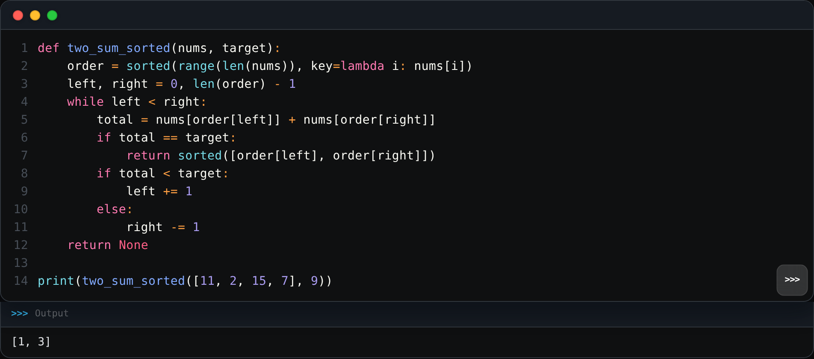

```python
def two_sum_sorted(nums, target):
    order = sorted(range(len(nums)), key=lambda i: nums[i])
    left, right = 0, len(order) - 1
    while left < right:
        total = nums[order[left]] + nums[order[right]]
        if total == target:
            return sorted([order[left], order[right]])
        if total < target:
            left += 1
        else:
            right -= 1
    return None

print(two_sum_sorted([11, 2, 15, 7], 9))
```

| ✓ Dict lookup in one pass | ✗ Sort, then walk or search |
| --- | --- |
| • Works on unsorted input as it arrives<br><br>• Stores one entry per value seen<br><br>• Answers exact matches only | • Pays for one sort up front<br><br>• Can run in place with 2 indexes<br><br>• Answers ordering questions, such as which values are closest or fall in a range |


<br>

### Sort once, answer many questions

A sorted list also supports binary search. `bisect_right(lengths, x)` returns how many values are at most `x`, so the program below finds 3 sessions of 10 minutes or less and 2 longer than 20. One sort pays for any number of these questions.

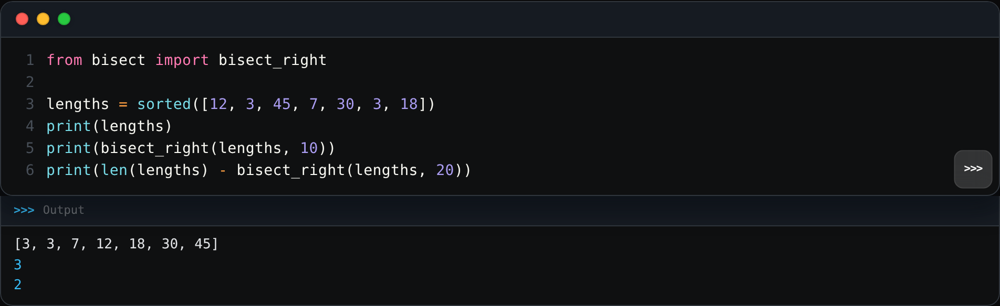

```python
from bisect import bisect_right

lengths = sorted([12, 3, 45, 7, 30, 3, 18])
print(lengths)
print(bisect_right(lengths, 10))
print(len(lengths) - bisect_right(lengths, 20))
```

Every pass in this section trusts the order the sort produced. The closest-pair loop assumes the nearest values are neighbours, the merge assumes a session can only overlap the last block, and `bisect_right` assumes no larger value sits before a smaller one. Remove the sort and each loop still runs to the end with no exception. The assumption is false, though, so the output is a wrong answer that looks like a real one.

**This version of the merge leaves out the sort. What does it print?**

```python
sessions = [(9, 12), (1, 4), (3, 6)]
merged = [list(sessions[0])]
for start, end in sessions[1:]:
    last = merged[-1]
    if start <= last[1]:
        last[1] = max(last[1], end)
    else:
        merged.append([start, end])
print(merged)
```

- **A.** [[1, 6], [9, 12]], the same blocks a sorted merge finds
- **B.** [[9, 12], [1, 6]], the right blocks in arrival order
- **C.** [[1, 12]], since all 3 sessions merge into one span
- **D.** [[9, 12]], because 1 and 3 both test as inside [9, 12]

<details>
<summary>Solution</summary>

**D.** [[9, 12]], because 1 and 3 both test as inside [9, 12]

Both starts are at most 12, and max(12, 4) and max(12, 6) leave the end at 12, so 2 sessions vanish.

**Why the others are wrong**

- **A.** Without the sort, (1, 4) is compared with [9, 12], and 1 <= 12 is true, so no [1, 6] block is ever built.
- **B.** No new block opens, because every start is at most 12 and the else branch never runs.
- **C.** The block's start stays 9: the loop only ever updates last[1], the end.

</details>

A missing sort sometimes leaves a visible trace. In the closest-pair loop run on arrival order, `b - a` goes negative whenever a later timestamp is smaller, as 140 - 905 = -765 is. A negative gap is smaller than every real gap, so it wins. Any gap below 0 means the order the loop relies on is missing.

### The fullest gap

Exercise: [The fullest gap](_exercises/python_problem_solving_advanced_exercise_1.md)


<br>

---

## Putting It All Together

The Wrapped team at Spotify receives a year of rows per listener: minutes played each day, app sessions as start and end hours, and the lengths of every track played. From those rows they must produce each listener's summary cards before launch day.

- A dict keyed by listener groups the rows in one pass, so every later pattern runs per person instead of filtering the whole year for each one.
- Daily minutes become a prefix list once per listener, and 'minutes in your summer' or any other date range is a single subtraction.
- The longest listening streak and the biggest rise in daily minutes each come from one pass with a running best, with no list of candidates stored.
- Sessions sorted by start and merged turn overlapping app sessions into real listening blocks.
- Track pairs that fill a gap come from sorting lengths and walking 2 pointers, or from a dict of lengths when the data must stay in arrival order.


<br>

---

## Key Takeaways

- A two-pointer walk is correct when each move provably discards a value, and on pair sums that proof needs sorted input.
- A dict turns a search for the partner into a lookup of target - num , and checking before storing stops a value pairing with itself.
- A running best keeps memory flat, and its starting value and its tie comparison are both part of the answer.
- A prefix list with a leading 0 answers any range sum as prefix [ last + 1 ] - prefix [ first ] .
- Sorting first moves equal and closest values next to each other and lines up overlapping intervals, at the price of the original positions.
