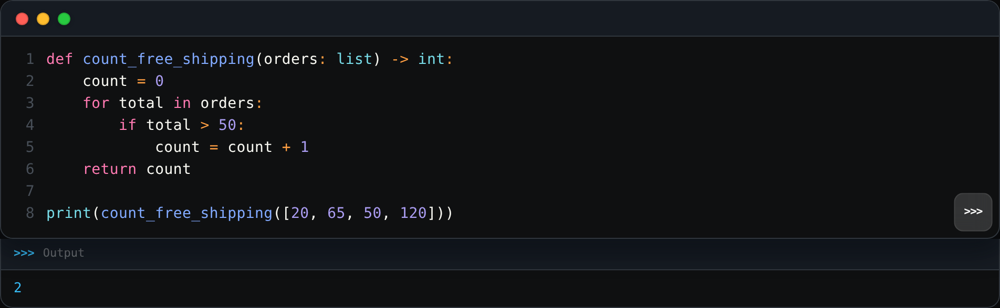
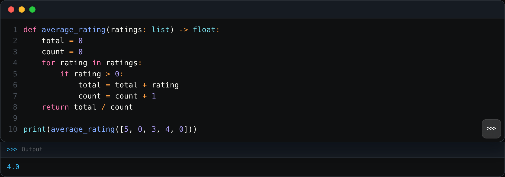
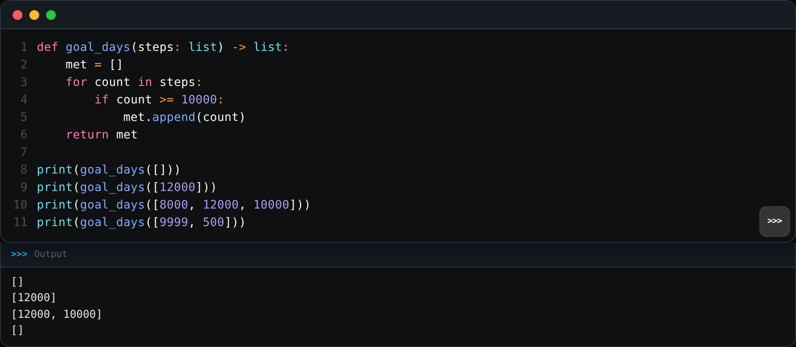
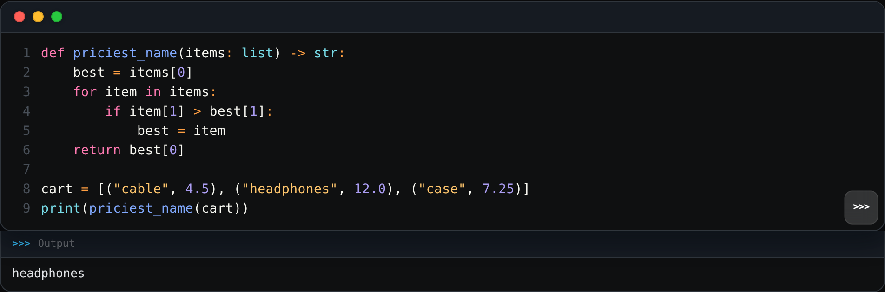
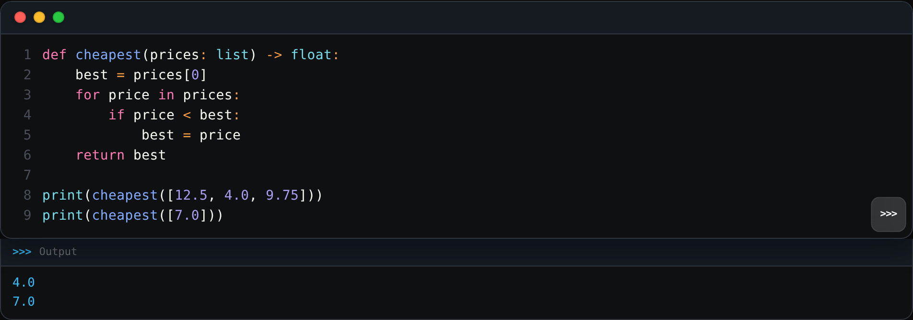
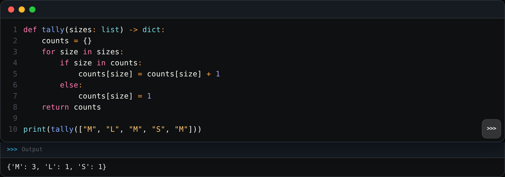
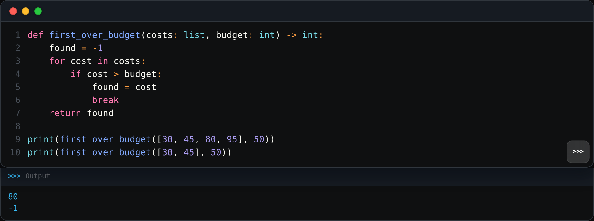
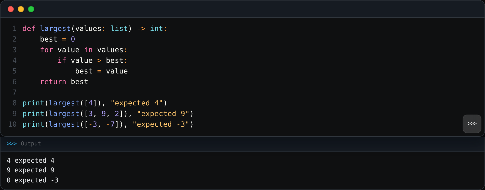
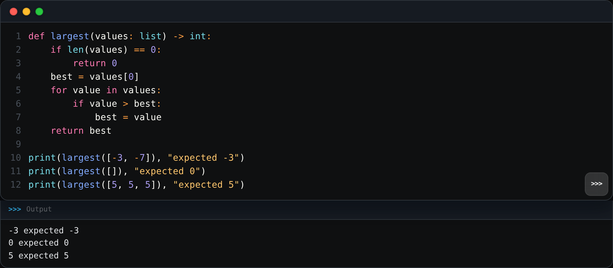

# Problem Solving: Beginner

Every December, Spotify ships Wrapped, and one card shows the total minutes each listener spent playing music that year. An engineer gets only that sentence; the function name and the test data are hers to invent. Whether the card is right for hundreds of millions of listeners depends on how she turns 1 sentence into steps, checks them by hand, and tests them on 3 fake listeners first.


<br>

---

## Breaking Problems into Steps

A word problem arrives as a sentence, and Python runs lines. The work between them is a list of steps in plain words, each small enough that you already know the line of code it becomes. Writing that list first means the code is a translation, and a translation is checked line by line against its source.


<br>

### From sentence to steps

Here is a problem as a teammate would phrase it: a store gives free shipping on orders over 50 dollars, and we have the list of order totals from today, so how many orders got free shipping? Before touching code, write what has to happen, in order:

Steps in plain words

- Start a counter at 0, because no orders have been checked yet.
- Look at each order total, one at a time.
- If the total is more than 50, add 1 to the counter.
- After the last order, the counter holds the answer.

Each step names 1 thing Python can do: an assignment, a for loop, an if with an assignment inside it, and a return. The translation is 1 line per step, with the loop body indented under its step.

| Step | Code |
| --- | --- |
| 1. Start a counter at 0 | count = 0 |
| 2. Look at each order | for total in orders: |
| 3. More than 50? Add 1 | if total > 50: count = count + 1 |
| 4. Report the counter | return count |



```python
def count_free_shipping(orders: list) -> int:
    count = 0
    for total in orders:
        if total > 50:
            count = count + 1
    return count

print(count_free_shipping([20, 65, 50, 120]))
```

Of the 4 totals, 2 come out: 65 and 120 are over 50, 20 is under, and 50 sits on the line. The problem said over 50, and over means strictly more, so the 50 dollar order pays shipping. That decision was made at step 3, in words, before the > was typed, which is where boundary decisions belong.

> **TIP**
>
> When a sentence has a boundary word (over, at least, under, up to), write the exact comparison into the step in words: 'more than 50' or '50 or more'. A step that says 'about 50' turns into a guess at the keyboard.


<br>

### Steps that need more than 1 variable

Some problems need 2 running values. A ratings problem: each product has a list of star ratings from 1 to 5, and a 0 means the customer skipped the rating, so what's the average of the real ratings? The word average hides 2 totals, the sum of ratings and the count of ratings, and both must skip the zeros.

Steps

- Start a running sum at 0 and a running count at 0.
- Look at each rating.
- If the rating is greater than 0, add it to the sum and add 1 to the count.
- After the loop, divide the sum by the count.



```python
def average_rating(ratings: list) -> float:
    total = 0
    count = 0
    for rating in ratings:
        if rating > 0:
            total = total + rating
            count = count + 1
    return total / count

print(average_rating([5, 0, 3, 4, 0]))
```

Step 3 became 2 lines under 1 if, because both totals change under the same condition. Step 4 is the one that would go wrong if a product had only zeros: the count would be 0 and the division would fail. Catching that is the job of the last section of this lesson; the step list is what made it catchable, because 'divide the sum by the count' is a sentence you can question.


<br>

**A teammate asks: given a list of daily temperatures, how many days were at least 30 degrees? Which step list translates the question?**

- **A.** Start a counter at 0; look at each temperature; if it is 30 or more, add 1 to the counter; report the counter.
- **B.** Start a counter at 0; look at each temperature; if it is more than 30, add 1 to the counter; report the counter.
- **C.** Start a sum at 0; look at each temperature; if it is 30 or more, add it to the sum; report the sum.
- **D.** Look at each temperature; if it is 30 or more, add 1 to the counter; report the counter at the end.

<details>
<summary>Solution</summary>

**A.** Start a counter at 0; look at each temperature; if it is 30 or more, add 1 to the counter; report the counter.

At least 30 means 30 counts, so the comparison is 30 or more, and a count needs a counter that starts at 0.

**Why the others are wrong**

- **B.** More than 30 excludes a day that was exactly 30, and the question says at least 30, so that day must count.
- **C.** This totals the hot temperatures instead of counting the hot days; the question asks how many days.
- **D.** There is no step that creates the counter, so the first add has nothing to add to.

</details>

Each blank in the next program comes from a word in its step list. 'Start a counter at 0' sets the starting value. 'More than 10' sets both the operator and the number it compares against. 'Add 1' sets how much the counter grows on each match. Before you submit, check the 10 kilogram package against your comparison: > 10 leaves it out, and >= 10 would count it.


<br>

---

## Input/Output Analysis

Before a function has a body, it has a shape: what comes in, what goes out, and what type each is. Writing 3 or 4 input and output pairs by hand pins that shape down. Each pair is a small fact about the problem that the finished code will be held to, and the pairs usually expose the questions the sentence left open.


<br>

### Write the pairs first

Problem: a fitness app records daily step counts, and we want the days that met the 10000 step goal. Before deciding anything about loops, fill a table of inputs and the outputs they should produce:

| Input | Output | Why |
| --- | --- | --- |
| [] | [] | No days recorded, so no days met the goal. |
| [12000] | [12000] | One day, and it met the goal. |
| [8000, 12000, 10000] | [12000, 10000] | 10000 meets the goal because met means reached. |
| [9999, 500] | [] | Both fell short, so the answer is an empty list; the number 0 would be the wrong type. |

The table settled 3 things the sentence left unsaid. The output is a list, because 'the days that met the goal' is a collection even when it holds 1 or 0 items. The boundary 10000 is included. And an input with no qualifying days returns an empty list rather than the number 0, which a caller that appends the result or asks for its length would otherwise break on.



```python
def goal_days(steps: list) -> list:
    met = []
    for count in steps:
        if count >= 10000:
            met.append(count)
    return met

print(goal_days([]))
print(goal_days([12000]))
print(goal_days([8000, 12000, 10000]))
print(goal_days([9999, 500]))
```

Each printed line matches its row in the table, and that's the point of having written the table: the table decided what correct meant, and the code followed it.


<br>

### Input type, output type

The second half of the analysis is types. The same sentence can hide very different functions depending on what the caller holds and what they need back. Here are 3 readings of 'find the most expensive item' with the same cart:

| Input | Output | Function returns |
| --- | --- | --- |
| list of prices [4.5, 12.0, 7.25] | 12.0 | a float, the price |
| list of (name, price) tuples | "headphones" | a string, the name |
| list of (name, price) tuples | ("headphones", 12.0) | a tuple, the whole item |

All 3 are reasonable, and only the caller knows which one they want. Writing the type hint on the signature forces that question before the body exists: -> float, -> str and -> tuple describe 3 different functions. The float version compares each item directly. The 2 tuple versions share 1 loop that compares item[1] and keeps the whole tuple. They differ only in the return line: best[0] for the name, best for the item.



```python
def priciest_name(items: list) -> str:
    best = items[0]
    for item in items:
        if item[1] > best[1]:
            best = item
    return best[0]

cart = [("cable", 4.5), ("headphones", 12.0), ("case", 7.25)]
print(priciest_name(cart))
```

Each item is a tuple, so item[1] is the price being compared and best[0] is the name being returned. The input row said tuples and the output row said string, and those 2 index positions follow from the rows.

> Questions a pairs table answers
>
> - Is the output 1 value or a collection?
> - Does the boundary value count?
> - What comes back when the input is empty?
> - What type is each thing, and does the type hint match it?


<br>

**Problem: given a list of exam scores, return how many students scored under 40. A teammate writes these input and output pairs. Which pair is wrong?**

- **A.** Input [] gives output 0
- **B.** Input [40] gives output 0
- **C.** Input [39, 12] gives output [39, 12]
- **D.** Input [55, 39] gives output 1

<details>
<summary>Solution</summary>

**C.** Input [39, 12] gives output [39, 12]

The question asks how many, so the output is the count 2, and a list is the wrong type.

**Why the others are wrong**

- **A.** No scores means no student scored under 40, and a count of nothing is 0.
- **B.** A score of 40 isn't under 40, so that student doesn't count.
- **D.** Only 39 is under 40, so the count is 1.

</details>

A function that returns the values that passed a test has the same shape as goal_days, and its pairs table predicts its code. The result starts as [], because an input where nothing passes must return an empty list. The comparison carries the boundary the sentence names, and .append adds each kept value in input order. When no value passes, the function returns the [] it started with, unchanged. That is the empty row of the table.


<br>

---

## Tracing Code Manually

Tracing is running the program yourself: a table with a column per variable, and a new row each time a line changes one. It's slow, which is the reason it works. Reading code lets you believe what it does; tracing it shows what it does, and the 2 differ more often than anyone expects.


<br>

### Swapping 2 values in 3 lines

Start with 6 lines and no loop. Before pressing play, write down what you expect x and y to be at the end, then watch each line change the stage.

https://github.com/user-attachments/assets/da6d8637-be3c-41fd-8af4-118a29016620

*Each right side reads the values the previous line left behind.*

| Line | x | y |
| --- | --- | --- |
| x = 5 | 5 |  |
| y = 3 | 5 | 3 |
| x = x + y | 8 | 3 |
| y = x - y | 8 | 5 |
| x = x - y | 3 | 5 |

The third line reads x on the right before it writes x on the left, so x + y is 5 + 3 and the new x is 8. The fourth line then uses that 8, and 8 minus 3 is 5. The trace shows the swap works because each right side reads the values the previous row left behind. Someone who skims the code and sees 'add then subtract' usually predicts the values end unchanged.


<br>

### Tracing a loop

A loop adds 1 row per pass. This program peels the digits off a number from the right: num % 10 is the last digit and num // 10 drops it. Trace it with 3 columns before running it.

https://github.com/user-attachments/assets/adb8760d-22ba-4a3b-96c2-3fd405b16f17

*The loop makes 3 passes, then a fourth check finds num equal to 0 and stops.*

| Pass | digit | total | num after |
| --- | --- | --- | --- |
| before loop |  | 0 | 123 |
| 1 | 3 | 3 | 12 |
| 2 | 2 | 5 | 1 |
| 3 | 1 | 6 | 0 |
| check |  | 6 | 0, so the loop stops |

The loop condition is checked before every pass, and a fourth check finds num equal to 0 and stops the loop. The table has 1 numbered row per pass. Counting the numbered rows, and leaving out 'before loop' and 'check', answers 'how many times did the body run': 3.

*Every trace of a while loop ends with 1 more condition check than it has passes. If you skip the check after pass 3, you run the body again with num equal to 0 and write a fourth row that never happened. The check row is what tells you to stop.*


<br>

### Tracing a loop over a list

With a for loop over a list, the loop variable takes each item in order, and the trace needs a column for it. This program keeps the highest score seen so far. Write the trace table yourself before playing it, then compare.

https://github.com/user-attachments/assets/394d96f0-378f-47db-b485-54b96a9eb216

*Only the 58 pass changes best.*

| score | score > best? | best |
| --- | --- | --- |
| start |  | 42 |
| 42 | no | 42 |
| 17 | no | 42 |
| 58 | yes | 58 |
| 23 | no | 58 |

The first pass compares 42 to itself and does nothing, which is correct and harmless. The only row that changes best is the 58 row. A trace table like this is the fastest way to answer a question such as 'what if the list were [3, 9, 9]': 2 rows say no, 1 row says yes, and best ends at 9.

> **TIP**
>
> Trace with the real values, not with descriptions of them. A row that says 'total gets bigger' hides the arithmetic that holds the bug; a row that says '5 + 3 = 8' cannot.


<br>

**Trace this program by hand. What does it print?**

```python
count = 0
for n in [4, 7, 10, 3]:
    if n % 2 == 0:
        count = count + 1
    else:
        count = count + 2
print(count)
```

- **A.** 4
- **B.** 6
- **C.** 8
- **D.** 5

<details>
<summary>Solution</summary>

**B.** 6

4 is even (+1), 7 is odd (+2), 10 is even (+1), 3 is odd (+2): 1 + 2 + 1 + 2 = 6.

**Why the others are wrong**

- **A.** That counts the items; the program adds 1 for an even item and 2 for an odd one.
- **C.** That would be every item adding 2; 4 and 10 are even and add only 1 each.
- **D.** That is 1 + 2 + 1 + 1, which treats 3 as even; 3 % 2 is 1, so 3 adds 2.

</details>

When a trace ends on the wrong number, the first row where it goes wrong points at the line to fix. Add a column for the condition itself and write yes or no beside each item. If the total grows on rows that should say no, the test is backwards. If it grows by the wrong amount on the yes rows, the body is wrong. For an even number n % 2 is 0, and for an odd number it is 1.


<br>

---

## Pattern Recognition

After a few dozen problems, the loops stop being new. Most of them are 1 of 6 shapes, and the sentence that describes a problem usually names its shape in the first few words. Recognizing the shape means the loop's skeleton is written before you think, and the thinking goes into the condition and the values, where it belongs.

| The question starts with | Pattern | Skeleton |
| --- | --- | --- |
| What is the total ... | Accumulate | total = 0, add each item |
| How many ... | Count | count = 0, add 1 when the condition holds |
| What is the largest / smallest ... | Best so far | best = items[0], replace when an item beats it |
| Which items ... | Filter | kept = [], append when the condition holds |
| How many of each ... | Tally | counts = {}, add 1 under the item's key |
| Is there any / find the first ... | Search | loop, and break at the first match |


<br>

### Accumulate, count, filter

These 3 share a loop and differ in what sits before it and what the body does. The starting value is the answer for an empty list: 0 for a total, 0 for a count, [] for a filter.

```sql
total = 0
for price in prices:
    total = total + price

count = 0
for price in prices:
    if price > 100:
        count = count + 1

expensive = []
for price in prices:
    if price > 100:
        expensive.append(price)
```


<br>

### Best so far

Finding a largest or smallest value keeps 1 current best and tests it against every item. The current best starts as the first item, which guarantees it came from the list. The comparison direction is the only thing that changes between largest and smallest.



```python
def cheapest(prices: list) -> float:
    best = prices[0]
    for price in prices:
        if price < best:
            best = price
    return best

print(cheapest([12.5, 4.0, 9.75]))
print(cheapest([7.0]))
```


<br>

### Tally

A question with 'of each' in it wants a dictionary: the items are keys and the counts are values. The body has to handle a key seen for the first time, because reading a missing key fails, so the pattern checks in before adding.



```python
def tally(sizes: list) -> dict:
    counts = {}
    for size in sizes:
        if size in counts:
            counts[size] = counts[size] + 1
        else:
            counts[size] = 1
    return counts

print(tally(["M", "L", "M", "S", "M"]))
```

The dictionary keeps keys in the order they were first seen, so M comes first with 3, and L and S follow with 1 each. The first M took the else branch and created the key; the next 2 took the if branch and added to it.


<br>

### Search

A search stops at the first match, and break is what stops it. The result variable starts as a value that means 'not found', so a list with no match still leaves something to return.



```python
def first_over_budget(costs: list, budget: int) -> int:
    found = -1
    for cost in costs:
        if cost > budget:
            found = cost
            break
    return found

print(first_over_budget([30, 45, 80, 95], 50))
print(first_over_budget([30, 45], 50))
```

The loop runs 3 passes for the first call and stops at 80 without looking at 95. The second call finds nothing and returns the -1 it started with, which the caller can test for.

| ✓ Chosen by the question's wording | ✗ Chosen by the data |
| --- | --- |
| • 'total of' means accumulate<br><br>• 'how many' means count<br><br>• 'which ones' means filter<br><br>• 'of each' means tally | • the exact comparison and its boundary<br><br>• the start value for an empty input<br><br>• the type of each item being read<br><br>• the value that means 'not found' |


<br>

**A product manager asks: of all the support tickets opened this week, how many came in from each region? Which pattern fits?**

- **A.** Count: start at 0 and add 1 for each ticket from the region.
- **B.** Tally: a dictionary with regions as keys and ticket counts as values.
- **C.** Filter: a list of the tickets whose region matches the one asked about.
- **D.** Best so far: the single region with the most tickets this week.

<details>
<summary>Solution</summary>

**B.** Tally: a dictionary with regions as keys and ticket counts as values.

'How many of each' is the tally shape: 1 key per region, and each ticket adds 1 under its region's key.

**Why the others are wrong**

- **A.** A count gives 1 number; the question wants a number per region.
- **C.** A filter keeps tickets; the question asks for counts, and asks for every region.
- **D.** Best so far returns 1 winner; the question asks for every region's count.

</details>

Changing 1 character turns cheapest into a function that finds the longest or largest value: price < best becomes price > best. The start value is still the first item, and the assignment inside the if still writes the item into best. With the direction pointing the wrong way, the loop still runs without an error and returns the smallest value. Only a known answer catches that.


<br>

---

## Testing Simple Cases

A function that has been written hasn't been checked. The check is running it on inputs small enough that you know the answer without the function: an empty list, 1 item, 2 items, values at the boundary, values that are all the same. Each such run costs a few seconds, and each one that disagrees with your known answer is a bug found before a real dataset hides it among 10 million rows.


<br>

### A function that looks right

This function is meant to return the largest value in a list of temperature changes, which can be negative. It reads correctly at a glance.

```sql
def largest(values: list) -> int:
    best = 0
    for value in values:
        if value > best:
            best = value
    return best
```

Pick small inputs with answers you know before running anything, and write the expected answer beside each:

| Input | Expected | Why |
| --- | --- | --- |
| [4] | 4 | One value, so it is the largest. |
| [3, 9, 2] | 9 | Ordinary case. |
| [-3, -7] | -3 | Both negative; -3 is closer to zero. |
| [] | no answer yet | Nothing to be largest; the function needs a decision. |



```python
def largest(values: list) -> int:
    best = 0
    for value in values:
        if value > best:
            best = value
    return best

print(largest([4]), "expected 4")
print(largest([3, 9, 2]), "expected 9")
print(largest([-3, -7]), "expected -3")
```

Of the 3 rows, 2 agree and the third does not. With best starting at 0, no negative value ever beats it, so the function returns a 0 that was never in the list. The fix is the start value from the best so far pattern: best = values[0]. The empty list row is the other finding. values[0] fails on an empty list, so the function must decide what empty means. Here the caller agreed that an empty list returns 0. A temperature change of 0 is a real value, though, so a result of 0 can no longer say whether the list was empty. Choosing a different value to mean 'nothing' is a decision for a later lesson.



```python
def largest(values: list) -> int:
    if len(values) == 0:
        return 0
    best = values[0]
    for value in values:
        if value > best:
            best = value
    return best

print(largest([-3, -7]), "expected -3")
print(largest([]), "expected 0")
print(largest([5, 5, 5]), "expected 5")
```

The same style of printing now agrees on every row. The [5, 5, 5] case was added because a list of equal values is where a comparison written as >= instead of > shows a difference in which item wins. Here neither choice changes the printed answer.


<br>

### Choosing the small cases

> Small cases that find most bugs
>
> - Empty input: does the function return something sensible or fail?
> - One item: the loop runs once, so the start value can't hide.
> - 2 items, in each order: catches a comparison pointing the wrong way.
> - The boundary value itself: 50 for 'over 50', 10000 for 'at least 10000'.
> - Negatives and zeros: start values of 0 are exposed.
> - All equal: ties show whether the first or the last item wins.

Each case targets a specific kind of mistake, which is why 6 small runs find more than 1 large one. A list of 10000 real orders contains all of these cases somewhere, but when the total is off by 3 nobody can say which row caused it. With 2 items, the whole trace fits in your head.


<br>

### Expected first, run second

The order matters. Writing the expected answer before running the code means the code can't talk you into its answer. Running first and then nodding at the output is how a 0 for [-3, -7] gets accepted, because 0 looks like a plausible number until you remember that it was never in the list.

| ✓ Do | ✗ Don't |
| --- | --- |
| • Write the expected answer next to each input before running.<br><br>• Start with the empty list and 1 item.<br><br>• Put the boundary value in a test on its own. | • Test only with the example from the problem statement.<br><br>• Run first and decide afterwards whether the output looks right.<br><br>• Skip negatives because the real data is 'always positive'. |


<br>

**Which small input finds the problem in this function?**

```python
def average(values: list) -> float:
    total = 0
    for value in values:
        total = total + value
    return total / len(values)
```

- **A.** [2, 4]
- **B.** [-5, 5]
- **C.** []
- **D.** [7]

<details>
<summary>Solution</summary>

**C.** []

The total is 0 and len(values) is 0, so the division fails. The function needs a decision about empty input.

**Why the others are wrong**

- **A.** Total 6 divided by 2 gives 3.0, which is right.
- **B.** Total 0 divided by 2 gives 0.0, which is the correct average.
- **D.** Total 7 divided by 1 gives 7.0, which is right.

</details>


<br>

### One problem, all 5 habits

Exercise: [One problem, all 5 habits](_exercises/python_problem_solving_beginner_exercise_1.md)

A logistics team asks: given a list of parcel weights in kilograms, how many parcels are over the 20 kilogram limit? Walk it through every section of this lesson:

- Steps: start a counter at 0, look at each weight, add 1 when it is more than 20, report the counter.
- Pairs: [] gives 0, [20] gives 0 because 20 is not over 20, [25, 8, 31] gives 2.
- Pattern: 'how many' is a count, so the skeleton is count = 0 with an if inside the loop.
- Trace [25, 8, 31] by hand: 25 adds 1, 8 adds nothing, 31 adds 1, and the counter ends at 2.
- Test: run the empty list, the boundary [20], and the 3 item list, with the expected answers written first.


<br>

---

## Putting It All Together

A payments team at Stripe is asked for a report: for each merchant, how many of their refunds this month were over 500 dollars, and what was the largest single refund?

- 'For each merchant' is the wording of the tally shape. Group the refunds into 1 list per merchant under that merchant's key, then answer the same question once for each list.
- For a single merchant, the sentence breaks into 2 problems with their own steps: a count with a 'more than 500' comparison, and a largest value, both over the same list of refund amounts.
- Pairs settle the shape before coding: an empty refund list gives a count of 0, a refund of exactly 500 doesn't count, and the largest refund comes back as an amount, so the function returns 2 values the caller can read separately.
- The patterns are count and best so far. The skeleton is a counter at 0 and a current best set to the first refund, both updated inside 1 loop.
- A trace on [120, 650, 500, 900] gives count 2 and largest 900, and shows that 500 failed the more-than-500 test and added nothing.
- Testing [] shows that the first refund can't be read from an empty list, so the function decides what empty means before the real month of data arrives.


<br>

---

## Key Takeaways

- Write the steps in plain words first. Each step should name 1 line of Python, and boundary words become exact comparisons there.
- Write 3 or 4 input and output pairs before the body. They fix the output type, the boundary, and what empty input returns.
- Trace with a table of real values, 1 row per line or per pass, and count the numbered pass rows to know how many times a loop ran.
- Most loops are 1 of 6 shapes (accumulate, count, best so far, filter, tally, search), and the first words of the question name the shape.
- Test on the empty list, 1 item, 2 items, the boundary value, negatives and ties, with the expected answer written before the run.
