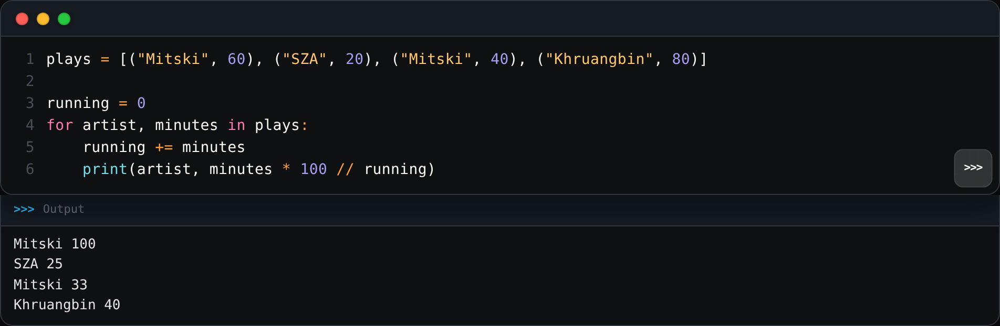
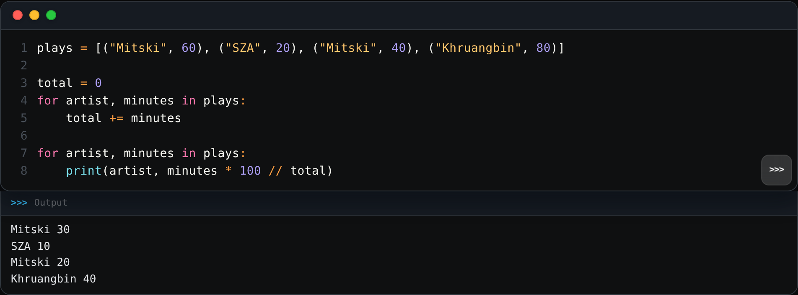
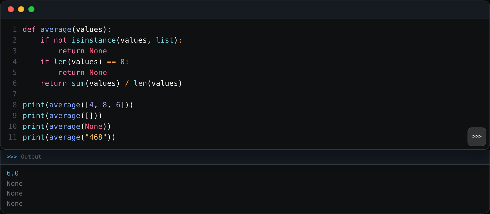
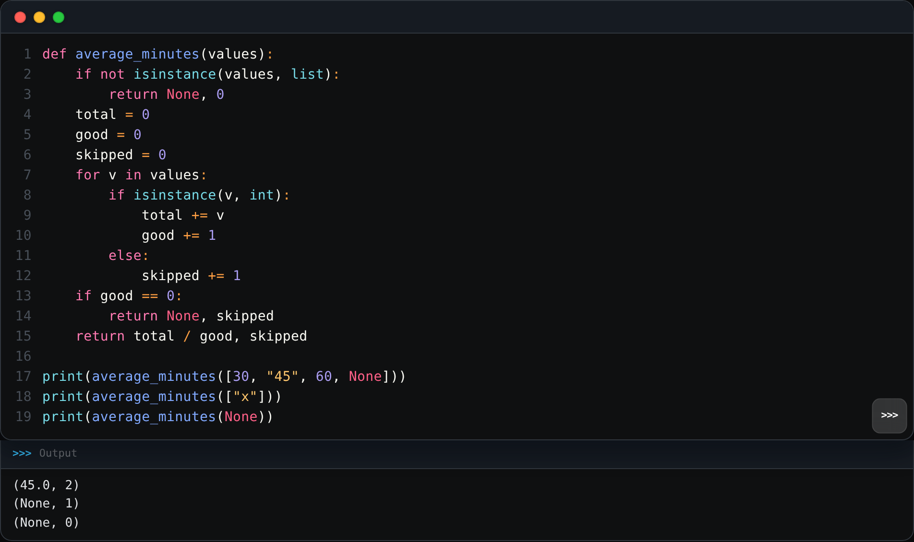
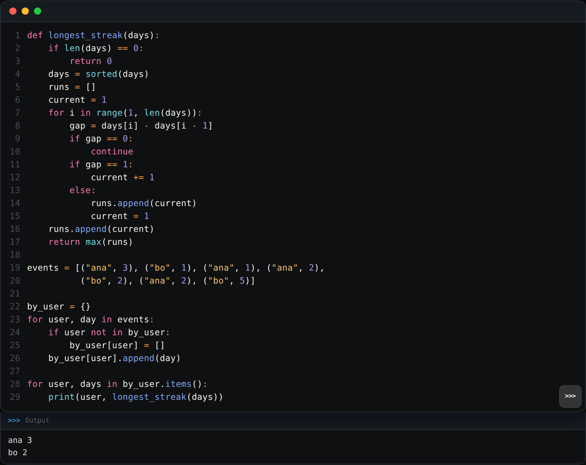
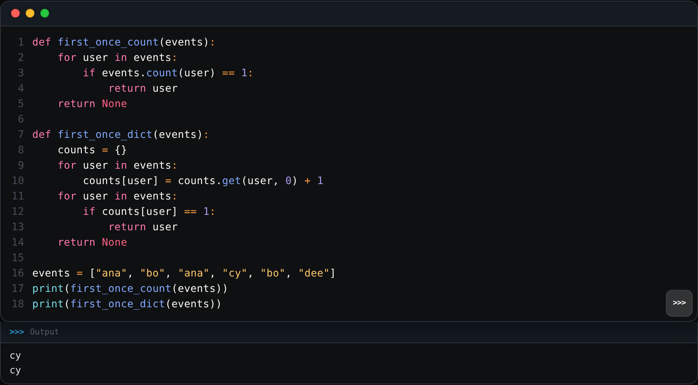

# Problem Solving: Intermediate

It is late November at Spotify, and a Wrapped card claims a listener gave 38% of their year to one artist. That figure needs the year's total before any artist's slice exists. A brand-new account has no plays at all, and the play log is far too long to compare every row with every other. Each choice decides whether the card ships correct.


<br>

---

## Solving a Problem in 2 Passes

Some questions about a list can be answered row by row. Others depend on a fact about the whole list: its total, its average, or how often a value occurs. For those, the loop meets row 1 before it has read the rows that decide row 1's answer. The way out is to read the data twice: a first pass that only learns a summary, then a second pass that acts on every row.


<br>

### A share needs the total first

Take 4 play events for a single listener, each an artist and the minutes played. The task is to print what percent of the listener's minutes each event represents. A percent is minutes divided by the total, and the total stays unknown until the last row has been read. Here is a 1-pass attempt that divides by the total seen so far:



```python
plays = [("Mitski", 60), ("SZA", 20), ("Mitski", 40), ("Khruangbin", 80)]

running = 0
for artist, minutes in plays:
    running += minutes
    print(artist, minutes * 100 // running)
```

Only Khruangbin's line is right. Every earlier row was divided by a partial total: Mitski's first 60 minutes looked like 100% because nothing else had been read yet. No change to the arithmetic inside that loop can repair it, since the missing information sits in rows the loop hasn't reached.



```python
plays = [("Mitski", 60), ("SZA", 20), ("Mitski", 40), ("Khruangbin", 80)]

total = 0
for artist, minutes in plays:
    total += minutes

for artist, minutes in plays:
    print(artist, minutes * 100 // total)
```

The first loop prints nothing. Its only job is to produce total, and the second loop reads that value on every row. Every 2-pass solution has this shape: pass 1 builds a small summary, and pass 2 makes each row's decision using it.


<br>

### When the summary is a dict of counts

The summary can be bigger than a single number. Suppose an event log lists the user behind each event, and the task is the first user who appears exactly once, a one-time visitor. When the loop reaches cy, it cannot tell whether cy shows up again 3 rows later. Pass 1 counts every user into a dict; pass 2 walks the log in its original order and stops at the first user whose count is 1.

https://github.com/user-attachments/assets/44eebf84-149f-4038-a804-b988bd52b1c0

*Pass 1 fills counts; pass 2 stops at the first user counted once.*

The dict is complete before the second loop asks its first question, so counts[user] == 1 is a statement about the entire log. The second pass could walk counts instead, because a dict keeps its keys in first-inserted order and a user seen once was inserted at its only position. Either loop works; neither can run until the counting is finished.


<br>

### Spotting a problem that needs 2 passes

| ✓ One pass is enough when | ✗ A second pass is needed when |
| --- | --- |
| • The answer for a row depends only on rows already read<br><br>• Running totals, a maximum, a count of rows over a threshold<br><br>• Example: print the cumulative minutes after each play | • A row's answer depends on rows that come after it<br><br>• Shares of a total, distance from the average, 'appears only once'<br><br>• Example: flag every order larger than the day's average order |

> **TIP**
>
> Phrases such as 'share of', 'percent of the total', 'compared with the average' and 'unique' signal that each row is judged against the whole list. Look for them in the task before writing the first loop.

Reading twice doubles the row visits, so 1 million rows become 2 million, and the summary from pass 1 must fit in memory. A single number costs nothing; a dict of counts grows with the number of distinct users. Both costs grow in step with the data, which keeps 2-pass solutions practical on large inputs.

**Which task needs a second pass over a list of order amounts?**

- **A.** Print the running total after each order
- **B.** Find the largest order in the list
- **C.** Flag each order that is above the average order
- **D.** Count how many orders are over 100

<details>
<summary>Solution</summary>

**C.** Flag each order that is above the average order

The average depends on every order, including ones after the row being flagged, so pass 1 computes it and pass 2 compares.

**Why the others are wrong**

- **A.** Each running total depends only on orders already read, so a single pass produces every line.
- **B.** max(amounts) reads the list once; no later order changes whether an earlier one was smaller.
- **D.** Whether an order exceeds 100 is decided by that order alone, so a single pass counts them.

</details>

An average adds one line between the 2 passes. Pass 1 adds into total. Once that loop has finished, average = total / len(amounts) runs a single time, outside both loops, and pass 2 compares each amount with that fixed value. For orders [40, 10, 30, 80], pass 1 ends with total at 160 and average at 40.0, and pass 2 flags only 80, because > leaves out the 40 that equals it. Indented one level deeper, inside pass 1, the division becomes a running average that changes on every row and matches the real one only after the last row.


<br>

---

## Edge Case Handling

A function that works on the inputs its author pictured is half finished. Pipelines hand functions empty batches, missing values, strings where numbers were expected and lists of a single row. An edge case is an input at the boundary of what the function was written for, and each one either gets a deliberate answer or produces a crash or a silent wrong number.


<br>

### Where an unguarded function breaks

**What does this program print?**

```python
def average(values):
    return sum(values) / len(values)

print(average([4, 8, 6]))
print(average([]))
```

- **A.** 6.0, then Python stops with ZeroDivisionError: division by zero
- **B.** 6.0, then 0.0 for the empty list
- **C.** 6, then Python stops with ZeroDivisionError
- **D.** 6.0, then None for the empty list

<details>
<summary>Solution</summary>

**A.** 6.0, then Python stops with ZeroDivisionError: division by zero

The first call prints 6.0. For [], sum returns 0 and len returns 0, and 0 / 0 raises the error on the return line.

**Why the others are wrong**

- **B.** Python does not treat 0 / 0 as 0; dividing any number by zero raises ZeroDivisionError.
- **C.** The / operator always returns a float, so the first line is 6.0 rather than 6.
- **D.** Nothing in the function returns None; the division runs and raises before any value comes back.

</details>

Empty is only one boundary. The table lists the inputs worth asking about for any function that takes a list of numbers, with what this average function does with each.

| Input kind | Example | What average does |
| --- | --- | --- |
| Empty | `[]` | ZeroDivisionError |
| None | `None` | TypeError from `sum` |
| Wrong container | `"468"` | TypeError from `sum` |
| Bad item | `[4, "8", 6]` | TypeError from `sum` |
| Single item | `[7]` | 7.0, correct |
| Booleans | `[True, False]` | 0.5, counted as 1 and 0 without complaint |


<br>

### Guard clauses that return a deliberate answer

A guard clause checks for a bad case at the top of the function and returns immediately. The design question is what to return. For an average of nothing, 0 would be a lie: a dashboard would plot 0 minutes for a listener with no data, and nobody downstream could tell it from a real 0. None says 'no answer exists' and forces the caller to check with is None.



```python
def average(values):
    if not isinstance(values, list):
        return None
    if len(values) == 0:
        return None
    return sum(values) / len(values)

print(average([4, 8, 6]))
print(average([]))
print(average(None))
print(average("468"))
```

isinstance(None, list) is False, so the first guard catches None along with strings and dicts. The order of guards matters: each check must be safe to run on whatever the earlier checks let through. Put the len check first and average(None) crashes with TypeError: object of type 'NoneType' has no len() before the type check ever runs.


<br>

### Bad items inside a good list

A type check on the list says nothing about its items. A batch of watch times may carry a string that was never converted, or a None where a client failed to report. The function faces a policy choice: reject the whole batch, or skip the bad items. Skipping keeps the pipeline moving, but a silent skip hides data loss, so the version below returns the count of dropped items alongside the average.



```python
def average_minutes(values):
    if not isinstance(values, list):
        return None, 0
    total = 0
    good = 0
    skipped = 0
    for v in values:
        if isinstance(v, int):
            total += v
            good += 1
        else:
            skipped += 1
    if good == 0:
        return None, skipped
    return total / good, skipped

print(average_minutes([30, "45", 60, None]))
print(average_minutes(["x"]))
print(average_minutes(None))
```

The final guard, good == 0, catches a case the type checks cannot: a real list in which every item was bad. Without it, ["x"] reaches total / good and divides by zero, the empty-list crash arriving by a different road.


| ✓ Do | ✗ Don't |
| --- | --- |
| • Decide the return value for empty, None and wrong-type input before writing the main logic<br><br>• Order guards so each check is safe on what earlier checks let through<br><br>• Report how many items were skipped instead of dropping them silently<br><br>• Test every function on [], None and a 1-item list | • Return 0 for 'no data' when 0 is also a real answer<br><br>• Call len() on a value that may be None<br><br>• Assume a list of the right type holds items of the right type<br><br>• Guard only the case that crashed last week |


<br>

---

## What Input Size Rules Out

A problem statement often says how big the input can get: up to 1,000 rows, up to 100,000 events, an answer within 1 second. Those limits are design information. Before writing code, you can estimate how many steps each candidate approach takes and discard the ones that cannot finish in time.


<br>

### Count steps, then compare with a budget

A loop over n items runs its body n times, and 2 passes run 2 × n bodies. A loop inside a loop that compares every item with every later item runs about n × n ÷ 2 bodies, because the first item is compared with n - 1 others, the second with n - 2, and so on. For a working budget, take around 10 million simple steps per second in Python: a conservative figure for loop bodies doing a comparison or an addition, which you can confirm by timing a loop on your own machine.

The animation runs 2 approaches to a duplicate check on 6 IDs and counts the steps each one takes.

https://github.com/user-attachments/assets/a43c0c09-a92f-4298-8426-f50dca731d15

*Pair checks grow with n × n; counting steps grow with n.*

At 6 IDs the gap is 15 against 6. The table pushes n to sizes a pipeline actually sees and converts steps to time with the budget of 10 million simple steps per second.

| n (items) | Steps, 1 pass | Time, 1 pass | Pair checks | Time, pair checks |
| --- | --- | --- | --- | --- |
| 1,000 | 1,000 | 0.0001 s | 499,500 | 0.05 s |
| 100,000 | 100,000 | 0.01 s | about 5 billion | about 8 minutes |
| 10,000,000 | 10,000,000 | 1 s | about 50 trillion | about 58 days |

Read the table against a limit of 100,000 events and 1 second. Pair checks need roughly 8 minutes, so any solution shaped like a loop inside a loop is ruled out before it is written, however clean it looks. One pass or 2 passes cost about 0.01 to 0.02 seconds and fit with room to spare. At 10 million rows a single pass costs about 1 second, so a 1-second limit allows only one lean pass; a 5-second limit allows a handful of passes, and still nothing nested.


<br>

### Small limits allow the direct approach

The arithmetic also works in the other direction. If a task guarantees at most 1,000 rows, the pair loop finishes in about 0.05 seconds, and its directness becomes an advantage: it reads like the problem statement and leaves little room for mistakes. A stated limit tells you which approaches are forbidden, and also which ones you are allowed to keep plain.


<br>

### Loops hidden inside a single line

Some loops do not look like loops. x in some_list, some_list.count(x), some_list.index(x) and some_list.remove(x) each scan the list from the front, so calling one inside a for loop builds a loop inside a loop. The dedup below has a single visible for, but user not in seen walks seen on every row.

```sql
events = ["ana", "bo", "ana", "cy", "bo", "dee"]

seen = []
for user in events:
    if user not in seen:
        seen.append(user)

print(seen)
```

With 1 million mostly distinct users, seen grows toward 1 million names, and each later row scans most of it: hundreds of billions of comparisons. A dict behaves differently. key in counts and counts[key] take about the same time whether the dict holds 10 keys or 10 million, which is why the counting pass in the animation stays at n steps.

> Reading a size limit
>
> - Up to around 1,000 items: comparing every pair fits, so pick the clearest code
> - Up to around 100,000 items: 1 or a few passes, with dict lookups inside
> - About 10 million items: a few passes at most, and watch what each pass stores
> - A time limit is a step budget: about 10 million simple steps per second
> - Count the hidden scans from in, count, index and remove as loops

**A task gives up to 200,000 transactions and expects an answer in about 1 second. With a budget of 10 million simple steps per second, which approach is ruled out before coding?**

- **A.** Two passes: pass 1 sums the amounts and pass 2 flags rows above the average
- **B.** A single pass that counts transactions per merchant in a dict
- **C.** A single pass that counts how many amounts exceed 500
- **D.** Comparing every transaction with every later one to find matching pairs

<details>
<summary>Solution</summary>

**D.** Comparing every transaction with every later one to find matching pairs

Around 20 billion pair checks, roughly 2,000 seconds: over half an hour against a 1-second limit.

**Why the others are wrong**

- **A.** About 400,000 steps, about 0.04 seconds, well inside the budget.
- **B.** Around 200,000 steps with dict lookups, around 0.02 seconds.
- **C.** Roughly 200,000 steps, around 0.02 seconds, far below the limit.

</details>

The pair count has an exact form. The first item meets n - 1 later items, the second n - 2, down to 0 for the last, and those add up to n \* (n - 1) // 2. For the 6 IDs in the animation that is 6 × 5 ÷ 2 = 15, the pair_checks it printed; for 1,000 items it is 499,500, the figure in the table. Turning a limit into a verdict is then one comparison: compute the steps for the largest allowed n and check whether they stay within the budget, 10 million steps for a 1-second limit.


<br>

---

## Solving a Simpler Version First

Some problems arrive with several difficulties tangled together. Handling all of them in the first draft produces code that is wrong in ways that are hard to locate. A better move is to strip the problem down to a version small enough to work by hand, solve it, and then add the difficulties back one at a time, testing after each.


<br>

### The full problem: longest streak per user

A product team wants each user's longest run of consecutive active days. The events arrive as (user, day) tuples, where day is a day number. They are out of order, a user can be active twice on the same day, and many users share a single list. That is 3 complications on top of the core question.

| Version | What it drops | What it teaches |
| --- | --- | --- |
| 1 | Many users, disorder, repeat days | A streak breaks wherever 2 neighbors differ by more than 1 |
| 2 | Many users, disorder | A gap of 0 is a repeat day: skip it, neither extend nor break |
| 3 | Many users | Sorting the days first turns disorder into version 2 |
| 4 | Nothing | Group by user, then call the single-user function per user |

#### Version 1: a single user, sorted, no repeats

With a single user's days already sorted and no repeats, the core idea fits in one comparison: if a day is exactly 1 more than the day before it, the current run grows; otherwise the run ends and a new one starts. The program collects every run length and takes the largest at the end.

https://github.com/user-attachments/assets/546b66a1-69c7-4134-9bbf-9f350a6de567

*A run grows while each day is 1 more than the last and closes at every gap.*

Day 5 follows day 3, so the first run closes at 3 and a new run starts. Day 10 follows day 6 and closes a run of 2. The runs.append(current) after the loop records the last run, which no gap ever closed.

#### Versions 2 to 4: add a difficulty at a time

Version 2 adds repeat days. With [1, 2, 2, 3], version 1 sees 2 followed by 2, a difference of 0, and wrongly closes the run. Computing gap = days[i] - days[i - 1] and skipping when gap == 0 repairs it. Version 3 adds disorder, and sorted(days) at the top reduces it to version 2. Version 4 adds many users: group the days into a dict of lists keyed by user, then call the finished single-user function once per key.



```python
def longest_streak(days):
    if len(days) == 0:
        return 0
    days = sorted(days)
    runs = []
    current = 1
    for i in range(1, len(days)):
        gap = days[i] - days[i - 1]
        if gap == 0:
            continue
        if gap == 1:
            current += 1
        else:
            runs.append(current)
            current = 1
    runs.append(current)
    return max(runs)

events = [("ana", 3), ("bo", 1), ("ana", 1), ("ana", 2),
          ("bo", 2), ("ana", 2), ("bo", 5)]

by_user = {}
for user, day in events:
    if user not in by_user:
        by_user[user] = []
    by_user[user].append(day)

for user, days in by_user.items():
    print(user, longest_streak(days))
```

Each version kept the earlier tests valid. Version 1's sample still returns 3 under the final code, and ana's days [3, 1, 2, 2] exercise both the sort and the repeat skip. The empty-list guard came from running the version 1 logic on an input it never saw: with no days the loop does not run, and the trailing append would report a streak of 1.

> Ways to shrink a problem
>
> - Solve for 1 user, 1 key or 1 day before many
> - Assume the input is sorted, then sort it yourself later
> - Assume no duplicates, then decide what a duplicate should mean
> - Fix the size at 3 or 4 items and work the answer by hand
> - Drop the output format and print raw values until the logic is right

> **TIP**
>
> Write down the assumptions the simple version makes. That list becomes the plan: each assumption you remove is one change to the code and one new test case.

**The full task: for each region, find the hour with the highest total revenue, from rows of (region, hour, revenue) in no particular order. Which simpler version is the best first step?**

- **A.** Sort all rows by revenue and print the top row for the whole table
- **B.** For one region's (hour, revenue) rows, total each hour in a dict and pick the top hour
- **C.** Handle every region at once, but skip hours that have no revenue
- **D.** Write guard clauses for every malformed row before anything else

<details>
<summary>Solution</summary>

**B.** For one region's (hour, revenue) rows, total each hour in a dict and pick the top hour

It keeps the core question, totals per hour and then the top hour, and drops only the grouping by region, which comes back next.

**Why the others are wrong**

- **A.** This answers a different question: the single largest row, with no per-hour totals and no regions.
- **C.** It keeps every hard difficulty and drops a minor one, so the first draft is still the full problem.
- **D.** Guards matter, but they do not show how to compute the answer; solve the core first, then guard it.

</details>

When an added difficulty breaks an earlier version, list each kind of input the difficulty brings and the branch it reaches in the old code. For the streak loop, those inputs are the possible gaps between neighboring days. Version 1 has only 2 branches, so every gap that is not 1 lands in the branch that closes the run.

| Gap between neighbors | Version 1 branch | Right behavior |
| --- | --- | --- |
| 1 | `if`: the run grows | Grow the run, as version 1 does |
| 0, a repeat day | `else`: the run closes | Skip the row |
| 2 or more | `else`: the run closes | Close the run, as version 1 does |


<br>

---

## Comparing 2 Working Solutions

Solutions that both pass every test can still differ in what they cost. One may finish in a fraction of a second where the other takes minutes, one may hold an extra dict the size of the input, and one may read like the problem statement while the other needs explaining. Choosing between them is a judgment made against the input limits and the people who will maintain the code.


<br>

### Finding the first one-time user with count() and with a dict



```python
def first_once_count(events):
    for user in events:
        if events.count(user) == 1:
            return user
    return None

def first_once_dict(events):
    counts = {}
    for user in events:
        counts[user] = counts.get(user, 0) + 1
    for user in events:
        if counts[user] == 1:
            return user
    return None

events = ["ana", "bo", "ana", "cy", "bo", "dee"]
print(first_once_count(events))
print(first_once_dict(events))
```

Both print cy. first_once_count is 4 lines and says what it means: the first user whose count in the log is 1. Its cost hides in events.count(user), which reads the whole list on every call. first_once_dict takes 2 loops and a dict, and reads the log exactly twice.


<br>

### Speed, memory and clarity side by side

| Measure | first_once_count | first_once_dict |
| --- | --- | --- |
| Reads of a log with no one-time user | n × n | 2 × n |
| n = 1,000 | 1,000,000 reads | 2,000 reads |
| n = 100,000 | 10 billion reads, about 17 minutes | 200,000 reads, about 0.02 s |
| Extra memory | Nothing beyond the list | One dict entry per distinct user |
| Clarity | Mirrors the task in a single condition | Two loops; the reader must see why |

The table assumes a log with no one-time user, the input that makes both functions read to the end. There the count version calls count n times, each a full scan, while the dict version finishes its 2 passes and returns None. The times use the same budget as before, 10 million simple steps per second.


<br>

### A rule for choosing

Start from the stated limits. Discard any solution whose step count does not fit the budget; that decision needs no taste. Among the ones that fit, prefer the one a teammate can verify fastest, which usually means the shortest code that states the task directly. Memory decides only when the extra structure would not fit, for example a dict over hundreds of millions of distinct keys on a single machine.

| ✓ Keep first_once_count when | ✗ Switch to first_once_dict when |
| --- | --- |
| • The log is capped at roughly 1,000 events<br><br>• The function runs once in a script, not once per row of a pipeline<br><br>• Readers need to check it against the spec at a glance | • The log can reach 100,000 events or more<br><br>• The function runs inside a loop over many logs<br><br>• The next request, every one-time user, needs the counts anyway |

The last row points at a fourth measure: how each solution absorbs the next change. Once the counts exist, listing every one-time user, or every user seen more than 5 times, is an edit to the second loop's condition. The count version would repeat its full scans for each new question.


**A nightly job checks a config list capped at 50 entries for any name that appears twice. One correct version calls names.count(name) > 1 inside a loop; another builds a dict of counts first. Which should the team keep?**

- **A.** The dict version, because counting into a dict is always the better choice
- **B.** The dict version, because the count version will exceed the step budget
- **C.** The count version, because both fit the budget and it states the check most directly
- **D.** Neither, because a loop hidden inside a single line is never acceptable

<details>
<summary>Solution</summary>

**C.** The count version, because both fit the budget and it states the check most directly

With 50 entries speed can't decide, so clarity does: the condition reads as the requirement.

**Why the others are wrong**

- **A.** At 50 entries the count version makes at most 2,500 reads, a fraction of a millisecond; 'always' ignores the limit.
- **B.** At 50 entries, 50 × 50 is 2,500 steps, around 0.25 milliseconds at 10 million simple steps per second.
- **D.** Hidden loops are a cost to count, and here that count is 2,500 steps, far below any budget.

</details>

The count version has a second flaw once the task changes from 'is there a duplicate' to 'list the duplicates'. A loop over ids that prints every ID passing ids.count(i) > 1 prints it once per appearance, so an ID that occurs 3 times prints 3 times. Walking the dict of counts visits each key exactly once, in the order it was first inserted, which is the order of its first appearance in the list. Counting in pass 1 and filtering the dict in pass 2 gives one line per duplicated ID.


<br>

---

## Putting It All Together

Spotify's Wrapped shows each listener their top artist and the minutes they spent with that artist over the year. A batch job has to turn a log of (listener, artist, minutes) rows into a card per listener, including listeners who signed up recently and have no plays, with every card's share computed correctly.

- The simpler version comes first: a single listener's (artist, minutes) rows, ignoring every other listener, then grouping by listener in a dict once that works.
- For each listener, pass 1 totals minutes overall and per artist in a dict; pass 2 picks the top artist and divides by the total.
- A guard returns None for a listener whose total is 0, so a new account gets no card instead of a ZeroDivisionError.
- The batch size rules out comparing rows pairwise or calling count inside a loop; grouping into a dict keeps the job to a few passes.
- If a short list-based version and a dict version both produce correct cards, the batch size picks the dict version, and clarity breaks ties only where both fit the budget.


<br>

---

## Key Takeaways

- When a row's answer depends on the whole list, read twice: pass 1 builds a summary, pass 2 decides each row with it.
- Guard clauses at the top of a function give empty, None and wrong-type input a deliberate answer, ordered so each check is safe.
- A size limit plus a budget of roughly 10 million simple steps per second rules out loop-inside-a-loop solutions beyond around 5,000 items when the limit is 1 second.
- in , count , index and remove on a list each hide a scan, and inside a loop they make a nested loop.
- Solve a stripped-down version first, then add each removed difficulty back with its own test.
- Between correct solutions, discard what breaks the budget, then keep the clearest of what remains.
