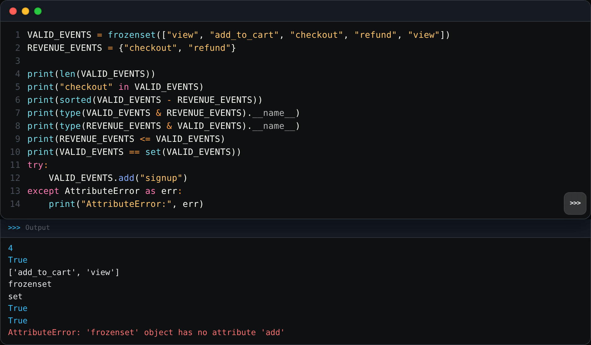
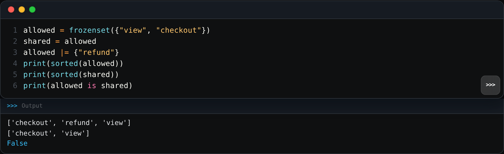
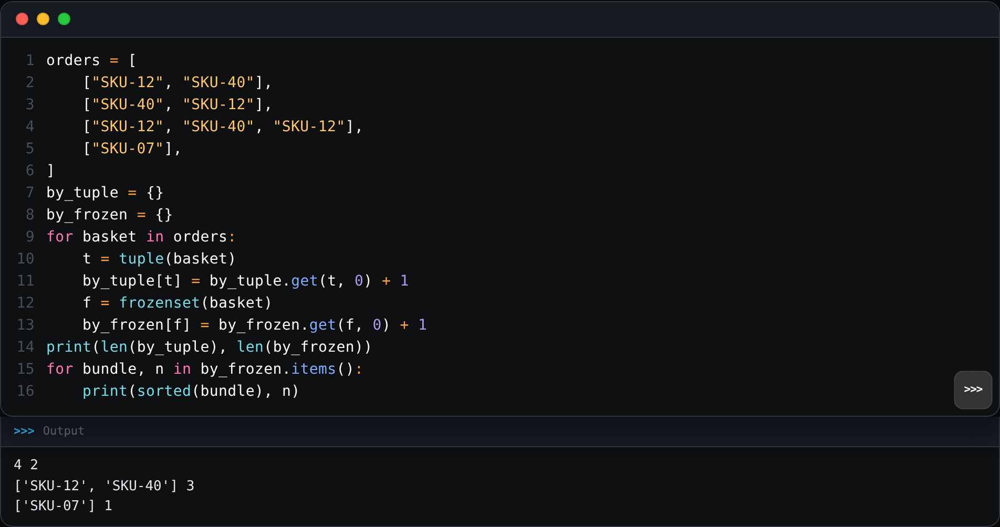
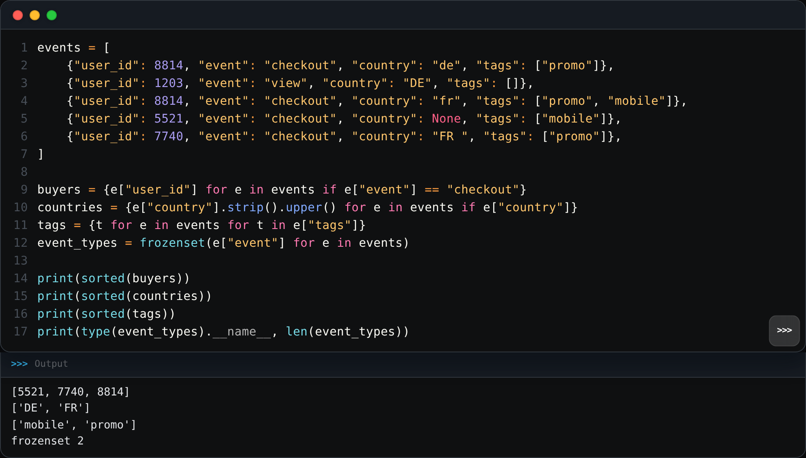
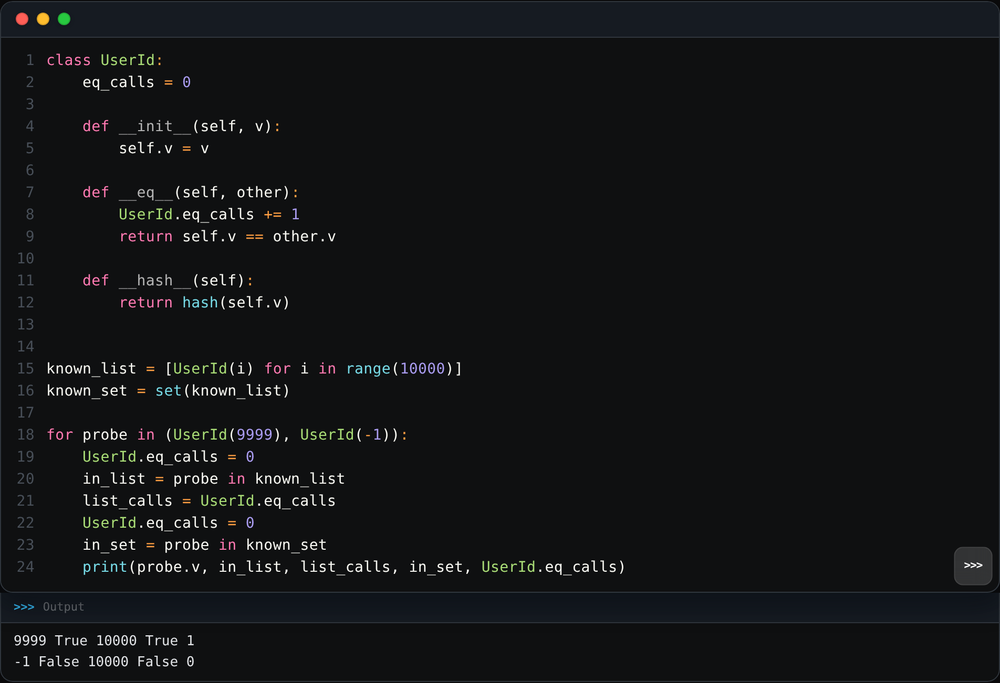
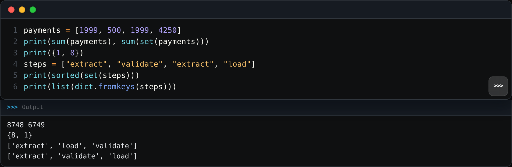
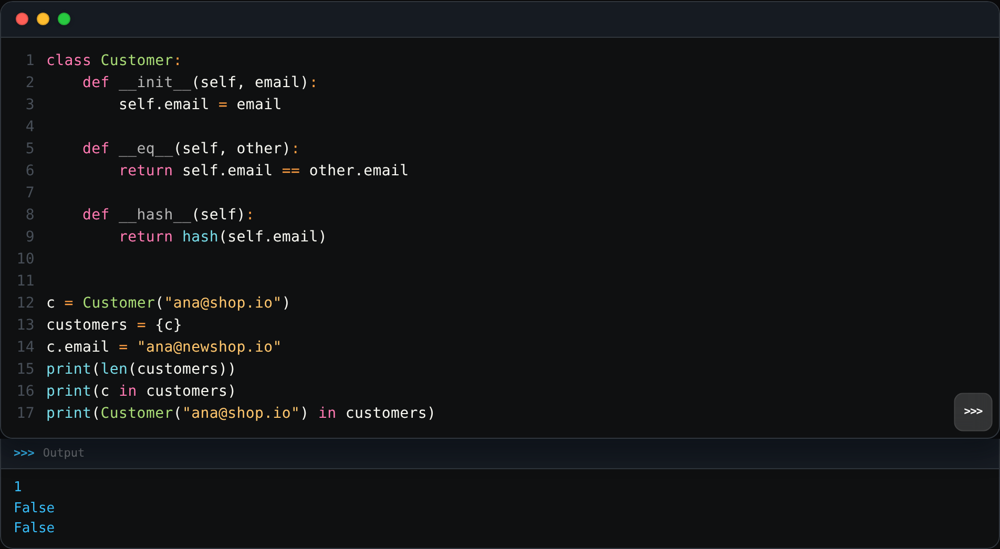

# Sets: Advanced

A deduplication step that sums `set(amounts)` reports less revenue than the shop took. A membership test against a list where a set belonged can stretch a sub-second filter into minutes. Both pass code review because they read correctly. This lesson covers the set behaviour underneath bugs like these, starting with the immutable set, the only kind that can be a dict key.


<br>

---

## Immutable Sets With frozenset

Pipelines keep reference collections that many functions read and none should change: the event types a validator accepts, the country codes a report covers, the columns a schema requires. In an ordinary set, any function that calls `.add()` on such a collection changes it, and every other reader inherits the change. A `frozenset` is a set whose membership is fixed at construction. The `frozenset()` constructor takes any iterable and deduplicates it the way `set()` does. There is no literal syntax, so `frozenset()` with no argument is also the only way to write an empty one.



```python
VALID_EVENTS = frozenset(["view", "add_to_cart", "checkout", "refund", "view"])
REVENUE_EVENTS = {"checkout", "refund"}

print(len(VALID_EVENTS))
print("checkout" in VALID_EVENTS)
print(sorted(VALID_EVENTS - REVENUE_EVENTS))
print(type(VALID_EVENTS & REVENUE_EVENTS).__name__)
print(type(REVENUE_EVENTS & VALID_EVENTS).__name__)
print(REVENUE_EVENTS <= VALID_EVENTS)
print(VALID_EVENTS == set(VALID_EVENTS))
try:
    VALID_EVENTS.add("signup")
except AttributeError as err:
    print("AttributeError:", err)
```

Everything that reads a set still works on the frozen one: `len`, `in`, iteration, the subset comparisons and all 4 operators. The `-` and `&` lines build new objects and leave `VALID_EVENTS` as it was. Each result takes the type of its left operand, so `frozenset & set` gives a frozenset and `set & frozenset` gives a set. Equality compares elements only, which is why a frozenset equals the set built from it. The last line fails with `AttributeError` because the type has no `add` method at all: the mutating methods were never defined on it.

| Operation | On a set | On a frozenset |
| --- | --- | --- |
| add, remove, discard, pop, clear | Changes the set in place | AttributeError |
| update, intersection_update, difference_update, symmetric_difference_update | Changes the set in place | AttributeError |
| union, intersection, difference, symmetric_difference (methods and operators) | New set | New frozenset |
| in, len, iteration, subset comparisons, ==, isdisjoint() | Works | Works |
| hash() | TypeError: unhashable type: 'set' | An int computed from the elements |

The last row is the reason the type exists. A hash table files each key under a number computed from its contents. If those contents changed after filing, the key would sit under a stale number where no lookup could reach it, so Python refuses to hash a mutable set at all. A frozenset's contents cannot change, so its hash is computed once from its elements and cached. Frozensets holding the same elements hash equally, whatever order they were built in.

Immutability makes 2 other things cheap. `frozenset.copy()` and `frozenset(fs)` return the same object, because a copy of something unchangeable could never differ from the original. A frozenset is also a safe default argument. `def validate(event, allowed=frozenset({"view", "checkout"}))` creates the default once and shares it across every call. That sharing is harmless when no call can modify the default, and it is the classic shared-default bug when the default is a set.


<br>

### Augmented assignment on a frozenset

The table lists no way to update a frozenset, yet `allowed |= {"refund"}` runs without error. `frozenset` defines no in-place `__ior__` method, so Python falls back to `allowed = allowed | {"refund"}`. It builds a new frozenset and rebinds the name. Any other name that still points at the original object sees the original contents.



```python
allowed = frozenset({"view", "checkout"})
shared = allowed
allowed |= {"refund"}
print(sorted(allowed))
print(sorted(shared))
print(allowed is shared)
```

The same fallback applies to `&=`, `-=` and `^=`. It happens only when the left operand lacks the in-place method. The question below changes 1 thing: the first line builds a plain set.

**The same 6 lines run with the first line changed to allowed = {"view", "checkout"}, a plain set. What does print(sorted(shared)) print?**

- **A.** ['checkout', 'refund', 'view']
- **B.** ['checkout', 'view']
- **C.** A TypeError, because |= needs both operands to be the same type
- **D.** ['refund']

<details>
<summary>Solution</summary>

**A.** ['checkout', 'refund', 'view']

A set defines __ior__, so |= adds "refund" to the single object both names refer to. allowed is shared now prints True.

**Why the others are wrong**

- **B.** That was the frozenset run. A set updates in place under |=, so no new object is created and shared sees the new element.
- **C.** Mixed operands are allowed. Any set or frozenset works on the right, and the left operand decides the type of the result.
- **D.** |= is union assignment. It keeps the left operand's elements and adds the right operand's.

</details>


<br>

---

## Frozensets as Keys and Elements

Some facts describe a group rather than a sequence: the products bought together in an order, the 2 accounts on either end of a transfer, the permissions a role holds. Counting or looking up a group needs a key that ignores order and repeats. A list cannot be a dict key at all. A tuple can, but it treats `("SKU-12", "SKU-40")` and `("SKU-40", "SKU-12")` as different keys. A frozenset is hashable, ignores order and collapses repeats, which matches what a bundle is.



```python
orders = [
    ["SKU-12", "SKU-40"],
    ["SKU-40", "SKU-12"],
    ["SKU-12", "SKU-40", "SKU-12"],
    ["SKU-07"],
]
by_tuple = {}
by_frozen = {}
for basket in orders:
    t = tuple(basket)
    by_tuple[t] = by_tuple.get(t, 0) + 1
    f = frozenset(basket)
    by_frozen[f] = by_frozen.get(f, 0) + 1
print(len(by_tuple), len(by_frozen))
for bundle, n in by_frozen.items():
    print(sorted(bundle), n)
```

The tuple keys found 4 bundles where the business sees 2, because each ordering and the repeated SKU-12 produced a key of its own. The frozenset keys merged all 3 baskets that contain SKU-12 and SKU-40. `tuple(sorted(basket))` fixes the ordering but still splits the third basket on its duplicate. Whether collapsing repeats is correct depends on the question being asked. For "which products sell together" it is. For "which exact orders recur", 2 units of SKU-12 differ from 1, and the key has to carry the quantity.

| Key built from a basket | Ignores order | Ignores repeats | Hashable |
| --- | --- | --- | --- |
| list(basket) | No | No | No |
| tuple(basket) | No | No | Yes |
| tuple(sorted(basket)) | Yes | No | Yes |
| frozenset(basket) | Yes | Yes | Yes |
| frozenset(Counter(basket).items()) | Yes | No, keeps each count | Yes |


<br>

### Lookups need a frozen key too

A dict hashes the value used to look it up, so the query must be hashable as well. Code that gathers a basket into a set and tests it against a frozenset-keyed dict fails with `TypeError`. The same test against a set of frozensets succeeds. Set membership, `remove` and `discard` catch the error and retry with a temporary frozenset built from the argument. Dicts have no such retry.

```sql
bundle_counts = {frozenset({"SKU-12", "SKU-40"}): 3}
known_bundles = {frozenset({"SKU-12", "SKU-40"})}
basket = {"SKU-40", "SKU-12"}

bundle_counts[frozenset(basket)]   # 3
basket in known_bundles            # True: the set retries as a frozenset
basket in bundle_counts            # TypeError: unhashable type: 'set'
```

`functools.lru_cache` follows the same rule, because it keys its cache on the call's arguments. A cached function called with a set raises `TypeError: unhashable type: 'set'` before the function body runs. Passing `frozenset(skus)` fixes it, and calls with the same SKUs in any order share 1 cache entry.


<br>

### Sets whose elements are sets

Hashability also lets a frozenset be an element, which gives a set of groups. Undirected pairs are the standard case. A transfer from acct_1 to acct_2 and a transfer from acct_2 to acct_1 describe a single relationship, and `frozenset((src, dst))` gives both of them the same identity.

```sql
transfers = [("acct_1", "acct_2"), ("acct_2", "acct_1"), ("acct_3", "acct_1")]
pairs = set()
for src, dst in transfers:
    pairs.add(frozenset((src, dst)))
print(len(pairs))   # 2
```

Frozensets can also contain other frozensets. A fixed collection of groups, such as the bundles in this week's promotion, can therefore itself be a key or an element.


<br>

### Build mutable, freeze, thaw

Real workflows need both types at different moments. While events stream in, each session's cart has to grow, which takes a set. When the stream ends, the finished cart has to become a key, which takes a frozenset. `frozenset(cart)` copies the current elements into a new immutable object, and later changes to `cart` never reach it. In the other direction, `set(bundle)` returns a mutable copy to edit while the frozen original stays in the dict. Each conversion copies every element, so convert once at the boundary between stages and never on every event.

Each stage holds the type that matches what it does to the data. A cart that starts as a frozenset fails on its first `.add`, and a cart that reaches the dict while still a set fails as a key. The conversion belongs at the point where accumulation ends and counting begins.


<br>

---

## Set Comprehensions

A set comprehension is a list comprehension written in curly braces. `{expression for item in iterable if condition}` evaluates the expression for each item that passes the condition and adds the result to a new set. Duplicates collapse as the set is built, and no intermediate list is created. A colon in the expression, as in `{k: v for ...}`, makes it a dict comprehension instead. The examples below run over 5 clickstream events.



```python
events = [
    {"user_id": 8814, "event": "checkout", "country": "de", "tags": ["promo"]},
    {"user_id": 1203, "event": "view", "country": "DE", "tags": []},
    {"user_id": 8814, "event": "checkout", "country": "fr", "tags": ["promo", "mobile"]},
    {"user_id": 5521, "event": "checkout", "country": None, "tags": ["mobile"]},
    {"user_id": 7740, "event": "checkout", "country": "FR ", "tags": ["promo"]},
]

buyers = {e["user_id"] for e in events if e["event"] == "checkout"}
countries = {e["country"].strip().upper() for e in events if e["country"]}
tags = {t for e in events for t in e["tags"]}
event_types = frozenset(e["event"] for e in events)

print(sorted(buyers))
print(sorted(countries))
print(sorted(tags))
print(type(event_types).__name__, len(event_types))
```

Each line exercises one part of the syntax. `buyers` filters on the event type and keeps only the id, so user 8814's 2 checkouts become 1 element. `countries` shows the order in which the clauses run. The `if` is tested first, so `.strip()` never reaches the `None`. Normalising inside the expression is what merges `"de"`, `"DE"`, `"fr"` and `"FR "` into 2 codes. `tags` uses 2 `for` clauses, read left to right like nested loops, to flatten every event's tag list into a single set.


<br>

### There is no frozenset comprehension

Curly braces always produce a mutable set. For a frozen result, pass a generator expression to the constructor, as `event_types` does with `frozenset(e["event"] for e in events)`. The generator hands over 1 element at a time, so nothing is stored in between. Wrapping a list comprehension in `set()` reaches the same set by a longer route: it builds a full list with every duplicate included, then hashes each of its elements into the set.

| Form | Intermediate list | Result |
| --- | --- | --- |
| {f(x) for x in xs} | None | set |
| set(f(x) for x in xs) | None | set |
| set([f(x) for x in xs]) | Yes, duplicates included | set |
| frozenset(f(x) for x in xs) | None | frozenset |
| [f(x) for x in xs] | The list is the result | list, duplicates kept |


<br>

### Filters, conditionals and where they go

An `if` after a `for` drops items. An `if`/`else` before the first `for` keeps every item and chooses what to add for each one. Mixing the 2 up changes the size of the result, so a wrong count from a comprehension is the first sign to check which form was used.

```sql
labels = {"paid" if e["event"] == "checkout" else "free" for e in events}
paid_ids = {e["user_id"] for e in events if e["event"] == "checkout"}
promo_buyers = {e["user_id"] for e in events if e["event"] == "checkout"
                for t in e["tags"] if t == "promo"}
# labels: 2 elements, every event mapped to "paid" or "free"
# paid_ids: 3 elements, the view event dropped
# promo_buyers: 2 elements, 8814 and 7740
```

The third comprehension shows that an `if` can sit between `for` clauses and filter at that level of nesting before the inner loop runs. The expression has a cost to watch: it runs once per item, before deduplication. `{fetch_segment(e["user_id"]) for e in events}` over 50,000 events makes 50,000 calls even when only 3,000 users exist. Deduplicating the ids first, with `{fetch_segment(u) for u in {e["user_id"] for e in events}}`, makes 3,000. When a loop has to do 2 jobs at once, such as collecting ids while counting rejects, a plain `for` loop with `.add()` reads better than a comprehension with side effects.

Each wrong condition crashes for its own reason. `e is None` lets only the `None` through, so `.split` runs on `None` and fails in the expression. `"@" in e` fails in the filter itself, because `in` cannot search `None`. The guard has to test for `None` before anything else touches `e`. Lowercasing inside the expression is what makes `Shop.io` and `shop.io` one element.

> **TIP**
>
> Comprehension variables stay inside the comprehension in Python 3. After `{e["user_id"] for e in events}` runs, the name `e` in the enclosing scope is unchanged or undefined. A plain `for` loop's variable, by contrast, survives the loop holding its last value.


<br>

---

## Performance: When to Use Sets

`x in collection` reads the same for a list and a set, but the 2 do different work. A list walks its elements from index 0 and compares each with `==` until one matches or the list ends, so a miss costs 1 comparison per element. A set computes `hash(x)` and uses it to jump to 1 slot of its hash table. It calls `==` only on entries whose stored hash equals `hash(x)`. Counting the `==` calls against 10,000 ids makes the difference visible.



```python
class UserId:
    eq_calls = 0

    def __init__(self, v):
        self.v = v

    def __eq__(self, other):
        UserId.eq_calls += 1
        return self.v == other.v

    def __hash__(self):
        return hash(self.v)


known_list = [UserId(i) for i in range(10000)]
known_set = set(known_list)

for probe in (UserId(9999), UserId(-1)):
    UserId.eq_calls = 0
    in_list = probe in known_list
    list_calls = UserId.eq_calls
    UserId.eq_calls = 0
    in_set = probe in known_set
    print(probe.v, in_list, list_calls, in_set, UserId.eq_calls)
```

Both collections hold the same 10,000 objects. The list made 10,000 comparisons for the hit, which sat at the end, and 10,000 more for the miss. The set made 1 comparison for the hit, to confirm the match, and 0 for the miss: no stored hash equalled the probe's, so there was nothing to compare. This is what O(n) against O(1) average means in practice. The list's cost grows with its length, and the set's stays flat whether it holds 10 ids or 10 million.


<br>

### The number, worked out

A nightly job flags test traffic by checking 500,000 order events against 20,000 test-account ids. Nearly every event is real, so nearly every check is a miss, and a miss against a list scans all 20,000 ids. That comes to 500,000 times 20,000, or 10 billion comparisons, where a set needs 500,000 hash lookups. On typical hardware, the same filter takes roughly:

- **~2 min** — with the ids in a list
- **~0.1 s** — with the ids in a set

The gap holds across the operations pipelines use most:

| Operation | list | set |
| --- | --- | --- |
| x in c | O(n), scans until a match | O(1) average, 1 hash lookup |
| Add 1 element | O(1) amortised append | O(1) average add |
| Remove by value | O(n), find then shift the tail | O(1) average |
| Common elements of a and b | O(len(a) x len(b)) with nested in | O(min(len(a), len(b))) via a & b |
| Keeps order and duplicates | Yes | No |

Comparing 2 extracts is the case most often missed. Finding the customer ids present in both of 2 lists of 100,000 ids with a nested `in` takes up to 10 billion comparisons. `set(a) & set(b)` hashes each side once and then probes from the smaller set.

*The O(1) is an average. If many elements share a hash, lookups degrade toward O(n), which is one reason CPython salts string hashing with a random seed at startup.*


<br>

### When a list is still the right call

- Building costs O(n): set(ids) hashes every id, so for a single lookup a list scan is cheaper.
- Memory: in CPython 3.9, set(range(10000)) takes about 524 KB and list(range(10000)) about 80 KB.
- Order and duplicates: rows, ranked results and repeated payments need a list.
- Unhashable elements: a collection of dicts or lists cannot be stored in a set at all.
- Tiny fixed collections: for 3 or 4 items, a scan costs about what hashing does, so readability decides.


<br>

### Set for membership, list for order

Most pipelines need both behaviours: drop repeated ids, and emit the survivors in arrival order. The standard pattern keeps a `seen` set for the O(1) check and a list for the output. Each structure is used only for the job it does well.

https://github.com/user-attachments/assets/38accb45-f878-4476-b120-ca8539070c60

*seen answers membership in 1 hash lookup; unique keeps arrival order.*

Each id costs 1 hash lookup against `seen`. A list in that role would rescan the growing output on every event, which brings back the quadratic cost on a long stream.

The most common performance bug with sets puts the right structure in the wrong place.

**A filter takes minutes on 500,000 events. Its loop body is if e["account_id"] in set(test_ids): flagged.append(e), where test_ids is a list of 20,000 ids. Which change fixes it?**

- **A.** Build test_set = set(test_ids) once before the loop and test against test_set.
- **B.** Test against test_ids directly, since a list needs no building.
- **C.** Sort test_ids first so in can stop early.
- **D.** Convert events to a set so each event is visited once.

<details>
<summary>Solution</summary>

**A.** Build test_set = set(test_ids) once before the loop and test against test_set.

set(test_ids) inside the condition hashes all 20,000 ids on every event, 10 billion hash operations in total, which is slower than the list scan it was meant to replace. Built once, the set costs 20,000 hashes and each check is O(1).

**Why the others are wrong**

- **B.** That removes the rebuild but brings back a full scan per miss: 10 billion comparisons.
- **C.** in on a list ignores sort order and scans until it finds a match. Sorting helps only an explicit binary search.
- **D.** Events are dicts, which are unhashable, and the time goes into the membership check, not the outer loop.

</details>


<br>

---

## Advanced Set Pitfalls

The set bugs that reach production share a shape. The code runs, the output looks plausible, and the damage shows up later in a report or a rerun. Most of them come from the 5 patterns below.


<br>

### Changing a set while looping over it

A set iterator records the set's size when it starts and checks it on every step. Removing or adding an element inside the loop changes the size, and the next step raises `RuntimeError: Set changed size during iteration`. Pairing 1 add with 1 remove keeps the size constant and silences the check. That is worse, because elements can then be skipped or visited twice with no error at all. Every fix takes the iteration off the live set: loop over a snapshot with `for x in list(s)`, build a new set with a comprehension, or apply the whole change at once with `s -= expired`.

`list(active)` copies the 5 ids before the loop starts, so the removals change a set the loop is no longer reading. For a bulk removal like this one, `active -= expired` does the whole job in 1 call costing O(len(expired)).


<br>

### Sets where lists belong, and set order

A set answers "which distinct values occurred". Code that needs to know how many, or in what sequence, loses that information as soon as it builds a set. Summing a set of payment amounts drops every repeated amount, and a set of pipeline steps forgets which step ran first. Iteration order looks dependable because small ints hash to themselves and often print sorted, until one of them wraps around the table.



```python
payments = [1999, 500, 1999, 4250]
print(sum(payments), sum(set(payments)))
print({1, 8})
steps = ["extract", "validate", "extract", "load"]
print(sorted(set(steps)))
print(list(dict.fromkeys(steps)))
```

The 2 payments of 1999 cents collapsed into a single element, so revenue came out 1999 cents short. `{1, 8}` prints as `{8, 1}` because 8 lands in slot 0 of an 8-slot table, ahead of 1 in slot 1. String order is less predictable still. String hashes are randomised per process through `PYTHONHASHSEED`, so a set of column names can serialise in a different order on every run and churn every diff and checksum downstream. Where order is visible, `sorted(s)` fixes it alphabetically, and `dict.fromkeys(items)` deduplicates while keeping the order in which items were first seen.


<br>

### Empty braces and the set() argument

Braces default to dict: `{}` is an empty dict, and only a non-empty brace literal without colons is a set. `seen = {}` survives `if x in seen`, which works on dicts, and fails later at `seen.add(x)` with `AttributeError: 'dict' object has no attribute 'add'`. The constructor has the opposite trap. `set()` takes 1 iterable and iterates over it, so `set("checkout")` holds letters.

| Expression | Result |
| --- | --- |
| {} | Empty dict |
| set() | Empty set |
| frozenset() | Empty frozenset |
| {"checkout"} | Set with 1 string |
| set("checkout") | Set of 7 characters |
| set(["checkout"]) | Set with 1 string |


<br>

### Custom objects in sets

A class without `__eq__` and `__hash__` compares by identity. Then 2 `Customer` objects for the same email count as 2 elements, and deduplication silently does nothing. Defining `__eq__` alone sets `__hash__` to `None`, so adding an instance to a set raises `TypeError: unhashable type: 'Customer'`. Defining both on a field that can change is the dangerous case.



```python
class Customer:
    def __init__(self, email):
        self.email = email

    def __eq__(self, other):
        return self.email == other.email

    def __hash__(self):
        return hash(self.email)


c = Customer("ana@shop.io")
customers = {c}
c.email = "ana@newshop.io"
print(len(customers))
print(c in customers)
print(Customer("ana@shop.io") in customers)
```

The set filed `c` under the hash of its old email. After the change, a lookup for `c` computes the new hash and finds nothing filed under it. A lookup for the old email finds the right slot but fails `__eq__`. The object is still inside the set and counted by `len`, yet membership tests cannot reach it. Hash only fields that never change after construction, such as a database id, or store an immutable value like a tuple in the set in place of the object. `@dataclass(frozen=True)` generates a matching `__eq__` and `__hash__` and blocks attribute assignment.

| ✓ Do | ✗ Don't |
| --- | --- |
| • Freeze a set with frozenset() before using it as a dict key or set element<br><br>• Hold reference collections that must not change as module-level frozensets<br><br>• Build a set once, outside the loop, and test membership against it inside<br><br>• Iterate over list(s) when the loop body adds to or removes from s<br><br>• Use sorted(s) or dict.fromkeys() wherever output order is visible | • Sum, count or average values after putting them in a set<br><br>• Write {} for an empty set, because it creates an empty dict<br><br>• Call set() inside a loop condition, which rebuilds the set on every pass<br><br>• Hash a custom object on a field that can change after it enters a set<br><br>• Rely on set iteration order, even when small ints happen to print sorted |


<br>

---

## Putting It All Together

An online retailer runs a nightly 'frequently bought together' job. It reads 500,000 order events, drops traffic from 20,000 test accounts, and publishes how often each product bundle sold, with bundle revenue, to the recommendation service behind its product pages.

- The test-account check runs against a set built once before the loop, which turns 10 billion list comparisons into 500,000 hash lookups.
- Each order's SKUs are gathered with a set comprehension and then frozen, so a bundle gets exactly 1 dict key whatever order or repeats the basket arrived with.
- The event types the job accepts live in a module-level frozenset, so no step can widen the filter by mutating it.
- Bundle revenue is summed from the order rows, never from a set of amounts, and bundles are published with sorted SKU lists so every run's output is byte-identical.


<br>

---

## Key Takeaways

- A frozenset drops every mutating method in exchange for a stable hash; reads, comparisons and operators still work, each returning a new object.
- Key a dict by frozenset when a group's identity ignores order and repeats, freeze the lookup value too, and use set() to get an editable copy.
- {expr for x in xs if cond} builds a set with no intermediate list; the filter runs before the expression, and frozenset(genexp) covers the frozen case.
- Set membership is O(1) on average and list membership O(n): build the set once outside the loop, and keep a list beside it when order matters.
- Never mutate a set mid-iteration, sum a set of amounts, rely on set order, write {} for an empty set, or hash an object on a field that changes.
