# Sets: Beginner

At Spotify, a track's daily listener count has to mean people, not plays. One fan who loops a song 40 times in an afternoon is still 1 listener. The service behind that report receives millions of play events as they happen and has to answer 'how many different accounts heard this?' A set makes that question cheap, and the duplicates vanish on their own.


<br>

---

## What is a Set?

A set holds each value at most once and gives those values no positions. You put values in, you ask whether a value is present, and you count how many distinct values you hold. A list can store the same ticket number 5 times; a set given the same 5 numbers keeps 1 copy of each and drops the rest on its own, with no code from you to check for repeats.

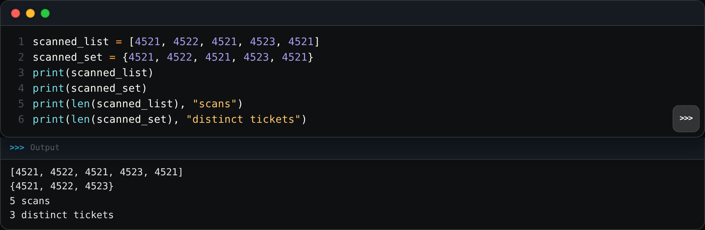

```python
scanned_list = [4521, 4522, 4521, 4523, 4521]
scanned_set = {4521, 4522, 4521, 4523, 4521}
print(scanned_list)
print(scanned_set)
print(len(scanned_list), "scans")
print(len(scanned_set), "distinct tickets")
```

Both collections received the same 5 numbers. The list reports 5 scans because it recorded every arrival. The set reports 3 distinct tickets because the second and third arrivals of 4521 found it already present and changed nothing. Printing the set shows braces, which also appear around dictionaries, so look for the missing colons: a set has values only, with no key pointing at any of them.


<br>

### No positions, so no indexing

A list remembers where each item sits, so `scanned_list[0]` is a meaningful request: the first thing scanned. A set remembers only which values are present. There's no first element, so asking for `[0]` on a set raises an error. The order Python prints a set in comes from its internal storage layout, and your code must never lean on it.

```sql
colors = {"red", "green", "blue"}
print(colors[0])
```

*Subscriptable means 'accepts square brackets after it'. A list is subscriptable, as are strings and dictionaries. A set is not.*


<br>

### Membership in 1 step

The `in` operator works on both, but the work behind it differs. A list compares your value against item after item from the front until one matches or the list ends. A set computes a slot from the value itself and looks in that 1 slot. At 10 items you won't notice a difference. At 10 million, the list might make 10 million comparisons before saying `False`, while the set still takes a handful of steps.

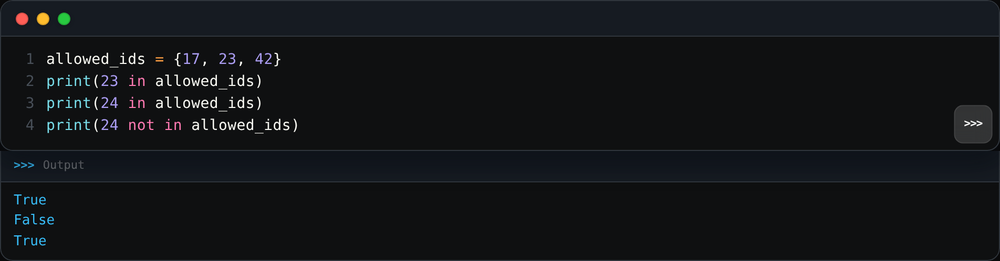

```python
allowed_ids = {17, 23, 42}
print(23 in allowed_ids)
print(24 in allowed_ids)
print(24 not in allowed_ids)
```

Every answer here matches what a list of the same 3 ids would give. The difference is cost, and cost is why the structure exists: a program that tests membership thousands of times a second needs the 1-slot version.


<br>

### Side by side

| ✓ List | ✗ Set |
| --- | --- |
| • Keeps items in the order you added them<br><br>• Stores the same value as many times as you add it<br><br>• Reaches an item by position: items[0]<br><br>• in compares against items one by one | • Has no order you can rely on<br><br>• Keeps 1 copy of each value, always<br><br>• No positions, so square brackets raise an error<br><br>• in jumps straight to the value's slot |

| Task | List | Set |
| --- | --- | --- |
| Hold 7 three times | `[7, 7, 7]` holds 3 items | `{7, 7, 7}` holds 1 item |
| Get the first item | `items[0]` | No such thing |
| Count what is stored | `len` counts every copy | `len` counts distinct values |
| Print it | Square brackets, insertion order | Braces, storage order |


<br>

### When to pick a set over a list

- Visitors who opened a page today, counted as people rather than page loads
- Words a chat filter blocks, checked once for every incoming message
- Order ids already processed, so a retried batch does no double work
- Tags on a product, where applying 'sale' twice means the same as once

> **TIP**
>
> Ask 1 question before choosing: do repeats or positions carry meaning in this data? If yes, a list. If the only questions are 'is this here?' and 'how many different ones?', a set.

**What does this program print?**

```python
ids = {1, 2, 3}
ids.discard(4)
ids.remove(2)
ids.discard(2)
print(ids)
```

- **A.** {1, 2, 3}
- **B.** KeyError raised by discard(4)
- **C.** KeyError raised by discard(2)
- **D.** {1, 3}

<details>
<summary>Solution</summary>

**D.** {1, 3}

discard(4) does nothing, remove(2) succeeds because 2 is present, and discard(2) finds it already gone and stays quiet. Members 1 and 3 remain.

**Why the others are wrong**

- **A.** remove(2) takes 2 out. Only discard(4) and the final discard(2) leave the set untouched.
- **B.** discard never raises for a missing value; 4 is absent and the call does nothing. Only remove raises KeyError.
- **C.** By this line 2 is already gone, but the call is discard, which treats a missing value as nothing to do.

</details>

That question leaned on 2 facts: repeats collapse when the set is built, and `len` counts what survived. Add `in` and you have the pattern behind most everyday set work: write the raw values as a set literal, let the repeats fall away, then ask `len` for the distinct count and `in` about any single value. Here a door scanner logged 6 badge swipes from 4 different people.

```sql
swipes = {301, 302, 301, 305, 302, 309}
print(len(swipes))
print(305 in swipes)
print(310 in swipes)
```

This prints 4, then `True`, then `False`. Ids 301 and 302 each arrived twice, so the 6 ids in the literal shrink to 4 members. A list of the same ids would report 6 from `len`, which counts swipes rather than people, and that gap is the reason to choose the set here.


<br>

---

## Creating Sets

Write braces around values when you know the values while writing the code. Call the `set()` function on an iterable when the values already live in some other collection and you want its distinct members.


<br>

### Braces around known values

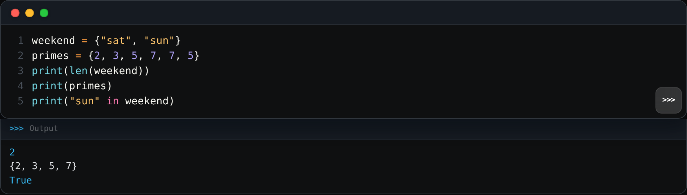

```python
weekend = {"sat", "sun"}
primes = {2, 3, 5, 7, 7, 5}
print(len(weekend))
print(primes)
print("sun" in weekend)
```

Each value appears once in the result whether you typed it once or twice. Writing `{2, 3, 5, 7}` and `{7, 5, 3, 2, 2}` produces equal sets, because a set is defined by its members alone, never by how many times or in what order they were listed.


<br>

### The empty set is set(), never {}

Braces reached Python as dictionary syntax first, so empty braces produce an empty dictionary. There's no brace spelling for a set with nothing in it. Call `set()` with no argument, and read the type back whenever you doubt which one you are holding.

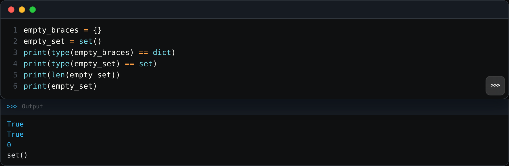

```python
empty_braces = {}
empty_set = set()
print(type(empty_braces) == dict)
print(type(empty_set) == set)
print(len(empty_set))
print(empty_set)
```

Printing an empty set shows `set()` rather than braces, for the same reason: braces with nothing between them would read as a dictionary. You'll see this spelling again whenever a set runs out of members.


<br>

### set() walks any iterable

An iterable is anything a `for` loop can step through: a list, a string, a `range`, a dictionary. `set()` steps through it the same way and adds each item it meets. Repeats collapse as they arrive. A dictionary contributes its keys, because keys are what a `for` loop over a dictionary yields.

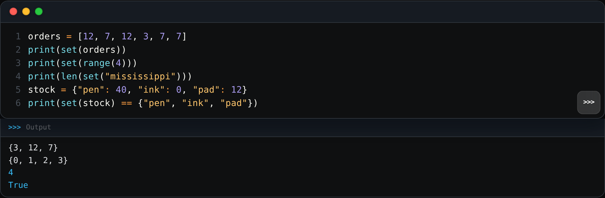

```python
orders = [12, 7, 12, 3, 7, 7]
print(set(orders))
print(set(range(4)))
print(len(set("mississippi")))
stock = {"pen": 40, "ink": 0, "pad": 12}
print(set(stock) == {"pen", "ink", "pad"})
```

The list `[12, 7, 12, 3, 7, 7]` became `{3, 12, 7}`: 3 distinct values survived, and the printed order matches neither the list nor numeric order. That order is the storage layout, nothing more. The string `"mississippi"` has 11 characters but only 4 distinct letters, m, i, s, p. The dictionary gave up its 3 keys and none of its values.

| Source | What set() steps through | Result |
| --- | --- | --- |
| `[1, 1, 2]` | Each list item | `{1, 2}` |
| `"aab"` | Each character | `{"a", "b"}` |
| `range(3)` | 0, 1, 2 | `{0, 1, 2}` |
| `{"x": 1, "y": 2}` | The keys only | `{"x", "y"}` |
| `42` | Nothing: an integer has no items | `TypeError` |

```sql
print(set(42))
```

An integer is a single value with nothing to step through, so `set(42)` has no items to collect and Python says so. Either `{42}` or `set([42])` makes a set holding 42, because each gives `set()` something it can walk.


<br>

### One string or its characters?

`{"hello"}` has 1 member, the whole word. `set("hello")` has 4 members, one per distinct letter: h, e, l, o. Both are valid, and they answer different questions, so pick the spelling that matches the question you are asking.

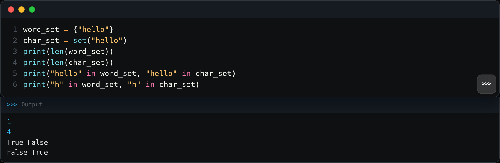

```python
word_set = {"hello"}
char_set = set("hello")
print(len(word_set))
print(len(char_set))
print("hello" in word_set, "hello" in char_set)
print("h" in word_set, "h" in char_set)
```

> Three spellings, three results
>
> - `{"abc"}`: 1 member, the string itself
> - `set("abc")`: 3 members, one per character
> - `set(["abc"])`: 1 member, because the list being walked holds 1 item

> **TIP**
>
> When the data already sits in a variable, write `set(variable)`. When you're typing the values by hand, write braces. The 1 exception is zero values, which needs `set()`.

**What does this line print?**

```python
print(len(set([1, 2, 3])), len({1, 2, 3}), len(set("123")))
```

- **A.** 3 3 1
- **B.** 1 3 3
- **C.** 3 1 3
- **D.** 3 3 3

<details>
<summary>Solution</summary>

**D.** 3 3 3

A list of 3 ints, a literal of 3 ints and a string of 3 distinct characters each produce a set of 3 members.

**Why the others are wrong**

- **A.** set("123") walks the string character by character and collects "1", "2" and "3", so the third count is 3, not 1.
- **B.** set([1, 2, 3]) walks the list and collects 3 distinct integers. The first count is 3; a count of 1 would need set([[1, 2, 3]]), which fails anyway.
- **C.** {1, 2, 3} is a brace literal with 3 distinct values, so its length is 3. Nothing here collapses to 1 member.

</details>

The 2 sources you will turn into sets most often are a list of raw records and a dictionary used as a lookup. Both go through the same `set()` call, and the results compare directly, because a set built from a dictionary holds plain keys.

```sql
prices = {"A1": 3.5, "B2": 4.0, "C3": 2.25}
basket = ["B2", "D4", "B2", "A1"]
basket_codes = set(basket)
price_codes = set(prices)
print(len(basket_codes))
print("D4" in price_codes)
```

This prints 3 and then `False`. The basket names 4 codes with `"B2"` twice, so 3 distinct codes remain. The prices never made it into `price_codes`; it holds only the keys `"A1"`, `"B2"` and `"C3"`. So `"D4"` fails the test, and the program has found an item it can't charge for.


<br>

---

## Automatic Duplicate Removal

A set does deduplication for free, but the data has to get into the set first. `add` puts in 1 value, and `update` puts in every value in an iterable. Neither raises an error when a value is already present. The set stays as it was, and the program moves on.


<br>

### add: one value, no complaints

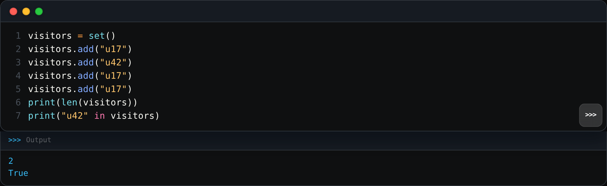

```python
visitors = set()
visitors.add("u17")
visitors.add("u42")
visitors.add("u17")
visitors.add("u17")
print(len(visitors))
print("u42" in visitors)
```

That was 4 `add` calls and 2 distinct visitors. The third and fourth calls found `"u17"` present and did nothing. Compare a list: 4 `append` calls would store 4 items, and counting distinct visitors would need a loop that checks each new id against everything stored before it.

Inside a loop, `add` becomes a filter that remembers. The program below walks a list of numbers, offers each even one to a set, and counts what survived.

https://github.com/user-attachments/assets/0db1d50a-5a75-42e3-b6f6-5c25eb6347ab

*Each even number is offered to the set; repeats leave it unchanged.*

The 9 numbers include 6 even ones, only 4 of them distinct. The set never needed an `if num not in unique_evens` check before adding, because `add` carries that check inside it. The pattern 'add everything, then `len`' answers 'how many distinct?' with no counters and no nested loop.

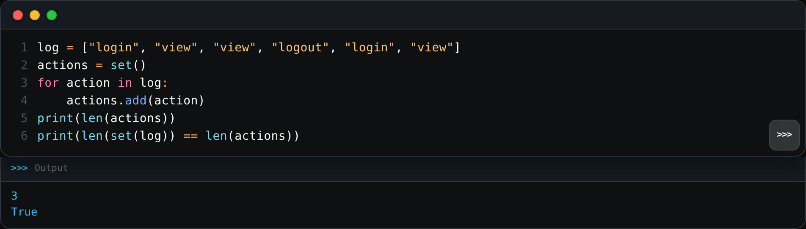

```python
log = ["login", "view", "view", "logout", "login", "view"]
actions = set()
for action in log:
    actions.add(action)
print(len(actions))
print(len(set(log)) == len(actions))
```

The loop and `set(log)` arrive at the same 3 actions. The loop version is worth its extra lines when you need to do something else per item, such as skip some of them; otherwise `set(log)` says it shorter.


<br>

### update: many values at once

`update` takes an iterable and adds each of its items, one by one, the same way `set()` does while building. Writing `seen.update(items)` is the same as a `for` loop calling `seen.add(item)` on each item, in 1 line.

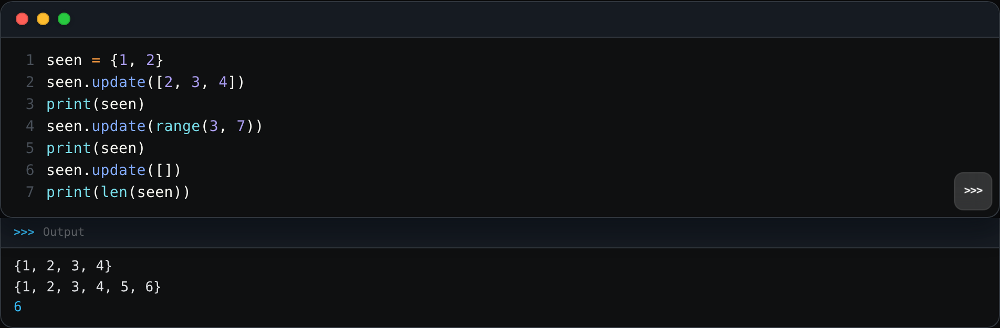

```python
seen = {1, 2}
seen.update([2, 3, 4])
print(seen)
seen.update(range(3, 7))
print(seen)
seen.update([])
print(len(seen))
```

The first `update` offered `[2, 3, 4]`. 2 was already present, so only 3 and 4 were added. The second offered 3 through 6, and only 5 and 6 changed anything. Updating with an empty list touches nothing. The count ends at 6.


<br>

### A string is 1 value to add and 4 to update

`update` walks its argument. A string walks as characters, so `tags.update("sale")` adds 4 separate members: `"s"`, `"a"`, `"l"`, `"e"`. To add the word as 1 tag, use `tags.add("sale")` instead; wrapping it in a list, `tags.update(["sale"])`, also works.

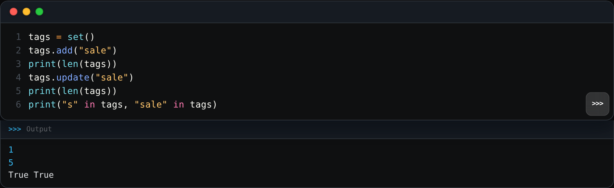

```python
tags = set()
tags.add("sale")
print(len(tags))
tags.update("sale")
print(len(tags))
print("s" in tags, "sale" in tags)
```

| ✓ add(value) | ✗ update(iterable) |
| --- | --- |
| • Takes exactly 1 value<br><br>• Puts that value in as 1 member<br><br>• add("sale") adds the word<br><br>• add([1, 2]) raises an error: a list can't be a member | • Takes something a loop can walk<br><br>• Puts each item in as its own member<br><br>• update("sale") adds 4 letters<br><br>• update([1, 2]) adds 1 and 2 |

> **TIP**
>
> Reach for `add` when your hand holds 1 value and `update` when it holds a collection. Passing a collection to `add` is the mistake the last section of this lesson explains in full.


<br>

### Dedupe and keep arrival order

`set(items)` removes repeats and forgets which came first. When first appearance matters, a list recording the order and a set answering 'seen before?' work as a pair. The set does the fast check; the list grows only when the check says new.

https://github.com/user-attachments/assets/28ead674-41ef-45e6-80ea-2a5be57eb9e9

*The set answers the membership test; the list keeps arrival order.*

The loop receives 7 items, 4 of them distinct. Each one is tested against `seen` in 1 step. The list `unique_ordered` ends as `["apple", "kiwi", "fig", "plum"]`, first appearances in the order they came, which `set(items)` alone couldn't promise.

**How many members does s hold at the end?**

```python
s = {10}
s.add(10)
s.update([10, 20])
s.update("20")
print(len(s))
```

- **A.** 4
- **B.** 3
- **C.** 5
- **D.** 2

<details>
<summary>Solution</summary>

**A.** 4

add(10) changes nothing. update([10, 20]) adds 20. update("20") walks the string and adds the characters "2" and "0", which are strings and differ from the integer 20. Members: 10, 20, "2", "0".

**Why the others are wrong**

- **B.** This treats update("20") as adding 1 member. A string argument is walked character by character, so it contributes 2 members here.
- **C.** This counts the second add(10) as a new member. A value already present stays as 1 member no matter how many times it is offered.
- **D.** This ignores the last update entirely. The characters "2" and "0" are new string members and join 10 and 20.

</details>

Lists and sets grow through different method names, and mixing them up is one of the first errors people meet with sets. A list has `append` because new items go on its end. A set has no end, so it has no `append`, and calling it stops the program with `AttributeError: 'set' object has no attribute 'append'`. The reverse holds too: a list has no `add`.

| Collection | Method that adds 1 value | What a repeat does |
| --- | --- | --- |
| List | `items.append(x)` | Stored again as a new item |
| Set | `items.add(x)` | Changes nothing |

When an error names `append` on a set, the fix is the method name alone. Everything else, including the final `len`, stays as written.


<br>

---

## Removing Elements from Sets

A set has 4 methods that take values out. `remove` and `discard` each take out 1 named value and differ only in what happens when it is absent. `pop` takes out some member and hands it back. `clear` empties the set. To check what's there before or after, use `in` and `not in`.


<br>

### remove raises, discard forgives

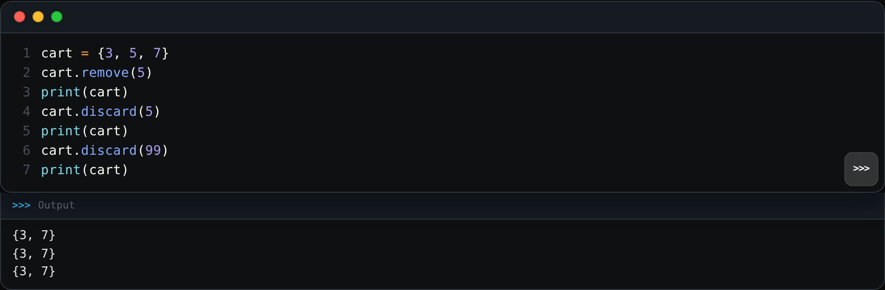

```python
cart = {3, 5, 7}
cart.remove(5)
print(cart)
cart.discard(5)
print(cart)
cart.discard(99)
print(cart)
```

`remove(5)` found 5 and took it out. `discard(5)` then looked for 5 and returned without complaint when it wasn't there. `discard(99)` did the same. Swap that last `discard` for `remove` and the program stops.

```sql
cart = {3, 7}
cart.remove(5)
```

A `KeyError` names the value that was missing, the same error a dictionary raises for a missing key, because a set is stored much like a dictionary that has keys and no values. Use `remove` when absence means something went wrong upstream and you want the program to stop and say so. Use `discard` when absence is an ordinary state, such as cancelling a reservation that was already cancelled.

> **TIP**
>
> Reading `s.remove(x)` in a colleague's code tells you the author believes x must be there. Reading `s.discard(x)` tells you they expect it might not be. Choose the one that documents your own belief.


<br>

### Testing before and after

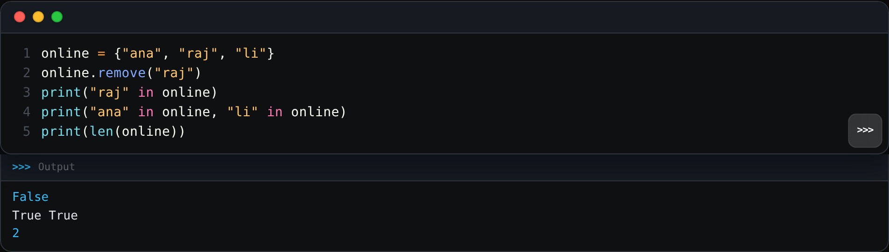

```python
online = {"ana", "raj", "li"}
online.remove("raj")
print("raj" in online)
print("ana" in online, "li" in online)
print(len(online))
```

A removal shows up in 2 places: the removed value now fails the `in` test, and `len` drops by 1. Nothing else moves, because nothing in a set has a position to shift.


<br>

### Guarding with in

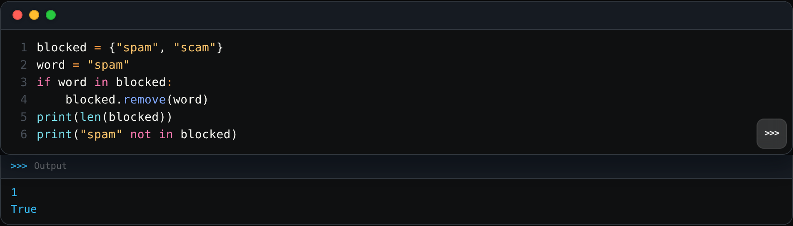

```python
blocked = {"spam", "scam"}
word = "spam"
if word in blocked:
    blocked.remove(word)
print(len(blocked))
print("spam" not in blocked)
```

The `if word in blocked` guard makes `remove` safe, which is what `discard` does on its own. Write the guard when the other branch has work of its own, such as printing a message; otherwise `discard` says the same thing in 1 line.

A loop of `discard` calls handles a batch of removals where some may not apply. Here 3 guests cancel, and 1 of them was never on the list.

https://github.com/user-attachments/assets/19796700-5ebc-4b02-aa06-69504ec3c383

*Each cancellation is offered to discard; a guest never on the list causes no error.*

Guest 15 was not in the set, and `discard` passed over it without raising anything. The set keeps 2 guests, and the seat count follows from `len`.


<br>

### pop takes something, clear takes everything

`pop` removes 1 member and returns it, but you don't choose which. The set picks from its storage layout, so on a set with several members, treat the result as 'some member', never 'the first one' or 'the smallest'. Calling `pop` on an empty set raises `KeyError`. `clear` removes every member and leaves `set()`.

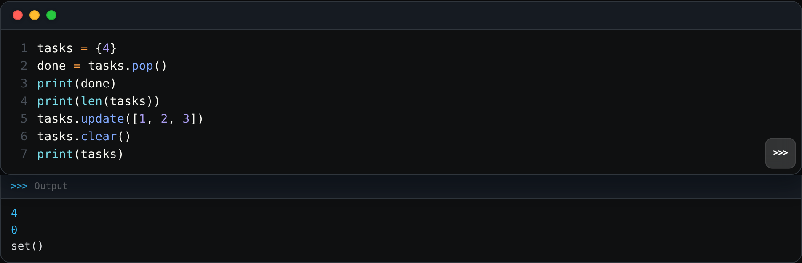

```python
tasks = {4}
done = tasks.pop()
print(done)
print(len(tasks))
tasks.update([1, 2, 3])
tasks.clear()
print(tasks)
```

With 1 member there is nothing to guess: `pop` returns 4. After `clear`, printing shows `set()`, the spelling for an empty set, since `{}` would read as an empty dictionary.

| Call | Effect | If the value is absent |
| --- | --- | --- |
| `s.remove(x)` | Takes x out | `KeyError` |
| `s.discard(x)` | Takes x out | Nothing happens |
| `s.pop()` | Takes out some member and returns it | `KeyError` only when the set is empty |
| `s.clear()` | Takes out every member | Nothing to take, no error |
| `x in s` | Reports presence | Returns `False` |

| ✓ Do | ✗ Don't |
| --- | --- |
| • Use discard for batches where some values may already be gone<br><br>• Use remove when a missing value signals a bug worth stopping for<br><br>• Test with in when the other branch has its own work to do | • Treat pop as returning the first or smallest member<br><br>• Call remove in a loop over values you haven't confirmed are present<br><br>• Write {} hoping for an empty set |

**What does this program print?**

```python
ids = {1, 2, 3}
ids.discard(4)
ids.remove(2)
ids.discard(2)
print(ids)
```

- **A.** {1, 2, 3}
- **B.** KeyError raised by discard(4)
- **C.** KeyError raised by discard(2)
- **D.** {1, 3}

<details>
<summary>Solution</summary>

**D.** {1, 3}

discard(4) does nothing, remove(2) succeeds because 2 is present, and discard(2) finds it already gone and stays quiet. Members 1 and 3 remain.

**Why the others are wrong**

- **A.** remove(2) takes 2 out. Only discard(4) and the final discard(2) leave the set untouched.
- **B.** discard never raises for a missing value; 4 is absent and the call does nothing. Only remove raises KeyError.
- **C.** By this line 2 is already gone, but the call is discard, which treats a missing value as nothing to do.

</details>

Seat releases arrive the way the cancellations did: a list of values, some of which were never taken. Choosing the method is choosing what an absent value means. If a release for a seat nobody held is ordinary, `discard` lets the loop finish. If it means 2 systems disagree about the seating chart, `remove` stops at the first bad value and names it in the `KeyError`. After the loop, `not in` confirms each release took effect.

```sql
held = {4, 9, 12}
for seat in [9, 30]:
    held.discard(seat)
print(len(held), 9 not in held)
```

This prints `2 True`. Seat 30 was never held and the loop passed over it; seat 9 left, so `9 not in held` is `True`.


<br>

---

## What Can Be in a Set?

Numbers and strings can be set members, and so can booleans. Lists and dictionaries cannot, and neither can another set. The rule behind the 2 groups is about change: a value that can be altered after it is created can't be a set member.

```sql
broken = {[1, 2], 3}
```

The error says `unhashable`. Hashing is the step that turns a value into the slot number the set stores it under, the same step that lets `in` finish in 1 look. The message means Python declined to compute that number for a list.


<br>

### Why a changing value cannot be a member

Suppose a set did accept `[1, 2]`. It would compute a slot from the contents 1 and 2 and file the list there. Then you run `my_list.append(3)`. The list in the set now reads `[1, 2, 3]`, but it still sits in the slot computed for `[1, 2]`. Ask `[1, 2, 3] in my_set` and the set looks in the slot for `[1, 2, 3]`. That slot is empty, so it says `False` about a value it holds. Rather than allow that, Python refuses to hash its built-in types that can change after creation, which includes lists and dictionaries as well as sets themselves. Integers and floats cannot be altered in place, and neither can strings or booleans, so their slot never goes stale.

| Value | Can it change after creation? | Set accepts it? |
| --- | --- | --- |
| `42` | No | Yes |
| `2.5` | No | Yes |
| `"abc"` | No | Yes |
| `True` | No | Yes |
| `[1, 2]` | Yes, `append` and more | No |
| `{"a": 1}` | Yes, keys come and go | No |
| `{1, 2}` | Yes, `add` and `discard` | No |

```sql
mixed = {7, "seven", 7.5}
print(len(mixed))
print("seven" in mixed)
mixed.add([8])
```

Mixed types in 1 set are fine: 3 members of 3 types. The failure comes at the `add([8])` line, after the 2 prints have already run. Read the output in order: 2 printed lines, then the traceback. An error stops the program at the line that raised it, and nothing earlier is undone.


<br>

### Records: store the id, keep the dict elsewhere

You'll often have a list with 1 dictionary per event and need the distinct users behind them. The dictionaries can't go in a set, and they don't need to. Pull out the field that identifies a user and add that.

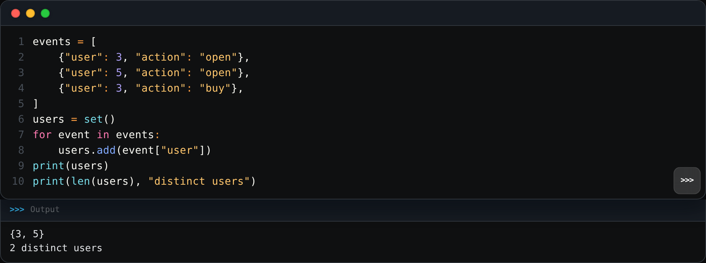

```python
events = [
    {"user": 3, "action": "open"},
    {"user": 5, "action": "open"},
    {"user": 3, "action": "buy"},
]
users = set()
for event in events:
    users.add(event["user"])
print(users)
print(len(users), "distinct users")
```

User 3 sent 2 events, and the set holds 3 once. The dictionaries stay in `events`, available for anything else the program needs; the set holds only what identifies them, which is all a distinct count requires.


<br>

### Sets inside sets

A set can't hold a set for the same reason it can't hold a list: `add` and `discard` would change its contents after filing. Python does offer a frozen kind of set that accepts no changes and so can be a member, and the advanced sets lesson covers it. For now the rule to carry is 1 sentence: if you could change it in place, it cannot be a set member.

> A quick check before adding
>
> - Can you change it in place by calling `append` or `update` on it? Then no.
> - Is it a number or a string? Is it `True` or `False`? Then yes.
> - Is it a record with several fields? Add the 1 field that identifies it.

**Which line raises an error, and why?**

```python
a = {1, 2}
a.add("3")
a.add(4.0)
a.add({5})
print(len(a))
```

- **A.** Line 2, because a set of integers cannot take a string
- **B.** Line 3, because 4.0 is a float and floats cannot be hashed
- **C.** Line 4, because a set can change and so cannot be a member
- **D.** No line fails, and the program prints 5

<details>
<summary>Solution</summary>

**C.** Line 4, because a set can change and so cannot be a member

{5} is a set, and sets can change through add and discard, so Python refuses it with TypeError: unhashable type: 'set'. The print never runs.

**Why the others are wrong**

- **A.** Sets accept mixed types. A string joins a set of integers without complaint, as {7, "seven", 7.5} showed.
- **B.** Floats can't change in place and hash fine. 4.0 becomes a member; it would collapse with 4 only if 4 were already present.
- **D.** Lines 2 and 3 succeed, bringing the count to 4, but line 4 stops the program before the print. A set is never a valid member.

</details>

The error in that question has a common cousin. You hold a set and a list of new values for it, and you pass the whole list to `add`. Python reads that as a request to store the list itself as 1 member, and a list can change, so the call raises `TypeError: unhashable type: 'list'`. What you meant was to store each item of the list, which is the job `update` does.

```sql
codes = {"NYC", "SFO"}
new_codes = ["LAX", "SFO"]
codes.update(new_codes)
print(len(codes))
```

This prints 3: `"LAX"` joins and `"SFO"` was already there. Written as `codes.add(new_codes)`, the same program stops at line 3 and never reaches the print.


<br>

---

## Putting It All Together

At DoorDash, an on-call engineer wants to know how many distinct restaurants received at least 1 order during a Friday dinner rush. The order events arrive as a list of dictionaries, each carrying a restaurant id, and a busy restaurant appears hundreds of times. A set of ids, filled by one loop, answers the question with a single len call.

- Each event dictionary can't be a set member, so the loop adds event [ "restaurant_id" ] rather than the event itself.
- add inside the loop collapses the hundreds of repeat orders from one restaurant into 1 member, with no check written by hand.
- A batch of restaurants that paused service can be taken out with discard in a loop, since some of them may have had no orders at all.
- in confirms whether a specific restaurant took part, in 1 step regardless of how many events arrived.
- If the report needed the order in which restaurants got their first order, a list alongside the set would record it, since the set alone does not.


<br>

---

## Key Takeaways

- A set keeps 1 copy of each value and has no positions, so s [ 0 ] raises an error and printed order means nothing.
- Build with braces for known values or set ( iterable ) for data in a variable; an empty set is set ( ) , because { } is a dictionary.
- add puts in 1 value and update puts in each item of an iterable; a value already present changes nothing.
- remove raises KeyError on a missing value, discard stays quiet, pop returns some member, clear empties the set.
- Members must be values that cannot change in place. Numbers and strings qualify, as do booleans; lists and dictionaries do not, and neither do sets.
