# Sets: Intermediate

Spotify's Blend builds a shared playlist out of friends' listening. Suppose you own the step that picks artists for a Blend between Maya and Theo. Artists both of them play should lead the mix, artists only Maya plays fill her part, and no artist should appear twice. Each rule is a set operation, and the wrong operator hands Theo a playlist of Maya's favourites alone.


<br>

---

## Union: Combining Sets

Pipelines rarely get their keys from a single place. Say Monday's purchases arrive on 2 event feeds, the website and the mobile app, and each feed is loaded into a set of buyer IDs. A customer who bought on both shows up in both sets. Finance wants the number of distinct people who bought on Monday, and that number comes from the union: every ID present in at least 1 of the sets, each counted once.

| user_id | in web | in app | in web | app |
| --- | --- | --- | --- |
| 101 | yes | no | yes |
| 102 | yes | no | yes |
| 103 | yes | yes | yes, once |
| 104 | yes | yes | yes, once |
| 105 | no | yes | yes |


<br>

### The | operator and the union() method

Python offers union in 2 spellings. `web | app` reads as "in web or in app" and builds a new set. `web.union(app)` is the method spelling and builds an equal set. Neither form changes `web` or `app`: each keeps the IDs it started with, which matters when a later step still needs the per-feed sets, for a per-channel breakdown say.

*Python prints a set in its internal storage order, and for strings that order can change between runs. The examples pass each set to sorted(), which returns a list of the items in ascending order, so every printout comes out the same.*

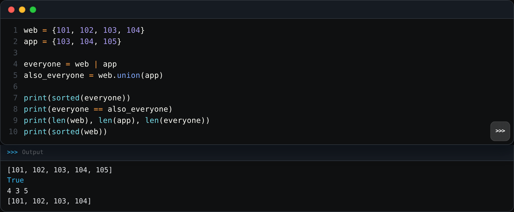

```python
web = {101, 102, 103, 104}
app = {103, 104, 105}

everyone = web | app
also_everyone = web.union(app)

print(sorted(everyone))
print(everyone == also_everyone)
print(len(web), len(app), len(everyone))
print(sorted(web))
```

The third printed line holds the lesson about counts. The feeds hold 4 and 3 IDs, 7 in total, yet the union holds 5, because 103 and 104 appear once each. Adding the sizes of 2 sets overcounts whenever they overlap, and summing per-feed counts is a common way for a dashboard to report more customers than exist. The size of that overcount is the overlap, which the next section computes directly. The last line shows `web` still holding its original 4 IDs.


<br>

### What union() accepts that | refuses

The operator insists on a set on both sides: `web | [106]` raises `TypeError`. The method takes any iterable, meaning a list, a string, a `range` or a dict (whose keys it uses), and converts the input as it reads it. It also takes several arguments, merging all of them into a single new set.

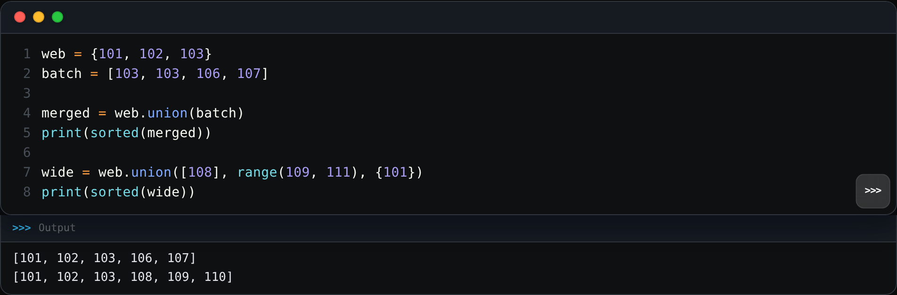

```python
web = {101, 102, 103}
batch = [103, 103, 106, 107]

merged = web.union(batch)
print(sorted(merged))

wide = web.union([108], range(109, 111), {101})
print(sorted(wide))
```

The list carried 103 twice. The result kept a single 103, which `web` already held, and added 106 and 107. The second call merged a list, a range and another set at once, and 101, already in `web`, appeared a single time.

| ✓ The | operator | ✗ The union() method |
| --- | --- |
| • Both sides must be sets, or Python raises TypeError<br><br>• Chains to more inputs: a \| b \| c<br><br>• Short enough to sit inside a larger expression | • Takes lists, strings, ranges and dicts as well as sets<br><br>• Merges any number of inputs in a single call<br><br>• Converts its inputs, so no set(...) wrapper is needed |


<br>

### Folding a list of sets

Daily partitions often arrive as a list holding a set per day. Start from an empty set and fold each day in with `|`. The empty set contributes nothing, so after the first step `seen` holds the first day's IDs, and every later step adds whatever that day brings that is new.

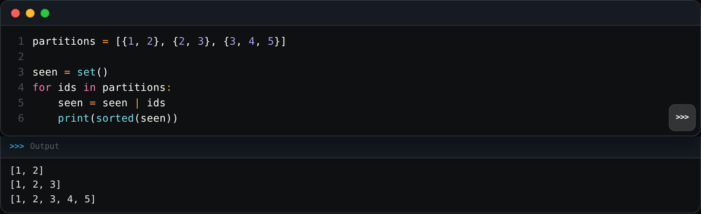

```python
partitions = [{1, 2}, {2, 3}, {3, 4, 5}]

seen = set()
for ids in partitions:
    seen = seen | ids
    print(sorted(seen))
```

> **TIP**
>
> Reach for union when the question is "in any of these": distinct buyers across feeds, every table a group of jobs writes to, all tags used this week. A question that says "both" or "every" needs a different operator, and the next section introduces it.

**A job's tags live in a set, and a new tag arrives as a plain string. What does this program print?**

```python
tags = {"etl", "daily"}
tags = tags.union("sql")
print(sorted(tags))
print(len(tags))
```

- **A.** ['daily', 'etl', 'sql'] then 3
- **B.** ['daily', 'etl', 'l', 'q', 's'] then 5
- **C.** TypeError, since union() needs a set argument
- **D.** ['daily', 'etl'] then 2, since tags is unchanged

<details>
<summary>Solution</summary>

**B.** ['daily', 'etl', 'l', 'q', 's'] then 5

union() takes any iterable and adds each item it yields. A string yields its characters, so 's', 'q' and 'l' join as 3 separate tags.

**Why the others are wrong**

- **A.** union() loops over its argument, and looping over a string yields characters, so 'sql' never enters as a whole word.
- **C.** That rule belongs to the | operator. The method accepts lists, ranges and strings, and converts them as it reads.
- **D.** union() does leave the original set alone, but the result is assigned back to tags, so the new set replaces it.

</details>


<br>

### Adding a whole string as 1 item

To add a word as 1 tag, hand `union()` a container holding it: the list `["sql"]` yields the whole string, and so does `tags | {"sql"}`. Each argument is read on its own, so 1 call can mix a correct input with a careless one, as the third line shows: `"hourly"` arrives whole and `"sql"` splits into letters.

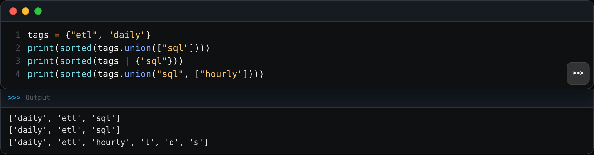

```python
tags = {"etl", "daily"}
print(sorted(tags.union(["sql"])))
print(sorted(tags | {"sql"}))
print(sorted(tags.union("sql", ["hourly"])))
```

Each argument to `union()` is looped over on its own, so a list contributes whole IDs while a bare string contributes characters. A repeated ID in any argument lands in the result once, and the calling set keeps its contents.


<br>

---

## Set Intersection

Intersection keeps what the sets have in common: an element survives only if every operand contains it. Back in the Blend, the artists Maya and Theo both play form the intersection of their 2 artist sets. Python writes it `maya & theo`, read as "in maya and in theo", or `maya.intersection(theo)`.

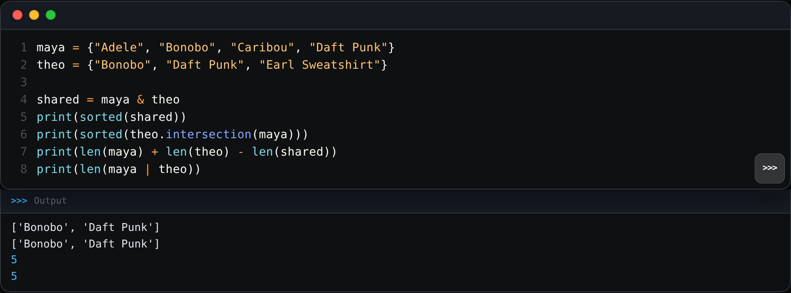

```python
maya = {"Adele", "Bonobo", "Caribou", "Daft Punk"}
theo = {"Bonobo", "Daft Punk", "Earl Sweatshirt"}

shared = maya & theo
print(sorted(shared))
print(sorted(theo.intersection(maya)))
print(len(maya) + len(theo) - len(shared))
print(len(maya | theo))
```

Swapping the operands changed nothing, since `a & b` and `b & a` hold the same elements. The last 2 lines settle the overcount from the union section: 4 artists plus 3 artists minus the 2 they share equals the 5 in the union. For 2 sources, the gap between the summed counts and the distinct count is exactly the size of their overlap. With 3 or more sources, an ID present in all 3 is counted 3 times, so the gap is no longer the size of any single overlap.


<br>

### When nothing is shared

An intersection with no common elements is still a set, an empty one, and Python prints it as `set()`. The braces `{}` already mean an empty dict, so an empty set needs a name of its own. Comparing with `overlap == set()` or testing `len(overlap) == 0` reads that result correctly.

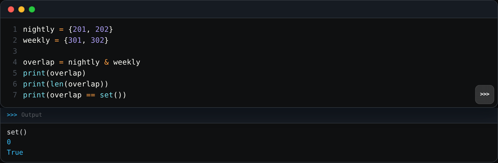

```python
nightly = {201, 202}
weekly = {301, 302}

overlap = nightly & weekly
print(overlap)
print(len(overlap))
print(overlap == set())
```


<br>

### Users active on every day

A retention report asks which users were active on all 3 days of a period. Both forms accept more than 2 sets: `mon & tue & wed`, or `mon.intersection(tue, wed)`. When the days arrive as a list, a loop does the same job, and its starting value decides whether the answer is right. Step through it as the set narrows day by day.

https://github.com/user-attachments/assets/316ab1a7-f0a2-4939-960a-26d94a546f77

*Each & can only drop IDs, so the set narrows from 4 to 2.*

The loop starts from `days[0]` and each `&` can only remove IDs, so the set shrinks from 4 to 3 to 2. Starting from `set()` instead, the habit that serves union well, empties the result on the first step: an empty set shares nothing with anything. Union and intersection want opposite starting values.

| Folding a list with | Start from | Why |
| --- | --- | --- |
| | (union) | set() | an empty set adds no IDs, so the result is untouched |
| & (intersection) | the first set | an empty set removes every ID, so the result stays empty |


<br>

### Checking incoming keys against loaded ones

The method form of intersection also takes a list, so a batch of incoming keys can be checked against the loaded keys without converting the batch first. Repeats in the batch collapse, because the result is a set.

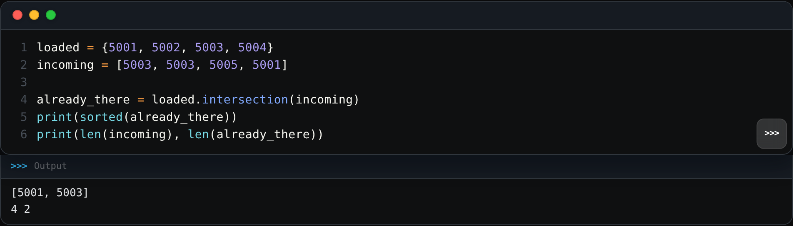

```python
loaded = {5001, 5002, 5003, 5004}
incoming = [5003, 5003, 5005, 5001]

already_there = loaded.intersection(incoming)
print(sorted(already_there))
print(len(incoming), len(already_there))
```

Of the 4 incoming entries, 2 distinct IDs were already loaded: 5001 and 5003, with the repeated 5003 counted once. A load step that skips those keys avoids writing duplicate rows, and 5005, absent from `loaded`, never appears in the result.

> **TIP**
>
> When the only question is whether 2 sets overlap at all, a.isdisjoint(b), covered in the last section of this lesson, stops at the first shared element and never builds the overlap set.

**A retention job looks for IDs active on all 3 days. What does it print?**

```python
mon = {1, 2, 3}
tue = {2, 3, 4}
wed = {3, 4, 5}

every_day = set()
for day in [mon, tue, wed]:
    every_day = every_day & day
print(every_day)
```

- **A.** {3}, the single ID present on all 3 days
- **B.** {1, 2, 3, 4, 5}, every ID seen on any day
- **C.** {}, the empty result printed with braces
- **D.** set(), because the loop starts from an empty set

<details>
<summary>Solution</summary>

**D.** set(), because the loop starts from an empty set

set() & mon is empty, and every later & keeps it empty. Starting from mon instead gives {3}.

**Why the others are wrong**

- **A.** That is the intended answer, but the loop starts from set(), and set() & mon is already empty.
- **B.** That would be the union. The & operator keeps only elements present in both operands.
- **C.** The result is empty, but {} is how an empty dict prints. An empty set prints as set().

</details>

The repair changes 1 line: start from the first set in the list. A period of a single day still works. Its slice `[1:]` is empty, the loop body never runs, and the answer is that day's set, which is correct: everyone active that day was active on every day of the period.

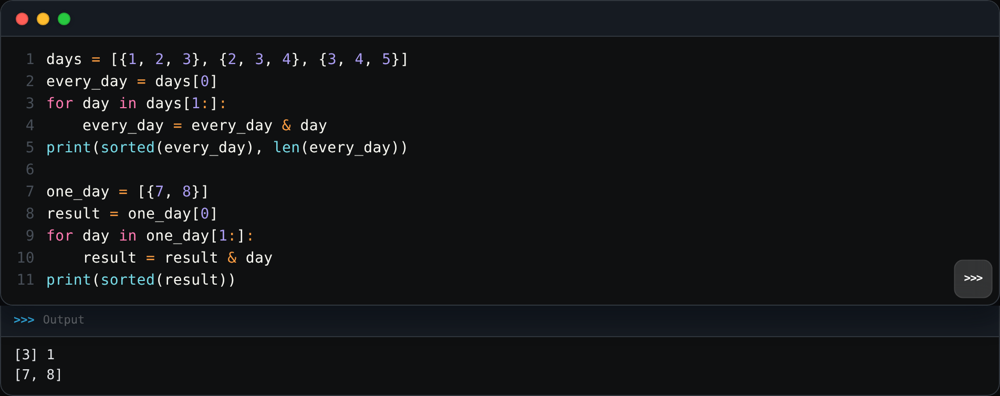

```python
days = [{1, 2, 3}, {2, 3, 4}, {3, 4, 5}]
every_day = days[0]
for day in days[1:]:
    every_day = every_day & day
print(sorted(every_day), len(every_day))

one_day = [{7, 8}]
result = one_day[0]
for day in one_day[1:]:
    result = result & day
print(sorted(result))
```

The pattern to carry forward: start from the first set, loop over the rest with `&`, and expect the result to shrink or hold steady. Its length is the number a retention report shows.


<br>

---

## Set Difference

Difference answers a one-sided question: which elements of the left set are absent from the right set. `today - yesterday` keeps every ID active today that was not active yesterday. Anything in `yesterday` that `today` lacks is ignored, because the result only ever holds elements of the left operand. Flip the operands and the question flips with them.

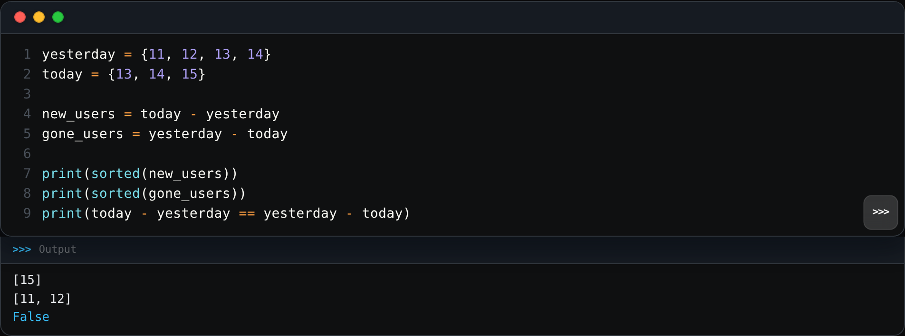

```python
yesterday = {11, 12, 13, 14}
today = {13, 14, 15}

new_users = today - yesterday
gone_users = yesterday - today

print(sorted(new_users))
print(sorted(gone_users))
print(today - yesterday == yesterday - today)
```

| user_id | yesterday | today | today - yesterday | yesterday - today |
| --- | --- | --- | --- | --- |
| 11 | yes | no | no | yes |
| 12 | yes | no | no | yes |
| 13 | yes | yes | no | no |
| 14 | yes | yes | no | no |
| 15 | no | yes | yes | no |

The same 2 sets answer 2 different business questions. `today - yesterday` gives the new users a growth report counts, and `yesterday - today` gives the users who went quiet, the input to a churn alert. The `False` on the last line is the reason to name each result after its direction, as `new_users` and `gone_users` do.


<br>

### Syncing a table: inserts and deletes

A nightly job keeps a warehouse table in step with a source table. Comparing the 2 sets of primary keys splits the work 3 ways. Keys in the source but not the warehouse belong to new rows to insert. Keys in the warehouse but not the source were deleted upstream. Keys in both need a value check for updates, and that group is an intersection.

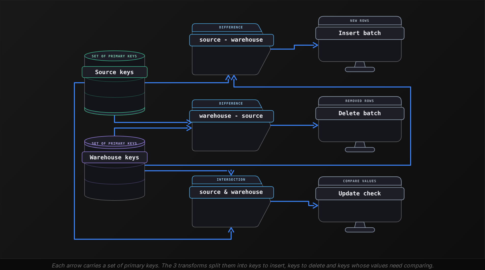

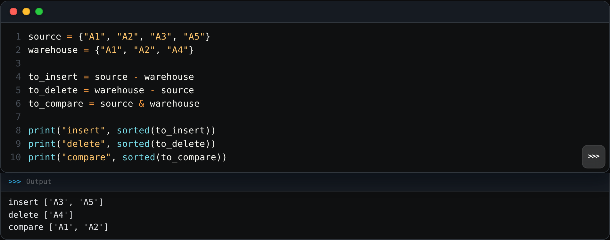

```python
source = {"A1", "A2", "A3", "A5"}
warehouse = {"A1", "A2", "A4"}

to_insert = source - warehouse
to_delete = warehouse - source
to_compare = source & warehouse

print("insert", sorted(to_insert))
print("delete", sorted(to_delete))
print("compare", sorted(to_compare))
```


<br>

### Removing several groups at once

`a.difference(b, c)` removes everything found in `b` or in `c`, and it takes a list wherever the operator would demand a set. The operator form chains: `a - b - c` runs left to right, so Python computes `(a - b) - c`. Both drop the same elements from `a`.

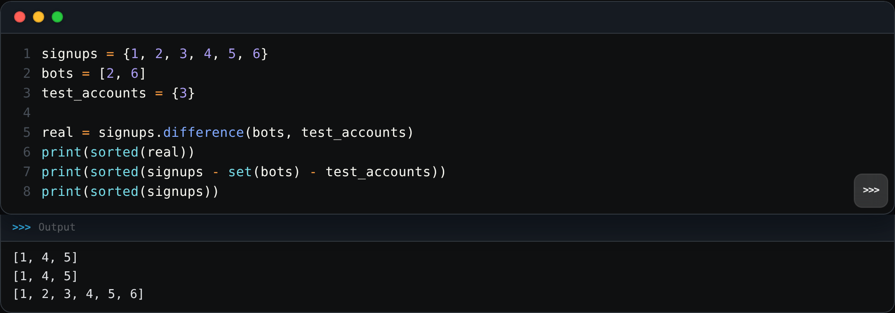

```python
signups = {1, 2, 3, 4, 5, 6}
bots = [2, 6]
test_accounts = {3}

real = signups.difference(bots, test_accounts)
print(sorted(real))
print(sorted(signups - set(bots) - test_accounts))
print(sorted(signups))
```

The operator line needed `set(bots)` because `-` refuses a list. Subtracting an ID the left set lacks is harmless: `{1, 2} - {99}` returns a set holding 1 and 2. That makes difference the safer tool for a cleanup list that may name IDs already gone, where calling `remove(99)` would raise `KeyError`. And `signups` printed in full on the last line: the method built a new set and left the original alone.

| ✓ Do | ✗ Don't |
| --- | --- |
| • Name each result after its direction: new_users = today - yesterday<br><br>• Use difference() when some of the inputs are lists<br><br>• Add parentheses whenever the grouping matters: a - (b - c) | • Don't treat a - b and b - a as interchangeable<br><br>• Don't loop remove() over IDs that may already be gone<br><br>• Don't subtract lists: [1, 2] - [1] raises TypeError |

**Both lines subtract the same 3 sets. What does the program print?**

```python
a = {1, 2, 3}
b = {2, 3}
c = {3}

print(sorted(a - b - c))
print(sorted(a - (b - c)))
```

- **A.** [1] then [1, 3]
- **B.** [1] then [1]
- **C.** [1, 3] then [1]
- **D.** [] then [1]

<details>
<summary>Solution</summary>

**A.** [1] then [1, 3]

a - b - c is (a - b) - c, which is {1}. In the second line b - c is {2}, so only 2 leaves a, and 3 stays.

**Why the others are wrong**

- **B.** The parentheses change the result. b - c is {2}, so the second line removes only 2 from a.
- **C.** Chained - runs left to right, so the first line is (a - b) - c, which leaves only 1.
- **D.** Nothing in b or c contains 1, so 1 survives every subtraction on both lines.

</details>

A reversed difference raises no error. The result holds only elements of the left operand, so when the left side is a short group of exceptions that all sit in the right side, the answer is an empty set on every run, printed as a clean `[]` and a count of 0.

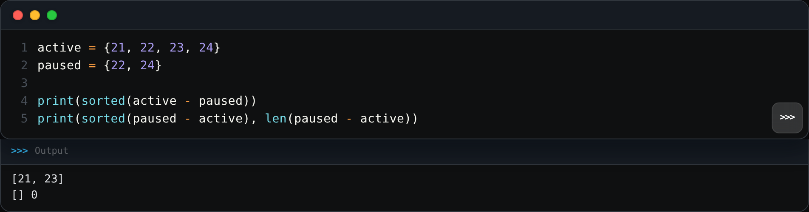

```python
active = {21, 22, 23, 24}
paused = {22, 24}

print(sorted(active - paused))
print(sorted(paused - active), len(paused - active))
```

Put the set you keep on the left and read the line as "keep these, except those".


<br>

---

## Symmetric Difference

Symmetric difference keeps the elements that sit in exactly 1 of 2 sets and drops the ones they share. Reconciliation is where it earns its keep: an orders service and a billing service each hold a set of order IDs for the day, and every ID present in only 1 of them is a record someone has to chase. Python writes it `orders ^ billing`.

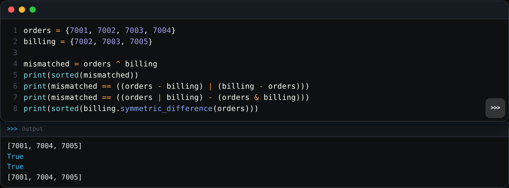

```python
orders = {7001, 7002, 7003, 7004}
billing = {7002, 7003, 7005}

mismatched = orders ^ billing
print(sorted(mismatched))
print(mismatched == ((orders - billing) | (billing - orders)))
print(mismatched == ((orders | billing) - (orders & billing)))
print(sorted(billing.symmetric_difference(orders)))
```

| Region | IDs | In orders ^ billing |
| --- | --- | --- |
| only in orders | 7001, 7004 | yes |
| in both | 7002, 7003 | no |
| only in billing | 7005 | yes |

The 2 `True` lines show what `^` is made of: the 2 one-sided differences joined together, or equally, the union with the intersection taken out. Operand order does not matter here, as the last line confirms with `billing` on the left.

The result says 7001, 7004 and 7005 disagree, and nothing about which system holds each. If the fix depends on the side, such as re-sending an order to billing versus voiding a charge, compute `orders - billing` and `billing - orders` separately. Use `^` when the question is "do these match, and which IDs differ": an empty result means the 2 sets hold exactly the same elements.


<br>

### Chaining ^ over 3 sets

Applying `^` across 3 sets looks as if it should give the elements found in exactly 1 of them. Follow the ID 2, which sits in all 3 sets, through each step.

https://github.com/user-attachments/assets/962ec6b1-141b-4d52-997e-9ef39420e939

*ID 2 sits in all 3 sets: the first ^ removes it and the second brings it back.*

The first `^` drops 2 because `a` and `b` share it. The second `^` compares that result with `c`, which holds 2 while the result does not, so 2 comes back. Each `^` flips an element's presence, so a chain keeps the elements that appear in an odd number of the sets: 1 set, 3 sets, 5 sets all qualify. For elements in exactly 1 set, take away everything that appears in 2 or more.

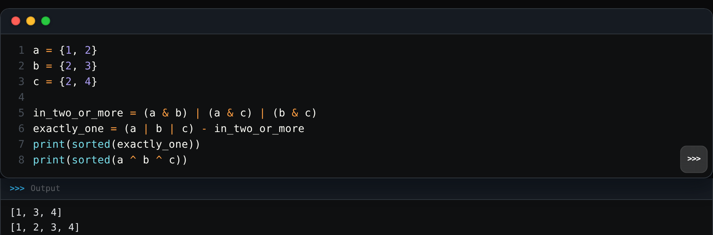

```python
a = {1, 2}
b = {2, 3}
c = {2, 4}

in_two_or_more = (a & b) | (a & c) | (b & c)
exactly_one = (a | b | c) - in_two_or_more
print(sorted(exactly_one))
print(sorted(a ^ b ^ c))
```


<br>

### Choosing ^ or symmetric_difference()

| ✓ The ^ operator | ✗ symmetric_difference() |
| --- | --- |
| • Both operands must be sets<br><br>• Chains, keeping elements with an odd count<br><br>• Fits inside a longer expression, such as a ^ b == set() | • Accepts a list, string or range as its argument<br><br>• Takes exactly 1 argument, where union() takes many<br><br>• Its name tells a reader what the line computes |

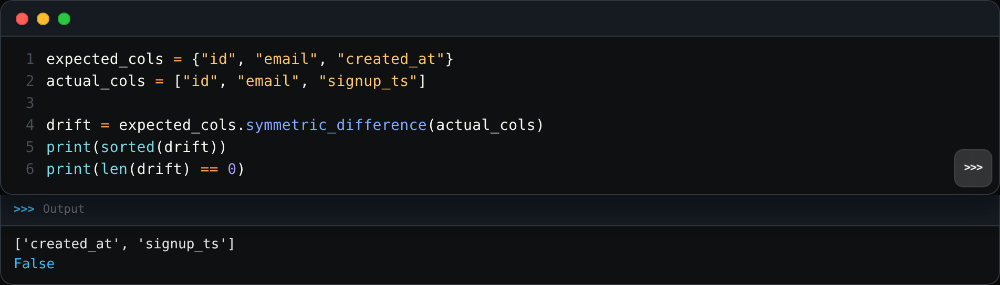

```python
expected_cols = {"id", "email", "created_at"}
actual_cols = ["id", "email", "signup_ts"]

drift = expected_cols.symmetric_difference(actual_cols)
print(sorted(drift))
print(len(drift) == 0)
```

The method compared a set with the list of column names that arrived in the data, and the result named both sides of the drift: a column the contract expects and a column nobody asked for. The `False` is the alert condition. For 2 sets in a short expression `^` is the compact choice; when the input is a list, or the line should explain itself to whoever reviews it, use the method.

**A job chains ^ across 3 daily snapshots of IDs. What does it print?**

```python
mon = {1, 2, 3}
tue = {2, 3}
wed = {3, 4}
print(sorted(mon ^ tue ^ wed))
```

- **A.** [1, 4]
- **B.** [1, 2, 3, 4]
- **C.** [1, 3, 4]
- **D.** [3]

<details>
<summary>Solution</summary>

**C.** [1, 3, 4]

mon ^ tue is {1}, and {1} ^ wed adds 3 and 4. IDs 1 and 4 appear once and ID 3 appears 3 times, all odd counts.

**Why the others are wrong**

- **A.** That is the exactly-once answer. ID 3 is in all 3 snapshots, an odd count, so the chain keeps it.
- **B.** That is the union. ID 2 is in 2 snapshots, an even count: mon ^ tue removes it and wed never adds it back.
- **D.** ID 3 is the only one present every day, but a ^ chain also keeps 1 and 4, which each appear an odd number of times.

</details>

To test whether 2 collections match, compare 2 sets. A set never equals a list, so `shelf == scanned` below is `False` even though both name the same SKUs. The symmetric difference reads the list as a set, so the repeated `S1` collapses and the result is empty.

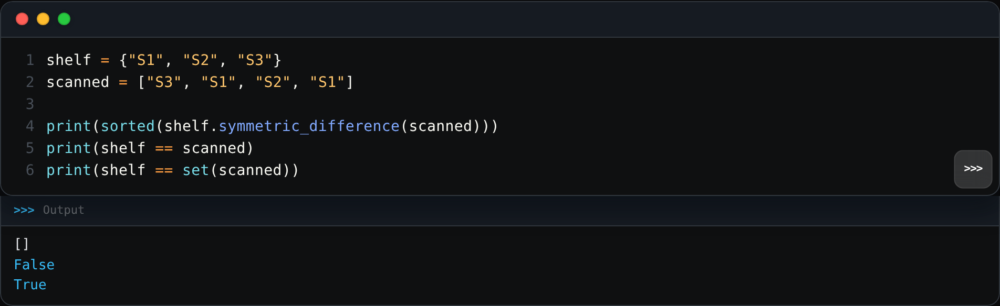

```python
shelf = {"S1", "S2", "S3"}
scanned = ["S3", "S1", "S2", "S1"]

print(sorted(shelf.symmetric_difference(scanned)))
print(shelf == scanned)
print(shelf == set(scanned))
```

Reach for the method when one side arrives as a list: it converts the list, drops repeats and returns what sits on only 1 side. An empty result means the 2 collections match.


<br>

---

## Subset and Superset

Every operation so far built a new set. The last group asks yes-or-no questions about containment, and then changes a set where it stands. `a <= b`, or `a.issubset(b)`, is `True` when every element of `a` is also in `b`. Read from the other side, `b >= a`, or `b.issuperset(a)`, says `b` contains all of `a`. A data contract check fits this exactly: are all required fields present in a record?

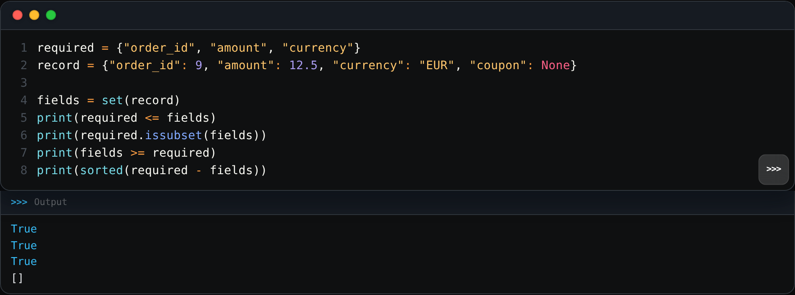

```python
required = {"order_id", "amount", "currency"}
record = {"order_id": 9, "amount": 12.5, "currency": "EUR", "coupon": None}

fields = set(record)
print(required <= fields)
print(required.issubset(fields))
print(fields >= required)
print(sorted(required - fields))
```

`set(record)` collects the dict's keys. The record carries an extra `coupon` field and the check still passes: a subset test ignores whatever the larger set holds beyond the smaller one. When the check fails, `required - fields` names the missing fields for the error message, which tells the on-call engineer far more than a bare `False`.


<br>

### Proper subsets and the empty set

The `<` operator adds a condition to `<=`: the sets must also differ, so the larger set holds at least 1 extra element. Every set is a subset of itself and never a proper subset of itself. The empty set is a subset of every set, since it has no element that could be missing.

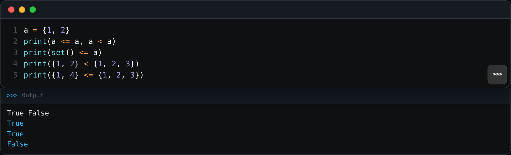

```python
a = {1, 2}
print(a <= a, a < a)
print(set() <= a)
print({1, 2} < {1, 2, 3})
print({1, 4} <= {1, 2, 3})
```


<br>

### When neither set contains the other

With numbers, if `x <= y` is `False` then `x >= y` is `True`. Sets drop that rule. `{1, 2}` and `{3}` each hold something the other lacks, so `<=`, `>=`, `<`, `>` and `==` all come back `False` between them. The `isdisjoint()` method asks a separate question: do the 2 sets share nothing at all?

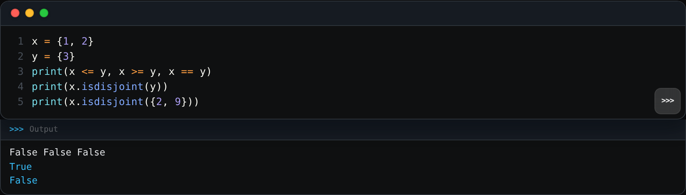

```python
x = {1, 2}
y = {3}
print(x <= y, x >= y, x == y)
print(x.isdisjoint(y))
print(x.isdisjoint({2, 9}))
```


<br>

### Changing a set in place

Each operation in this lesson has an in-place form that rewrites the left set and builds nothing new. The augmented assignment operators work on sets, and each has a method twin. The methods take lists and other iterables, the operators still want a set on the right, and every method returns `None`.

| Builds a new set | Changes the left set | Method form |
| --- | --- | --- |
| a | b | a |= b | a.update(b) |
| a & b | a &= b | a.intersection_update(b) |
| a - b | a -= b | a.difference_update(b) |
| a ^ b | a ^= b | a.symmetric_difference_update(b) |

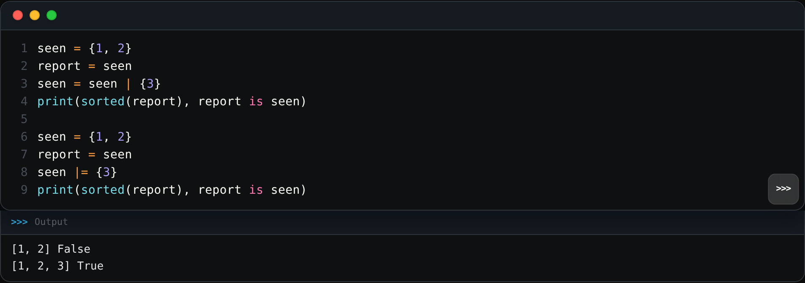

```python
seen = {1, 2}
report = seen
seen = seen | {3}
print(sorted(report), report is seen)

seen = {1, 2}
report = seen
seen |= {3}
print(sorted(report), report is seen)
```

`seen = seen | {3}` builds a new set and points `seen` at it, so `report` still names the old object holding 1 and 2. `seen |= {3}` adds 3 to the object `seen` already names, and `report` names that same object, so it sees the change and `is` returns `True`. When 2 names share a set, choose the form deliberately: an in-place change reaches every name.

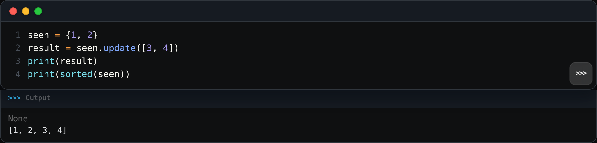

```python
seen = {1, 2}
result = seen.update([3, 4])
print(result)
print(sorted(seen))
```

`update()` changed `seen` and handed back `None`, as every in-place method does. Writing `seen = seen.update(batch)` therefore replaces the set with `None`, and the next method call on `seen` fails with `AttributeError`.

**A dashboard keeps a second name, snapshot, for a set of active session IDs. What does this print?**

```python
active = {1, 2, 3}
snapshot = active
active -= {2}
active = active | {9}
print(sorted(snapshot))
```

- **A.** [1, 2, 3]
- **B.** [1, 3, 9]
- **C.** [1, 2, 3, 9]
- **D.** [1, 3]

<details>
<summary>Solution</summary>

**D.** [1, 3]

The -= removed 2 from the object both names share. The | line then built a new set for active alone, so snapshot keeps {1, 3}.

**Why the others are wrong**

- **A.** The -= changed the shared object, so snapshot lost 2 along with active.
- **B.** active = active | {9} built a new set and moved only the name active to it; snapshot still names the old object.
- **C.** No step leaves 2 in the shared object, and 9 went into a new set that snapshot never sees.

</details>

When a loop collects batches, call `update()` as a statement on its own line, or use `|=` with the batch wrapped in `set()`. Either way `loaded` stays the same object and grows with each batch.

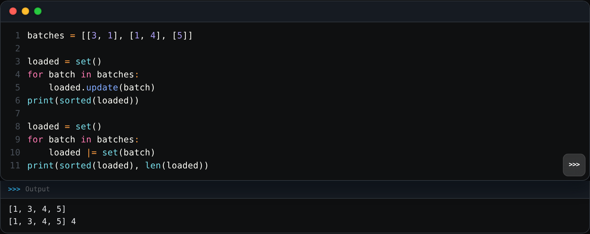

```python
batches = [[3, 1], [1, 4], [5]]

loaded = set()
for batch in batches:
    loaded.update(batch)
print(sorted(loaded))

loaded = set()
for batch in batches:
    loaded |= set(batch)
print(sorted(loaded), len(loaded))
```

Learn to spot the broken version: assigning the result of `update()` back to the name leaves `None` after the first batch, and the second pass raises `AttributeError: 'NoneType' object has no attribute 'update'`.

Containment tests compose with the other operators, since `a | b` is a set like any other, and `issuperset()` accepts a list. Comparisons bind looser than `|` and `&`, so the second line compares `flagged` with the whole union. The third line asks for IDs present on both days, and fails.

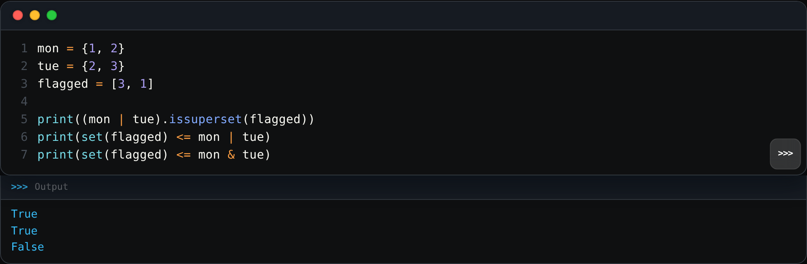

```python
mon = {1, 2}
tue = {2, 3}
flagged = [3, 1]

print((mon | tue).issuperset(flagged))
print(set(flagged) <= mon | tue)
print(set(flagged) <= mon & tue)
```


<br>

---

## Putting It All Together

Spotify's Blend step for Maya and Theo receives each listener's set of artists, a list of artists pulled from the catalog, and a set of seed artists that every Blend should open with. The job must build the artist pool, pick the shared leads, fill each person's part, and refuse to run when a seed artist has gone missing.

- ( maya | theo ) . difference ( pulled ) builds the pool: every artist either listener plays, minus the pulled list, which can stay a list.
- maya & theo picks the shared leads, and len ( maya & theo ) divided by len ( maya | theo ) scores how alike their taste is.
- maya - theo and theo - maya fill each person's part, and maya ^ theo is both parts together with the owner forgotten.
- seeds <= pool guards the run, and seeds - pool names the missing seeds for the error message.
- Adding late listening with maya |= recent updates the set every other name shares, while maya = maya . update ( recent ) would leave None behind.


<br>

---

## Key Takeaways

- a | b and a . union ( . . . ) build a new set of everything in either; the method also takes lists, strings and several arguments.
- a & b keeps only shared elements; fold a list of sets starting from the first set, never from set ( ) .
- a - b is directional: today - yesterday gives new users, yesterday - today gives the ones who left.
- a ^ b lists elements in exactly 1 of 2 sets; chained over 3 or more sets it keeps elements with an odd count.
- <= , < , >= and isdisjoint ( ) test containment, and 2 sets can fail every comparison at once.
- The in-place forms |= , &= , -= , ^= and their methods change the set itself, reach every name sharing it, and return None .
