# Strings: Advanced

On July 2, 2019, one regular expression in a Cloudflare firewall rule drove CPUs to 100% across its network and returned errors for about 27 minutes. Every request Cloudflare proxies arrives as bytes that get decoded into strings and split into fields. The fields are matched against patterns, then formatted and joined into log lines. Those 5 moves are this lesson, including the pattern that caught fire.


<br>

---

## Splitting Strings

`str.split` cuts a string at every occurrence of a separator and returns the pieces as a list: an ordered sequence of values, printed between square brackets with each string in quotes. Lists get their own lesson later, and this lesson needs 3 facts about them. A `for` loop walks a list item by item, multiple assignment unpacks it into named variables, and `[0]` reads its first item the way `[0]` reads the first character of a string.


<br>

### Whitespace splitting versus a fixed separator

Called with no argument, `split()` treats any run of whitespace, newlines included, as a single separator and ignores whitespace at both ends. Called with an argument, `split(" ")` cuts at every single space, so 2 spaces in a row leave an empty string between them. Log files padded for alignment trip up the second form and pass cleanly through the first.

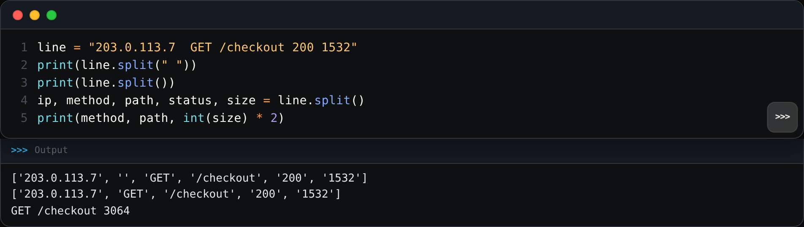

```python
line = "203.0.113.7  GET /checkout 200 1532"
print(line.split(" "))
print(line.split())
ip, method, path, status, size = line.split()
print(method, path, int(size) * 2)
```

Even `'200'` and `'1532'` come back as strings, like every other piece, so arithmetic needs `int()` first; the last line converts `size` before doubling it. The unpacking line shows the usual next step after a split: naming each field, so later code reads `path` instead of a position.

| ✓ split() | ✗ split(sep) |
| --- | --- |
| • Any run of whitespace counts as a single cut<br><br>• Whitespace at both ends is ignored<br><br>• Never returns an empty string as a piece | • Every occurrence of sep is a cut<br><br>• A separator at either end makes an empty field<br><br>• n separators give n + 1 pieces |

The empty string in the first result follows a fixed rule: each separator ends the field before it, and whatever follows the last separator forms a final field, even when nothing follows. The program below makes those cuts by hand with `find`, printing every field between brackets so an empty one stays visible.

https://github.com/user-attachments/assets/c8f78575-9fd6-43e7-9853-4b29fe8017c9

*Three commas produce 4 fields: n separators always give n + 1 pieces.*

#### Edge cases worth predicting

| Expression | Result | Why |
| --- | --- | --- |
| `"a,b,".split(",")` | `['a', 'b', '']` | Text after the last comma is a field |
| `"".split(",")` | `['']` | No separator found, so 1 field, and it is empty |
| `"".split()` | `[]` | No-argument split drops empty pieces |
| `" a b ".split()` | `['a', 'b']` | Runs count once, and the ends are trimmed |
| `"a\r\nb\n".split("\n")` | `['a\r', 'b', '']` | Windows line endings leave `\r` behind |
| `"a\r\nb\n".splitlines()` | `['a', 'b']` | Cuts at any line ending, with no empty last field |

> **TIP**
>
> When a field can contain the separator itself, as a comma inside a quoted CSV value can, `split` can't tell the 2 apart. That input needs a real parser, such as the standard library's `csv` module.


<br>

### Capping the number of cuts

The second argument, `maxsplit`, caps how many cuts happen, and everything after the last cut stays in a single piece. A header such as `time: 12:30:05` shows why it matters: a plain `split(":")` cuts the clock apart too. `rsplit` takes its cuts from the right end, the end that holds a file extension.

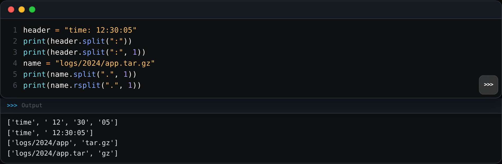

```python
header = "time: 12:30:05"
print(header.split(":"))
print(header.split(":", 1))
name = "logs/2024/app.tar.gz"
print(name.split(".", 1))
print(name.rsplit(".", 1))
```


<br>

### When the piece count is wrong

Multiple assignment demands an exact count. `key, value = text.split("=")` works for `mode=fast`, raises `ValueError` for `url=/a?b=c`, whose 2 equals signs produce 3 pieces, and raises again for `debug`, which has no equals sign and produces 1 piece.

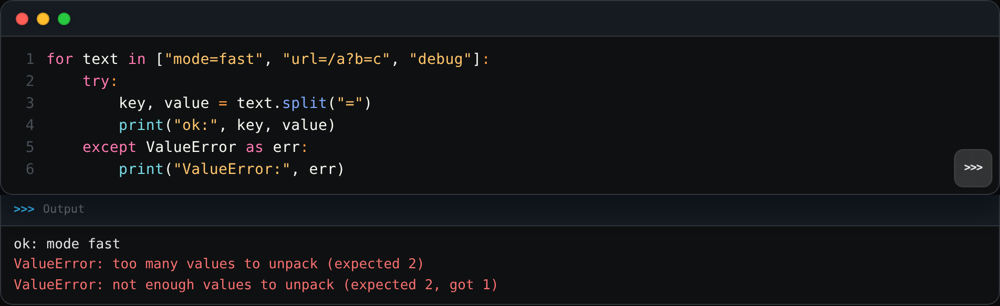

```python
for text in ["mode=fast", "url=/a?b=c", "debug"]:
    try:
        key, value = text.split("=")
        print("ok:", key, value)
    except ValueError as err:
        print("ValueError:", err)
```

Passing `maxsplit=1` repairs the URL case. `partition(sep)` repairs all 3: it always returns exactly 3 values, with the separator itself in the middle between the text before it and the rest. When the separator is missing, the last 2 come back as empty strings, so a 3-name assignment never fails.

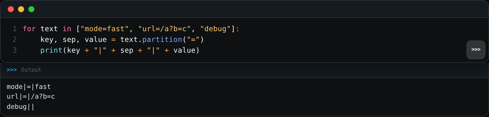

```python
for text in ["mode=fast", "url=/a?b=c", "debug"]:
    key, sep, value = text.partition("=")
    print(key + "|" + sep + "|" + value)
```

> Choosing a cutting tool
>
> - `split()` for fields separated by runs of whitespace
> - `split(sep)` when empty fields carry meaning, as in `a,,b`
> - `split(sep, 1)` or `rsplit(sep, 1)` for 2 parts cut at the first or the last separator
> - `partition(sep)` when the separator may be missing and 3 values must still come back

**What does this program print?**

```python
text = "naïve"
data = text.encode("utf-8")
print(len(text), len(data), data[2])
```

- **A.** 5 5 239
- **B.** 5 6 195
- **C.** 5 6 ï
- **D.** 6 6 195

<details>
<summary>Solution</summary>

**B.** 5 6 195

The text holds 5 characters, ï takes 2 bytes in UTF-8, and index 2 is its first byte, 195.

**Why the others are wrong**

- **A.** Treats ï as 1 byte and reads its code point; UTF-8 spends 2 bytes on it, and the first is 195.
- **C.** The lengths are right, but indexing a bytes object returns an integer, the byte's value.
- **D.** The byte count and the byte are right, but the str holds 5 characters; only its encoding has 6.

</details>

An address such as `cache:primary:6379` has a colon inside its name as well as before its port. The port is always the last field, so the cut belongs at the last colon: `rsplit(":", 1)` gives 2 pieces, while `split(":")` gives 3 and breaks a 2-name unpacking.

The 2 repairs differ when the separator is missing. `"debug".split("=", 1)` still returns 1 piece and still fails a 2-name unpacking, which suits code that must reject a malformed setting. `partition` returns empty strings instead, which suits code that treats a bare key as a flag.


<br>

---

## Joining Strings

`join` reverses `split`. It's called on the separator and given the pieces as its argument, so `", ".join(parts)` reads as "glue these parts with a comma and a space". The separator goes only between neighbouring pieces: 5 pieces get 4 separators, and neither end gets one.

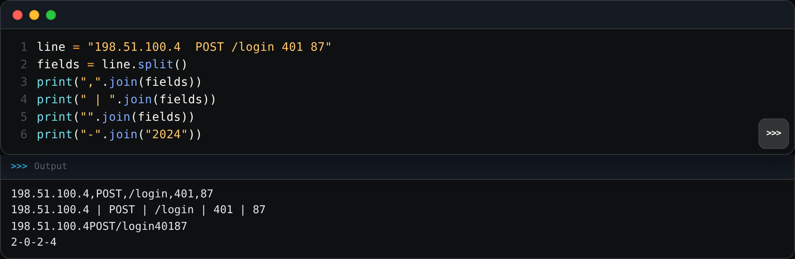

```python
line = "198.51.100.4  POST /login 401 87"
fields = line.split()
print(",".join(fields))
print(" | ".join(fields))
print("".join(fields))
print("-".join("2024"))
```

The last call passes a string where pieces are expected. A string is a sequence of characters, so `join` takes each character as a piece and places a dash between every pair.


<br>

### Split and join undo each other

For any non-empty separator `sep`, `sep.join(text.split(sep))` rebuilds `text` character for character. The empty strings that `split` keeps are what make this work: each one holds the spot between 2 adjacent separators, and dropping them would lose those separators on the way back. No-argument `split()` breaks the round trip by design, which turns `" ".join(text.split())` into a one-line way to collapse messy whitespace into single spaces.

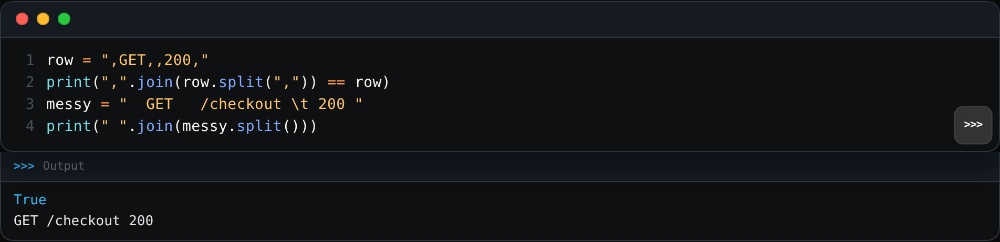

```python
row = ",GET,,200,"
print(",".join(row.split(",")) == row)
messy = "  GET   /checkout \t 200 "
print(" ".join(messy.split()))
```

The other direction carries a condition. Joining pieces and splitting the result gives back the same pieces only when no piece contains the separator. Composite keys built with `join` fail silently when one does, because 2 different sets of fields collapse into the same string.

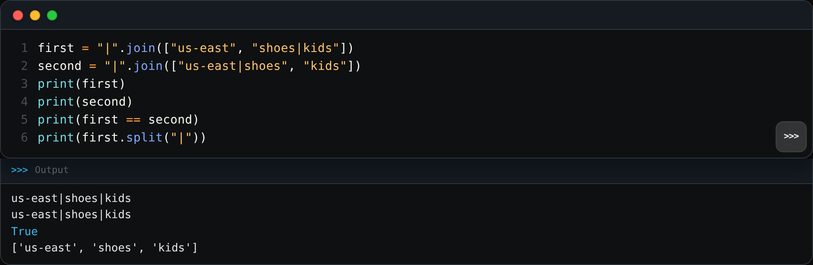

```python
first = "|".join(["us-east", "shoes|kids"])
second = "|".join(["us-east|shoes", "kids"])
print(first)
print(second)
print(first == second)
print(first.split("|"))
```

> **TIP**
>
> Pick a separator the data cannot contain, such as a tab for single-line text, or reject any piece that holds the separator before joining. A check with `in` costs a single scan of each piece.


<br>

### Only strings go in

`join` rejects any piece that isn't a string, numbers included, even though `print` shows them without complaint. The error names the position of the first offender, counted from 0.

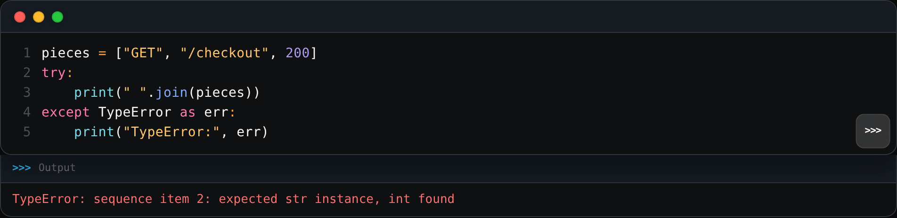

```python
pieces = ["GET", "/checkout", 200]
try:
    print(" ".join(pieces))
except TypeError as err:
    print("TypeError:", err)
```

The fix converts each value on its way in. `join` accepts any iterable of strings, so a generator that yields `str(value)` for each value works as well as a list of converted values. `join` goes over the pieces twice, measuring them before it copies them, so it collects a generator's output into a list internally before it starts.

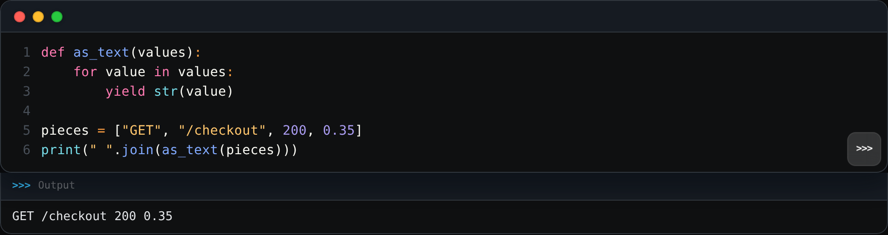

```python
def as_text(values):
    for value in values:
        yield str(value)

pieces = ["GET", "/checkout", 200, 0.35]
print(" ".join(as_text(pieces)))
```


<br>

### Why join beats += in a loop

Strings are immutable, so `report += piece` is allowed to build a new string and copy everything accumulated so far, on every pass. CPython sometimes skips that copy by growing the string in place, and PEP 8 warns that the shortcut is fragile even there and absent from Python implementations that do not use reference counting. `join` measures all the pieces first, allocates the result once, and copies each character once. Here is the gap for 10,000 log lines of 10 characters each:

- **500,050,000** — characters copied if every += copies
- **100,000** — characters copied by one join


<br>

### Newlines at the seams

`"\n".join(lines)` puts a newline between lines and none after the last. A file written that way ends mid-line, so the next record appended to it sticks to the final line. When the result is headed for a file, add the closing `"\n"` yourself.

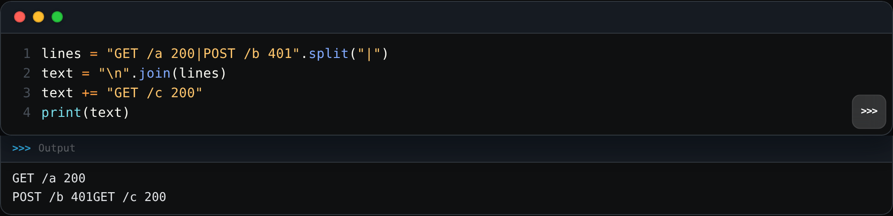

```python
lines = "GET /a 200|POST /b 401".split("|")
text = "\n".join(lines)
text += "GET /c 200"
print(text)
```

| ✓ Do | ✗ Don't |
| --- | --- |
| • Call join on the separator: ", ".join(parts)<br><br>• Convert numbers with str() before they reach join<br><br>• Add the final newline yourself when the text goes to a file | • Build a large string with += inside a loop<br><br>• Join with a separator that the pieces might contain<br><br>• Expect join to call str() on numbers for you |

**What does this program print?**

```python
text = "naïve"
data = text.encode("utf-8")
print(len(text), len(data), data[2])
```

- **A.** 5 5 239
- **B.** 5 6 195
- **C.** 5 6 ï
- **D.** 6 6 195

<details>
<summary>Solution</summary>

**B.** 5 6 195

The text holds 5 characters, ï takes 2 bytes in UTF-8, and index 2 is its first byte, 195.

**Why the others are wrong**

- **A.** Treats ï as 1 byte and reads its code point; UTF-8 spends 2 bytes on it, and the first is 195.
- **C.** The lengths are right, but indexing a bytes object returns an integer, the byte's value.
- **D.** The byte count and the byte are right, but the str holds 5 characters; only its encoding has 6.

</details>

One split can feed several joins. Unpack the fields once, then hand `join` a short list written in brackets: with `method` and `path` unpacked from the `POST /login` line earlier, `" ".join([method, path])` builds `POST /login` from 2 of its 5 fields.

When only one value is a number, converting it inside the brackets is the smallest repair: `",".join([method, path, str(status)])`. The position in the `TypeError` message says which piece to convert, so `sequence item 2` points at the third value.


<br>

---

## Regular Expression Matching

`split` and `find` need the exact characters of what they look for. A regular expression describes a shape instead: 3 digits, a word in capitals, everything up to the next space. Python's `re` module, imported like any other, tests text against that shape and reports where it matched and what each part captured.


- `\d{3}`: Exactly 3 digits in a row Example: `code 2001` -> `200`
- `\w+`: One or more letters, digits or underscores Example: `user_id=7` -> `user_id`
- `GET\s+/a`: \s is any whitespace: space, tab or newline Example: `GET   /a` -> `GET   /a`
- `\S+`: One or more characters other than whitespace Example: `/checkout` -> `/checkout`
- `[A-Z]+`: One or more characters from the set A to Z Example: `use POST here` -> `POST`
- `colou?r`: ? makes the item before it optional Example: `the color` -> `color`
- `a.c`: . matches any character except a newline Example: `a-c` -> `a-c`
- `^GET`: ^ anchors to the start of the text, $ to the end Example: `POST /GET` -> `no match`
- `\bcat\b`: \b is a word boundary, 0 characters wide Example: `concat cat` -> `cat at position 7`
- `[\d.]+`: Inside brackets, . is a literal dot Example: `ip 10.0.0.1` -> `10.0.0.1`


<br>

### search, match and fullmatch

The 3 functions differ only in where the pattern has to sit. `re.search` finds the first match anywhere in the text. `re.match` succeeds only when the match starts at position 0. `re.fullmatch` succeeds only when the pattern covers the entire text, which makes it the right tool for validating an input. Success returns a match object, whose `.start()` gives the position and `.group()` the matched text; failure returns `None`.

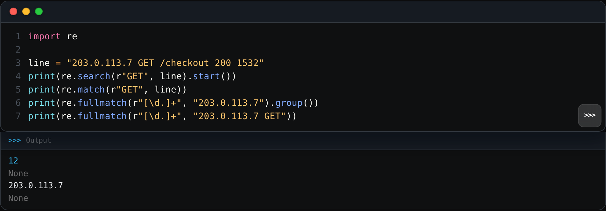

```python
import re

line = "203.0.113.7 GET /checkout 200 1532"
print(re.search(r"GET", line).start())
print(re.match(r"GET", line))
print(re.fullmatch(r"[\d.]+", "203.0.113.7").group())
print(re.fullmatch(r"[\d.]+", "203.0.113.7 GET"))
```


<br>

### Raw strings keep backslashes intact

Regex syntax is full of backslashes, and so is Python's string syntax, and the string syntax runs first. In an ordinary string, `"\b"` becomes a backspace character before `re` sees anything, so the pattern hunts for backspaces. The `r` prefix switches escape processing off and hands `re` the 2 characters `\` and `b`, which it reads as a word boundary. Writing every pattern as a raw string removes this whole class of bug.

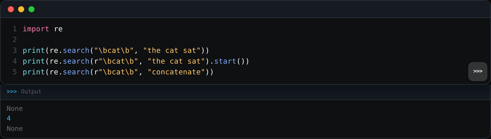

```python
import re

print(re.search("\bcat\b", "the cat sat"))
print(re.search(r"\bcat\b", "the cat sat").start())
print(re.search(r"\bcat\b", "concatenate"))
```


<br>

### Capturing parts with groups

Parentheses mark a group, and `m.group(1)` returns what the first group captured, counting opening parentheses from the left; `m.group(0)` is the whole match. `re.compile` gives a pattern a name, and its `search` method skips the cache lookup that `re.search` makes on every call. The `re` module already caches recent patterns, so compiling is mainly about clarity and reuse. Test the result before reading groups: a line that doesn't match gives `None`, and calling `.group` on `None` raises `AttributeError`.

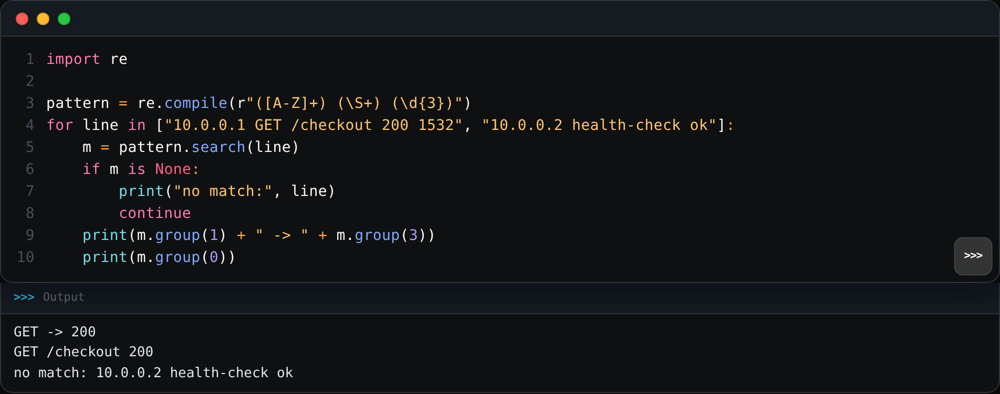

```python
import re

pattern = re.compile(r"([A-Z]+) (\S+) (\d{3})")
for line in ["10.0.0.1 GET /checkout 200 1532", "10.0.0.2 health-check ok"]:
    m = pattern.search(line)
    if m is None:
        print("no match:", line)
        continue
    print(m.group(1) + " -> " + m.group(3))
    print(m.group(0))
```


<br>

### Greedy and lazy quantifiers

`*` and `+` are greedy: they take as much text as they can and give back only what the rest of the pattern needs. A `?` after them makes them lazy, taking as little as possible. `re.findall` returns every match as a list of strings, and when the pattern contains a single group, the list holds what that group captured.

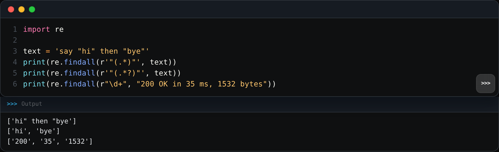

```python
import re

text = 'say "hi" then "bye"'
print(re.findall(r'"(.*)"', text))
print(re.findall(r'"(.*?)"', text))
print(re.findall(r"\d+", "200 OK in 35 ms, 1532 bytes"))
```


<br>

### Replacing matches

`re.sub(pattern, replacement, text)` replaces every match. Inside the replacement, `\1` inserts what group 1 captured, which lets you keep part of a match and mask the rest. Write the replacement as a raw string too, for the same backslash reason.

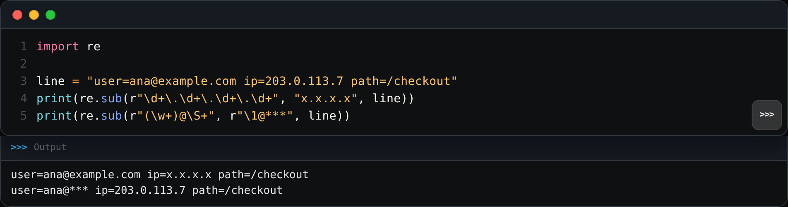

```python
import re

line = "user=ana@example.com ip=203.0.113.7 path=/checkout"
print(re.sub(r"\d+\.\d+\.\d+\.\d+", "x.x.x.x", line))
print(re.sub(r"(\w+)@\S+", r"\1@***", line))
```


**What does this program print?**

```python
text = "naïve"
data = text.encode("utf-8")
print(len(text), len(data), data[2])
```

- **A.** 5 5 239
- **B.** 5 6 195
- **C.** 5 6 ï
- **D.** 6 6 195

<details>
<summary>Solution</summary>

**B.** 5 6 195

The text holds 5 characters, ï takes 2 bytes in UTF-8, and index 2 is its first byte, 195.

**Why the others are wrong**

- **A.** Treats ï as 1 byte and reads its code point; UTF-8 spends 2 bytes on it, and the first is 195.
- **C.** The lengths are right, but indexing a bytes object returns an integer, the byte's value.
- **D.** The byte count and the byte are right, but the str holds 5 characters; only its encoding has 6.

</details>

Real log lines open with an address, so a pattern that starts at the method fails `re.match` on every one of them. `search` scans forward to the method wherever it sits, and a line with no request in it, such as a health check, returns `None` for an `if` test to catch.

A pattern that quietly finds nothing is the usual sign of the backslash bug, and `len` exposes it: `len("\b")` is 1, a single backspace, while `len(r"\b")` is 2. Unrecognized escapes such as `\d` pass through an ordinary string unchanged, which lets a pattern without the `r` seem to work until a `\b` arrives.


<br>

---

## Advanced Formatting

A field in an f-string can carry a format spec after a colon, as in `f"{value:spec}"`. The spec is a compact language read left to right, and every part is optional: a fill character, an alignment (`<`/`>`/`^`), a sign, a width, a thousands separator, a precision after a dot, and a type letter such as `f`/`d`/`x`/`%`.

| Part | Example | Result |
| --- | --- | --- |
| Fill and center | `f"{'GET':\*^9}"` | `\*\*\*GET\*\*\*` |
| Width, left | `f"|{'GET':<6}|"` | `|GET |` |
| Width, right | `f"|{'GET':>6}|"` | `| GET|` |
| Sign | `f"{42:+d}"` | `+42` |
| Thousands | `f"{20481:,}"` | `20,481` |
| Precision | `f"{3.14159:.2f}"` | `3.14` |
| Percent | `f"{0.25:.1%}"` | `25.0%` |
| Zero padding | `f"{7:03d}"` | `007` |
| Hex and binary | `f"{255:x} {5:08b}"` | `ff 00000101` |

> Reading \*>+12,.2f left to right
>
> - `*` is the fill: the character used for padding
> - `>` is the alignment: push the value to the right edge
> - `+` is the sign: show a plus on positive numbers as well
> - `12` is the width: the minimum number of characters
> - `,` is the grouping: a comma every 3 digits
> - `.2` is the precision and `f` the type: fixed point, 2 decimals

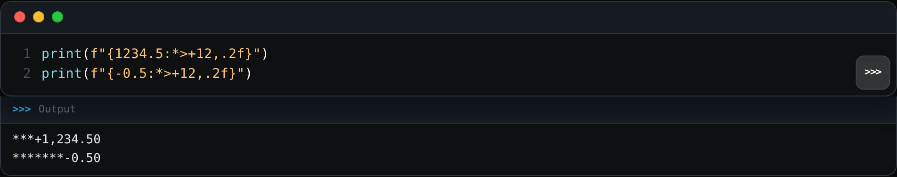

```python
print(f"{1234.5:*>+12,.2f}")
print(f"{-0.5:*>+12,.2f}")
```


<br>

### Strings and numbers pad on opposite sides

With a width and no alignment character, strings pad on the right and numbers on the left. A status read by `split` is a string, so it lines up differently from the same status converted with `int`, a common cause of ragged columns.

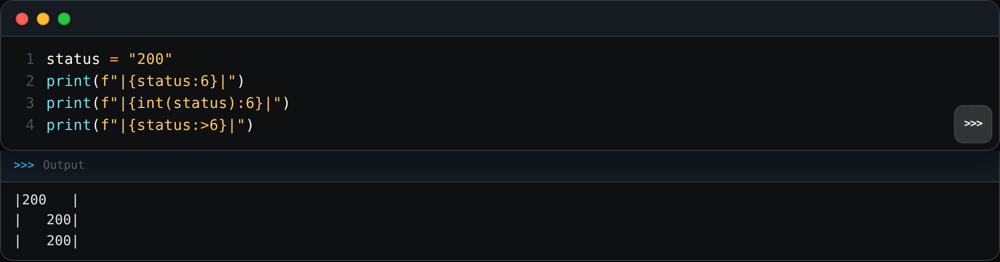

```python
status = "200"
print(f"|{status:6}|")
print(f"|{int(status):6}|")
print(f"|{status:>6}|")
```


<br>

### Building an aligned report

Widths turn a loop of `print` calls into columns. The report below parses 3 log lines and gives each field a fixed width, with the byte count right-aligned and grouped by thousands.

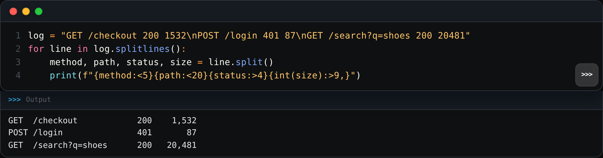

```python
log = "GET /checkout 200 1532\nPOST /login 401 87\nGET /search?q=shoes 200 20481"
for line in log.splitlines():
    method, path, status, size = line.split()
    print(f"{method:<5}{path:<20}{status:>4}{int(size):>9,}")
```

A width can also come from a variable: a field nested inside the spec, as in `f"{path:<{width}}"`, is evaluated first, so the column grows to whatever `width` holds when the line runs.

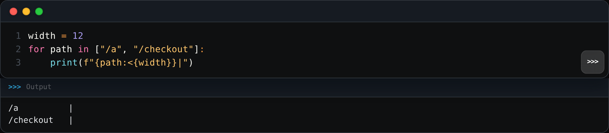

```python
width = 12
for path in ["/a", "/checkout"]:
    print(f"{path:<{width}}|")
```


<br>

### Precision, rounding and truncation

Precision means different things for different types. On a float, `.2f` rounds to 2 decimals, and when the binary value sits exactly halfway, which is true of `0.125` and also of `2.5`, it rounds to the even neighbour. On a string, `.7` keeps the first 7 characters and drops the rest without any warning. With `%`, the value is multiplied by 100 before rounding.

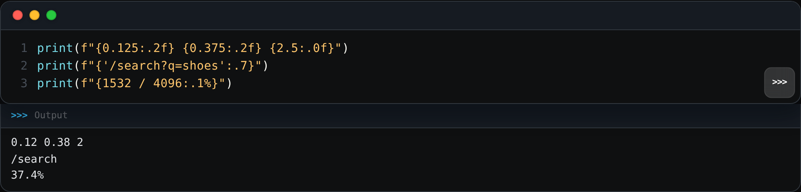

```python
print(f"{0.125:.2f} {0.375:.2f} {2.5:.0f}")
print(f"{'/search?q=shoes':.7}")
print(f"{1532 / 4096:.1%}")
```


<br>

### Showing the value itself with !r and =

`!r` formats a value with `repr` instead of `str`, which wraps strings in quotes and spells out tabs and newlines as escapes, so stray whitespace becomes visible. A `=` after an expression prints the expression's own text joined to its value by an equals sign, which turns a debugging `print` into a single field. The `=` combines with a spec placed after it.

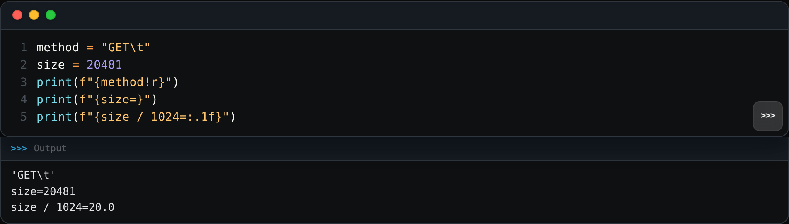

```python
method = "GET\t"
size = 20481
print(f"{method!r}")
print(f"{size=}")
print(f"{size / 1024=:.1f}")
```


<br>

### Templates with str.format

The same spec language works in `str.format` and in the built-in `format`. A template such as `"{:<6}{:>8,}"` can sit in a variable and be filled later, which an f-string cannot do, because an f-string is evaluated at the line where it's written.

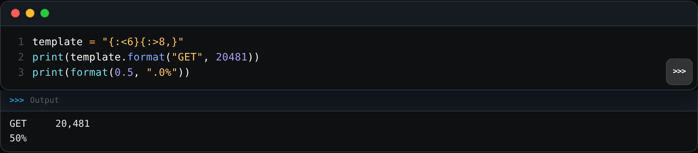

```python
template = "{:<6}{:>8,}"
print(template.format("GET", 20481))
print(format(0.5, ".0%"))
```

| ✓ Do | ✗ Don't |
| --- | --- |
| • Give numeric columns an explicit width so digits line up on the right<br><br>• Use !r when printing text to debug it, so stray whitespace shows up<br><br>• Store templates that are filled later as str.format strings | • Put a string precision like .7 on values you cannot afford to truncate<br><br>• Expect .2f to round exact halves upward; ties go to the even digit<br><br>• Pad columns by counting spaces when a width in the spec does it |

**What does this program print?**

```python
text = "naïve"
data = text.encode("utf-8")
print(len(text), len(data), data[2])
```

- **A.** 5 5 239
- **B.** 5 6 195
- **C.** 5 6 ï
- **D.** 6 6 195

<details>
<summary>Solution</summary>

**B.** 5 6 195

The text holds 5 characters, ï takes 2 bytes in UTF-8, and index 2 is its first byte, 195.

**Why the others are wrong**

- **A.** Treats ï as 1 byte and reads its code point; UTF-8 spends 2 bytes on it, and the first is 195.
- **C.** The lengths are right, but indexing a bytes object returns an integer, the byte's value.
- **D.** The byte count and the byte are right, but the str holds 5 characters; only its encoding has 6.

</details>

Inside one spec the parts keep their order even when most are missing: `>8,` puts alignment before width and grouping last, and `.1%` puts precision ahead of type. Swapping them changes the meaning without an error: in `f"{1532:,>8}"` the comma sits in the fill position, so it prints `,,,,1532`.

Centering splits the padding in 2, and when the padding is odd the extra character goes on the right: `f"|{'GET':^6}|"` prints `| GET |`. In that same width of 6, `/a` starts 2 characters in, with 2 spaces after it.


<br>

---

## String Encoding

A Python `str` holds characters, and each character is a Unicode code point: a number that names it, such as 233 for `é`. Anything stored on disk or sent over a socket is bytes, values from 0 to 255. An encoding is the rule that converts one into the other. UTF-8, the dominant encoding on the web, spends 1 byte on each ASCII character and 2 to 4 bytes on everything else.

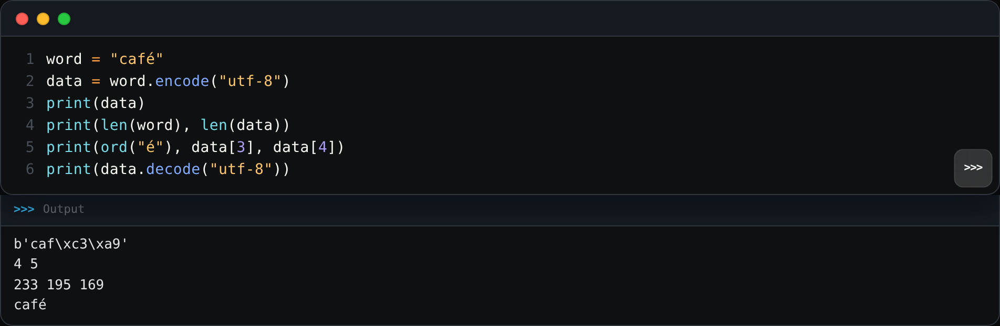

```python
word = "café"
data = word.encode("utf-8")
print(data)
print(len(word), len(data))
print(ord("é"), data[3], data[4])
print(data.decode("utf-8"))
```

`len()` counts characters on a `str` and bytes on a `bytes` object, which is why the same word measures 4 and 5. `ord()` returns a character's code point. Indexing a bytes object returns an integer, the byte's value, where indexing a string returns a 1-character string. The `b'...'` display shows printable ASCII bytes as characters and writes every other byte as `\x` followed by 2 hex digits.

| Character | Code point | UTF-8 bytes (hex) | Byte count |
| --- | --- | --- | --- |
| `a` | 97 | `61` | 1 |
| `é` | 233 | `c3 a9` | 2 |
| `€` | 8364 | `e2 82 ac` | 3 |
| `👍` | 128077 | `f0 9f 91 8d` | 4 |


<br>

### Decoding with the wrong codec

Bytes carry no label saying which encoding wrote them. Decode UTF-8 bytes as Latin-1 and each byte becomes its own character, so `é` turns into the 2 characters `é`, with no error raised. That garbled text, called mojibake, is the usual sign that a file was read with the wrong `encoding=`. Bytes that break UTF-8's rules raise `UnicodeDecodeError` instead, naming the bad byte and its position.

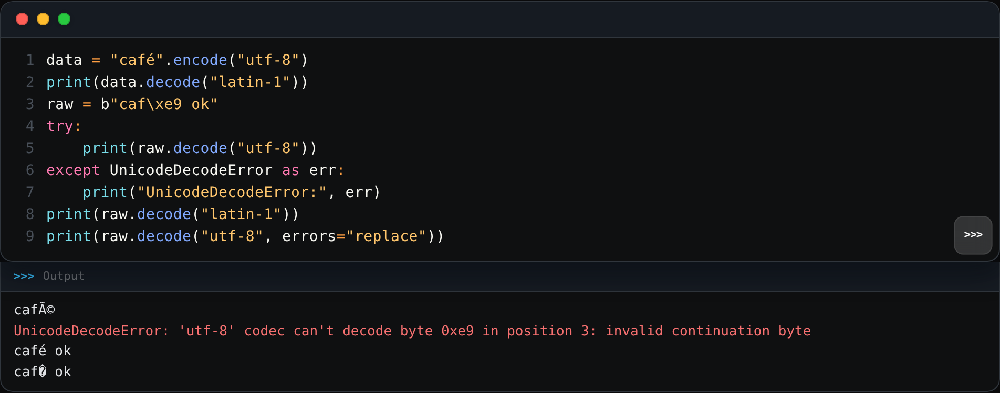

```python
data = "café".encode("utf-8")
print(data.decode("latin-1"))
raw = b"caf\xe9 ok"
try:
    print(raw.decode("utf-8"))
except UnicodeDecodeError as err:
    print("UnicodeDecodeError:", err)
print(raw.decode("latin-1"))
print(raw.decode("utf-8", errors="replace"))
```

Latin-1 maps all 256 byte values to characters, so it never fails, and that is exactly why it hides mistakes. `errors="replace"` puts the replacement character `�` where each bad byte was and carries on. Use it to keep a pipeline moving, and count the `�` characters with `count` so lost data shows up in a metric.


<br>

### Byte limits cut characters in half

Many systems cap a field in bytes: a message size, a database column, a header. Slicing the encoded bytes to fit can land in the middle of a multi-byte character, and the cut piece then fails to decode. Decoding the slice with `errors="ignore"` drops the half character, which makes it a safe way to trim to a byte budget.

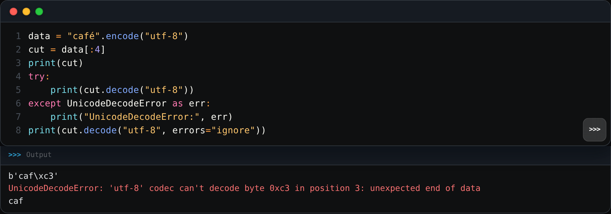

```python
data = "café".encode("utf-8")
cut = data[:4]
print(cut)
try:
    print(cut.decode("utf-8"))
except UnicodeDecodeError as err:
    print("UnicodeDecodeError:", err)
print(cut.decode("utf-8", errors="ignore"))
```


<br>

### Bytes leaking into text

Calling `str()` on bytes, or placing them in an f-string, formats their display without decoding them, so the `b'...'` prefix comes along. That is how log lines end up holding `b'GET'`. Decode at the edge where bytes enter the program, work in `str` everywhere inside it, and encode at the edge where data leaves.

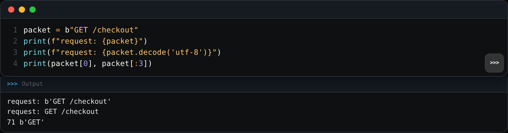

```python
packet = b"GET /checkout"
print(f"request: {packet}")
print(f"request: {packet.decode('utf-8')}")
print(packet[0], packet[:3])
```

> **TIP**
>
> Pass `encoding="utf-8"` to `open()` whenever you read or write text files. Without it, Python before 3.15 falls back to the platform's preferred encoding, which differs between machines, so the same script can read a file cleanly on a laptop and produce mojibake on a server.


<br>

### Same text, different code points

Unicode can write `é` 2 ways: as the single code point 233, or as a plain `e` followed by a combining accent, code point 769. Both render identically, yet they compare unequal because one is a code point longer than the other. `unicodedata.normalize("NFC", text)` rewrites combining sequences into single code points, so normalize both sides before comparing or deduplicating text typed by people.

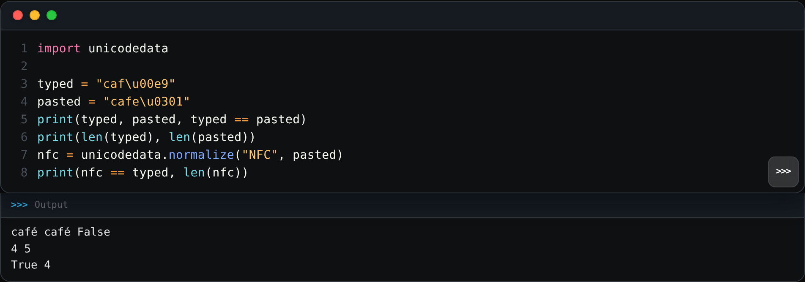

```python
import unicodedata

typed = "caf\u00e9"
pasted = "cafe\u0301"
print(typed, pasted, typed == pasted)
print(len(typed), len(pasted))
nfc = unicodedata.normalize("NFC", pasted)
print(nfc == typed, len(nfc))
```

A byte limit is checked on the encoded form, `len(text.encode("utf-8"))`, never on `len(text)`. In UTF-8 a string of n characters takes between n and 4n bytes, so a character count says little about whether a value fits.

**What does this program print?**

```python
text = "naïve"
data = text.encode("utf-8")
print(len(text), len(data), data[2])
```

- **A.** 5 5 239
- **B.** 5 6 195
- **C.** 5 6 ï
- **D.** 6 6 195

<details>
<summary>Solution</summary>

**B.** 5 6 195

The text holds 5 characters, ï takes 2 bytes in UTF-8, and index 2 is its first byte, 195.

**Why the others are wrong**

- **A.** Treats ï as 1 byte and reads its code point; UTF-8 spends 2 bytes on it, and the first is 195.
- **C.** The lengths are right, but indexing a bytes object returns an integer, the byte's value.
- **D.** The byte count and the byte are right, but the str holds 5 characters; only its encoding has 6.

</details>

`errors="ignore"` drops every byte that does not belong to a complete character, wherever it sits. On bytes you encoded and then sliced, only the cut character can break, so at most 3 bytes fall away. On input from outside, the same flag hides corruption that `errors="replace"` would show.

`len` counts code points, which is not always what a reader sees as 1 symbol. The flag `🇫🇷` is 2 code points, the regional indicator letters F and R, so `len` gives 2 and its UTF-8 form takes 8 bytes.


<br>

---

## Putting It All Together

An online retailer receives a nightly export of web server access logs from its CDN partner: raw bytes, one request per line, columns padded with spaces. A Python job turns it into a plain-text summary of failing endpoints for the on-call channel and a CSV for the reliability dashboard.

- The job reads the export as bytes and decodes it as UTF-8 with errors = "replace" , logging how many � characters appeared, so a file written in another encoding gets noticed the first night.
- Each line goes through no-argument split ( ) because of the padding, and lines that unpack to the wrong number of fields are set aside and counted instead of crashing the run.
- A compiled raw-string pattern with groups pulls the endpoint out of each path, and re . sub masks user ids in query strings before anything is stored.
- The summary uses fixed widths, right-aligned counts with thousands separators and .1 % error rates, so its columns line up in a monospaced message.
- Report lines and CSV rows are built with join over values converted with str ( ) , end with a trailing newline, and are size-checked on their encoded bytes against the upload limit.


<br>

---

## Key Takeaways

- No-argument split ( ) collapses whitespace and drops empty pieces; split ( sep ) keeps every empty field, so n separators always give n + 1 pieces.
- The choice of maxsplit / rsplit / partition decides where and how often text is cut, and partition always returns exactly 3 values.
- sep . join ( pieces ) puts the separator between pieces only, needs every piece to be a string, and copies each character once.
- Write patterns as raw strings. Pick search / match / fullmatch by where the match must sit, and test for None before reading groups.
- A format spec reads in a fixed order: fill and align first, then sign and width, then grouping, with precision and type last. Strings pad on the right by default and numbers on the left.
- Decode bytes where they enter, work in str , encode where they leave, and check byte limits with len ( ) of the encoded bytes.
