# Strings: Beginner

At Spotify, the Wrapped team builds each listener's year-end card out of text: a top artist's name in capitals, a count of minutes listened, and a 3-line message with the breaks in the right places. If a card builder joins the minute count to a sentence with +, the batch stops on the first card. Every rule that card depends on is in this lesson.


<br>

---

## What is a String?

A string is a run of characters that Python keeps in order, from first to last: the letters of a city name, the digits of a postcode, a whole paragraph of an email. You write one by placing the text between quotes. The quotes mark where the text starts and stops, and they're not stored with the value: `"Oslo"` holds 4 characters, the capital O and the 3 small letters after it.

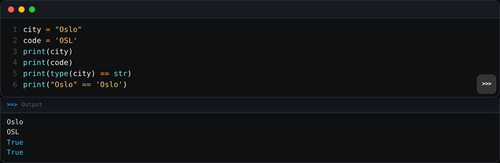

```python
city = "Oslo"
code = 'OSL'
print(city)
print(code)
print(type(city) == str)
print("Oslo" == 'Oslo')
```

Python accepts either double quotes or single quotes, and the value is the same either way: the last line prints True because both literals hold the same 4 characters. The type of every string is str, and the third line confirms it: type(city) == str is True. Pick one quote style for a program and keep to it, so a reader scanning your code sees the same shape on every line.


<br>

### Text that looks like a number

Putting digits between quotes makes a string. `"42"` is 2 characters that happen to be digits, and `42` is an integer the computer can add and multiply. They're stored differently and never compare equal, so a value that arrives from a form field or a spreadsheet cell as text stays text until something converts it. Arithmetic works on the integer and leaves the string alone.

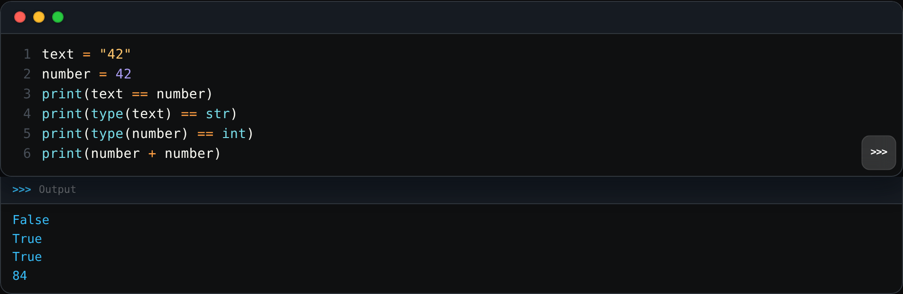

```python
text = "42"
number = 42
print(text == number)
print(type(text) == str)
print(type(number) == int)
print(number + number)
```

| Literal | Type | What it holds |
| --- | --- | --- |
| "42" | str | 2 characters, the digits 4 and 2 |
| 42 | int | the integer 42 |
| "" | str | 0 characters, the empty string |
| " " | str | 1 character, a space |
| "True" | str | 4 characters, a word rather than the boolean True |

A ZIP code such as `"02134"` must stay a string: stored as the integer `2134` it loses its leading zero and the address lookup fails. Phone numbers behave the same way, and so do product codes and account identifiers. In data work, if you would never add 2 of them together, keep them as strings.


<br>

### Walking through the characters

A `for` loop over a string visits its characters one at a time, in order, the same way a loop over `range(4)` visits the numbers 0 through 3. Each pass hands the loop variable 1 character, which is itself a tiny string holding that single character. Counting the passes tells you how many characters the string has, and the animation below does that for `"Oslo"`.

https://github.com/user-attachments/assets/fad3f009-766f-42aa-acf5-6353181cf0dd

*ch takes each character of word in order, and count goes up by 1 per pass.*

The loop body ran 4 times, so `count` finished at 4 and the last line printed `characters: 4`. Run the same loop over the empty string `""` and the body never executes: `count` stays 0 and only the final line is printed. A space is a character like any other, so `"New York"` counts to 8, including the gap between the words.

> **TIP**
>
> A string that contains an apostrophe goes in double quotes, and a string that contains double quotes goes in single quotes: "it's" and 'say "go"' both work, while 'it's' ends the string at the second quote and Python reports a syntax error.

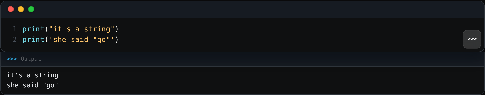

```python
print("it's a string")
print('she said "go"')
```


<br>

### Equal means every character matches

Two strings compare equal with `==` only when they hold the same characters in the same order. Python checks them one position at a time, and a capital letter is a different character from its small form, so `"Oslo" == "oslo"` is `False`. A trailing space counts too: `"Oslo "` has 5 characters and never equals the 4-character `"Oslo"`, even though both look alike on screen.

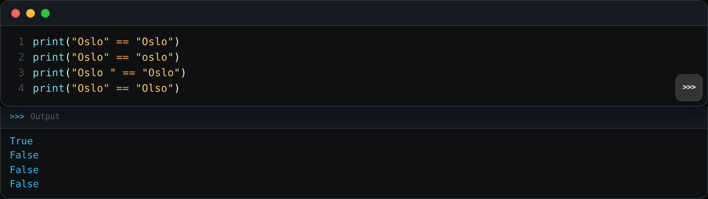

```python
print("Oslo" == "Oslo")
print("Oslo" == "oslo")
print("Oslo " == "Oslo")
print("Oslo" == "Olso")
```

The last line fails for a third reason: the same 4 letters in a different order make a different string. When 2 values that should match come back unequal, compare their case first. If the case matches, look for a stray space or for characters in the wrong order. Each one hides on screen until you compare the strings character by character.

**What does this program print?**

```python
tag = "Draft v2"
tag.upper()
label = tag.lower()
print(tag)
print(label)
```

- **A.** DRAFT V2, then draft v2
- **B.** Draft v2, then draft v2
- **C.** Draft v2, then Draft v2
- **D.** DRAFT V2, then DRAFT V2

<details>
<summary>Solution</summary>

**B.** Draft v2, then draft v2

The upper() result was discarded. tag keeps its original value, and label holds the lowercased copy.

**Why the others are wrong**

- **A.** tag.upper() produced a new string that was never stored, so tag is unchanged.
- **C.** label was assigned the result of tag.lower(), which is all lowercase.
- **D.** Neither variable holds capitals: upper() wasn't stored and lower() produces small letters.

</details>

Counting works the same whatever kind of characters a string holds. Every character gives the loop 1 pass, spaces and punctuation included, so the product code `"X9-7"` counts to 4 and the postcode `"02134"` counts to 5. The loop visits each character in turn without looking at what kind it is.


<br>

---

## Multiline Strings

Some text runs across several lines: an email body, a receipt, the help message of a command. A string can span as many lines as you like if you open and close it with 3 quotes in a row. Both `"""` and `'''` work, and every line break you type between the opening and closing quotes is stored as part of the string. The string ends only at the matching 3 quotes.

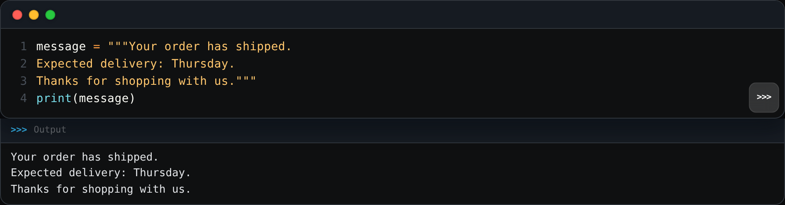

```python
message = """Your order has shipped.
Expected delivery: Thursday.
Thanks for shopping with us."""
print(message)
```

One `print` call produced 3 lines because the string itself contains a line break after `shipped.` and another after `Thursday.`. Nothing special happened at print time: `print` wrote the characters it was given, and 2 of those characters moved the cursor to the next line.


<br>

### A line break is a character

The line break is stored as a single character, so it counts when you walk the string with a loop. The string below shows 4 visible letters on 2 lines, and the loop counts 5.

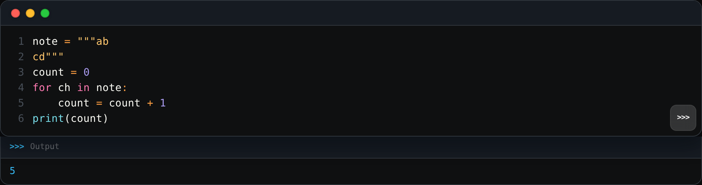

```python
note = """ab
cd"""
count = 0
for ch in note:
    count = count + 1
print(count)
```


<br>

### The string starts right after the quotes

Pressing Enter straight after the opening `"""` puts a line break at the very start of the string, so the first thing printed is an empty line. This is the most common surprise with triple quotes. The program below prints a blank line before `Welcome`, and `done` shows where the string ended.

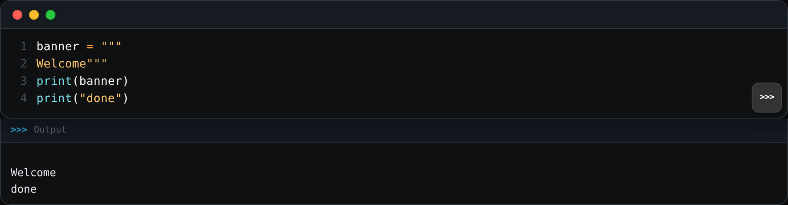

```python
banner = """
Welcome"""
print(banner)
print("done")
```

To begin with `Welcome` on the first printed line, type it on the same line as the opening quotes, as the shipping message above does. Likewise, a line break before the closing quotes adds a trailing blank line to whatever you print.


<br>

### Indentation inside the quotes is kept

Inside a function body your code is indented, and any spaces you type at the start of a continuation line become spaces in the string. The receipt below looks tidy in the source, but the second printed line starts with 4 spaces that came from the indentation.

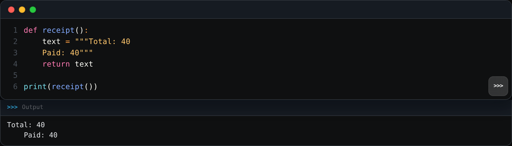

```python
def receipt():
    text = """Total: 40
    Paid: 40"""
    return text

print(receipt())
```

The content of a string is text rather than code, so Python does not require it to be indented. Writing `Paid: 40` flush against the left margin, inside the function, removes the leading spaces while the rest of the function stays indented as usual. It looks odd in the editor and prints correctly.

You have met triple quotes already: a docstring is a triple-quoted string written as the first statement of a function, and it keeps the line breaks you type like any other. Its later lines can still sit at the function body's indentation, because documentation tools strip the indentation those lines share before showing the text, and Python itself does the same when it stores a docstring from version 3.13 onward. An ordinary triple-quoted string such as the receipt above gets no such treatment, so its leading spaces stay.


<br>

### Multiline strings in pipeline code

Pipelines keep plenty of text that has a shape worth preserving: a query sent to a database, a template for an alert email, the help text of a command. A triple-quoted string lets the shape in the source match the shape of the output, so a reviewer sees the query laid out as it will run.

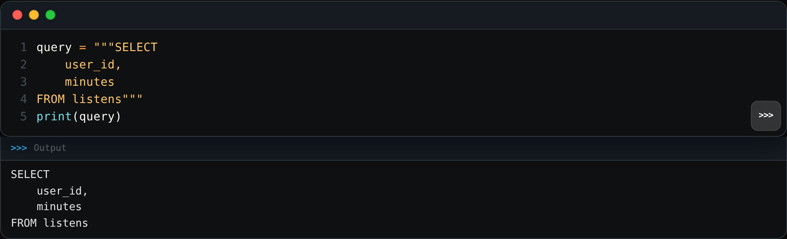

```python
query = """SELECT
    user_id,
    minutes
FROM listens"""
print(query)
```

| ✓ One pair of quotes | ✗ Three quotes in a row |
| --- | --- |
| • Starts and ends on the same source line<br><br>• A line break before the closing quote is a syntax error<br><br>• Fits anything that stays on one line, like a name or a sentence | • Can run across many source lines<br><br>• Every typed line break and leading space is stored<br><br>• Fits docstrings and any message or query that runs past one line |

**How many characters does the loop count?**

```python
s = "a\\b\n"
count = 0
for ch in s:
    count = count + 1
print(count)
```

- **A.** 6: every typed symbol counts as one
- **B.** 3: a, b and a line break, the backslashes vanish
- **C.** 5: a, 2 backslashes, b and a line break
- **D.** 4: a, 1 backslash, b and a line break

<details>
<summary>Solution</summary>

**D.** 4: a, 1 backslash, b and a line break

\\ stores 1 backslash and \n stores 1 line break, so the characters are a, \, b and the line break.

**Why the others are wrong**

- **A.** Each escape sequence is 2 typed symbols stored as 1 character, so the count is lower.
- **B.** \\ stores 1 real backslash in the string; it doesn't disappear.
- **C.** \\ is a single escape that stands for 1 backslash, not 2.

</details>


<br>

### Returning a multiline message

A function can build a multiline string and hand it back with `return`, and the caller prints it like any other value. The same rules apply inside the function: the text starts with whatever follows the opening quotes, so the first line of the message goes right after them. Continuation lines sit at the left margin, because spaces typed before them would be stored.

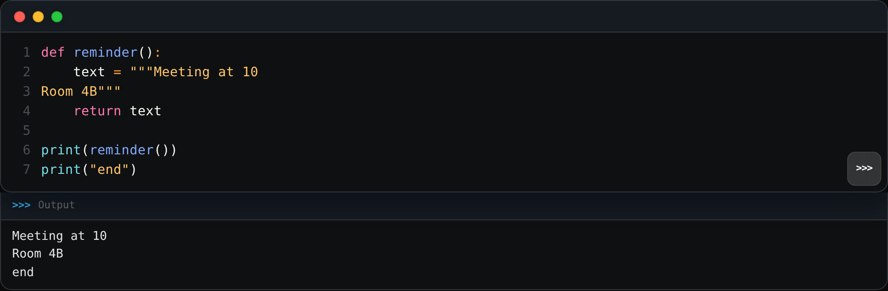

```python
def reminder():
    text = """Meeting at 10
Room 4B"""
    return text

print(reminder())
print("end")
```

The output has exactly 2 lines of message and no blank line above them, because `Meeting at 10` begins on the line of the opening quotes and `Room 4B` begins at column 0. Move `Meeting at 10` down a line and the printed message would open with an empty line.


<br>

---

## String Concatenation

The `+` operator joins 2 strings end to end and gives back a new string containing both. Nothing is inserted between them: if you want a space, you concatenate a space. Swapping the operands changes the result, so `"Ada" + "Lovelace"` is a different string from `"Lovelace" + "Ada"`.

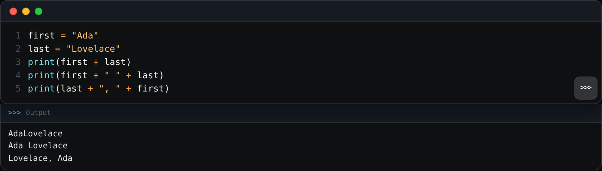

```python
first = "Ada"
last = "Lovelace"
print(first + last)
print(first + " " + last)
print(last + ", " + first)
```

Each of the 3 expressions produces a new string. `first` and `last` are unchanged afterwards. `+` reads the strings it is given and produces a fresh result, which you then print or store in a variable. The strings you started with are never modified.


<br>

### Growing a string in a loop

Because `+` returns a new string, building text piece by piece means assigning the result back to the same variable on each pass. The animation walks the digits of a date code and attaches each one to `label` with a dash in front of it, while `day` keeps its original value throughout.

https://github.com/user-attachments/assets/a2ab643d-1665-4f4b-b748-f4335c5168ef

*label gets a new, longer value on every pass, while day stays 0301.*

Each pass replaces `label` with a longer string. It starts as `d-0` and grows through `d-0-3` and `d-0-3-0` until it reaches `d-0-3-0-1`. The last line prints `0301`, confirming that reading characters from `day` left it as it was. This assign-back pattern, `label = label + something`, is how you build a CSV row from its fields, and report lines and log messages get assembled the same way.


<br>

### Repeating with \*

Multiplying a string by an integer repeats it that many times, which is the quickest way to draw a separator or pad a column. `"-" * 10` is 10 dashes, and `"ab" * 3` is `ababab`. Multiplying by 0 gives the empty string. As with numbers, `*` runs before `+`, so `"=" * 3 + "end"` repeats first and joins second.

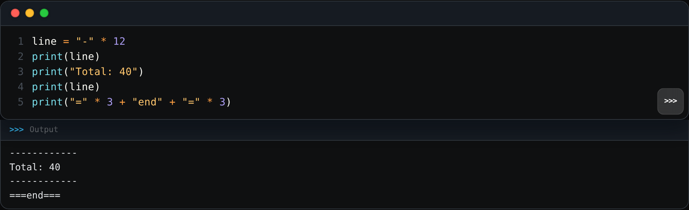

```python
line = "-" * 12
print(line)
print("Total: 40")
print(line)
print("=" * 3 + "end" + "=" * 3)
```


<br>

### Only strings join strings

`+` between a string and a number stops the program. Python won't guess whether you wanted `Order 42` or arithmetic, so it raises a `TypeError` and the lines after it never run. The error message names both types, which is how you find the mistake in a longer program.

```sql
order = 42
print("Order " + order)
print("never reached")
```

You already have a tool that prints mixed values side by side: `print` with commas. It accepts strings and numbers alike and puts 1 space between each pair. Use `+` when you need the joined text as a value you can store or return, and commas when all you need is to display it.

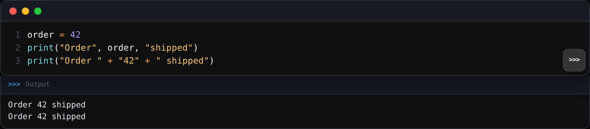

```python
order = 42
print("Order", order, "shipped")
print("Order " + "42" + " shipped")
```

| ✓ + between strings | ✗ Commas inside print |
| --- | --- |
| • Produces a value you can store or return<br><br>• Adds nothing between the pieces<br><br>• Every piece must be a string | • Displays the values and produces nothing<br><br>• Puts 1 space between the pieces<br><br>• Accepts strings mixed with ints or floats |

> **TIP**
>
> When a program dies with a TypeError on a + line, one side is a number. Either print the pieces with commas, or keep the number out of the string and show it on its own line.

**What does this program print?**

```python
tag = "Draft v2"
tag.upper()
label = tag.lower()
print(tag)
print(label)
```

- **A.** DRAFT V2, then draft v2
- **B.** Draft v2, then draft v2
- **C.** Draft v2, then Draft v2
- **D.** DRAFT V2, then DRAFT V2

<details>
<summary>Solution</summary>

**B.** Draft v2, then draft v2

The upper() result was discarded. tag keeps its original value, and label holds the lowercased copy.

**Why the others are wrong**

- **A.** tag.upper() produced a new string that was never stored, so tag is unchanged.
- **C.** label was assigned the result of tag.lower(), which is all lowercase.
- **D.** Neither variable holds capitals: upper() wasn't stored and lower() produces small letters.

</details>


<br>

### A count in a variable sets the repeats

The number on the right of `*` can come from a variable, which lets a count decide how long a piece of text is. Here a string and an int meet in one expression without an error: `*` accepts an int and repeats the text, while `+` refuses one. A string on both sides of `*` fails the other way, with `TypeError: can't multiply sequence by non-int of type 'str'`.

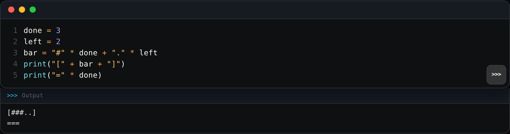

```python
done = 3
left = 2
bar = "#" * done + "." * left
print("[" + bar + "]")
print("=" * done)
```

Both pieces of `bar` are computed first, because `*` runs before `+`, and then the brackets are concatenated around the result. Change `done` to 4 and `left` to 1 and the bar redraws as `[####.]` with no other edit.


<br>

---

## Escape Characters in Strings

Some characters have no key you can press inside a string. A tab is one. A line break is another when it has to live in a string written with one pair of quotes, and so is a double quote inside a string that is itself delimited by double quotes. The backslash solves this. A backslash followed by 1 character is an escape sequence, and Python stores the character the pair stands for instead of the 2 symbols you typed.

| Escape | Stands for | Example | Printed |
| --- | --- | --- | --- |
| \n | line break | "a\nb" | a, then b on the next line |
| \t | tab | "a\tb" | a, a jump to the next tab stop, b |
| \" | double quote | "say \"hi\"" | say "hi" |
| \' | single quote | 'it\'s' | it's |
| \\ | one backslash | "C:\\temp" | C:\temp |

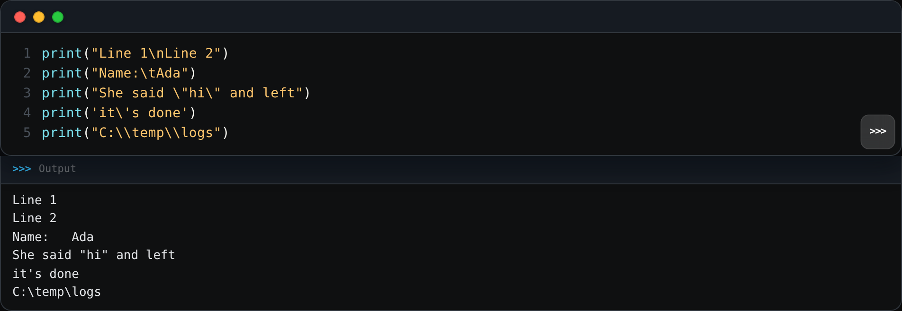

```python
print("Line 1\nLine 2")
print("Name:\tAda")
print("She said \"hi\" and left")
print('it\'s done')
print("C:\\temp\\logs")
```

The tab is the odd one out: it moves the cursor to the next tab stop, usually every 8 columns, rather than inserting a fixed number of spaces. Short values followed by `\t` therefore line up in the same column, which is handy for a quick table printed to the screen.

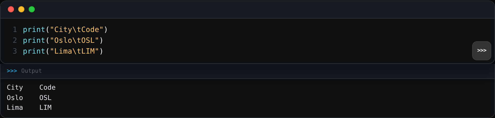

```python
print("City\tCode")
print("Oslo\tOSL")
print("Lima\tLIM")
```


<br>

### An escape sequence is 1 character

You type 2 symbols, but the string stores 1 character. `"a\nb"` has 3 characters, and `"C:\\temp"` has 7, with a single backslash sitting between the colon and the t. A loop that counts characters confirms both figures.

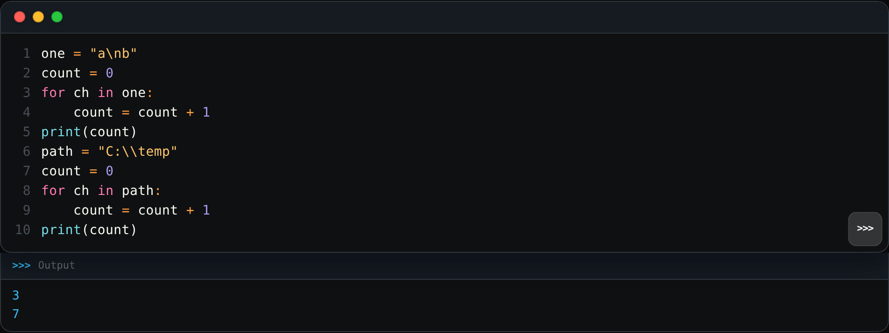

```python
one = "a\nb"
count = 0
for ch in one:
    count = count + 1
print(count)
path = "C:\\temp"
count = 0
for ch in path:
    count = count + 1
print(count)
```


<br>

### Triple quotes write \n for you

The line breaks you typed inside triple quotes in the previous section are these same `\n` characters. A 2-line triple-quoted string and a string written with one pair of quotes and `\n` in the middle are equal, character for character. Choose triple quotes when the text is long enough that seeing its shape helps, and `\n` when the string is short or built from parts with `+`.

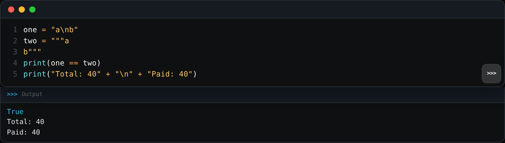

```python
one = "a\nb"
two = """a
b"""
print(one == two)
print("Total: 40" + "\n" + "Paid: 40")
```


<br>

### Backslashes in a pasted Windows path

A backslash in text you paste from elsewhere, a Windows folder path for instance, is read as the start of an escape. `"C:\new folder"` contains `\n`, so the path breaks across 2 lines when printed and the letter n is gone. Doubling every backslash restores the intended characters.

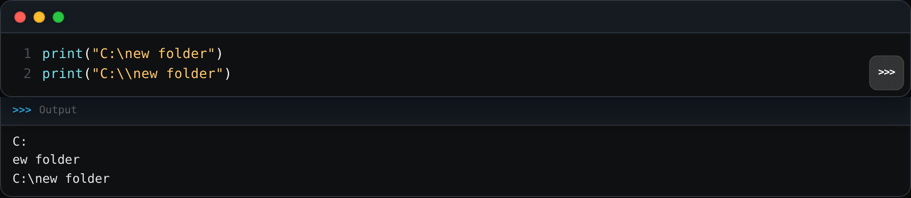

```python
print("C:\new folder")
print("C:\\new folder")
```

| ✓ Do | ✗ Don't |
| --- | --- |
| • Double a backslash that should appear in the output<br><br>• Use \n for a short 2-line string built with +<br><br>• Switch quote styles before reaching for \" or \' | • Paste a path with backslashes into a string unchanged<br><br>• Count an escape as 2 characters<br><br>• Expect \t to insert a fixed number of spaces |

**How many characters does the loop count?**

```python
s = "a\\b\n"
count = 0
for ch in s:
    count = count + 1
print(count)
```

- **A.** 6: every typed symbol counts as one
- **B.** 3: a, b and a line break, the backslashes vanish
- **C.** 5: a, 2 backslashes, b and a line break
- **D.** 4: a, 1 backslash, b and a line break

<details>
<summary>Solution</summary>

**D.** 4: a, 1 backslash, b and a line break

\\ stores 1 backslash and \n stores 1 line break, so the characters are a, \, b and the line break.

**Why the others are wrong**

- **A.** Each escape sequence is 2 typed symbols stored as 1 character, so the count is lower.
- **B.** \\ stores 1 real backslash in the string; it doesn't disappear.
- **C.** \\ is a single escape that stands for 1 backslash, not 2.

</details>


<br>

### Several escapes in one string

Escapes can sit next to each other and next to ordinary letters in the same string. Python reads the string from left to right, and each time it meets a backslash it takes the backslash and the next character as one pair, stores the character the pair stands for, and carries on. So nothing stops a single string from holding a tab and a line break along with a quoted word.

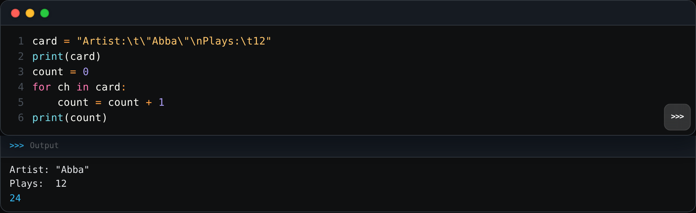

```python
card = "Artist:\t\"Abba\"\nPlays:\t12"
print(card)
count = 0
for ch in card:
    count = count + 1
print(count)
```

Between its quotes the source line has 29 typed symbols, and the loop counts 24 characters: each of the 5 escapes was typed as 2 symbols and stored as 1. The tab after `Plays:` puts 12 in the same column as the quoted name, because both labels end before the first tab stop.


<br>

---

## Case Conversion

A string carries a set of built-in operations called methods. You call one by putting a dot after the string and then the method name with parentheses, the same way you call a function you defined with `def`, except the string comes first. `name.upper()` asks the string in `name` for a copy of itself with every letter in capitals. The 5 case methods below are the ones you will use most.

| Call on "hello World" | Result | Rule |
| --- | --- | --- |
| upper() | HELLO WORLD | every letter to capitals |
| lower() | hello world | every letter to small |
| capitalize() | Hello world | first character up, the rest down |
| title() | Hello World | first letter of each word up, the rest down |
| swapcase() | HELLO wORLD | each letter flipped |


<br>

### The original string does not change

A method returns a new string and leaves the one it was called on as it was. If you want the converted text, store the result: `shout = name.upper()`. Calling `name.upper()` on a line by itself computes the capitals and throws them away, which is the most common mistake with these methods.

https://github.com/user-attachments/assets/8a655868-5f36-42b8-8a7b-0d70bf740bc9

*upper() builds shout as a new string; name is read and left as it was.*

After the second line runs, `name` still prints `ada` and `shout` prints `ADA`. To change what `name` holds, assign back to it: `name = name.upper()`, the same shape as growing a string with `+`.


<br>

### Comparing without caring about case

Text typed by people arrives in whatever case they felt like: `Yes`, `yes`, `YES`. Comparing with `==` would need a branch per spelling. Lowercasing both sides first collapses them to one spelling, so a single comparison handles them all. The function below returns a boolean, so an `if` statement can use it directly.

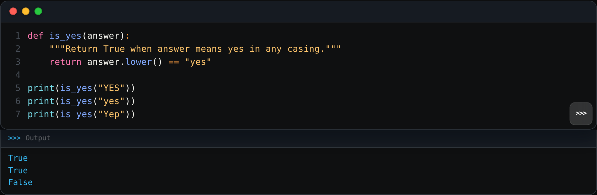

```python
def is_yes(answer):
    """Return True when answer means yes in any casing."""
    return answer.lower() == "yes"

print(is_yes("YES"))
print(is_yes("yes"))
print(is_yes("Yep"))
```


<br>

### Matching keys from 2 systems

The same trick joins records whose keys were typed by different teams. A warehouse table might store `OSLO` while a partner's export says `Oslo`. Lowering both before the comparison, or upper-casing both, makes the match succeed without changing either source.

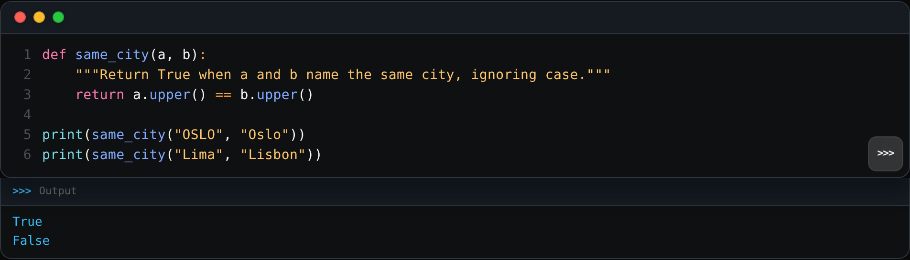

```python
def same_city(a, b):
    """Return True when a and b name the same city, ignoring case."""
    return a.upper() == b.upper()

print(same_city("OSLO", "Oslo"))
print(same_city("Lima", "Lisbon"))
```

> **TIP**
>
> Pick 1 casing for every key column when data enters a pipeline, and convert there. Every later comparison then needs no conversion at all.


<br>

### Letters only

Only letters have case, so the methods pass every other character through unchanged. `title()` decides where a word starts by looking for a character that isn't a letter, which gives a surprise on text like `3rd street`: the r after the digit is treated as the start of a word and gets capitalized.

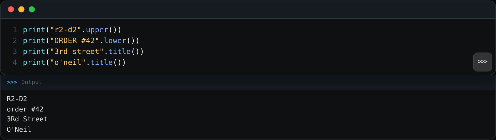

```python
print("r2-d2".upper())
print("ORDER #42".lower())
print("3rd street".title())
print("o'neil".title())
```


> Chaining methods
>
> - The result of a method is a string, so another method can follow it on the same line
> - "hELLO".lower().capitalize() gives "Hello"
> - Read a chain left to right: each call runs on the previous call's result

**What does this program print?**

```python
tag = "Draft v2"
tag.upper()
label = tag.lower()
print(tag)
print(label)
```

- **A.** DRAFT V2, then draft v2
- **B.** Draft v2, then draft v2
- **C.** Draft v2, then Draft v2
- **D.** DRAFT V2, then DRAFT V2

<details>
<summary>Solution</summary>

**B.** Draft v2, then draft v2

The upper() result was discarded. tag keeps its original value, and label holds the lowercased copy.

**Why the others are wrong**

- **A.** tag.upper() produced a new string that was never stored, so tag is unchanged.
- **C.** label was assigned the result of tag.lower(), which is all lowercase.
- **D.** Neither variable holds capitals: upper() wasn't stored and lower() produces small letters.

</details>


<br>

### Keeping the converted value

To keep a conversion, put the method call on the right of an `=`. Assigning to a new name keeps both versions, and assigning back to the same name replaces the old text, which is what you want when the original casing has no further use. The program below calls `title()` twice: once on a line by itself and once in an assignment.

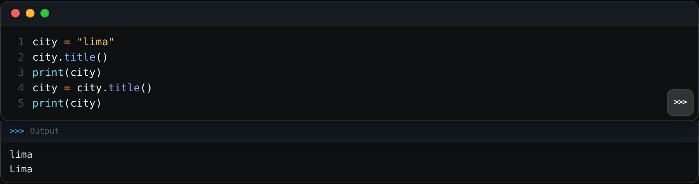

```python
city = "lima"
city.title()
print(city)
city = city.title()
print(city)
```

The first `print` shows `lima` because the result of the bare call was discarded. The second shows `Lima` because `city` now names the new string. A conversion that appears to do nothing is almost always a call whose result nobody stored.


<br>

---

## Putting It All Together

Spotify's Wrapped cards show each listener their top artist and minutes listened in a short block of text. A card builder starts from the artist name as typed in the catalog, shows it in capitals, places the minute count on its own line and ends with a tagline that contains a quotation.

- The artist name arrives as a string and the minute count as an int, so the builder prints them with commas or keeps them on separate lines rather than joining them with +.
- upper() produces the capitalized name as a new string, which the builder stores before concatenating it into the card.
- The breaks between card lines are \n characters whether they come from triple quotes or a typed escape, so the character count is the same either way.
- A tagline that contains double quotes goes in single quotes or escapes them with \", and an apostrophe in an artist name goes in double quotes.


<br>

---

## Key Takeaways

- A string is characters between quotes; the quotes aren't stored, and "42" is text rather than a number.
- Triple quotes keep every line break and leading space you type, including a break right after the opening quotes.
- + joins strings into a new string and refuses numbers; print with commas displays mixed values with spaces.
- An escape sequence such as \n or \\ is typed as 2 symbols and stored as 1 character.
- Case methods return a new string; assign the result or the conversion is lost.
