# Strings: Intermediate

Spotify identifies every track with a URI such as `spotify:track:6rqhFgbbKwnb9MLmUQDhG6`, and its share links end in the same 22-character ID. Say your job turns a day of play events carrying those URIs into a report with clickable links. Search for the first colon instead of the last and every ID comes out as `track:6rqh...`, so every link 404s; skip the kind check and albums get filed as tracks.


<br>

---

## String Indexing

A string is an ordered sequence of characters, and each character sits at a numbered position called its index. Counting starts at 0. Writing text[i] reads the character at position i and returns it as a new string of length 1. An index is an offset, the number of characters you skip from the start to reach this one. The first character needs 0 skips, and the second needs 1.

https://github.com/user-attachments/assets/f31a207f-f865-4300-a9be-a46d15eb0d05

The string `"Python"` has 6 characters, so its indexes run from 0 to 5. `text[0]` is `P` and `text[1]` is `y`; at the far end, `text[5]` is `n`. `len(text)` returns 6 here, the character count. Because the count of skips starts at 0, the last index of a non-empty string is `len(text) - 1`.


<br>

### Counting from the end

https://github.com/user-attachments/assets/282d1faf-0914-42aa-865d-d8d9b381489d

A negative index counts from the right: `text[-1]` is the last character, `text[-2]` the one before it, and `text[-6]` reaches back to `P`. Python reads `-k` as `len(text) - k`, so in this 6-character string `-1` means position 5 and `-6` means position 0. Negative indexes pay off when lengths vary: the final character of an order ID is `order_id[-1]` whether the ID has 5 characters or 50.

| Character | Index from the left | Index from the right |
| --- | --- | --- |
| 2 | 0 | -10 |
| 0 | 1 | -9 |
| 2 | 2 | -8 |
| 4 | 3 | -7 |
| - | 4 | -6 |
| 0 | 5 | -5 |
| 3 | 6 | -4 |
| - | 7 | -3 |
| 1 | 8 | -2 |
| 5 | 9 | -1 |

For the date `"2024-03-15"`, the 2 indexes in every row differ by 10, the length of the string. So 9 and -1 both name the final `5`, and 0 and -10 both name the first `2`.

**What does this program print?**

```python
part = 4
total = 12
print(f"{{part}} {part}/{total} {part / total:.1%}")
```

- **A.** {4} 4/12 33.3%
- **B.** {part} 4/12 0.3%
- **C.** {part} 4/12 33.3%
- **D.** 4 4/12 33.3%

<details>
<summary>Solution</summary>

**C.** {part} 4/12 33.3%

{{ and }} print as single braces around the plain word part. The other braces evaluate, and .1% turns 0.3333 into 33.3%.

**Why the others are wrong**

- **A.** Doubled braces print literal braces and switch off evaluation, so the first piece stays the text {part}.
- **B.** The % spec multiplies by 100 before rounding, so 0.3333 shows as 33.3%.
- **D.** The doubled braces print as literal braces with the word part between them, unevaluated, so the line starts with {part}.

</details>


<br>

### Reading past the end raises IndexError

```sql
code = "SKU-42"
print(len(code))
print(code[5])
print(code[6])
```

A 6-character string accepts indexes from -6 to 5. `code[6]` asks for a seventh character, so Python stops at line 4 with `IndexError`. Since `len(code)` sits 1 position past the last index, it is never a valid index; that off-by-one is how this error usually shows up, often from a loop whose range runs 1 step too far.


<br>

### Each character is a string of length 1

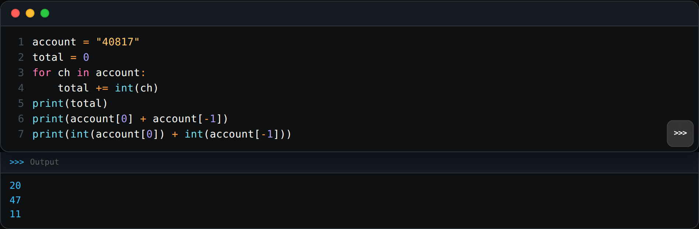

```python
account = "40817"
total = 0
for ch in account:
    total += int(ch)
print(total)
print(account[0] + account[-1])
print(int(account[0]) + int(account[-1]))
```

A single character in Python is a `str` of length 1, so indexing a digit hands back text. `account[0] + account[-1]` concatenates `"4"` and `"7"` into `47`, and adding the digits as numbers takes `int()` on each, which gives 11. The loop at the top shows the other way to visit characters: `for ch in account` delivers each one in order, with no index needed.

> **TIP**
>
> An empty string `""` has no valid index: `""[0]` and `""[-1]` both raise IndexError. Code that reads `name[0]` from a field that can arrive blank needs a `len(name) > 0` check first.


<br>

### Reading a character at a known position

Many record formats fix what each position means. A legacy export might pack 4 yes/no answers into one field such as `"YNYY"`: index 0 says whether the account is active, 1 whether its email is verified, 2 whether it opted into marketing, and 3 whether it's a business account. One index reads one answer, and comparing that character with `"Y"` turns it into `True` or `False`.

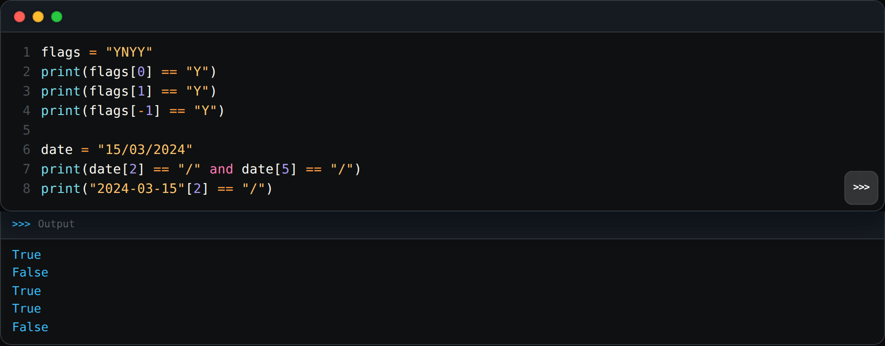

```python
flags = "YNYY"
print(flags[0] == "Y")
print(flags[1] == "Y")
print(flags[-1] == "Y")

date = "15/03/2024"
print(date[2] == "/" and date[5] == "/")
print("2024-03-15"[2] == "/")
```

The last 2 lines are a format check. A `DD/MM/YYYY` date always has its slashes at positions 2 and 5, so testing those 2 characters accepts `15/03/2024` and rejects `2024-03-15` before a later step reads `20` as the day. The positions are part of the format's contract, and an index is how code holds a value to it.


<br>

---

## String Slicing

Slicing pulls out a run of characters in one step. text[start:stop] returns a new string holding the characters from index start up to, but not including, index stop. When both bounds fall inside the string, the result has stop - start characters.

https://github.com/user-attachments/assets/3d0a7acc-0f05-4889-b26e-4d75a5fdffc5

`text[0:6]` takes positions 0 through 5, the 6 letters of `Python`. `text[7:18]` takes positions 7 through 17, the 11 letters of `Programming`; index 6, the space, belongs to neither slice. Because `stop` is excluded, 2 slices that share a boundary fit together with nothing lost and nothing doubled: `text[0:7] + text[7:18]` rebuilds all 18 characters.


<br>

### Leaving out an end

Leave out `start` and the slice begins at 0; leave out `stop` and it runs to the end. `text[:n]` is the first `n` characters, `text[n:]` is the rest, and `text[:n] + text[n:]` equals `text` for every `n`. In an ISO timestamp such as `ts = "2024-03-15T08:42:10Z"`, each field sits at a fixed position, so a slice reads it with no searching at all.

| Slice of ts | Result | What it holds |
| --- | --- | --- |
| ts[:4] | 2024 | year |
| ts[5:7] | 03 | month |
| ts[8:10] | 15 | day |
| ts[:10] | 2024-03-15 | date part |
| ts[11:19] | 08:42:10 | time part |
| ts[11:13] | 08 | hour |
| ts[-1:] | Z | time-zone marker |


<br>

### Negative bounds and bounds past the end

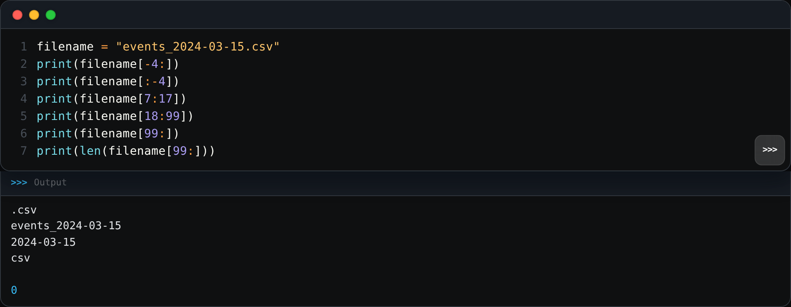

```python
filename = "events_2024-03-15.csv"
print(filename[-4:])
print(filename[:-4])
print(filename[7:17])
print(filename[18:99])
print(filename[99:])
print(len(filename[99:]))
```

`filename[-4:]` starts 4 characters from the end, so it reads the extension however long the name is, and `filename[:-4]` keeps everything else. The last 3 lines show where slicing parts ways with indexing: a bound past the end is clamped to the length. `filename[18:99]` stops at the real end, and `filename[99:]` is an empty string of length 0, printed as a blank line. Clamping makes slices safe on short input and also silent: slicing `[:10]` from a 6-character value returns 6 characters without complaint, so check `len()` whenever the width matters.

**What does this program print?**

```python
part = 4
total = 12
print(f"{{part}} {part}/{total} {part / total:.1%}")
```

- **A.** {4} 4/12 33.3%
- **B.** {part} 4/12 0.3%
- **C.** {part} 4/12 33.3%
- **D.** 4 4/12 33.3%

<details>
<summary>Solution</summary>

**C.** {part} 4/12 33.3%

{{ and }} print as single braces around the plain word part. The other braces evaluate, and .1% turns 0.3333 into 33.3%.

**Why the others are wrong**

- **A.** Doubled braces print literal braces and switch off evaluation, so the first piece stays the text {part}.
- **B.** The % spec multiplies by 100 before rounding, so 0.3333 shows as 33.3%.
- **D.** The doubled braces print as literal braces with the word part between them, unevaluated, so the line starts with {part}.

</details>

| ✓ Indexing s[i] | ✗ Slicing s[a:b] |
| --- | --- |
| • Returns exactly 1 character, as a string<br><br>• A position past the end raises IndexError<br><br>• s[len(s)] crashes<br><br>• On "", every index fails | • Returns a string of 0 or more characters<br><br>• Bounds past the end are clamped to the length<br><br>• s[len(s):] returns ""<br><br>• On "", every slice returns "" |


<br>

### A third number: the step

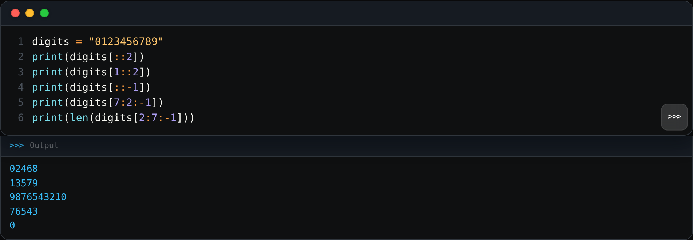

```python
digits = "0123456789"
print(digits[::2])
print(digits[1::2])
print(digits[::-1])
print(digits[7:2:-1])
print(len(digits[2:7:-1]))
```

The third number is the step, how far to move between characters. A step of 2 takes every second character: starting at 0 that gives the even digits, starting at 1 the odd ones. A negative step walks right to left, so `[::-1]` returns the string reversed. With a negative step, `start` must sit to the right of `stop`: `digits[7:2:-1]` reads positions 7 down to 3 and stops before 2, while `digits[2:7:-1]` points the wrong way and comes back empty.

*Bounds never raise, but a step of 0 would never move, so Python refuses it: digits[::0] raises ValueError: slice step cannot be zero.*


<br>

### Building a new string from slices

Slices are pieces, and `+` joins them back in a new order or with text added between them. Inserting `new` at position `i` is `s[:i] + new + s[i:]`, so a compact date such as `"20240315"` becomes the dashed form with 2 inserts:

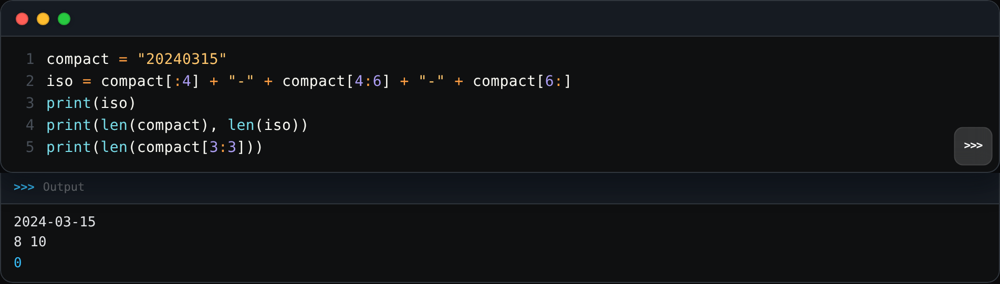

```python
compact = "20240315"
iso = compact[:4] + "-" + compact[4:6] + "-" + compact[6:]
print(iso)
print(len(compact), len(iso))
print(len(compact[3:3]))
```

The first slice covers positions 0 to 3. Each later slice starts where the previous one stopped, at 4 and then at 6, and the last ends at 7, so no digit is lost or repeated. The result grows from 8 characters to 10, 1 per dash. A slice whose start equals its stop, such as `compact[3:3]`, holds nothing: it marks the gap between 2 characters, which is where an insert lands.

> **TIP**
>
> A slice never changes the string it came from. `ts[:10]` builds a new string and leaves `ts` as it was, which is why the table above can slice the same value 7 times in a row.


<br>

---

## Searching in Strings

Slicing needs positions you already know, and real data rarely hands them over: a log level lands wherever the timestamp ends, and an email's @ can be anywhere. Searching answers 2 questions: is this text present, and where does it begin. The `in` operator answers the first with True or False.

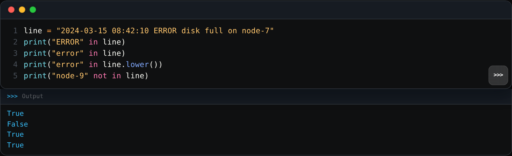

```python
line = "2024-03-15 08:42:10 ERROR disk full on node-7"
print("ERROR" in line)
print("error" in line)
print("error" in line.lower())
print("node-9" not in line)
```

Every search is case-sensitive, so `"error"` misses `ERROR`. Lowering the line first, with the `lower()` method you already know, makes the match ignore case. `not in` is the negated form, and it reads closer to English than `not ("node-9" in line)`.

*The empty string counts as present everywhere: "" in line is True for every line, even an empty one. A search term read from a blank setting therefore matches everything, so check len(term) > 0 before searching.*


<br>

### Finding the position with find and index

`s.find(sub)` returns the index where the first match of `sub` begins, or -1 when there is none. `s.rfind(sub)` searches from the right and returns where the last match begins. `s.index(sub)` gives the same answer as `find` while the text is present and raises `ValueError` when it's missing. A Spotify track URI, `spotify:track:6rqhFgbbKwnb9MLmUQDhG6`, holds 2 colons to search for.

```sql
uri = "spotify:track:6rqhFgbbKwnb9MLmUQDhG6"
print(uri.find(":"))
print(uri.rfind(":"))
print(uri.find("track"))
print(uri.find("album"))
print(uri.index("album"))
```

The first colon is at 7 and the last at 13, so the ID starts at 14. `find("track")` returns 8, the position of the `t` that opens the match. Pick by what a missing match means. Use `find` and test for -1 when absence is normal, as in a log line with no level. When absence means the record is broken, `index` halts the program at that line, which beats writing a wrong value downstream.


<br>

### Slicing between 2 search results

A pair of searches marks 2 boundaries, and a slice reads what lies between them. The text between a URI's colons names what it points to, and the text after a filename's last dot is its extension:

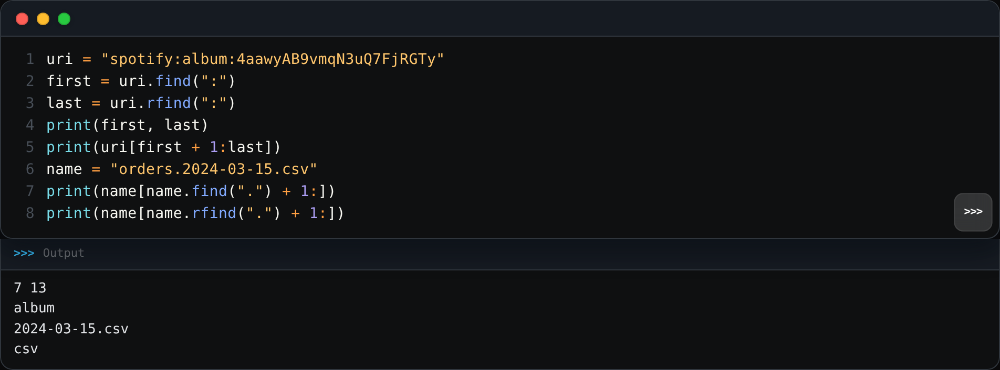

```python
uri = "spotify:album:4aawyAB9vmqN3uQ7FjRGTy"
first = uri.find(":")
last = uri.rfind(":")
print(first, last)
print(uri[first + 1:last])
name = "orders.2024-03-15.csv"
print(name[name.find(".") + 1:])
print(name[name.rfind(".") + 1:])
```

`first + 1` steps past the first colon so it stays out of the result, and `last` as the stop keeps the second colon out because the stop is excluded. The code never mentions the word's length, so a `playlist` URI yields `playlist` with the same 2 searches. The filename shows why the direction matters: `find` stops at the first dot and returns `2024-03-15.csv`, while `rfind` lands on the last dot and returns `csv`.


<br>

### The -1 trap

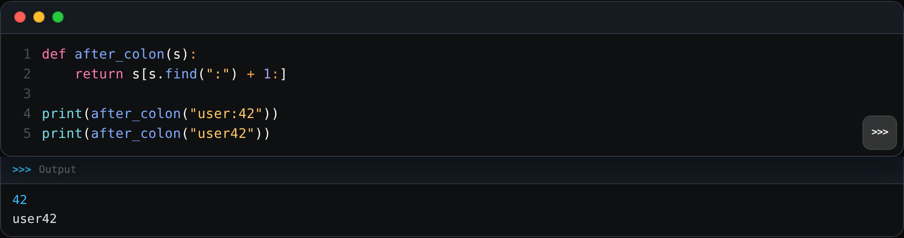

```python
def after_colon(s):
    return s[s.find(":") + 1:]

print(after_colon("user:42"))
print(after_colon("user42"))
```

For `"user42"`, `find` returns -1, and `-1 + 1` is 0, so the slice becomes `s[0:]`, the whole input, returned as if it were the answer with nothing to flag it. Used as an index, the same -1 reads the last character, because -1 is a valid negative index. Test the result before treating it as a position:

```sql
def after_colon(s):
    pos = s.find(":")
    if pos == -1:
        return None
    return s[pos + 1:]
```


<br>

### Searching again from a position

`find` takes an optional start index: `s.find(sub, start)` ignores everything before `start`. Starting each search 1 position after the previous hit walks through every match, and the loop ends when `find` returns -1.

https://github.com/user-attachments/assets/ebd4f16c-e45d-49cb-a38f-74c758825e56

*Each search starts 1 position after the previous match.*

The loop counts 3 matches, the last starting at 17 after ones at 0 and 7, which agrees with `log.count("ERR")`. `count` reports matches without overlap: `"aaaa".count("aa")` is 2, because the scan resumes after the end of each match rather than 1 character later.


<br>

### Checking the start and the end

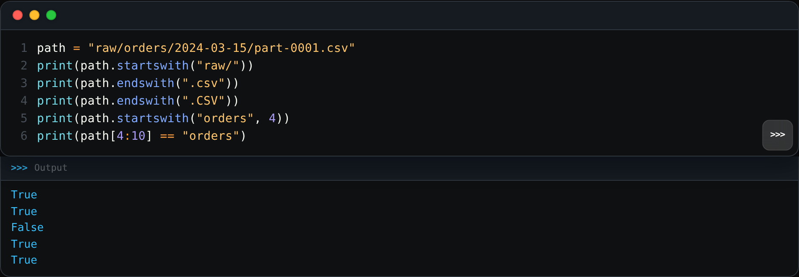

```python
path = "raw/orders/2024-03-15/part-0001.csv"
print(path.startswith("raw/"))
print(path.endswith(".csv"))
print(path.endswith(".CSV"))
print(path.startswith("orders", 4))
print(path[4:10] == "orders")
```

`startswith` and `endswith` test a prefix or suffix with no length arithmetic. `path[-4:] == ".csv"` gives the same answer, but its 4 must be edited by hand when the suffix becomes `.json`, while `endswith(".json")` carries its own length. Both accept a start index, so `startswith("orders", 4)` checks the text that begins at index 4.

| Call | When the text is found | When it is missing |
| --- | --- | --- |
| sub in s | True | False |
| s.find(sub) | index where the first match begins | -1 |
| s.rfind(sub) | index where the last match begins | -1 |
| s.index(sub) | index where the first match begins | ValueError |
| s.count(sub) | number of non-overlapping matches | 0 |
| s.startswith(p) | True when s begins with p | False |

**What does this program print?**

```python
part = 4
total = 12
print(f"{{part}} {part}/{total} {part / total:.1%}")
```

- **A.** {4} 4/12 33.3%
- **B.** {part} 4/12 0.3%
- **C.** {part} 4/12 33.3%
- **D.** 4 4/12 33.3%

<details>
<summary>Solution</summary>

**C.** {part} 4/12 33.3%

{{ and }} print as single braces around the plain word part. The other braces evaluate, and .1% turns 0.3333 into 33.3%.

**Why the others are wrong**

- **A.** Doubled braces print literal braces and switch off evaluation, so the first piece stays the text {part}.
- **B.** The % spec multiplies by 100 before rounding, so 0.3333 shows as 33.3%.
- **D.** The doubled braces print as literal braces with the word part between them, unevaluated, so the line starts with {part}.

</details>


<br>

---

## Replacing Text in Strings

Strings are **immutable**: once a string exists, none of its characters can change. Reading by index works, and assigning to an index is refused.

```sql
status = "pending"
print(status[0])
status[0] = "P"
```

Every edit therefore produces a new string. You can assemble it yourself from slices, as `"P" + status[1:]` gives `Pending`, or call a method that assembles it for you. `replace(old, new)` is the method for substituting one piece of text with another.


<br>

### replace hands back a new string

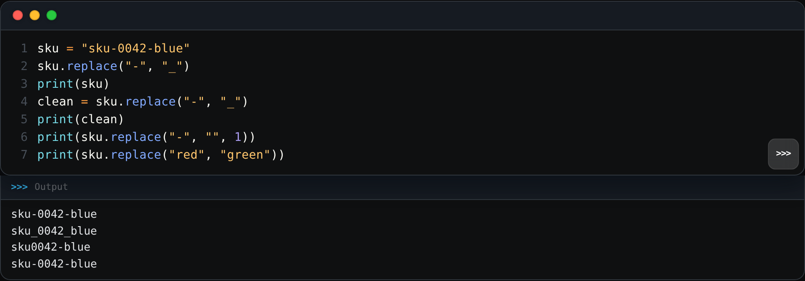

```python
sku = "sku-0042-blue"
sku.replace("-", "_")
print(sku)
clean = sku.replace("-", "_")
print(clean)
print(sku.replace("-", "", 1))
print(sku.replace("red", "green"))
```

Line 2 calls `replace` and discards the result, so `sku` prints unchanged; storing the result in `clean` keeps it. The optional third argument caps how many replacements happen, counting from the left, so `replace("-", "", 1)` removes only the first dash, and an empty `new` deletes the text. When `old` is absent, `replace` returns an unchanged copy and raises nothing, which hides typos: the `red` call above did nothing and reported nothing.

Because a missed match is silent, a cleanup that must change something can count first. `sku.count("-")` is 2, the number of substitutions `replace("-", "_")` will make, and a count of 0 warns that the call would hand back its input untouched.


<br>

### How replace scans the text

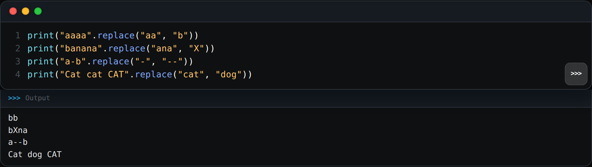

```python
print("aaaa".replace("aa", "b"))
print("banana".replace("ana", "X"))
print("a-b".replace("-", "--"))
print("Cat cat CAT".replace("cat", "dog"))
```

`replace` scans left to right. After substituting a match, it resumes past the text it consumed. `"aaaa"` holds 2 non-overlapping `aa` runs, so it becomes `bb`. In `banana` the first `ana` covers positions 1 to 3, the scan resumes at 4, and the `ana` that would start at 3 is never seen. Inserted text is never rescanned, so replacing each dash with 2 dashes turns `a-b` into `a--b` and stops there. Matching is case-sensitive, so only the lowercase `cat` changes.


<br>

### Chaining replace calls

Because `replace` returns a string, another method can run on its result in the same expression. Python evaluates the chain left to right, and each call works on the string the call before it produced:

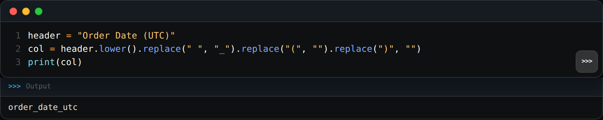

```python
header = "Order Date (UTC)"
col = header.lower().replace(" ", "_").replace("(", "").replace(")", "")
print(col)
```

Each call here removes or swaps a character that no later call looks for, so the calls could run in any order and still give `order_date_utc`. A chain goes wrong when a later call matches text an earlier call inserted, because a string keeps no record of which characters were original.


<br>

### Running the same cleanup twice

Pipelines get re-run: a failed job retries, a backfill replays last month. A cleanup step that damages input it already cleaned will corrupt data on the second run.

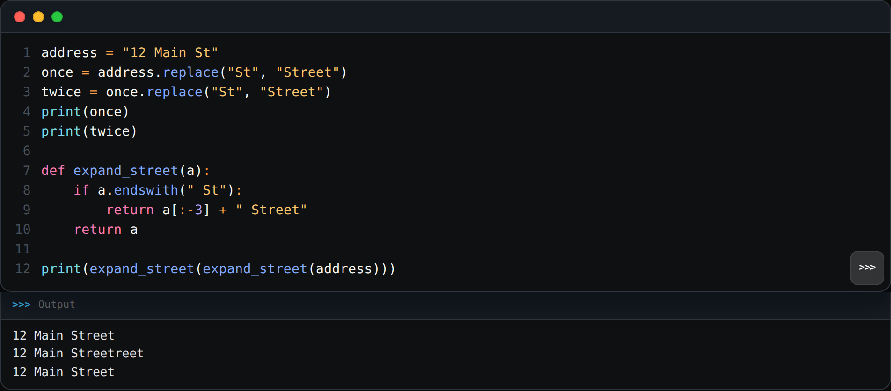

```python
address = "12 Main St"
once = address.replace("St", "Street")
twice = once.replace("St", "Street")
print(once)
print(twice)

def expand_street(a):
    if a.endswith(" St"):
        return a[:-3] + " Street"
    return a

print(expand_street(expand_street(address)))
```

`Street` begins with `St`, so the second pass turns it into `Streetreet`. The function checks for the suffix with `endswith` and rewrites it with a slice, so a second call finds no  `St` ending and returns its input untouched. Calling it once or 5 times produces the same address.


<br>

### Editing at a position you found

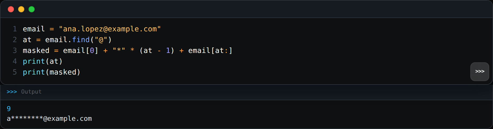

```python
email = "ana.lopez@example.com"
at = email.find("@")
masked = email[0] + "*" * (at - 1) + email[at:]
print(at)
print(masked)
```

`replace` works by content: it changes every copy of some text wherever it appears. Masking by position needs `find` for the position and slices for the edit. With `at` at 9, the result keeps `email[0]`, adds `"*" * (at - 1)`, which repeats the star 8 times to cover positions 1 to 8, and keeps everything from the `@` onward.

| ✓ Do | ✗ Don't |
| --- | --- |
| • Assign the result: s = s.replace(a, b)<br><br>• Pass a count when only the first match should change<br><br>• Test a cleanup by running it twice on the same value<br><br>• Use find plus slices for edits tied to a position | • Call replace and expect the original string to change<br><br>• Chain replaces where a later call can match text an earlier call inserted<br><br>• Replace a short token that also appears inside longer words<br><br>• Assign to s[i]; build a new string instead |

**This line is meant to swap every Y and N. What does it print?**

```python
row = "N,Y,N"
print(row.replace("Y", "N").replace("N", "Y"))
```

- **A.** Y,N,Y
- **B.** Y,Y,Y
- **C.** N,N,N
- **D.** N,Y,N

<details>
<summary>Solution</summary>

**B.** Y,Y,Y

The first call gives N,N,N, erasing the difference between the letters, and the second turns every N into Y. A swap needs a placeholder found nowhere else in the text.

**Why the others are wrong**

- **A.** That would be a correct swap. The first call turns the Y into N, so the second call finds 3 N values and turns all of them into Y.
- **C.** That's the value after the first call. The second replace runs on it and changes every N to Y.
- **D.** Both calls find matches, so the text changes. Each replace returns a new string, and the chain passes it to the next call.

</details>


<br>

---

## F-Strings

An **f-string** is a string literal with an f before the opening quote. Each pair of braces inside it holds a Python expression; when the line runs, Python evaluates the expression, converts the result to text, and puts that text in place of the braces.

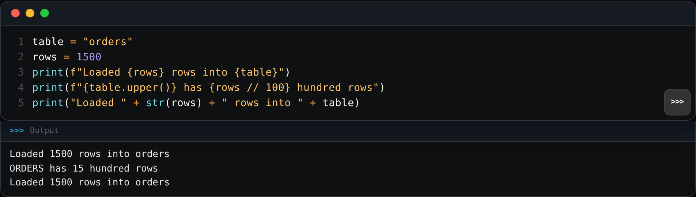

```python
table = "orders"
rows = 1500
print(f"Loaded {rows} rows into {table}")
print(f"{table.upper()} has {rows // 100} hundred rows")
print("Loaded " + str(rows) + " rows into " + table)
```

The concatenated version needs `str(rows)`, because `+` between a string and an int raises `TypeError`. The f-string converts for you, and the sentence reads in one piece with each value where it appears. `{rows  100}` and `{table.upper()}` put arithmetic and method calls inside the braces, which accept any expression.


<br>

### Indexes, slices and searches inside the braces

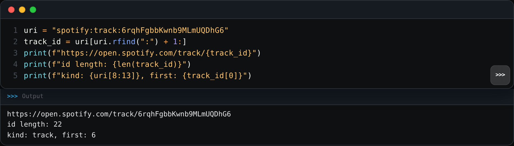

```python
uri = "spotify:track:6rqhFgbbKwnb9MLmUQDhG6"
track_id = uri[uri.rfind(":") + 1:]
print(f"https://open.spotify.com/track/{track_id}")
print(f"id length: {len(track_id)}")
print(f"kind: {uri[8:13]}, first: {track_id[0]}")
```

Everything from the earlier sections works inside braces. The ID comes from slicing after the last colon, and the share link is assembled around it. `len` and an index also run in place. A long expression is clearer as a variable of its own, as `track_id` is here, which keeps the template readable.


<br>

### Formatting numbers after a colon

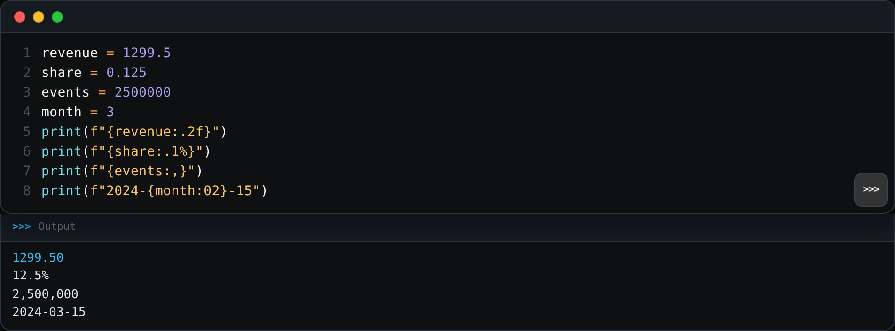

```python
revenue = 1299.5
share = 0.125
events = 2500000
month = 3
print(f"{revenue:.2f}")
print(f"{share:.1%}")
print(f"{events:,}")
print(f"2024-{month:02}-15")
```

A colon after the expression starts a format spec. `.2f` prints a float with exactly 2 decimals. `.1%` multiplies by 100 and adds a percent sign, and `,` groups thousands. For `02`, Python pads with zeros to a width of 2. Zero padding matters in dates and partition paths: as text, `month=10` sorts before `month=3`, while `month=03` sorts before `month=10`.


<br>

### Mixing slices and specs in one line

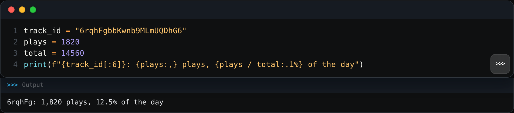

```python
track_id = "6rqhFgbbKwnb9MLmUQDhG6"
plays = 1820
total = 14560
print(f"{track_id[:6]}: {plays:,} plays, {plays / total:.1%} of the day")
```

Each spec applies only to the value in its own braces, so one f-string can hold a slice with no spec, a count grouped with `,`, and a ratio shown with `.1%`. The division happens inside the braces and gives 0.125; the spec decides how that float looks and leaves the computed value alone.


<br>

### Braces, quotes and the = shortcut

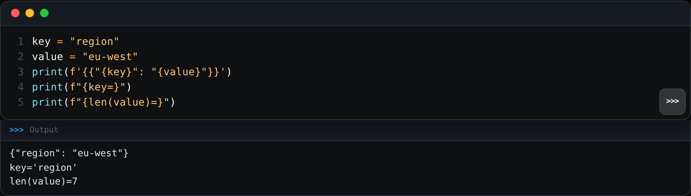

```python
key = "region"
value = "eu-west"
print(f'{{"{key}": "{value}"}}')
print(f"{key=}")
print(f"{len(value)=}")
```

Doubled braces `{{` and `}}` print 1 literal brace each, which JSON-shaped text needs. Writing `=` after an expression prints the expression and its value joined by an equals sign, with quotes around strings: `key='region'`. Before Python 3.12, including the 3.9 these examples run on, quotes inside the braces must differ from the ones around the f-string: `f"{name.replace('-', '_')}"` works, and reusing double quotes inside is a `SyntaxError`. From 3.12 on, reusing the same quotes is allowed.

> F-string mistakes to recognise
>
> - A missing `f`: `"rows: {rows}"` prints the braces and the name as plain text, and nothing warns you.
> - A spec that does not fit the type: with `name = "abc"`, `f"{name:.2f}"` raises `ValueError: Unknown format code 'f' for object of type 'str'`.
> - A number still held as text: `qty = input()` returns a string, so `f"{qty:,}"` raises ValueError until you convert it with `int(qty)`.


<br>

### When the values are read

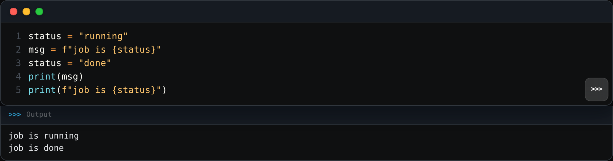

```python
status = "running"
msg = f"job is {status}"
status = "done"
print(msg)
print(f"job is {status}")
```

An f-string is evaluated once, on the line where it appears. `msg` holds the finished text `job is running`, and changing `status` afterwards can't reach back into it. The second print evaluates a fresh f-string, so it sees `done`.

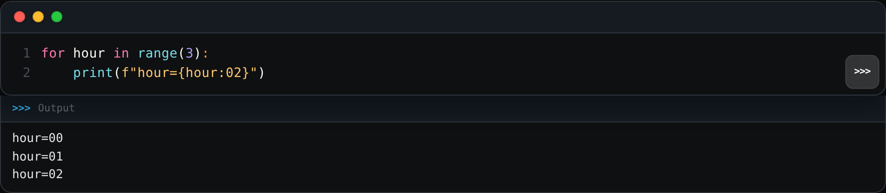

```python
for hour in range(3):
    print(f"hour={hour:02}")
```

Inside a loop, the f-string sits on a line that runs once per pass, so each pass evaluates it with that pass's `hour`. A job that writes one partition per hour runs the same template 24 times and gets 24 different paths, from `hour=00` to `hour=23`.

> **TIP**
>
> For a template that must fill with new values each time, wrap it in a function: `def status_line(job, status): return f"{job}: {status}"`. Every call evaluates the braces with that call's arguments.

**What does this program print?**

```python
part = 4
total = 12
print(f"{{part}} {part}/{total} {part / total:.1%}")
```

- **A.** {4} 4/12 33.3%
- **B.** {part} 4/12 0.3%
- **C.** {part} 4/12 33.3%
- **D.** 4 4/12 33.3%

<details>
<summary>Solution</summary>

**C.** {part} 4/12 33.3%

{{ and }} print as single braces around the plain word part. The other braces evaluate, and .1% turns 0.3333 into 33.3%.

**Why the others are wrong**

- **A.** Doubled braces print literal braces and switch off evaluation, so the first piece stays the text {part}.
- **B.** The % spec multiplies by 100 before rounding, so 0.3333 shows as 33.3%.
- **D.** The doubled braces print as literal braces with the word part between them, unevaluated, so the line starts with {part}.

</details>


<br>

---

## Putting It All Together

Picture a nightly job that turns a day of Spotify play events into a top-tracks report. Each event carries a uri such as spotify:track:6rqhFgbbKwnb9MLmUQDhG6 and a UTC timestamp such as 2024-03-15T08:42:10Z. The job keeps tracks and drops albums and playlists, builds a share link for each track, writes rows under an hourly partition path, and prints each track's share of plays.

- Searching: uri . startswith ( "spotify:track:" ) keeps tracks and drops other URI kinds, and uri . rfind ( ":" ) locates where the ID begins.
- Slicing: uri [ uri . rfind ( ":" ) + 1 : ] extracts the 22-character ID. The date and hour come from fixed positions, read by ts [ : 10 ] and ts [ 11 : 13 ] .
- Indexing: ts [ - 1 ] == "Z" confirms a timestamp is in UTC before its hour is trusted for the partition.
- Replacing: uri . replace ( "spotify:track:" , "https://open.spotify.com/track/" ) turns a URI into a link, and a second run changes nothing because the output no longer holds the old prefix.
- F-strings: f"plays/date={ts[:10]}/hour={ts[11:13]}" assembles the partition path, and { share : .1 % } formats each track's share for the report.


<br>

---

## Key Takeaways

- An index is an offset from the start: valid positions run from 0 to len ( s ) - 1 , or from - len ( s ) to -1 counting from the right, and any other index raises IndexError.
- A slice s [ start : stop ] excludes stop and clamps bounds past the end, so it never raises IndexError; a negative step reads right to left, and a step of 0 raises ValueError.
- find returns -1 when nothing matches, and -1 is also a valid index, so test for it before using the result as a position.
- Strings never change in place: replace and slicing produce new strings, and the result is lost unless you assign it.
- An f-string evaluates its braces once, when its line runs. A format spec after a colon sets decimals and percentages, and it can also add thousands separators or zero padding.
